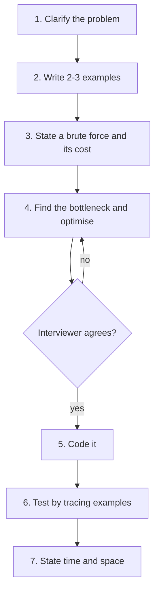
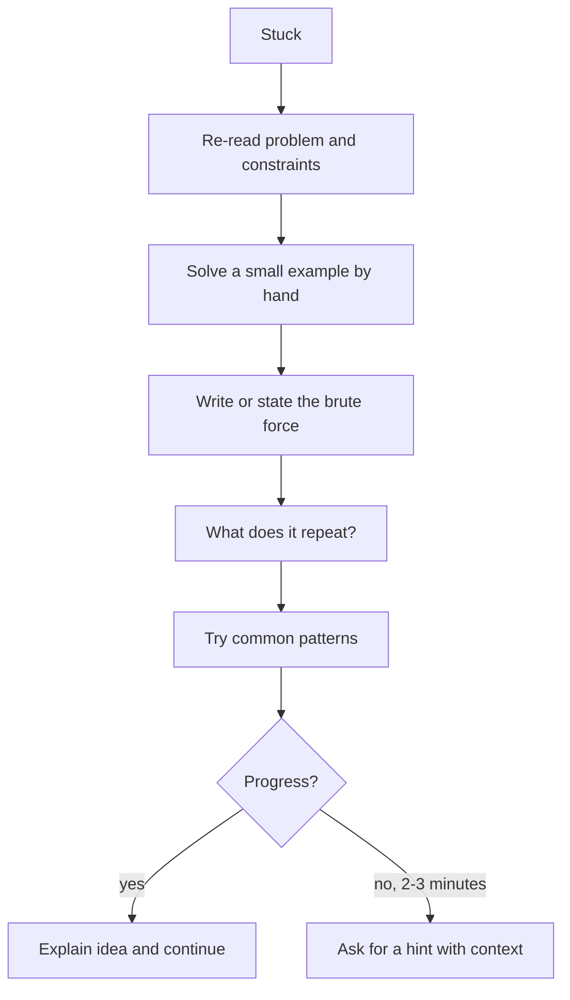
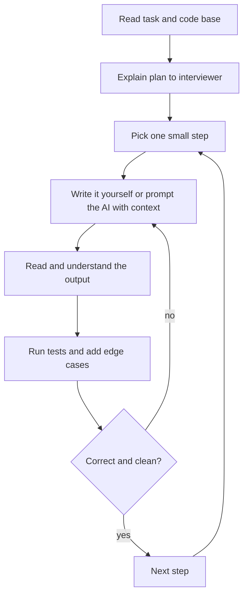

# How Coding Interviews Work

[⬅ Back to index](../README.md)

Covers: how coding rounds are run and graded, a repeatable step-by-step framework, talking while you code, clarifying questions, testing your own code, what to do when stuck, online assessments, AI-assisted coding rounds, and how coding rounds differ for mobile engineers.

---

## How a round works

### 1. What happens in a coding interview round, and what is graded?

**📘 Concept**

<details>
<summary>Answer</summary>

**In short:** A live coding round is usually 45-60 minutes with one interviewer, one or two problems, and a shared editor (often without running code). You are graded on four things, roughly equally: **problem solving** (did you reach a good approach and explain why it works), **coding** (is the code clean, correct and idiomatic), **verification** (did you test it yourself and catch your own bugs), and **communication** (could the interviewer follow your thinking the whole time). Getting the optimal answer silently is not a pass; reaching a good answer while thinking out loud, testing and fixing your own bug usually is.

#### What a typical round looks like

| Minutes | What happens |
|---|---|
| 0-5 | Introductions. Keep yours to 30-60 seconds. |
| 5-10 | The interviewer pastes the problem. You read it, ask clarifying questions, write a couple of examples. |
| 10-20 | You talk through a brute force, then a better approach, and agree on one with the interviewer. |
| 20-35 | You code it. |
| 35-42 | You test it by hand, fix bugs, state time and space complexity. |
| 42-45 | Follow-up question or a second problem; then your questions for them. |

Formats vary. Some companies give two medium problems in 45 minutes; others one harder problem with follow-ups. Most big product companies use a plain shared editor (CoderPad, a Google Doc-like editor, or an in-house tool) where you may not be able to compile or run. Some allow running code. Always ask: "Can I run this, or should I trace it by hand?"

#### The four things you are graded on

Most companies use a written rubric. The wording differs, but it almost always reduces to these:

| Signal | What "strong" looks like | What "weak" looks like |
|---|---|---|
| **Problem solving** | Clarifies, finds a brute force, spots the bottleneck, improves it, can justify why the optimal approach is correct | Jumps to code, guesses patterns without reasons, cannot explain why it works |
| **Coding** | Readable names, small helper functions, correct use of the language's collections, few syntax slips | Long tangled function, off-by-one errors everywhere, fights the language |
| **Verification** | Traces a small example line by line, picks edge cases unprompted, finds and fixes own bug | Says "I think it works", waits for the interviewer to find bugs |
| **Communication** | Narrates decisions, checks in at key points, responds well to hints | Silent for long stretches, ignores hints, argues |

A useful mental model: the interviewer has to write a report afterwards that convinces a hiring committee or manager. **Every thing you say out loud is evidence they can write down.** If you thought of a clever edge case but didn't say it, it isn't in the report.

#### How the decision is made

Each interviewer usually gives a score (for example "strong hire" to "strong no hire") with written evidence. At large companies a committee or hiring manager reads all the feedback together; one weaker round can be balanced by strong others, but a "no hire" with clear evidence (could not code a working solution, could not explain complexity) is hard to overcome.

Hints are normal. Taking a hint and running with it is a mild negative at most. Needing the same hint three times, or not recovering after it, is a stronger negative.

#### What is NOT usually graded

- Typing speed or memorised syntax for rarely used APIs — say "I'd look up the exact name; I'll assume `sortedBy` exists."
- Having seen the problem before. In fact, pretending you haven't when you have is risky; it's fine to say "I've seen something similar."
- Perfect optimality on the first try. Going from O(n²) to O(n) out loud is exactly the signal they want.

#### Common mistakes

- Treating the round as a test of the final answer instead of the process.
- Long silences — the interviewer cannot grade what they cannot hear.
- Skipping testing because time is short. A quick trace is worth more than five extra lines of code.

#### Follow-ups

- *How do I structure my thinking so I hit all four signals?* Use the framework in [question 2](#2-what-is-a-repeatable-framework-for-solving-any-coding-problem).
- *How should I explain complexity?* See [Complexity Analysis (Big-O)](02-complexity-analysis.md).
- *What do specific companies focus on?* See [Company-wise Coding](24-company-wise-coding.md).

</details>

## The framework

### 2. What is a repeatable framework for solving any coding problem?

**📘 Concept**

<details>
<summary>Answer</summary>

**In short:** Use the same seven steps every time: **clarify → examples → brute force → optimise → code → test → complexity**. The first four happen before you write real code and take about a third of the round. Having a fixed routine means you never freeze, you produce evidence for every grading signal, and the interviewer can see where you are and help at the right moment.

#### The seven steps



| Step | What you do | What you say |
|---|---|---|
| 1. Clarify | Restate the problem, ask about input size, duplicates, negatives, empty input, output format | "So I return the indices, not the values, and there's exactly one answer?" |
| 2. Examples | Write a normal example and one edge case in the editor | "Let me write `[2,7,11,15], target 9 → [0,1]`, and an empty array case." |
| 3. Brute force | Describe the simplest correct idea and its complexity. Usually don't code it | "Checking every pair is O(n²). That works but let's do better." |
| 4. Optimise | Find what the brute force repeats, pick a pattern that removes it | "The inner loop searches for `target - x`. A hash map makes that O(1)." |
| 5. Code | Write clean code, top-down, with helper functions | "I'll write the main loop first and a helper for the window check." |
| 6. Test | Trace your example line by line, then edge cases; fix bugs | "With `[3,3]`, target 6: i=0 stores 3, i=1 finds 3 at index 0. Good." |
| 7. Complexity | Time and space, with a one-line reason each | "One pass with O(1) map work → O(n) time, O(n) for the map." |

#### Why each step exists

- **Clarify** stops you solving the wrong problem — the most expensive mistake there is.
- **Examples** turn a vague statement into something concrete. Patterns often jump out of a well-chosen example, and you reuse the same example for testing in step 6.
- **Brute force** proves you understand the problem and gives a safe fallback. If you run out of ideas, a coded brute force beats nothing.
- **Optimise** is where most of the problem-solving signal comes from. Ask: "What work does the brute force repeat?" The answer usually names the data structure (hash map for repeated lookups, sorting plus two pointers for pair search, heap for repeated min/max, DP for repeated subproblems). See [Pattern Recognition](04-pattern-recognition.md).
- **Get agreement before coding.** Say "I'm going to code the hash map approach — does that sound good?" If the interviewer wants something else, you find out now, not after 15 minutes of typing.
- **Test** is where you show verification. See [question 5](#5-how-do-you-test-and-dry-run-your-own-code).
- **Complexity** closes the loop and often leads to the follow-up question.

#### How strictly to follow it

The steps are a skeleton, not a script. For an easy warm-up you might clarify in one sentence and skip the brute force. For a hard problem you might loop between steps 3 and 4 several times. What matters is that you never start coding without an agreed plan, and never declare "done" without testing.

#### Common mistakes

- Coding the brute force fully "just in case" when the optimal idea is already clear — it burns 10 minutes.
- Optimising in your head silently, then announcing a solution with no explanation.
- Skipping step 7 — interviewers almost always ask, so volunteer it.

#### Follow-ups

- *What exactly should I ask in step 1?* See [question 3](#3-which-clarifying-questions-should-you-ask-before-solving).
- *How do I find the optimisation in step 4?* See [Problem-Solving Tricks](06-problem-solving-tricks.md) and [Reusable Code Templates](05-reusable-templates.md).
- *What if I'm stuck at step 4?* See [question 6](#6-what-should-you-do-when-you-are-stuck).

</details>

### 3. Which clarifying questions should you ask before solving?

**📘 Concept**

<details>
<summary>Answer</summary>

**In short:** Ask the few questions whose answers would change your algorithm or your code: **input size** (which complexity is acceptable), **value range** (negatives, zero, overflow), **duplicates**, **empty or tiny input**, **is the input sorted**, and **what exactly to return** (indices or values, any answer or all answers, what to return if none exists). Two to five targeted questions in about two minutes is right. Asking nothing looks careless; asking twenty looks like stalling.

#### Why clarifying matters

Interview problems are often deliberately under-specified. The interviewer wants to see whether you notice. A problem like "find two numbers that add up to a target" can be solved four different ways depending on the answers: sorted input → two pointers, unsorted → hash map, need all pairs → different output handling, duplicates → careful counting.

#### The checklist

| Question | Why it matters | Example of how the answer changes things |
|---|---|---|
| How big can the input be? | Tells you the target complexity | n ≤ 20 → exponential backtracking is fine. n ≤ 10⁵ → you need O(n log n) or better |
| Can values be negative or zero? | Breaks some patterns | Sliding window on sums only works with non-negative numbers |
| Can values overflow? | Integer type | Sums of many `Int`s near 2³¹ need `Long` |
| Are there duplicates? | Counting and output | 3Sum must skip duplicate triplets |
| Can the input be empty or have one element? | Base cases | Return 0, empty list, or throw? |
| Is the input sorted? | Unlocks binary search and two pointers | Sorted → O(log n) search instead of O(n) |
| What should I return? | Shape of the answer | Indices vs values, one answer vs all, `-1` vs `null` when none |
| Is there always a valid answer? | Error handling | "Exactly one solution" means no need to handle "not found" |
| Can I modify the input? | Space | In-place sort may be allowed, saving O(n) space |
| For strings: what characters? | Counting array size | Lowercase a-z → `IntArray(26)`; Unicode → hash map |
| For graphs/trees: can there be cycles, is it connected, how is it given? | Visited set, representation | Edge list vs adjacency list; a "tree" with a cycle is a graph |

You don't ask all of these. Pick the ones that matter for **this** problem.

#### Using constraints to pick the approach

When the interviewer gives n, use it. A rough guide (about 10⁸ simple operations per second):

| n up to | Acceptable complexity | Typical approach |
|---|---|---|
| 10-12 | O(n!) | permutations |
| 20-25 | O(2ⁿ) | subsets, backtracking |
| 500 | O(n³) | triple loop DP |
| 5,000 | O(n²) | pair DP, nested loops |
| 10⁵-10⁶ | O(n log n) or O(n) | sorting, heap, hashing, two pointers |
| 10⁹ and above | O(log n) or O(1) | binary search, math |

More on this in [Complexity Analysis (Big-O)](02-complexity-analysis.md).

#### How to ask well

- **Restate first.** "So given an unsorted array and a target, I return the indices of two different elements that sum to the target." The interviewer will correct any misunderstanding.
- **Propose a default.** Instead of "What if it's empty?", say "If it's empty I'll return an empty list — is that OK?" It shows judgement and keeps things moving.
- **Write the answers down** as a comment block at the top of the editor. You'll refer back to them when testing.
- If the interviewer says "What do you think?", pick the reasonable option and state it.

#### Common mistakes

- Asking generic questions that don't affect the solution ("What language should I use?" when it was already stated).
- Assuming the input is sorted because the example happens to be.
- Forgetting overflow — summing large ints or multiplying is a classic hidden bug, especially in OAs.

#### Follow-ups

- *What if the interviewer won't give constraints?* State your assumption: "I'll assume n up to about 10⁵, so I'll aim for O(n log n)."
- *What if requirements change mid-problem?* That's often a planned follow-up. Restate the new requirement and check which part of your solution it breaks.

</details>

### 4. How do you talk through your approach while coding?

**📘 Concept**

<details>
<summary>Answer</summary>

**In short:** Narrate **decisions, not keystrokes**. Before coding, explain the approach and why it works, and get a nod. While coding, say what each block is for ("this loop grows the window", "this handles the empty case"), call out choices and trade-offs, and pause briefly at checkpoints. When you need to think, say so: "Let me think quietly for a moment about the update rule." Silence for a minute is fine if announced; five unexplained minutes is not.

#### Why talking matters so much

The interviewer is writing down evidence. If you think silently, they see only the final code and have to guess whether you understood it or got lucky. Talking also lets them help you: a good interviewer will drop a hint the moment they hear you heading the wrong way, but only if they can hear you.

#### What to say at each stage

| Stage | Good narration |
|---|---|
| Understanding | "Let me restate: I need the length of the longest substring with no repeated characters." |
| Brute force | "Simplest idea: check every substring for uniqueness. That's O(n²) substrings × O(n) check, so O(n³)." |
| Insight | "When I find a repeat, everything before the earlier copy is useless for windows ending here, so I can jump the left pointer. That gives a sliding window." |
| Plan check | "So the plan is: map from char to last index, a left pointer, and one pass. Shall I code that?" |
| Coding | "I'm storing last seen index, not a count, because I need to know where to jump to." |
| Uncertainty | "I'm not sure if this should be `<` or `<=`. I'll mark it and check it when I trace." |
| Done | "That's the code. Let me trace it on `abba` because it's the tricky case." |

#### Narrating without slowing down

You don't need to read every line out loud. A good rhythm: say a sentence about what the next few lines will do, write them, move on. Name variables well (`windowStart`, `lastSeen`) so the code explains itself and you have less to say.

When writing tricky lines, slow down and talk through them — off-by-one decisions, loop bounds, the order of "update answer" and "shrink window". Those are exactly the places interviewers watch.

#### Handling hints and pushback

- **Listen fully.** Stop typing when the interviewer talks. Hints are often short and easy to miss.
- **Engage with the hint.** "Oh, so if it's sorted I could use two pointers instead of the map — that saves the space." Then continue.
- **If you disagree,** explain your reasoning politely and offer to check with an example. Sometimes the interviewer is testing whether you'll defend a correct answer.
- **Ask for feedback at checkpoints**: "Does this direction make sense before I code it?"

#### Writing as you talk

Use the editor as a whiteboard. Before real code, it's fine to write:

```kotlin
// Plan:
// 1. lastSeen = map char -> last index
// 2. for right in s.indices:
//      if s[right] seen at index >= left, left = that index + 1
//      best = max(best, right - left + 1)
```

This makes your plan visible, gives the interviewer something to point at, and becomes your code skeleton.

#### Common mistakes

- Narrating syntax ("now I type for, open paren...") instead of intent.
- Going silent when stuck — that's when talking helps most.
- Talking over the interviewer, or ignoring a hint because you're mid-thought.
- Over-explaining trivial parts and rushing the tricky ones.

#### Follow-ups

- *What if I think better in silence?* Say so and ask for 30-60 seconds, then summarise what you concluded.
- *What if I'm interviewing in a second language?* Short sentences and good variable names do most of the work; clarity beats fluency.

</details>

### 5. How do you test and dry-run your own code?

**📘 Concept**

<details>
<summary>Answer</summary>

**In short:** After coding, don't say "I think it works" — **prove it**. First read the code once for obvious slips (bounds, uninitialised variables, missing return). Then **trace a small normal example line by line**, writing variable values in a table or comments. Then run through **edge cases** chosen on purpose: empty, one element, all the same, already sorted or reversed, negatives, the boundary of your loop. Fix bugs calmly and say what you fixed. Finding your own bug is a positive signal, not a negative one.

#### Step 1: a quick read-through

Scan for the bugs that are cheap to spot:

- Loop bounds: `0 until n` vs `0..n`, `while (l < r)` vs `l <= r`.
- Variables initialised to the right value (`Int.MAX_VALUE` for a minimum, `0` or `-1` where it matters).
- Every path returns something.
- Indices used after a pointer moved (reading `nums[i]` after `i++`).
- Updating the answer in the right place (before or after shrinking a window).

#### Step 2: trace a small example by hand

Pick an example small enough to trace in a minute or two (3-6 elements) but not so trivial it skips the interesting branches. Write state in a table as you go.

Suppose you wrote this to find the maximum subarray sum:

```kotlin
fun maxSubArray(nums: IntArray): Int {
    var best = 0
    var current = 0
    for (x in nums) {
        current = maxOf(x, current + x)
        best = maxOf(best, current)
    }
    return best
}
```

Trace `[-2, 1, -1, 3]`:

| x | current | best |
|---|---|---|
| -2 | max(-2, -2) = -2 | max(0, -2) = 0 |
| 1 | max(1, -1) = 1 | 1 |
| -1 | max(-1, 0) = 0 | 1 |
| 3 | max(3, 3) = 3 | 3 |

Returns 3, which is correct. Good — but a normal example didn't exercise the dangerous case.

#### Step 3: choose edge cases deliberately

Edge cases are where most bugs live. Pick them by asking "what input breaks my assumptions?":

| Category | Examples |
|---|---|
| Size | empty, one element, two elements |
| Values | all negative, zeros, very large values (overflow), duplicates |
| Order | already sorted, reverse sorted, all equal |
| Structure | single node tree, skewed tree, disconnected graph, cycle |
| Answer position | answer at the very start or very end, no valid answer |

Try **all negative** on the code above: `[-3, -1]`. `best` starts at 0 and never drops, so it returns 0 — but the right answer is -1. The bug is `best = 0`; it should be `best = nums[0]` (and `current = nums[0]`, loop from index 1), or `Int.MIN_VALUE`. Say it out loud: "My initial value assumes a non-negative answer; with all negatives it's wrong. I'll initialise from the first element."

#### Step 4: fix carefully, then re-check

Change the smallest thing that fixes the bug, then re-trace just the case that failed. Don't rewrite large chunks under pressure — that tends to introduce new bugs.

#### If the platform lets you run code

Still trace by hand first; it's faster than writing a test harness. Then add a few `println` checks or a tiny `main` with your examples and edge cases. Make expected outputs explicit (`check(maxSubArray(intArrayOf(-3, -1)) == -1)`), so you're testing against a known answer, not eyeballing.

#### Common mistakes

- Testing only the example from the problem statement — it's usually the happy path.
- "Tracing" by reading the code and nodding, rather than writing down actual values.
- Tracing what you **meant** to write instead of what you wrote.
- Panicking when you find a bug. Interviewers expect bugs; the signal is whether you find them.

#### Follow-ups

- *How many cases should I trace?* One normal case fully, then two or three edge cases quickly (often just reasoning about the key lines).
- *What if time is almost up?* Name the edge cases you'd test and what you expect — that still shows verification.
- *How do I avoid off-by-one errors in the first place?* Use the loop templates in [Reusable Code Templates](05-reusable-templates.md).

</details>

### 6. What should you do when you are stuck?

**📘 Concept**

<details>
<summary>Answer</summary>

**In short:** Being stuck is normal and the interviewer is watching how you handle it. Keep talking and work through a fixed list: **re-read the problem and constraints**, **solve a smaller example by hand** and notice what you did, **write the brute force** and ask what work it repeats, **run through the common patterns** (hash map, sort, two pointers, binary search, heap, BFS/DFS, DP), and **simplify the problem** (drop a constraint, solve it, then add it back). If two or three minutes pass with no progress, **ask for a hint gracefully** — say what you've tried and where you're blocked.

#### Why a procedure helps

Under pressure, "just think harder" doesn't work; your mind goes blank. A list of moves gives you something concrete to do, and each move produces talk the interviewer can follow and help with.



#### The moves, in detail

1. **Re-read the constraints.** n ≤ 20 hints at backtracking or bitmasks; "sorted" hints at binary search or two pointers; values in 1..n hints at index tricks; "k-th largest" hints at a heap. The constraints are often the biggest clue you were given.
2. **Do it by hand.** Take a 5-element example and solve it yourself, slowly. Then ask "how did I know that?" Your manual process is often the algorithm.
3. **Brute force first.** Even an O(n³) answer is progress. Then look at what it recomputes: a repeated search → hash map; a repeated min/max → heap or monotonic stack; repeated overlapping subproblems → memoisation.
4. **Walk the pattern list.** Ask of each pattern: "Would sorting help? Would a map from value to index help? Can I binary search on the answer? Is this a graph?" See [Pattern Recognition](04-pattern-recognition.md).
5. **Simplify.** Solve the 1D version of a 2D problem, the version without duplicates, or the version with k = 1. The simpler solution often extends.
6. **Work backwards.** Think about what the last step of the answer looks like — this is how many DP and greedy solutions are found.

More techniques like these are in [Problem-Solving Tricks](06-problem-solving-tricks.md).

#### Asking for a hint well

A good hint request shows your thinking:

> "I have an O(n²) solution that checks every pair. I think the repeated work is searching for the complement, but the array isn't sorted so I can't binary search. Am I on the right track, or is there a structure I'm missing?"

This is much better than "Can I have a hint?" because the interviewer can give a small, targeted nudge, and you still get credit for the analysis. When you get the hint, acknowledge it and build on it immediately.

#### When you're stuck while coding (not on the idea)

- If it's a syntax or API question, say what you want and move on: "I'll assume a helper that returns the sorted keys."
- If a piece of logic is fiddly, write a helper function stub with a clear name and come back to it. This keeps the main flow visible.
- If you realise the approach is wrong, say so clearly and explain why, then decide with the interviewer whether to fix or restart.

#### Common mistakes

- Going silent and staring at the screen.
- Refusing to ask for a hint until there are five minutes left.
- Jumping between half-formed ideas without finishing any of them — commit to the brute force first.
- Ignoring the constraints, which often give the approach away.

#### Follow-ups

- *Does asking for a hint fail me?* Usually not. Small hints are expected; it's not recovering after a hint that hurts.
- *What if I'm stuck at the very start?* Restate the problem and write examples — that alone often unlocks it.

</details>

### 7. How should you manage time in a 45-minute round?

**📘 Concept**

<details>
<summary>Answer</summary>

**In short:** Plan the clock before you start: about **5 minutes** to clarify and write examples, **5-10 minutes** to reach and agree on an approach, **15-20 minutes** to code, **5-8 minutes** to test and give complexity, leaving a few minutes for follow-ups and your questions. Set checkpoints ("by minute 20 I should be coding"), and if you're behind, fall back to coding the best approach you have rather than searching for a perfect one. A working, tested O(n log n) solution beats an unfinished O(n) one.

#### A time budget

| Phase | Minutes (single problem) | If there are two problems |
|---|---|---|
| Intro | 0-3 | 0-3 |
| Clarify + examples | 3-8 | ~3 per problem |
| Approach | 8-15 | ~5 per problem |
| Code | 15-33 | ~10-12 per problem |
| Test + complexity | 33-40 | ~4 per problem |
| Follow-up / your questions | 40-45 | whatever is left |

Interviewers often have a follow-up or a second part ready. Finishing the first part in 30 minutes leaves room to show more; using all 45 minutes on part one often caps your score.

#### Checkpoints and fallbacks

- **Minute ~15, no optimal idea yet:** say "Given time, I'll code the O(n²) approach now and optimise if time allows." Then do it. Many interviewers will hint at this point instead.
- **Minute ~30, still coding:** simplify. Stub out a helper with a clear name, finish the main logic, and explain what the stub would do.
- **Minute ~38, not tested:** stop adding features and test what you have. Untested code is a big negative.

Glance at the clock at each phase change, not constantly. If the interviewer is running the clock, it's fine to ask: "How much time do we have left?"

#### Where time gets lost

| Time sink | Fix |
|---|---|
| Long introduction | Prepare a 30-second version |
| Coding before agreeing an approach, then rewriting | Always get a nod on the plan first |
| Debugging by staring | Trace with concrete values |
| Writing the full brute force when the optimal is clear | Just state brute-force complexity |
| Language API hunting | Know your standard library cold; see [Kotlin & Swift for Interviews](03-kotlin-swift-for-interviews.md) |
| Over-engineering (classes, generics, interfaces) | One function plus small helpers |

#### Practising the clock

Time every practice problem. Aim for medium problems in about 25 minutes including testing, so the real 45-minute round has slack for nerves and talking. Mock interviews (see [question 11](#11-how-should-you-prepare-in-4-to-8-weeks)) are the best way to calibrate how long narrating actually takes.

#### Common mistakes

- Spending 20 minutes looking for the optimal solution and then running out of time to code anything.
- Polishing code style while the logic is still untested.
- Not leaving time for your own questions — the last few minutes also leave an impression.

#### Follow-ups

- *What if the interviewer keeps adding follow-ups?* That's usually a good sign — you finished early and they're probing depth.
- *What about 60-minute rounds?* Same proportions; usually a harder problem or a longer follow-up chain.

</details>

## Formats

### 8. How are online assessments different from live rounds?

**📘 Concept**

<details>
<summary>Answer</summary>

**In short:** An online assessment (OA) is an automated, timed test — usually 2-4 problems in 60-120 minutes on a platform like HackerRank, Codility or CodeSignal — graded by **hidden test cases**, not by a person. Nobody hears your reasoning, so communication doesn't count; what counts is **correct output on every hidden test within the time limit**. That means edge cases, overflow and efficiency matter more than in a live round, and a partially correct solution can still earn partial credit per test case.

#### Side by side

| | Online assessment | Live round |
|---|---|---|
| Graded by | Hidden test cases (and sometimes code-similarity / proctoring checks) | Interviewer with a rubric |
| Communication | Not graded | Large part of the score |
| Running code | Yes, usually against sample tests | Sometimes no |
| Partial credit | Per passing test case | For approach and reasoning |
| Efficiency | Enforced by time limits (often ~1-2 seconds per test) | Discussed and judged |
| Edge cases | Hidden tests will hit them | You choose which to mention |
| Input parsing | Sometimes you read stdin yourself | Usually a function signature |
| Typical use | Screening many candidates early, common for new grads and at large Indian product companies | Later rounds |

#### Strategy for OAs

1. **Read all problems first** (a minute each). Do the one you're most confident about first to bank points.
2. **Check constraints** to choose the complexity. With n = 10⁵, an O(n²) solution will time out on the big hidden tests.
3. **Submit a brute force early if stuck.** It may pass the small hidden tests and earn partial credit. Then improve it.
4. **Write your own tests** for edge cases the samples don't cover: empty input, single element, maximum size, all equal, negatives.
5. **Watch for overflow.** Hidden tests love sums and products that exceed 32-bit `Int`. Use `Long` when values × count can pass about 2 × 10⁹.
6. **Watch the clock per problem.** Don't sink 60 of 90 minutes into one problem.

#### Common OA traps

| Trap | Example | Fix |
|---|---|---|
| Time limit exceeded | O(n²) with n = 10⁵ | Re-check constraints, use hashing/sorting |
| Wrong answer on hidden tests only | Missed empty input or duplicates | Write edge-case tests yourself |
| Overflow | Sum of 10⁵ values up to 10⁹ | `Long` |
| Slow input reading | Reading a million numbers with `readLine()` + split in a loop can be slow | Use a buffered reader and read once |
| Recursion depth | DFS on a 10⁵-node path | Iterative DFS or BFS |
| Modulo answers | "Return answer mod 10⁹+7" | Apply mod after every addition/multiplication |

#### Integrity and proctoring

Many OAs record the screen or webcam, detect tab switching, and compare submissions against known solutions and other candidates. Some companies now also check for AI-generated code. Using outside help typically disqualifies you, and many companies discuss your OA solution again in a live round, so you need to understand it anyway.

#### Common mistakes

- Treating OAs like practice problems and ignoring constraints.
- Polishing one problem to perfection while leaving others blank.
- Trusting that passing the sample tests means passing hidden tests.

#### Follow-ups

- *Do OA scores matter after I pass?* Often they're just a filter, but some companies look at the code later or ask you to explain it.
- *How do I practise for them?* Timed contests (LeetCode weekly contests, Codeforces Div 3/4) mimic the pressure and hidden-test grading well.

</details>

### 9. How do AI-assisted coding rounds work?

**📘 Concept**

<details>
<summary>Answer</summary>

**In short:** Some companies have started coding rounds where you **are allowed, or expected, to use an AI assistant**. Meta is reported to have introduced one from late 2025: a single **~60-minute round on a multi-file project** in an editor with an **AI chat panel**, where you extend a feature, fix bugs or make tests pass. Google is reported to be piloting AI-assisted rounds in 2026. The grading shifts from "can you write this algorithm from memory" to **"do you understand the code, can you direct the AI well, and do you verify what it gives you"**. Details change quickly and vary by team, so always confirm the format with your recruiter.

#### What is reported about the format

Based on public candidate reports (treat the specifics as "reported", not official):

| Aspect | Classic round | AI-assisted round (as reported) |
|---|---|---|
| Code base | Blank editor, one function | Existing project with several files |
| Task | Solve an algorithm problem | Understand the code, then implement a feature, fix bugs, or pass failing tests, often in stages |
| Tools | No assistance | AI chat panel inside the editor; code can usually be run |
| Length | 45 minutes, 1-2 problems | About 60 minutes, one project |
| What's graded | Problem solving, coding, verification, communication | The same signals, applied to how you understand, prompt, check and integrate AI output |

The algorithms underneath are usually still classic ones (a search, a graph traversal, a data structure), so DSA knowledge still matters — you need it to judge whether the AI's answer is correct and efficient.

#### What interviewers look for

- **Orientation:** Do you read the code base first — entry point, data structures, tests — before prompting? Can you explain what the existing code does?
- **Problem decomposition:** Do you break the task into small, checkable steps, rather than asking the AI to "solve everything"?
- **Prompting with intent:** Do you give the AI precise context ("this function receives a sorted list; write a binary search for the first index ≥ target") and constraints?
- **Verification:** Do you read every line the AI produces, run the tests, add edge-case tests, and catch subtle bugs (off-by-one, wrong complexity, unhandled empty input)?
- **Ownership:** Can you explain and modify the final code yourself? "The AI wrote it" is not an answer to "why is this O(n log n)?"
- **Communication:** As in any round, narrate your plan and decisions.

#### A good working loop



#### How to prepare

- Practise on small unfamiliar repos: give yourself 10 minutes to understand one and explain it out loud.
- Practise using an assistant on algorithm problems **and then reviewing its output critically** — find its bugs and complexity mistakes.
- Keep doing classic DSA practice. You still need to recognise when generated code is wrong or slow, and many companies still run classic rounds alongside.

#### Common mistakes

- Pasting the whole task into the chat and accepting the result without reading it.
- Not running the tests, or not adding any.
- Spending the whole hour prompting instead of writing simple parts yourself — often typing a 5-line function is faster.
- Being unable to explain code that is now "yours".

#### Follow-ups

- *Is it cheating to use AI in a normal round?* Yes, unless the company explicitly allows it. Only use AI in rounds designed for it.
- *Will classic rounds go away?* Unclear. As of 2026 most companies still run classic DSA rounds, and AI-assisted rounds are additional or experimental.

</details>

### 10. How do coding rounds differ for mobile engineers?

**📘 Concept**

<details>
<summary>Answer</summary>

**In short:** Android and iOS loops usually mix **one or two DSA rounds** (same format as for backend engineers, often at easy-to-medium level) with **platform rounds**: an Android/iOS deep-dive (lifecycle, concurrency, memory, UI), a **practical/app-building round** (build a small feature or screen, live or take-home), and **mobile system design**. At many Indian product companies a **machine-coding round** is commonly reported: 90-120 minutes to build a working, well-structured mini-application or module. You need solid DSA, but also clean, idiomatic, production-style Kotlin or Swift.

#### What a typical mobile loop looks like

The exact mix depends on the company; this is a commonly reported shape:

| Round | Content | What's graded |
|---|---|---|
| OA / phone screen | 1-2 DSA problems | Correctness, efficiency |
| DSA round(s) | Classic problems: arrays, strings, hashing, trees, graphs | The usual four signals ([question 1](#1-what-happens-in-a-coding-interview-round-and-what-is-graded)) |
| Platform deep-dive | Lifecycle, threading/coroutines or Swift concurrency, memory leaks, rendering, persistence | Depth of platform knowledge |
| Practical / app round | Build a screen that fetches and shows a list, add search or pagination, handle errors | Architecture, state handling, working code |
| Mobile system design | Design an image feed, chat app, offline sync | Trade-offs, client architecture, API design |
| Behavioural | Past projects, conflict, ownership | Seniority signals |

Big tech companies (Google, Meta, Amazon) often run mobile candidates through the **same DSA bar** as other software engineers, sometimes with one round swapped for a mobile domain or design round. Smaller product companies tend to weigh the practical rounds more.

#### Machine-coding rounds (common in India)

Commonly reported at Indian product companies and startups, especially for mid-level and senior roles:

- **Format:** 90-120 minutes; a problem like a parking lot, a splitwise-style expense sharer, a rate limiter, an in-memory cache, a snake-and-ladder game, or for mobile, a small app screen with a list, details and local caching.
- **Must run:** you write and run real code on your own machine or an online IDE, then demo it.
- **Graded on:** working functionality first, then separation of concerns, extensibility ("now add a new vehicle type"), naming, error handling, and sometimes unit tests.
- **Strategy:** clarify requirements, sketch the models and interfaces in 10 minutes, build the core flow end-to-end early, then add features; keep code modular so the extension request is easy.

See [Design-Style Coding](22-design-style-coding.md) for problems like LRU caches and rate limiters that sit between DSA and design.

#### How DSA shows up in mobile-flavoured problems

Some interviewers dress classic problems in mobile clothing: merge overlapping time ranges in a calendar view (intervals), find the visible items in a scrolled list (binary search), deduplicate a feed (hashing), cache images with eviction (LRU), schedule dependent tasks at app start (topological sort). The algorithms are the same; recognising them is the skill. See [Mobile-Flavoured Coding](23-mobile-flavoured-coding.md).

#### Language choice

Use the language you're strongest in. For mobile roles, Kotlin or Swift signals platform fluency, and interviewers usually accept them in DSA rounds. Know the standard collections and their costs cold — e.g. Swift has no built-in heap or deque, and `String` isn't integer-indexable. See [Kotlin & Swift for Interviews](03-kotlin-swift-for-interviews.md).

#### Common mistakes

- Preparing only platform topics and under-preparing DSA, assuming mobile rounds are easier.
- In machine-coding rounds, building beautiful architecture but no working demo by the deadline.
- Using Android/iOS framework APIs in a pure DSA round when the standard library would do.

#### Follow-ups

- *Is DSA easier for mobile roles?* Sometimes slightly, but at big tech companies the bar is often the same — prepare for mediums.
- *Should I use Java/Python instead of Kotlin/Swift?* Only if you're much faster in them; for mobile roles Kotlin/Swift is a plus.

</details>

## Preparing

### 11. How should you prepare in 4 to 8 weeks?

**📘 Concept**

<details>
<summary>Answer</summary>

**In short:** Learn **patterns, not problem counts**. Go topic by topic (arrays and hashing → two pointers and sliding window → binary search → stacks → linked lists → trees → heaps → graphs → backtracking → DP), and for each topic understand the core idea, solve the classic problems, and write down the pattern in your own words. **Re-solve problems on a spaced schedule** so they stick, do **timed practice** from the midpoint onward, and do **mock interviews** in the last weeks to practise talking. 1-2 hours a day for 6 weeks with deliberate review beats 500 problems rushed.

#### Why patterns beat counts

Interview problems are mostly variations on 15-20 patterns. If you solve 300 problems without reflecting, you memorise answers that don't transfer. If you solve 120 and can say "this is a variable sliding window with a count map, because the condition is monotonic", you can solve new problems. See [Pattern Recognition](04-pattern-recognition.md).

#### A 6-week plan (compress or stretch it)

| Week | Focus | Notes |
|---|---|---|
| 1 | Big-O, language fluency, arrays, strings, hashing | [Complexity Analysis](02-complexity-analysis.md), [Kotlin & Swift for Interviews](03-kotlin-swift-for-interviews.md), [Arrays, Strings & Hashing](07-arrays-strings-hashing.md) |
| 2 | Two pointers, sliding window, prefix sums, intervals, binary search | [Two Pointers & Sliding Window](08-two-pointers-sliding-window.md), [Prefix Sums & Intervals](09-prefix-sums-intervals.md), [Binary Search](10-binary-search.md) |
| 3 | Stacks, queues, linked lists, heaps | [Stacks & Queues](11-stacks-queues-monotonic.md), [Linked Lists](12-linked-lists.md), [Heaps](13-heaps-priority-queues.md) |
| 4 | Trees, tries, graphs (BFS, DFS, topological sort) | [Trees & BSTs](14-trees-bst.md), [Tries](15-tries-string-algorithms.md), [Graphs](16-graphs-bfs-dfs-topo.md) |
| 5 | Backtracking, DP, greedy | [Recursion & Backtracking](18-recursion-backtracking.md), [Dynamic Programming](19-dynamic-programming.md), [Greedy](20-greedy.md) |
| 6 | Mixed timed practice, mocks, company-specific lists, weak spots | [Company-wise Coding](24-company-wise-coding.md) |

- **4 weeks:** merge weeks 1-2 and 3-4, skip advanced graphs and rare topics, keep the mocks.
- **8 weeks:** add [Advanced Graphs](17-advanced-graphs.md), [Bit Manipulation & Math](21-bit-manipulation-math.md), more hard problems, and more mocks.

A realistic daily rhythm: one new problem (attempt for 25-30 minutes before looking at a solution), one or two re-solves from your review list, and 10 minutes writing notes.

#### How to study one problem

1. Attempt it for a fixed time, out loud if possible.
2. If stuck, read **only the hint or idea**, then try again before reading code.
3. After solving, write a 2-3 line note: pattern, key insight, the bug you made.
4. Add it to your review list.

#### Spaced repetition

You forget most of what you solved within a couple of weeks unless you revisit it. Re-solve each problem from scratch (not re-read) on a schedule like:

| Review | When |
|---|---|
| 1st | 1-2 days later |
| 2nd | about a week later |
| 3rd | 2-3 weeks later |

If you solve it quickly and cleanly, push it further out. If you struggle, reset it to the start. A simple spreadsheet or notes file with "next review" dates works fine.

#### Mock interviews

Solving alone and solving while talking to a stranger with a clock are different skills. From about the midpoint, do at least 3-5 mocks with friends, colleagues or peer mock platforms. Ask for feedback on the four signals, not just whether you got the answer. Record yourself if no partner is available.

#### Common mistakes

- Counting problems solved as the measure of progress.
- Reading solutions too early, then feeling you "understand" it.
- Never re-solving, so the patterns fade by interview day.
- Only practising in silence, never timed, never in mocks.
- Grinding hard problems before mediums are solid — most rounds are mediums.

#### Follow-ups

- *How many problems is enough?* There's no magic number; roughly 100-150 well-understood problems covering all core patterns is a common target.
- *Should I follow a curated list?* Yes, as a backbone — but always extract the pattern from each problem.

</details>

### 12. What common mistakes make candidates fail coding rounds?

**📘 Concept**

<details>
<summary>Answer</summary>

**In short:** Most failures are not about lacking a clever trick. They come from **process mistakes**: coding before understanding the problem, staying silent, not having any working solution by the end, not testing, being unable to state or justify complexity, and handling hints badly. Each one removes evidence for a grading signal. The good news is that these are fixable with practice and the framework in [question 2](#2-what-is-a-repeatable-framework-for-solving-any-coding-problem).

#### The mistakes, mapped to the signals they hurt

| Mistake | Signal it hurts | Fix |
|---|---|---|
| Starting to code within the first minute | Problem solving | Clarify, write examples, agree a plan first |
| Solving a different problem than asked | Problem solving | Restate the problem and confirm |
| Long silences | Communication | Narrate decisions; announce thinking pauses |
| Never stating a brute force | Problem solving | Always give the naive approach and its cost |
| Jumping to an advanced technique without justification | Problem solving | Explain why the pattern fits |
| No working code by the end | Coding | Fall back to a simpler approach by mid-round |
| Messy code: one giant function, names like `a`, `tmp2` | Coding | Small helpers, clear names |
| Fighting the language (forgetting basic collection APIs) | Coding | Practise in your interview language daily |
| Saying "I think it works" without tracing | Verification | Trace one example and two edge cases |
| Wrong or missing complexity | Problem solving | State time and space with reasons |
| Ignoring or arguing with hints | Communication | Listen, acknowledge, build on it |
| Giving up or visibly panicking after a bug | All | Treat bugs as normal; debug methodically |

#### Mistakes before the interview

- **Memorising solutions instead of patterns.** A small twist on a known problem then breaks you.
- **Never practising out loud or under time.** The first time you narrate under a clock shouldn't be the real interview.
- **Not knowing the format.** Ask the recruiter: language, editor, whether code runs, number of problems, whether AI tools are allowed.
- **Skipping fundamentals.** Weak Big-O or language basics show up in every round.

#### Mistakes during the interview, in more detail

**Optimising too early.** Some candidates refuse to say a brute force because it feels "too simple". But a brute force shows you understand the problem and gives you something to improve. Interviewers want to see the journey.

**Over-engineering.** Creating classes, interfaces and generics for a 20-line algorithm wastes time and adds bugs. Write a clear function with helpers. (In machine-coding rounds the opposite is true — structure matters there.)

**Silent debugging.** When the output is wrong, candidates often stare at the code. Instead, pick the failing input and trace it with actual values, out loud.

**Not finishing.** A complete, tested, slightly slower solution almost always scores better than an optimal idea that's half-written.

#### Mistakes after the main problem

- Not having questions for the interviewer — prepare two genuine ones.
- Talking down your own performance at the end ("Sorry, that went badly"). Let the evidence speak.

#### Common mistakes when reviewing a failed round

- Concluding "I need to do more problems" when the real issue was communication or testing. Write down which signal was weakest and practise that specifically.

#### Follow-ups

- *Can one bad round sink an offer?* Sometimes, but committees look at the whole loop; strong rounds elsewhere can balance a weaker one.
- *How do I know which mistakes I make?* Mock interviews with honest feedback, or record yourself and review against the table above.

</details>

---

[⬅ Back to index](../README.md) · [Next: Complexity Analysis (Big-O) ➡](02-complexity-analysis.md)
