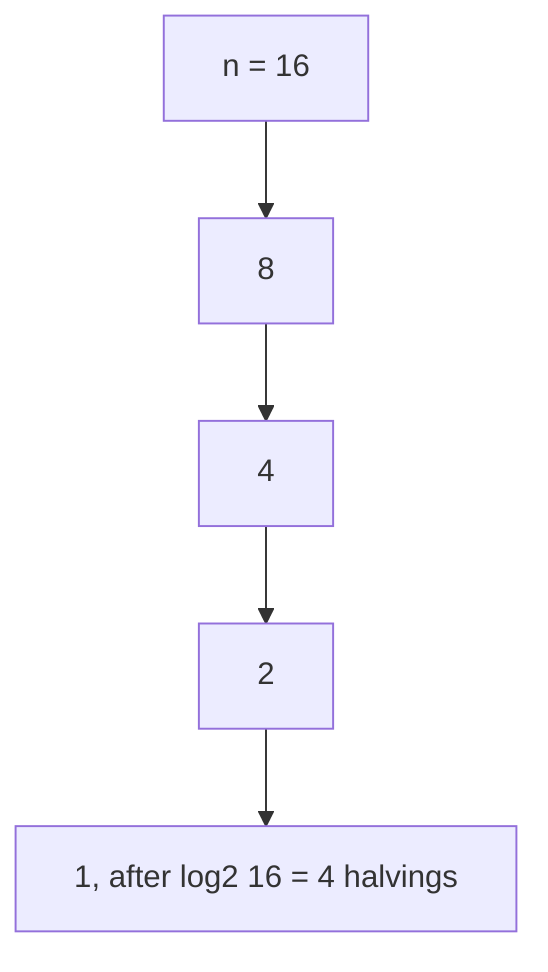
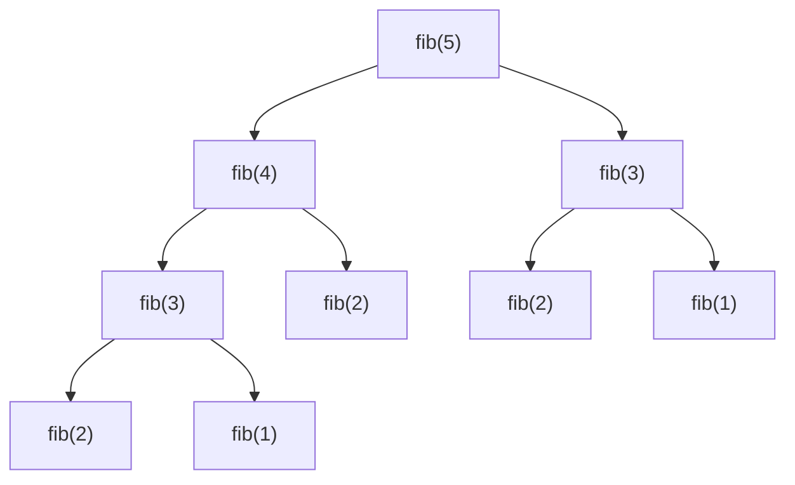
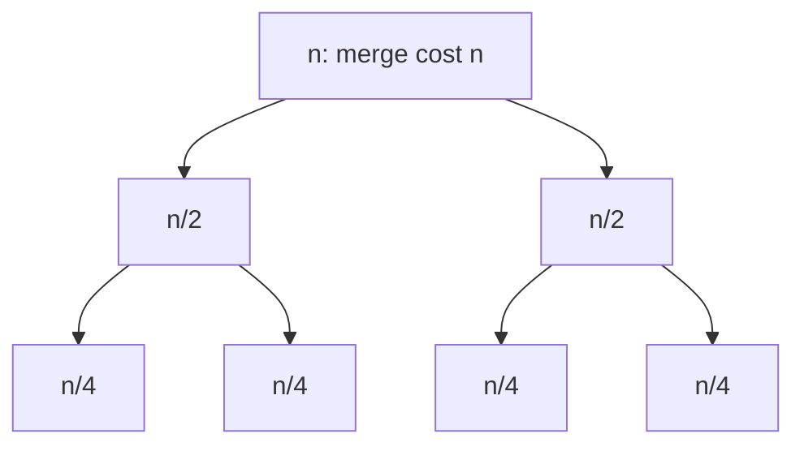
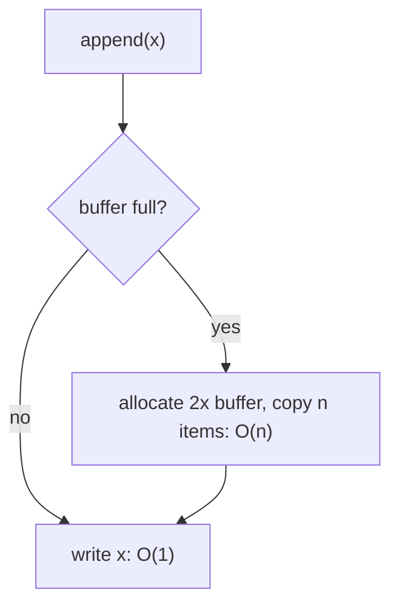
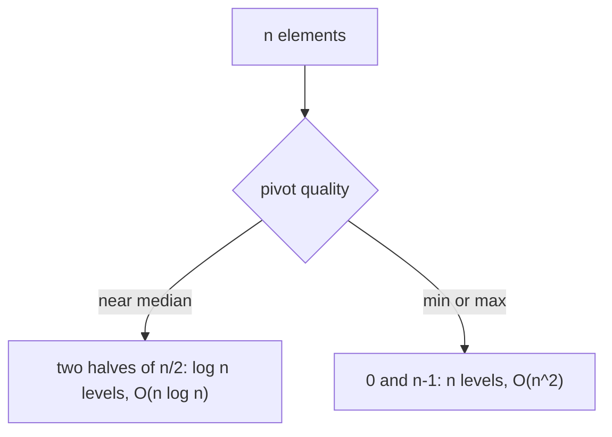
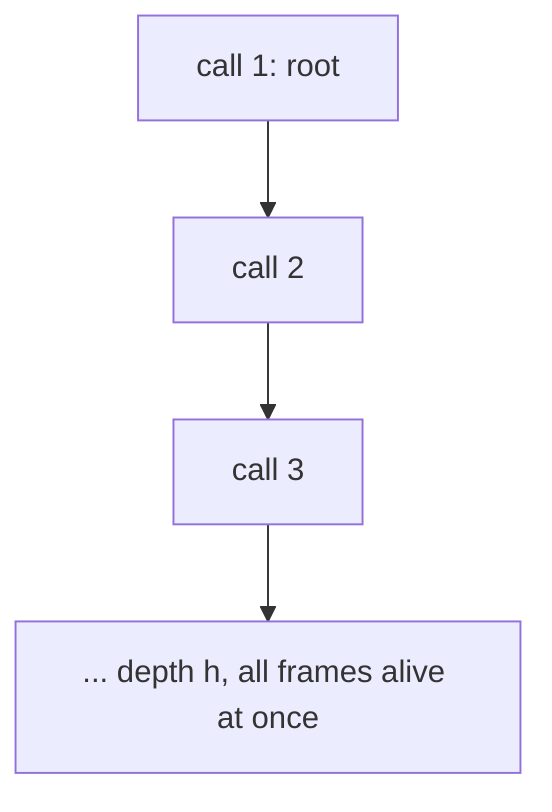
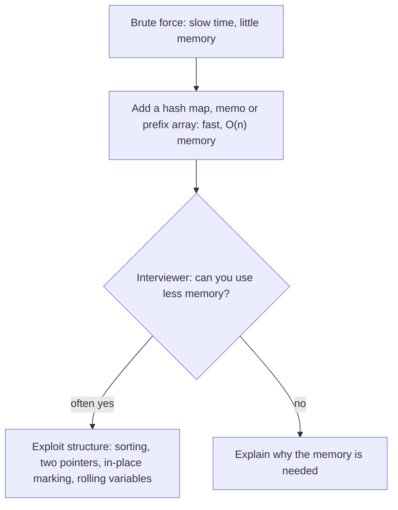

# Complexity Analysis (Big-O)

[⬅ Back to index](../README.md)

Covers: what Big-O means and how to explain it, the common complexity classes, analysing loops, nested loops and recursion, amortised cost, space complexity including the recursion stack, the master theorem in practice, and how to state complexity in an interview.

---

## Foundations

### 1. What does Big-O mean, and how is it different from Big-Theta and Big-Omega?

**📘 Concept** · ⭐ Product/FAANG favourite

<details>
<summary>Answer</summary>

**In short:** Big-O describes how the running time (or memory) of an algorithm **grows** as the input gets bigger, ignoring constant factors and smaller terms. Formally, O is an *upper bound*, Ω (Omega) a *lower bound* and Θ (Theta) a *tight bound* (both at once). In interviews, "O(n)" is used to mean the tight bound on the worst case — "this grows linearly, no faster" — and that's what you should say unless asked for the formal distinction.

#### What Big-O actually measures

Big-O is not a stopwatch. It answers: **if I double the input, what happens to the work?**

| Complexity | Input doubles from n to 2n | Work becomes |
|---|---|---|
| O(1) | 1000 → 2000 | the same |
| O(log n) | 1000 → 2000 | one more step |
| O(n) | 1000 → 2000 | 2× |
| O(n log n) | 1000 → 2000 | a little more than 2× |
| O(n²) | 1000 → 2000 | 4× |
| O(2ⁿ) | 30 → 31 | 2× for each **single** extra element |

Because it's about growth, we drop:

- **Constants:** `3n + 5` is O(n). A loop that does 3 things per element is still linear.
- **Lower-order terms:** `n² + 100n + 7` is O(n²). For large n, the n² term dominates everything else.
- **Log bases:** log₂ n and log₁₀ n differ only by a constant factor, so we just write O(log n).

#### The three symbols

| Symbol | Means | Everyday reading |
|---|---|---|
| O(f(n)) | grows **at most** like f(n) (upper bound) | "no worse than" |
| Ω(f(n)) | grows **at least** like f(n) (lower bound) | "no better than" |
| Θ(f(n)) | grows **exactly** like f(n), up to constants (O and Ω together) | "exactly this order" |

Formally, `f(n) = O(g(n))` if there are constants `c > 0` and `n₀` such that `f(n) ≤ c · g(n)` for every `n ≥ n₀`. "Eventually, and up to a constant, f is below g."

A subtle point: Big-O is only an upper bound, so linear search is technically O(n²) as well — it's just not a *useful* statement. In interviews everyone uses O to mean the tightest bound you can give, so always give the tightest one.

#### Bounds vs cases — two different ideas

People often mix up "O vs Ω vs Θ" with "worst vs best vs average case". They are independent:

- **Case** picks *which input* you're talking about (worst input, best input, a random input).
- **Bound** describes *how tightly* you've pinned down the growth for that case.

Example: insertion sort is Θ(n²) in the **worst** case (reverse-sorted input) and Θ(n) in the **best** case (already sorted). So "insertion sort is Ω(n)" and "insertion sort is O(n²)" are both true statements about all inputs. See [best, average and worst case](#8-what-are-best-average-and-worst-case-and-which-one-do-you-quote).

#### What interviewers want to hear

- State the complexity of **your** solution for time and space: "O(n log n) time because of the sort, O(n) extra space for the map."
- If the worst case differs from the typical case, say both: "O(1) average per hash map lookup, O(n) worst case with many collisions."
- Mention Ω only when it's useful, e.g. "any comparison sort needs Ω(n log n) comparisons, so we can't beat that by sorting" or "we must read every element, so Ω(n) is a lower bound — our O(n) is optimal."

#### Big-O is not the whole story

Constants matter in practice. An O(n) solution that allocates a map entry per element can be slower than an O(n log n) in-place sort for n = 1000. But in an interview, Big-O is the language for comparing approaches; mention constants only as a tie-breaker ("both are O(n), but the array of 26 counts is faster than a HashMap").

#### Common mistakes

- Saying "O(2n)" or "O(n + n²)" — simplify to O(n) and O(n²).
- Dropping a term that **isn't** smaller: O(n + m) is not O(n) if m can be much bigger than n. See [multiple variables](#13-how-do-you-express-complexity-with-more-than-one-variable).
- Confusing "Big-O" with "worst case". They're related by convention, not by definition.

#### Follow-ups

- *Is an O(n) algorithm always faster than an O(n²) one?* Only for large enough n; for tiny inputs constants can win (that's why library sorts switch to insertion sort for small ranges).
- *What's the lower bound for comparison sorting?* Ω(n log n) — there are n! orderings and each comparison gives one bit, so you need about log₂(n!) ≈ n log n comparisons.

</details>

### 2. What are the common complexity classes, with examples?

**📘 Concept** · ⭐ Product/FAANG favourite

<details>
<summary>Answer</summary>

**In short:** Almost every interview solution falls into one of about eight classes: O(1), O(log n), O(n), O(n log n), O(n²), O(n³), O(2ⁿ) and O(n!). Knowing a typical algorithm for each, and roughly how large n can be before each one gets too slow, lets you both describe your solution and guess what the interviewer expects.

#### The table

The "comfortable n" column assumes the usual rule of thumb of around 10⁸ simple operations per second and a 1-2 second limit. It's a guide, not a law.

| Class | Name | Typical examples | Comfortable n |
|---|---|---|---|
| O(1) | constant | array index, hash map get/put (average), push/pop on a stack | any |
| O(log n) | logarithmic | binary search, heap push/pop, balanced BST lookup, fast power | any (even 10¹⁸) |
| O(√n) | square root | checking if n is prime by trial division | up to ~10¹⁴ |
| O(n) | linear | one pass, two pointers, sliding window, counting with a map | up to ~10⁷-10⁸ |
| O(n log n) | linearithmic | sorting, merge sort, n heap operations | up to ~10⁶ |
| O(n²) | quadratic | all pairs, simple 2D DP like LCS, bubble/insertion sort | up to ~10⁴ |
| O(n³) | cubic | three nested loops, Floyd-Warshall, interval DP | up to ~500 |
| O(2ⁿ) | exponential | all subsets, naive recursion with two branches | up to ~20-25 |
| O(n!) | factorial | all permutations, brute-force travelling salesman | up to ~10-11 |

How to read the last column, and how to work backwards from an input constraint to the intended solution, is covered in depth in [Pattern Recognition](04-pattern-recognition.md).

#### How fast each one grows

| n | log₂ n | n log₂ n | n² | 2ⁿ |
|---|---|---|---|---|
| 10 | ~3 | ~33 | 100 | 1,024 |
| 100 | ~7 | ~664 | 10,000 | ~10³⁰ |
| 1,000 | ~10 | ~10,000 | 1,000,000 | astronomically large |
| 1,000,000 | ~20 | ~2 × 10⁷ | 10¹² (too slow) | — |

Two things to notice: log n is tiny even for huge n (about 20 for a million, about 30 for a billion), and the jump from n log n to n² is what separates "runs instantly" from "times out" at n = 10⁵-10⁶.

#### One example of each, in Kotlin

```kotlin
// O(1): index access
fun first(a: IntArray) = a[0]

// O(log n): halve the range each step
fun countHalvings(n: Int): Int {
    var x = n; var steps = 0
    while (x > 1) { x /= 2; steps++ }
    return steps
}

// O(n): one pass
fun sum(a: IntArray): Long { var s = 0L; for (x in a) s += x; return s }

// O(n log n): sort dominates
fun hasDuplicate(a: IntArray): Boolean {
    val s = a.sorted()
    for (i in 1 until s.size) if (s[i] == s[i - 1]) return true
    return false
}

// O(n^2): all pairs
fun countPairsWithSum(a: IntArray, k: Int): Int {
    var c = 0
    for (i in a.indices) for (j in i + 1 until a.size) if (a[i] + a[j] == k) c++
    return c
}

// O(2^n): every subset
fun subsetCount(a: IntArray, i: Int = 0): Int =
    if (i == a.size) 1 else subsetCount(a, i + 1) + subsetCount(a, i + 1)
```

#### Classes that appear with more than one input

Real problems often have two sizes. Common ones: O(n + m) (merging two lists), O(n · m) (grid or two-string DP), O(V + E) (graph traversal), O(E log V) (Dijkstra), O(n log k) (heap of size k), O(n · L) (n words of length L in a trie). See [multiple variables](#13-how-do-you-express-complexity-with-more-than-one-variable).

#### Rarer ones worth recognising

- **O(α(n))** — inverse Ackermann, effectively constant; union-find with path compression and union by rank ([Advanced Graphs](17-advanced-graphs.md)).
- **O(n log log n)** — the Sieve of Eratosthenes ([Bit Manipulation & Math](21-bit-manipulation-math.md)).
- **O(log² n)** — e.g. binary search where each check is itself a binary search.
- **O(n · 2ⁿ)** — bitmask DP over subsets, or generating all subsets and copying each one.

#### Common mistakes

- Treating O(n log n) as "basically O(n²)". For n = 10⁶ it's ~2 × 10⁷ vs 10¹² — a different universe.
- Forgetting that generating all subsets costs O(n · 2ⁿ) when you copy each subset into the output, not just O(2ⁿ).

#### Follow-ups

- *Why is O(log n) "almost constant"?* Because log₂ of any realistic input size is at most about 60.
- *Where does O(√n) come from?* Looping while `i * i <= n`, e.g. checking divisors in pairs `(i, n / i)`.

</details>

### 3. Why does log n show up so often?

**📘 Concept** · ⭐ Product/FAANG favourite

<details>
<summary>Answer</summary>

**In short:** log₂ n is the number of times you can **halve** n before reaching 1 (equivalently, how many times you can double 1 before reaching n). So whenever an algorithm throws away a constant fraction of the work at each step — binary search, a balanced tree's height, a heap's height, splitting in merge sort, squaring in fast power — a log n appears.

#### The definition, in one picture

Starting at n = 16 and halving: 16 → 8 → 4 → 2 → 1. That's 4 steps, and log₂ 16 = 4.



Doubling n adds just one step. That's why log n is so small: log₂ 10⁹ ≈ 30.

#### Where it comes from

| Source | Why it's log n |
|---|---|
| **Binary search** | each comparison discards half the remaining range |
| **Balanced BST** (red-black, AVL, Kotlin `TreeMap`) | height stays about log n, and each operation walks one root-to-leaf path |
| **Binary heap** | a complete binary tree with n nodes has height ⌊log₂ n⌋; sift up/down walks one path |
| **Merge sort / divide and conquer** | splitting n in half repeatedly gives log n *levels*; with O(n) work per level, total O(n log n) |
| **Fast exponentiation** | the exponent halves each step: xⁿ = (x^(n/2))² |
| **Digits of a number** | a number n has about log₁₀ n decimal digits (or log₂ n bits), so a loop that does `n /= 10` runs O(log n) times |
| **Loop with `i *= 2`** | i takes values 1, 2, 4, ... up to n: log₂ n iterations |
| **Union by rank** | a tree's height only grows when two equal-rank trees merge, so height ≤ log n |

#### Why the base doesn't matter

log₂ n = log₁₀ n / log₁₀ 2 ≈ 3.32 · log₁₀ n — just a constant factor. Discarding a third each time (ternary search) or nine tenths still gives O(log n). What matters is that a **constant fraction** is removed each step.

Contrast: removing a **constant amount** each step (n → n − 1, or n → n − 2) gives O(n) steps, not O(log n). That's the difference between binary search and linear search.

#### The tree picture

A complete binary tree with n leaves has height log₂ n. That's the shape behind most log factors: a recursion that splits into two halves, a heap, a balanced BST. Whenever you can draw your algorithm as "walk one path in a balanced tree", the cost is O(log n).


Each level halves the size, so there are log₂ n levels until size 1.

#### Common mistakes

- Calling a loop `while (i < n) i += 2` O(log n). It's O(n/2) = O(n) — it subtracts a constant, it doesn't divide.
- Assuming any BST is O(log n). An unbalanced BST built from sorted input is a linked list with height n. Only *balanced* trees guarantee log n.
- Forgetting the log in heap operations: pushing n items into a heap is O(n log n), not O(n) (though *building* a heap from an existing array with heapify is O(n) — see [Heaps & Priority Queues](13-heaps-priority-queues.md)).

#### Follow-ups

- *How many times can you halve 10¹⁸?* About 60 — which is why binary search on the answer works even with huge value ranges ([Binary Search](10-binary-search.md)).
- *Why is merge sort O(n log n) and not O(log n)?* There are log n levels, but each level touches all n elements. See [recursion trees](#5-how-do-you-find-the-complexity-of-a-recursive-function).

</details>

## Analysing code

### 4. How do you analyse loops: sequential, nested, and loops that multiply?

**📘 Concept** · ⭐ Product/FAANG favourite

<details>
<summary>Answer</summary>

**In short:** Count how many times the innermost line runs. **Sequential** blocks **add** (O(n) + O(m) = O(n + m)); **nested** loops **multiply** when the inner loop's length doesn't depend on the outer one (O(n · m)); when it does depend, add up the actual iterations (often an arithmetic series giving n²/2, or a harmonic series giving n log n). A loop variable that **multiplies or divides** (`i *= 2`, `n /= 10`) runs O(log n) times. And a nested `while` isn't automatically quadratic — if the inner pointer never moves back, the total is O(n).

#### Rule 1: sequential blocks add

```kotlin
for (x in a) { /* O(1) */ }      // n
for (y in b) { /* O(1) */ }      // m
// total: O(n + m)
```

Keep only the biggest term when they're in the same variable: O(n) + O(n log n) = O(n log n).

#### Rule 2: independent nested loops multiply

```kotlin
for (i in 0 until n)
    for (j in 0 until m)
        work()                    // runs n * m times → O(n * m)
```

#### Rule 3: dependent nested loops — sum the actual counts

```kotlin
for (i in 0 until n)
    for (j in i + 1 until n)      // runs n-1, n-2, ..., 0 times
        work()
```

Total = (n−1) + (n−2) + ... + 0 = n(n−1)/2, which is O(n²). Halving the work doesn't change the class.

A different dependency gives a different answer:

```kotlin
for (i in 1..n)
    for (j in i..n step i)        // runs about n/i times
        work()
```

Total ≈ n/1 + n/2 + n/3 + ... + n/n = n · (1 + 1/2 + ... + 1/n) ≈ n ln n. This **harmonic series** gives O(n log n) — it's the shape of "loop over all multiples of each i" (sieves, divisor counting).

#### Rule 4: multiplying / dividing loop variables → log

```kotlin
var i = 1
while (i < n) { work(); i *= 2 }        // 1, 2, 4, ..., < n → O(log n)

var x = n
while (x > 0) { work(); x /= 10 }       // one step per digit → O(log n)

var k = 1
while (k * k <= n) { work(); k++ }      // O(sqrt n)
```

Combine with nesting:

```kotlin
for (i in 0 until n) {          // n times
    var j = 1
    while (j < n) j *= 2        // log n times
}                               // O(n log n)
```

| Loop shape | Iterations |
|---|---|
| `i++` up to n | n |
| `i += k` up to n (k constant) | n / k → O(n) |
| `i *= 2` up to n | log₂ n |
| `i *= i` (squaring) starting at 2 | log log n |
| `i * i <= n` | √n |
| inner `j` from `i` to n | n²/2 → O(n²) |
| inner `j` over multiples of `i` | n log n (harmonic) |

#### Rule 5: nested `while` with a pointer that never goes back is O(n)

```kotlin
var left = 0
for (right in a.indices) {            // n iterations
    add(a[right])
    while (invalid()) {               // looks nested...
        remove(a[left]); left++       // ...but left only moves forward, at most n times in TOTAL
    }
}
```

`left` goes from 0 to at most n over the **entire** run, so the inner loop's body runs at most n times in total, not n times per outer iteration. Total O(n + n) = O(n). This is an [amortised](#7-what-is-amortised-analysis) argument and it's why sliding windows and monotonic stacks are linear ([Two Pointers & Sliding Window](08-two-pointers-sliding-window.md), [Stacks, Queues & Monotonic Stack](11-stacks-queues-monotonic.md)).

The trick: instead of asking "how many times can the inner loop run per outer iteration?", ask "**how many times can this line run in total?**"

#### Rule 6: don't forget the cost of what's inside

A loop body isn't always O(1). Calls like `list.contains(x)`, `s.substring(...)`, `list.indexOf(x)` or `s + c` cost O(n) themselves. One pass with an O(n) call inside is O(n²). See [hidden costs](#11-what-hidden-costs-hide-inside-library-calls).

#### A worked example

```kotlin
fun mystery(a: IntArray): Int {
    val sorted = a.sorted()                     // O(n log n)
    var count = 0
    for (i in sorted.indices) {                 // n
        var step = 1
        while (step < sorted.size) step *= 2    //   × log n
        count += step
    }
    val seen = HashSet<Int>()
    for (x in a) seen.add(x)                    // O(n) average
    return count + seen.size
}
// Total: O(n log n) + O(n log n) + O(n) = O(n log n) time, O(n) extra space.
```

#### Common mistakes

- Calling every double loop O(n²) — a two-pointer `while` inside a `for` is often O(n).
- Calling `for (j in i until n)` O(n log n) — it's still O(n²).
- Missing an O(n) library call inside a loop.
- Using one variable for two different sizes: rows and columns of a grid are r and c, so a full scan is O(r · c), not O(n²).

#### Follow-ups

- *Three nested loops where each is `for (k in j until n)`?* Still O(n³) — about n³/6 iterations.
- *What about `for (i in 0 until n) for (j in 0 until i * i)`?* Sum of i² ≈ n³/3 → O(n³).

</details>

### 5. How do you find the complexity of a recursive function?

**📘 Concept** · ⭐ Product/FAANG favourite

<details>
<summary>Answer</summary>

**In short:** Draw the **recursion tree**: each node is one call, labelled with the work it does *outside* its recursive calls. Total time = sum of all node labels. A quick shortcut that covers most cases: **time ≈ (number of calls) × (work per call)**, and **stack space = maximum depth × space per frame**. Naive Fibonacci makes ~2ⁿ calls (exponential); with memoisation each of the n states is computed once (O(n)); merge sort has log n levels each doing O(n) work (O(n log n)).

#### Step 1: write the recurrence

Describe the cost T(n) in terms of smaller calls plus the local work:

| Function | Recurrence | Result |
|---|---|---|
| sum of a list recursively | T(n) = T(n−1) + O(1) | O(n) |
| naive Fibonacci | T(n) = T(n−1) + T(n−2) + O(1) | O(2ⁿ) (tightly ~1.618ⁿ) |
| binary search | T(n) = T(n/2) + O(1) | O(log n) |
| merge sort | T(n) = 2T(n/2) + O(n) | O(n log n) |
| tree traversal | T(n) = T(left) + T(right) + O(1) | O(n) |
| subsets (include / exclude) | T(n) = 2T(n−1) + O(1) | O(2ⁿ) |
| permutations | T(n) = n · T(n−1) + O(1) | O(n!) |

#### Step 2: draw the tree and add up the levels

**Naive Fibonacci:**

```kotlin
fun fib(n: Int): Long = if (n < 2) n.toLong() else fib(n - 1) + fib(n - 2)
```



Each call does O(1) work and spawns up to two calls, and the tree is up to n levels deep, so there are at most 1 + 2 + 4 + ... + 2ⁿ ≈ 2ⁿ⁺¹ nodes → **O(2ⁿ)**. (The exact growth is about φⁿ ≈ 1.618ⁿ because the right branch is shorter, but O(2ⁿ) is the accepted interview answer; mention φ if you want to show depth.) Notice `fib(3)` and `fib(2)` are computed repeatedly — that's the waste.

**Memoised Fibonacci:**

```kotlin
fun fibMemo(n: Int, memo: LongArray = LongArray(n + 1) { -1L }): Long {
    if (n < 2) return n.toLong()
    if (memo[n] != -1L) return memo[n]          // already solved: O(1)
    memo[n] = fibMemo(n - 1, memo) + fibMemo(n - 2, memo)
    return memo[n]
}
```

Now use the shortcut: **distinct states × work per state** = n × O(1) = **O(n)** time. The tree collapses to a single chain because every repeated call returns instantly. Space: O(n) for the memo plus O(n) for the stack depth.

This "states × transitions" rule is how you analyse every memoised DP ([Dynamic Programming](19-dynamic-programming.md)): a 2D state `(i, j)` with i < n, j < m and O(1) work per state is O(n · m).

**Merge sort:**



| Level | Calls | Size each | Work at this level |
|---|---|---|---|
| 0 | 1 | n | n |
| 1 | 2 | n/2 | n |
| 2 | 4 | n/4 | n |
| ... | ... | ... | n |
| log₂ n | n | 1 | n |

Every level costs n in total, and there are log₂ n + 1 levels → **O(n log n)**.

#### Step 3: space is the depth, not the number of calls

Calls in different branches are not alive at the same time. Only the current root-to-leaf path is on the stack. So:

- naive Fibonacci: 2ⁿ calls, but depth n → **O(n) stack space**
- merge sort: depth log n → O(log n) stack, plus O(n) for the merge buffer
- DFS on a tree: depth = height h → O(h), which is O(log n) if balanced and O(n) if skewed

See [space complexity](#9-how-do-you-measure-space-complexity-including-the-recursion-stack).

#### Shortcut for "branches^depth"

When each call does O(1) work, makes b calls and the depth is d, the tree has about **bᵈ** nodes. Subsets: b = 2, d = n → 2ⁿ. Letter combinations of a phone number: b up to 4, d = digits → 4ᵈ. Backtracking with pruning is still bounded by this, just with a smaller constant in practice ([Recursion & Backtracking](18-recursion-backtracking.md)).

If each call also does non-constant work (e.g. copying a list of length n at the leaves), multiply: subsets with copying is O(n · 2ⁿ).

#### Common mistakes

- Calling naive Fibonacci O(n) "because it goes down to n" — that's the depth, not the number of calls.
- Forgetting the work *inside* each call, such as slicing an array (`a.copyOfRange`) at every level of a "binary search", which makes it O(n) instead of O(log n).
- Counting memoised recursion as exponential: once memoised, count states, not calls.

#### Follow-ups

- *What's the complexity of `T(n) = 2T(n/2) + O(1)`?* O(n) — a tree traversal. The levels sum to 1 + 2 + 4 + ... + n ≈ 2n.
- *Is there a formula for divide-and-conquer recurrences?* Yes — see [the master theorem](#6-what-is-the-master-theorem-and-how-do-you-use-it-without-heavy-maths).

</details>

### 6. What is the master theorem, and how do you use it without heavy maths?

**📘 Concept**

<details>
<summary>Answer</summary>

**In short:** For divide-and-conquer recurrences of the form **T(n) = a · T(n/b) + O(nᵈ)** — split into `a` subproblems of size `n/b`, and spend `nᵈ` work splitting/combining — compare the **combine work nᵈ** with the **number of leaves n^(log_b a)**. Whichever is bigger wins; if they're equal, you get an extra log n factor. Three cases cover nearly everything you'll see.

#### The intuition: who dominates the recursion tree?

Picture the recursion tree. At depth k there are aᵏ subproblems, each of size n/bᵏ, each doing (n/bᵏ)ᵈ work. So the work at level k is:

> nᵈ · (a / bᵈ)ᵏ

The ratio **r = a / bᵈ** decides everything:

| Ratio | What happens per level | Total | Intuition |
|---|---|---|---|
| r < 1 (a < bᵈ) | work **shrinks** going down | **O(nᵈ)** | the top level (root) dominates |
| r = 1 (a = bᵈ) | every level does the **same** work | **O(nᵈ log n)** | n^d per level × log n levels |
| r > 1 (a > bᵈ) | work **grows** going down | **O(n^(log_b a))** | the leaves dominate |

That's the whole theorem in practice. No need to memorise the formal version.

#### Applying it to the classics

| Algorithm | Recurrence | a, b, d | Compare a with bᵈ | Result |
|---|---|---|---|---|
| Binary search | T(n/2) + O(1) | 1, 2, 0 | 1 = 2⁰ | O(log n) |
| Merge sort | 2T(n/2) + O(n) | 2, 2, 1 | 2 = 2¹ | O(n log n) |
| Tree traversal / max of array by halves | 2T(n/2) + O(1) | 2, 2, 0 | 2 > 2⁰ | O(n^(log₂ 2)) = O(n) |
| Quickselect (average) | T(n/2) + O(n) | 1, 2, 1 | 1 < 2¹ | O(n) |
| Karatsuba multiplication | 3T(n/2) + O(n) | 3, 2, 1 | 3 > 2 | O(n^(log₂ 3)) ≈ O(n^1.585) |
| Strassen matrix multiply | 7T(n/2) + O(n²) | 7, 2, 2 | 7 > 4 | O(n^(log₂ 7)) ≈ O(n^2.81) |

#### A quick sanity check for case 1 (quickselect)

Work per level: n, n/2, n/4, ... This is a geometric series that adds up to less than 2n. The first level dominates → O(n). The same logic explains why heapify is O(n): most nodes are near the bottom and sift down only a short distance.

#### When the master theorem does NOT apply

- **Subtract-style recurrences** like T(n) = T(n−1) + O(n) (selection sort) → just sum: n + (n−1) + ... = O(n²). Or T(n) = 2T(n−1) + O(1) → O(2ⁿ). Use the recursion tree instead ([previous question](#5-how-do-you-find-the-complexity-of-a-recursive-function)).
- **Unequal splits** like quicksort's T(n) = T(k) + T(n−k−1) + O(n). Worst case k = 0 gives O(n²); balanced-on-average gives O(n log n).
- **Work that isn't a polynomial**, e.g. T(n) = 2T(n/2) + O(n log n) → O(n log² n). The simplified three-case version doesn't cover it; draw the tree (each level costs n log(n/2ᵏ), and the sum is about n log² n).

#### How to say it in an interview

"Each call splits into two halves and does linear work to merge, so the recursion tree has log n levels with n work each: O(n log n)." Explaining via the tree is usually more convincing than quoting the theorem by name — but naming it shows you know it.

#### Common mistakes

- Mixing up a and b: a is *how many* subproblems, b is *how much smaller* each one is.
- Applying it to T(n−1) recurrences.
- Forgetting that d = 0 means O(1) combine work, so binary search is a = 1, b = 2, d = 0 → equal case → O(log n).

#### Follow-ups

- *What's T(n) = 4T(n/2) + O(n)?* a = 4 > 2¹, leaves dominate → O(n²).
- *What's T(n) = T(n/2) + O(n²)?* a = 1 < 4, root dominates → O(n²).

</details>

### 7. What is amortised analysis?

**📘 Concept** · ⭐ Product/FAANG favourite

<details>
<summary>Answer</summary>

**In short:** Amortised analysis gives the **average cost per operation over a whole sequence of operations, in the worst case** — no randomness involved. Some operations are occasionally expensive (a dynamic array resizing, a queue moving elements between stacks), but they can only happen rarely, so the total over n operations is O(n) and each one is **amortised O(1)**. It's different from average-case analysis, which averages over random inputs.

#### Example 1: appending to a dynamic array

`ArrayList` in Kotlin/Java and `Array` in Swift sit on a fixed-size buffer. When the buffer is full, the next append allocates a bigger buffer (a constant factor bigger) and copies everything over — O(n) for that one append.

Suppose capacity doubles, starting at 1, and we append n = 16 items:

| Append # | Resize? | Copies |
|---|---|---|
| 1 | — | 0 |
| 2 | 1 → 2 | 1 |
| 3 | 2 → 4 | 2 |
| 5 | 4 → 8 | 4 |
| 9 | 8 → 16 | 8 |
| all others | no | 0 |

Total copies = 1 + 2 + 4 + 8 = 15 < n. In general, copies ≤ 1 + 2 + 4 + ... + n/2 < n. Add the n normal writes: total under 2n, so **each append is amortised O(1)**, even though a single append can be O(n).

The growth factor just has to be a constant multiple: Java's `ArrayList` grows by about 1.5×, Swift arrays roughly double. Both give amortised O(1). What would **not** work is growing by a fixed +10 slots each time — then there'd be n/10 resizes each copying up to n elements, O(n²) total.



Practical note: if you know the final size, pre-size the collection (`ArrayList(n)`, `reserveCapacity(n)` in Swift, `StringBuilder(n)`) to avoid the copies altogether.

#### Example 2: queue built from two stacks

```kotlin
class TwoStackQueue<T> {
    private val inbox = ArrayDeque<T>()   // used as a stack
    private val outbox = ArrayDeque<T>()  // used as a stack

    fun push(x: T) = inbox.addLast(x)                 // O(1)

    fun pop(): T {
        if (outbox.isEmpty()) {
            // move everything once; reverses the order so the oldest is on top
            while (inbox.isNotEmpty()) outbox.addLast(inbox.removeLast())
        }
        return outbox.removeLast()
    }
}
```

A single `pop` can move n elements — O(n). But follow one element through its life: pushed onto `inbox` once, moved to `outbox` **at most once**, popped once. Three O(1) steps per element, ever. So n operations cost O(n) total, **amortised O(1)** per operation. The full problem is in [Stacks, Queues & Monotonic Stack](11-stacks-queues-monotonic.md).

#### The "count per element" argument (aggregate method)

The cleanest way to prove amortised bounds in an interview: **charge the work to elements, and show each element is touched a constant number of times.**

- **Monotonic stack:** each index is pushed once and popped at most once → O(n) total, even though there's a `while` inside a `for`.
- **Sliding window:** each element enters and leaves the window once → O(n).
- **Hash map with resizing:** like the dynamic array, rehashing on growth is amortised O(1) per insert.
- **Union-find** with path compression and union by rank: amortised O(α(n)), effectively constant ([Advanced Graphs](17-advanced-graphs.md)).

There are also the "banker's" (accounting) and "physicist's" (potential) methods: you pre-pay a little extra on cheap operations — say 3 coins per append — and spend the saved coins on the expensive one. You rarely need them by name in an interview; the per-element argument is enough.

#### Amortised vs average vs worst

| Term | What it averages over | Guarantee |
|---|---|---|
| Worst case | nothing — the single slowest operation | every op is this fast |
| Amortised | a **sequence** of operations on any input | the **total** over n ops is bounded; one op can still be slow |
| Average case | random inputs / random choices | holds in expectation; an unlucky input can be slower |

Why it matters in practice: amortised O(1) can still mean an occasional long pause (a big resize). For hard real-time code (UI frame budgets, audio callbacks) that one spike might matter even though the average is fine.

#### Common mistakes

- Calling `ArrayList.add` "O(n)" because of resizing — the right answer is amortised O(1), worst case O(n).
- Calling amortised O(1) "average case". Amortised needs no assumption about random inputs.
- Saying a `while` inside a `for` is O(n²) without checking whether the inner pointer ever resets.

#### Follow-ups

- *Why doesn't the two-stack queue move elements back from `outbox` to `inbox`?* That would break the "each element moves once" argument and allow O(n) per op on alternating push/pop.
- *Is removing from the front of an `ArrayList` amortised O(1)?* No — every `removeAt(0)` shifts all elements, O(n) each time. Use `ArrayDeque` ([hidden costs](#11-what-hidden-costs-hide-inside-library-calls)).

</details>

### 8. What are best, average and worst case, and which one do you quote?

**📘 Concept**

<details>
<summary>Answer</summary>

**In short:** The same algorithm can take different time on different inputs of the same size. **Worst case** is the slowest input, **best case** the fastest, **average (expected) case** the typical cost over random inputs or random choices. In interviews, quote the **worst case** by default, and add the average case when it's what people rely on — quicksort is O(n log n) average but O(n²) worst; hash map operations are O(1) average but O(n) worst.

#### Three algorithms that show the difference

| Algorithm | Best | Average | Worst | Worst input |
|---|---|---|---|---|
| Linear search | O(1) | O(n) | O(n) | target missing or last |
| Insertion sort | O(n) | O(n²) | O(n²) | reverse-sorted array |
| Quicksort | O(n log n) | O(n log n) | O(n²) | already-sorted input with a first/last-element pivot |
| Hash map get/put | O(1) | O(1) | O(n) | all keys collide in one bucket |
| Binary search | O(1) | O(log n) | O(log n) | target missing |
| Merge sort | O(n log n) | O(n log n) | O(n log n) | — (always the same) |

#### Quicksort in detail

Quicksort picks a pivot, partitions into "smaller" and "larger", and recurses.

- **Good pivot** (near the median): each partition halves the problem → log n levels × O(n) partitioning → O(n log n).
- **Bad pivot** (always the min or max): one side is empty, the other has n−1 elements → n levels × O(n) → O(n²). This happens on sorted input if you always choose the first element.



Fixes: choose a **random pivot** (expected O(n log n) on every input — the randomness is in the algorithm, not the data), use median-of-three, or switch to heapsort when recursion gets too deep (introsort). Library sorts use such safeguards, which is why you can quote **O(n log n)** for `sort()` in Kotlin and Swift.

The same applies to [quickselect](13-heaps-priority-queues.md) for the k-th largest element: O(n) average, O(n²) worst, fixed in practice with a random pivot.

#### Hash maps in detail

A hash map is O(1) **on average** because a good hash function spreads keys evenly over buckets and the table resizes to keep buckets short. If many keys land in the same bucket, lookup degrades to scanning that bucket. Since Java 8, `HashMap` turns long buckets into balanced trees, so the worst case for keys that are `Comparable` becomes O(log n) rather than O(n). In an interview, say "O(1) average"; the details are in [Arrays, Strings & Hashing](07-arrays-strings-hashing.md).

#### Which one to quote

- **Default:** the worst case. "This is O(n log n)."
- **When the average is the accepted answer:** hashing and randomised algorithms. Say it explicitly: "O(n) expected, using a hash set" or "quickselect is O(n) on average, O(n²) worst case; with a random pivot the worst case is very unlikely."
- **Best case:** almost never useful on its own. "It's O(1) if the first element matches" says nothing about the algorithm. Mention it only when it's meaningful, e.g. insertion sort on nearly-sorted data.

#### Average case vs amortised

These sound similar but aren't. Average case averages over **inputs** (and can be beaten by an adversary). Amortised averages over a **sequence of operations** on any input, and is a real guarantee on the total. See [amortised analysis](#7-what-is-amortised-analysis).

#### Common mistakes

- Saying "quicksort is O(n log n)" without qualification when the interviewer asks about the worst case.
- Saying "hash map lookup is O(1)" in a context where the keys are long strings — hashing a string of length L costs O(L) itself, so it's O(L) per lookup.
- Using best case to argue an algorithm is fast.

#### Follow-ups

- *Can an adversary make a hash map slow?* Yes, with crafted colliding keys ("hash flooding"); that's why languages randomise hash seeds (Swift does by default) or treeify buckets (Java).
- *Why is merge sort used when worst-case guarantees matter?* It's O(n log n) on every input and stable; the cost is O(n) extra space.

</details>

## Space and hidden costs

### 9. How do you measure space complexity, including the recursion stack?

**📘 Concept** · ⭐ Product/FAANG favourite

<details>
<summary>Answer</summary>

**In short:** Space complexity is how much **extra memory** an algorithm needs as the input grows. Count three things: (1) **auxiliary data structures** you allocate (maps, sets, arrays, queues), (2) the **recursion stack** — maximum depth × memory per frame, and (3) the **output**, which most interviewers exclude unless you say otherwise. The input itself usually isn't counted. Be explicit: "O(n) extra space for the map, O(h) for the recursion stack, not counting the output."

#### What to count

| Source | Example | Cost |
|---|---|---|
| Fixed number of variables | two pointers, a running max | O(1) |
| Collections you build | `HashMap` of counts, `visited` set, DP table | size of the collection |
| Recursion stack | DFS, divide and conquer, memoised DP | max depth × frame size |
| Copies | `a.sorted()`, `s.toCharArray()`, `substring`, slicing | size of the copy |
| Output | the list of all subsets, the result array | usually reported separately |

"Auxiliary space" means everything except the input. When people say "O(1) space", they almost always mean O(1) auxiliary space.

#### The recursion stack is real memory

Each active call keeps a **stack frame** (parameters, local variables, return address). Only the calls on the current path are alive at once, so stack space = **maximum depth**, not total number of calls.

```kotlin
fun maxDepth(node: TreeNode?): Int =
    if (node == null) 0 else 1 + maxOf(maxDepth(node.left), maxDepth(node.right))
```

This allocates nothing on the heap, but it's **not** O(1) space. It's O(h), where h is the tree's height:

| Tree shape | Height h | Stack space |
|---|---|---|
| balanced | log n | O(log n) |
| skewed (a "linked list") | n | O(n) |



More examples:

- Naive Fibonacci: O(2ⁿ) calls, but max depth n → O(n) space.
- Merge sort: O(log n) stack + O(n) merge buffer → O(n).
- Quicksort: O(log n) stack on average, O(n) in the worst case (recursing into the smaller side first keeps it at O(log n)).
- Memoised DP over n states: O(n) memo + O(n) stack.

Deep recursion can also **crash**: the JVM and iOS threads have limited stack sizes, so recursion tens of thousands of levels deep (e.g. DFS on a 10⁵-node path graph or a large grid) can throw `StackOverflowError` or crash the app. The fixes — an explicit stack, or Kotlin's `DeepRecursiveFunction` — are in [Kotlin & Swift for Coding Interviews](03-kotlin-swift-for-interviews.md).

#### Output space

If a problem asks for all subsets, the output alone is O(n · 2ⁿ). Most interviewers don't count it as "extra" space because no algorithm can avoid it. Say: "O(n) extra space for the recursion and the current path, plus the output." If you're returning a single array of size n (like Product of Array Except Self), "O(1) extra space excluding the output array" is the standard phrasing.

#### In-place doesn't always mean O(1)

- Sorting in place with a library call: Kotlin's `IntArray.sort()` and Swift's `sort()` sort in place but may use O(log n) or more internal space. Usually you just say "sorting is in place" or "O(log n) to O(n) depending on the sort".
- Modifying the input to save memory (marking visited cells in the grid) is O(1) extra space but destroys the input — ask whether that's allowed.

#### Time vs space interplay

Every byte you write takes time, so **space ≤ time** for any algorithm: you can't use O(n²) memory in O(n) time. If your time is O(n), your space is at most O(n).

#### Common mistakes

- Claiming O(1) space for a recursive solution — it's O(depth).
- Forgetting copies made by `sorted()`, `toList()`, `substring`, `split` or array slicing.
- Counting the DP table but not the recursion stack (or vice versa) in a memoised solution.
- Writing "O(1) space" when you built a `HashMap` of 26 letters — that's fine, it's genuinely O(1) because the alphabet is fixed; but say why.

#### Follow-ups

- *Can you make this DP use less memory?* Often yes: if row i only reads row i−1, keep two rows → O(m) instead of O(n · m) ([Dynamic Programming](19-dynamic-programming.md)).
- *Iterative vs recursive — does it change space?* An iterative version with an explicit stack has the same asymptotic space, but it lives on the heap so it can't overflow the thread's call stack.

</details>

### 10. Why is building a string in a loop slow, and how do you fix it?

**📘 Concept**

<details>
<summary>Answer</summary>

**In short:** In Kotlin (and Java), `String` is **immutable**: `s += c` doesn't append, it creates a brand-new string and copies all of `s` into it. Doing that n times copies 1 + 2 + ... + n characters → **O(n²)**. A `StringBuilder` keeps a growable buffer and appends in **amortised O(1)**, so the whole build is O(n). In Swift, `String` is a mutable value type and `+=`/`append` on a variable is amortised O(1) when the string isn't shared — but other string operations (like `count` and indexing) hide O(n) costs.

#### Why concatenation in a loop is quadratic

```kotlin
// O(n^2): each += copies the whole string so far
fun slowJoin(parts: List<String>): String {
    var s = ""
    for (p in parts) s += p      // new String of length |s| + |p| every time
    return s
}
```

Trace with n single characters:

| Iteration | Characters copied | Running total |
|---|---|---|
| 1 | 1 | 1 |
| 2 | 2 | 3 |
| 3 | 3 | 6 |
| ... | ... | ... |
| n | n | n(n+1)/2 |

For n = 100,000 that's about 5 × 10⁹ character copies — far too slow. (The compiler turns `a + b + c` *within one expression* into a single builder, but it can't merge appends across loop iterations.)

#### The fix: StringBuilder

```kotlin
// O(n): amortised O(1) per append, one final copy in toString()
fun fastJoin(parts: List<String>): String {
    val sb = StringBuilder()
    for (p in parts) sb.append(p)
    return sb.toString()
}

// Kotlin's buildString is the same thing, more idiomatic
fun reverseWords(words: List<String>): String = buildString {
    for (i in words.indices.reversed()) {
        append(words[i])
        if (i > 0) append(' ')
    }
}
```

`StringBuilder` grows its internal array by a constant factor when it's full, exactly like a [dynamic array](#7-what-is-amortised-analysis). Total cost is proportional to the final length. `joinToString` uses a builder internally, so it's O(total length) too.

Other good options: build a `CharArray` of known size and call `String(chars)` at the end; or `sb.insert(0, x)` — but beware, inserting at the front of a builder shifts everything and is O(n) per call. Append and reverse at the end instead.

#### Swift

```swift
// Fine: += on a uniquely owned var appends in place, amortised O(1)
func join(_ parts: [String]) -> String {
    var s = ""
    s.reserveCapacity(parts.reduce(0) { $0 + $1.utf8.count })  // optional pre-sizing
    for p in parts { s += p }
    return s
}

// Or simply: parts.joined()
```

Swift strings use copy-on-write: appending to a string that nobody else holds a reference to mutates it in place. The traps in Swift are elsewhere:

- `s.count` is **O(n)** — Swift counts grapheme clusters (user-perceived characters) by walking the string. Don't call it in a loop condition; cache it, or work on `Array(s)`.
- `s[s.index(s.startIndex, offsetBy: k)]` is **O(k)**, so random access in a loop is O(n²). Convert once with `let chars = Array(s)` (O(n)) and index the array in O(1).
- Building a new string with `s = s + x` where the old `s` is still referenced elsewhere forces a copy.

See [Kotlin & Swift for Coding Interviews](03-kotlin-swift-for-interviews.md) for the full string toolkit.

#### Related hidden string costs (both languages)

| Operation | Cost |
|---|---|
| `s.substring(i, j)` (Kotlin) | O(j − i) — it copies |
| `s1 == s2` | O(length) |
| `s.hashCode()` / using a string as a map key | O(length) to hash (Java caches a string's hash after the first time) |
| `s.toCharArray()`, `s.split(...)`, `s.reversed()` | O(n) and allocate |
| `s.length` (Kotlin) | O(1) |
| `s.count` (Swift) | O(n) |

So "O(1) hash map lookup" with string keys of length L is really O(L) per lookup. For n words of length L, a map of words costs O(n · L).

#### Common mistakes

- `result += char` inside a loop in Kotlin (O(n²)).
- Using `substring` inside a loop to compare windows (O(n · k)) when a rolling hash or a frequency array would be O(n).
- Recursive string building `helper(s + c)` in backtracking — each call copies the path; a shared `StringBuilder` with append/`deleteCharAt` (choose/undo) is cheaper.

#### Follow-ups

- *Is `s + c` in a recursive backtracking call always bad?* It costs O(length) per call; often acceptable when the path is short (≤ 10-20), but a shared builder is the cleaner habit.
- *How do you reverse a string efficiently?* `StringBuilder(s).reverse()` or two pointers on a `CharArray` — O(n).

</details>

### 11. What hidden costs hide inside library calls?

**📘 Concept** · ⭐ Product/FAANG favourite

<details>
<summary>Answer</summary>

**In short:** A single line of code can be O(n) or worse. The usual offenders: **searching a list** (`contains`, `indexOf`, `remove(element)`), **inserting or removing at the front of an array** (`removeAt(0)`, `add(0, x)`, Swift `removeFirst()`), **copies** (`sorted()`, `toList()`, `substring`, `copyOfRange`, slicing), **sorting** (O(n log n)), **comparing or hashing** strings and lists (O(length)), and in Swift `String.count` and string indexing. Put one of these inside a loop and an O(n) solution quietly becomes O(n²).

#### The classic trap

```kotlin
// Looks O(n). Is O(n^2): list.contains is a linear scan.
fun findDuplicatesSlow(a: IntArray): List<Int> {
    val seen = mutableListOf<Int>()
    val dupes = mutableListOf<Int>()
    for (x in a) {
        if (x in seen) dupes.add(x) else seen.add(x)   // "in" on a List = O(n)
    }
    return dupes
}

// O(n) average: HashSet lookups are O(1) on average.
fun findDuplicatesFast(a: IntArray): List<Int> {
    val seen = HashSet<Int>()
    val dupes = mutableListOf<Int>()
    for (x in a) if (!seen.add(x)) dupes.add(x)        // add returns false if present
    return dupes
}
```

#### Kotlin / JVM cost sheet

| Operation | Cost | Note |
|---|---|---|
| `list[i]`, `list.add(x)` (ArrayList) | O(1) / amortised O(1) | |
| `list.contains(x)`, `indexOf`, `remove(element)` | O(n) | linear scan |
| `list.removeAt(0)`, `list.add(0, x)` | O(n) | shifts every element; use `ArrayDeque` |
| `ArrayDeque.addFirst/removeFirst/addLast/removeLast` | O(1) amortised | the right queue/deque |
| `set.contains`, `map[key]` (Hash*) | O(1) average | × cost of hashing the key |
| `TreeMap` / `TreeSet` operations | O(log n) | |
| `PriorityQueue.add/poll` | O(log n) | `peek` is O(1) |
| `PriorityQueue.remove(x)`, `contains(x)` | O(n) | not a search structure |
| `sorted()`, `sortedBy`, `sort()` | O(n log n) | `sorted()` also allocates a copy |
| `toList()`, `toSet()`, `toMutableList()`, `copyOf()`, `reversed()` | O(n) | new collection |
| `map`, `filter`, `sum`, `max`, `count { }`, `any { }` | O(n) | each one is a full pass |
| `subList(a, b)` | O(1) | a **view**; copying it with `toList()` is O(b − a) |
| `copyOfRange`, `slice`, `substring` | O(length of the result) | copies |
| `list1 == list2`, `s1 == s2` | O(n) | element-by-element |
| `LinkedList.get(i)` | O(n) | avoid linked lists for indexing |

#### Swift cost sheet

| Operation | Cost | Note |
|---|---|---|
| `array[i]`, `append` | O(1) / amortised O(1) | |
| `array.contains(x)`, `firstIndex(of:)` | O(n) | linear scan |
| `array.removeFirst()`, `insert(_, at: 0)` | O(n) | shifts; use an index-based queue |
| `removeLast()`, `popLast()` | O(1) | |
| `Set` / `Dictionary` lookup | O(1) average | |
| `sorted()` / `sort()` | O(n log n) | |
| `array[a..<b]` (ArraySlice) | O(1) | shares storage; `Array(slice)` copies, O(b − a) |
| `reversed()` on an Array | O(1) | returns a lazy reversed view |
| `string.count` | **O(n)** | walks grapheme clusters |
| `string.index(_, offsetBy: k)` | O(k) | strings aren't randomly indexable |
| `Array(string)` | O(n) | do it once, then index in O(1) |
| Mutating a copied array | O(n) on the first write | copy-on-write: `var b = a; b.append(1)` copies `a`'s buffer |

The copy-on-write row bites in recursion: passing an array into a function and mutating it inside (as a `var` copy) copies the whole array per call. Use `inout` or a class wrapper when you mean to share.

#### How to protect yourself

1. When you write a library call inside a loop, ask: "Is this O(1)?"
2. Choose the structure for the operation you'll repeat: membership → hash set; front removal → deque; min/max repeatedly → heap; sorted order with updates → `TreeMap`.
3. Hoist invariant work out of loops: compute `s.count`, `sorted()`, `toSet()` once, before the loop.
4. Mention the cost when you use the call: "I'll sort first, that's O(n log n), then one pass."

#### Common mistakes

- `queue.removeAt(0)` on a `MutableList` as a BFS queue → O(n) per pop, O(V²) BFS.
- Calling `max()` inside a loop to get the current maximum → O(n²); keep a running max or a heap.
- Using `list.sorted()` inside a loop "to keep it sorted" — use a heap or `TreeMap`.
- Building `HashSet<List<Int>>` keys: hashing each list is O(length), so the "O(1)" lookups cost O(k) each.

#### Follow-ups

- *What's the cost of `a.sorted().first()` vs `a.min()`?* O(n log n) vs O(n) — never sort just to find the minimum.
- *Is `x in map` on a `HashMap` O(1)?* `in` calls `containsKey`, so yes on average — the same keyword on a `List` is O(n). Know what's on the right side of `in`.

</details>

## Putting it together

### 12. What are time-space trade-offs, and how do you discuss them?

**📘 Concept**

<details>
<summary>Answer</summary>

**In short:** You can often make an algorithm faster by spending memory to **remember** something — a hash set of what you've seen, a memo of solved subproblems, a prefix sum array, a precomputed index — or save memory by **recomputing** or by working in place. Interviewers like to hear you name the trade-off explicitly: "I can do this in O(n) time with O(n) extra space using a hash map, or O(n log n) time with O(1) extra space by sorting in place. Which matters more here?"

#### The common trades

| Problem | Less memory | More memory, faster |
|---|---|---|
| Two Sum (unsorted) | sort + two pointers: O(n log n) time, O(1)-ish extra (loses original indices) | hash map: O(n) time, O(n) space |
| Contains Duplicate | sort: O(n log n), O(1) extra | hash set: O(n), O(n) |
| Fibonacci / any DP | naive recursion: O(2ⁿ), O(n) stack | memo or table: O(n) time, O(n) space |
| Range sum queries (q queries) | sum each range: O(n · q) | prefix sums: O(n) build + O(1) per query, O(n) space |
| Repeated lookups in a list | scan each time: O(n) per lookup | build a set once: O(n) then O(1) |
| Anagram check | sort both strings: O(n log n) | count array of 26: O(n), O(1) space |
| Detect a cycle in a linked list | Floyd's fast/slow pointers: O(n), O(1) | visited set: O(n), O(n) |

The last two rows are the best kind: you get better time **and** O(1) space by using structure (a fixed alphabet, the pointer race). Interviewers often push for exactly these: "Can you do it without the extra set?"

#### The usual direction of follow-ups



Typical memory-reducing techniques:

- **Rolling variables / rows in DP:** if state i depends only on i−1 and i−2, keep two variables instead of an array (O(n) → O(1)). For 2D DP that only looks at the previous row, keep one or two rows.
- **In-place marking:** negate values or overwrite grid cells instead of a `visited` set — saves space but modifies input (ask first).
- **Two pointers / fast & slow** instead of a set.
- **Bit tricks:** a bitmask or XOR instead of a set of booleans ([Problem-Solving Tricks](06-problem-solving-tricks.md)).
- **Recompute instead of store:** e.g. compute a value on the fly in a second pass rather than storing an extra array.

#### How to weigh them

- **Constraints first:** n = 10⁶ integers in a hash set is tens of MB on the JVM (boxed `Integer` objects) — usually fine on a server, worth a mention on a memory-constrained mobile device.
- **Is the input reusable?** Sorting in place or marking cells changes it; if the caller needs it, you need a copy anyway.
- **One query or many?** Precomputation (prefix sums, sorting, an index) pays off only when it's reused.
- **Readability:** a slightly slower but clearly correct solution can be the right call under time pressure — say that you know the faster one.

#### Common mistakes

- Presenting only one approach without mentioning the trade-off when an obvious alternative exists.
- Claiming O(1) space after sorting the input with a copy (`sorted()` allocates O(n)).
- Optimising memory before you have a correct solution.

#### Follow-ups

- *Can you do Two Sum in O(1) extra space?* Only by sorting (O(n log n)), and you'd need to track original indices if the problem asks for them — which brings the memory back.
- *When is memory more important than time?* Streaming data that doesn't fit in memory, embedded or mobile constraints, or huge n where O(n) memory is gigabytes.

</details>

### 13. How do you express complexity with more than one variable?

**📘 Concept**

<details>
<summary>Answer</summary>

**In short:** Use a separate variable for each independent size and **keep every term that can dominate**: O(n + m) when you scan two inputs one after the other, O(n · m) for a grid or a 2D DP over two strings, O(V + E) for a graph traversal, O(n log k) for a heap of size k, O(n · L) for n strings of length L. Don't collapse them into one "n" — that hides real information and is often wrong.

#### Why not just say O(n)?

If a grid has r rows and c columns, a full scan is O(r · c). Calling that "O(n²)" assumes it's square; calling it "O(n)" where n = r · c is fine **only if you say so**. Interviewers want to see that you know which sizes drive the cost.

Similarly, O(n + m) can't be simplified to O(n) unless you know m ≤ n. Merging a list of 10 items with a list of 10 million is dominated by m.

#### The common forms

| Form | Where it appears | Why |
|---|---|---|
| O(n + m) | merging two sorted lists, comparing two strings' counts | one pass over each |
| O(n · m) | grid BFS/DFS, LCS / edit distance DP, checking every word against every pattern | every pair (i, j) |
| O(r · c) | any full grid scan | each cell once |
| O(V + E) | BFS / DFS / topological sort on an adjacency list | each vertex dequeued once, each edge looked at once (twice if undirected) |
| O(V²) | the same traversal on an adjacency **matrix** | each row scanned fully |
| O((V + E) log V) or O(E log V) | Dijkstra with a binary heap | each edge may push to the heap |
| O(n log k) | top-k with a heap of size k; merging k sorted lists of n total elements | n heap operations on a heap of size k |
| O(n · L) | building a trie, hashing n strings of length L, Group Anagrams with counting | each character processed once |
| O(n · L log L) | Group Anagrams by sorting each word | sort each word |
| O(n · k) | brute-force sliding window of size k | k work per window |
| O(n · target) | knapsack / Coin Change DP | items × capacity |
| O(log(max value) · n) | binary search on the answer with an O(n) check | log of the value range, not of n |

#### Why O(V + E) and not O(V · E)

In BFS, each vertex is added to the queue once, and when it's dequeued we look at its adjacency list. Summed over all vertices, the adjacency lists contain E entries (2E for undirected). So the work is V (for vertices) + E (for edges), added, not multiplied. The neighbour loop *looks* nested but, like a [sliding window](#4-how-do-you-analyse-loops-sequential-nested-and-loops-that-multiply), you count total iterations.

O(V + E) also covers both extremes: a sparse graph (E ≈ V) is O(V); a dense graph (E ≈ V²) is O(V²). See [Graphs: BFS, DFS & Topological Sort](16-graphs-bfs-dfs-topo.md).

#### Why O(n log k) beats O(n log n)

Keeping only the k best items in a heap means every push/pop costs log k, not log n. For "top 10 of 10 million", log 10 ≈ 3 vs log 10⁷ ≈ 23 — and memory is O(k) instead of O(n). See [Heaps & Priority Queues](13-heaps-priority-queues.md).

#### Simplifying correctly

- You may drop a term only if you know it's smaller: if E ≥ V − 1 (connected graph), O(V + E) = O(E).
- In O(n · m) both stay.
- Constants in one variable still go: O(26 · n) = O(n) (but saying "26 · n" explicitly can clarify why an alphabet-sized loop is fine).
- Name your variables before using them: "Let n be the number of words and L the maximum word length."

#### Common mistakes

- Saying "O(n²)" for a grid when rows and columns are different sizes.
- Calling BFS O(V · E).
- Forgetting the string length in string problems — Group Anagrams is O(n · L log L), not O(n log n).
- Writing O(log n) for binary search on an answer range — it's O(log(range)) iterations, each with its own cost.

#### Follow-ups

- *What's the complexity of Word Search on an r × c board with a word of length L?* O(r · c · 3ᴸ) — each start cell, then up to 3 directions per step (not 4, since you don't go back) ([Recursion & Backtracking](18-recursion-backtracking.md)).
- *Merge k sorted lists with N total nodes?* O(N log k) with a heap.

</details>

### 14. How do you state and justify complexity in an interview?

**📘 Concept** · ⭐ Product/FAANG favourite

<details>
<summary>Answer</summary>

**In short:** For **every** approach you propose (brute force and optimal), say the time and space complexity, defined in terms of named variables, with a one-line reason pointing at the line of code that dominates: "O(n log n) time — the sort dominates, the scan after it is O(n). O(n) extra space for the output; the sort is in place." Do it unprompted, before and after coding, and be precise about averages, amortisation and the recursion stack.

#### A script that works

1. **Define the variables.** "Let n be the length of the array and k the window size."
2. **Brute force first.** "Checking every pair is O(n²) time, O(1) space."
3. **Optimal approach with the reason.** "With a hash map storing value → index, each element is looked up and inserted once, so O(n) time on average, O(n) space."
4. **After coding, re-derive it from the code.** Point to the loops: "This outer loop is n; the inner `while` moves `left` forward only, so it's n in total — O(n) overall."
5. **Mention the qualifiers that apply:** average vs worst (hashing, quicksort), amortised (dynamic arrays, two-stack queue), stack space for recursion, whether output space is counted.
6. **Say whether it's optimal** if you can: "We must read every element, so we can't do better than O(n)."

#### Choosing the target before you code

The input constraints often tell you what complexity the interviewer expects (n ≤ 20 suggests exponential is fine; n ≤ 10⁵ needs O(n log n) or better). That skill is covered in detail in [Pattern Recognition: Reading the Problem](04-pattern-recognition.md).

#### Precise phrasing to use

| Situation | Say |
|---|---|
| Hash map / set | "O(1) **average** per operation, so O(n) overall" |
| String keys | "O(L) to hash each key, so O(n · L) total" |
| Dynamic array append, two-stack queue | "**amortised** O(1)" |
| Recursion | "O(h) stack space, where h is the height: O(log n) if balanced, O(n) worst case" |
| Library sort | "O(n log n) time; Kotlin's/Swift's sort may use O(log n) to O(n) internal space" |
| Output-heavy | "O(n · 2ⁿ) time, which is the size of the output, so it's optimal" |
| Two-pointer / monotonic stack loops | "each element is pushed and popped at most once, so O(n) total" |
| Graph | "O(V + E) with an adjacency list" |
| Memoised recursion | "O(number of states × work per state) = O(n · m)" |

#### Walkthrough: justifying a tricky one

Longest Substring Without Repeating Characters with a sliding window ([Two Pointers & Sliding Window](08-two-pointers-sliding-window.md)):

```kotlin
fun lengthOfLongestSubstring(s: String): Int {
    val lastSeen = HashMap<Char, Int>()
    var left = 0
    var best = 0
    for (right in s.indices) {                       // n iterations
        val c = s[right]
        val prev = lastSeen[c]
        if (prev != null && prev >= left) left = prev + 1   // left only moves forward
        lastSeen[c] = right                          // O(1) average
        best = maxOf(best, right - left + 1)
    }
    return best
}
```

What to say: "One pass with `right`; `left` only ever moves forward, so total pointer movement is O(n). Each map operation is O(1) on average. Time O(n). Space O(min(n, alphabet size)) for the map — O(1) if the alphabet is fixed, like ASCII."

#### Answering "can you do better?"

- Compare with a **lower bound**: reading the input is Ω(n); comparison sorting is Ω(n log n); producing k outputs is Ω(k). If you've matched it, say so.
- If time is optimal, the follow-up is usually about **space**: can you drop the hash map, use the input in place, or keep a rolling DP row? See [time-space trade-offs](#12-what-are-time-space-trade-offs-and-how-do-you-discuss-them).
- If you can't improve it, say what you'd try and why it doesn't work — reasoning counts.

#### Red flags interviewers notice

- No complexity stated until asked.
- "It's O(n)" for code with `list.contains` inside the loop ([hidden costs](#11-what-hidden-costs-hide-inside-library-calls)).
- Recursive solution described as O(1) space.
- One letter "n" used for two different sizes.
- Hesitating between O(n) and O(n²) for a sliding window — the "count total pointer moves" argument settles it.

#### Common mistakes

- Reciting complexity without a reason — the reason is what's being graded.
- Over-hedging ("maybe O(n), maybe O(n log n)?"). Derive it; if unsure, walk through the loops out loud.
- Forgetting to update the complexity after changing the approach mid-interview.

#### Follow-ups

- *What if the interviewer disagrees with your analysis?* Walk through the dominant loop together, counting total iterations; either you'll spot your error or you'll show your reasoning clearly.
- *What if the input is a stream?* Then state per-element cost and memory held at any time (e.g. "O(log k) per element, O(k) memory").

</details>

---

[⬅ Previous: How Coding Interviews Work](01-coding-interviews-overview.md) · [⬅ Back to index](../README.md) · [Next: Kotlin & Swift for Coding Interviews ➡](03-kotlin-swift-for-interviews.md)
