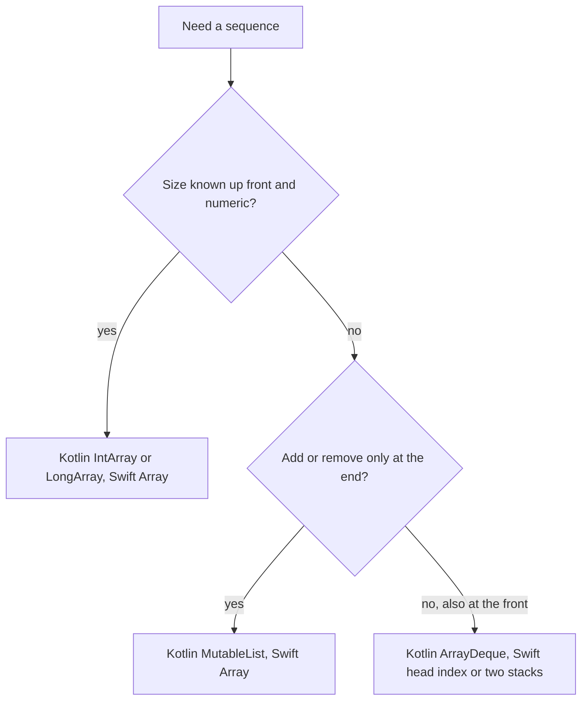
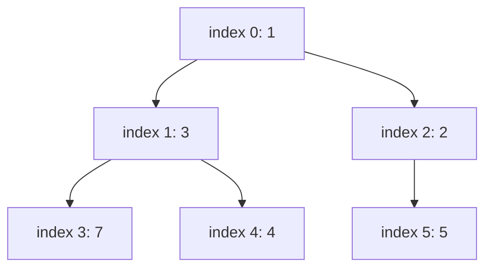

# Kotlin & Swift for Coding Interviews

[⬅ Back to index](../README.md)

Covers: the Kotlin and Swift collections you use in coding rounds and what each operation costs, sorting with custom comparators, heaps and deques (built into Kotlin/JVM, hand-written in Swift), strings and characters, integer overflow, recursion limits, and idioms that keep solutions short and correct.

---

## Collections

### 1. Which list or array type should you use, and what does each operation cost?

**📘 Concept**

<details>
<summary>Answer</summary>

**In short:** In Kotlin, use `IntArray` (or `LongArray`, `BooleanArray`, `CharArray`) for fixed-size numeric data and DP tables, and `MutableList` (an `ArrayList`) when the size changes. In Swift, use plain `Array` for both. All of these are contiguous, growable-at-the-end arrays: index access and append are O(1) (append is amortised), and anything that inserts, removes or searches anywhere else is O(n). Most "my solution is mysteriously O(n²)" bugs come from forgetting that.

#### The Kotlin family

| Type | What it really is | When to use it |
|---|---|---|
| `IntArray`, `LongArray`, `BooleanArray`, `CharArray` | JVM primitive array (`int[]` …), fixed size, no boxing | DP tables, counts, visited flags, anything numeric with a known size. LeetCode signatures usually hand you `IntArray`. |
| `Array<T>` | JVM object array, fixed size | Arrays of objects or of rows: `Array<IntArray>` for a grid. `Array<Int>` boxes every element — avoid it for numbers. |
| `List<T>` (`listOf`) | Read-only *view* over a list | Return values, inputs you won't change |
| `MutableList<T>` (`mutableListOf`, `ArrayList`) | Resizable array (`java.util.ArrayList`) | Results you build up, stacks, anything that grows |

`List<Int>` and `MutableList<Int>` store boxed `Integer` objects. That costs memory and some speed, but for interview sizes (n ≤ 10⁵) it rarely matters. It matters more for DP tables of 10⁶+ cells: use `IntArray`/`LongArray` there.

Creating them:

```kotlin
val counts = IntArray(26)                 // 26 zeros
val squares = IntArray(n) { it * it }     // initialiser gets the index
val dp = LongArray(n + 1)
val result = mutableListOf<Int>()
val fromRange = (1..n).toList()
val asList = nums.toList()                // IntArray -> List<Int> (copy)
val backToArray = result.toIntArray()     // List<Int> -> IntArray (copy)
```

#### The Swift family

Swift has one main type, `Array<Element>` (written `[Int]`). It is a **value type with copy-on-write**: assigning it to another variable is cheap, and the real O(n) copy happens only when one of the two copies is mutated.

```swift
var counts = [Int](repeating: 0, count: 26)
var dp = Array(repeating: 0, count: n + 1)
var result: [Int] = []
result.reserveCapacity(n)                 // optional: avoids regrowth
let squares = (0..<n).map { $0 * $0 }
```

`ContiguousArray` exists and guarantees contiguous storage. On Apple platforms a plain `Array` of class instances may be backed by an `NSArray` for Objective-C bridging; `ContiguousArray` never is. For value types like `Int` there is no practical difference, so in interviews plain `Array` is the right default — mentioning `ContiguousArray` is a nice-to-know, not a must.

#### What each operation costs (both languages)

| Operation | Kotlin | Swift | Cost |
|---|---|---|---|
| Read/write by index | `a[i]`, `a[i] = x` | `a[i]`, `a[i] = x` | O(1) |
| Append at end | `list.add(x)` | `a.append(x)` | O(1) amortised |
| Remove last | `list.removeAt(list.lastIndex)` | `a.removeLast()` / `a.popLast()` | O(1) |
| Insert/remove at front | `list.add(0, x)`, `list.removeAt(0)` | `a.insert(x, at: 0)`, `a.removeFirst()` | **O(n)** — shifts everything |
| Search by value | `x in list`, `indexOf(x)` | `a.contains(x)`, `firstIndex(of:)` | **O(n)** |
| Copy / slice to new array | `copyOf()`, `slice()`, `toList()` | `Array(a[l..<r])` | O(k) for k elements |
| Sort | `sort()`, `sorted()` | `sort()`, `sorted()` | O(n log n) |

"Amortised O(1)" means the array occasionally doubles its capacity and copies everything, but averaged over many appends each costs O(1) (see [Complexity Analysis](02-complexity-analysis.md)).

#### Gotchas worth knowing

- **Using a list as a queue.** `removeAt(0)` / `removeFirst()` in a loop makes BFS O(n²). Use a deque in Kotlin or a head index in Swift — see [question 8](#8-how-do-you-get-a-stack-a-queue-and-a-deque).
- **Swift slices keep the original indices.** `let tail = a[2...]` is an `ArraySlice` whose first index is **2**, not 0. `tail[0]` crashes. Use `tail.first`, `tail.startIndex`, or wrap it: `Array(a[2...])`.
- **Swift array parameters are immutable.** To mutate an input, copy it into a `var` (`var nums = nums`) or take it as `inout`.
- **Kotlin `subList` is a view**, not a copy — changing the original list later can make it invalid. `slice(range)` and `toList()` copy.
- **`listOf` is read-only, not immutable.** The underlying list could still be changed through another reference. Not an interview issue in practice, but don't claim it is a deep copy.
- **Empty ranges.** In Kotlin `0..n - 1` with `n == 0` is just empty. In Swift `0...n - 1` with `n == 0` **crashes** (a closed range needs lower ≤ upper). Prefer `0..<n` in Swift (and `0 until n` or `0..<n` in Kotlin).

#### Choosing quickly



#### Follow-ups

- *Why is `Array<Int>` worse than `IntArray` in Kotlin?* Every element is a heap-allocated `Integer`, so memory is several times larger and reads chase pointers.
- *Does passing a Swift array to a function copy it?* Not until someone mutates one of the copies (copy-on-write), so read-only passing is O(1).

</details>

### 2. How do HashMap/HashSet and Dictionary/Set work in practice, and how do you count frequencies?

**📘 Concept** · ⭐ Product/FAANG favourite

<details>
<summary>Answer</summary>

**In short:** Kotlin's `HashMap`/`HashSet` and Swift's `Dictionary`/`Set` are hash tables: insert, lookup and delete are O(1) on average and O(n) in the pathological worst case. The idioms you will type most are the "read with a default" forms — Kotlin `getOrDefault`, `getOrPut`, `?: 0`; Swift `dict[key, default: 0]` — because counting and grouping are in a huge share of problems. Keys must have a sensible `hashCode`/`equals` (Kotlin) or be `Hashable` (Swift): that rules out `IntArray` keys in Kotlin and tuple keys in Swift.

#### Side by side

| Task | Kotlin | Swift |
|---|---|---|
| Create | `val map = HashMap<String, Int>()` or `mutableMapOf()` | `var map: [String: Int] = [:]` |
| Read (may be missing) | `map[key]` → `Int?` | `map[key]` → `Int?` |
| Read with default | `map.getOrDefault(key, 0)` or `map[key] ?: 0` | `map[key, default: 0]` |
| Write | `map[key] = v` | `map[key] = v` |
| Delete | `map.remove(key)` | `map[key] = nil` or `map.removeValue(forKey: key)` |
| Contains key | `key in map` | `map[key] != nil` |
| Size | `map.size` | `map.count` |
| Iterate | `for ((k, v) in map)` | `for (k, v) in map` |
| Set add | `set.add(x)` → `Boolean` (false if present) | `set.insert(x).inserted` → `Bool` |
| Set contains | `x in set` | `set.contains(x)` |

`mutableMapOf()` and `mutableSetOf()` give you a `LinkedHashMap`/`LinkedHashSet`, which remembers insertion order at a small memory cost. `HashMap()`/`hashSetOf()` don't keep any order. Swift's `Dictionary` and `Set` have **no defined order**, and it can differ between runs — never rely on it in output; sort if the problem asks for an order.

#### Counting frequencies

This is the single most common hash map pattern:

```kotlin
val counts = HashMap<Int, Int>()
for (x in nums) {
    counts[x] = counts.getOrDefault(x, 0) + 1
    // or: counts.merge(x, 1, Int::plus)
}
// one-liner for a whole collection:
val counts2: Map<Int, Int> = nums.groupingBy { it }.eachCount()
```

```swift
var counts: [Int: Int] = [:]
for x in nums {
    counts[x, default: 0] += 1          // mutates in place, no double lookup
}
// one-liner:
let counts2 = nums.reduce(into: [:]) { acc, x in acc[x, default: 0] += 1 }
```

When keys are lowercase letters, an `IntArray(26)` / `[Int](repeating: 0, count: 26)` indexed by `c - 'a'` is faster and simpler than a map (see [question 11](#11-how-do-you-handle-strings-and-characters-in-kotlin)).

#### Grouping: map from key to list

```kotlin
val groups = HashMap<String, MutableList<String>>()
for (w in words) {
    val key = w.toCharArray().sorted().joinToString("")
    groups.getOrPut(key) { mutableListOf() }.add(w)   // creates the list only once
}
```

```swift
var groups: [String: [String]] = [:]
for w in words {
    let key = String(w.sorted())
    groups[key, default: []].append(w)    // appends in place
}
```

`getOrPut` and Swift's `default:` subscript both avoid the classic bug of creating a new list, appending to it, and forgetting to store it back.

#### What can be a key?

- **Kotlin:** any type with value-based `equals`/`hashCode` — `Int`, `String`, `Pair`, `List<Int>`, data classes. **Not `IntArray`**: arrays use identity, so two arrays with the same contents are different keys. Convert with `toList()`, use a `Pair`, a data class, or encode a cell as `r.toLong() * cols + c`.
- **Swift:** any `Hashable` type — `Int`, `String`, `Character`, `[Int]` (arrays of hashable elements are hashable), and your own `struct` declaring `: Hashable`. **Tuples are not `Hashable`**, so `Set<(Int, Int)>` does not compile. Use a small struct or encode as `r * cols + c`.

```swift
struct Cell: Hashable { let r: Int; let c: Int }
var seen = Set<Cell>()
seen.insert(Cell(r: 0, c: 0))
```

#### Costs and the worst case

Average O(1) relies on a good hash spreading keys across buckets. If many keys collide, a bucket grows long and operations degrade — up to O(n) in the worst case. Java 8+ `HashMap` turns very long buckets into balanced trees, so a bucket of mutually comparable keys is O(log n). Swift uses open addressing with per-process random hash seeding, which makes deliberate collision attacks hard. In interviews, say "O(1) average" and move on; how hashing works internally is covered in [Arrays, Strings & Hashing](07-arrays-strings-hashing.md).

#### Pitfalls

- **Modifying a Kotlin map while iterating it** throws `ConcurrentModificationException`. Collect keys first, or use `map.entries.removeIf { … }` / an explicit iterator's `remove()`.
- **`map[key]!!`** crashes when the key is missing — prefer `getOrDefault` or `?: default`.
- **Mutable objects as keys:** changing a key after inserting it (e.g. a `MutableList`) leaves it in the wrong bucket. Use immutable keys.
- **Swift `Dictionary.keys` order** is not sorted — use `map.keys.sorted()`.

#### Follow-ups

- *When would you use a sorted map instead?* When you need "the largest key ≤ x" or ordered iteration — see [question 7](#7-what-do-you-use-for-a-sorted-map-or-sorted-set).
- *Memory cost?* A hash map uses noticeably more memory per entry than an array. If keys are small dense integers, a plain array indexed by key is both faster and smaller.

</details>

### 3. How do you work with 2D arrays and grids?

**📘 Concept**

<details>
<summary>Answer</summary>

**In short:** Kotlin grids are `Array<IntArray>` (or `Array<CharArray>`, `Array<BooleanArray>`) built with `Array(rows) { IntArray(cols) }`. Swift grids are `[[Int]]` built with `Array(repeating: Array(repeating: 0, count: cols), count: rows)` — safe because Swift arrays are values, so the rows are independent. Iterate neighbours with a direction list, always bounds-check before indexing, and encode a cell as `r * cols + c` when you need it as a single key.

#### Creating grids

```kotlin
val rows = grid.size
val cols = grid[0].size
val dist = Array(rows) { IntArray(cols) { -1 } }      // every cell -1
val visited = Array(rows) { BooleanArray(cols) }
val copy = grid.map { it.copyOf() }.toTypedArray()    // deep copy of Array<IntArray>
```

The lambda in `Array(rows) { … }` runs once per row, so each row is a new array. The classic bug is creating one row and reusing it:

```kotlin
val row = IntArray(cols)
val bad = Array(rows) { row }   // every row is the SAME array: writing bad[0][0] changes all rows
```

```swift
let rows = grid.count, cols = grid[0].count
var dist = Array(repeating: Array(repeating: -1, count: cols), count: rows)
var visited = [[Bool]](repeating: [Bool](repeating: false, count: cols), count: rows)
```

In Swift, `Array(repeating: row, count: rows)` looks like the Python aliasing bug but is fine: each row is a value, and writing to one triggers copy-on-write for that row only.

#### Visiting neighbours

```kotlin
val dirs = arrayOf(intArrayOf(1, 0), intArrayOf(-1, 0), intArrayOf(0, 1), intArrayOf(0, -1))

for ((dr, dc) in dirs) {                 // destructuring works on IntArray (component1/2)
    val nr = r + dr
    val nc = c + dc
    if (nr !in 0 until rows || nc !in 0 until cols) continue
    // use grid[nr][nc]
}
```

```swift
let dirs = [(1, 0), (-1, 0), (0, 1), (0, -1)]
for (dr, dc) in dirs {
    let nr = r + dr, nc = c + dc
    guard nr >= 0, nr < rows, nc >= 0, nc < cols else { continue }
    // use grid[nr][nc]
}
```

Tuples are fine in an array you only iterate — they just can't be `Set`/`Dictionary` keys.

#### Mutating the input in place

LeetCode often hands Swift a `[[Character]]` parameter, which is immutable. Write `var grid = grid` (one O(rows·cols) copy) and then mark visited cells by overwriting them. A nested function can capture and mutate that local `var`:

```swift
func numIslands(_ grid: [[Character]]) -> Int {
    var grid = grid
    let rows = grid.count, cols = grid[0].count

    func sink(_ r: Int, _ c: Int) {
        guard r >= 0, r < rows, c >= 0, c < cols, grid[r][c] == "1" else { return }
        grid[r][c] = "0"
        sink(r + 1, c); sink(r - 1, c); sink(r, c + 1); sink(r, c - 1)
    }

    var islands = 0
    for r in 0..<rows {
        for c in 0..<cols where grid[r][c] == "1" {
            islands += 1
            sink(r, c)
        }
    }
    return islands
}
```

In Kotlin the `Array<CharArray>` parameter is a reference, so writing `grid[r][c] = '0'` mutates the caller's grid directly. Say so if the interviewer might care about not changing the input.

#### Encoding cells as single numbers

For a BFS queue or a visited set, one `Int` per cell is cheaper than a pair:

```kotlin
val id = r * cols + c       // encode
val r2 = id / cols          // decode
val c2 = id % cols
```

This is valid while `rows * cols` fits in an `Int` (it does for grid problems).

#### Pitfalls

- **`grid[0].size` on an empty grid** crashes — check `grid.isEmpty()` first if empty input is allowed.
- **Rows vs columns swapped**: `grid[r][c]` — row first. Name variables `r`/`c`, not `i`/`j`, to avoid swapping them.
- **Deep recursion on big grids**: a DFS flood fill on a 1000×1000 grid of land can be 10⁶ calls deep and overflow the stack. Use BFS or an explicit stack — see [question 14](#14-how-deep-can-recursion-go-and-what-do-you-do-when-it-is-too-deep).

#### Follow-ups

- *Jagged grids?* Kotlin `Array<IntArray>` and Swift `[[Int]]` allow rows of different lengths, so use `grid[r].size` when rows may differ (e.g. Pascal's triangle).
- *Where are grid algorithms covered?* BFS/DFS on grids in [Graphs: BFS, DFS & Topological Sort](16-graphs-bfs-dfs-topo.md), grid DP in [Dynamic Programming](19-dynamic-programming.md).

</details>

## Sorting & searching

### 4. How do you sort with a custom comparator?

**📘 Concept** · ⭐ Product/FAANG favourite

<details>
<summary>Answer</summary>

**In short:** In Kotlin use `sortBy { key }` / `sortedBy` for one key and `sortWith(compareBy({ a }, { b }))` or `compareBy<T> { a }.thenBy { b }` for several keys, with `Descending` variants for reverse order. In Swift use `sort(by:)` / `sorted(by:)` with a closure that returns "should `a` come before `b`?", and compare tuples — `(a.x, a.y) < (b.x, b.y)` — for several keys. Both sorts are O(n log n). Never sort with subtraction (`a - b`) — it overflows.

#### Kotlin

```kotlin
val nums = intArrayOf(5, 2, 9)
nums.sort()                         // in place, ascending
nums.sortDescending()               // in place, descending
val asc = nums.sorted()             // new List<Int>

val words = mutableListOf("pear", "fig", "apple")
words.sortBy { it.length }                               // by one key
words.sortWith(compareBy({ it.length }, { it }))         // length, then alphabetical
words.sortWith(compareByDescending<String> { it.length }.thenBy { it })  // longest first, ties alphabetical

val intervals = arrayOf(intArrayOf(3, 5), intArrayOf(1, 4))
intervals.sortBy { it[0] }                               // Array<IntArray> sorts in place by start

data class Person(val name: String, val age: Int)
val people = listOf(Person("Bo", 30), Person("Al", 30), Person("Cy", 25))
val byAgeThenName = people.sortedWith(compareBy<Person> { it.age }.thenBy { it.name })
```

A hand-written comparator returns negative / zero / positive:

```kotlin
val cmp = Comparator<IntArray> { a, b ->
    if (a[0] != b[0]) a[0].compareTo(b[0]) else b[1].compareTo(a[1])  // start asc, end desc
}
intervals.sortWith(cmp)
```

Note: Kotlin's `Pair` is **not** `Comparable`, so `listOfPairs.sorted()` doesn't compile — use `sortedWith(compareBy({ it.first }, { it.second }))`.

#### Swift

```swift
var nums = [5, 2, 9]
nums.sort()                         // in place, ascending
nums.sort(by: >)                    // in place, descending
let asc = nums.sorted()             // new array

var words = ["pear", "fig", "apple"]
words.sort { $0.count < $1.count }                          // by one key
words.sort { ($0.count, $0) < ($1.count, $1) }              // length, then alphabetical

var intervals = [[3, 5], [1, 4]]
intervals.sort { $0[0] < $1[0] }
```

Tuples of `Comparable` values compare lexicographically with `<` (the standard library provides this for tuples of up to six elements). For mixed directions, write the comparison out — it is clearer than tricks with swapped tuple elements:

```swift
people.sort { a, b in
    if a.age != b.age { return a.age > b.age }   // age descending
    return a.name < b.name                        // then name ascending
}
```

#### The comparator contract

- **Kotlin:** `compare(a, b)` must be consistent — if `a < b` and `b < c` then `a < c`, and `compare(a, a) == 0`. A broken comparator can make the JVM's sort throw `IllegalArgumentException: Comparison method violates its general contract!`.
- **Swift:** the closure must be a *strict* ordering — `a < b`, **never** `a <= b`. With `<=`, equal elements each claim to come before the other, and the sort's result is not well defined.

#### Why subtraction is a bug

`Comparator { a, b -> a - b }` looks fine and passes small tests, but `a - b` overflows when `a` is large positive and `b` large negative (e.g. `Int.MAX_VALUE - (-1)` wraps to a negative number), giving the wrong order. Use `a.compareTo(b)` or `compareValues(a, b)` in Kotlin; Swift closures return a `Bool`, so the issue doesn't arise there.

#### Pitfalls

- **`sorted()` vs `sort()`**: `sorted()` returns a new collection and leaves the original unchanged; `sort()` mutates. Calling `nums.sorted()` and ignoring the result is a common silent bug.
- **`IntArray.sorted()` returns a `List<Int>`** — use `sortedArray()` if you want an `IntArray` back.
- **Sorting strings by length with ties**: decide the tie-break explicitly if output order is checked.

#### Follow-ups

- *Is the sort stable?* See [question 5](#5-are-kotlin-and-swift-sorts-stable-and-why-does-it-matter).
- *Sorting characters of a string?* Kotlin `s.toCharArray().sorted().joinToString("")` or `String(s.toCharArray().apply { sort() })`; Swift `String(s.sorted())`.
- *Custom order in a heap?* The same comparators plug into `PriorityQueue` — see [question 9](#9-how-do-you-use-priorityqueue-in-kotlin).

</details>

### 5. Are Kotlin and Swift sorts stable, and why does it matter?

**📘 Concept**

<details>
<summary>Answer</summary>

**In short:** A *stable* sort keeps equal elements in their original relative order. Kotlin's sorts on lists and object arrays (`sortWith`, `sortBy`, `sortedWith`, …) are documented as stable — they run on the JVM's TimSort. Swift's `sort`/`sorted` are also stable: the implementation has been stable since Swift 5, and Apple's documentation now guarantees it (Swift Evolution proposal SE-0372, "Document Sorting as Stable"). Even so, making the comparator break ties explicitly is the clearest interview answer. For primitive arrays (`IntArray`) stability is meaningless, because equal numbers are indistinguishable.

#### What stability means, with an example

Sort these people by age only:

| Before | After (stable) | After (allowed if unstable) |
|---|---|---|
| (Bo, 30) | (Cy, 25) | (Cy, 25) |
| (Al, 30) | (Bo, 30) | **(Al, 30)** |
| (Cy, 25) | (Al, 30) | **(Bo, 30)** |

A stable sort guarantees Bo stays before Al because Bo came first. An unstable sort may swap them.

#### Why it matters in interviews

1. **Multi-pass sorting.** Sorting by name and then *stably* by age gives "by age, ties by name". With an unstable second pass, the first pass is lost.
2. **"Keep original order for ties" requirements.** Problems such as sorting by frequency and then by first appearance are easy to get subtly wrong.
3. **Determinism.** If the expected output lists ties in a particular order, an unstable sort can pass locally and fail on hidden tests.

#### Kotlin details

- `MutableList.sort()`, `sortBy`, `sortWith`, `sorted()`, `sortedBy`, `sortedWith`, and the same functions on `Array<T>` are stable (the Kotlin docs say so; on the JVM they use TimSort via `java.util`).
- `IntArray.sort()` uses a dual-pivot quicksort on primitives — not stable, but it doesn't matter since equal `Int`s are identical.

#### Swift details

- Swift 5 replaced the old introsort with a modified timsort, which is stable.
- For years the documentation didn't promise stability; SE-0372 changed that, and the docs for `sort()`, `sort(by:)` and `sorted(by:)` now state the sort is guaranteed to be stable. On an older toolchain or if you want the intent to be obvious, add an explicit tie-break.
- The explicit version is cheap: carry the original index and use it as the last key.

```swift
let sortedPeople = people.enumerated()
    .sorted { a, b in
        if a.element.age != b.element.age { return a.element.age < b.element.age }
        return a.offset < b.offset          // explicit tie-break: original position
    }
    .map { $0.element }
```

The same trick works in any language and makes the intent visible to the interviewer.

#### Best practice in both languages

Make the ordering **total**: add keys until no two distinct items compare equal (e.g. age, then name, then original index). Then stability stops mattering and the output is deterministic everywhere.

#### Follow-ups

- *Which classic algorithms are stable?* Merge sort, insertion sort, counting sort and TimSort are stable; quicksort, heap sort and selection sort (as usually written) are not.
- *Is Kotlin's `sortedByDescending` stable?* Yes — equal keys keep their original order; it does not reverse ties.

</details>

### 6. How do you binary search with the standard library, and when should you write your own?

**📘 Concept**

<details>
<summary>Answer</summary>

**In short:** Kotlin has `binarySearch` on sorted lists and arrays. It returns the index if the element is found, otherwise `-(insertionPoint) - 1` — a negative number that encodes where the element would go. With duplicates it may return **any** matching index. Swift's standard library has no binary search on arrays, so you write a 6-line `lowerBound`. In interviews, writing your own lower/upper bound is usually clearer and works in both languages.

#### Kotlin's built-in

```kotlin
val a = intArrayOf(1, 3, 3, 5, 8)
a.binarySearch(5)        // 3
a.binarySearch(4)        // -4  -> insertion point is 3
a.binarySearch(3)        // 1 or 2 -- unspecified with duplicates

val i = a.binarySearch(4)
val insertAt = if (i >= 0) i else -(i + 1)   // decode the insertion point
```

Why `-(p) - 1` instead of `-p`? Because the insertion point can be 0, and `-0` would be indistinguishable from "found at 0". Subtracting one more makes every "not found" result negative.

Other forms:

```kotlin
val list = listOf(1, 3, 5)
list.binarySearch(3)                                   // natural order
words.binarySearch("kiwi", compareBy<String> { it.length })  // list sorted by that comparator
intervals.binarySearch { compareValues(it.start, 7) }  // compare element to target: negative = element too small
list.binarySearch(3, fromIndex = 1, toIndex = 3)      // search a range
```

The list **must be sorted by the same order** you search with; otherwise the result is meaningless (no exception is thrown).

#### Writing your own (both languages)

Most problems need the *first* index where something becomes true — a lower bound — not "any index equal to x". The half-open template:

```kotlin
// first index i with a[i] >= target, or a.size if none
fun lowerBound(a: IntArray, target: Int): Int {
    var lo = 0
    var hi = a.size                 // search in [lo, hi)
    while (lo < hi) {
        val mid = lo + (hi - lo) / 2   // no overflow
        if (a[mid] < target) lo = mid + 1 else hi = mid
    }
    return lo
}
```

```swift
// first index i with a[i] >= target, or a.count if none
func lowerBound(_ a: [Int], _ target: Int) -> Int {
    var lo = 0, hi = a.count
    while lo < hi {
        let mid = lo + (hi - lo) / 2
        if a[mid] < target { lo = mid + 1 } else { hi = mid }
    }
    return lo
}
```

Change `<` to `<=` and you get `upperBound` (first index with `a[i] > target`). From those two:

| Question | Answer |
|---|---|
| Does `x` exist? | `lb < n && a[lb] == x` |
| First occurrence of `x` | `lb` (if it exists) |
| Last occurrence of `x` | `upperBound(x) - 1` |
| Count of `x` | `upperBound(x) - lowerBound(x)` |
| Count of elements `< x` | `lowerBound(x)` |

Trace for `a = [1, 3, 3, 5, 8]`, `target = 3`:

| lo | hi | mid | a[mid] | action |
|---|---|---|---|---|
| 0 | 5 | 2 | 3 | not < 3, so hi = 2 |
| 0 | 2 | 1 | 3 | not < 3, so hi = 1 |
| 0 | 1 | 0 | 1 | < 3, so lo = 1 |
| 1 | 1 | – | – | stop, answer 1 |

#### What about Swift?

The standard library has `firstIndex(where:)`, which is a linear O(n) scan — fine for small inputs, but it is not a binary search. `partitioningIndex(where:)` lives in the separate swift-algorithms package, which coding platforms usually don't provide. So write `lowerBound` yourself.

#### Pitfalls

- Using Kotlin's result directly as an index when it's negative → `ArrayIndexOutOfBoundsException`.
- Expecting the first occurrence from `binarySearch` with duplicates.
- `(lo + hi) / 2` can overflow `Int` for huge ranges (binary search on the answer up to 2·10⁹); `lo + (hi - lo) / 2` can't.

#### Follow-ups

- *Binary search on the answer?* Same template with a feasibility check instead of `a[mid] < target` — see [Binary Search](10-binary-search.md) and [Reusable Code Templates](05-reusable-templates.md).
- *Need lower bound on a changing set of keys?* Use a `TreeMap`/`TreeSet` in Kotlin — [question 7](#7-what-do-you-use-for-a-sorted-map-or-sorted-set).

</details>

### 7. What do you use for a sorted map or sorted set?

**📘 Concept**

<details>
<summary>Answer</summary>

**In short:** In Kotlin, use `java.util.TreeMap` / `TreeSet` — red-black trees with O(log n) insert, delete and lookup, plus the navigation queries `floorKey`, `ceilingKey`, `lowerKey`, `higherKey`, `firstKey`, `lastKey`. Swift's standard library has **no sorted map or set**. The usual workarounds are a sorted array plus binary search (O(log n) queries, O(n) inserts), sorting once when all data is known up front, or a heap if you only need the minimum or maximum.

#### Kotlin: TreeMap and TreeSet

```kotlin
import java.util.TreeMap
import java.util.TreeSet

val tm = TreeMap<Int, String>()
tm[10] = "a"; tm[20] = "b"; tm[30] = "c"

tm.floorKey(25)      // 20   largest key <= 25
tm.ceilingKey(25)    // 30   smallest key >= 25
tm.lowerKey(20)      // 10   largest key < 20
tm.higherKey(20)     // 30   smallest key > 20
tm.floorKey(5)       // null -- no such key
tm.firstKey()        // 10   (throws NoSuchElementException if empty)
tm.lastEntry()       // 30=c
tm.pollFirstEntry()  // removes and returns 10=a
tm.headMap(30)       // view of keys < 30
tm.tailMap(20, true) // view of keys >= 20

val ts = TreeSet<Int>(listOf(4, 1, 9))
ts.floor(5)          // 4
ts.ceiling(5)        // 9
ts.first()           // 1
ts.pollLast()        // 9 (removes it)
```

The navigation methods return `null` when there is no answer; on the JVM they are platform types, so handle `null` explicitly (`?: -1`, `?.let`). `firstKey()`/`lastKey()` and `first()`/`last()` throw on an empty collection, so check `isEmpty()` first.

All of these are O(log n). Iteration is in sorted key order.

Typical uses:

- **Interval booking / My Calendar:** `floorKey(start)` finds the interval that begins before the new one; check overlap.
- **Sliding-window min/max with deletions:** a `TreeMap<Int, Int>` of value → count, so duplicates are handled; `firstKey()`/`lastKey()` give min/max.
- **"Closest value ≤ x" in a stream of inserts.**

A TreeSet can't hold duplicates — use `TreeMap<value, count>` when values repeat:

```kotlin
fun add(m: TreeMap<Int, Int>, x: Int) { m[x] = (m[x] ?: 0) + 1 }
fun remove(m: TreeMap<Int, Int>, x: Int) {
    val c = m[x] ?: return
    if (c == 1) m.remove(x) else m[x] = c - 1
}
```

#### Swift: the workarounds

1. **Sorted array + binary search.** Queries are O(log n) with the `lowerBound` from [question 6](#6-how-do-you-binary-search-with-the-standard-library-and-when-should-you-write-your-own); inserting keeps the array sorted at O(n) per insert because elements shift.

```swift
var keys: [Int] = []
func insert(_ x: Int) {
    keys.insert(x, at: lowerBound(keys, x))   // O(n) shift, but memmove is fast
}
func floor(_ x: Int) -> Int? {                // largest key <= x
    let i = lowerBound(keys, x + 1)           // first index > x
    return i > 0 ? keys[i - 1] : nil
}
```

For n up to ~10⁴–10⁵ inserts this is often fast enough in practice, but say clearly that it is O(n) per insert — the interviewer will want to hear you know that.

2. **Sort once, then query.** If all values are known before the queries (offline processing), sort once and binary search — no tree needed.
3. **Heap** if you only ever need the min or max — see [question 10](#10-how-do-you-get-a-heap-in-swift).
4. **Hand-written balanced tree** (or a skip list) — rarely expected. Mention it as the "real" answer and ask whether the interviewer wants it.

#### Kotlin vs Swift, side by side

| Need | Kotlin | Swift |
|---|---|---|
| Ordered unique keys with inserts | `TreeSet` | sorted array + `lowerBound` (O(n) insert) |
| Largest key ≤ x | `floorKey(x)` | `lowerBound(keys, x + 1) - 1` |
| Min / max with deletions | `TreeMap` of counts | two heaps with lazy deletion, or sorted array |
| Sorted iteration | iterate the TreeMap | `dict.keys.sorted()` (O(n log n) each time) |

#### Pitfalls

- Using `HashMap` and calling `keys.sorted()` on every query — O(n log n) per query.
- Forgetting that `TreeMap` keys need a consistent ordering. If you pass a comparator, it defines equality too: two keys that compare as 0 are the same key.
- Swift's `x + 1` in `floor` overflows if `x == Int.max` — rarely matters, but you can write a separate `upperBound` instead.

#### Follow-ups

- *Why not a hash map?* Hash maps answer "is x present?" but not "what's the nearest key to x?".
- *Complexity of `headMap`?* Creating the view is O(log n), but iterating it is O(k) for k entries.

</details>

## Stacks, queues & heaps

### 8. How do you get a stack, a queue and a deque?

**📘 Concept** · ⭐ Product/FAANG favourite

<details>
<summary>Answer</summary>

**In short:** In Kotlin, `ArrayDeque` (from `kotlin.collections`, no import needed) is a resizable circular buffer with O(1) add and remove at **both** ends, so it is your stack, your queue and your deque. In Swift, an `Array` is a great stack (`append` / `popLast`), but there's no built-in queue or deque: `removeFirst()` is O(n). Use an array plus a moving head index for a queue, and the same trick (head index + `removeLast`) for the monotonic deques used in sliding-window problems.

#### Kotlin: one class for everything

```kotlin
val stack = ArrayDeque<Int>()
stack.addLast(1); stack.addLast(2)
stack.last()          // 2 (peek)
stack.removeLast()    // 2 (pop)

val queue = ArrayDeque<Int>()
queue.addLast(1); queue.addLast(2)   // enqueue at the back
queue.first()         // 1 (peek)
queue.removeFirst()   // 1 (dequeue from the front)

val dq = ArrayDeque<Int>()
dq.addFirst(0); dq.addLast(9)
dq.removeFirstOrNull()  // 0, or null when empty
```

| Operation | Kotlin `ArrayDeque` | Cost |
|---|---|---|
| Push/pop back | `addLast`, `removeLast` | O(1) amortised |
| Push/pop front | `addFirst`, `removeFirst` | O(1) amortised |
| Peek | `first()`, `last()` (throw if empty), `firstOrNull()`, `lastOrNull()` | O(1) |
| Index access | `dq[i]` | O(1) |
| Contains | `x in dq` | O(n) |

Avoid `java.util.Stack` — it's a legacy synchronized class built on `Vector`. `java.util.ArrayDeque` also works (`push`/`pop`/`peek` act on the *front*, `offer`/`poll` treat it as a queue), but mixing its method names is a common source of bugs. Using the Kotlin `ArrayDeque` with explicit `First`/`Last` names makes the direction obvious.

BFS in Kotlin:

```kotlin
val queue = ArrayDeque<Int>()
queue.addLast(start)
visited[start] = true
while (queue.isNotEmpty()) {
    repeat(queue.size) {                 // one BFS level
        val node = queue.removeFirst()
        for (next in graph[node]) {
            if (!visited[next]) { visited[next] = true; queue.addLast(next) }
        }
    }
}
```

`repeat(queue.size)` evaluates the size once, before the level starts, which is exactly what level-order processing needs.

#### Swift: stack is easy

```swift
var stack: [Int] = []
stack.append(1)
stack.last            // peek, Int?
stack.popLast()       // pop, Int? (nil when empty)
stack.removeLast()    // pop, crashes when empty
```

#### Swift: queue with a head index

`removeFirst()` shifts every remaining element, so a BFS that calls it each step is O(n²). Instead, never remove — just move a read pointer forward:

```swift
var queue = [start]
var head = 0
visited[start] = true
while head < queue.count {
    let node = queue[head]
    head += 1
    for next in graph[node] where !visited[next] {
        visited[next] = true
        queue.append(next)
    }
}
```

Each element is appended once and read once, so BFS is O(V + E). Memory grows to the total number of enqueued items — fine for BFS, where that's at most V. For level-by-level BFS, a common alternative is swapping two arrays: `current` and `next`.

A reusable version, if you prefer a type:

```swift
struct Queue<T> {
    private var items: [T] = []
    private var head = 0
    var isEmpty: Bool { head == items.count }
    var count: Int { items.count - head }
    mutating func enqueue(_ x: T) { items.append(x) }
    mutating func dequeue() -> T? {
        guard head < items.count else { return nil }
        let x = items[head]
        head += 1
        if head > 1024 && head * 2 > items.count {   // occasionally drop the consumed prefix
            items.removeFirst(head)
            head = 0
        }
        return x
    }
}
```

#### Swift: monotonic deque

Sliding Window Maximum needs pops from the back and the front, but pushes only at the back. A head index handles the front, and `removeLast` handles the back:

```swift
var dq: [Int] = []        // indices, values decreasing
var head = 0
for i in 0..<nums.count {
    while dq.count > head && nums[dq[dq.count - 1]] <= nums[i] { dq.removeLast() }
    dq.append(i)
    if dq[head] <= i - k { head += 1 }     // front index left the window
    if i >= k - 1 { result.append(nums[dq[head]]) }
}
```

`removeLast` never removes below `head` because the `dq.count > head` check guards it. (Full problem in [Two Pointers & Sliding Window](08-two-pointers-sliding-window.md).)

A true double-ended queue with pushes at both ends needs a ring buffer; the `swift-collections` package has `Deque`, but coding platforms usually don't let you import it.

#### Pitfalls

- Kotlin: `queue.first()` / `removeFirst()` throw `NoSuchElementException` on an empty deque — loop on `isNotEmpty()` or use the `OrNull` variants.
- Swift: `removeFirst()` in a BFS loop — correct, but O(n) per call.
- Using a `MutableList` with `removeAt(0)` as a queue in Kotlin — O(n) per call.

#### Follow-ups

- *Implement a queue with two stacks?* Push to `inStack`; when `outStack` is empty, move everything across; pop from `outStack`. Amortised O(1) — see [Stacks, Queues & Monotonic Stack](11-stacks-queues-monotonic.md).
- *Why is `ArrayDeque` faster than `LinkedList`?* Contiguous memory and no per-node allocation.

</details>

### 9. How do you use PriorityQueue in Kotlin?

**📘 Concept** · ⭐ Product/FAANG favourite

<details>
<summary>Answer</summary>

**In short:** `java.util.PriorityQueue` is a binary heap. By default it's a **min-heap** in natural order; pass a comparator for anything else — `compareByDescending { it }` (or `Collections.reverseOrder()`) for a max-heap, `compareBy { it[0] }` for arrays, `compareBy({ it.first }, { it.second })` for pairs. `add`/`offer` and `poll` are O(log n), `peek` is O(1), but `remove(x)` and `contains(x)` are O(n), and iterating it does **not** give sorted order.

#### Creating heaps

```kotlin
import java.util.PriorityQueue

val minHeap = PriorityQueue<Int>()                               // smallest on top
val maxHeap = PriorityQueue<Int>(compareByDescending { it })     // largest on top
val byDistance = PriorityQueue<IntArray>(compareBy { it[0] })    // [dist, node]
val byFreqThenWord = PriorityQueue<Pair<String, Int>>(
    compareBy<Pair<String, Int>> { it.second }.thenByDescending { it.first }
)
```

`Collections.reverseOrder()` (from `java.util`) also gives a max-heap for `Comparable` types. Avoid `PriorityQueue<Int> { a, b -> b - a }`: the subtraction can overflow (see [question 4](#4-how-do-you-sort-with-a-custom-comparator)); use `b.compareTo(a)`.

#### Operations and costs

| Operation | Method | Cost | Empty heap |
|---|---|---|---|
| Insert | `add(x)` / `offer(x)` | O(log n) | – |
| Look at top | `peek()` | O(1) | returns `null` |
| Remove top | `poll()` | O(log n) | returns `null` |
| Remove top (strict) | `remove()` | O(log n) | throws |
| Remove arbitrary element | `remove(x)` | **O(n)** | – |
| Contains | `contains(x)` | **O(n)** | – |
| Size | `size`, `isEmpty()` | O(1) | – |
| Build from a collection | `PriorityQueue(list)` | O(n) | – |

#### How it's stored

A binary heap is a complete binary tree kept in an array: the children of index `i` are `2i + 1` and `2i + 2`, and every parent is ≤ its children (for a min-heap). Only the **top** is guaranteed to be the minimum — the rest of the array is only partly ordered.



That's why `println(heap)` or `for (x in heap)` shows something like `[1, 3, 2, 7, 4, 5]` — not sorted. To read it in order, `poll()` repeatedly.

#### Patterns you'll use it for

**Top-K largest: keep a min-heap of size K.** The top is the smallest of the K largest — the K-th largest.

```kotlin
fun findKthLargest(nums: IntArray, k: Int): Int {
    val heap = PriorityQueue<Int>()
    for (x in nums) {
        heap.add(x)
        if (heap.size > k) heap.poll()      // drop the smallest; keep the k largest
    }
    return heap.peek()
}
```

O(n log k) time, O(k) space.

**Dijkstra with lazy deletion.** Java's heap can't lower a priority in place, so push a new entry and skip stale ones when popped:

```kotlin
val pq = PriorityQueue<LongArray>(compareBy { it[0] })   // [dist, node]
pq.add(longArrayOf(0L, src.toLong()))
while (pq.isNotEmpty()) {
    val (d, uL) = pq.poll()
    val u = uL.toInt()
    if (d > dist[u]) continue            // stale entry, a shorter path was already found
    for ((v, w) in graph[u]) {
        if (d + w < dist[v]) { dist[v] = d + w; pq.add(longArrayOf(dist[v], v.toLong())) }
    }
}
```

(Full version in [Advanced Graphs](17-advanced-graphs.md).)

#### Pitfalls

- **Expecting a max-heap by default.** It's a min-heap.
- **Mutating an element while it's in the heap** (e.g. changing `arr[0]` of an `IntArray` already inserted). The heap doesn't notice, and its order breaks. Remove and re-insert instead.
- **`poll()` returns a nullable** — in Kotlin it's a platform type, so `heap.poll() + 1` compiles but throws `NullPointerException` when empty. Check `isNotEmpty()` first.
- **Using `remove(x)` in a loop** — O(n) each. Use lazy deletion or a `TreeMap` of counts.

#### Follow-ups

- *Running median?* A max-heap for the lower half and a min-heap for the upper half — see [Problem-Solving Tricks](06-problem-solving-tricks.md).
- *Heap vs sort for top-K?* Sorting is O(n log n); a size-K heap is O(n log k) and works on streams. Quickselect is O(n) average. See [Heaps & Priority Queues](13-heaps-priority-queues.md).

</details>

### 10. How do you get a heap in Swift?

**📘 Concept** · ⭐ Product/FAANG favourite

<details>
<summary>Answer</summary>

**In short:** The Swift standard library has no heap or priority queue. Apple's `swift-collections` package has `Heap`, but coding platforms usually don't let you import packages, so you write a small generic binary heap yourself: an array plus two operations, sift-up after `append` and sift-down after moving the last element to the root. It's about 35 lines; practise until you can type it from memory in under five minutes.

#### The compact heap

```swift
struct Heap<T> {
    private var items: [T] = []
    private let higherPriority: (T, T) -> Bool    // true if the first should be nearer the top

    init(_ higherPriority: @escaping (T, T) -> Bool) {
        self.higherPriority = higherPriority
    }

    var isEmpty: Bool { items.isEmpty }
    var count: Int { items.count }
    var peek: T? { items.first }

    mutating func push(_ x: T) {
        items.append(x)
        var child = items.count - 1
        while child > 0 {                               // sift up
            let parent = (child - 1) / 2
            if !higherPriority(items[child], items[parent]) { break }
            items.swapAt(child, parent)
            child = parent
        }
    }

    mutating func pop() -> T? {
        guard !items.isEmpty else { return nil }
        items.swapAt(0, items.count - 1)                // move the top to the end
        let top = items.removeLast()
        var parent = 0
        while true {                                    // sift down
            let left = 2 * parent + 1, right = left + 1
            var best = parent
            if left < items.count && higherPriority(items[left], items[best]) { best = left }
            if right < items.count && higherPriority(items[right], items[best]) { best = right }
            if best == parent { break }
            items.swapAt(parent, best)
            parent = best
        }
        return top
    }
}
```

Using it:

```swift
var minHeap = Heap<Int>(<)                 // smallest on top
var maxHeap = Heap<Int>(>)                 // largest on top
var byDist = Heap<(dist: Int, node: Int)> { $0.dist < $1.dist }   // tuples are fine here

minHeap.push(5); minHeap.push(1); minHeap.push(3)
minHeap.pop()   // 1
minHeap.peek    // 3
```

Tuples work as elements because the heap only needs the closure, not `Comparable` or `Hashable`.

#### Why it works

The array is a complete binary tree: parent of `i` is `(i - 1) / 2`, children are `2i + 1` and `2i + 2`. The **heap property** is "every parent has higher priority than its children", so the root is the best element.

- **push:** add at the end (keeps the tree complete), then swap upwards while the new item beats its parent. At most the tree height, O(log n), swaps.
- **pop:** the root is the answer. Move the last item to the root (keeps the tree complete), then swap it down with its better child until both children are worse. O(log n).

Trace pushing 5, 1, 3 into a min-heap, then popping:

| Step | Array | What happened |
|---|---|---|
| push 5 | [5] | – |
| push 1 | [5, 1] → [1, 5] | 1 beats parent 5, swap |
| push 3 | [1, 5, 3] | 3 doesn't beat parent 1, stop |
| pop | swap root and last → [3, 5, 1], remove 1 → [3, 5] | 3 vs child 5: 3 is better, stop. Returned 1 |

#### Example: K-th largest in Swift

```swift
func findKthLargest(_ nums: [Int], _ k: Int) -> Int {
    var heap = Heap<Int>(<)                 // min-heap of the k largest
    for x in nums {
        heap.push(x)
        if heap.count > k { _ = heap.pop() }
    }
    return heap.peek!
}
```

#### Pitfalls

- **Using `<=` in the closure.** It still works for a heap (unlike sorting), but `<` is the convention and avoids needless swaps of equal items.
- **Forgetting `mutating`** on `push`/`pop` — the struct won't compile.
- **Declaring the heap with `let`** — it must be `var` to call mutating methods.
- **Sorting after every insert** (`arr.append(x); arr.sort()`) as a "heap" — that's O(n log n) per insert. Fine for tiny inputs, but say it's a shortcut.

#### Follow-ups

- *Build a heap from an array in O(n)?* Sift down every index from `n / 2 - 1` down to 0. Proof sketch in [Heaps & Priority Queues](13-heaps-priority-queues.md).
- *Decrease-key for Dijkstra?* Use lazy deletion: push the new distance and skip stale entries when popped, exactly as in Kotlin ([question 9](#9-how-do-you-use-priorityqueue-in-kotlin)).

</details>

## Strings & numbers

### 11. How do you handle strings and characters in Kotlin?

**📘 Concept**

<details>
<summary>Answer</summary>

**In short:** A Kotlin `String` is immutable and randomly indexable — `s[i]` is O(1) and gives a `Char`. Build strings with `StringBuilder` (or `buildString { }`), never `+=` in a loop, which is O(n²). For in-place edits, convert to a `CharArray` and back. `Char` arithmetic is direct: `c - 'a'` is an `Int` offset and `'a' + i` is a `Char`; `c.code` gives the numeric code.

#### Core operations

| Task | Kotlin | Cost |
|---|---|---|
| Length / char at | `s.length`, `s[i]` | O(1) |
| Substring | `s.substring(start, endExclusive)` | O(k) copy |
| Concatenate in a loop | `StringBuilder().append(x)` | O(1) amortised per char |
| Mutable chars | `val chars = s.toCharArray()`, then `String(chars)` | O(n) each way |
| Reverse | `s.reversed()`, `sb.reverse()` | O(n) |
| Compare content | `s == t` | O(n) |
| Split on spaces | `s.trim().split(Regex("\\s+"))` | O(n) |
| Join | `list.joinToString(" ")` | O(total length) |
| Int ↔ String | `s.toInt()`, `s.toIntOrNull()`, `n.toString()` | O(digits) |
| Binary string | `n.toString(2)`, `s.toInt(2)` | O(bits) |

#### Building strings

```kotlin
// O(n²): each += copies the whole string so far
var bad = ""
for (c in s) bad += c

// O(n)
val sb = StringBuilder()
for (c in s) sb.append(c)
val good = sb.toString()

// same thing, shorter
val alsoGood = buildString { for (c in s) if (c.isLetter()) append(c.lowercaseChar()) }
```

`StringBuilder` is handy for backtracking too: `sb.append(c)`, recurse, then `sb.deleteCharAt(sb.length - 1)` to undo.

#### Character arithmetic

Chars are UTF-16 code units, and letters `'a'..'z'` are consecutive, so offsets are easy:

```kotlin
val idx = c - 'a'               // Int: 'a' -> 0, 'z' -> 25
val ch = 'a' + 2                // Char: 'c'
val code = c.code               // Int: 'a' -> 97   (c.toInt() is deprecated)
val fromCode = Char(98)         // 'b'
val digit = '7'.digitToInt()    // 7  (or '7' - '0')

val counts = IntArray(26)
for (c in s) counts[c - 'a']++  // frequency of lowercase letters
```

Useful checks: `c.isDigit()`, `c.isLetter()`, `c.isLetterOrDigit()`, `c.isWhitespace()`, `c.isUpperCase()`, `c.lowercaseChar()`, `c.uppercaseChar()`. These accept Unicode letters and digits too, not just ASCII — if the problem says "ASCII letters", that's fine; if it insists on `a-z` only, check the range `c in 'a'..'z'`.

#### Example: is it a palindrome, ignoring non-alphanumerics?

```kotlin
fun isPalindrome(s: String): Boolean {
    var l = 0
    var r = s.length - 1
    while (l < r) {
        if (!s[l].isLetterOrDigit()) { l++; continue }
        if (!s[r].isLetterOrDigit()) { r--; continue }
        if (s[l].lowercaseChar() != s[r].lowercaseChar()) return false
        l++; r--
    }
    return true
}
```

#### Pitfalls

- **`split(" ")` keeps empty strings** for repeated spaces: `"a  b".split(" ")` is `[a, , b]`. Use `split(Regex("\\s+"))` after `trim()`, or `split(" ").filter { it.isNotEmpty() }`.
- **`s.toCharArray().sorted()` returns a `List<Char>`** — join it with `joinToString("")`, or sort in place: `val a = s.toCharArray(); a.sort(); String(a)`.
- **`'a' + 'b'`** doesn't compile (Char + Char isn't defined). `'a' - 'b'` is an `Int`.
- **`substring` in a hot loop** copies each time. Compare with indices instead when you can.
- **`==` vs `===`**: always `==` for string content.

#### Follow-ups

- *What about Unicode and emoji?* A `Char` is one UTF-16 unit; emoji take two (a surrogate pair). Interview problems almost always say "lowercase English letters" — confirm it as a clarifying question.
- *Swift?* Very different — see [question 12](#12-why-cant-you-index-a-swift-string-with-an-int-and-what-do-you-do-instead).

</details>

### 12. Why can't you index a Swift String with an Int, and what do you do instead?

**📘 Concept** · ⭐ Product/FAANG favourite

<details>
<summary>Answer</summary>

**In short:** A Swift `Character` is a full user-perceived character (an extended grapheme cluster, e.g. an emoji with skin tone), so characters have variable byte lengths and there is no O(1) way to jump to the i-th one. That's why `s[i]` with an `Int` doesn't compile and `s.count` is O(n). The interview fix: convert once with `let chars = Array(s)` to get `[Character]` with O(1) indexing, or `Array(s.utf8)` to get `[UInt8]` bytes when input is ASCII. This is the biggest Swift gotcha in coding rounds.

#### What the String API looks like

```swift
let s = "hello"
// s[1]                                   // does not compile
let i = s.index(s.startIndex, offsetBy: 1) // String.Index -- walking there is O(k)
s[i]                                        // "e"
s.count                                     // O(n): must walk the whole string
```

Using `index(_:offsetBy:)` inside a loop makes each access O(i), turning an O(n) algorithm into O(n²).

#### The standard fixes

```swift
let chars = Array(s)          // [Character], O(n) once, then chars[i] is O(1)
let n = chars.count           // O(1) on an array

let bytes = Array(s.utf8)     // [UInt8], fastest; valid when input is ASCII
let a = UInt8(ascii: "a")     // 97
let idx = Int(bytes[0] - a)   // offset of a lowercase letter
```

Then convert back at the end:

```swift
let result = String(chars)                     // [Character] -> String
let fromBytes = String(decoding: bytes, as: UTF8.self)
```

#### Character arithmetic

`Character` has no `+` or `-`. Go through its ASCII value or through the UTF-8 bytes:

```swift
let c: Character = "d"
let offset = Int(c.asciiValue! - Character("a").asciiValue!)   // 3 (asciiValue is UInt8?)
let letter = Character(UnicodeScalar(UInt8(97 + 2)))           // "c"
let digit = Character("7").wholeNumberValue!                   // 7

var counts = [Int](repeating: 0, count: 26)
for b in s.utf8 { counts[Int(b - UInt8(ascii: "a"))] += 1 }    // lowercase frequency
```

`asciiValue` is `nil` for non-ASCII characters, hence the optional. Watch out: subtracting `UInt8` values that would go negative **traps** (UInt8 can't be negative), so subtract only when you know the order, or convert to `Int` first.

Checks: `c.isLetter`, `c.isNumber`, `c.isWholeNumber`, `c.isWhitespace`, `c.isUppercase`, `c.isLowercase`, `c.lowercased()` (returns a `String`, not a `Character`). Like Kotlin's, these are Unicode-aware.

#### Other common operations

| Task | Swift |
|---|---|
| Append | `var out = ""; out.append(c)` or `out += "ab"` — amortised O(1) per char |
| Reverse | `String(s.reversed())` |
| Sort characters | `String(s.sorted())` |
| Split on spaces | `s.split(separator: " ")` → `[Substring]`, empty pieces dropped by default |
| Join | `words.joined(separator: " ")` |
| Prefix / suffix check | `s.hasPrefix("ab")`, `s.hasSuffix("z")` |
| First k characters | `String(s.prefix(k))` |
| Int ↔ String | `Int(s)` → `Int?`, `String(n)`, `String(n, radix: 2)` |
| Equality | `s == t` (Unicode canonical equivalence) |

Unlike Kotlin, appending to a Swift `String` with `+=` in a loop is fine (amortised O(1) per append, because `var` strings grow in place).

#### Substring

`split`, `prefix`, `suffix` and range subscripts return `Substring`, which **shares** the original string's memory and keeps it alive. Convert with `String(sub)` before storing it in a dictionary or returning it; many APIs that want a `String` won't accept a `Substring` anyway.

#### Example: palindrome check

```swift
func isPalindrome(_ s: String) -> Bool {
    let chars = Array(s.lowercased()).filter { $0.isLetter || $0.isNumber }
    var l = 0, r = chars.count - 1
    while l < r {
        if chars[l] != chars[r] { return false }
        l += 1; r -= 1
    }
    return true
}
```

This builds a filtered copy for simplicity (O(n) extra space); a two-pointer version over `Array(s)` with skipping works too.

#### Pitfalls

- Calling `s.count` inside a loop condition — O(n) every iteration. Store it once.
- `Character("ab")` traps at runtime — a `Character` must be exactly one grapheme.
- Mixing `Character` and `String` literals: `"a"` is inferred as whichever the context needs; annotate when it's ambiguous.
- `UInt8` underflow when subtracting bytes.
- `"\r\n"` is a **single** `Character` in Swift (one grapheme). Rarely matters, but it surprises people parsing input.

#### Follow-ups

- *Why does Swift do this?* Correctness for all of Unicode: "é" might be one scalar or two (e + combining accent), and Swift treats both as one equal `Character`.
- *Kotlin comparison?* Kotlin indexes UTF-16 code units in O(1) — simpler, but an emoji counts as two `Char`s. See [question 11](#11-how-do-you-handle-strings-and-characters-in-kotlin).

</details>

### 13. How do Kotlin and Swift handle integer overflow?

**📘 Concept** · ⭐ Product/FAANG favourite

<details>
<summary>Answer</summary>

**In short:** Kotlin's `Int` is 32-bit (about ±2.1 × 10⁹) and **wraps silently** on overflow, so you get a wrong answer with no error — use `Long` (64-bit) for sums, products, and anything that can pass ~2 × 10⁹. Swift's `Int` is 64-bit on every platform you will interview on, and overflow **traps** (the program crashes) instead of wrapping; the `&+`, `&-`, `&*` operators wrap on purpose. In both, watch `Int.MAX_VALUE`/`Int.max` sentinels that later get `+ 1` or `+ weight`.

#### The two behaviours

| | Kotlin | Swift |
|---|---|---|
| `Int` size | 32-bit, max `Int.MAX_VALUE` = 2,147,483,647 | 64-bit on 64-bit platforms, max `Int.max` ≈ 9.22 × 10¹⁸ |
| 64-bit type | `Long` (`Long.MAX_VALUE`) | `Int` itself (or `Int64`) |
| On overflow | wraps silently: `Int.MAX_VALUE + 1 == Int.MIN_VALUE` | runtime trap ("arithmetic overflow") |
| Wrap on purpose | default behaviour | `a &+ b`, `a &- b`, `a &* b` |
| Detect overflow | `Math.addExact(a, b)` / `multiplyExact` throw `ArithmeticException` | `a.addingReportingOverflow(b)` returns `(partialValue, overflow)` |
| Integer division by zero | throws `ArithmeticException` | trap |

A trap is arguably better than a silent wrong answer — but in an interview, both are bugs.

#### When Kotlin `Int` overflows in practice

- **Sums:** 10⁵ values up to 10⁹ sum to 10¹⁴. Use `nums.sumOf { it.toLong() }` or a `var total = 0L`.
- **Products:** `a * b` with both up to 10⁵ is 10¹⁰. Convert **before** multiplying: `a.toLong() * b`. `(a * b).toLong()` converts the already-wrapped result — still wrong.
- **Midpoints:** `(lo + hi) / 2` overflows when both are near 2 × 10⁹ (binary search on the answer). Use `lo + (hi - lo) / 2`, or `(lo + hi) ushr 1` for non-negative values.
- **Sentinels:** `dist[u] + w` where `dist[u] == Int.MAX_VALUE` wraps to a negative number and looks like a great path. Check `dist[u] != INF` first, or use a smaller INF such as `1_000_000_000`, or use `Long`.
- **Modular arithmetic:** with `MOD = 1_000_000_007`, `a * b` of two values below MOD can reach ~10¹⁸ — do it in `Long`: `(a.toLong() * b % MOD).toInt()`.
- **`abs(Int.MIN_VALUE)`** is still `Int.MIN_VALUE` (negative!), because +2³¹ doesn't fit.

Kotlin helps a little: it never widens implicitly, so `val x: Long = a * b` with `Int` operands does **not** compile. The trap is reaching for `.toLong()` on the wrong side.

```kotlin
const val MOD = 1_000_000_007L
fun mulMod(a: Long, b: Long): Long = (a % MOD) * (b % MOD) % MOD   // each factor < MOD, product < 10^18 fits
```

#### Swift

```swift
let big = Int.max
// let boom = big + 1            // traps at runtime
let wrapped = big &+ 1           // Int.min, intentional
let (value, didOverflow) = big.addingReportingOverflow(1)
```

Since Swift's `Int` is 64-bit, sums and products of typical interview values fit without thinking. You still need care with:

- **`Int.max` sentinels:** `dist[u] + w` with `dist[u] == Int.max` traps. Check before adding, or use a sentinel like `Int.max / 2`.
- **Products of two values up to ~10¹⁰** (or modular products with a large modulus) can exceed 9.2 × 10¹⁸.
- **Hashing loops** (rolling hash) that are meant to wrap — use `&*` and `&+`.
- **`abs(Int.min)`** traps, as does `Int.min / -1`.
- **Mixing types:** `Int` and `Int32`/`UInt8` don't mix without explicit conversion, and unsigned values trap if a subtraction goes below zero.

#### Negative modulo (both languages)

`%` keeps the sign of the dividend: `-7 % 3 == -1` in both. For a non-negative result:

```kotlin
val r = Math.floorMod(-7, 3)     // 2   (or (-7).mod(3) in Kotlin 1.5+)
```

```swift
let r = ((-7 % 3) + 3) % 3       // 2
```

This matters for circular arrays (`(i - 1) % n` when `i == 0`) and for prefix sums modulo k.

#### Pitfalls

- Declaring `var sum = 0` in Kotlin for a large sum — that's an `Int`. Write `0L`.
- Checking overflow *after* it happened (`if (a + b < 0)`) — fragile; prefer `Long`, or check beforehand with `a > Int.MAX_VALUE - b`.
- Assuming "the answer fits in a 32-bit integer" means intermediate values fit too.

#### Follow-ups

- *Reverse Integer-style problems* ("return 0 on 32-bit overflow"): check against `Int.MAX_VALUE / 10` before multiplying. In Swift, compare against `Int(Int32.max)` because `Int` is 64-bit. See [Bit Manipulation & Math](21-bit-manipulation-math.md).
- *More overflow guards:* see [Problem-Solving Tricks](06-problem-solving-tricks.md).

</details>

## Recursion, idioms & input

### 14. How deep can recursion go, and what do you do when it is too deep?

**📘 Concept**

<details>
<summary>Answer</summary>

**In short:** Every recursive call uses a stack frame, and the call stack is small — a JVM thread's default stack is typically around 0.5–1 MB, which often allows only a few thousand to a few tens of thousands of frames, depending on frame size. Recursion over a balanced tree (depth ~log n) is always fine; recursion whose depth can be **n** — a skewed tree, a linked list, a DFS flood fill on a big grid, memoised DP over 10⁵ states — can crash with `StackOverflowError` (Kotlin) or a stack-overflow crash (Swift). The fixes: convert to an explicit stack, use BFS, use bottom-up DP, or in Kotlin use `DeepRecursiveFunction`.

#### Will my recursion fit?

| Recursion | Max depth | Safe? |
|---|---|---|
| Balanced BST, merge sort, binary search | O(log n) | Yes |
| Backtracking on n ≤ 20 | n | Yes |
| Tree DFS where the tree can be a chain, n = 10⁴ | 10⁴ | Usually OK |
| DFS on a 1000 × 1000 grid, or a chain of n = 10⁵ | 10⁵–10⁶ | Risky — likely to overflow |
| Top-down DP over 10⁵+ states | up to 10⁵+ | Risky |

The exact limit depends on the platform, the thread's stack size and how big each frame is (more locals and parameters means a bigger frame), so treat these as rough guidance. In an interview, the right move is to **say** "the depth can be n here; if n is large I'd make it iterative".

#### Fix 1: explicit stack (both languages)

Replace the call stack with your own, which lives on the heap and can grow to millions of entries.

```kotlin
// iterative preorder DFS on a tree
fun preorder(root: TreeNode?): List<Int> {
    val out = mutableListOf<Int>()
    val stack = ArrayDeque<TreeNode>()
    root?.let { stack.addLast(it) }
    while (stack.isNotEmpty()) {
        val node = stack.removeLast()
        out.add(node.`val`)
        node.right?.let { stack.addLast(it) }   // push right first so left is processed first
        node.left?.let { stack.addLast(it) }
    }
    return out
}
```

```swift
func preorder(_ root: TreeNode?) -> [Int] {
    var out: [Int] = []
    var stack: [TreeNode] = []
    if let root = root { stack.append(root) }
    while let node = stack.popLast() {
        out.append(node.val)
        if let r = node.right { stack.append(r) }
        if let l = node.left { stack.append(l) }
    }
    return out
}
```

Post-order or "do something after the children" logic is harder iteratively: push a `(node, childrenDone)` pair, or produce a reversed order. For DP, the better conversion is usually **bottom-up tabulation** — see [Dynamic Programming](19-dynamic-programming.md).

#### Fix 2: Kotlin `DeepRecursiveFunction`

Kotlin's standard library (stable since Kotlin 1.7) has `DeepRecursiveFunction`, which keeps the recursion's frames on the heap instead of the thread stack. You write the recursion almost unchanged, calling `callRecursive` instead of calling yourself:

```kotlin
val depth = DeepRecursiveFunction<TreeNode?, Int> { node ->
    if (node == null) 0
    else 1 + maxOf(callRecursive(node.left), callRecursive(node.right))
}

fun maxDepth(root: TreeNode?): Int = depth(root)   // invoke like a function
```

It's slower than plain recursion (it's built on coroutine machinery), but it won't overflow for chains of 10⁵+ nodes. It takes a single argument — pack several into a `Pair` or a small data class.

#### Fix 3: run on a thread with a bigger stack (Kotlin, OA platforms)

On online-assessment platforms where you write `main`, a common trick is:

```kotlin
fun main() {
    val t = Thread(null, { solve() }, "solver", 1L shl 28)   // request a 256 MB stack
    t.start()
    t.join()
}
```

The stack size is a request the JVM may adjust, and it doesn't help on LeetCode, where you don't control the thread. Swift has no simple equivalent in a coding round — use an explicit stack.

#### What about tail recursion?

Kotlin's `tailrec` modifier turns **self**-calls in tail position into a loop — useful for things like `gcd`, but not for tree or graph DFS, where the recursive call isn't the last operation. Swift doesn't guarantee tail-call optimisation, so don't rely on it.

#### Pitfalls

- Recursing on a grid without marking cells visited **before** recursing — infinite recursion, then a stack overflow.
- Assuming "it passed my tests" means it's safe — the deep case is usually a hidden test.
- Memoised recursion with depth n where a 1D bottom-up loop is just as easy.

#### Follow-ups

- *Space complexity of recursion?* O(depth) for the call stack — count it in your analysis ([Complexity Analysis](02-complexity-analysis.md)).
- *Iterative in-order traversal?* Push left children, pop, visit, move right — see [Trees & Binary Search Trees](14-trees-bst.md).

</details>

### 15. Which standard-library idioms keep solutions short and correct?

**📘 Concept**

<details>
<summary>Answer</summary>

**In short:** A small set of idioms covers most interview code: counting and grouping (`groupingBy { }.eachCount()`, `groupBy`; Swift `reduce(into:)`, `Dictionary(grouping:by:)`), pairing (`zip`, `withIndex` / `enumerated()`), windows (`windowed`, `zipWithNext`, `chunked`), aggregates (`sumOf`, `maxOf`, `count { }`; Swift `reduce`, `max()`), and ranges (`until`, `downTo`, `step`; Swift `stride`). Use them where they make the intent obvious — but write a plain loop when you need early exit, index tricks, or O(1) extra space, and know what each idiom costs.

#### Iterating with indices and ranges

```kotlin
for (i in 0 until n) { }              // 0..n-1 (also 0..<n in Kotlin 1.9+)
for (i in n - 1 downTo 0) { }         // reverse
for (i in 0 until n step 2) { }       // every other index
for (i in nums.indices) { }           // 0..nums.size-1
for ((i, x) in nums.withIndex()) { }  // index and value
nums.forEachIndexed { i, x -> }
repeat(k) { }                         // k times
```

```swift
for i in 0..<n { }
for i in stride(from: n - 1, through: 0, by: -1) { }   // reverse, includes 0
for i in stride(from: 0, to: n, by: 2) { }             // every other index
for i in nums.indices { }
for (i, x) in nums.enumerated() { }                    // offset and element
for i in (0..<n).reversed() { }
```

#### Counting and grouping

```kotlin
val freq: Map<Char, Int> = s.groupingBy { it }.eachCount()
val byLength: Map<Int, List<String>> = words.groupBy { it.length }
val indexOf: Map<String, Int> = words.withIndex().associate { (i, w) -> w to i }
val lengths: Map<String, Int> = words.associateWith { it.length }
val (evens, odds) = nums.partition { it % 2 == 0 }
```

```swift
let freq = s.reduce(into: [Character: Int]()) { $0[$1, default: 0] += 1 }
let byLength = Dictionary(grouping: words, by: { $0.count })
let indexOf = Dictionary(uniqueKeysWithValues: words.enumerated().map { ($1, $0) })   // traps on duplicate keys
let counts = Dictionary(words.map { ($0, 1) }, uniquingKeysWith: +)                   // handles duplicates
```

`Dictionary(uniqueKeysWithValues:)` **traps** if a key repeats — use `uniquingKeysWith:` when duplicates are possible. Kotlin's `associate` silently keeps the last value for a repeated key.

#### Pairs and windows

```kotlin
val pairs = a.zip(b)                                      // List<Pair>, length = shorter list
val diffs = nums.toList().zipWithNext { x, y -> y - x }   // adjacent differences
val windowSums = nums.toList().windowed(3) { it.sum() }   // every window of size 3
val rows = (1..7).chunked(3)                              // [[1,2,3],[4,5,6],[7]]
```

```swift
for (x, y) in zip(a, b) { }                               // stops at the shorter one
let diffs = zip(nums, nums.dropFirst()).map { $1 - $0 }   // adjacent differences
```

Swift's standard library has no `windowed` or `chunked` (similar functions live in the separate swift-algorithms package); use `zip` with `dropFirst` or index loops.

**Cost warning:** `windowed(k)` builds a new list per window — O(n·k) total. For an O(n) sliding window, keep a running sum yourself ([Two Pointers & Sliding Window](08-two-pointers-sliding-window.md)).

#### Aggregates

```kotlin
nums.sum()                       // Int -- can overflow!
nums.sumOf { it.toLong() }       // Long
nums.max()                       // throws on empty (Kotlin 1.7+); maxOrNull() returns null
words.maxByOrNull { it.length }
nums.count { it > 0 }
nums.any { it < 0 }; nums.all { it > 0 }; nums.none { it == 0 }
nums.fold(0) { acc, x -> acc xor x }
minOf(a, b); maxOf(a, b, c)
x.coerceIn(lo, hi)               // clamp
```

```swift
nums.reduce(0, +)
nums.max()                       // Int? -- nil when empty
words.max(by: { $0.count < $1.count })
nums.filter { $0 > 0 }.count
nums.contains(where: { $0 < 0 }); nums.allSatisfy { $0 > 0 }
nums.reduce(0, ^)
min(a, b); max(a, b, c)
```

#### Transforming

```kotlin
nums.map { it * 2 }; nums.filter { it > 0 }; lists.flatten(); words.flatMap { it.toList() }
nums.distinct(); nums.toSet(); nums.reversed(); nums.firstOrNull { it > 5 }; nums.indexOfFirst { it > 5 }
```

```swift
nums.map { $0 * 2 }; nums.filter { $0 > 0 }; lists.flatMap { $0 }; strs.compactMap { Int($0) }
Set(nums); nums.reversed(); nums.first(where: { $0 > 5 }); nums.firstIndex(where: { $0 > 5 })
nums.swapAt(i, j)
```

#### When to use a plain loop instead

- You need to **stop early**. Kotlin's `forEach` has no `break`, and a bare `return` inside it returns from the whole enclosing function — a `for` loop is clearer.
- You're chaining many operations on a large input: each `map`/`filter` allocates a new list. Kotlin's `asSequence()` and Swift's `.lazy` avoid the intermediate lists, but a loop is usually clearest.
- The interviewer asked for O(1) extra space.
- The logic needs two indices or state carried between elements.

#### Follow-ups

- *Are these idioms acceptable in interviews?* Yes, as long as you know their complexity and can explain what they do. Avoid "clever" one-liners that hide the algorithm being tested.
- *Is `sum()` safe?* Not for large inputs in Kotlin — see [question 13](#13-how-do-kotlin-and-swift-handle-integer-overflow).

</details>

### 16. How do you read input and print output on online-assessment platforms?

**📘 Concept**

<details>
<summary>Answer</summary>

**In short:** LeetCode-style platforms call your function, so there's no input parsing. Online assessments on some platforms give you raw stdin instead. In Kotlin, use `readln()` (Kotlin 1.6+; throws at end of input) or `readlnOrNull()`, then `split` and `map { it.toInt() }`; for large input use a buffered reader with a tokenizer. In Swift, `readLine()` returns `String?` (`nil` at end of input); split on spaces and convert with `Int(...)`, which also returns an optional. For output, build one string and print it once.

#### Kotlin

```kotlin
fun main() {
    val n = readln().trim().toInt()
    val nums = readln().trim().split(" ").map { it.toInt() }   // "3 1 2" -> [3, 1, 2]
    val (rows, cols) = readln().trim().split(" ").map { it.toInt() }

    val grid = Array(rows) { readln().trim().split(" ").map { it.toInt() }.toIntArray() }

    // read until end of input
    while (true) {
        val line = readlnOrNull() ?: break
        if (line.isBlank()) continue
        // process line
    }
}
```

`readLine()` (returns `String?`) also exists and is common in older code; `readln()` is the non-null version.

**Large input (10⁵+ numbers):** `readln()` plus `split` is usually fine, but it allocates a lot. A faster pattern uses a buffered reader and a tokenizer:

```kotlin
import java.io.BufferedReader
import java.io.InputStreamReader
import java.util.StringTokenizer

private val reader = BufferedReader(InputStreamReader(System.`in`))
private var tokens = StringTokenizer("")

private fun next(): String {
    while (!tokens.hasMoreTokens()) tokens = StringTokenizer(reader.readLine())
    return tokens.nextToken()
}
private fun nextInt() = next().toInt()

fun main() {
    val n = nextInt()
    val a = IntArray(n) { nextInt() }   // works whether numbers are on one line or many
    val out = StringBuilder()
    for (x in a) out.append(x * 2).append('\n')
    print(out)                           // one print call, not n
}
```

The tokenizer doesn't care how numbers are spread across lines, which removes a whole class of parsing bugs.

#### Swift

```swift
let n = Int(readLine()!)!
let nums = readLine()!.split(separator: " ").map { Int($0)! }
let dims = readLine()!.split(separator: " ").map { Int($0)! }
let rows = dims[0], cols = dims[1]

var grid: [[Int]] = []
for _ in 0..<rows {
    grid.append(readLine()!.split(separator: " ").map { Int($0)! })
}

// read until end of input
while let line = readLine() {
    if line.isEmpty { continue }
    // process line
}

print(nums.map(String.init).joined(separator: " "))   // "3 1 2"
```

Notes:

- `readLine()` strips the trailing newline by default.
- `split(separator: " ")` drops empty pieces, so double spaces are harmless; it yields `Substring`s, and `Int($0)` accepts them directly.
- Force-unwrapping (`!`) is acceptable in an OA when the format is guaranteed; it crashes loudly if the input isn't what you expect, which is easier to debug than silent zeros.
- Build output with `joined` or by appending to a `String`, then `print` once — many `print` calls are slow for large outputs.

#### Kotlin vs Swift at a glance

| Task | Kotlin | Swift |
|---|---|---|
| One line | `readln()` | `readLine()!` |
| End of input | `readlnOrNull() == null` | `readLine() == nil` |
| Ints on a line | `readln().split(" ").map { it.toInt() }` | `readLine()!.split(separator: " ").map { Int($0)! }` |
| Print list | `println(list.joinToString(" "))` | `print(list.map(String.init).joined(separator: " "))` |
| Fast output | `StringBuilder` + one `print` | build a `String` + one `print` |

#### Pitfalls

- **Trailing spaces or `\r`:** `"3 4 ".split(" ")` in Kotlin yields an empty last token and `toInt()` throws. `trim()` first, or use `split(Regex("\\s+"))` / the tokenizer. Windows-style line endings can leave a `\r` — `trim()` removes it too.
- **Assuming one test case.** Many OAs put `T` test cases in one input; read `T` first and loop.
- **Printing extra text** like "Answer: " — judges compare output exactly.
- **Debug prints left in.** Print debugging to stderr (`System.err.println` in Kotlin) or remove it before submitting.

#### Follow-ups

- *What does the interview format usually look like?* See [How Coding Interviews Work](01-coding-interviews-overview.md).
- *Is Foundation available in Swift?* Usually, on the major platforms, but the standard-library calls above don't need it — fewer surprises.

</details>

---

[⬅ Previous: Complexity Analysis (Big-O)](02-complexity-analysis.md) · [⬅ Back to index](../README.md) · [Next: Pattern Recognition: Reading the Problem ➡](04-pattern-recognition.md)
