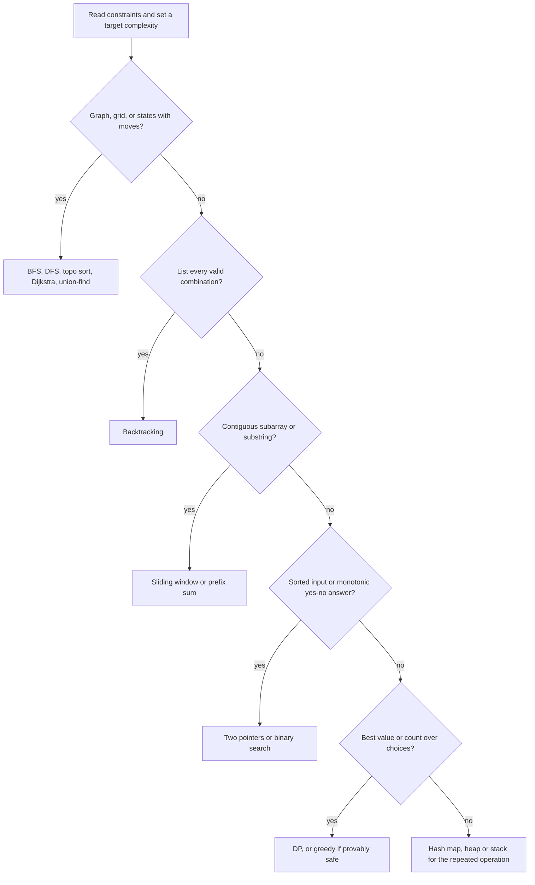
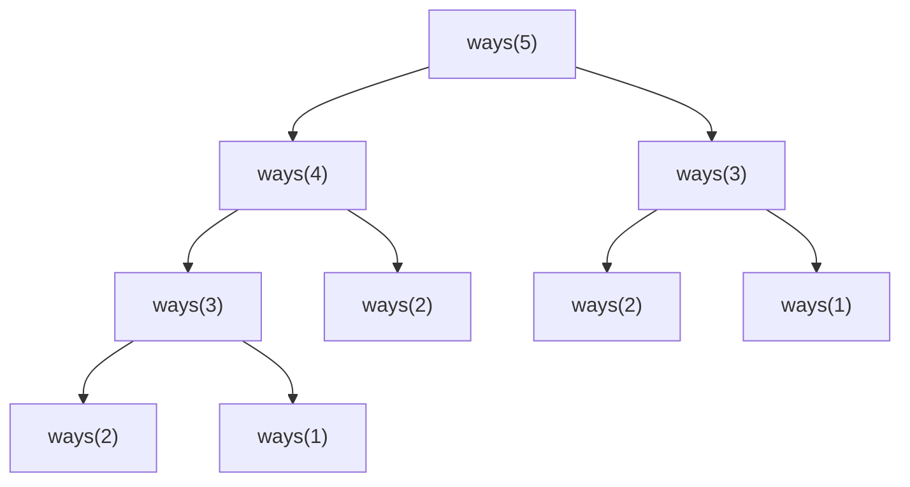
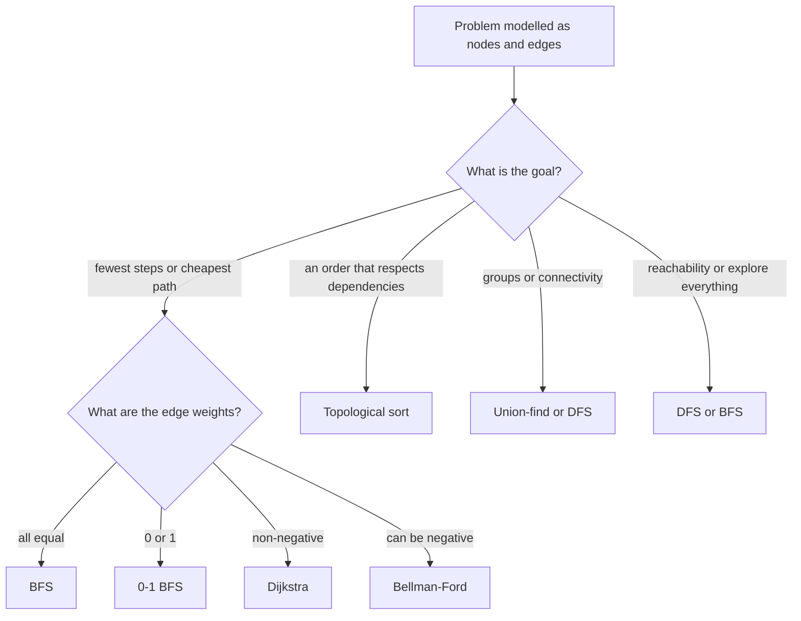

# Pattern Recognition: Reading the Problem

[⬅ Back to index](../README.md)

Covers: how to work out the intended technique from a problem statement: what the input size tells you, the keywords that signal each pattern, a step-by-step decision flow, and how to choose when more than one pattern seems to fit.

---

## Reading the constraints

### 1. How do the input constraints tell you the target complexity?

**📘 Concept** · ⭐ Product/FAANG favourite

<details>
<summary>Answer</summary>

**In short:** A typical judge (and a typical interviewer's mental model) allows roughly **10⁸ simple operations per second**. Plug the largest `n` into each candidate complexity and see which ones fit under that budget. The one that *just* fits is almost always the intended solution: `n ≤ 20` invites O(2ⁿ) brute force, `n ≤ 5000` invites O(n²), `n ≤ 10⁵` demands O(n log n) or O(n), and `n` up to 10⁹ or 10¹⁸ means you cannot even read the range — you need O(log n) or a formula.

#### Why this works

Problem setters choose constraints deliberately. If they want to reject the O(n²) solution, they set `n = 10⁵` (so n² = 10¹⁰, about 100 seconds). If they *allow* an exponential search, they keep `n` tiny so it finishes. So the constraint is not just a limit — it is a hint about the intended algorithm.

The rule of thumb: **about 10⁸ simple operations per second**. Kotlin on the JVM and compiled Swift are both in that ballpark for tight loops over arrays; hash map operations and object allocation are slower by a constant factor, so leave some margin.

#### The table to memorise

| Largest n | Target complexity | n plugged in | Typical techniques |
|---|---|---|---|
| ≤ 10-12 | O(n!) or O(n!·n) | 12! ≈ 4.8×10⁸ | all permutations, brute-force orderings ([Recursion & Backtracking](18-recursion-backtracking.md)) |
| ≤ 20-25 | O(2ⁿ) or O(2ⁿ·n) | 2²⁰ ≈ 10⁶ | all subsets, backtracking, bitmask DP ([Bit Manipulation & Math](21-bit-manipulation-math.md)) |
| ≤ 40 | O(2^(n/2)) | 2²⁰ ≈ 10⁶ | meet in the middle ([Problem-Solving Tricks](06-problem-solving-tricks.md)) |
| ≤ 100-500 | O(n³) | 500³ ≈ 1.25×10⁸ | interval DP, Floyd-Warshall, triple loops ([Dynamic Programming](19-dynamic-programming.md)) |
| ≤ 1000-5000 | O(n²) | 5000² = 2.5×10⁷ | 2D DP (LCS, edit distance), all pairs, O(n²) DP like basic LIS |
| ≤ 10⁵-10⁶ | O(n log n) or O(n) | 10⁶·20 = 2×10⁷ | sorting, heaps, binary search, two pointers, sliding window, hashing, prefix sums |
| ≤ 10⁷-10⁸ | O(n), small constant | 10⁸ | a single tight pass, sieve, counting array |
| up to 10⁹-10¹² | O(√n) or O(log n) | √10¹² = 10⁶ | divisors, prime checks, binary search on the answer |
| up to 10¹⁸ | O(log n) or O(1) | log₂10¹⁸ ≈ 60 | fast exponentiation, math formula, binary search on value |

Read it in both directions. If `n ≤ 10⁵` and your idea is O(n²), you know *before writing any code* that you need a better idea. If `n ≤ 15` and you are trying to find a clever greedy, stop — the setter is telling you brute force over subsets is fine.

#### Multiple variables

When there are several inputs, multiply them: a grid of `m × n ≤ 200 × 200` with BFS is O(m·n) = 4×10⁴, trivial. Word Search with a 6×6 board and a 15-letter word is O(m·n·4^L) in the worst case — fine only because the numbers are small. `n` items and `q` queries both up to 10⁵ means O(n·q) = 10¹⁰ is too slow: you need preprocessing so each query is O(1) or O(log n) (prefix sums, sorting + binary search).

#### Worked example

**Problem:** "Given `nums` of length up to 10⁵, return the length of the longest strictly increasing subsequence."

- O(2ⁿ) all subsequences: impossible.
- O(n²) DP: 10¹⁰ — too slow at this size (it is the intended answer when `n ≤ 2500`, which is what LeetCode 300 uses).
- O(n log n) patience sorting: 1.7×10⁶ — this is the target.

Same problem, different constraints, different expected algorithm. That is why you **ask about input size** in a live round when it isn't given.

#### In a live interview

Interviewers often don't state constraints. Ask: "Roughly how big can the input get — thousands or millions?" The answer tells you whether they expect the O(n²) idea to be improved. If they say "assume it's large", aim for O(n log n) or better. See [How Coding Interviews Work](01-coding-interviews-overview.md) for more clarifying questions and [Complexity Analysis](02-complexity-analysis.md) for computing complexities.

#### Common mistakes

- Treating 10⁸ as a hard line. It is a rough guide: 3×10⁸ simple array operations may pass, 10⁸ hash map inserts with boxing might not.
- Forgetting the hidden factor: sorting strings of length L costs O(n log n · L), not O(n log n).
- Ignoring the output size. Listing all subsets is Ω(2ⁿ·n) no matter how clever you are, so "n ≤ 20" there is not a hint to optimise further.

#### Follow-ups

- *Why is `n ≤ 20` and not `n ≤ 30` the usual limit for subsets?* 2³⁰ ≈ 10⁹ is already too slow once you multiply by the work per subset.
- *What if constraints say `n ≤ 10⁵` but values are tiny?* Then the value range may allow a counting array — see the [next question](#2-what-else-do-the-constraints-tell-you-beyond-n).

</details>

### 2. What else do the constraints tell you beyond n?

**📘 Concept**

<details>
<summary>Answer</summary>

**In short:** Read **every** line of the constraints, not just the length. Value ranges tell you whether you can index an array by value (small range), whether sums can overflow (large values), and whether sliding windows on sums are safe (no negatives). A small `k`, a small total sum, or "return the answer modulo 10⁹+7" each point at a specific technique — usually counting, DP over the sum, or a structure sized by `k`.

#### Constraint → what it suggests

| Constraint you see | What it tells you | Typical technique |
|---|---|---|
| `s` has only lowercase English letters | at most 26 distinct keys | `IntArray(26)` instead of a hash map; O(26·n) is O(n) |
| `0 ≤ nums[i] ≤ 10⁵` (small value range) | values can be array indices | counting sort, frequency array, bucket by value |
| `1 ≤ nums[i] ≤ n` (values in 1..n) | each value has "its own" slot | cyclic sort or negation marking, O(1) extra space ([Problem-Solving Tricks](06-problem-solving-tricks.md)) |
| `-10⁴ ≤ nums[i] ≤ 10⁴` (negatives allowed) | sums are not monotonic as a window grows | sliding window on sums breaks; use prefix sum + hash map |
| `nums[i]` up to 10⁹ | can't index by value; sums overflow `Int` | hash map or coordinate compression; use `Long` for sums |
| `sum(nums) ≤ 10⁴` or `target ≤ 10⁴` | a DP indexed by sum fits in memory | knapsack-style DP (Partition Equal Subset Sum, Coin Change) |
| "return the answer modulo 10⁹+7" | the answer is astronomically large | you must **count** without listing: DP or combinatorics |
| `k ≤ 10` or `k` small | you can carry `k` in the state | DP with a `k` dimension, heap of size `k` |
| `q` queries up to 10⁵ | per-query work must be tiny | preprocess: prefix sums, sorting + binary search, union-find |
| "all values are distinct" | duplicates won't break your logic | simpler binary search / BST reasoning; no dedupe step |
| "array is sorted" | order is free information | two pointers or binary search (see [question 7](#7-when-does-sorted-input-matter-and-when-should-you-sort-first)) |
| "use O(1) extra space" (often a follow-up) | no hash map allowed | in-place tricks, two pointers, bit tricks, reusing the input |

#### Three examples of constraints changing the solution

**Subarray Sum Equals K.** With only positive numbers, a window can grow while the sum is below `k` and shrink while above — sliding window, O(1) space. The real constraints allow negatives, so adding an element might *decrease* the sum and the window has no direction to move. The constraint pushes you to prefix sums + a hash map ([Problem-Solving Tricks](06-problem-solving-tricks.md)).

**Partition Equal Subset Sum.** `n ≤ 200` would allow nothing exponential (2²⁰⁰), but `nums[i] ≤ 100` means the total sum is at most 20,000. A boolean DP over achievable sums is O(n · sum) = 4×10⁶. The *value* constraint is what makes the DP possible ([Dynamic Programming](19-dynamic-programming.md)).

**Decode Ways / Climbing Stairs variants that say "modulo 10⁹+7".** The modulo is a signal that the count grows exponentially with `n`, so enumerating the ways is hopeless. You need a recurrence that counts them.

#### Overflow is part of reading constraints

If `n ≤ 10⁵` and `nums[i] ≤ 10⁹`, a sum can reach 10¹⁴, far beyond Kotlin's 32-bit `Int` (about 2.1×10⁹), which wraps silently. Swift's `Int` is 64-bit on modern platforms and traps instead of wrapping. Spotting this from the constraints and saying "I'll use `Long` for the running sum" is a small detail interviewers notice. See [Kotlin & Swift for Coding Interviews](03-kotlin-swift-for-interviews.md).

```kotlin
// values up to 1e9, n up to 1e5: the sum needs 64 bits
fun total(nums: IntArray): Long {
    var sum = 0L
    for (x in nums) sum += x   // Int is widened to Long before adding
    return sum
}
```

#### Common mistakes

- Using a sliding window on a sum problem without checking whether values can be negative.
- Allocating an array indexed by value when values go up to 10⁹ (memory error) — use a map or compress coordinates.
- Applying `% MOD` only at the end. Intermediate values overflow first; reduce after every addition and multiplication.

#### Follow-ups

- *Values are up to 10⁹ but there are only 10⁵ of them — can I still use an array?* Yes, after coordinate compression: sort the distinct values and replace each by its rank.
- *What does "string of digits" with length up to 10⁵ tell you?* The number doesn't fit in any integer type — treat it as a string.

</details>

## Signals and the decision flow

### 3. What is the master table of signals and patterns?

**📘 Concept** · ⭐ Product/FAANG favourite

<details>
<summary>Answer</summary>

**In short:** Most interview problems contain a phrase that strongly suggests a family of techniques: "sorted" suggests two pointers or binary search, "contiguous subarray" suggests a sliding window or prefix sums, "k-th largest" suggests a heap, "all combinations" suggests backtracking, "minimum steps" in an unweighted graph suggests BFS, and "number of ways" suggests DP. Learn these pairings as a first guess, then confirm the guess against the constraints and the problem's structure.

#### The table

| Signal in the problem | First pattern to try | Example problems | Learn it in |
|---|---|---|---|
| Input is **sorted**, or pairs/triples summing to a target | Two pointers, binary search | Two Sum II, 3Sum, Search Insert Position | [Two Pointers & Sliding Window](08-two-pointers-sliding-window.md), [Binary Search](10-binary-search.md) |
| **Contiguous** subarray/substring, "longest/shortest window with…" | Sliding window | Longest Substring Without Repeating Characters, Minimum Window Substring | [Two Pointers & Sliding Window](08-two-pointers-sliding-window.md) |
| Subarray **sum equals / divisible by** k, range sums, negatives allowed | Prefix sum (+ hash map) | Subarray Sum Equals K, Range Sum Query, Contiguous Array | [Prefix Sums & Intervals](09-prefix-sums-intervals.md), [Tricks](06-problem-solving-tricks.md) |
| **Frequency**, duplicates, "seen before?", anagrams, fast lookup | Hash map / hash set | Two Sum, Group Anagrams, Longest Consecutive Sequence | [Arrays, Strings & Hashing](07-arrays-strings-hashing.md) |
| **Top k**, k-th largest/smallest, k closest, merge k sorted | Heap (or quickselect) | Kth Largest Element, K Closest Points, Merge k Sorted Lists | [Heaps & Priority Queues](13-heaps-priority-queues.md) |
| **Next greater / smaller**, "how many days until warmer", spans | Monotonic stack | Daily Temperatures, Largest Rectangle in Histogram | [Stacks & Monotonic Stack](11-stacks-queues-monotonic.md) |
| Matching brackets, nested structure, undo, evaluate expression | Stack | Valid Parentheses, Decode String, Basic Calculator | [Stacks & Monotonic Stack](11-stacks-queues-monotonic.md) |
| **Intervals**, meetings, overlapping ranges, bookings | Sort by start/end + sweep | Merge Intervals, Meeting Rooms II, Non-overlapping Intervals | [Prefix Sums & Intervals](09-prefix-sums-intervals.md) |
| "**Minimum** largest / **maximum** smallest", "smallest speed/capacity that works" | Binary search on the answer | Koko Eating Bananas, Capacity To Ship Packages, Split Array Largest Sum | [Binary Search](10-binary-search.md) |
| **All** combinations / permutations / subsets / partitions, small n | Backtracking | Subsets, Permutations, N-Queens, Combination Sum | [Recursion & Backtracking](18-recursion-backtracking.md) |
| **Number of ways**, min/max cost over a sequence of **choices** | Dynamic programming | Coin Change, House Robber, Edit Distance | [Dynamic Programming](19-dynamic-programming.md) |
| Locally best choice looks safe (earliest end, farthest reach) | Greedy (prove it) | Jump Game, Gas Station, Partition Labels | [Greedy](20-greedy.md) |
| Tree: depth, paths, ancestors, "for every node" | DFS returning info up; BFS for levels | Maximum Depth, LCA, Level Order Traversal | [Trees & BSTs](14-trees-bst.md) |
| Grid of cells, islands, regions, "connected" | DFS/BFS flood fill | Number of Islands, Surrounded Regions | [Graphs](16-graphs-bfs-dfs-topo.md) |
| **Shortest path / fewest steps**, unweighted | BFS | Word Ladder, Shortest Path in Binary Matrix, Rotting Oranges | [Graphs](16-graphs-bfs-dfs-topo.md) |
| Shortest path with **non-negative weights** | Dijkstra | Network Delay Time, Path With Minimum Effort | [Advanced Graphs](17-advanced-graphs.md) |
| **Prerequisites**, dependencies, build order | Topological sort | Course Schedule, Alien Dictionary | [Graphs](16-graphs-bfs-dfs-topo.md) |
| Groups, "are these connected?", merging sets, redundant edge | Union-find (or DFS) | Number of Provinces, Redundant Connection, Accounts Merge | [Advanced Graphs](17-advanced-graphs.md) |
| **Prefix** of words, autocomplete, many words searched at once | Trie | Implement Trie, Word Search II, Search Suggestions System | [Tries & Strings](15-tries-string-algorithms.md) |
| Linked list **cycle**, middle, k-th from end | Fast & slow pointers | Linked List Cycle II, Middle of the Linked List | [Linked Lists](12-linked-lists.md) |
| Values in **1..n**, missing/duplicate numbers, O(1) space | Cyclic sort / index marking | First Missing Positive, Find All Numbers Disappeared | [Tricks](06-problem-solving-tricks.md) |
| "Appears once while others appear twice", toggling, subsets as masks | XOR / bit manipulation | Single Number, Missing Number, Counting Bits | [Tricks](06-problem-solving-tricks.md), [Bits & Math](21-bit-manipulation-math.md) |
| Running median, stream with "at any time" queries | Two heaps / heap | Find Median from Data Stream | [Tricks](06-problem-solving-tricks.md) |
| "Design a structure where every op is O(1)" | Hash map + linked list/array combos | LRU Cache, Insert Delete GetRandom O(1) | [Design-Style Coding](22-design-style-coding.md) |

#### How to use the table without being fooled by it

Keywords give you a **hypothesis**, not an answer. Two checks turn the hypothesis into a decision:

1. **Does it fit the constraints?** "All subsets" with `n = 10⁵` is not backtracking — the problem must have more structure (often DP or greedy). See [question 1](#1-how-do-the-input-constraints-tell-you-the-target-complexity).
2. **Does the pattern's precondition hold?** Sliding window needs a condition that only gets "more broken" as the window grows. Binary search needs a monotonic yes/no. Greedy needs a reason the local choice can't hurt. Two pointers on sums need sorted order.

If the precondition fails, move to the next row that matches. "Contiguous subarray with sum k" matches the sliding window row, but negatives break the precondition, so you move to the prefix-sum row.

#### Common mistakes

- Matching on one word and ignoring the rest: "subsequence" is not "subarray" (see [question 5](#5-subarray-substring-subsequence-or-subset-why-does-the-word-matter)).
- Forgetting that one problem can need two rows: Word Search II is trie + backtracking; Meeting Rooms II is sort + heap.
- Reaching for the fancy row first. A hash map often solves it before you need anything else ([question 8](#8-why-is-a-hash-map-the-default-first-optimisation)).

#### Follow-ups

- *Is there a single order to check these in?* Yes, roughly — see the decision flow in the [next question](#4-what-is-a-step-by-step-decision-flow-for-choosing-a-pattern).
- *Where are the code skeletons?* In [Reusable Code Templates](05-reusable-templates.md).

</details>

### 4. What is a step-by-step decision flow for choosing a pattern?

**📘 Concept** · ⭐ Product/FAANG favourite

<details>
<summary>Answer</summary>

**In short:** Ask a fixed sequence of questions, from the most structural to the most general: (1) what complexity do the constraints allow, (2) is this really a graph, (3) do they want *every* solution listed, (4) is it about a contiguous range, (5) is there order or monotonicity to exploit, (6) is it an optimise/count over choices, and finally (7) which data structure makes the repeated operation cheap. The first question that gets a clear "yes" usually names the pattern.

#### The flowchart



#### Why this order

- **Constraints first** because they rule out whole branches immediately (n = 10⁵ kills backtracking; n = 15 makes it attractive).
- **Graph next** because it changes everything downstream: once you see nodes and edges, the toolbox is BFS/DFS/topo/Dijkstra/union-find, and keywords like "minimum" mean "shortest path", not DP. Disguised graphs are covered in [question 13](#13-how-do-you-spot-a-graph-problem-in-disguise).
- **"List all"** next because the output itself is exponential, so nothing beats backtracking.
- **Contiguous** before "sorted" because sorting destroys contiguity — if the problem is about subarrays, you usually must not sort.
- **Optimise/count over choices** comes late because DP is the general fallback: it works on many problems, but if a cheaper pattern fits, interviewers expect the cheaper one.
- **Data structure last**: if no shape matched, the problem is usually "do this operation many times, fast" — look up (hash map), get min/max (heap), most recent unmatched (stack), oldest (queue), ordered neighbour (TreeMap / sorted array).

#### The last box, expanded: the operation decides the structure

| You need to do this repeatedly | Use | Cost per op |
|---|---|---|
| "Have I seen x?" / "how many x?" | hash set / hash map | O(1) average |
| Get the current min or max while inserting | heap (`PriorityQueue`) | O(log n) |
| Get the most recent unresolved item | stack (`ArrayDeque`) | O(1) |
| Process in arrival order | queue (`ArrayDeque`) | O(1) |
| Find the nearest key ≤ x or ≥ x while inserting | `TreeMap` / `TreeSet` (Kotlin); sorted array + binary search in Swift | O(log n) |
| Sum of a range, many times | prefix sum array | O(1) after O(n) build |
| Are a and b in the same group, while merging groups | union-find | ~O(1) amortised |

#### Running the flow on three problems

**"Given a list of course prerequisites, can you finish all courses?"** — Constraints: up to 2000 courses, 5000 edges. Graph? Yes: courses are nodes, prerequisites are directed edges. "Can you finish" = "no cycle". → Topological sort ([Graphs](16-graphs-bfs-dfs-topo.md)).

**"Longest substring with at most two distinct characters."** — n up to 10⁵ → O(n). Not a graph, not "list all". Contiguous substring? Yes. Does the condition get worse monotonically as the window grows? Yes (more characters can only add distinct ones). → Sliding window ([Two Pointers & Sliding Window](08-two-pointers-sliding-window.md)).

**"Minimum number of coins to make amount."** — amount ≤ 10⁴, coins ≤ 12. Not a graph (well, it could be modelled as BFS over amounts, which also works). Not contiguous. Not sorted/monotonic. Best value over choices? Yes. Is greedy safe? Not for arbitrary coins (coins {1, 3, 4}, amount 6: greedy 4+1+1, optimal 3+3). → DP ([Dynamic Programming](19-dynamic-programming.md)).

#### Practical tips

- Say the flow out loud in the interview: "It's contiguous, the constraint is monotonic, so I'll try a sliding window." It shows structured thinking even before code.
- If two branches both say yes, see [question 16](#16-when-several-patterns-seem-to-fit-how-do-you-choose).
- When nothing matches, write the brute force and ask "what work is repeated?" — the answer is usually a hash map, prefix sum, or memo.

#### Common mistakes

- Sorting a subarray problem (destroys the contiguity the problem is about).
- Jumping to DP for something with a simple greedy or two-pointer solution — correct but slower to code and often slower to run.
- Missing that a grid is a graph and trying to write ad-hoc loops.

#### Follow-ups

- *What if the flowchart points to DP but n is 10⁵ and the DP is O(n²)?* Look for a greedy, a monotonic structure that speeds up the transition, or binary search inside the DP (as in O(n log n) LIS).
- *What's the fastest way to get better at this?* Practise labelling problems before solving them — see [question 18](#18-how-do-you-practise-pattern-recognition).

</details>

### 5. Subarray, substring, subsequence or subset: why does the word matter?

**📘 Concept** · ⭐ Product/FAANG favourite

<details>
<summary>Answer</summary>

**In short:** The four words describe different search spaces. A **subarray/substring** is contiguous (there are only O(n²) of them, and windows, prefix sums and stacks work on them). A **subsequence** keeps order but may skip elements (2ⁿ of them; usually DP, sometimes greedy). A **subset** ignores order entirely (2ⁿ of them; you may sort, and you use backtracking, knapsack DP or bitmasks). Misreading one word sends you to the wrong family of techniques.

#### The definitions, on `[1, 2, 3]`

| Term | Rule | Examples from `[1, 2, 3]` | How many (non-empty) |
|---|---|---|---|
| Subarray (substring for strings) | contiguous, keeps order | `[1, 2]`, `[2, 3]`, `[1, 2, 3]` — **not** `[1, 3]` | n(n+1)/2 = 6 |
| Subsequence | any elements, original order kept | `[1, 3]`, `[2, 3]` — **not** `[3, 1]` | 2ⁿ − 1 = 7 |
| Subset | any elements, order irrelevant | `{1, 3}` (same as `{3, 1}`) | 2ⁿ − 1 = 7 |
| Permutation | all elements, any order | `[3, 1, 2]` | n! = 6 |

The count matters: there are only polynomially many subarrays, so even brute force is O(n²) or O(n³). Subsequences and subsets are exponential, so brute force is only possible for tiny `n`.

#### Why contiguity enables the fast techniques

A subarray is fully described by two indices `(l, r)`. That lets you:

- **slide** a window by moving `l` and `r` forward ([Two Pointers & Sliding Window](08-two-pointers-sliding-window.md));
- compute any range sum as `prefix[r + 1] - prefix[l]` ([Prefix Sums & Intervals](09-prefix-sums-intervals.md));
- extend "best subarray ending at i" from "best ending at i − 1" (Kadane, in [Problem-Solving Tricks](06-problem-solving-tricks.md));
- find each element's span with a monotonic stack ([Stacks & Monotonic Stack](11-stacks-queues-monotonic.md)).

None of these work when you can skip elements.

#### Why subsequences usually mean DP

For a subsequence, each element is a **choice**: take it or skip it. That choice structure, plus order, gives overlapping subproblems indexed by position: "best answer using the first i elements" or, for two strings, "using `a[0..i)` and `b[0..j)`". Classic examples: Longest Increasing Subsequence, Longest Common Subsequence, Distinct Subsequences ([Dynamic Programming](19-dynamic-programming.md)). The exception is checking whether one string **is** a subsequence of another — that is greedy two pointers, because matching the earliest possible character is always safe.

#### Why subsets let you sort

Since a subset ignores order, you are free to sort the input first, which helps skip duplicates (Subsets II, Combination Sum II) and prune early ("the rest are bigger, stop"). Subsets are generated with backtracking or bitmasks ([Recursion & Backtracking](18-recursion-backtracking.md)), counted or optimised with knapsack DP (Partition Equal Subset Sum, Target Sum).

#### Same question, three words, three algorithms

"Maximum sum" over:

- **subarray** → Kadane, O(n). The sum of the best subarray ending at `i` is `max(nums[i], best(i-1) + nums[i])`.
- **subsequence** → just add every positive number (or the largest element if all are negative), O(n). Skipping is free, so negatives are simply skipped.
- **subset with sum ≤ target** → 0/1 knapsack DP over the sum.

```kotlin
// Max subarray (contiguous) vs max subsequence (skips allowed)
fun maxSubarray(nums: IntArray): Int {
    var best = nums[0]; var endingHere = nums[0]
    for (i in 1 until nums.size) {
        endingHere = maxOf(nums[i], endingHere + nums[i])
        best = maxOf(best, endingHere)
    }
    return best
}

fun maxSubsequence(nums: IntArray): Int {
    val positives = nums.filter { it > 0 }
    return if (positives.isEmpty()) nums.max() else positives.sum()
}
```

#### Common mistakes

- Treating "substring" and "subsequence" as synonyms. Longest Common Substring and Longest Common Subsequence have different recurrences.
- Sorting an array in a subarray or subsequence problem — the order is part of the question.
- Trying a sliding window for a subsequence problem; the window has no meaning when elements can be skipped.

#### Follow-ups

- *What's the brute force for subarrays?* Two nested loops for `(l, r)`, often with a running sum — O(n²). Good to mention before optimising.
- *Is "contiguous" ever implied?* Yes: "substring", "window", "consecutive elements", "subarray" all mean contiguous. "Consecutive numbers" (as in Longest Consecutive Sequence) is different: it refers to values, not positions.

</details>

### 6. Optimise, count or list all: what does the question type imply?

**📘 Concept** · ⭐ Product/FAANG favourite

<details>
<summary>Answer</summary>

**In short:** Look at **what you must return**. "List all valid ones" means the output itself can be exponential, so backtracking is the right tool and no clever trick beats it. "How many ways" means you must count without listing — DP or combinatorics, often modulo 10⁹+7. "Minimum/maximum" means optimisation — DP, greedy, BFS shortest path, or binary search on the answer. "Is it possible?" is the easiest form of each and often allows early exit.

#### One theme, four questions

The same coin setting gives four different problems, and the return type decides the technique:

| Question | Return type | Technique | Where |
|---|---|---|---|
| List every combination of coins that sums to target | list of lists | backtracking | Combination Sum ([18](18-recursion-backtracking.md)) |
| How many combinations sum to target? | a number (can be huge) | DP counting ways | Coin Change II ([19](19-dynamic-programming.md)) |
| Fewest coins that sum to target? | min value | DP (or BFS over amounts) | Coin Change ([19](19-dynamic-programming.md)) |
| Can any subset sum to target? | Boolean | DP over reachable sums | Partition Equal Subset Sum ([19](19-dynamic-programming.md)) |

#### "List all" → backtracking

If the answer can contain 2ⁿ or n! items, any algorithm must spend at least that long writing it out, so the complexity is driven by the output. Backtracking builds candidates one choice at a time and undoes the choice after exploring it (choose → explore → unchoose). Recognition signals:

- "return all", "generate all", "every possible", "all valid arrangements";
- small `n` (≤ 10 for permutations, ≤ 20 for subsets);
- constraints between choices (N-Queens, Sudoku, Word Search) that let you **prune** early.

Estimate before coding: Permutations of 8 items is 8! = 40,320 lists — fine. Subsets of 20 items is about 10⁶ — fine. If the estimate is 10¹², the problem wants a count, not a list.

#### "Count" → DP or combinatorics, never enumerate

Counting problems usually have far more solutions than you could list (that's why they ask for the count, and why "modulo 10⁹+7" appears). You need a recurrence where `ways(state) = sum of ways(next states)`. Examples: Climbing Stairs, Unique Paths, Decode Ways, Coin Change II, Number of Dice Rolls With Target Sum. Some counting problems have a non-DP counting trick: Subarray Sum Equals K counts with prefix sums + a hash map, and Subarrays with K Different Integers counts as `atMost(K) − atMost(K − 1)`.

A useful test: if your backtracking solution would work *but* only to count, it almost certainly has overlapping subproblems — memoise it and it becomes DP.

#### "Optimise" → several options; narrow it down

| Extra signal | Likely technique |
|---|---|
| Steps/moves in an unweighted graph or grid | BFS ([Graphs](16-graphs-bfs-dfs-topo.md)) |
| "Minimise the maximum" / "smallest X that works" | binary search on the answer ([question 10](#10-how-do-you-recognise-binary-search-on-the-answer)) |
| A locally best choice is provably safe | greedy ([question 12](#12-greedy-or-dp-how-do-you-know-when-greedy-is-enough)) |
| Choices interact; future depends on past choices | DP ([question 11](#11-how-do-you-recognise-a-dynamic-programming-problem)) |

#### "Is it possible?" → the decision version

Yes/no questions are often the same algorithm with early exit: Jump Game (greedy reachability), Word Break (boolean DP), Course Schedule (cycle detection), Valid Sudoku (hash sets). They are also the predicate you binary-search over in "binary search on the answer".

#### "Return any one" vs "return all"

If any valid answer is accepted, you can stop at the first one (backtracking with early return, or reconstruct one path from a DP table). If they want all of them, you can't stop early. Ask which one they want — it changes the code.

#### Common mistakes

- Generating all solutions just to count them (exponential where DP is polynomial).
- Trying to "optimise" a list-all problem below the output size.
- Forgetting the modulo in counting problems, or applying it only at the end.

#### Follow-ups

- *How do you reconstruct the actual items for an optimisation DP?* Store the choice made at each state (or recompute it from the table) and walk back from the final state.
- *Can I count with backtracking if n is small?* Yes, and that's a fine first answer; then memoise.

</details>

### 7. When does sorted input matter, and when should you sort first?

**📘 Concept**

<details>
<summary>Answer</summary>

**In short:** Sorted order is free information: it lets two pointers discard a whole row of pairs per step and lets binary search discard half the range per step. If the input isn't sorted, sorting it yourself costs O(n log n) and is worth it when **the answer doesn't depend on the original order** — pairs/triples by value, intervals, greedy matching, grouping. Don't sort when you must return original indices (unless you carry them along), when the problem is about contiguous ranges or subsequences, or when O(n) is required.

#### What "sorted" unlocks

| With sorted input you can… | Pattern | Example problems |
|---|---|---|
| find a pair with a given sum in O(n), O(1) space | opposite-end two pointers | Two Sum II, 3Sum, Container-like pair problems |
| find a value or insertion point in O(log n) | binary search | Binary Search, Search Insert Position, First and Last Position |
| skip duplicates by comparing neighbours | adjacent comparison | 3Sum dedupe, Remove Duplicates from Sorted Array |
| merge two sequences in O(n + m) | merge step | Merge Two Sorted Lists, Merge Sorted Array |
| answer "how many ≤ x" | binary search for the bound | Count of smaller elements in a sorted array |

Partially sorted shapes still count: **rotated sorted** arrays (one sorted half at every step) and **row/column sorted matrices** (staircase search from a corner, or binary search) are covered in [Binary Search](10-binary-search.md).

#### When sorting first is the key step

Sort when the problem only cares about **values**, not positions:

- **Pairs and triples by value** — 3Sum, 4Sum, Two Sum when only values are returned. Sorting turns O(n³) into O(n²).
- **Intervals** — Merge Intervals, Meeting Rooms, Non-overlapping Intervals. Sorting by start (or end) means each interval only needs to be compared with the last one kept ([Prefix Sums & Intervals](09-prefix-sums-intervals.md)).
- **Greedy matching** — Assign Cookies, Boats to Save People: sort both sides and match smallest with smallest, or heaviest with lightest ([Greedy](20-greedy.md)).
- **Canonical keys** — Group Anagrams: sort the letters of each word to get a key ([Arrays, Strings & Hashing](07-arrays-strings-hashing.md)).
- **Duplicate handling in backtracking** — Subsets II, Combination Sum II: sort so equal values are adjacent and can be skipped.
- **Custom order is the answer** — Largest Number sorts with a comparator `a + b` vs `b + a`.

#### When not to sort

- **You need original indices** — Two Sum (LeetCode 1) returns indices. Either sort `(value, index)` pairs, or better, use a hash map in O(n).
- **The problem is about contiguous ranges or order** — subarray sums, longest increasing subsequence, stock prices over time. Sorting destroys the question.
- **O(n) is required** or `n` is huge and a single pass with a hash map does it.
- **Only the top k matter** — a heap of size k is O(n log k), cheaper than a full sort when k ≪ n ([Heaps](13-heaps-priority-queues.md)).

#### Carrying indices along when you do sort

```kotlin
// Sort indices by value, keeping the original positions available
fun sortedIndices(nums: IntArray): List<Int> =
    nums.indices.sortedBy { nums[it] }   // stable sort; ties keep original index order
```

#### Common mistakes

- Sorting in place and then returning indices into the sorted array.
- Sorting a "subarray" problem because the values "look easier sorted".
- Forgetting the O(n log n) cost when the target was O(n).
- Comparator overflow: `compareBy { it[0] }` is safe; `{ a, b -> a[0] - b[0] }` can overflow for large values — prefer `compareValues` or `compareBy`.

#### Follow-ups

- *Two Sum on an unsorted array — sort + two pointers or hash map?* Hash map: O(n) time, and it keeps indices. Sort + two pointers is O(n log n) time and O(1) extra space (if you can modify the input and only need values), which is the trade-off to mention.
- *Can counting sort make it O(n)?* Yes, when values are in a small range (see [question 2](#2-what-else-do-the-constraints-tell-you-beyond-n)).

</details>

### 8. Why is a hash map the default first optimisation?

**📘 Concept** · ⭐ Product/FAANG favourite

<details>
<summary>Answer</summary>

**In short:** Most brute-force solutions have an inner loop that **searches** for something: a complement, a previous occurrence, a matching group. A hash map answers "have I seen this, and where/how many?" in O(1) average time, so it turns that inner loop into a lookup and O(n²) into O(n). When you're stuck after writing the brute force, the first question to ask is "what is the inner loop looking for, and can I remember it in a map instead?"

#### The transformation, on Two Sum

Brute force: for every `i`, scan every `j` to find `nums[j] == target - nums[i]`. That scan is a search, and a search for an exact value is exactly what a hash map does.

```kotlin
fun twoSum(nums: IntArray, target: Int): IntArray {
    val indexOf = HashMap<Int, Int>()          // value -> index seen so far
    for ((i, x) in nums.withIndex()) {
        val j = indexOf[target - x]            // replaces the inner loop
        if (j != null) return intArrayOf(j, i)
        indexOf[x] = i                         // store after checking, so i is never paired with itself
    }
    return intArrayOf()
}
```

O(n²) time → O(n) time, at the cost of O(n) extra space. That time-for-space trade is the most common optimisation in coding interviews.

#### The five shapes of hash-map solutions

| Shape | What the map stores | Example problems |
|---|---|---|
| Complement lookup | value → index | Two Sum, pairs with difference k |
| Counting | value → count | Valid Anagram, Top K Frequent Elements, Majority Element |
| Grouping by a canonical key | key → list | Group Anagrams (sorted word or letter counts as key), group shifted strings |
| Seen / last position | value → last index, or a set | Contains Duplicate, Longest Substring Without Repeating Characters, Happy Number (cycle detection) |
| Prefix state | prefix sum (or parity/balance) → count or first index | Subarray Sum Equals K, Contiguous Array, Continuous Subarray Sum |

The last one deserves special mention: "count subarrays with sum k" becomes "for each prefix sum `p`, how many earlier prefixes equal `p - k`?" — a complement lookup on prefix sums ([Problem-Solving Tricks](06-problem-solving-tricks.md)).

#### How to spot the opportunity

- You wrote `for i … for j …` and the inner loop looks for an exact match → map.
- You keep asking "did this appear before?" → set.
- You compare two collections by content (anagrams, permutations of a string) → frequency counts.
- Things belong together when they share a property → map from the property to the group.

#### When a hash map is not the best answer

- **Keys are small integers or letters** → an `IntArray(26)` or `IntArray(maxValue + 1)` is faster and simpler.
- **Input is sorted** and O(1) space is asked → two pointers.
- **You need order** (smallest key ≥ x, iterate in sorted order) → `TreeMap` in Kotlin; in Swift, a sorted array with binary search ([Kotlin & Swift](03-kotlin-swift-for-interviews.md)).
- **You need min/max repeatedly** → heap.
- **Strict O(1) extra space** → in-place tricks such as cyclic sort or XOR.

Also remember the average-vs-worst-case caveat: hash operations are O(1) on average, O(n) in the worst case with many collisions. Interviewers accept "O(n) average"; say it that way. How hashing works is covered in [Arrays, Strings & Hashing](07-arrays-strings-hashing.md).

#### Common mistakes

- Inserting before checking in Two Sum, which pairs an element with itself when `x == target - x`.
- Using a mutable object (a `MutableList` or array) as a key — arrays in Kotlin use identity hashing, so two equal `IntArray`s are different keys. Convert to a `String` or `List` first.
- Forgetting to seed the prefix-sum map with `0 → 1` (the empty prefix).

#### Follow-ups

- *Can you do it in O(1) space?* Usually only with sorting (O(n log n)) or a problem-specific trick — say which one you'd trade.
- *What if the keys are strings of length L?* Hashing costs O(L), so the total is O(n·L).

</details>

## Recognising specific patterns

### 9. How do you recognise a sliding window problem?

**📘 Concept** · ⭐ Product/FAANG favourite

<details>
<summary>Answer</summary>

**In short:** Three things together signal a sliding window: (1) the question is about a **contiguous** subarray or substring, (2) it asks for the longest, shortest, or number of windows satisfying a condition, and (3) the condition is **monotonic** — if a window breaks the rule, every bigger window containing it also breaks it (and every smaller window inside a valid one is valid). With all three, two pointers moving forward give O(n). If (3) fails — typically because of negative numbers or "exactly k" — switch to prefix sums or the `atMost(k) − atMost(k − 1)` trick.

#### The checklist

| Check | Question to ask | If "no" |
|---|---|---|
| Contiguous? | Does the answer have to be a subarray/substring? | Not a window problem (maybe DP or hashing) |
| Window-shaped goal? | Longest / shortest / count / max-sum of windows? | Maybe prefix sums or Kadane |
| Monotonic condition? | Does growing a window only make it "more invalid"? | Prefix sum + hash map, or the atMost trick |
| Cheap to update? | Can you add/remove one element and update the state in O(1) (counts, sum, distinct count)? | Use a deque or heap for the state |

#### Fixed vs variable windows

- **Fixed size k** ("every window of size k", "average of each k-length subarray", Permutation in String): move both ends together; add the new element, remove the one that fell off.
- **Variable size** ("longest substring with…", "minimum length subarray with sum ≥ target"): expand `right` every step; shrink `left` while the window is invalid (for longest) or while it is still valid (for shortest).

```kotlin
// Variable window: longest run of 1s if you may flip at most k zeros (the condition is monotonic)
fun longestOnes(nums: IntArray, k: Int): Int {
    var left = 0; var best = 0; var zeros = 0
    for (right in nums.indices) {
        if (nums[right] == 0) zeros++          // add nums[right] to the window state
        while (zeros > k) {                    // window invalid: shrink from the left
            if (nums[left] == 0) zeros--
            left++
        }
        best = maxOf(best, right - left + 1)   // window [left, right] is valid here
    }
    return best
}
```

This is Max Consecutive Ones III ("flip at most k zeros"): "more zeros in the window" can only get worse as the window grows — monotonic, so the window works.

#### Signals and examples

| Phrase | Example problem |
|---|---|
| "longest substring without repeating / with at most k distinct" | Longest Substring Without Repeating Characters, Fruit Into Baskets |
| "replace at most k characters / flip at most k zeros" | Longest Repeating Character Replacement, Max Consecutive Ones III |
| "smallest window containing all of…" | Minimum Window Substring |
| "is a permutation / anagram of p a substring of s" | Permutation in String, Find All Anagrams |
| "maximum of every window of size k" | Sliding Window Maximum (window + monotonic deque) |
| "minimum size subarray with sum ≥ target" (positive numbers) | Minimum Size Subarray Sum |

All are in [Two Pointers & Sliding Window](08-two-pointers-sliding-window.md); the templates are in [Reusable Code Templates](05-reusable-templates.md).

#### When the window fails

- **Sums with negative numbers.** Adding an element can lower the sum, so "too big → shrink" is no longer safe. Subarray Sum Equals K needs prefix sums + a hash map.
- **"Exactly k" counts.** "Exactly k distinct" is not monotonic in the window size, but "at most k" is. Count `atMost(k) − atMost(k − 1)` (Subarrays with K Different Integers).
- **Non-contiguous** ("subsequence") — no window exists; think DP.
- **Window state needs min/max** — counters aren't enough; add a monotonic deque (O(1) amortised) or a sorted multiset.

#### Common mistakes

- Using `if` instead of `while` to shrink (the window may need to shrink several steps).
- Updating the answer before the window is made valid again.
- Applying a sliding window to "maximum subarray sum" — that is Kadane, because there is no length or validity condition.

#### Follow-ups

- *How do you prove it's O(n)?* Each index enters the window once (via `right`) and leaves at most once (via `left`), so the inner `while` runs at most n times in total.
- *What about opposite-end two pointers?* That's the sorted-input pattern — see [question 7](#7-when-does-sorted-input-matter-and-when-should-you-sort-first).

</details>

### 10. How do you recognise binary search on the answer?

**📘 Concept** · ⭐ Product/FAANG favourite

<details>
<summary>Answer</summary>

**In short:** Use it when the problem asks for the **smallest (or largest) value X** such that some condition holds, and checking "does X work?" is much easier than finding X directly. The condition must be **monotonic**: if X works, every bigger X also works (or every smaller one). Then binary search over the range of possible answers, calling a feasibility check each time: O(check · log(range)). The tell-tale phrases are "minimum speed / capacity / days so that…", "minimise the maximum…" and "maximise the minimum…".

#### The signals

- The answer is a **number from a big range** (1 to 10⁹, or 0 to sum of the array), not an index or a subset.
- The phrase is **"minimum X such that…"**, **"minimise the largest…"**, or **"maximise the smallest…"**.
- Given a candidate X, you can check it greedily in O(n) — usually one pass that counts how many groups/days/hours it needs.
- Making X larger only makes the condition easier (or only harder). That's the monotonicity.

#### The four-step recipe

1. **Range:** smallest and largest possible answers (e.g. speed from 1 to `max(piles)`).
2. **Predicate:** `feasible(x): Boolean`, usually greedy.
3. **Monotonicity:** confirm "if x works, x + 1 works". Say it out loud.
4. **Search:** find the first `x` where `feasible(x)` is true.

```kotlin
// First value in [lo, hi] for which feasible() is true (feasible must be false...false, true...true)
fun firstTrue(lo: Long, hi: Long, feasible: (Long) -> Boolean): Long {
    var l = lo; var h = hi
    while (l < h) {
        val mid = l + (h - l) / 2          // avoids overflow
        if (feasible(mid)) h = mid else l = mid + 1
    }
    return l
}
```

#### Walkthrough: Koko Eating Bananas

Piles `[3, 6, 7, 11]`, `h = 8` hours. Each hour Koko eats up to `k` bananas from one pile. Smallest `k` that finishes in time?

`hours(k) = sum of ceil(pile / k)`. Bigger `k` → fewer hours, so "finishes in ≤ 8 hours" is monotonic in `k`. Range: 1..11.

| lo | hi | mid | hours(mid) | feasible? | move |
|---|---|---|---|---|---|
| 1 | 11 | 6 | 1+1+2+2 = 6 | yes | hi = 6 |
| 1 | 6 | 3 | 1+2+3+4 = 10 | no | lo = 4 |
| 4 | 6 | 5 | 1+2+2+3 = 8 | yes | hi = 5 |
| 4 | 5 | 4 | 1+2+2+3 = 8 | yes | hi = 4 |
| 4 | 4 | — | — | — | answer 4 |

Cost: O(n · log(max pile)) instead of trying every speed.

#### Problems with this shape

| Problem | Answer being searched | Feasibility check |
|---|---|---|
| Koko Eating Bananas | eating speed | total hours ≤ h |
| Capacity To Ship Packages Within D Days | ship capacity | greedy day count ≤ D |
| Split Array Largest Sum | largest allowed part sum | greedy part count ≤ k |
| Minimum Number of Days to Make m Bouquets | day | bouquets possible by that day ≥ m |
| Magnetic Force Between Two Balls | minimum gap (maximise it) | greedy placement fits m balls |

All are in [Binary Search](10-binary-search.md).

#### How it differs from DP

Split Array Largest Sum can also be solved with DP in O(k·n²). The binary-search version is O(n log(sum)) and simpler. A hint that binary search on the answer is intended: the DP state would include a huge value (like a sum up to 10⁹), but checking a single value is a linear greedy pass.

#### Common mistakes

- Wrong range: low bound too high (e.g. starting capacity at 1 when it must be at least `max(weights)`) or high bound too low.
- A predicate that isn't monotonic — then binary search silently returns garbage.
- Integer overflow in the check (summing hours or sums in `Int`) — use `Long`.
- Mixing up "first true" and "last true" for maximise-the-minimum problems; flip the predicate or search for the last true.

#### Follow-ups

- *What about real-valued answers?* Loop a fixed number of times (e.g. 100) or until `hi − lo < ε`.
- *How do you explain why the greedy check is correct?* Packing items as late/full as possible never uses more groups than any other packing — a short exchange argument.

</details>

### 11. How do you recognise a dynamic programming problem?

**📘 Concept** · ⭐ Product/FAANG favourite

<details>
<summary>Answer</summary>

**In short:** DP fits when (1) the problem asks to **optimise or count** over a sequence of **choices**, (2) the best answer for a big input can be built from best answers to **smaller versions** of the same problem (optimal substructure), and (3) a plain recursive solution would solve the **same subproblems many times** (overlapping subproblems). The practical test: write the brute-force recursion and look at its arguments — if the same arguments recur, memoise them and you have DP.

#### The signals

| Signal | Example |
|---|---|
| "number of ways to…" | Climbing Stairs, Decode Ways, Unique Paths, Coin Change II |
| "minimum cost / maximum profit" with choices that affect later options | House Robber, Coin Change, Best Time to Buy and Sell Stock with Cooldown |
| Two strings compared character by character | Longest Common Subsequence, Edit Distance |
| "can you reach / form / partition…" with small sums or lengths | Word Break, Partition Equal Subset Sum, Target Sum |
| Subsequence (not subarray) optimisation | Longest Increasing Subsequence |
| Greedy has an easy counter-example | Coin Change with coins {1, 3, 4} |
| Constraints like n ≤ 1000-5000, or sum ≤ 10⁴ | fits an O(n²) or O(n·sum) table |

#### The overlap test, on Climbing Stairs

"You can climb 1 or 2 steps; how many ways to reach step n?" The recursion is `ways(n) = ways(n − 1) + ways(n − 2)`. Drawing the calls for `n = 5` shows the repeated work:



`ways(3)` is computed twice and `ways(2)` three times; the tree grows exponentially. Caching each `ways(k)` the first time makes it O(n). That is the moment a recursion becomes DP.

```kotlin
fun climbStairs(n: Int): Int {
    val memo = IntArray(n + 1)
    fun ways(k: Int): Int {
        if (k <= 1) return 1
        if (memo[k] != 0) return memo[k]       // reuse the overlapping subproblem
        memo[k] = ways(k - 1) + ways(k - 2)
        return memo[k]
    }
    return ways(n)
}
```

#### Finding the state

Ask: **"What is the minimum I need to know to make the remaining decisions optimally?"** That information is the state.

- House Robber: just the index `i` (best from house `i` onward).
- Edit Distance: positions `i` and `j` in the two strings.
- Stock with cooldown: index plus "holding / not holding / cooling down".
- Knapsack: index plus remaining capacity.

If the state needs the whole history (e.g. the full set of items used, with n = 100), it's either a different problem (greedy, graph) or a bitmask DP that only works for n ≤ ~20.

#### The DP families to recognise

| Family | State shape | Examples |
|---|---|---|
| Linear | `dp[i]` | Climbing Stairs, House Robber, Decode Ways, Word Break |
| Grid | `dp[r][c]` | Unique Paths, Minimum Path Sum, Maximal Square |
| Two sequences | `dp[i][j]` | LCS, Edit Distance, Interleaving String |
| Knapsack | `dp[i][capacity]` | Partition Equal Subset Sum, Coin Change, Target Sum |
| Interval | `dp[l][r]` | Burst Balloons, Longest Palindromic Subsequence |
| State machine | `dp[i][state]` | Stock with Cooldown / Transaction Fee |
| Bitmask | `dp[mask][…]` | Travelling salesman-style, Partition to K Equal Sum Subsets |

All of these are in [Dynamic Programming](19-dynamic-programming.md).

#### When it looks like DP but isn't

- **All solutions are wanted** → backtracking; DP can't shrink the output.
- **Subproblems don't overlap** (merge sort, tree height) → plain recursion / divide and conquer.
- **A greedy choice is provably safe** → greedy is simpler ([next question](#12-greedy-or-dp-how-do-you-know-when-greedy-is-enough)).
- **"Minimum steps" in a graph with unit costs** → BFS is the natural fit.

#### Common mistakes

- Defining a state that doesn't capture everything the future depends on (e.g. forgetting "holding a stock").
- Starting with the table before the recurrence — derive the recursion first, then convert.
- Using `0` as "not computed" in the memo when 0 is a valid answer; use `-1` or a nullable array.

#### Follow-ups

- *Top-down or bottom-up?* Top-down is quicker to get right; bottom-up allows space optimisation and avoids deep recursion. Either is fine if you explain it.
- *How do you reduce space?* If `dp[i]` depends only on the last one or two rows/values, keep only those.

</details>

### 12. Greedy or DP: how do you know when greedy is enough?

**📘 Concept** · ⭐ Product/FAANG favourite

<details>
<summary>Answer</summary>

**In short:** Greedy is enough when making the locally best choice **never rules out** an optimal solution — you can argue that any optimal answer could be changed to include your greedy choice without getting worse (the **exchange argument**). If choices interact so that a good choice now can block a better combination later, you need DP. The fastest practical test is to hunt for a small counter-example to the greedy rule; if you find one in a minute, it's DP.

#### The classic contrast

| Greedy works | Looks similar but needs DP | Why the difference |
|---|---|---|
| Coin change with canonical coins (1, 5, 10, 25) | Coin Change with arbitrary coins | {1, 3, 4}, amount 6: greedy 4+1+1 = 3 coins; optimal 3+3 = 2 coins |
| Fractional knapsack (take best value/weight first) | 0/1 knapsack | can't take part of an item, so a high-ratio item may waste capacity |
| Activity selection: max number of non-overlapping intervals (earliest end first) | Weighted interval scheduling (maximise total weight) | one heavy interval can beat many light ones |
| Jump Game (track farthest reachable index) | Minimum cost to jump with costs per index | costs make "farthest" not the same as "cheapest" |

The 0/1 knapsack counter-example: capacity 50, items (value 60, weight 10), (100, 20), (120, 30). Ratios 6, 5, 4 → greedy takes the first two for value 160. Optimal is the last two: 220.

#### The exchange argument in one paragraph

For Non-overlapping Intervals / activity selection, greedy picks the interval that **ends first**. Take any optimal solution; its first interval ends no earlier than ours. Swap it for ours: nothing later overlaps, because ours ends even sooner. So an optimal solution exists that starts with our choice, and the same argument repeats for the rest. That is the whole proof, and saying a version of it in an interview is a strong signal. See [Greedy](20-greedy.md).

#### Practical ways to decide

1. **Try to break it.** Take the greedy rule and test 3-4 tiny inputs by hand, especially ones where a big early choice blocks two smaller ones. A counter-example means DP.
2. **Look for a "safe" quantity.** Earliest end time, farthest reach, smallest sufficient item, largest remaining count — greedy rules are usually about one such quantity.
3. **Check whether the state is tiny.** Greedy keeps O(1) information (farthest reach, current tank). If you find yourself needing "which items have I used", it's DP.
4. **Check the constraints.** n up to 10⁵ with no small value range often rules out an O(n²) DP and hints at greedy (or sort + greedy).
5. **When unsure, start with DP.** A correct O(n²) DP beats a wrong O(n) greedy. Mention that you'd look for a greedy simplification afterwards.

#### Greedy problems to know by signal

| Signal | Greedy rule | Problem |
|---|---|---|
| Can you reach the end? | track the farthest reachable index | Jump Game |
| Fewest jumps | BFS-like levels over reach ranges | Jump Game II |
| Circular route with fuel | restart after the point where the tank goes negative | Gas Station |
| Split into parts where each letter appears in one part | extend the part to the last occurrence of each letter | Partition Labels |
| Remove fewest intervals | keep earliest-ending | Non-overlapping Intervals ([09](09-prefix-sums-intervals.md)) |
| Pair people into boats | heaviest with lightest after sorting | Boats to Save People |

#### Common mistakes

- Claiming a greedy works because it passed the examples. Examples are often chosen to pass greedy.
- Sorting by the wrong key (start time instead of end time for activity selection).
- Writing DP for Jump Game — correct, but O(n²) where O(n) greedy exists; the interviewer will ask for better.

#### Follow-ups

- *Is Dijkstra greedy?* Yes: always finalise the closest unvisited node; it's safe because weights are non-negative. With negative weights, the greedy choice can be wrong.
- *Is Kadane greedy or DP?* It's DP with a one-value state ("best sum ending here"), which is why it looks greedy.

</details>

### 13. How do you spot a graph problem in disguise?

**📘 Concept** · ⭐ Product/FAANG favourite

<details>
<summary>Answer</summary>

**In short:** Many problems never say "graph", but they have **things** (cells, words, lock combinations, courses, accounts) and **relations or moves** between them. Whenever you can say "from this thing I can get to those things", you have nodes and edges. Grids, "transform X into Y in the fewest steps", prerequisites and "these belong together" are the four most common disguises. Once you've modelled it, the goal picks the algorithm: fewest steps → BFS, order → topological sort, groups → union-find or DFS, weighted cheapest → Dijkstra.

#### The common disguises

| Disguise | Nodes | Edges | Algorithm | Example problems |
|---|---|---|---|---|
| A 2D grid of cells | cells | up/down/left/right neighbours | DFS/BFS flood fill; BFS for shortest | Number of Islands, Rotting Oranges, Shortest Path in Binary Matrix |
| "Fewest operations to turn X into Y" | every reachable state | one operation | BFS over states | Word Ladder, Open the Lock, Minimum Genetic Mutation |
| Prerequisites, "a must come before b" | tasks / letters | dependency | topological sort, cycle detection | Course Schedule, Alien Dictionary |
| "Belong together", shared items, equivalence | people, accounts, variables | "shares something with" | union-find or DFS components | Accounts Merge, Number of Provinces, Satisfiability of Equality Equations |
| Ratios or conversions | variables | weighted edge `a / b = k` | DFS/BFS multiplying weights | Evaluate Division |
| Each index points to another index | indices | `i → nums[i]` | cycle detection (fast & slow) | Find the Duplicate Number ([Linked Lists](12-linked-lists.md)) |
| Rooms with keys, unlock-reachability | rooms | key to room | DFS/BFS reachability | Keys and Rooms |

#### Modelling questions to ask

1. **What is a node?** A cell `(r, c)`, a word, a 4-digit string, a course.
2. **What is an edge, and is it directed?** Neighbouring cells are undirected; "a before b" is directed.
3. **Are edges weighted?** Unit cost → BFS. Non-negative weights → Dijkstra. 0/1 weights → 0-1 BFS.
4. **Do I build the graph or generate neighbours on the fly?** For grids and state spaces, generate neighbours on the fly — don't build an adjacency list of 10⁴ lock states up front.
5. **How many nodes and edges?** That gives the complexity: O(V + E). For Open the Lock, V = 10⁴ states and each has 8 neighbours.

#### Goal → algorithm



BFS and DFS and topological sort are in [Graphs](16-graphs-bfs-dfs-topo.md); Dijkstra, Bellman-Ford, 0-1 BFS and union-find are in [Advanced Graphs](17-advanced-graphs.md).

#### A grid as a graph, in code

```kotlin
// Neighbours of a grid cell generated on the fly; no adjacency list needed
val dirs = arrayOf(intArrayOf(1, 0), intArrayOf(-1, 0), intArrayOf(0, 1), intArrayOf(0, -1))

fun neighbours(r: Int, c: Int, rows: Int, cols: Int): List<Pair<Int, Int>> =
    dirs.map { (dr, dc) -> r + dr to c + dc }
        .filter { (nr, nc) -> nr in 0 until rows && nc in 0 until cols }
```

#### Signals that "minimum" means BFS, not DP

- Moves can go **back and forth** (cycles), so there's no natural order of subproblems for a DP table.
- Each move costs the same.
- The state space is explicit and small enough to visit (≤ ~10⁶ states).

Coin Change is the in-between case: amounts only go down, so DP works, but BFS over amounts also gives the fewest coins.

#### Common mistakes

- Forgetting a `visited` set in a state-space BFS — it loops forever or explodes.
- Marking visited when popping instead of when pushing in BFS, which adds the same node to the queue many times.
- Using DFS for shortest paths in an unweighted graph; DFS finds *a* path, not the shortest.
- Building all edges of Word Ladder by comparing every pair of words (O(n²·L)) when generating one-letter changes or wildcard patterns is cheaper.

#### Follow-ups

- *Multiple starting points?* Push them all into the queue at distance 0 — multi-source BFS (Rotting Oranges in [Problem-Solving Tricks](06-problem-solving-tricks.md)).
- *What if the state includes extra info (keys collected, k stops used)?* Make it part of the node: `(cell, keysMask)` or `(city, stops)`.

</details>

### 14. Heap, sort or quickselect: how do you choose for top-K problems?

**📘 Concept** · ⭐ Product/FAANG favourite

<details>
<summary>Answer</summary>

**In short:** If you need the elements in full order or only once on a small input, **sort** (O(n log n)) — it's the simplest. If you need the top k out of n with k much smaller than n, or the data arrives as a stream, keep a **heap of size k** (O(n log k)). If you need just the k-th element once, on an array you may modify, **quickselect** is O(n) average (O(n²) worst case). If values are bounded (like frequencies ≤ n), **bucket sort** gives O(n). And if you repeatedly remove the min/max while adding new items, it's a heap regardless.

#### Decision table

| Situation | Best choice | Complexity | Example |
|---|---|---|---|
| Need everything in order, or k ≈ n | sort | O(n log n) | Largest Number, sorting intervals |
| Top k of n, k ≪ n | heap of size k | O(n log k) time, O(k) space | K Closest Points to Origin, Top K Frequent (heap version) |
| Data arrives over time; answer after each item | heap of size k | O(log k) per item | Kth Largest Element in a Stream |
| Just the k-th element, one-off, in place | quickselect | O(n) average, O(n²) worst | Kth Largest Element in an Array |
| Keys are bounded integers (counts ≤ n) | bucket / counting sort | O(n) | Top K Frequent Elements (bucket version, [07](07-arrays-strings-hashing.md)) |
| Repeatedly take min/max, then push something back | heap | O(log n) per op | Last Stone Weight, Task Scheduler, Merge k Sorted Lists, Dijkstra |
| Median or two halves of a stream | two heaps | O(log n) per insert | Find Median from Data Stream ([06](06-problem-solving-tricks.md)) |

Heaps are covered in [Heaps & Priority Queues](13-heaps-priority-queues.md).

#### Why a heap of size k, and which kind

For the **k largest**, keep a **min-heap** of size k: its top is the smallest of the current top k, so any new element bigger than it replaces it. That sounds backwards at first, so it's worth saying out loud.

```kotlin
import java.util.PriorityQueue

fun findKthLargest(nums: IntArray, k: Int): Int {
    val heap = PriorityQueue<Int>()         // min-heap
    for (x in nums) {
        heap.add(x)
        if (heap.size > k) heap.poll()      // drop the smallest; heap keeps the k largest
    }
    return heap.peek()                      // smallest of the k largest = k-th largest
}
```

For the **k smallest** (e.g. K Closest Points), keep a **max-heap** of size k with `PriorityQueue(compareByDescending { … })`. Swift has no built-in heap, so in Swift you either sort (fine for an interview if you mention the trade-off) or hand-write one ([Kotlin & Swift](03-kotlin-swift-for-interviews.md)).

#### The signals for "heap", beyond top-k

- "**k-th** largest/smallest", "**k closest**", "**k most frequent**".
- "**merge k** sorted lists/arrays" — the heap holds the current head of each list.
- "always pick the **largest/smallest remaining**, then put something back" — simulation problems.
- "schedule tasks by earliest finish / highest priority", "rooms needed at once" (Meeting Rooms II, with a heap of end times).
- Greedy with a changing pool of candidates (IPO, Single-Threaded CPU).

#### Quickselect: when it's worth mentioning

Quickselect partitions like quicksort but recurses into only one side, so the expected work is n + n/2 + n/4 + … ≈ 2n. It's the "optimal" answer for Kth Largest Element in an Array, but its worst case is O(n²) without a random pivot, and it modifies the array. A good interview answer: "Heap is O(n log k) and simple; quickselect is O(n) average if you want me to optimise further."

#### Common mistakes

- Using a max-heap of all n elements and popping k times — correct, but O(n + k log n) with O(n) space; fine to mention, not the best when space matters.
- Wrong heap direction (max-heap for the k largest of a stream).
- Comparator overflow: `PriorityQueue<IntArray> { a, b -> a[0] - b[0] }` can overflow; use `compareBy { it[0] }`.
- Sorting the whole frequency map when bucket sort makes it O(n).

#### Follow-ups

- *What if k changes with every query?* An order-statistics structure (a balanced BST with sizes, or a Fenwick tree over compressed values) — usually only named in interviews.
- *What if the data doesn't fit in memory?* A size-k heap still works on a stream; that's its big advantage over sorting.

</details>

### 15. How do you recognise the specialised patterns (monotonic stack, trie, union-find and others)?

**📘 Concept**

<details>
<summary>Answer</summary>

**In short:** A handful of patterns are narrow but very recognisable once you know their phrases: **"next greater / previous smaller"** → monotonic stack; **intervals, meetings, bookings** → sort and sweep; **prefixes of many words** → trie; **merging groups / "are these connected" as edges arrive** → union-find; **linked list cycle or middle** → fast & slow pointers; **values in 1..n with O(1) space** → cyclic sort; **"appears once, others twice"** → XOR; **many range updates** → difference array. Each has a precondition you should confirm before committing.

#### Monotonic stack

- **Signals:** "next greater element", "days until a warmer temperature", "nearest smaller to the left", "how far can this bar extend", "remove digits to make the smallest number".
- **Why:** you need, for every element, the first element to one side that beats it. A stack holding candidates in increasing (or decreasing) order pops exactly the elements that just found their answer — O(n) total.
- **Problems:** Daily Temperatures, Next Greater Element II, Largest Rectangle in Histogram, Remove K Digits, Online Stock Span ([Stacks & Monotonic Stack](11-stacks-queues-monotonic.md)).
- **Confirm:** "Once an element is beaten by a newer one, can it ever be the answer for anything later?" If no, it can be popped → monotonic stack.

#### Intervals → sort + sweep

- **Signals:** start/end pairs, meetings, bookings, "overlapping", "merge", "minimum rooms", "remove fewest to make non-overlapping".
- **Why:** after sorting by start (or end), each interval only interacts with its neighbour or with a small active set (a heap of end times).
- **Problems:** Merge Intervals, Insert Interval, Meeting Rooms II, Non-overlapping Intervals, Car Pooling ([Prefix Sums & Intervals](09-prefix-sums-intervals.md)).
- **Confirm:** ask whether touching intervals (`[1, 2]` and `[2, 3]`) overlap — it changes `<` vs `<=`.

#### Trie

- **Signals:** "starts with", autocomplete, "search many words in one grid", wildcard `.` matching, longest common prefix of many strings.
- **Why:** words that share a prefix share a path, so one walk checks all of them at once.
- **Problems:** Implement Trie, Design Add and Search Words, Word Search II, Search Suggestions System ([Tries & Strings](15-tries-string-algorithms.md)).
- **Confirm:** one word lookup? A hash set is simpler. Many prefix queries or a search that prunes by prefix? Trie.

#### Union-find

- **Signals:** "connected", "same group", "merge accounts", "redundant edge", "number of components after each addition", equivalence relations.
- **Why:** near O(1) amortised `union` and `find`, and it handles edges arriving one at a time.
- **Problems:** Number of Provinces, Redundant Connection, Accounts Merge, Graph Valid Tree ([Advanced Graphs](17-advanced-graphs.md)).
- **Confirm:** if you need actual paths or distances, use BFS/DFS instead; union-find only answers "same group?".

#### Fast & slow pointers

- **Signals:** linked list "cycle", "start of the cycle", "middle node", "k-th from the end", "palindrome list in O(1) space", sequences that must repeat (Happy Number).
- **Problems:** Linked List Cycle II, Middle of the Linked List, Remove Nth Node From End, Find the Duplicate Number ([Linked Lists](12-linked-lists.md)).

#### Cyclic sort / index marking, XOR, difference arrays

| Pattern | Signal | Problems | Where |
|---|---|---|---|
| Cyclic sort / negation marking | values in `1..n` (or `0..n`), "missing", "duplicate", O(1) extra space | First Missing Positive, Find All Numbers Disappeared in an Array | [Tricks](06-problem-solving-tricks.md) |
| XOR | "every element appears twice except one", missing number, toggles | Single Number, Missing Number | [Tricks](06-problem-solving-tricks.md) |
| Bitmask as a set | n ≤ 20 items, "visited set" inside a state | subsets via masks, shortest path visiting all nodes | [Bits & Math](21-bit-manipulation-math.md) |
| Difference array | many "add v to range [l, r]" updates, then read once | Car Pooling, Corporate Flight Bookings | [Tricks](06-problem-solving-tricks.md) |
| Two heaps | running median, balance two halves | Find Median from Data Stream | [Tricks](06-problem-solving-tricks.md) |

#### A tiny example of the monotonic-stack signal

"For each day, how many days until a warmer temperature?" Brute force scans forward from every day: O(n²). The phrase "until a warmer" is the "next greater" signal:

```kotlin
fun dailyTemperatures(t: IntArray): IntArray {
    val answer = IntArray(t.size)
    val stack = ArrayDeque<Int>()                    // indices with decreasing temperatures
    for (i in t.indices) {
        while (stack.isNotEmpty() && t[stack.last()] < t[i]) {
            val j = stack.removeLast()               // day j just found its warmer day
            answer[j] = i - j
        }
        stack.addLast(i)
    }
    return answer
}
```

#### Common mistakes

- Using a trie for a single exact-match lookup (a hash set is simpler and faster).
- Forgetting path compression in union-find — it still works, but the complexity guarantee disappears.
- Choosing the wrong monotonic direction (increasing vs decreasing stack). Decide from "what pops whom".

#### Follow-ups

- *How do you remember all of these?* Keep a pattern journal of signal → pattern → problem (see [question 18](#18-how-do-you-practise-pattern-recognition)).
- *Templates?* Each one has a skeleton in [Reusable Code Templates](05-reusable-templates.md).

</details>

## Choosing and practising

### 16. When several patterns seem to fit, how do you choose?

**📘 Concept** · ⭐ Product/FAANG favourite

<details>
<summary>Answer</summary>

**In short:** Several patterns often fit the same problem, and that's fine — interviewers like hearing the options. Choose with five tie-breakers, in order: (1) does it meet the **target complexity** from the constraints, (2) does it return what's asked (**indices vs values**, one answer vs all), (3) does it meet the **space** limit, (4) does it handle the **online/offline** shape of the input, and (5) which is **simplest to code correctly** in 20 minutes. Name the alternatives in one sentence each, pick one, and say why.

#### Common "two patterns fit" problems

| Problem | Option A | Option B | Usual choice and why |
|---|---|---|---|
| Two Sum (unsorted, return indices) | hash map, O(n) time, O(n) space | sort + two pointers, O(n log n), O(1) extra | hash map — keeps indices and is faster |
| Kth Largest Element | heap of size k, O(n log k) | quickselect, O(n) average | heap first (simple, safe), quickselect as the optimisation |
| Top K Frequent Elements | heap, O(n log k) | bucket sort, O(n) | either; bucket if they push for linear |
| Number of Connected Components | DFS/BFS, O(V + E) | union-find, near O(V + E) | DFS for a fixed graph; union-find if edges arrive over time |
| Course Schedule | DFS with three colours | Kahn's BFS with in-degrees | Kahn's when you also need the order; both are O(V + E) |
| Meeting Rooms II | sort + min-heap of end times | sweep over sorted starts and ends | either, both O(n log n); sweep has less code |
| Longest Increasing Subsequence | DP, O(n²) | patience sorting + binary search, O(n log n) | depends on n: ≤ 2500 either; 10⁵ needs the binary search |
| Coin Change | DP over amounts | BFS over amounts | DP is the expected answer; BFS is a nice remark |
| Word Break | DP over prefix positions | BFS/DFS with memo, or trie | DP — shortest correct code |
| Kth Smallest in a Sorted Matrix | heap of row heads | binary search on value | heap is easier to explain; binary search is O(n log range) |

#### The tie-breakers, explained

1. **Complexity first.** If one option misses the target from [question 1](#1-how-do-the-input-constraints-tell-you-the-target-complexity), it's out, however elegant.
2. **Return type.** Sorting loses original indices; union-find can't give paths; quickselect doesn't give the top k in order.
3. **Space.** "O(1) extra space" rules out hash maps and often points to sorting, two pointers or in-place marking.
4. **Input shape.** A stream or interleaved queries favours heaps, union-find and incremental structures over sort-once solutions ([question 17](#17-how-do-online-and-streaming-variants-change-the-pattern)).
5. **Simplicity and risk.** In a 45-minute round, a clean O(n log n) solution you can finish and test beats an O(n) one you might not finish. Say "There's an O(n) quickselect, but I'll start with the heap and optimise if we have time."

#### Patterns combine more often than they compete

Many hard problems are two patterns glued together. Recognising the pieces separately is the skill:

| Problem | Pattern 1 | Pattern 2 |
|---|---|---|
| Word Search II | trie (prune by prefix) | backtracking on the grid |
| Sliding Window Maximum | sliding window | monotonic deque |
| Dijkstra / Network Delay Time | graph | heap |
| Meeting Rooms II | sort | heap |
| Longest Increasing Subsequence O(n log n) | DP idea | binary search |
| Split Array Largest Sum | binary search on the answer | greedy check |
| Path Sum III | tree DFS | prefix sum + hash map |

#### How to say it in the interview

"I see two ways. A hash map gives O(n) time and O(n) space. Sorting with two pointers gives O(1) extra space but O(n log n) and we'd lose the indices. Since we need indices, I'll use the hash map." That's 15 seconds and it shows you know the trade-offs. Then commit — don't keep switching.

#### Common mistakes

- Spending five minutes debating options out loud instead of picking one.
- Choosing the cleverest option and running out of time.
- Not mentioning the alternative at all — interviewers often ask "can you do it another way?" as a follow-up.

#### Follow-ups

- *The interviewer asks for the other approach after you finish.* Describe it, its complexity, and when it would be better; code it only if asked.
- *Neither option feels right.* Go back to the brute force and ask what repeated work it does ([question 4](#4-what-is-a-step-by-step-decision-flow-for-choosing-a-pattern)).

</details>

### 17. How do online and streaming variants change the pattern?

**📘 Concept**

<details>
<summary>Answer</summary>

**In short:** In an **offline** problem you get all the data up front, so you can sort it, scan it twice, or look ahead. In an **online/streaming** problem, values arrive one at a time and you must answer after each one, without seeing the future and often without storing everything. That rules out "sort once" and pushes you to **incremental structures**: heaps, two heaps, running counters, queues of recent items, monotonic stacks, union-find, and (by name) Fenwick or segment trees. Phrases like "data stream", "design a class with `add` and `get`", "after each operation" and "at any time" signal the online version.

#### Offline technique → online replacement

| Offline you would… | Online you use… | Example problem |
|---|---|---|
| sort and read the k-th largest | a min-heap of size k | Kth Largest Element in a Stream |
| sort and take the middle | two heaps (max-heap low half, min-heap high half) | Find Median from Data Stream ([06](06-problem-solving-tricks.md)) |
| sum a window by re-scanning | a queue plus a running sum | Moving Average from Data Stream ([22](22-design-style-coding.md)) |
| count events in a time range by scanning | a queue of timestamps, drop old ones | Design Hit Counter, Logger Rate Limiter ([22](22-design-style-coding.md)) |
| compute all "previous greater" values with one pass | the same monotonic stack, kept between calls | Online Stock Span ([11](11-stacks-queues-monotonic.md)) |
| run DFS on the full graph for components | union-find, adding edges as they arrive | Number of Islands II-style "components after each addition" ([17](17-advanced-graphs.md)) |
| build a prefix-sum array once | a Fenwick tree or segment tree when values also change | Range Sum Query - Mutable (named, rarely coded in mobile loops) |
| pick a random element after reading everything | reservoir sampling | Linked List Random Node ([06](06-problem-solving-tricks.md)) |

#### Why the pattern changes

Sorting costs O(n log n) **each time**; re-sorting after every insert is O(n² log n) for n inserts. A heap pays O(log n) per insert and keeps just enough order to answer the question (the min or max). The general idea: **maintain the answer incrementally**, storing only what future answers can depend on.

```kotlin
import java.util.PriorityQueue

// Online k-th largest: each add is O(log k), memory is O(k)
class KthLargest(private val k: Int, nums: IntArray) {
    private val heap = PriorityQueue<Int>()       // min-heap of the k largest so far
    init { nums.forEach { add(it) } }

    fun add(value: Int): Int {
        heap.add(value)
        if (heap.size > k) heap.poll()
        return heap.peek()
    }
}
```

#### Signals that a problem is online

- The signature is a **class** with methods (`add`, `get`, `hit`, `next`), not one function.
- "Data stream", "infinite stream", "called many times", "after each query", "real time".
- "Memory is limited" or "you can't store all of it" (then think counters, fixed-size heaps, reservoir sampling).
- The follow-up "what if this is called 10⁵ times?" on an offline solution — it's asking you to move the work into preprocessing or incremental updates.

#### Mobile angle

Online thinking is natural in app code: search-as-you-type (a trie updated per keystroke), "top 10 recent items" (heap or bounded deque), rate-limiting taps, and caches with eviction (LRU in [Design-Style Coding](22-design-style-coding.md), app-flavoured variants in [Mobile-Flavoured Coding](23-mobile-flavoured-coding.md)).

#### Common mistakes

- Re-sorting or re-scanning the whole history on every call.
- Forgetting to evict old items from a time window, so memory grows forever.
- Assuming union-find supports deletions — it doesn't; removing edges needs a different approach.

#### Follow-ups

- *What if most calls are reads and few are writes?* Precompute on write, so reads are O(1); state the trade-off.
- *What if values in the median stream are small integers (0-100)?* A count array of size 101 gives O(100) median queries — the value-range trick from [question 2](#2-what-else-do-the-constraints-tell-you-beyond-n).

</details>

### 18. How do you practise pattern recognition?

**📘 Concept** · ⭐ Product/FAANG favourite

<details>
<summary>Answer</summary>

**In short:** Recognition is trained by **labelling before solving**. For every problem, spend two minutes writing down the signals you see, the pattern you'd use and why, *before* writing code. Practise on **mixed** problem sets (topic-sorted lists give the pattern away), keep a **pattern journal** of signals you missed, re-solve problems after a few days, and run quick "name the pattern" drills on problem statements without coding. Breadth of patterns matters more than problem count.

#### The two-minute labelling habit

Before coding any practice problem, write three lines:

1. **Signals:** "contiguous substring", "at most k distinct", "n ≤ 10⁵".
2. **Pattern guess:** "variable sliding window".
3. **Why / precondition:** "adding a character can only increase distinct count — monotonic".

Then solve. Afterwards, check: was the guess right? If not, what signal did you miss? That last question is where most of the learning happens.

#### A pattern journal

Keep a simple table (a spreadsheet or a markdown file). The value is in the "missed signal" column:

| Problem | Signals | Pattern | Missed at first? | Signal to remember |
|---|---|---|---|---|
| Subarray Sum Equals K | contiguous, sum = k, negatives | prefix sum + hash map | tried sliding window | negatives break the window |
| Koko Eating Bananas | "minimum speed so that…" | binary search on answer | tried greedy | "min X such that" + easy check |
| Open the Lock | "minimum turns", states | BFS over states | didn't see a graph | "fewest moves between states" = BFS |
| Coin Change | min coins, arbitrary coins | DP | tried greedy | find a counter-example first |
| Daily Temperatures | "days until warmer" | monotonic stack | O(n²) scan | "next greater" phrase |

Review the journal weekly. After a month you'll see your personal blind spots (often: graphs in disguise and binary search on the answer).

#### How to structure practice

- **Learn each pattern on a focused set first** (3-5 problems from its topic file: [Two Pointers](08-two-pointers-sliding-window.md), [Binary Search](10-binary-search.md), [Graphs](16-graphs-bfs-dfs-topo.md), [DP](19-dynamic-programming.md)…), using [Reusable Code Templates](05-reusable-templates.md).
- **Then switch to mixed sets**, where you don't know the pattern in advance. That's what interviews feel like.
- **Recognition drills:** read 10 problem statements, name the pattern and complexity for each in under a minute, no code. Check against known solutions. This trains the exact skill this file is about, quickly.
- **Spaced re-solving:** re-solve a problem 2-3 days later and again after 1-2 weeks, from scratch. If you remember the trick, good; if not, it goes back into the journal.
- **Explain alternatives:** for each solved problem, say one other pattern that could work and why you didn't pick it ([question 16](#16-when-several-patterns-seem-to-fit-how-do-you-choose)).
- **Mock interviews:** recognising under time pressure and while talking is a separate skill. See [How Coding Interviews Work](01-coding-interviews-overview.md).

#### What "enough" looks like

Rather than a target problem count, aim for: for every row of the [signals table](#3-what-is-the-master-table-of-signals-and-patterns), you can name two problems, write the template from memory, and say the precondition. A few well-understood problems per pattern beat many problems solved by looking up the answer.

#### Common mistakes

- Practising only from topic-sorted lists, so the pattern is always known in advance.
- Reading the solution after five minutes and calling the problem "done".
- Counting problems solved instead of patterns mastered.
- Never revisiting old problems, so recognition fades before the interview.

#### Follow-ups

- *How long before interviews should I start?* Most people need several weeks of steady practice; a 4-8 week plan is in [How Coding Interviews Work](01-coding-interviews-overview.md).
- *What if I recognise the pattern but can't code it?* That's a template problem, not a recognition problem — drill the skeletons in [Reusable Code Templates](05-reusable-templates.md).

</details>

---

[⬅ Previous: Kotlin & Swift for Coding Interviews](03-kotlin-swift-for-interviews.md) · [⬅ Back to index](../README.md) · [Next: Reusable Code Templates ➡](05-reusable-templates.md)
