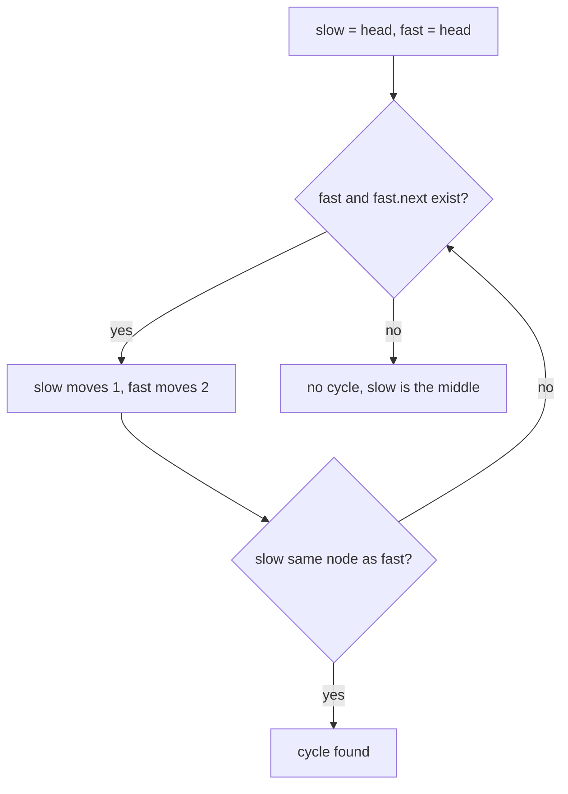
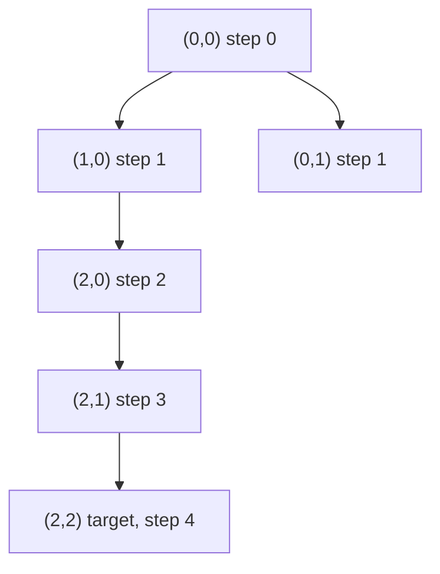
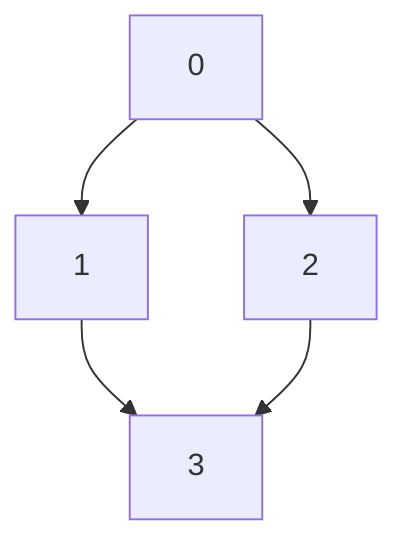
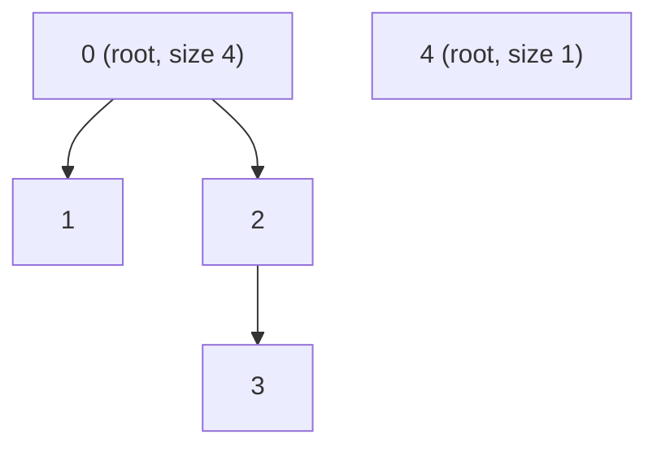
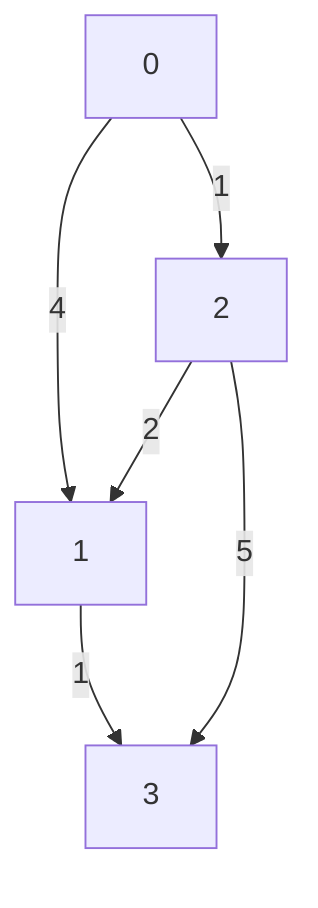
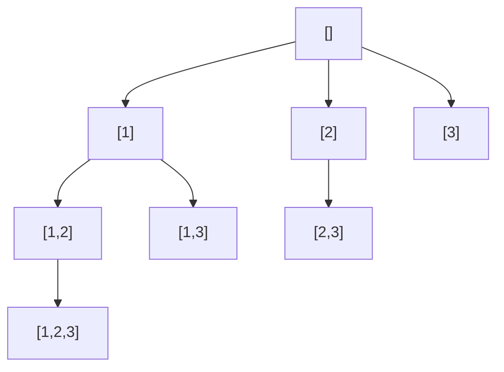
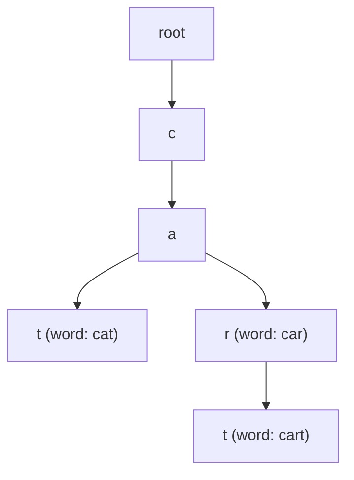

# Reusable Code Templates

[⬅ Back to index](../README.md)

Covers: the skeletons worth memorising, each with the template in Kotlin, what to change for common variants, a short worked example, and the off-by-one mistakes to avoid.

---

## Arrays, Strings & Intervals

### 1. What is the fixed-size sliding window template?

**📘 Concept**

<details>
<summary>Answer</summary>

**In short:** When the question is about every contiguous block of exactly `k` elements, don't recompute each block from scratch. Slide a window one step at a time: **add the element coming in on the right, remove the one falling out on the left, and record the answer once the window is full.** Each element is added once and removed once, so it's O(n) time instead of O(n·k).

#### When to use it

- "Maximum / minimum / average of every subarray of size k."
- "Does any substring of length k have property X?" (e.g. is it an anagram of a pattern — the pattern's length fixes k).
- "Count windows of size k that satisfy X."

The key signal is that the window size never changes. If the size depends on a condition ("longest", "shortest", "at most"), use the [variable-size window](#2-what-is-the-variable-size-sliding-window-template) instead.

#### The template

```kotlin
// Maximum sum of any k consecutive elements.
fun maxSumOfWindow(nums: IntArray, k: Int): Int {
    require(k in 1..nums.size) { "k must be between 1 and nums.size" }
    var windowSum = 0
    var best = Int.MIN_VALUE
    for (right in nums.indices) {
        windowSum += nums[right]                      // 1. element enters on the right
        if (right >= k) windowSum -= nums[right - k]  // 2. element leaves on the left
        if (right >= k - 1) best = maxOf(best, windowSum) // 3. window is full: record
    }
    return best
}
```

The three numbered steps are the whole template. Only the "state" (here `windowSum`) and the "record" step change between problems. The element that leaves is always `nums[right - k]`, because the window covers `[right - k + 1, right]`.

#### Worked example

`nums = [2, 1, 5, 1, 3, 2]`, `k = 3`

| right | enters | leaves | window | windowSum | best |
|---|---|---|---|---|---|
| 0 | 2 | – | [2] | 2 | – (not full) |
| 1 | 1 | – | [2, 1] | 3 | – (not full) |
| 2 | 5 | – | [2, 1, 5] | 8 | 8 |
| 3 | 1 | 2 | [1, 5, 1] | 7 | 8 |
| 4 | 3 | 1 | [5, 1, 3] | 9 | **9** |
| 5 | 2 | 5 | [1, 3, 2] | 6 | 9 |

#### Knobs you change for variants

| Variant | State to keep | Record step |
|---|---|---|
| Max/min sum or average | running sum | compare sum (divide by k for average) |
| Anagram of a pattern in a string | `IntArray(26)` counts of the window vs the pattern | windows where counts match (track a "matches" counter to keep it O(1)) |
| Number of distinct values in each window | `HashMap<value, count>`; remove a key when its count hits 0 | `map.size` |
| Maximum of each window | a monotonic deque of indices | front of the deque — see Sliding Window Maximum in [Two Pointers & Sliding Window](08-two-pointers-sliding-window.md) |

Some people prefer a two-phase version: build the first window with a loop over `0 until k`, then slide from `k` to `n - 1`. It's equivalent; the single loop above just has fewer places to get an index wrong.

#### Common bugs

- Removing `nums[right - k + 1]` instead of `nums[right - k]` — off by one; the window ends up with k − 1 elements.
- Recording before the window is full (`right >= k - 1` is the first full window).
- Initialising `best = 0` when all values can be negative.
- Forgetting to check `k > nums.size` (no full window exists).
- Using `Int` for sums of large values — switch to `Long` if `k · max(value)` can exceed about 2.1 × 10⁹.

#### Follow-ups

- *What if the window must satisfy a condition rather than a size?* Use the [variable-size window](#2-what-is-the-variable-size-sliding-window-template).
- *Can a prefix sum do this?* Yes: window sum = `prefix[right + 1] - prefix[right + 1 - k]`. The sliding version uses O(1) space instead of O(n).

</details>

### 2. What is the variable-size sliding window template?

**📘 Concept** · ⭐ Product/FAANG favourite

<details>
<summary>Answer</summary>

**In short:** Grow the window by moving `right` forward one step at a time; whenever the window breaks the rule, **shrink it from the left until it is valid again**; then record. Both pointers only move forward, so every element enters and leaves at most once — O(n). It works only when the rule is **monotonic**: if a window is invalid, every bigger window containing it is also invalid.

#### When to use it

- "Longest / shortest contiguous subarray or substring such that …"
- "Number of subarrays where …" (often via the "at most K" trick).
- Constraints that grow or shrink predictably: sums of **non-negative** numbers, number of distinct characters, count of a "bad" element.

If values can be negative and the rule is about sums, shrinking is no longer safe — use the [prefix sum and hash map](#5-what-is-the-prefix-sum-and-hash-map-template) template instead.

#### The template (longest valid window)

```kotlin
// Longest subarray with sum <= limit (all values non-negative).
fun longestWithSumAtMost(nums: IntArray, limit: Int): Int {
    var left = 0
    var windowSum = 0L
    var best = 0
    for (right in nums.indices) {
        windowSum += nums[right]                 // 1. expand: include nums[right]
        while (windowSum > limit) {              // 2. shrink while the window is invalid
            windowSum -= nums[left]
            left++
        }
        best = maxOf(best, right - left + 1)     // 3. [left, right] is valid: record
    }
    return best
}
```

Three slots change between problems: **what state you keep** (a sum, a count map, a counter of "bad" items), **the invalid condition** in the `while`, and **what you record**.

#### The shortest-window shape

For "shortest window that satisfies X", the record moves **inside** the loop: while the window is valid, record it and try to make it smaller.

```kotlin
// Shortest subarray with sum >= target (non-negative values). 0 if none.
fun shortestWithSumAtLeast(nums: IntArray, target: Int): Int {
    var left = 0
    var windowSum = 0L
    var best = Int.MAX_VALUE
    for (right in nums.indices) {
        windowSum += nums[right]
        while (windowSum >= target) {            // valid: record, then try smaller
            best = minOf(best, right - left + 1)
            windowSum -= nums[left]
            left++
        }
    }
    return if (best == Int.MAX_VALUE) 0 else best
}
```

#### Worked example (longest)

`nums = [3, 1, 2, 1, 1, 4]`, `limit = 5`

| right | add | sum after add | shrink steps | window | length | best |
|---|---|---|---|---|---|---|
| 0 | 3 | 3 | – | [3] | 1 | 1 |
| 1 | 1 | 4 | – | [3, 1] | 2 | 2 |
| 2 | 2 | 6 | drop 3 → 3 | [1, 2] | 2 | 2 |
| 3 | 1 | 4 | – | [1, 2, 1] | 3 | 3 |
| 4 | 1 | 5 | – | [1, 2, 1, 1] | 4 | **4** |
| 5 | 4 | 9 | drop 1, 2, 1 → 5 | [1, 4] | 2 | 4 |

#### Knobs you change for variants

| Variant | State | Invalid when |
|---|---|---|
| Longest substring without repeats | `IntArray(128)` or map of counts | count of `s[right]` > 1 |
| At most K distinct characters | `HashMap<Char, Int>` (remove at 0) | `map.size > k` |
| Replace at most K characters | counts + max frequency | `length - maxFreq > k` |
| At most K zeros you may flip | count of zeros | `zeros > k` |
| **Count** subarrays that are valid | same as above | add `right - left + 1` each step (every window ending at `right` and starting at ≥ `left` is valid) |
| **Exactly** K | — | `atMost(K) - atMost(K - 1)` |

The named problems are solved fully in [Two Pointers & Sliding Window](08-two-pointers-sliding-window.md).

#### Common bugs

- Using `if` instead of `while` to shrink — one step may not be enough.
- Recording before the window has been made valid (longest) or after it was shrunk past valid (shortest).
- Applying it to sums with negative numbers — the monotonic property is gone.
- Forgetting to remove a map key when its count drops to 0, so `map.size` is wrong.
- Window length is `right - left + 1`, not `right - left`.

#### Follow-ups

- *Why is it O(n) with a nested `while`?* `left` only moves forward and never passes `n`, so the inner loop runs at most n times **in total**.
- *Why is the window approach correct?* See the elimination argument in [Two Pointers & Sliding Window](08-two-pointers-sliding-window.md).

</details>

### 3. What is the opposite-end two pointers template?

**📘 Concept**

<details>
<summary>Answer</summary>

**In short:** Put one pointer at each end of a **sorted** array (or a string) and move them towards each other. At each step, look at the pair and move the pointer whose element **can no longer be part of a better answer**. Each step discards one element for good, so the loop is O(n) after an O(n log n) sort.

#### When to use it

- Pair problems on sorted input: "pair with sum = / < / closest to target".
- Symmetry checks: palindromes, reversing in place.
- "Two walls" problems where the answer depends on both ends (Container With Most Water).
- As the inner loop of 3Sum / 4Sum (fix one element, two-pointer the rest).

#### The template

```kotlin
// Count pairs i < j with nums[i] + nums[j] < target.
fun countPairsBelow(nums: IntArray, target: Int): Int {
    val sorted = nums.sortedArray()          // don't mutate the caller's array
    var lo = 0
    var hi = sorted.size - 1
    var count = 0
    while (lo < hi) {                        // stop when the pointers meet
        if (sorted[lo] + sorted[hi] < target) {
            count += hi - lo                 // lo pairs with every index in (lo, hi]
            lo++                             // lo is fully counted: drop it
        } else {
            hi--                             // sorted[hi] is too big for any remaining lo
        }
    }
    return count
}
```

Why `count += hi - lo`: the array is sorted, so if `sorted[lo] + sorted[hi]` is already below target, `sorted[lo]` plus anything **smaller** than `sorted[hi]` is too. That's `hi - lo` pairs at once — and `lo` has nothing left to contribute.

The other common shape is the symmetric one — no sorting, just move both pointers together:

```kotlin
fun reverseInPlace(chars: CharArray) {
    var lo = 0
    var hi = chars.size - 1
    while (lo < hi) {
        val tmp = chars[lo]; chars[lo] = chars[hi]; chars[hi] = tmp
        lo++
        hi--
    }
}
```

#### Worked example

`nums = [-1, 1, 2, 3, 1]`, `target = 2` → sorted `[-1, 1, 1, 2, 3]`

| lo | hi | pair | sum | action | count |
|---|---|---|---|---|---|
| 0 | 4 | (-1, 3) | 2 | not < 2 → hi-- | 0 |
| 0 | 3 | (-1, 2) | 1 | < 2 → count += 3, lo++ | 3 |
| 1 | 3 | (1, 2) | 3 | hi-- | 3 |
| 1 | 2 | (1, 1) | 2 | hi-- | 3 |
| 1 | 1 | – | – | stop | **3** |

#### Knobs you change for variants

| Variant | Decision at each step |
|---|---|
| Pair equal to target | `< target` → `lo++`; `> target` → `hi--`; equal → found |
| Closest to target | record `abs(sum - target)`, then move as above |
| All unique pairs (3Sum inner loop) | on a match, move both and skip duplicates on each side |
| Palindrome check | compare `s[lo]` and `s[hi]`; skip non-alphanumerics if asked |
| Maximise area between walls | move the **shorter** wall |

#### Common bugs

- Using it on unsorted data for a sum problem — the "this element is useless now" argument needs sorted order.
- `while (lo <= hi)` for pair problems, which pairs an element with itself.
- Forgetting to move **both** pointers after a match when listing all pairs (infinite loop).
- Sorting the caller's array in place when they didn't expect it — say so or copy.

#### Follow-ups

- *Why is moving one pointer safe?* The elimination argument — see question 1 of [Two Pointers & Sliding Window](08-two-pointers-sliding-window.md), which also solves Two Sum II, 3Sum and Container With Most Water.
- *Unsorted and you need indices?* A hash map is O(n) without sorting — see Two Sum in [Arrays, Strings & Hashing](07-arrays-strings-hashing.md).

</details>

### 4. What is the fast and slow pointers template?

**📘 Concept**

<details>
<summary>Answer</summary>

**In short:** Move two pointers through a sequence at different speeds — `slow` one step, `fast` two steps. When `fast` reaches the end, `slow` is at the **middle**. If there is a **cycle**, `fast` laps `slow` and they meet inside it. O(n) time, O(1) space, which is why it beats a visited set in interviews.

#### When to use it

- Linked lists: find the middle, detect a cycle, find the cycle's start, split a list in half (merge sort, palindrome check, reorder list).
- Any "next" function that must eventually repeat: `x → f(x)` sequences such as the digit-square sequence in Happy Number, or arrays where `nums[i]` points to another index (Find the Duplicate Number).

#### The template

```kotlin
class ListNode(var value: Int) {
    var next: ListNode? = null
}

// Middle node. For an even length this returns the SECOND middle.
fun middle(head: ListNode?): ListNode? {
    var slow = head
    var fast = head
    while (fast?.next != null) {             // fast can take two more steps
        slow = slow?.next
        fast = fast.next?.next
    }
    return slow
}

// True if the list has a cycle (Floyd's algorithm).
fun hasCycle(head: ListNode?): Boolean {
    var slow = head
    var fast = head
    while (fast?.next != null) {
        slow = slow?.next
        fast = fast.next?.next
        if (slow === fast) return true       // reference equality: same node
    }
    return false
}
```

The same idea works on any function, not just lists:

```kotlin
// For a sequence start, next(start), next(next(start)), ... over a finite set of
// values (so it must eventually repeat), return some value that lies on the cycle.
fun valueOnCycle(start: Int, next: (Int) -> Int): Int {
    var slow = next(start)
    var fast = next(next(start))
    while (slow != fast) {
        slow = next(slow)
        fast = next(next(fast))
    }
    return slow
}

// Example use: a number is "happy" when its digit-square sequence ends in the
// fixed point 1 (the cycle 1 -> 1), so: valueOnCycle(n, ::digitSquareSum) == 1
```

#### Worked example (middle)

| List | slow path | fast path | Result |
|---|---|---|---|
| 1 → 2 → 3 → 4 → 5 | 1, 2, 3 | 1, 3, 5 (fast.next is null) | 3 |
| 1 → 2 → 3 → 4 → 5 → 6 | 1, 2, 3, 4 | 1, 3, 5, null | 4 (second middle) |



#### Knobs you change for variants

| Variant | Change |
|---|---|
| First middle for even length | loop while `fast?.next?.next != null` |
| Split a list in two | find the first middle, then cut `mid.next = null` |
| Start of the cycle | after they meet, reset one pointer to `head` and move both one step at a time; they meet at the cycle start |
| k-th node from the end | different **gap**, same speed: move `fast` k steps first, then move both |

#### Common bugs

- Checking `fast.next` without checking `fast` first → null pointer. `fast?.next != null` covers both.
- Comparing values (`==` on data) instead of node identity (`===`) when values can repeat.
- Checking `slow === fast` **before** the first move — they both start at `head`, so it's trivially true.
- Getting first vs second middle wrong for even-length lists — decide which one you need before coding.

#### Follow-ups

- *Why do they meet, and why does resetting to head find the cycle start?* Proof and full solutions: Linked List Cycle I/II in [Linked Lists](12-linked-lists.md).
- *Can you use a HashSet?* Yes, O(n) space — fine to mention first, then optimise.

</details>

### 5. What is the prefix sum and hash map template?

**📘 Concept**

<details>
<summary>Answer</summary>

**In short:** A prefix sum turns "sum of `nums[l..r]`" into one subtraction: `prefix[r + 1] - prefix[l]`. Add a hash map of **prefix values seen so far** and you can ask, at each index, "is there an earlier prefix that makes the subarray ending here equal to K?" in O(1). That gives O(n) for subarray-sum questions **even with negative numbers**, where a sliding window fails.

#### When to use it

- Many range-sum queries on a static array → plain prefix array.
- "Count / longest subarray with sum = K" (values may be negative).
- "Subarray sum divisible by K" → key on `prefix % K`.
- "Equal number of 0s and 1s" → map 0 to −1 and look for sum 0.

#### Template 1: plain prefix array

```kotlin
fun buildPrefix(nums: IntArray): LongArray {
    val prefix = LongArray(nums.size + 1)    // prefix[i] = sum of nums[0 until i]
    for (i in nums.indices) prefix[i + 1] = prefix[i] + nums[i]
    return prefix
}

// Sum of nums[l..r], both inclusive.
fun rangeSum(prefix: LongArray, l: Int, r: Int): Long = prefix[r + 1] - prefix[l]
```

The extra leading 0 is the trick that removes every special case for `l = 0`.

#### Template 2: prefix sum + hash map

```kotlin
// Length of the longest subarray whose sum is exactly k (values may be negative).
fun longestSubarrayWithSum(nums: IntArray, k: Int): Int {
    val firstIndex = HashMap<Long, Int>()
    firstIndex[0L] = -1                      // empty prefix "ends" before index 0
    var prefix = 0L
    var best = 0
    for (i in nums.indices) {
        prefix += nums[i]
        val start = firstIndex[prefix - k]   // earlier prefix P with prefix - P == k
        if (start != null) best = maxOf(best, i - start)
        firstIndex.putIfAbsent(prefix, i)    // keep the EARLIEST index for longest
    }
    return best
}
```

The idea: `sum(j + 1..i) = prefix_i - prefix_j`. We want that to be `k`, so we look up `prefix_i - k` among earlier prefixes.

#### Worked example

`nums = [1, -1, 5, -2, 3]`, `k = 3`

| i | nums[i] | prefix | look up prefix − k | found at | length | map after |
|---|---|---|---|---|---|---|
| – | – | 0 | – | – | – | {0: −1} |
| 0 | 1 | 1 | −2 | – | – | {0: −1, 1: 0} |
| 1 | −1 | 0 | −3 | – | – | 0 already stored, keep −1 |
| 2 | 5 | 5 | 2 | – | – | + {5: 2} |
| 3 | −2 | 3 | 0 | −1 | 4 | + {3: 3} |
| 4 | 3 | 6 | 3 | 3 | 1 | + {6: 4} |

Answer **4** — the subarray `[1, -1, 5, -2]`.

#### Knobs you change for variants

| Variant | What the map stores | Key |
|---|---|---|
| Longest subarray with sum K | earliest index (`putIfAbsent`) | prefix |
| **Count** of subarrays with sum K | how many times each prefix occurred; add `count[prefix - k]` | prefix |
| Sum divisible by K | count or earliest index | `((prefix % k) + k) % k` (normalise negatives) |
| Equal 0s and 1s | earliest index | running balance (+1 for 1, −1 for 0), look up the same balance |

The "count subarrays with sum K" version is solved fully in [Problem-Solving Tricks](06-problem-solving-tricks.md); the modulo and balance versions in [Prefix Sums, Intervals & Sweep Line](09-prefix-sums-intervals.md).

#### Common bugs

- Forgetting the seed `0 → -1` (or `0 → 1` for counting) — misses subarrays that start at index 0.
- Inserting the current prefix **before** the lookup — with `k = 0` it matches itself and counts an empty subarray.
- Overwriting the earliest index when you want the longest (use `putIfAbsent`).
- Negative remainders in Kotlin: `-1 % 5 == -1`, so normalise.
- Int overflow in the running sum — use `Long`.

#### Follow-ups

- *Why not a sliding window?* With negative values, shrinking the window can increase the sum, so the monotonic rule the window needs is gone.
- *2D?* `prefix[r + 1][c + 1]` with inclusion–exclusion — see Range Sum Query 2D in [Prefix Sums, Intervals & Sweep Line](09-prefix-sums-intervals.md).

</details>

### 6. What is the merge intervals (sort and sweep) template?

**📘 Concept**

<details>
<summary>Answer</summary>

**In short:** Sort the intervals by start, then walk through them once, keeping a "current" interval. If the next interval **starts before the current one ends**, they overlap — extend the current end. Otherwise close the current one and start a new one. Sorting is O(n log n); the sweep is O(n). Sorting is what makes it work: after sorting, an interval can only overlap the one directly before it in the merged list.

#### When to use it

- Merge overlapping intervals, total covered length, free time between busy blocks.
- Insert a new interval into a sorted list.
- Variants that sort by **end** instead (maximum non-overlapping set, minimum arrows) or turn intervals into **events** (maximum overlap, meeting rooms needed).

#### The template

```kotlin
// Total length covered by the union of intervals [start, end).
fun coveredLength(intervals: List<IntArray>): Long {
    if (intervals.isEmpty()) return 0
    val sorted = intervals.sortedBy { it[0] }            // 1. sort by start
    var curStart = sorted[0][0]
    var curEnd = sorted[0][1]
    var total = 0L
    for (i in 1 until sorted.size) {
        val (start, end) = sorted[i]
        if (start <= curEnd) {                           // 2. overlaps (or touches): extend
            curEnd = maxOf(curEnd, end)
        } else {                                         // 3. gap: close current group
            total += curEnd - curStart
            curStart = start
            curEnd = end
        }
    }
    total += curEnd - curStart                           // 4. close the last group
    return total
}
```

Replace "add to `total`" with "append `[curStart, curEnd]` to a result list" and you have Merge Intervals itself (solved fully in [Prefix Sums, Intervals & Sweep Line](09-prefix-sums-intervals.md)).

#### Worked example

`[[7, 8], [1, 3], [2, 5]]` → sorted `[[1, 3], [2, 5], [7, 8]]`

| next | current before | overlap? | current after | total |
|---|---|---|---|---|
| – | [1, 3] | – | [1, 3] | 0 |
| [2, 5] | [1, 3] | 2 ≤ 3 yes | [1, 5] | 0 |
| [7, 8] | [1, 5] | 7 > 5 no | [7, 8] | 4 |
| end | [7, 8] | – | – | **5** |

#### Knobs you change for variants

| Variant | Sort by | Rule |
|---|---|---|
| Merge / union length / insert | start | overlap if `start <= curEnd` |
| Touching intervals should **not** merge (`[1,2]` and `[2,3]` stay apart) | start | overlap if `start < curEnd` |
| Max number of non-overlapping intervals | **end** | greedily keep an interval if it starts after the last kept end |
| Max intervals overlapping at once (rooms needed) | events | +1 at each start, −1 at each end; sort events (end before start at the same time if half-open); track the running max |

The events version, in short:

```kotlin
fun maxOverlap(intervals: List<IntArray>): Int {
    val events = ArrayList<IntArray>()
    for ((s, e) in intervals) {
        events.add(intArrayOf(s, +1))
        events.add(intArrayOf(e, -1))
    }
    // At equal times, process -1 first so [1,3) and [3,5) don't count as overlapping.
    events.sortWith(compareBy<IntArray>({ it[0] }, { it[1] }))
    var running = 0
    var best = 0
    for ((_, delta) in events) {
        running += delta
        best = maxOf(best, running)
    }
    return best
}
```

#### Common bugs

- Not sorting first (or sorting by end when you meant start).
- `curEnd = end` instead of `maxOf(curEnd, end)` — a short interval inside a long one would shrink it (`[1, 10]` then `[2, 3]`).
- Forgetting to add the last group after the loop.
- Mutating the input arrays you put in the result list — copy them if the caller still uses the input.
- Not asking whether ends are inclusive or exclusive — it decides `<=` vs `<`.

#### Follow-ups

- *Can you avoid sorting?* Only if the input is already sorted (Insert Interval) — then it's O(n).
- *Meeting rooms needed?* Events sweep or a min-heap of end times — see Meeting Rooms II in [Prefix Sums, Intervals & Sweep Line](09-prefix-sums-intervals.md).

</details>

## Searching, Stacks & Heaps

### 7. How do you write lower bound and upper bound binary search?

**📘 Concept** · ⭐ Product/FAANG favourite

<details>
<summary>Answer</summary>

**In short:** Use one loop shape for everything: a **half-open range `[lo, hi)`**, `while (lo < hi)`, `mid = lo + (hi - lo) / 2`, and either `lo = mid + 1` or `hi = mid`. **Lower bound** returns the first index whose value is `>= target`; **upper bound** returns the first index whose value is `> target`. Both return a value in `0..n`, and every other question ("first occurrence", "last occurrence", "count", "insert position") is one of these two plus a check. O(log n).

#### When to use it

- Sorted array and you need a **position**, not just yes/no: first/last occurrence, insert position, count of a value, number of elements below x.
- Any **monotonic predicate** over indices (false, false, …, true, true): "first index where predicate is true" is the same loop.

#### The template

```kotlin
// First index i in 0..n with nums[i] >= target (n if every value is smaller).
fun lowerBound(nums: IntArray, target: Int): Int {
    var lo = 0
    var hi = nums.size                  // half-open: hi is never a valid answer to read
    while (lo < hi) {
        val mid = lo + (hi - lo) / 2    // no overflow, unlike (lo + hi) / 2
        if (nums[mid] < target) lo = mid + 1   // mid is too small: answer is to the right
        else hi = mid                          // mid could be the answer: keep it
    }
    return lo                           // lo == hi
}

// First index i in 0..n with nums[i] > target.
fun upperBound(nums: IntArray, target: Int): Int {
    var lo = 0
    var hi = nums.size
    while (lo < hi) {
        val mid = lo + (hi - lo) / 2
        if (nums[mid] <= target) lo = mid + 1  // the only difference: <= instead of <
        else hi = mid
    }
    return lo
}
```

**Invariant:** everything left of `lo` is "too small" (predicate false), everything at or right of `hi` is "big enough" (predicate true). The range shrinks every step (`mid < hi`, and `lo` jumps past `mid`), so it always terminates, and when `lo == hi` that's the boundary.

#### Deriving everything else

| Question | Answer |
|---|---|
| Is `target` present? | `lb < n && nums[lb] == target` |
| First occurrence | `lb` if present, else −1 |
| Last occurrence | `upperBound - 1` if present |
| Count of `target` | `upperBound - lowerBound` |
| Insert position | `lowerBound` |
| Number of values `< x` / `<= x` | `lowerBound(x)` / `upperBound(x)` |
| Largest value `< x` | `nums[lowerBound(x) - 1]` if the index is ≥ 0 |

#### Worked example

`nums = [1, 2, 2, 2, 5]`, `target = 2`

| step | lo | hi | mid | nums[mid] | lowerBound action |
|---|---|---|---|---|---|
| 1 | 0 | 5 | 2 | 2 | not < 2 → hi = 2 |
| 2 | 0 | 2 | 1 | 2 | not < 2 → hi = 1 |
| 3 | 0 | 1 | 0 | 1 | < 2 → lo = 1 |
| end | 1 | 1 | | | **lowerBound = 1** |

Upper bound on the same input moves `lo` past every 2 and returns **4**, so the count of 2s is 4 − 1 = 3.

#### Swift

Swift has no `binarySearch` on arrays in the standard library, so you write it every time:

```swift
func lowerBound(_ nums: [Int], _ target: Int) -> Int {
    var lo = 0, hi = nums.count
    while lo < hi {
        let mid = lo + (hi - lo) / 2
        if nums[mid] < target { lo = mid + 1 } else { hi = mid }
    }
    return lo
}

func upperBound(_ nums: [Int], _ target: Int) -> Int {
    var lo = 0, hi = nums.count
    while lo < hi {
        let mid = lo + (hi - lo) / 2
        if nums[mid] <= target { lo = mid + 1 } else { hi = mid }
    }
    return lo
}
```

Kotlin does have `IntArray.binarySearch` / `List.binarySearch`, but with duplicates it returns **any** matching index, and when missing it returns `-(insertionPoint) - 1`. Fine for "is it there?", not for first/last.

#### Common bugs

- Mixing styles: `hi = n - 1` (closed range) with `while (lo < hi)` and `hi = mid` — skips the last element or loops forever. Pick half-open and never mix.
- `hi = mid - 1` in the lower-bound loop — throws away a possible answer.
- `(lo + hi) / 2` overflowing when indices or values (binary search on the answer) are near `Int.MAX_VALUE`.
- Reading `nums[lb]` without checking `lb < n`.

#### Follow-ups

- *Rotated array, peaks, 2D matrix?* Same invariant thinking, different predicate — see [Binary Search](10-binary-search.md), which also has a deeper "never get the bounds wrong" question.
- *Searching for a value, not an index?* See [binary search on the answer](#8-what-is-the-binary-search-on-the-answer-template).

</details>

### 8. What is the binary search on the answer template?

**📘 Concept** · ⭐ Product/FAANG favourite

<details>
<summary>Answer</summary>

**In short:** When a problem asks for the **minimum (or maximum) value that works**, and "works" is monotonic — if `x` works then every bigger `x` also works — binary search over the **range of possible answers**, not over an array. Write a `feasible(x)` check (usually a greedy O(n) pass), then find the first `x` where it returns true. Total cost: O(n · log(range)).

#### When to use it

- "Minimum speed / capacity / time / largest-piece such that the job can be done within a limit."
- "Maximise the minimum distance" or "minimise the maximum load".
- Checking a given answer is easy, but computing it directly is hard.
- Constraints with huge values (up to 10⁹) but a linear-time check — log₂(10⁹) ≈ 30 checks.

#### The template (minimum feasible value)

```kotlin
// Smallest x in [low, high] with feasible(x) == true.
// Requires: feasible is monotonic (false ... false true ... true) and feasible(high) is true.
fun minFeasible(low: Long, high: Long, feasible: (Long) -> Boolean): Long {
    var lo = low
    var hi = high
    while (lo < hi) {
        val mid = lo + (hi - lo) / 2
        if (feasible(mid)) hi = mid          // mid works: answer is mid or smaller
        else lo = mid + 1                    // mid fails: answer is bigger
    }
    return lo
}
```

This is exactly [lower bound](#7-how-do-you-write-lower-bound-and-upper-bound-binary-search) with the array lookup replaced by `feasible(mid)`.

#### Example: minimum time for a set of buses to complete N trips

Bus `i` takes `times[i]` minutes per trip; buses run in parallel. What's the minimum time to complete `totalTrips` trips in total? In time `t`, bus `i` does `t / times[i]` trips — more time never means fewer trips, so feasibility is monotonic.

```kotlin
fun minimumTime(times: IntArray, totalTrips: Int): Long {
    val fastest = times.min().toLong()
    // Upper bound: the fastest bus alone could do every trip.
    return minFeasible(1L, fastest * totalTrips) { t ->
        var trips = 0L
        for (time in times) {
            trips += t / time
            if (trips >= totalTrips) return@minFeasible true  // early exit, avoids overflow
        }
        false
    }
}
```

`times = [1, 2, 3]`, `totalTrips = 5`, search range `[1, 5]`:

| lo | hi | mid | trips in mid minutes | feasible? | next |
|---|---|---|---|---|---|
| 1 | 5 | 3 | 3 + 1 + 1 = 5 | yes | hi = 3 |
| 1 | 3 | 2 | 2 + 1 + 0 = 3 | no | lo = 3 |
| 3 | 3 | | | | answer **3** |

#### Maximum feasible value

For "largest x that still works" (true … true false … false), round `mid` **up** so the range always shrinks:

```kotlin
fun maxFeasible(low: Long, high: Long, feasible: (Long) -> Boolean): Long {
    var lo = low                             // requires feasible(low) == true
    var hi = high
    while (lo < hi) {
        val mid = lo + (hi - lo + 1) / 2     // upper mid, or lo = mid loops forever
        if (feasible(mid)) lo = mid else hi = mid - 1
    }
    return lo
}
```

#### Swift

```swift
func minFeasible(_ low: Int, _ high: Int, _ feasible: (Int) -> Bool) -> Int {
    var lo = low, hi = high
    while lo < hi {
        let mid = lo + (hi - lo) / 2
        if feasible(mid) { hi = mid } else { lo = mid + 1 }
    }
    return lo
}
```

Swift `Int` is 64-bit on current platforms, but it **traps** on overflow instead of wrapping, so the early exit inside `feasible` matters just as much.

#### Knobs you change for variants

- **The range:** `low` = smallest answer that could possibly work (often 1 or `max(nums)`), `high` = one that surely works (often `sum(nums)` or `max(nums)`).
- **The check:** usually greedy — "fill each day/worker until the limit, then start a new one, and count".
- **Direction:** min feasible (template 1) or max feasible (template 2).

#### Common bugs

- Feasibility that isn't actually monotonic — prove it in one sentence before coding.
- `high` too small (the true answer is outside the range) or `low` too large.
- `Int` overflow in the range (`fastest * totalTrips`) or in the check's running total.
- Max version with lower `mid` → infinite loop when `hi = lo + 1`.

#### Follow-ups

- Koko Eating Bananas, Capacity To Ship Packages and Split Array Largest Sum are solved fully in [Binary Search](10-binary-search.md).
- *Real-valued answer?* Loop a fixed number of times (say 100) with `Double`s instead of `lo < hi`.

</details>

### 9. What is the monotonic stack template?

**📘 Concept**

<details>
<summary>Answer</summary>

**In short:** To find, for every element, the **next greater** (or smaller) element, scan left to right with a stack of indices whose values are kept in **decreasing order**. When a new value is bigger than the top, the new value is the answer for that top — pop it and record. Each index is pushed once and popped at most once, so it's O(n) instead of O(n²).

#### When to use it

- "Next / previous greater / smaller element" and anything built on it: days until a warmer temperature, stock span, how far each bar can extend in a histogram.
- "For each element, the nearest element to the left/right that is bigger/smaller."
- Removing digits/characters to make the smallest result (a monotonic stack used greedily).

#### The template

```kotlin
// For each i, the value of the next element to the right that is strictly greater; -1 if none.
fun nextGreater(nums: IntArray): IntArray {
    val answer = IntArray(nums.size) { -1 }
    val stack = ArrayDeque<Int>()            // indices; their values are decreasing bottom to top
    for (i in nums.indices) {
        while (stack.isNotEmpty() && nums[i] > nums[stack.last()]) {
            answer[stack.removeLast()] = nums[i]   // nums[i] is the next greater for that index
        }
        stack.addLast(i)                     // nums[i] waits for its own next greater
    }
    return answer                            // indices left on the stack keep -1
}
```

Why it works: an index stays on the stack only while nothing greater has appeared after it. The stack is always decreasing because anything smaller than the newcomer was just popped.

#### Worked example

`nums = [2, 1, 2, 4, 3]`

| i | nums[i] | popped (answer set) | stack after (values) |
|---|---|---|---|
| 0 | 2 | – | [2] |
| 1 | 1 | – | [2, 1] |
| 2 | 2 | index 1 → 2 | [2, 2] |
| 3 | 4 | index 2 → 4, index 0 → 4 | [4] |
| 4 | 3 | – | [4, 3] |

Result: `[4, 2, 4, -1, -1]`.

#### Knobs you change for variants

| Want | Change |
|---|---|
| Next **smaller** | flip the comparison: pop while `nums[i] < nums[top]` (stack increasing) |
| Distance instead of value (days to wait) | `answer[top] = i - top` |
| **Previous** greater | after popping, the top that remains (if any) is the previous greater-or-equal of `i`; record before pushing |
| Duplicates count as "greater or equal" | use `>=` instead of `>` — decide deliberately, it matters in histogram and "sum of minimums" problems |
| Circular array | loop `i` over `0 until 2 * n`, use `i % n`, push only while `i < n` |

#### Common bugs

- Pushing values instead of indices — you then can't write the answer to the right slot or compute distances.
- Using `if` instead of `while` when popping — one newcomer can resolve many waiting indices.
- Getting strict vs non-strict comparison wrong with duplicates.
- Using `java.util.Stack` (synchronised, legacy) — prefer `ArrayDeque`.
- Kotlin: `removeLast()` on a `MutableList` can clash with the JDK 21 `List.removeLast` on Android; on `kotlin.collections.ArrayDeque` it's fine.

#### Follow-ups

- Daily Temperatures, Next Greater Element I/II, Largest Rectangle in Histogram and Online Stock Span are solved in [Stacks, Queues & Monotonic Stack](11-stacks-queues-monotonic.md).
- *Sliding window maximum?* Same idea with a deque that also drops indices from the front — see [Two Pointers & Sliding Window](08-two-pointers-sliding-window.md).

</details>

### 10. What is the top-K heap template?

**📘 Concept** · ⭐ Product/FAANG favourite

<details>
<summary>Answer</summary>

**In short:** To keep the **K largest** items, use a **min-heap of size K**: push each item, and if the heap grows past K, pop the smallest. The heap's root is always the K-th largest so far. O(n log K) time and O(K) space — better than sorting (O(n log n)) when K is small, and it works on a stream.

#### When to use it

- "K largest / smallest / most frequent / closest", "K-th largest".
- Data arrives as a stream, or n is huge and K is small.
- Merging K sorted sources (a different heap template, same tool).

The counter-intuitive part: **K largest → min-heap, K smallest → max-heap.** The heap's root is the item you'd throw away next.

#### The template (Kotlin)

```kotlin
import java.util.PriorityQueue

fun kLargest(nums: IntArray, k: Int): List<Int> {
    val heap = PriorityQueue<Int>()          // min-heap: root = smallest of the kept K
    for (x in nums) {
        heap.add(x)
        if (heap.size > k) heap.poll()       // evict the smallest
    }
    return heap.toList()                     // the K largest, NOT in sorted order
}
```

`heap.peek()` after the loop is the K-th largest. With a key, give a comparator:

```kotlin
// K points closest to the origin: keep a MAX-heap by distance, evict the farthest.
val heap = PriorityQueue<IntArray>(compareByDescending { it[0] * it[0] + it[1] * it[1] })
```

#### Worked example

`nums = [3, 1, 5, 12, 2, 11]`, `k = 3`

| x | heap after add | size > 3? | heap after |
|---|---|---|---|
| 3 | {3} | no | {3} |
| 1 | {1, 3} | no | {1, 3} |
| 5 | {1, 3, 5} | no | {1, 3, 5} |
| 12 | {1, 3, 5, 12} | yes, poll 1 | {3, 5, 12} |
| 2 | {2, 3, 5, 12} | yes, poll 2 | {3, 5, 12} |
| 11 | {3, 5, 11, 12} | yes, poll 3 | {5, 11, 12} |

Root is 5 — the 3rd largest.

#### Swift: a minimal hand-written heap

Swift's standard library has no heap (`swift-collections` has one, but coding platforms usually can't import it). This small generic heap is enough for any interview:

```swift
struct Heap<T> {
    private var items: [T] = []
    private let higherPriority: (T, T) -> Bool   // true if the first belongs nearer the top

    init(_ higherPriority: @escaping (T, T) -> Bool) { self.higherPriority = higherPriority }

    var count: Int { items.count }
    var peek: T? { items.first }

    mutating func push(_ x: T) {
        items.append(x)
        var child = items.count - 1
        while child > 0 {                            // sift up
            let parent = (child - 1) / 2
            if !higherPriority(items[child], items[parent]) { break }
            items.swapAt(child, parent)
            child = parent
        }
    }

    mutating func pop() -> T? {
        guard !items.isEmpty else { return nil }
        items.swapAt(0, items.count - 1)
        let top = items.removeLast()
        var parent = 0
        while true {                                 // sift down
            let left = 2 * parent + 1, right = left + 1
            var best = parent
            if left < items.count && higherPriority(items[left], items[best]) { best = left }
            if right < items.count && higherPriority(items[right], items[best]) { best = right }
            if best == parent { break }
            items.swapAt(parent, best)
            parent = best
        }
        return top
    }
}

func kLargest(_ nums: [Int], _ k: Int) -> [Int] {
    var heap = Heap<Int>(<)                          // min-heap
    for x in nums {
        heap.push(x)
        if heap.count > k { _ = heap.pop() }
    }
    var result: [Int] = []
    while let x = heap.pop() { result.append(x) }    // ascending
    return result
}
```

Pass `>` for a max-heap, or a closure such as `{ $0.dist < $1.dist }` for tuples/structs.

#### Knobs you change for variants

- **Which heap:** min-heap for K largest, max-heap for K smallest.
- **Key:** value, frequency (count with a map first), distance, or a tuple.
- **Output:** the whole heap (unsorted), the root (K-th), or pop everything for sorted order (then reverse if needed).

#### Common bugs

- Using a max-heap of everything and popping K times — correct, but O(n + K log n) memory and not what "heap of size K" means; say which you're doing.
- Assuming `heap.toList()` or iterating a `PriorityQueue` gives sorted order — it doesn't.
- Comparators like `compareBy { a - b }` that overflow for large values; use `compareBy { it }` or `Integer.compare`.
- Forgetting `import java.util.PriorityQueue` on platforms that need explicit imports.

#### Follow-ups

- *Faster on average?* Quickselect is O(n) average — compared with the heap in [Heaps & Priority Queues](13-heaps-priority-queues.md), which also explains how the heap works inside.
- *Top K frequent with O(n)?* Bucket sort by frequency — see [Arrays, Strings & Hashing](07-arrays-strings-hashing.md).

</details>

## Graphs

### 11. What is the BFS template (graphs and grids, level by level)?

**📘 Concept** · ⭐ Product/FAANG favourite

<details>
<summary>Answer</summary>

**In short:** Breadth-first search explores nodes in order of distance from the start, using a **queue**. Mark a node visited **when you enqueue it**, and process the queue **one level at a time** (take `queue.size` items per round) so the round number is the distance. In an unweighted graph the first time you reach a node is via a shortest path. O(V + E) time — O(rows · cols) on a grid.

#### When to use it

- Shortest path / minimum steps when every move costs the same (grids, word ladders, puzzle states).
- Anything "level by level": tree levels, spreading from sources (multi-source BFS), "minimum moves".
- When DFS might go very deep and you'd rather avoid recursion.

#### The template (grid, Kotlin)

```kotlin
private val DIRS = arrayOf(intArrayOf(1, 0), intArrayOf(-1, 0), intArrayOf(0, 1), intArrayOf(0, -1))

// Minimum steps from (sr, sc) to (tr, tc) moving 4 ways through cells that aren't '#'.
fun minSteps(grid: Array<CharArray>, sr: Int, sc: Int, tr: Int, tc: Int): Int {
    val rows = grid.size
    val cols = grid[0].size
    if (grid[sr][sc] == '#') return -1
    val visited = Array(rows) { BooleanArray(cols) }
    val queue = ArrayDeque<IntArray>()
    queue.addLast(intArrayOf(sr, sc))
    visited[sr][sc] = true                       // mark on ENQUEUE, not on dequeue
    var steps = 0
    while (queue.isNotEmpty()) {
        repeat(queue.size) {                     // exactly one level per round
            val (r, c) = queue.removeFirst()
            if (r == tr && c == tc) return steps
            for ((dr, dc) in DIRS) {
                val nr = r + dr
                val nc = c + dc
                if (nr in 0 until rows && nc in 0 until cols &&
                    grid[nr][nc] != '#' && !visited[nr][nc]) {
                    visited[nr][nc] = true
                    queue.addLast(intArrayOf(nr, nc))
                }
            }
        }
        steps++                                  // finished a level
    }
    return -1                                    // unreachable
}
```

For an adjacency list, replace the four directions with `for (next in graph[node])` — nothing else changes.

#### Worked example

```
S . #
. # .
. . T
```

| level (steps) | cells in the queue for this level |
|---|---|
| 0 | (0,0) |
| 1 | (1,0), (0,1) |
| 2 | (2,0) — (0,1) has no open unvisited neighbours |
| 3 | (2,1) |
| 4 | (2,2) = target → return **4** |



#### Swift

Swift has no built-in queue, and `Array.removeFirst()` is O(n). Use an array plus a head index:

```swift
func minSteps(_ grid: [[Character]], _ start: (Int, Int), _ target: (Int, Int)) -> Int {
    let rows = grid.count, cols = grid[0].count
    if grid[start.0][start.1] == "#" { return -1 }
    var visited = Array(repeating: Array(repeating: false, count: cols), count: rows)
    var queue = [start]
    var head = 0                                     // queue[head...] is the live part
    visited[start.0][start.1] = true
    let dirs = [(1, 0), (-1, 0), (0, 1), (0, -1)]
    var steps = 0
    while head < queue.count {
        let levelEnd = queue.count                   // everything before this is the current level
        while head < levelEnd {
            let (r, c) = queue[head]
            head += 1
            if r == target.0 && c == target.1 { return steps }
            for (dr, dc) in dirs {
                let nr = r + dr, nc = c + dc
                if nr >= 0, nr < rows, nc >= 0, nc < cols,
                   grid[nr][nc] != "#", !visited[nr][nc] {
                    visited[nr][nc] = true
                    queue.append((nr, nc))
                }
            }
        }
        steps += 1
    }
    return -1
}
```

#### Knobs you change for variants

- **Start set:** one source, or push **all** sources at level 0 (multi-source BFS — Rotting Oranges in [Problem-Solving Tricks](06-problem-solving-tricks.md)).
- **Neighbours:** 4 or 8 directions, adjacency list, or generated states (change one letter, turn a lock wheel).
- **Visited key:** a cell, a node, or a whole state (`cell + keys held`, `node + stops used`).
- **What you return:** steps to target, a distance array, or the level lists (tree level-order).

#### Common bugs

- Marking visited on dequeue → the same cell is enqueued many times (still correct, but the queue can hold O(E) duplicate entries instead of O(V), which often causes TLE or memory limits on large grids).
- Reading `queue.size` inside the loop condition while adding to the queue — capture it first (`repeat(queue.size)` does).
- Forgetting the start cell might be blocked or equal to the target.
- Using BFS for weighted edges — use [Dijkstra](#15-what-is-the-dijkstra-template) (or 0-1 BFS for weights 0/1).

#### Follow-ups

- *BFS or DFS?* BFS for shortest/levels, DFS for "explore everything / paths / ordering" — compared in [Graphs: BFS, DFS & Topological Sort](16-graphs-bfs-dfs-topo.md).
- *Faster on huge state spaces?* Bidirectional BFS from both ends meets in the middle and searches far fewer states.

</details>

### 12. What is the DFS template, recursive and iterative?

**📘 Concept** · ⭐ Product/FAANG favourite

<details>
<summary>Answer</summary>

**In short:** Depth-first search goes as deep as possible along one path before backing up. Recursively: **mark visited, do the work, recurse into each unvisited neighbour**. Iteratively: the same with an explicit stack. Code placed **before** the loop over neighbours is pre-order work; code **after** it is post-order work (used for topological order, subtree sizes, "return info up"). O(V + E).

#### When to use it

- Visit everything reachable: connected components, flood fill, islands, clone a graph.
- Paths and structure: cycle detection, topological order (post-order), tree problems.
- When you need information to flow **back up** from children (sizes, heights, "is this subtree valid?").

#### Recursive template

```kotlin
// Visit every node reachable from start in DFS order (graph as adjacency list).
fun dfsOrder(graph: List<List<Int>>, start: Int): List<Int> {
    val visited = BooleanArray(graph.size)
    val order = mutableListOf<Int>()

    fun visit(node: Int) {
        visited[node] = true
        order.add(node)                          // pre-order work
        for (next in graph[node]) {
            if (!visited[next]) visit(next)
        }
        // post-order work goes here: the whole subtree under `node` is finished
    }

    visit(start)
    return order
}
```

#### Iterative template

```kotlin
fun dfsOrderIterative(graph: List<List<Int>>, start: Int): List<Int> {
    val visited = BooleanArray(graph.size)
    val order = mutableListOf<Int>()
    val stack = ArrayDeque<Int>()
    stack.addLast(start)
    while (stack.isNotEmpty()) {
        val node = stack.removeLast()
        if (visited[node]) continue              // a node can be pushed more than once
        visited[node] = true
        order.add(node)
        // push in reverse so the first neighbour is processed first, like the recursion
        for (next in graph[node].asReversed()) {
            if (!visited[next]) stack.addLast(next)
        }
    }
    return order
}
```

Note the visited check is on **pop** here (unlike BFS). Checking on push would mark nodes too early and give a different, non-DFS order.

#### Worked example



`graph = [[1, 2], [3], [3], []]`, start 0.

| step | recursive call stack | visited order | iterative stack (top on the right) |
|---|---|---|---|
| 1 | visit(0) | 0 | [2, 1] |
| 2 | visit(0) → visit(1) | 0, 1 | [2, 3] |
| 3 | visit(0) → visit(1) → visit(3) | 0, 1, 3 | [2] |
| 4 | visit(0) → visit(2); 3 already visited | 0, 1, 3, 2 | [] after skipping |

Both give `0, 1, 3, 2`.

#### Grid version

```kotlin
// Size of the region of '1' cells connected to (r, c); marks them as visited by overwriting.
fun regionSize(grid: Array<CharArray>, r: Int, c: Int): Int {
    if (r !in grid.indices || c !in grid[0].indices || grid[r][c] != '1') return 0
    grid[r][c] = '0'                             // mark visited in place (say so to the interviewer)
    return 1 + regionSize(grid, r + 1, c) + regionSize(grid, r - 1, c) +
        regionSize(grid, r, c + 1) + regionSize(grid, r, c - 1)
}
```

#### Knobs you change for variants

| Variant | Change |
|---|---|
| Count components | loop over all nodes; each unvisited one starts a new DFS → `components++` |
| Directed cycle detection | three states (unvisited / on current path / done); an edge to an "on path" node is a cycle |
| Undirected cycle detection | pass `parent`; a visited neighbour that isn't the parent means a cycle |
| Topological order | append in **post-order**, then reverse |
| Return information up | make `visit` return a value (size, height, validity) and combine children's results |

#### Common bugs

- Forgetting to mark visited → infinite recursion on cycles.
- Stack overflow on deep inputs (a 1000 × 1000 grid that's one long snake). The JVM default stack handles roughly thousands to tens of thousands of frames depending on frame size; use the iterative version, BFS, or Kotlin's `DeepRecursiveFunction` when depth can reach ~10⁵.
- Modifying the input grid without saying so (or without restoring it when the caller needs it).
- In the iterative version, marking on push instead of pop and expecting true DFS order.

#### Follow-ups

- Islands, Clone Graph, Course Schedule and cycle detection in directed vs undirected graphs: [Graphs: BFS, DFS & Topological Sort](16-graphs-bfs-dfs-topo.md).
- Tree DFS and the "what does each call return" mindset: [Trees & Binary Search Trees](14-trees-bst.md).

</details>

### 13. What is the topological sort template (Kahn's algorithm)?

**📘 Concept**

<details>
<summary>Answer</summary>

**In short:** To order the nodes of a directed graph so every edge `a → b` has `a` before `b`, count each node's **in-degree** (how many arrows point at it). Start a queue with every node of in-degree 0, then repeatedly take one out, add it to the order, and "remove" its outgoing edges by decrementing its neighbours' in-degrees — any neighbour that hits 0 joins the queue. If the order ends up with fewer than `n` nodes, the graph has a **cycle** and no valid order exists. O(V + E).

#### When to use it

- Prerequisites, build order, task scheduling, "can all courses be finished?"
- Recovering an order from pairwise rules (Alien Dictionary).
- Detecting a cycle in a **directed** graph without recursion.
- Longest path / number of "rounds" in a DAG (process level by level).

#### The template

```kotlin
// edges[i] = [from, to] means `from` must come before `to`.
// Returns a valid order, or null if there's a cycle.
fun topoSort(n: Int, edges: Array<IntArray>): List<Int>? {
    val graph = List(n) { mutableListOf<Int>() }
    val indegree = IntArray(n)
    for ((from, to) in edges) {
        graph[from].add(to)
        indegree[to]++
    }
    val queue = ArrayDeque<Int>()
    for (v in 0 until n) if (indegree[v] == 0) queue.addLast(v)   // no prerequisites left

    val order = mutableListOf<Int>()
    while (queue.isNotEmpty()) {
        val v = queue.removeFirst()
        order.add(v)
        for (next in graph[v]) {
            indegree[next]--                  // v is done: one fewer prerequisite
            if (indegree[next] == 0) queue.addLast(next)
        }
    }
    return if (order.size == n) order else null   // nodes on a cycle never reach in-degree 0
}
```

Why the cycle check works: every node on a cycle has an incoming edge from another node on the same cycle, so none of them can ever reach in-degree 0 first. They never enter the queue.

#### Worked example


`n = 4`, edges `0→1, 0→2, 1→3, 2→3`. Initial in-degrees: `[0, 1, 1, 2]`.

| take | order | in-degree updates | queue after |
|---|---|---|---|
| start | [] | – | [0] |
| 0 | [0] | 1 → 0, 2 → 0 | [1, 2] |
| 1 | [0, 1] | 3 → 1 | [2] |
| 2 | [0, 1, 2] | 3 → 0 | [3] |
| 3 | [0, 1, 2, 3] | – | [] |

`order.size == 4`, so the order is valid. Add an edge `3 → 0` and node 0 starts at in-degree 1: the queue starts empty and the function returns `null`.

#### Knobs you change for variants

| Variant | Change |
|---|---|
| Only "is it possible?" | return `order.size == n` (or just count instead of building a list) |
| Smallest order lexicographically | `PriorityQueue<Int>` instead of `ArrayDeque` (O((V + E) log V)) |
| Minimum number of rounds/semesters | process the queue level by level (`repeat(queue.size)`) and count levels |
| Earliest finish time with durations | keep `finish[next] = max(finish[next], finish[v] + time[next])` as you relax edges |
| DFS alternative | three-colour DFS, append each node in **post-order**, then reverse |

#### Common bugs

- **Edge direction.** Course Schedule gives `[course, prerequisite]`, which means the arrow is `prerequisite → course`. Reversing it gives a reversed (still "valid"-looking) order — and wrong answers.
- Forgetting nodes with no edges at all — they still have in-degree 0 and must be in the order. Loop over `0 until n`, not over the edge list.
- Duplicate edges are fine (they add to in-degree and are removed the same number of times), but a "dedupe with a set" step must dedupe both the list and the count.
- Returning a partial order without checking `order.size == n`.

#### Follow-ups

- Course Schedule I/II and Alien Dictionary are solved fully in [Graphs: BFS, DFS & Topological Sort](16-graphs-bfs-dfs-topo.md).
- *Is the order unique?* Only if the queue never holds more than one node at a time.
- App-flavoured version (module or screen dependency order): [Mobile-Flavoured Coding Problems](23-mobile-flavoured-coding.md).

</details>

### 14. What is the union-find template?

**📘 Concept**

<details>
<summary>Answer</summary>

**In short:** Union-find (disjoint set union) keeps a forest where each group is a tree and the **root names the group**. `find(x)` walks to the root; `union(a, b)` links one root under the other. Two optimisations — **path compression** (point nodes straight at the root while finding) and **union by size or rank** (attach the smaller tree under the bigger) — make both operations nearly O(1) amortised: O(α(n)), where α is the inverse Ackermann function and is at most 4 for any realistic n.

#### When to use it

- Edges arrive one by one and you need "are these two connected?" or "how many groups?" as you go.
- Detecting the edge that creates a cycle in an undirected graph (Redundant Connection).
- Grouping things that are "the same" transitively (accounts sharing an email, equations `a == b`).
- Kruskal's minimum spanning tree.

#### The template

```kotlin
class UnionFind(n: Int) {
    private val parent = IntArray(n) { it }      // each node starts as its own root
    private val size = IntArray(n) { 1 }
    var components = n
        private set

    fun find(x: Int): Int {
        var root = x
        while (parent[root] != root) root = parent[root]
        var cur = x
        while (parent[cur] != root) {            // path compression: repoint the whole path
            val next = parent[cur]
            parent[cur] = root
            cur = next
        }
        return root
    }

    // Returns false if a and b were already connected (this edge would form a cycle).
    fun union(a: Int, b: Int): Boolean {
        var ra = find(a)
        var rb = find(b)
        if (ra == rb) return false
        if (size[ra] < size[rb]) { val t = ra; ra = rb; rb = t }  // union by size
        parent[rb] = ra                          // smaller tree goes under the bigger root
        size[ra] += size[rb]
        components--
        return true
    }

    fun connected(a: Int, b: Int) = find(a) == find(b)
}
```

The iterative `find` avoids deep recursion. The short recursive form, `if (parent[x] != x) parent[x] = find(parent[x]); return parent[x]`, is fine too once union by size keeps trees shallow.

#### Worked example

`n = 5`, then `union(0,1)`, `union(2,3)`, `union(1,3)`, `union(0,2)`:

| operation | roots found | result | parent array | components |
|---|---|---|---|---|
| start | – | – | [0, 1, 2, 3, 4] | 5 |
| union(0, 1) | 0, 1 | 1 under 0 | [0, 0, 2, 3, 4] | 4 |
| union(2, 3) | 2, 3 | 3 under 2 | [0, 0, 2, 2, 4] | 3 |
| union(1, 3) | 0, 2 (equal sizes) | 2 under 0 | [0, 0, 0, 2, 4] | 2 |
| union(0, 2) | 0, 0 | **false** — already connected, this edge closes a cycle | [0, 0, 0, 2, 4] | 2 |

A later `find(3)` walks 3 → 2 → 0 and compresses `parent[3] = 0`.



(Arrows point from parent to child for readability; in the array each child stores its parent.)

#### Knobs you change for variants

| Variant | Change |
|---|---|
| Keys aren't 0..n−1 (strings, emails, coordinates) | map each key to an index first, or use `HashMap<K, K>` for `parent` |
| Size of the largest group | read `size[find(x)]` |
| Union by rank instead of size | keep `rank`, attach lower rank under higher, bump rank only on ties — same complexity |
| Grid cells | index = `r * cols + c` |
| Ratios/weights between nodes (Evaluate Division) | store a weight to the parent and multiply along the path ("weighted union-find") |

#### Common bugs

- Comparing `parent[a] == parent[b]` instead of `find(a) == find(b)` — parents aren't roots.
- Linking `parent[a] = b` (the nodes) instead of the **roots** — breaks the trees.
- Decrementing `components` even when the two were already joined.
- No union by size and a recursive `find` on a long chain → stack overflow.

#### Follow-ups

- *Why α(n)?* Explained, along with Redundant Connection, Accounts Merge and Kruskal, in [Advanced Graphs: Shortest Paths, Union-Find & MST](17-advanced-graphs.md).
- *Union-find or DFS for components?* DFS for a fixed graph; union-find when edges arrive over time or you need "connected?" queries in between.

</details>

### 15. What is the Dijkstra template?

**📘 Concept**

<details>
<summary>Answer</summary>

**In short:** Dijkstra finds shortest paths from one source when every edge weight is **non-negative**. Keep a `dist` array (infinity except `dist[source] = 0`) and a **min-heap of (distance, node)**. Repeatedly pop the closest node; if the popped distance is stale, skip it; otherwise **relax** each edge — if going through this node is shorter, update `dist` and push the new pair. O((V + E) log V) with a binary heap.

#### When to use it

- Weighted shortest path, costs ≥ 0: network delay, cheapest route, minimum effort through a grid.
- "Minimum total cost to reach X" where moves have different costs.
- Not for negative weights (use Bellman-Ford), and not needed for unweighted graphs (use [BFS](#11-what-is-the-bfs-template-graphs-and-grids-level-by-level)).

#### The template (Kotlin)

```kotlin
import java.util.PriorityQueue

// edges[i] = [from, to, weight], directed. Returns shortest distances; Long.MAX_VALUE = unreachable.
fun dijkstra(n: Int, edges: Array<IntArray>, source: Int): LongArray {
    val graph = List(n) { mutableListOf<IntArray>() }      // graph[u] = list of [v, w]
    for ((u, v, w) in edges) graph[u].add(intArrayOf(v, w)) // add [u, w] to graph[v] too if undirected

    val dist = LongArray(n) { Long.MAX_VALUE }
    dist[source] = 0
    val heap = PriorityQueue<LongArray>(compareBy<LongArray> { it[0] })  // [distance, node]
    heap.add(longArrayOf(0, source.toLong()))

    while (heap.isNotEmpty()) {
        val (d, nodeAsLong) = heap.poll()
        val u = nodeAsLong.toInt()
        if (d > dist[u]) continue                  // stale entry: a shorter path was found later
        for ((v, w) in graph[u]) {
            val candidate = d + w
            if (candidate < dist[v]) {             // relax the edge
                dist[v] = candidate
                heap.add(longArrayOf(candidate, v.toLong()))
            }
        }
    }
    return dist
}
```

Why it's correct: with non-negative weights, the smallest distance in the heap can never be improved later — any other route would go through a node that's already at least as far. So the first time a node is popped with its current `dist`, that distance is final.

#### Worked example

Edges: `0→1 (4)`, `0→2 (1)`, `2→1 (2)`, `1→3 (1)`, `2→3 (5)`, source 0.



| pop (d, node) | stale? | relaxations | dist after |
|---|---|---|---|
| (0, 0) | no | 1 → 4, 2 → 1 | [0, 4, 1, ∞] |
| (1, 2) | no | 1 → 3 (via 2), 3 → 6 | [0, 3, 1, 6] |
| (3, 1) | no | 3 → 4 | [0, 3, 1, 4] |
| (4, 1) | yes (4 > 3) | – | unchanged |
| (4, 3) | no | – | [0, 3, 1, 4] |
| (6, 3) | yes (6 > 4) | – | final |

#### Swift

Swift needs a hand-written heap — reuse the `Heap` from the [top-K template](#10-what-is-the-top-k-heap-template):

```swift
func dijkstra(_ n: Int, _ edges: [[Int]], _ source: Int) -> [Int] {
    var graph = Array(repeating: [(to: Int, weight: Int)](), count: n)
    for e in edges { graph[e[0]].append((to: e[1], weight: e[2])) }

    var dist = Array(repeating: Int.max, count: n)
    dist[source] = 0
    var heap = Heap<(dist: Int, node: Int)>({ $0.dist < $1.dist })   // min-heap by distance
    heap.push((dist: 0, node: source))

    while let top = heap.pop() {
        let d = top.dist, u = top.node
        if d > dist[u] { continue }                  // stale entry
        for edge in graph[u] {
            let candidate = d + edge.weight
            if candidate < dist[edge.to] {
                dist[edge.to] = candidate
                heap.push((dist: candidate, node: edge.to))
            }
        }
    }
    return dist                                      // Int.max = unreachable
}
```

#### Knobs you change for variants

| Variant | Change |
|---|---|
| Single target | return as soon as the target is popped (not when first pushed) |
| Grid | node = `(r, c)`; edge weight = cell cost or height difference |
| Path cost is the **max** edge on the path (minimum effort) | `candidate = max(d, w)` instead of `d + w` — still works because it never decreases |
| Extra state (stops used, fuel) | node becomes `(node, state)`; `dist` is indexed by both |
| Rebuild the path | store `prev[v] = u` when relaxing, walk back from the target |

#### Common bugs

- Skipping the stale check — still correct but can do far more work.
- Marking a node "done" when it's **pushed** instead of when it's **popped** — wrong answers.
- Using `Int` and adding to `Int.MAX_VALUE` → overflow (Kotlin wraps to a negative number; Swift traps). Only relax from nodes you've actually reached, as the template does.
- Comparator `compareBy { (a - b) }` style subtraction overflowing.
- Negative edge weights — Dijkstra's "popped means final" argument breaks.

#### Follow-ups

- *Which shortest-path algorithm when?* BFS, 0-1 BFS, Dijkstra, Bellman-Ford and Floyd-Warshall are compared in [Advanced Graphs: Shortest Paths, Union-Find & MST](17-advanced-graphs.md), which also solves Network Delay Time and Cheapest Flights Within K Stops.
- *Dense graph?* An O(V²) array-scan version beats the heap when E ≈ V².

</details>

## Recursion, DP & Tries

### 16. What is the backtracking template (choose, explore, unchoose)?

**📘 Concept** · ⭐ Product/FAANG favourite

<details>
<summary>Answer</summary>

**In short:** Backtracking builds candidates one choice at a time. At each step: **choose** an option (add it to the current path), **explore** by recursing, then **unchoose** (remove it) so the path is clean for the next option. The recursion tree is the search space; you record answers at the right nodes and **prune** branches that can't lead anywhere. Cost is roughly (number of nodes in the tree) × (work per node), e.g. O(n · 2ⁿ) for subsets and O(n · n!) for permutations.

#### When to use it

- "Return **all** subsets / permutations / combinations / partitions / valid arrangements."
- Constraint puzzles: N-Queens, Sudoku, word search on a board.
- Small n (≤ ~10 for permutations, ≤ ~20 for subsets) — see [Pattern Recognition](04-pattern-recognition.md) for reading constraints.

If the question only asks "how many" or "the best", check whether it's really [DP](#17-what-is-the-dp-recipe-top-down-and-bottom-up) — listing everything is usually unnecessary then.

#### The template

```kotlin
fun allSubsets(nums: IntArray): List<List<Int>> {
    val result = mutableListOf<List<Int>>()
    val path = mutableListOf<Int>()

    fun backtrack(start: Int) {
        result.add(path.toList())                // record: for subsets every node is an answer (COPY it)
        for (i in start until nums.size) {       // options at this step
            path.add(nums[i])                    // choose
            backtrack(i + 1)                     // explore: later elements only, so no repeats
            path.removeAt(path.lastIndex)        // unchoose
        }
    }

    backtrack(0)
    return result
}
```

The skeleton is always the same five parts: **record condition**, **loop over options**, **choose**, **recurse with updated state**, **unchoose**. Problems differ only in those slots.

#### Worked example: the recursion tree for `[1, 2, 3]`



Every node is recorded, in the order `[] [1] [1,2] [1,2,3] [1,3] [2] [2,3] [3]` — 8 = 2³ subsets. Going down an edge is "choose"; coming back up is "unchoose".

#### Knobs you change for variants

| Variant | Record when | Loop / recurse with | Extra |
|---|---|---|---|
| Subsets | every call | `i in start until n`, recurse `i + 1` | – |
| Combinations of size k | `path.size == k` (then return) | same as subsets | prune: stop when not enough elements remain |
| Permutations | `path.size == n` | `i in 0 until n`, skip if `used[i]` | `used` boolean array, set and unset around the call |
| Reuse allowed (Combination Sum) | `remaining == 0` | recurse with `i` (not `i + 1`) | sort and `break` when `nums[i] > remaining` |
| Input has duplicates | as above | sort first; skip `i > start && nums[i] == nums[i - 1]` | permutations: skip if the previous equal value is unused |
| Board search | target reached | 4 neighbours | mark the cell, recurse, restore the cell |

A pruned combinations loop looks like this:

```kotlin
// choose k numbers from 1..n
fun combine(n: Int, k: Int): List<List<Int>> {
    val result = mutableListOf<List<Int>>()
    val path = mutableListOf<Int>()
    fun backtrack(start: Int) {
        if (path.size == k) { result.add(path.toList()); return }
        val need = k - path.size
        for (x in start..n - need + 1) {         // prune: leave room for the remaining picks
            path.add(x)
            backtrack(x + 1)
            path.removeAt(path.lastIndex)
        }
    }
    backtrack(1)
    return result
}
```

#### Common bugs

- `result.add(path)` without copying — every entry ends up as the same (finally empty) list.
- Forgetting to unchoose (or unchoosing in the wrong place), so state leaks into sibling branches.
- Using `path.removeLast()` on a `MutableList`: on newer JDKs (21+) it can resolve to the Java method, which crashes on older Android API levels. `removeAt(path.lastIndex)` is safe everywhere.
- Duplicate skipping with `i > 0` instead of `i > start` — wrongly drops valid combinations like `[1, 1]`.
- Not returning after recording when the path must stop growing (combinations, permutations).

#### Follow-ups

- All the classic problems (Subsets I/II, Permutations I/II, Combination Sum, N-Queens, Word Search) and why the complexity is exponential: [Recursion & Backtracking](18-recursion-backtracking.md).
- *How do you make it faster?* Prune earlier (sort and break), and carry running state (sum, used counts) instead of recomputing it at each node.

</details>

### 17. What is the DP recipe (top-down and bottom-up)?

**📘 Concept** · ⭐ Product/FAANG favourite

<details>
<summary>Answer</summary>

**In short:** Dynamic programming is recursion over **overlapping subproblems** with each answer stored once. The recipe: (1) define the **state** — what `dp[i]` means in one sentence; (2) write the **transition** from smaller states based on the choice at that step; (3) set the **base cases**; (4) pick the **order** so dependencies are computed first; (5) say where the **answer** is. Then write it top-down (recursion + memo) or bottom-up (a table filled in a loop), and shrink the table if only the last few rows are used. Time = number of states × work per transition.

#### When to use it

- "Number of ways", "minimum/maximum cost", "is it possible" over a sequence of choices.
- The brute-force recursion calls itself with the **same arguments** many times.
- Greedy fails on a small counter-example.

#### Example: minimum cost to climb stairs

`cost[i]` is paid when you step **off** step i; you can start on step 0 or 1 and climb 1 or 2 steps at a time. Reach the top (index `n`) as cheaply as possible.

1. **State:** `dp[i]` = minimum cost to stand on step `i`.
2. **Transition:** you arrived from `i - 1` or `i - 2`: `dp[i] = min(dp[i-1] + cost[i-1], dp[i-2] + cost[i-2])`.
3. **Base cases:** `dp[0] = dp[1] = 0` (you can start there for free).
4. **Order:** increasing `i`.
5. **Answer:** `dp[n]`.

#### Top-down (memoised recursion)

```kotlin
fun minCostTopDown(cost: IntArray): Int {
    val n = cost.size
    val memo = IntArray(n + 1) { -1 }            // -1 = not computed (costs are never negative)
    fun solve(i: Int): Int {
        if (i <= 1) return 0                     // base cases
        if (memo[i] != -1) return memo[i]        // already solved
        val best = minOf(solve(i - 1) + cost[i - 1], solve(i - 2) + cost[i - 2])
        memo[i] = best
        return best
    }
    return solve(n)
}
```

#### Bottom-up (table), then O(1) space

```kotlin
fun minCostBottomUp(cost: IntArray): Int {
    val n = cost.size
    val dp = IntArray(n + 1)                     // dp[0] = dp[1] = 0 already
    for (i in 2..n) {
        dp[i] = minOf(dp[i - 1] + cost[i - 1], dp[i - 2] + cost[i - 2])
    }
    return dp[n]
}

fun minCostTwoVariables(cost: IntArray): Int {
    var twoBack = 0                              // dp[i - 2]
    var oneBack = 0                              // dp[i - 1]
    for (i in 2..cost.size) {
        val current = minOf(oneBack + cost[i - 1], twoBack + cost[i - 2])
        twoBack = oneBack
        oneBack = current
    }
    return oneBack
}
```

#### Worked example

`cost = [10, 15, 20]`, n = 3

| i | from i−1 | from i−2 | dp[i] |
|---|---|---|---|
| 0 | – | – | 0 |
| 1 | – | – | 0 |
| 2 | dp[1] + 15 = 15 | dp[0] + 10 = 10 | 10 |
| 3 | dp[2] + 20 = 30 | dp[1] + 15 = 15 | **15** |

Start on step 1, pay 15, jump two steps to the top.

#### Top-down vs bottom-up

| | Top-down | Bottom-up |
|---|---|---|
| Writing it | straight from the recurrence — easiest to get right first | must choose a fill order |
| Computes | only states actually reached | every state |
| Risk | recursion depth (stack overflow for n ≈ 10⁵ on the JVM) | none |
| Space optimisation | hard | easy (keep only the rows you read) |

A good interview flow: say the recurrence, write top-down, then convert to bottom-up if asked or if n is large.

#### Knobs you change for variants

- **State shape:** `dp[i]` (prefix of one sequence), `dp[i][j]` (two strings, a grid, an interval `i..j`), `dp[i][state]` (state machine: holding / not holding a stock), `dp[mask]` (bitmask of used items).
- **Combine:** `min`, `max`, `+` (count ways), `||` (possible?).
- **Order:** prefix DP goes left to right; interval DP goes by increasing length; 0/1 knapsack iterates capacity **downwards** in the 1D version.
- **Modulo** for large counts: `(a + b) % 1_000_000_007` with `Long`.

A two-sequence skeleton for reference:

```kotlin
// dp[i][j] = answer for a[0 until i] and b[0 until j]
fun twoSequenceSkeleton(a: String, b: String): Int {
    val dp = Array(a.length + 1) { IntArray(b.length + 1) }  // row 0 / column 0 = empty prefix base cases
    for (i in 1..a.length) {
        for (j in 1..b.length) {
            dp[i][j] = if (a[i - 1] == b[j - 1]) dp[i - 1][j - 1] + 1   // here: LCS length
                       else maxOf(dp[i - 1][j], dp[i][j - 1])
        }
    }
    return dp[a.length][b.length]
}
```

#### Common bugs

- A vague state ("dp[i] is the answer around i") — if you can't say it in one sentence, the transition will be wrong.
- Memo sentinel that collides with a real answer (`-1` when answers can be −1) — use `Int?`/a separate `seen` array.
- Off-by-one between `dp` indices (length-based, size n + 1) and array indices (0-based).
- Wrong loop order — reading a cell before it's filled, or (in 1D knapsack) iterating upwards and reusing an item twice.
- Space-optimising before the full table is correct.

#### Follow-ups

- The DP families (knapsack, LIS, LCS/edit distance, interval, state machine, bitmask) with filled tables: [Dynamic Programming](19-dynamic-programming.md).
- *Greedy or DP?* See [Greedy Algorithms](20-greedy.md) for how to tell.

</details>

### 18. What is the trie template?

**📘 Concept**

<details>
<summary>Answer</summary>

**In short:** A trie (prefix tree) stores strings character by character: each node has up to one child per possible character and a flag saying "a word ends here". Words that share a prefix share the path for it, so **insert, search and startsWith all cost O(L)** for a word of length L, no matter how many words are stored. Use a `children` array of size 26 for lowercase letters, or a map for bigger alphabets.

#### When to use it

- Many prefix queries: autocomplete, "does any word start with …", search suggestions.
- Searching many words at once on a board (Word Search II) — walk the trie and the board together.
- Wildcard search (`.` matches any letter).
- Word-break style problems with a large dictionary, and XOR-maximum problems (a binary trie over bits).

#### The template

```kotlin
class Trie {
    private class Node {
        val children = arrayOfNulls<Node>(26)   // 'a'..'z'
        var isWord = false
    }

    private val root = Node()

    fun insert(word: String) {
        var node = root
        for (ch in word) {
            val i = ch - 'a'
            node = node.children[i] ?: Node().also { node.children[i] = it }  // create if missing
        }
        node.isWord = true                       // mark the END of a word
    }

    fun search(word: String): Boolean = findNode(word)?.isWord == true

    fun startsWith(prefix: String): Boolean = findNode(prefix) != null

    private fun findNode(s: String): Node? {     // shared walk for search and startsWith
        var node = root
        for (ch in s) {
            node = node.children[ch - 'a'] ?: return null
        }
        return node
    }
}
```

#### Worked example

Insert `car`, `cat`, `cart`:



| call | walk | result |
|---|---|---|
| `search("car")` | c → a → r, `isWord = true` | true |
| `search("ca")` | c → a, `isWord = false` | false |
| `startsWith("ca")` | c → a exists | true |
| `search("cab")` | c → a → no `b` child | false |

#### Knobs you change for variants

| Variant | Change |
|---|---|
| Count words with a prefix | add `var prefixCount` to `Node`, increment along the path on insert |
| Need the word itself at the end node (Word Search II, suggestions) | store `var word: String?` instead of a boolean |
| Wildcard `.` | recursive search: on `.` try every non-null child |
| Bigger alphabet / Unicode | `HashMap<Char, Node>` children (slower, flexible) |
| Top suggestions per prefix | keep a small sorted list at each node, or DFS from the prefix node in alphabetical order |
| Delete | decrement counts along the path, or unset `isWord` (lazy delete) |

#### Swift note

Swift strings aren't integer-indexable, but iterating `for ch in word` is fine. For the child index use the ASCII value: `Int(ch.asciiValue! - Character("a").asciiValue!)`, or a `[Character: Node]` dictionary. Nodes must be a `class` (shared references), not a `struct`.

#### Common bugs

- Treating "path exists" as "word exists" — `search("ca")` must be false unless `ca` was inserted. That's what `isWord` is for.
- Marking `isWord` on every node along the path instead of only the last.
- `ch - 'a'` on characters outside `a..z` (uppercase, digits) → index out of bounds. Ask about the alphabet.
- Memory: 26 references per node add up; mention the map-based node if the alphabet is sparse or large.

#### Follow-ups

- Implement Trie, Add and Search Words (wildcard), Word Search II and Search Suggestions System are solved in [Tries & String Algorithms](15-tries-string-algorithms.md).
- *Trie or hash set?* A hash set answers "is this exact word present?" just as fast; a trie wins as soon as you need **prefix** questions or want to share work across many searches.

</details>

---

[⬅ Previous: Pattern Recognition: Reading the Problem](04-pattern-recognition.md) · [⬅ Back to index](../README.md) · [Next: Problem-Solving Tricks Worth Knowing ➡](06-problem-solving-tricks.md)
