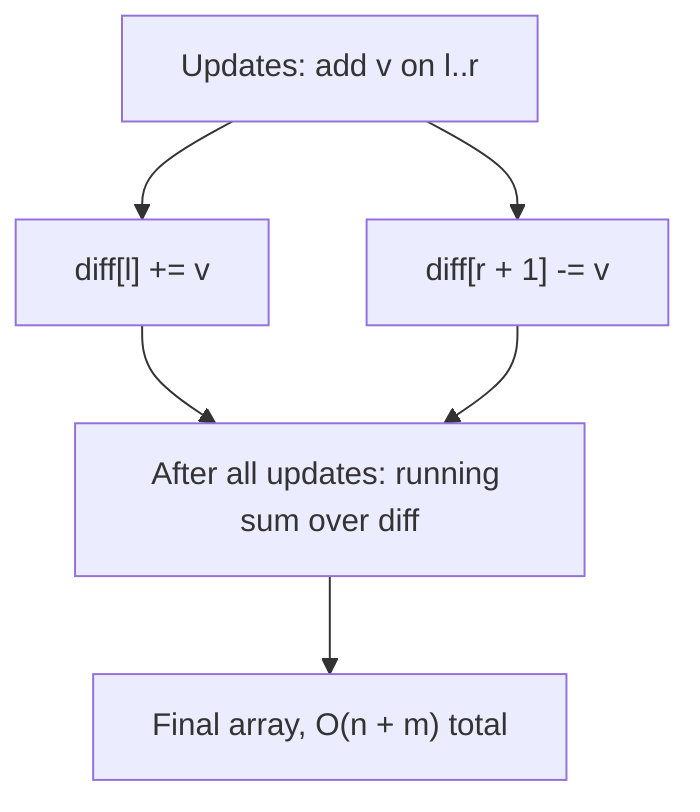
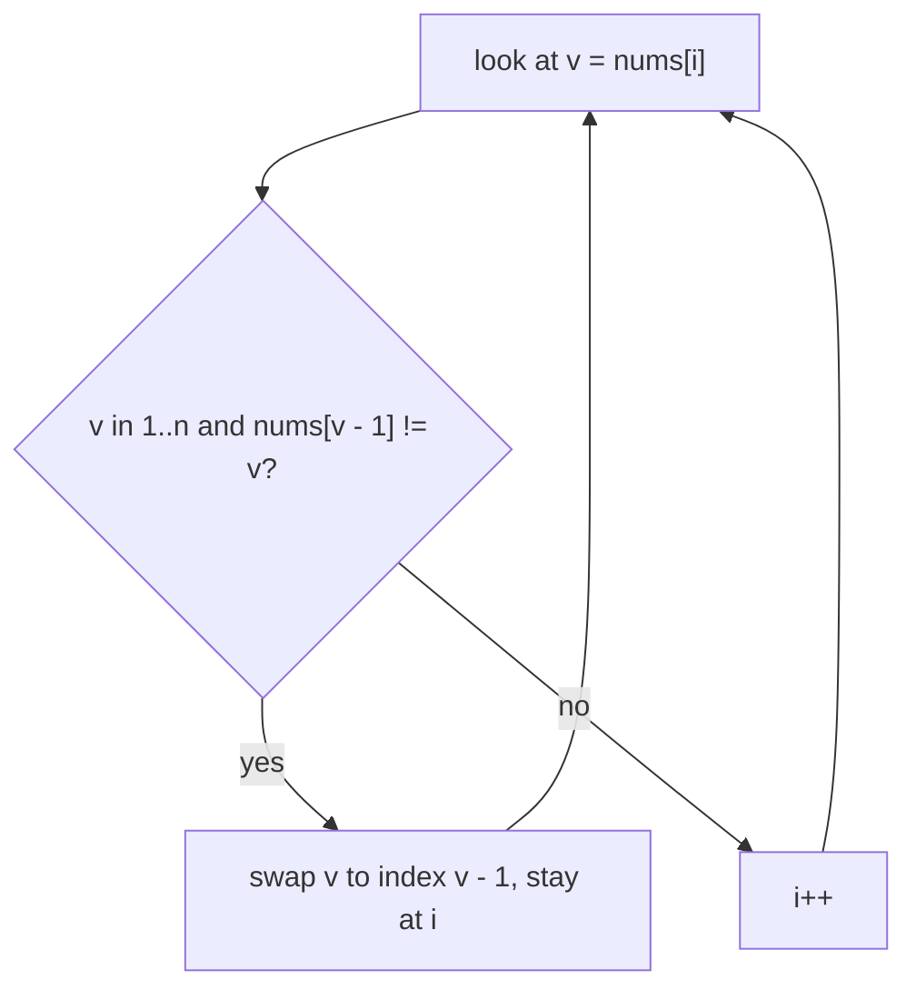
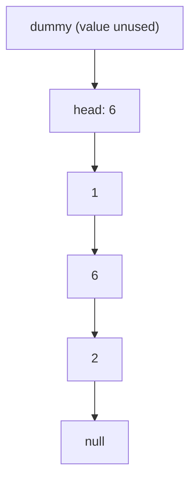
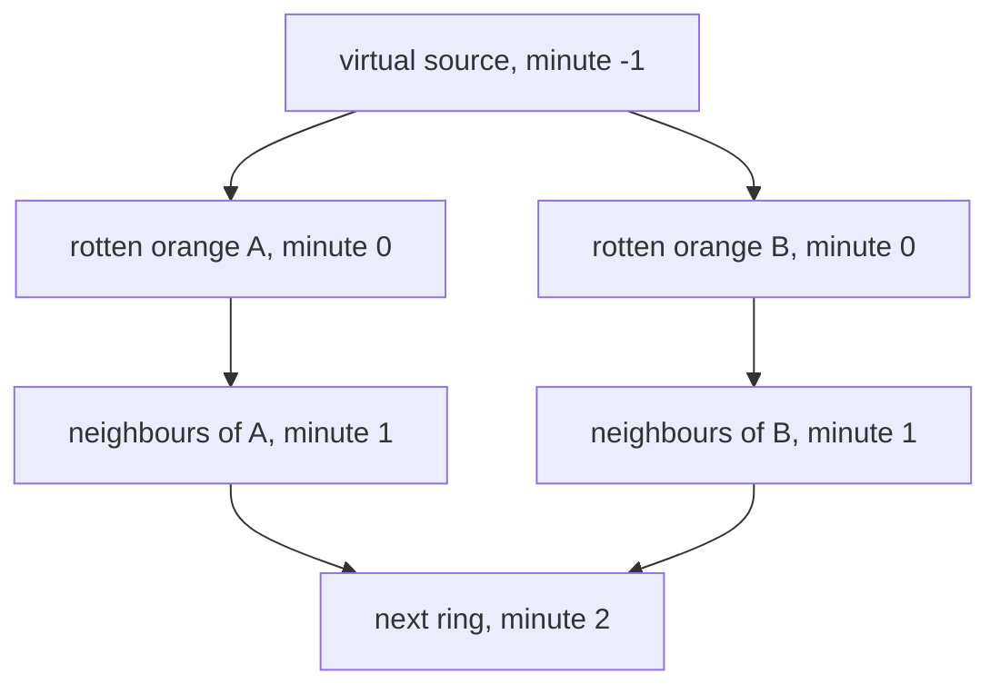
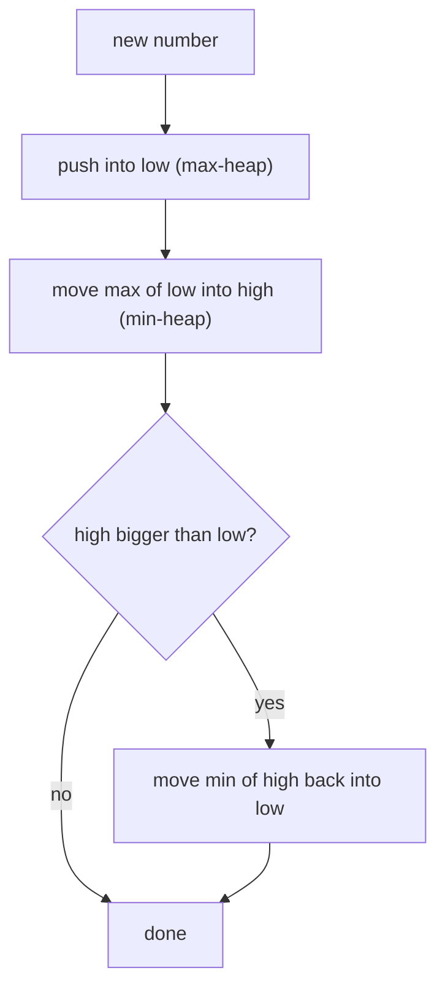
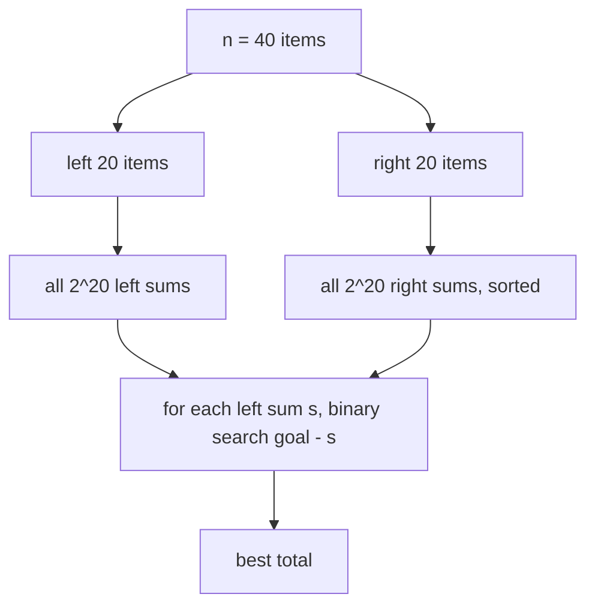

# Problem-Solving Tricks Worth Knowing

[⬅ Back to index](../README.md)

Covers: small, reusable tricks that unlock whole families of problems, each with the idea, why it works, a compact example in Kotlin, and the problems it typically unlocks.

---

## Prefix sums, range updates and contributions

### 1. Prefix Sum + Hash Map: Subarray Sum Equals K

**🟡 Medium** · ⭐ Product/FAANG favourite (commonly reported at Meta, Google)

<details>
<summary>Answer</summary>

**In short:** The sum of a subarray `nums[i+1..j]` is `prefix[j] - prefix[i]`. So "how many subarrays ending at j sum to k?" becomes "how many earlier prefix sums equal `prefix[j] - k`?" — a hash-map lookup. Walk the array once, keep a running prefix sum and a map from prefix sum → how many times it has occurred (seeded with `0 → 1`). O(n) time, O(n) space, and it works with negative numbers, where a sliding window does not.

#### Problem

Given an integer array `nums` (may contain negatives) and an integer `k`, return the number of contiguous, non-empty subarrays whose sum is exactly `k`.

- `nums = [1, 1, 1], k = 2` → `2` (`[1,1]` twice)
- `nums = [3, 4, -7, 3], k = 3` → `3` (`[3]`, `[3,4,-7,3]`, the last `[3]`)

#### Clarifying questions & edge cases

- Can values be negative or zero? Yes — this is exactly what rules out a sliding window.
- Count subarrays, or return one / the longest? Counting needs the map to store **counts**; "longest" needs the **first index** of each prefix instead.
- Overflow: with LeetCode's limits (n ≤ 2·10⁴, |nums[i]| ≤ 1000) sums fit in `Int`; for bigger inputs use `Long` keys.
- `k = 0` works naturally: equal prefix sums mean a zero-sum subarray.

#### Brute force

Try every start `i`, extend the end `j` and keep a running sum, counting when it equals `k`. O(n²) time, O(1) space. That is the honest first answer; the follow-up is always "can you do it in one pass?"

#### Key insight

Define `prefix[j]` = sum of `nums[0..j]`, with an imaginary `prefix[-1] = 0`. Then for any `i < j`:

`sum(nums[i+1..j]) = prefix[j] - prefix[i]`

We want that to be `k`, i.e. `prefix[i] = prefix[j] - k`. So when we are standing at index `j`, the number of good subarrays **ending at j** equals the number of earlier positions whose prefix sum was `prefix[j] - k`. If we have been counting prefix sums in a hash map as we go, that's one lookup.

Why seed the map with `0 → 1`? It stands for the empty prefix before index 0, so subarrays that start at index 0 (where `prefix[j]` itself equals `k`) are counted.

Why does a sliding window fail? A window needs monotonicity — extending the window should only make the sum bigger. With negative numbers, adding an element can make the sum smaller, so shrinking from the left is no longer a safe decision (see [Two Pointers & Sliding Window](08-two-pointers-sliding-window.md)). The prefix-sum trick doesn't care about signs.

Order matters inside the loop: **look up first, then insert** the current prefix. Inserting first would let a prefix match itself, counting an empty subarray when `k = 0`.

#### Walkthrough

`nums = [3, 4, -7, 3], k = 3`

| j | nums[j] | prefix | look for prefix − k | found | result | map after |
|---|---|---|---|---|---|---|
| start | | 0 | | | 0 | {0:1} |
| 0 | 3 | 3 | 0 | 1 | 1 | {0:1, 3:1} |
| 1 | 4 | 7 | 4 | 0 | 1 | {0:1, 3:1, 7:1} |
| 2 | −7 | 0 | −3 | 0 | 1 | {0:2, 3:1, 7:1} |
| 3 | 3 | 3 | 0 | 2 | 3 | {0:2, 3:2, 7:1} |

At j = 3 the two zeros are the empty prefix (giving the whole array) and the prefix after index 2 (giving the last `[3]`).

#### Kotlin

```kotlin
fun subarraySum(nums: IntArray, k: Int): Int {
    val prefixCount = HashMap<Int, Int>()
    prefixCount[0] = 1            // the empty prefix, so subarrays starting at 0 count
    var prefix = 0
    var result = 0
    for (x in nums) {
        prefix += x
        // Every earlier prefix equal to (prefix - k) starts a subarray summing to k.
        result += prefixCount.getOrDefault(prefix - k, 0)
        prefixCount[prefix] = prefixCount.getOrDefault(prefix, 0) + 1
    }
    return result
}
```

#### Complexity

- **Time:** O(n) — one pass, O(1) average per hash-map operation.
- **Space:** O(n) — up to n distinct prefix sums in the map.

#### Common mistakes

- Forgetting the `0 → 1` seed — misses every subarray that starts at index 0.
- Inserting the current prefix **before** looking it up — wrong for `k = 0`.
- Reaching for a sliding window: it only works when all numbers are non-negative.
- Storing a `Set` of prefixes instead of counts — the same prefix can occur many times and each occurrence is a different subarray.

#### Follow-ups

- **The family:** whenever the question is "subarray whose sum/xor/count satisfies an equation", store a prefix *something* in a map. Continuous Subarray Sum (store `prefix % k` → first index) and Contiguous Array (treat 0 as −1, look for equal prefixes) are in [Prefix Sums, Intervals & Sweep Line](09-prefix-sums-intervals.md); Path Sum III is this trick on a tree path — see [Trees & BSTs](14-trees-bst.md).
- *Subarray Sums Divisible by K?* Key the map by `((prefix % k) + k) % k` — the `+ k` fixes Kotlin's negative remainders.
- *Longest subarray with sum k?* Store the **first** index each prefix appears at, and take `j - firstIndex[prefix - k]`.

</details>

### 2. How does a difference array make range updates O(1)?

**📘 Concept**

<details>
<summary>Answer</summary>

**In short:** To add `v` to every element in `[l, r]`, don't touch all of them — write `diff[l] += v` and `diff[r + 1] -= v`. After all updates, a single prefix sum over `diff` rebuilds the final array. Each update is O(1) and the rebuild is O(n), so m updates cost O(n + m) instead of O(n·m). It is the inverse of a prefix sum: prefix sums make range **queries** cheap, difference arrays make range **updates** cheap.

#### Why it works

A difference array stores how much each element differs from the one before it: `diff[i] = a[i] - a[i-1]`. Taking a prefix sum of `diff` gives back `a`.

Adding `v` to `a[l..r]` changes only two of those differences:

- `a[l]` grew by `v` but `a[l-1]` didn't → `diff[l]` grows by `v`.
- `a[r+1]` didn't grow but `a[r]` did → `diff[r+1]` shrinks by `v`.
- Every difference strictly inside the range is unchanged, because both neighbours grew by the same `v`.

So the "+v starts here, stops here" story is exact. Think of it as placing a +v marker at the door you walk in and a −v marker at the door you walk out; the running total is how much is being added at each position.



#### Example: Corporate Flight Bookings (🟡 Medium)

There are `n` flights labelled 1..n. Each booking `[first, last, seats]` reserves `seats` on every flight from `first` to `last` inclusive. Return the total seats per flight.

`n = 5, bookings = [[1,2,10], [2,3,20], [2,5,25]]` → `[10, 55, 45, 25, 25]`

| step | diff (indices 0..5) |
|---|---|
| start | [0, 0, 0, 0, 0, 0] |
| [1,2,10] → +10 at 0, −10 at 2 | [10, 0, −10, 0, 0, 0] |
| [2,3,20] → +20 at 1, −20 at 3 | [10, 20, −10, −20, 0, 0] |
| [2,5,25] → +25 at 1, −25 at 5 | [10, 45, −10, −20, 0, −25] |
| running sum of first 5 | [10, 55, 45, 25, 25] |

```kotlin
fun corpFlightBookings(bookings: Array<IntArray>, n: Int): IntArray {
    val diff = IntArray(n + 1)          // one extra slot so r + 1 never goes out of bounds
    for (b in bookings) {
        val first = b[0] - 1            // convert to 0-based
        val last = b[1] - 1
        diff[first] += b[2]
        diff[last + 1] -= b[2]
    }
    for (i in 1 until n) diff[i] += diff[i - 1]   // prefix sum rebuilds the answer
    return diff.copyOf(n)
}
```

O(n + m) time, O(n) space.

#### Variants

- **Events on a timeline (sweep line):** when coordinates are huge (times up to 10⁹), you can't allocate `diff` of that size. Store the +v/−v events in a sorted map or a sorted list of events and sweep them in order — that is the Car Pooling / Meeting Rooms II approach in [Prefix Sums, Intervals & Sweep Line](09-prefix-sums-intervals.md). Or compress the coordinates first ([coordinate compression](#13-what-is-coordinate-compression-and-when-do-you-need-it)).
- **2D difference array:** to add `v` to a rectangle `(r1,c1)..(r2,c2)`, do `+v` at `(r1,c1)`, `−v` at `(r1,c2+1)` and `(r2+1,c1)`, `+v` at `(r2+1,c2+1)`, then take a 2D prefix sum.
- **Counting overlaps:** "how many intervals cover point x?" is a difference array with `v = 1`.

#### Common mistakes

- Allocating `diff` of size `n` and crashing on `diff[r + 1]` when `r = n - 1`. Use size `n + 1`.
- Mixing inclusive and exclusive ends: for a half-open range `[l, r)` the minus goes at `r`, not `r + 1`.
- Answering queries *between* updates: a difference array is for "all updates first, then read". If updates and queries interleave, you need a Fenwick tree or segment tree.

#### Follow-ups

- *Range updates and point queries online?* A Fenwick tree over the difference array gives O(log n) for both.
- *Range Addition (apply k range increments, return the array)?* Exactly this trick.
- *Minimum number of increments to turn an all-zero array into the target, where each step adds 1 to a range?* It's the sum of the positive differences `max(0, target[i] - target[i-1])`, with `target[-1] = 0` — difference thinking again.

</details>

### 3. Contribution Technique: Sum of Subarray Minimums

**🟡 Medium**

<details>
<summary>Answer</summary>

**In short:** Instead of enumerating all O(n²) subarrays and taking each one's minimum, flip the question: **for each element, in how many subarrays is it the minimum?** If `arr[i]` can be the minimum for `left[i]` choices of start and `right[i]` choices of end, it contributes `arr[i] · left[i] · right[i]`. Both counts come from a monotonic stack (previous smaller / next smaller). O(n) time, O(n) space.

#### Problem

Given an integer array `arr`, return the sum of `min(subarray)` over every contiguous subarray, modulo 10⁹ + 7.

- `arr = [3, 1, 2, 4]` → `17`. Subarrays: [3],[1],[2],[4],[3,1],[1,2],[2,4],[3,1,2],[1,2,4],[3,1,2,4] with minimums 3,1,2,4,1,1,2,1,1,1 → 17.

#### Clarifying questions & edge cases

- Duplicates? Yes — and they are the main trap (a subarray with two equal minimums must be counted once).
- Answer size: up to n²/2 subarrays × 3·10⁴ — use `Long` and the modulus.
- Single element → that element.

#### Brute force

For each start `i`, extend `j` to the right, keeping a running minimum, and add it. O(n²) time — too slow for n = 3·10⁴ in some judges, and the interviewer wants the linear idea.

#### Key insight — count contributions

The answer is `Σ over subarrays of min`. Regroup the same sum by **which element is the minimum**:

`answer = Σ over i of arr[i] × (number of subarrays where arr[i] is the minimum)`

`arr[i]` is the minimum of `arr[s..e]` exactly when `s..e` contains `i` and doesn't reach a smaller element on either side. So:

- `left[i]` = distance from `i` back to the previous **smaller** element (number of possible starts).
- `right[i]` = distance from `i` forward to the next **smaller** element (number of possible ends).
- Subarrays where `arr[i]` is the minimum = `left[i] × right[i]` (any start × any end).

**Ties:** if two equal values are both minimums of a subarray, we must give that subarray to exactly one of them. Use "previous **strictly smaller**" on the left and "next **smaller or equal**" on the right. Then the rightmost of the equal minimums owns the subarray: the left one's range stops before its equal twin, the right one's range extends past it.

"Previous smaller" and "next smaller" are textbook monotonic-stack queries (see [Stacks, Queues & Monotonic Stack](11-stacks-queues-monotonic.md)).

#### Walkthrough

`arr = [3, 1, 2, 4]`

| i | arr[i] | prev strictly smaller | left[i] | next smaller-or-equal | right[i] | contribution |
|---|---|---|---|---|---|---|
| 0 | 3 | none | 1 | index 1 (1) | 1 | 3·1·1 = 3 |
| 1 | 1 | none | 2 | none | 3 | 1·2·3 = 6 |
| 2 | 2 | index 1 (1) | 1 | none | 2 | 2·1·2 = 4 |
| 3 | 4 | index 2 (2) | 1 | none | 1 | 4·1·1 = 4 |

Total = 3 + 6 + 4 + 4 = **17**. Element `1` is the minimum of 6 subarrays (2 starts × 3 ends) — which matches the list above.

#### Kotlin

```kotlin
fun sumSubarrayMins(arr: IntArray): Int {
    val mod = 1_000_000_007L
    val n = arr.size
    val left = IntArray(n)    // number of valid start positions for arr[i] as the minimum
    val right = IntArray(n)   // number of valid end positions
    val stack = ArrayDeque<Int>()

    // Previous STRICTLY smaller: pop everything >= arr[i].
    for (i in 0 until n) {
        while (stack.isNotEmpty() && arr[stack.last()] >= arr[i]) stack.removeLast()
        left[i] = if (stack.isEmpty()) i + 1 else i - stack.last()
        stack.addLast(i)
    }
    stack.clear()
    // Next smaller OR EQUAL: pop everything > arr[i] (scan from the right).
    for (i in n - 1 downTo 0) {
        while (stack.isNotEmpty() && arr[stack.last()] > arr[i]) stack.removeLast()
        right[i] = if (stack.isEmpty()) n - i else stack.last() - i
        stack.addLast(i)
    }

    var total = 0L
    for (i in 0 until n) {
        total = (total + arr[i].toLong() * left[i] % mod * right[i]) % mod
    }
    return total.toInt()
}
```

#### Complexity

- **Time:** O(n) — every index is pushed and popped at most once per pass.
- **Space:** O(n) — two count arrays and the stack.

#### Common mistakes

- Using strict comparisons on both sides — subarrays with repeated minimums are counted twice. Using non-strict on both sides — they're counted zero times.
- Multiplying in `Int` — `arr[i] · left · right` overflows easily.
- Computing `left`/`right` as indices instead of counts (off by one): it's `i - prevIndex` and `nextIndex - i`.

#### Follow-ups

- **The family:** "sum over all subarrays/subsequences of f" where f is decided by one element — Sum of Subarray Ranges (= sum of maxes − sum of mins), counting subarrays where `x` is the maximum, Sum of All Odd Length Subarrays (each element appears in a countable number of them).
- *For subsequences instead of subarrays?* Sort first; element i is the max of `2^i` subsequences — Sum of Subsequence Widths uses that.
- *Why not a segment tree for range minimum?* It still enumerates O(n²) subarrays. The contribution flip is what removes the n².

</details>

## Array tricks

### 4. Kadane's Algorithm: Maximum Subarray (and the circular variant)

**🟡 Medium** · ⭐ Product/FAANG favourite (commonly reported at Amazon, Microsoft, Google)

<details>
<summary>Answer</summary>

**In short:** Scan left to right keeping `current` = the best sum of a subarray that **ends here**. At each element either extend the previous subarray or start fresh: `current = max(x, current + x)`. The answer is the largest `current` ever seen. A negative running sum can never help a future subarray, so dropping it is safe. O(n) time, O(1) space. For the **circular** version, the best wrap-around subarray is `total − (minimum subarray)`, found with the same scan for the minimum.

#### Problem

Given an integer array `nums` (at least one element, may contain negatives), return the largest sum of any non-empty contiguous subarray.

- `[-2, 1, -3, 4, -1, 2, 1, -5, 4]` → `6` (`[4, -1, 2, 1]`)
- `[-3, -1, -2]` → `-1` (must take at least one element)

**Maximum Sum Circular Subarray** (also 🟡 Medium): the array is circular, so a subarray may wrap from the end to the start (each element used at most once). `[5, -3, 5]` → `10` (`[5, 5]` wrapping around).

#### Clarifying questions & edge cases

- All negative? The answer is the largest single element, not 0 — unless the interviewer allows an empty subarray.
- Return the sum or the subarray itself? Tracking start/end indices is a common follow-up.
- Overflow: n · max|value| — fits `Int` for LeetCode's limits; say `Long` otherwise.

#### Brute force

Every start, every end, running sum: O(n²). (Triple loop with a fresh sum is O(n³).)

#### Key insight

Let `best(j)` = the maximum sum of a subarray that **ends exactly at j**. Such a subarray is either just `[nums[j]]`, or some subarray ending at `j − 1` plus `nums[j]` — and of those, the best one is `best(j−1)`. So:

`best(j) = max(nums[j], best(j−1) + nums[j])`

That's a one-variable DP (see [Dynamic Programming](19-dynamic-programming.md)). The intuition: if the running sum went negative, it's dead weight — any subarray continuing from it would be better off starting fresh at `nums[j]`.

**Circular case.** A best subarray either doesn't wrap (plain Kadane), or it wraps — and then the elements it *leaves out* form one contiguous block in the middle. Keeping the most means leaving out the least, so the wrapping answer is `total − minSubarray`. One catch: if every number is negative, `minSubarray` is the whole array and `total − min = 0` describes an *empty* subarray — so if the plain maximum is negative, return it directly.

#### Walkthrough

`nums = [-2, 1, -3, 4, -1, 2, 1, -5, 4]`

| j | x | current = max(x, current + x) | best |
|---|---|---|---|
| 0 | −2 | −2 | −2 |
| 1 | 1 | max(1, −1) = 1 (restart) | 1 |
| 2 | −3 | max(−3, −2) = −2 | 1 |
| 3 | 4 | max(4, 2) = 4 (restart) | 4 |
| 4 | −1 | 3 | 4 |
| 5 | 2 | 5 | 5 |
| 6 | 1 | 6 | **6** |
| 7 | −5 | 1 | 6 |
| 8 | 4 | 5 | 6 |

Circular `[5, -3, 5]`: total = 7, max subarray = 7 (whole array), min subarray = −3, wrap = 7 − (−3) = **10**.

#### Kotlin

```kotlin
fun maxSubArray(nums: IntArray): Int {
    var current = nums[0]
    var best = nums[0]
    for (i in 1 until nums.size) {
        current = maxOf(nums[i], current + nums[i])   // extend or restart
        best = maxOf(best, current)
    }
    return best
}

fun maxSubarraySumCircular(nums: IntArray): Int {
    var total = 0
    var curMax = 0
    var bestMax = Int.MIN_VALUE
    var curMin = 0
    var bestMin = Int.MAX_VALUE
    for (x in nums) {
        total += x
        curMax = maxOf(x, curMax + x)
        bestMax = maxOf(bestMax, curMax)
        curMin = minOf(x, curMin + x)                // Kadane for the minimum
        bestMin = minOf(bestMin, curMin)
    }
    // All negative: the wrap formula would describe an empty subarray.
    return if (bestMax < 0) bestMax else maxOf(bestMax, total - bestMin)
}
```

#### Complexity

- **Time:** O(n) — one pass (both variants).
- **Space:** O(1).

#### Common mistakes

- Initialising `best = 0` — returns 0 for an all-negative array.
- Using the "reset to 0 when negative" form (`current += x; best = max(best, current); if (current < 0) current = 0`) but updating `best` *after* the reset — an all-negative array then reports 0.
- In the circular version, forgetting the all-negative special case.

#### Follow-ups

- *Return the subarray?* Remember `start` when you restart (`x > current + x`), and save `(start, j)` whenever `best` improves.
- **Maximum Product Subarray:** a negative times a negative becomes large, so track both the max and min product ending here and swap them on a negative number.
- *Divide and conquer?* Best crossing the middle + best in each half gives O(n log n) — mention it only as a contrast.
- Best Time to Buy and Sell Stock is Kadane on the daily price differences — see [Two Pointers & Sliding Window](08-two-pointers-sliding-window.md).

</details>

### 5. Boyer-Moore Voting: Majority Element I and II

**🟡 Medium** · ⭐ Product/FAANG favourite

<details>
<summary>Answer</summary>

**In short:** Keep one candidate and a counter. For each element: if the counter is 0, adopt it as the candidate; if it equals the candidate, `count++`, otherwise `count--`. Each decrement cancels one candidate against one different value; a value occurring **more than n/2 times** can't be fully cancelled, so it survives. O(n) time, **O(1) space**. For "more than n/3" keep **two** candidates and then verify their counts in a second pass. (Majority Element I is 🟢 Easy; II is 🟡 Medium.)

#### Problem

- **Majority Element:** return the element that appears more than ⌊n/2⌋ times (guaranteed to exist). `[2, 2, 1, 1, 1, 2, 2]` → `2`.
- **Majority Element II:** return all elements that appear more than ⌊n/3⌋ times (at most two can). `[3, 2, 3]` → `[3]`; `[1, 2]` → `[1, 2]`.

#### Clarifying questions & edge cases

- Is a majority guaranteed? In I, yes. If not, add a verification pass (count the candidate).
- In II, nothing is guaranteed — the verification pass is mandatory.
- Empty array (II) → empty list.

#### Brute force and the usual alternatives

- Hash-map counts: O(n) time, O(n) space — the obvious first answer.
- Sort and take `nums[n/2]`: O(n log n) time. Works for I because the majority must cover the middle.
- Boyer-Moore wins on **O(1) extra space**, which is what interviewers are fishing for.

#### Why it works (the pairing argument)

Imagine pairing off elements that are different from each other and deleting both. Each `count--` is exactly such a pair: one copy of the current candidate and one different value. If `m` appears more than n/2 times, there are fewer than n/2 non-`m` elements, so even if every one of them is paired against an `m`, some `m` copies are left unpaired. Pairs that don't involve `m` only make it easier. So when the scan ends, the surviving candidate must be `m`.

For **> n/3** the same idea with two candidates deletes **triples** of distinct values (`count1--` and `count2--` together with the current element). Each triple uses up 3 elements, so there are at most ⌊n/3⌋ triples, and each removes at most one copy of any given value. An element with more than ⌊n/3⌋ copies therefore can't be wiped out. Survivors are only *candidates* though — a candidate may survive without actually reaching n/3, so verify by counting.

#### Walkthrough (I)

`[2, 2, 1, 1, 1, 2, 2]`

| x | before | action | candidate | count |
|---|---|---|---|---|
| 2 | count 0 | adopt 2 | 2 | 1 |
| 2 | same | +1 | 2 | 2 |
| 1 | different | −1 | 2 | 1 |
| 1 | different | −1 | 2 | 0 |
| 1 | count 0 | adopt 1 | 1 | 1 |
| 2 | different | −1 | 1 | 0 |
| 2 | count 0 | adopt 2 | **2** | 1 |

The candidate changes on the way, but the true majority holds the seat at the end.

#### Kotlin

```kotlin
fun majorityElement(nums: IntArray): Int {
    var candidate = 0
    var count = 0
    for (x in nums) {
        if (count == 0) candidate = x
        count += if (x == candidate) 1 else -1
    }
    return candidate   // guaranteed to exist in this problem
}

fun majorityElementII(nums: IntArray): List<Int> {
    var c1 = 0
    var n1 = 0
    var c2 = 1          // start with two different candidates
    var n2 = 0
    for (x in nums) {
        when {
            x == c1 -> n1++
            x == c2 -> n2++
            n1 == 0 -> { c1 = x; n1 = 1 }
            n2 == 0 -> { c2 = x; n2 = 1 }
            else -> { n1--; n2-- }      // cancel a triple of distinct values
        }
    }
    // Second pass: survivors are only candidates.
    val result = mutableListOf<Int>()
    if (nums.count { it == c1 } > nums.size / 3) result.add(c1)
    if (c2 != c1 && nums.count { it == c2 } > nums.size / 3) result.add(c2)
    return result
}
```

The order of the `when` branches matters: check "equals a candidate" before "a slot is free", otherwise the same value can occupy both slots.

#### Complexity

- **Time:** O(n) — one pass (two for II).
- **Space:** O(1).

#### Common mistakes

- Skipping verification when a majority isn't guaranteed — the algorithm always returns *some* candidate.
- In II, checking `n1 == 0` before `x == c2` — `x` gets adopted into slot 1 while it's already in slot 2.
- Thinking the final count equals the frequency — it doesn't; it's only a margin.

#### Follow-ups

- *Generalise to > n/k?* Keep k − 1 candidates (Misra-Gries); O(n·k) time, O(k) space, then verify.
- *Streaming / huge data?* That's where Boyer-Moore shines: one pass, constant memory. For approximate heavy hitters in big data, Misra-Gries and Count-Min sketches are the next step.
- *Check whether a sorted array has a majority?* Binary search for the first and last occurrence of `nums[n/2]` — see [Binary Search](10-binary-search.md).

</details>

### 6. Cyclic Sort: First Missing Positive (and Find All Numbers Disappeared)

**🔴 Hard** · ⭐ Product/FAANG favourite (commonly reported at Amazon)

<details>
<summary>Answer</summary>

**In short:** When values belong to the range `1..n` and the array has length `n`, every value has a "home" index: value `v` lives at index `v − 1`. Swap each value into its home until the current slot holds the right value or a value with no home (out of range or a duplicate). Afterwards, the first index `i` with `nums[i] != i + 1` tells you the missing number. Each swap puts one value home for good, so it's O(n) time and O(1) extra space. (First Missing Positive is 🔴 Hard; Find All Numbers Disappeared in an Array is 🟢 Easy.)

#### Problem

- **First Missing Positive:** given an unsorted integer array, return the smallest positive integer not present, in O(n) time and O(1) extra space. `[3, 4, -1, 1]` → `2`; `[1, 2, 0]` → `3`; `[7, 8, 9]` → `1`.
- **Find All Numbers Disappeared:** `nums` has length n with values in `1..n` (some repeated); return all values in `1..n` that are missing. `[4, 3, 2, 7, 8, 2, 3, 1]` → `[5, 6]`.

#### Clarifying questions & edge cases

- May I modify the input? The O(1)-space solutions rearrange it. If not, a hash set (O(n) space) is the answer.
- Negatives, zeros, values > n: they have no home — leave them where they are.
- Duplicates: a value whose home already holds the same value must not be swapped again (infinite loop).

#### Brute force

Put everything in a `HashSet`, then test 1, 2, 3, … — O(n) time but O(n) space. Sorting first gives O(1) space but O(n log n) time. The hard constraint is getting both.

#### Key insight

**The answer is always in `1..n+1`.** With n slots you can hold at most the numbers 1..n; if they are all present the answer is n + 1, otherwise it's one of them. So values outside `1..n` are irrelevant, and the array itself can serve as the "seen" table: index `v − 1` answers "is v present?".

Cyclic sort fills that table in place: look at `nums[i]`. If it's a value `v` in `1..n` and its home `nums[v − 1]` doesn't already hold `v`, swap it home. Don't advance `i` — a new value just arrived at `i` and must be checked too. Otherwise advance.

Why O(n)? Every swap puts at least one value into its correct home, and a value at home is never moved again. So there are at most n swaps, plus n advances.

#### Walkthrough

`nums = [3, 4, -1, 1]`

| i | nums[i] | home of value | action | array |
|---|---|---|---|---|
| 0 | 3 | index 2 holds −1 | swap | [−1, 4, 3, 1] |
| 0 | −1 | none | i++ | |
| 1 | 4 | index 3 holds 1 | swap | [−1, 1, 3, 4] |
| 1 | 1 | index 0 holds −1 | swap | [1, −1, 3, 4] |
| 1 | −1 | none | i++ | |
| 2 | 3 | already home | i++ | |
| 3 | 4 | already home | i++ | |

Final scan: index 1 holds −1 instead of 2 → answer **2**.



#### Kotlin

```kotlin
fun firstMissingPositive(nums: IntArray): Int {
    val n = nums.size
    var i = 0
    while (i < n) {
        val v = nums[i]
        if (v in 1..n && nums[v - 1] != v) {
            nums[i] = nums[v - 1]       // bring the occupant here to be examined next
            nums[v - 1] = v             // v is now home for good
        } else {
            i++
        }
    }
    for (j in 0 until n) if (nums[j] != j + 1) return j + 1
    return n + 1                        // 1..n are all present
}

fun findDisappearedNumbers(nums: IntArray): List<Int> {
    var i = 0
    while (i < nums.size) {
        val v = nums[i]                 // guaranteed 1..n here
        if (nums[v - 1] != v) {
            nums[i] = nums[v - 1]
            nums[v - 1] = v
        } else {
            i++
        }
    }
    return nums.indices.filter { nums[it] != it + 1 }.map { it + 1 }
}
```

#### Complexity

- **Time:** O(n) — at most n swaps (each places a value permanently) plus n increments, plus one scan.
- **Space:** O(1) extra (the output list aside).

#### Common mistakes

- Checking `nums[i] != i + 1` instead of `nums[v - 1] != v` as the swap condition — with duplicates this loops forever.
- Writing the swap as `nums[i] = nums[nums[i] - 1]; nums[nums[i] - 1] = ...` — the second index is computed from the *new* `nums[i]`. Save `v` first.
- Advancing `i` after a swap — the value that just arrived at `i` is never placed.

#### Follow-ups

- **The family:** Missing Number, Find the Duplicate Number (cyclic sort if you may modify; Floyd's cycle if not — see [Linked Lists](12-linked-lists.md)), Find All Duplicates in an Array, Set Mismatch (one duplicate + one missing): after cyclic sort, the index whose value is wrong reveals both.
- *Can't swap?* Use [in-place marking](#7-how-do-you-mark-visited-in-place) — negate `nums[v − 1]` to record that `v` was seen.
- *Values in `0..n−1` instead?* Home is index `v` instead of `v − 1`.

</details>

### 7. How do you mark visited in place?

**📘 Concept**

<details>
<summary>Answer</summary>

**In short:** Instead of a separate `visited` set or boolean array, store the "seen" bit **inside the input** using a value that can't occur naturally: flip a number's sign, overwrite a grid cell with a marker, add `n` to a value, or pack an extra bit into unused high bits. It turns O(n) extra space into O(1) — but it mutates the input, so ask first and restore it if needed.

#### The main variants

| Technique | When it fits | Example |
|---|---|---|
| **Negate** `nums[v - 1]` to mean "v seen" | values in `1..n`, all positive | Find All Duplicates in an Array, Find All Numbers Disappeared |
| **Overwrite** a grid cell (`'1'` → `'0'`, or `'#'`) | grid DFS/BFS where you never need the original | Number of Islands, Word Search (temporarily) |
| **Add n** (or a large constant) to `nums[v % n]` | values in `0..n-1`, need counts or need to read original values later via `% n` | Rearrange Array (`a[i] = a[a[i]]`) in O(1) space |
| **Encode two states in one cell** (bit 0 = old, bit 1 = new) | simultaneous update where every cell must see the old grid | Game of Life |
| **Temporary marker, then restore** | backtracking over a board | Word Search: set `board[r][c] = '#'`, recurse, put the letter back |

#### Example: Find All Duplicates in an Array (🟡 Medium)

Values are in `1..n`, each appears once or twice; return the ones that appear twice, O(n) time, O(1) extra space.

Idea: index `v − 1` is v's "flag". The first time we see `v`, we make `nums[v − 1]` negative. If it's **already** negative, `v` has been seen before. Because we only change signs, the absolute value of every slot is preserved — read with `abs`.

```kotlin
fun findDuplicates(nums: IntArray): List<Int> {
    val result = mutableListOf<Int>()
    for (x in nums) {
        val v = Math.abs(x)             // x may already have been negated
        val flag = v - 1
        if (nums[flag] < 0) result.add(v) else nums[flag] = -nums[flag]
    }
    return result
}
```

`[4, 3, 2, 7, 8, 2, 3, 1]`

| x | v | nums[v−1] before | action | duplicates |
|---|---|---|---|---|
| 4 | 4 | 7 | negate index 3 | |
| 3 | 3 | 2 | negate index 2 | |
| −2 | 2 | 3 | negate index 1 | |
| −7 | 7 | 3 | negate index 6 | |
| 8 | 8 | 1 | negate index 7 | |
| 2 | 2 | −3 | already negative | [2] |
| −3 | 3 | −2 | already negative | [2, 3] |
| −1 | 1 | 4 | negate index 0 | |

#### Example: Game of Life two-bit encoding

Every cell must be updated from the *old* grid, so you can't overwrite cells as you go — unless the new value lives in a different bit. Store the next state in bit 1: `board[r][c] = board[r][c] or (next shl 1)`. When counting neighbours read only bit 0 (`cell and 1`). After the pass, shift every cell right by 1. No copy of the grid needed.

#### Why it works

The trick always relies on a **spare part of the value's range**. Positive-only data has a spare sign bit; `0..n-1` data has spare room above n; a `'0'/'1'` grid has every other character spare; a 0/1 cell has 31 spare bits. If the input can use the full range (zeros, negatives, any Int), there's no spare room and you need real extra memory.

#### Common mistakes

- Reading a value after it's been marked without `abs` / `% n` / `and 1` — the index goes negative or out of range.
- Negating when the value is **0** — `-0` is still 0, so the mark is lost. Shift the range or use the add-n trick.
- Mutating input the caller still needs. Say it: "I'll mark in place; if the input must stay intact I can restore the signs in a second pass, or use a `BooleanArray`."
- Overwriting a grid cell permanently in a backtracking search — other paths need the original letter. Restore it on the way out.

#### Follow-ups

- *Is this really O(1) space?* Extra space, yes; but it's borrowing the input's memory. Some interviewers will push on that — mention the trade-off.
- *Graph BFS with visited marks?* Same idea on grids — see [Graphs: BFS, DFS & Topological Sort](16-graphs-bfs-dfs-topo.md) — and [Rotting Oranges](#17-multi-source-bfs-rotting-oranges) marks oranges rotten as they're enqueued.
- *Alternative to swapping?* [Cyclic sort](#6-cyclic-sort-first-missing-positive-and-find-all-numbers-disappeared) rearranges instead of marking; both need values in `1..n`.

</details>

### 8. XOR Tricks: Single Number, Missing Number and Swapping

**🟢 Easy** · ⭐ Product/FAANG favourite

<details>
<summary>Answer</summary>

**In short:** XOR has three properties that make values "cancel": `x xor x = 0`, `x xor 0 = x`, and it's commutative and associative (order doesn't matter). So XOR-ing a list where everything appears twice except one value leaves exactly that value — **Single Number** in O(n) time and O(1) space. XOR-ing the indices `0..n` with the values finds the **Missing Number** the same way. For two unique values, split the numbers by a bit where they differ. (Single Number and Missing Number are 🟢 Easy; Single Number III is 🟡 Medium.)

#### Problems

- **Single Number:** every element appears twice except one. `[4, 1, 2, 1, 2]` → `4`.
- **Missing Number:** `n` distinct numbers from `0..n`, one is missing. `[3, 0, 1]` → `2`.
- **Single Number III:** two elements appear once, all others twice. `[1, 2, 1, 3, 2, 5]` → `[3, 5]`.

#### Clarifying questions & edge cases

- Are the "others" guaranteed to appear exactly twice (an even number of times)? XOR needs even multiplicity to cancel.
- Negative numbers are fine — XOR works on the bit patterns.
- Single Number II (others appear **three** times) needs bit counting mod 3, not plain XOR.

#### Brute force

A hash map of counts (O(n) space), or sort and scan pairs (O(n log n)). For Missing Number, the sum formula `n(n+1)/2 − sum` also works in O(1) space, but can overflow for large n — XOR can't overflow.

#### Key insight

Because XOR is associative and commutative, `a xor b xor a` can be rearranged to `(a xor a) xor b = 0 xor b = b`. Every pair cancels no matter where the two copies sit. Think of XOR as "add each bit mod 2": a bit position ends up 1 only if an odd number of values had a 1 there.

**Missing Number:** XOR all indices `0..n` and all values. Every number that is present appears twice (once as an index, once as a value) and cancels; the missing one appears only as an index.

**Single Number III:** XOR of everything is `a xor b` (non-zero since a ≠ b). Any set bit in it is a position where `a` and `b` differ. Take the lowest one, `diff = x and -x`. Split all numbers into two groups by that bit: `a` and `b` land in different groups, and each pair lands together in one group. XOR each group → `a` and `b`.

**Swap without a temp:** `a = a xor b; b = a xor b; a = a xor b`. After step 2, `b = (a xor b) xor b = a`; after step 3, `a = (a xor b) xor a = b`. A party trick — in real code, use a temp (clearer, and the XOR version zeroes the value if both refer to the same array slot, e.g. `i == j`).

#### Walkthrough (Missing Number)

`nums = [3, 0, 1]`, n = 3, start with `x = n = 3`:

| i | nums[i] | x = x xor i xor nums[i] |
|---|---|---|
| 0 | 3 | 3 xor 0 xor 3 = 0 |
| 1 | 0 | 0 xor 1 xor 0 = 1 |
| 2 | 1 | 1 xor 2 xor 1 = **2** |

#### Kotlin

```kotlin
fun singleNumber(nums: IntArray): Int = nums.fold(0) { acc, x -> acc xor x }

fun missingNumber(nums: IntArray): Int {
    var x = nums.size                    // index n has no slot in the loop, so start with it
    for (i in nums.indices) x = x xor i xor nums[i]
    return x
}

fun singleNumberIII(nums: IntArray): IntArray {
    val xorAll = nums.fold(0) { acc, x -> acc xor x }   // = a xor b
    val diffBit = xorAll and -xorAll                    // lowest bit where a and b differ
    var a = 0
    for (x in nums) if ((x and diffBit) != 0) a = a xor x
    return intArrayOf(a, xorAll xor a)
}
```

Kotlin uses infix functions `xor`, `and`, `or`, `shl`, `shr` instead of `^ & | << >>` (Swift uses the C-style symbols). See [Bit Manipulation & Math](21-bit-manipulation-math.md) for the full list.

#### Complexity

- **Time:** O(n) for all three.
- **Space:** O(1).

#### Common mistakes

- Missing Number: forgetting to include `n` itself (start `x` at `nums.size`).
- Applying plain XOR when duplicates appear three times — it doesn't cancel.
- Single Number III: `x and diffBit == 1` — the bit may be 4 or 16, so compare with `!= 0`. In Kotlin also parenthesise `(x and diffBit)` for readability.

#### Follow-ups

- **Single Number II** (others appear 3 times): count how many numbers have each of the 32 bits set; bits with `count % 3 != 0` belong to the single number.
- *Find the duplicate and the missing number (Set Mismatch)?* XOR of values and `1..n` gives `dup xor missing`; split by a differing bit as in III (or use cyclic sort — [question 6](#6-cyclic-sort-first-missing-positive-and-find-all-numbers-disappeared)).
- *XOR of a subarray?* Prefix XOR works like prefix sums: `xor(i..j) = px[j] xor px[i-1]`, so "count subarrays with XOR = k" is [question 1](#1-prefix-sum--hash-map-subarray-sum-equals-k) with XOR.

</details>

### 9. When should you use a frequency array of size 26 instead of a hash map?

**📘 Concept**

<details>
<summary>Answer</summary>

**In short:** When the keys are a small, known range — lowercase letters (26), ASCII (128), digits (10), values `0..1000` — index an `IntArray` directly with `c - 'a'` instead of using a `HashMap<Char, Int>`. It's O(1) per operation with no hashing or boxing, the whole thing compares in O(26), and it can be turned into a map key for grouping. Ask the interviewer about the alphabet first; switch back to a map for Unicode or unbounded values.

#### The idea

`'a'..'z'` are consecutive character codes, so `c - 'a'` maps `'a' → 0`, `'b' → 1`, … `'z' → 25`. In Kotlin, `Char - Char` gives an `Int` directly.

```kotlin
fun isAnagram(s: String, t: String): Boolean {
    if (s.length != t.length) return false
    val count = IntArray(26)
    for (i in s.indices) {
        count[s[i] - 'a']++          // add letters of s
        count[t[i] - 'a']--          // remove letters of t
    }
    return count.all { it == 0 }
}
```

Swift has no `Character` arithmetic, so go through ASCII values:

```swift
func isAnagram(_ s: String, _ t: String) -> Bool {
    guard s.count == t.count else { return false }
    var count = [Int](repeating: 0, count: 26)
    let a = Character("a").asciiValue!
    for c in s.utf8 { count[Int(c - a)] += 1 }   // utf8 bytes are UInt8, so 'a' is 97
    for c in t.utf8 { count[Int(c - a)] -= 1 }
    return count.allSatisfy { $0 == 0 }
}
```

#### Why it's better than a map (when it fits)

| | `IntArray(26)` | `HashMap<Char, Int>` |
|---|---|---|
| Per update | array index — a few CPU instructions | hash, bucket lookup, boxing of `Char`/`Int` in Kotlin/JVM |
| Compare two counts | `contentEquals`, always 26 steps | map equality, allocation-heavy |
| Use as a key | `String(charArray)` / `joinToString` / `toList()` | awkward |
| Space | O(26) = O(1) | O(distinct keys) |

Big-O is the same (O(1) average per operation), but constant factors are 5-10× better and the code is shorter. More importantly, "O(26) space" lets you honestly say **O(1) space**.

#### What it unlocks

- **Anagram problems:** Valid Anagram, Group Anagrams (key = the 26 counts) — see [Arrays, Strings & Hashing](07-arrays-strings-hashing.md).
- **Fixed windows over letters:** Permutation in String, Find All Anagrams — compare two count arrays as the window slides; see [Two Pointers & Sliding Window](08-two-pointers-sliding-window.md).
- **Counting values in a small range:** counting sort, "values are 0..100" follow-ups (e.g. a running median over small values with a count array), Ransom Note, Task Scheduler (26 task types).
- **Last seen index:** `IntArray(128) { -1 }` for Longest Substring Without Repeating Characters.

#### Common mistakes

- Assuming lowercase when the input has uppercase, digits or spaces → `ArrayIndexOutOfBounds`. Ask, or use 128 slots indexed by `c.code`.
- Unicode / emoji: `c - 'a'` is meaningless; use a map. In Kotlin a `Char` is a UTF-16 unit, so surrogate pairs need `codePoints()`.
- Using `count == other` for `IntArray` — that compares references. Use `contentEquals`.
- Using an `IntArray` as a `HashMap` key — arrays use identity `hashCode`. Convert to a `String` or `List<Int>` first.

#### Follow-ups

- *Counts for large but bounded values (say 0..10⁵)?* An `IntArray(100_001)` still beats a map if the array is reused; it's a judgement call against memory.
- *Same trick for presence only?* A `BooleanArray(26)` — or a 26-bit mask in one `Int`, see the [bitmask question](#10-how-do-you-use-a-bitmask-to-represent-a-set-or-a-state).

</details>

### 10. How do you use a bitmask to represent a set or a state?

**📘 Concept**

<details>
<summary>Answer</summary>

**In short:** When the universe is small (≤ ~20 items for enumeration, ≤ 32/64 items for storage), a set can be one integer: bit `i` is 1 if item `i` is in the set. Union, intersection, membership and "add item" become single bit operations, the whole set is hashable for free, and all subsets can be enumerated as the numbers `0 until (1 shl n)`. It's how you put "which items have I used / visited" into a DP or BFS state.

#### Set operations as bit operations (Kotlin)

| Set operation | Bit operation |
|---|---|
| empty set | `0` |
| add item i | `mask or (1 shl i)` |
| remove item i | `mask and (1 shl i).inv()` |
| contains i? | `(mask shr i) and 1 == 1` |
| union / intersection | `a or b` / `a and b` |
| A is a subset of B | `a and b == a` |
| size | `Integer.bitCount(mask)` (or `mask.countOneBits()`) |
| full set of n items | `(1 shl n) - 1` |
| iterate all subsets of {0..n-1} | `for (mask in 0 until (1 shl n))` |
| iterate submasks of `m` | `var s = m; while (s > 0) { …; s = (s - 1) and m }` |

#### Example: Maximum Product of Word Lengths (🟡 Medium)

Find the maximum `len(a) · len(b)` over pairs of words that share no letter. Comparing letter sets naively is O(26) per pair with arrays; with a 26-bit mask per word it's a single `and`.

```kotlin
fun maxProduct(words: Array<String>): Int {
    val masks = IntArray(words.size)
    for (i in words.indices) {
        for (c in words[i]) masks[i] = masks[i] or (1 shl (c - 'a'))   // letter set of word i
    }
    var best = 0
    for (i in words.indices) for (j in i + 1 until words.size) {
        if (masks[i] and masks[j] == 0) {                // no common letter
            best = maxOf(best, words[i].length * words[j].length)
        }
    }
    return best
}
```

`"abcw"` → bits a, b, c, w; `"xtfn"` → bits x, t, f, n; `and` = 0, so the product 16 counts. O(L + n²) time where L is the total length.

#### Bitmask as part of a state

- **BFS over (node, visited set):** Shortest Path Visiting All Nodes (🔴 Hard) runs BFS where a state is `(currentNode, maskOfVisited)`; the target is any state with `mask == (1 shl n) - 1`. There are `n · 2ⁿ` states — fine for n ≤ 12.
- **Bitmask DP:** `dp[mask]` = best result using exactly the items in `mask` (assignment problems, travelling salesman in O(n²·2ⁿ), Partition to K Equal Sum Subsets) — see [Dynamic Programming](19-dynamic-programming.md).
- **Generating subsets:** each `mask` from 0 to 2ⁿ − 1 *is* a subset — see [Bit Manipulation & Math](21-bit-manipulation-math.md).
- **Parity of letter counts:** "substring where every vowel appears an even number of times" stores a 5-bit parity mask per prefix and uses [prefix + hash map](#1-prefix-sum--hash-map-subarray-sum-equals-k) on the mask.

#### Why the size limits

2ⁿ grows fast: 2²⁰ ≈ 10⁶ is fine to enumerate, 2³⁰ ≈ 10⁹ isn't. So "n ≤ 15-20" in the constraints is a strong hint for bitmask enumeration or bitmask DP (see [Pattern Recognition](04-pattern-recognition.md)). For pure storage, an `Int` holds 32 items and a `Long` 64.

#### Common mistakes

- Operator precedence: in Kotlin, infix `and`/`or`/`shl` bind tighter than `==`, so `a and b == 0` means `(a and b) == 0` — correct, but write the parentheses anyway. In Java and C, `&` binds **looser** than `==`, so `a & b == 0` is a classic bug there; Swift gives `&` multiplication precedence, so it's fine in Swift.
- `1 shl 31` is negative in a 32-bit `Int`; for 32+ items use `1L shl i` with a `Long`.
- Forgetting that the number of states is `n · 2ⁿ`, not `2ⁿ`, when a position is part of the state.

#### Follow-ups

- *Lowest set bit?* `mask and -mask`. *Remove it?* `mask and (mask - 1)` — the basis of fast bit counting.
- *More than 64 items?* Use `java.util.BitSet` or a `LongArray` — but then the "hashable single number" advantage is gone.

</details>

## Sorting and ordering tricks

### 11. When does sorting first make a problem easier?

**📘 Concept**

<details>
<summary>Answer</summary>

**In short:** Sorting costs O(n log n) once and buys you **order**: equal items become neighbours, the closest values become adjacent, two pointers and binary search become valid, and greedy choices ("take the smallest / the earliest ending") become easy to make. If the target complexity allows O(n log n) and the answer doesn't depend on the original positions, ask yourself "what if this were sorted?" before anything clever.

#### What sorting gives you

| After sorting… | …you can | Example problems |
|---|---|---|
| equal values are adjacent | dedupe and group with one scan | 3Sum (skip duplicates), Contains Duplicate, Subsets II |
| the closest pair is adjacent | check only neighbours | Minimum Absolute Difference, Minimum Time Difference |
| values are monotonic | use two pointers / binary search | Two Sum II, 3Sum, Boats to Save People, Valid Triangle Number |
| intervals are ordered by start (or end) | sweep and merge in one pass | Merge Intervals, Non-overlapping Intervals, Meeting Rooms |
| the smallest/largest is at an end | make greedy choices | Assign Cookies, Two City Scheduling (sort by cost difference) |
| a custom order is meaningful | build the answer by concatenation | Largest Number (compare `a+b` vs `b+a`) |

#### Example: Minimum Absolute Difference (🟢 Easy)

Return all pairs of distinct values with the minimum absolute difference. Without sorting you'd compare every pair (O(n²)). After sorting, the closest partner of any value is one of its neighbours — if `a < b < c`, then `c − a > c − b`, so a non-adjacent pair can never beat the adjacent one inside it.

```kotlin
fun minimumAbsDifference(arr: IntArray): List<List<Int>> {
    val sorted = arr.sorted()                // returns a new List<Int>, input untouched
    var minDiff = Int.MAX_VALUE
    for (i in 1 until sorted.size) minDiff = minOf(minDiff, sorted[i] - sorted[i - 1])
    val result = mutableListOf<List<Int>>()
    for (i in 1 until sorted.size) {
        if (sorted[i] - sorted[i - 1] == minDiff) result.add(listOf(sorted[i - 1], sorted[i]))
    }
    return result
}
```

`[4, 2, 1, 3]` → sorted `[1, 2, 3, 4]` → min diff 1 → `[[1,2],[2,3],[3,4]]`. O(n log n) time.

#### When sorting is the wrong move

- **Positions matter:** "subarray", "return original indices", "next greater element to the right" — sorting destroys exactly the information you need. (Sometimes you can sort **indices** instead — see the [next question](#12-how-do-you-use-the-indices-of-a-sorted-copy).)
- **O(n) is required** and sorting is the bottleneck: Longest Consecutive Sequence asks for O(n), so use a hash set; Top K can be O(n log k) with a heap or O(n) average with quickselect.
- **Streaming input:** you can't sort data you haven't seen yet — use a heap or a balanced tree.

#### Cost reminders

- Kotlin `sort()` on `IntArray` is in-place (dual-pivot quicksort, O(log n) stack); `sorted()` / `sortedBy` copy and use a stable merge sort (TimSort) for objects.
- Sorting strings or arrays of arrays costs O(n log n · comparison cost).
- Say the cost out loud: "Sorting is O(n log n), which dominates the O(n) scan."

#### Follow-ups

- *Can you avoid the sort?* If values are small integers, counting sort is O(n + range).
- *Sort by what?* For intervals, sorting by **end** is what makes "keep the most non-overlapping" greedy correct; by **start** is right for merging — see [Prefix Sums, Intervals & Sweep Line](09-prefix-sums-intervals.md) and [Greedy Algorithms](20-greedy.md).

</details>

### 12. How do you use the indices of a sorted copy?

**📘 Concept**

<details>
<summary>Answer</summary>

**In short:** When you need sorted order **and** the original positions, don't sort the values — sort an array of **indices** by their values: `val order = nums.indices.sortedBy { nums[it] }`. Now `order[k]` is the original index of the k-th smallest value. You can walk values in sorted order while still reporting, comparing or moving original positions. It unlocks ranking, "return the original indices", and minimum-swaps-to-sort problems.

#### The idea

```kotlin
val nums = intArrayOf(40, 10, 30, 20)
val order = nums.indices.sortedBy { nums[it] }   // [1, 3, 2, 0]
// order[0] = 1 → nums[1] = 10 is the smallest; order[3] = 0 → nums[0] = 40 is the largest
```

Two related arrays come up:

- `order[k]` = original index of the k-th smallest (sorted position → original position).
- `rank[i]` = sorted position of the element originally at `i` (original → sorted). It's the inverse: `rank[order[k]] = k`.

#### Uses

| Need | How sorted indices help |
|---|---|
| Two Sum, but with two pointers instead of a hash map | sort indices, run two pointers over values, return the original indices |
| Rank Transform of an Array (🟢 Easy) / Relative Ranks | walk `order`, assign increasing ranks (same rank for equal values) |
| Minimum swaps to sort an array | `order` is a permutation; count its cycles |
| Count of Smaller Numbers After Self, Reverse Pairs | merge sort over indices, so counts are credited to original positions |
| Process queries offline in sorted order | sort query indices by query value, answer, then write results to `answer[queryIndex]` |

#### Example: minimum swaps to sort (distinct values)

The element now at index `order[i]` must end up at index `i`. Follow `i → order[i] → order[order[i]] → …` and you trace a **cycle** of positions that must rotate among themselves. A cycle of length L needs exactly L − 1 swaps (each swap puts one element home, and the last swap puts two home). Total = Σ (L − 1).

```kotlin
fun minSwapsToSort(nums: IntArray): Int {
    val n = nums.size
    val order = (0 until n).sortedBy { nums[it] }   // original index of the k-th smallest
    val visited = BooleanArray(n)
    var swaps = 0
    for (i in 0 until n) {
        if (visited[i] || order[i] == i) continue  // already part of a counted cycle, or home
        var cycleLength = 0
        var j = i
        while (!visited[j]) {
            visited[j] = true
            j = order[j]
            cycleLength++
        }
        swaps += cycleLength - 1
    }
    return swaps
}
```

`nums = [2, 4, 5, 1, 3]` → `order = [3, 0, 4, 1, 2]`

| cycle | positions | length | swaps |
|---|---|---|---|
| from 0 | 0 → 3 → 1 → 0 | 3 | 2 |
| from 2 | 2 → 4 → 2 | 2 | 1 |

Total **3**: `[2,4,5,1,3]` → swap pos 0,3 → `[1,4,5,2,3]` → swap pos 1,3 → `[1,2,5,4,3]` → swap pos 2,4 → `[1,2,3,4,5]`.

#### Common mistakes

- Sorting `nums` itself and then trying to find original indices with `indexOf` — O(n²) and wrong with duplicates.
- Confusing `order` and `rank` — write down which direction each maps.
- Using `sortedBy` on huge inputs and forgetting the boxing cost: `(0 until n).sortedBy {}` creates a `List<Int>`. Fine for interviews; mention `Array<Int>` + `sortWith` if asked about performance.
- Duplicates in rank problems: equal values must share a rank — compare with the previous value as you walk `order`.

#### Follow-ups

- *Keep stability?* Kotlin's `sortedBy` is stable, so equal values keep their original index order — useful for tie-breaking.
- *Minimum swaps when duplicates exist?* The cycle argument needs a fixed target per element; with duplicates, break ties by original index (stable sort) to get one valid target.
- *Ranks over a huge value range for an array-indexed structure?* That's [coordinate compression](#13-what-is-coordinate-compression-and-when-do-you-need-it).

</details>

### 13. What is coordinate compression and when do you need it?

**📘 Concept**

<details>
<summary>Answer</summary>

**In short:** If only the **relative order** of values matters but the values are huge (up to 10⁹, or negative), replace each value by its rank among the distinct values: `[1000000, -5, 42, 42]` → `[2, 0, 1, 1]`. Now values fit in `0..m-1` (m ≤ n), so you can index arrays, difference arrays and Fenwick/segment trees with them. Sort the distinct values once (O(n log n)), then look ranks up with binary search or a map.

#### Why it's valid

Many algorithms only ask "is a < b?" or "are a and b equal?". Replacing values by their ranks keeps every such answer the same — ranking is order-preserving and equality-preserving — while shrinking the range from 10⁹ to at most n. You couldn't allocate `IntArray(1_000_000_000)`, but you can allocate `IntArray(n)`.

```kotlin
fun compress(values: IntArray): IntArray {
    val sorted = values.distinct().sorted()                     // m distinct values, ascending
    return IntArray(values.size) { i -> sorted.binarySearch(values[i]) }   // rank in 0..m-1
}
```

`compress([1000000, -5, 42, 42])` → `sorted = [-5, 42, 1000000]` → `[2, 0, 1, 1]`.

#### Example: Count of Smaller Numbers After Self (🔴 Hard)

For each `i`, count elements to its right that are smaller. Scan from the right, inserting each value into a Fenwick tree (binary indexed tree) indexed by value; the answer for `i` is "how many inserted values are below `nums[i]`". Values can be −10⁴..10⁴ (or 10⁹ in harder variants), so compress first.

```kotlin
fun countSmaller(nums: IntArray): List<Int> {
    val sorted = nums.distinct().sorted()
    val m = sorted.size
    val tree = IntArray(m + 1)                        // Fenwick tree, 1-based internally

    fun add(rank: Int) {                              // record one value with this rank
        var k = rank + 1
        while (k <= m) { tree[k]++; k += k and -k }
    }
    fun countBelow(rank: Int): Int {                  // how many recorded values have rank < rank
        var k = rank
        var sum = 0
        while (k > 0) { sum += tree[k]; k -= k and -k }
        return sum
    }

    val result = IntArray(nums.size)
    for (i in nums.indices.reversed()) {
        val rank = sorted.binarySearch(nums[i])
        result[i] = countBelow(rank)                  // smaller values already seen to the right
        add(rank)
    }
    return result.toList()
}
```

`[5, 2, 6, 1]` → ranks `[2, 1, 3, 0]`; scanning from the right: 1 → 0 smaller, 6 → 1, 2 → 1, 5 → 2 → `[2, 1, 1, 0]`. O(n log n) time, O(n) space.

#### Where it shows up

- Fenwick/segment trees over values: counting inversions, Count of Range Sum, Reverse Pairs.
- Sweep lines with huge coordinates: compress all interval endpoints, then use a difference array of size O(n) ([question 2](#2-how-does-a-difference-array-make-range-updates-o1)).
- 2D grids defined by a few rectangles with huge coordinates (Rectangle Area II): compress x and y separately.
- Rank-based answers (Rank Transform of an Array is compression itself).

#### Common mistakes

- Forgetting `distinct()` — duplicates get different ranks and break equality.
- **Lost gaps:** for interval problems, compressing endpoints `[1, 10]` to `[0, 1]` erases the length between them. If lengths matter, keep the original coordinates in `sorted` and compute `sorted[k+1] - sorted[k]` per compressed cell; if "is there a gap?" matters, also insert `x + 1` for each endpoint.
- Using `indexOf` instead of binary search or a map — O(n) per lookup.

#### Follow-ups

- *Map or binary search?* A `HashMap<Int, Int>` from value to rank makes lookups O(1) average after the O(n log n) sort; binary search avoids the extra map. Both are fine.
- *Online values you haven't seen yet?* You can't compress what you don't know — use a balanced tree (`TreeMap`) or a dynamic segment tree instead.

</details>

### 14. What is reverse thinking (working backwards)?

**📘 Concept**

<details>
<summary>Answer</summary>

**In short:** If the forward process has many choices but the backward process has few (or only one), solve it backwards: start from the target or the end state and undo steps. Reversal also turns hard operations into easy ones — deletions become insertions, "spread to everything that can reach X" becomes "search outward from X", and "which balloon first?" becomes "which balloon last?". When you're stuck, ask: *what does the last step look like?*

#### Example: Broken Calculator (🟡 Medium)

You can double a number or subtract 1. Minimum operations to turn `startValue` into `target`?

Forward, every step has two choices and doubling can overshoot — it looks like BFS over a huge space. Backwards, the operations become **halve** (only if even) and **add 1**, and the choice is forced:

- If `target` is odd, the last forward step can't have been a doubling, so the only undo is `+1`.
- If `target` is even, halving is never worse than adding 1 twice and then halving (`(t + 2) / 2 = t/2 + 1` costs 3 operations; `t/2` then `+1` costs 2).
- Once `target ≤ startValue`, only "subtract 1" (forward) helps: add `startValue − target`.

```kotlin
fun brokenCalc(startValue: Int, target: Int): Int {
    var t = target
    var ops = 0
    while (t > startValue) {
        t = if (t % 2 == 0) t / 2 else t + 1      // undo a double, or undo a decrement
        ops++
    }
    return ops + (startValue - t)                  // remaining decrements
}
```

`start = 3, target = 10`: 10 → 5 → 6 → 3 (3 ops) + 0 = **3**. Forward that is 3 → 6 → 5 → 10. O(log target) time.

#### The same move in other problems

| Problem | Forward (hard) | Backward (easy) |
|---|---|---|
| Pacific Atlantic Water Flow, Surrounded Regions | from every cell, search whether water/region reaches the border: O((mn)²) | from the border, search inward once: O(mn) — see [Graphs](16-graphs-bfs-dfs-topo.md) |
| Bricks Falling When Hit, offline "remove edges, ask connectivity" | union-find can't delete | add the edges back in reverse order of removal with union-find — see [Advanced Graphs](17-advanced-graphs.md) |
| Burst Balloons | which balloon to burst **first** changes the neighbours of everything | choose which balloon bursts **last** in a range; its neighbours are the range ends — see [Dynamic Programming](19-dynamic-programming.md) |
| Dungeon Game | forward DP needs two values per cell | DP from the princess back to the start needs one |
| Merge Sorted Array (in place) | filling from the front overwrites unread values | fill from the back, where the free space is |
| Reaching Points (🔴 Hard) | `(x, y) → (x+y, y)` or `(x, x+y)` branches | from `(tx, ty)` the larger coordinate must have been the sum — only one parent |

#### Why it works

A process is often a tree when run forward (many children per state) but a chain when run backward (one parent per state). Searching a chain is linear; searching a tree is exponential. More generally, working backwards changes **which end of the problem has the constraint**: the target is fixed, the start isn't always.

#### How to use it in an interview

1. Write down the last operation: "how could the final state have been produced?"
2. If it has one (or few) possible predecessors, iterate backwards.
3. For "remove/delete over time + query", consider processing time in reverse so removals become additions.
4. Check the greedy backward choice with a small counter-example before coding.

#### Common mistakes

- Running the backward greedy without proving the choice is forced (Broken Calculator's "halve when even" needs the 2-vs-3 argument above).
- In Reaching Points, subtracting one step at a time — use modulo to skip many subtractions, or it's too slow.

#### Follow-ups

- *Bidirectional BFS?* Search from both ends and meet in the middle — Word Ladder gets much faster; see [Graphs](16-graphs-bfs-dfs-topo.md) and [meet in the middle](#20-what-is-meet-in-the-middle-and-when-does-n--40-call-for-it).

</details>

## Linked lists, grids and sentinels

### 15. Why use a dummy (sentinel) head node in linked lists?

**📘 Concept**

<details>
<summary>Answer</summary>

**In short:** Create a fake node `dummy` whose `next` is the real head, do all your work as if the list always had a node in front of it, and return `dummy.next`. The head stops being a special case: removing the first node, inserting before it, or building a new list from nothing all use the same code as the middle of the list. It costs one node of memory and removes most `if (head == null)` / `if (prev == null)` branches — and the bugs that live in them.

#### The problem it solves

Most linked-list edits are "change `prev.next`". The head has no `prev`, so without a dummy you write two versions of every edit: one that updates `head` and one that updates `prev.next`. With a dummy, the head *has* a predecessor.



#### Example: Remove Linked List Elements (🟢 Easy)

Remove every node with value `target`. `6 → 1 → 6 → 2`, target 6 → `1 → 2`. Without a dummy you'd first loop "while head is 6, move head" and then handle the rest separately.

```kotlin
class ListNode(var `val`: Int) {
    var next: ListNode? = null
}

fun removeElements(head: ListNode?, target: Int): ListNode? {
    val dummy = ListNode(0)
    dummy.next = head
    var prev: ListNode = dummy                  // never null, so no null checks on prev
    while (prev.next != null) {
        if (prev.next!!.`val` == target) {
            prev.next = prev.next!!.next        // unlink; works for the head too
        } else {
            prev = prev.next!!
        }
    }
    return dummy.next                           // the real head may have changed
}
```

| prev | prev.next | action | list after dummy |
|---|---|---|---|
| dummy | 6 | unlink | 1 → 6 → 2 |
| dummy | 1 | advance | |
| 1 | 6 | unlink | 1 → 2 |
| 1 | 2 | advance | |
| 2 | null | stop | 1 → 2 |

#### Example: building a list — Partition List (🟡 Medium)

Rearrange so all nodes `< x` come before nodes `>= x`, keeping relative order. Use **two** dummies as the heads of two new lists, append each node to the right one, then join them.

```kotlin
fun partition(head: ListNode?, x: Int): ListNode? {
    val lessDummy = ListNode(0)
    val moreDummy = ListNode(0)
    var less = lessDummy
    var more = moreDummy
    var node = head
    while (node != null) {
        if (node.`val` < x) { less.next = node; less = node }
        else { more.next = node; more = node }
        node = node.next
    }
    more.next = null                 // cut the old link, or the list may form a cycle
    less.next = moreDummy.next       // join: smaller part, then the rest
    return lessDummy.next
}
```

`1 → 4 → 3 → 2 → 5 → 2`, x = 3 → `1 → 2 → 2 → 4 → 3 → 5`. O(n) time, O(1) extra space.

#### Where the habit pays off

- **Building output:** Merge Two Sorted Lists, Add Two Numbers, Merge k Sorted Lists — append to `tail` starting from a dummy.
- **Removing:** Remove Nth Node From End (the node to remove may be the head), Remove Duplicates from Sorted List II (the whole prefix may disappear).
- **Reversing a section:** Reverse Linked List II, Reverse Nodes in k-Group — the node *before* the section might not exist.
- **Doubly linked lists:** LRU Cache uses dummy head **and** tail so insert/remove never checks for null neighbours — see [Design-Style Coding Problems](22-design-style-coding.md).

All of these are solved in [Linked Lists](12-linked-lists.md).

#### Common mistakes

- Returning `head` instead of `dummy.next` — wrong when the original head was removed or moved.
- Forgetting to terminate the last node when re-linking (`more.next = null` above), creating a cycle.
- Advancing `prev` after an unlink — you skip checking the node that just moved up.

#### Follow-ups

- *Does the dummy cost anything?* One allocation, O(1) space — always worth it in an interview.
- *Same idea elsewhere?* Sentinel values in arrays and grids — the [next question](#16-how-do-sentinel-values-and-padding-remove-bounds-checks).

</details>

### 16. How do sentinel values and padding remove bounds checks?

**📘 Concept**

<details>
<summary>Answer</summary>

**In short:** Add a fake element at the boundary whose value makes the "normal" code do the right thing: a border of zeros around a grid so neighbour lookups never go out of range, a `0` height appended to a histogram so the stack empties at the end, `±∞` before/after an array so comparisons at the ends just work. The edge case disappears into the data instead of being an `if` in the loop. Pick the sentinel so it can't be confused with real data and can't overflow.

#### Common sentinels

| Sentinel | What it removes | Where |
|---|---|---|
| Border of zeros (or walls) around a grid | `r in 0 until rows && c in 0 until cols` checks on every neighbour | Game of Life, image smoothing, "count neighbours" |
| Append `0` to histogram heights | a separate "empty the stack at the end" loop | Largest Rectangle in Histogram — see [Stacks, Queues & Monotonic Stack](11-stacks-queues-monotonic.md) |
| `nums[-1] = nums[n] = -∞` (conceptually) | special cases for the first/last index | Find Peak Element — see [Binary Search](10-binary-search.md) |
| `Int.MIN_VALUE` / `Int.MAX_VALUE` as "no value" for a missing half | branches when one side of a partition is empty | Median of Two Sorted Arrays |
| Prefix array with a leading 0 (`prefix[0] = 0`) | `if (i == 0)` in `sum(i..j) = prefix[j+1] − prefix[i]` | all prefix-sum problems |
| DP table with an extra row/column for the empty prefix | special-casing `i == 0` or `j == 0` | LCS, Edit Distance |
| Dummy list node | head-specific code | [question 15](#15-why-use-a-dummy-sentinel-head-node-in-linked-lists) |
| Search sentinel at the end of the array | the `i < n` check in a linear search | classic textbook optimisation |

#### Example: neighbour counts with a padded grid

```kotlin
fun liveNeighbours(board: Array<IntArray>): Array<IntArray> {
    val rows = board.size
    val cols = board[0].size
    val padded = Array(rows + 2) { IntArray(cols + 2) }       // border of zeros
    for (r in 0 until rows) for (c in 0 until cols) padded[r + 1][c + 1] = board[r][c]

    return Array(rows) { r ->
        IntArray(cols) { c ->
            var sum = 0
            for (dr in -1..1) for (dc in -1..1) {
                if (dr != 0 || dc != 0) sum += padded[r + 1 + dr][c + 1 + dc]   // never out of range
            }
            sum
        }
    }
}
```

The cost is O(rows · cols) extra memory for the copy; the gain is a loop with no boundary logic. In an interview you can equally keep the bounds check — but know the trick, and use it when the check would appear in many places.

#### Example: the histogram sentinel

In Largest Rectangle in Histogram, bars stay on a monotonic stack until a shorter bar pops them. Bars still on the stack at the end need a second clean-up loop — unless you pretend there is one more bar of height 0 at index n. It's shorter than everything, so it pops every remaining bar using the same code:

```kotlin
for (i in 0..heights.size) {
    val h = if (i == heights.size) 0 else heights[i]   // sentinel bar of height 0
    // … the usual "pop while stack top is taller than h" logic …
}
```

#### Choosing a safe sentinel

- It must not collide with real values. If heights can be 0, a 0 sentinel still works (it pops everything ≥ 0); if values can be any `Int`, `Int.MIN_VALUE` may collide — use `Long` or a separate flag.
- **Infinity that you'll add to:** `Int.MAX_VALUE + 1` overflows to a negative number. In shortest paths use `Int.MAX_VALUE / 2` or check before adding — see [question 22](#22-why-write-mid--lo--hi---lo--2-and-what-other-overflow-guards-matter).
- Remember to exclude the sentinel from the output (e.g. don't report the padding row).

#### Common mistakes

- Off-by-one when mapping between padded and original coordinates (`r + 1`).
- Using a sentinel that a valid input can contain, which silently changes answers.
- Forgetting that padding copies the grid (memory) — say so if memory is tight.

#### Follow-ups

- *Direction arrays* (`val dirs = arrayOf(0 to 1, 1 to 0, 0 to -1, -1 to 0)`) are the other half of clean grid code — loop over directions instead of writing four `if`s.

</details>

### 17. Multi-Source BFS: Rotting Oranges

**🟡 Medium** · ⭐ Product/FAANG favourite (commonly reported at Amazon)

<details>
<summary>Answer</summary>

**In short:** Put **all** starting cells (every rotten orange) into the BFS queue at time 0, then run an ordinary level-by-level BFS. Each level is one minute; the answer is the number of levels needed to reach every fresh orange, or −1 if some are never reached. Starting from all sources at once is the same as BFS from one virtual "super source" connected to them all, so each cell gets its distance to the **nearest** source in a single O(rows · cols) pass.

#### Problem

A grid holds `0` (empty), `1` (fresh orange) or `2` (rotten). Every minute, each fresh orange next to a rotten one (up/down/left/right) becomes rotten. Return the minutes until no fresh orange remains, or −1 if impossible.

- `[[2,1,1],[1,1,0],[0,1,1]]` → `4`
- `[[2,1,1],[0,1,1],[1,0,1]]` → `-1` (bottom-left orange is cut off)
- `[[0,2]]` → `0` (no fresh oranges)

#### Clarifying questions & edge cases

- No fresh oranges at the start → 0, even if there are no rotten ones.
- Fresh oranges but no rotten ones → −1.
- 4-directional only? (Yes in the standard version.)
- May I modify the grid? Marking oranges rotten in place avoids a `visited` array.

#### Brute force

Simulate minute by minute: scan the whole grid, rot the neighbours of rotten oranges (into a copy), repeat until nothing changes. Each minute is O(mn) and there can be O(mn) minutes → O((mn)²).

#### Key insight

The time an orange rots = its shortest distance to the **nearest** initially rotten orange. Shortest distance in an unweighted grid = BFS. Running a separate BFS from every rotten orange and taking the minimum would be O(k · mn). Instead, seed the queue with all of them: BFS processes cells in order of distance, and because all sources start at distance 0, each cell is first reached from whichever source is closest.



Count fresh oranges up front and decrement as they rot; if the count isn't 0 when the queue empties, some orange was unreachable.

#### Walkthrough

`[[2,1,1],[1,1,0],[0,1,1]]`, fresh = 6, queue starts with (0,0).

| minute | newly rotten | fresh left |
|---|---|---|
| 1 | (0,1), (1,0) | 4 |
| 2 | (0,2), (1,1) | 2 |
| 3 | (2,1) | 1 |
| 4 | (2,2) | 0 |

Answer **4**.

#### Kotlin

```kotlin
fun orangesRotting(grid: Array<IntArray>): Int {
    val rows = grid.size
    val cols = grid[0].size
    val queue = ArrayDeque<IntArray>()
    var fresh = 0
    for (r in 0 until rows) for (c in 0 until cols) {
        when (grid[r][c]) {
            2 -> queue.addLast(intArrayOf(r, c))     // every source starts at minute 0
            1 -> fresh++
        }
    }
    if (fresh == 0) return 0

    val dirs = arrayOf(intArrayOf(1, 0), intArrayOf(-1, 0), intArrayOf(0, 1), intArrayOf(0, -1))
    var minutes = 0
    while (queue.isNotEmpty() && fresh > 0) {
        repeat(queue.size) {                         // one BFS level = one minute
            val cell = queue.removeFirst()
            for (d in dirs) {
                val nr = cell[0] + d[0]
                val nc = cell[1] + d[1]
                if (nr in 0 until rows && nc in 0 until cols && grid[nr][nc] == 1) {
                    grid[nr][nc] = 2                 // mark when enqueued, not when dequeued
                    fresh--
                    queue.addLast(intArrayOf(nr, nc))
                }
            }
        }
        minutes++
    }
    return if (fresh == 0) minutes else -1
}
```

#### Complexity

- **Time:** O(rows · cols) — every cell is enqueued at most once and checks 4 neighbours.
- **Space:** O(rows · cols) — the queue in the worst case.

#### Common mistakes

- Running a BFS per rotten orange and taking minimums — correct but O(k · mn).
- Counting one extra minute: the loop condition `fresh > 0` stops as soon as the last orange rots; without it, the final level (which rots nothing) is counted too.
- Marking cells visited when dequeued instead of when enqueued — the same cell gets added several times.
- Returning −1 for a grid with no oranges at all — the answer is 0.

#### Follow-ups

- **Same trick:** 01 Matrix (distance to nearest 0 — seed with all zeros), Walls and Gates (seed with all gates), As Far from Land as Possible (seed with all land), Shortest Bridge (seed with one whole island). See [Graphs: BFS, DFS & Topological Sort](16-graphs-bfs-dfs-topo.md).
- *Weighted version (different rot times)?* Multi-source Dijkstra — seed the priority queue with every source at distance 0 ([Advanced Graphs](17-advanced-graphs.md)).
- *Return the time each orange rots?* Store the level in a `dist` grid instead of only counting.

</details>

## Streams, randomness and search space

### 18. Two Heaps: Find Median from Data Stream

**🔴 Hard** · ⭐ Product/FAANG favourite (commonly reported at Amazon, Google, Meta)

<details>
<summary>Answer</summary>

**In short:** Keep the smaller half of the numbers in a **max-heap** (`low`) and the larger half in a **min-heap** (`high`), with `low` holding the same number of elements as `high` or one more. The median is then the top of `low` (odd count) or the average of both tops (even count). Each `addNum` is O(log n) — push into `low`, move `low`'s max to `high`, and move one back if `high` got bigger — and `findMedian` is O(1).

#### Problem

Design `MedianFinder` with `addNum(num)` and `findMedian()`, where numbers arrive one at a time.

- add 1, add 2 → median 1.5; add 3 → median 2.0.

#### Clarifying questions & edge cases

- How many calls, and in what ratio? (Up to ~5·10⁴; many adds and finds interleaved.)
- `findMedian` before any add? Usually not called; say what you'd return.
- Range of values? If they're all in 0..100, a count array gives O(100) median — a classic follow-up.
- Duplicates are fine.

#### Brute force

Keep a list and sort on every `findMedian` — O(n log n) per query. Keeping a sorted list with binary-search insertion is O(n) per add (shifting) and O(1) per query — better but still linear.

#### Key insight

The median only depends on the **boundary** between the lower half and the upper half: the largest of the small numbers and the smallest of the large numbers. A heap gives exactly "largest" or "smallest" in O(1) and updates in O(log n). So keep two heaps and maintain two invariants:

1. **Order:** every element of `low` ≤ every element of `high`.
2. **Balance:** `low.size == high.size` or `low.size == high.size + 1`.

The add routine keeps both automatically: push the new number into `low`, then move `low`'s largest into `high` — that guarantees invariant 1 whatever the new number was. If `high` is now bigger, move its smallest back to `low` — invariant 2.



#### Walkthrough

Add 5, 2, 8, 3:

| add | after rebalancing: low (max-heap) | high (min-heap) | median |
|---|---|---|---|
| 5 | [5] | [] | 5 |
| 2 | [2] | [5] | (2 + 5) / 2 = 3.5 |
| 8 | [5, 2] | [8] | 5 |
| 3 | [3, 2] | [5, 8] | (3 + 5) / 2 = 4 |

Check: sorted `[2, 3, 5, 8]` → median 4. ✓

#### Kotlin

```kotlin
import java.util.PriorityQueue

class MedianFinder {
    private val low = PriorityQueue<Int>(compareByDescending<Int> { it })   // max-heap: smaller half
    private val high = PriorityQueue<Int>()                                 // min-heap: larger half

    fun addNum(num: Int) {
        low.offer(num)
        high.offer(low.poll())                 // keep every low <= every high
        if (high.size > low.size) low.offer(high.poll())   // keep low.size >= high.size
    }

    fun findMedian(): Double =
        if (low.size > high.size) low.peek().toDouble()
        else (low.peek().toDouble() + high.peek().toDouble()) / 2.0
}
```

Swift has no built-in heap: write a small binary heap (see [Heaps & Priority Queues](13-heaps-priority-queues.md) and [Kotlin & Swift for Coding Interviews](03-kotlin-swift-for-interviews.md)) and use two instances with opposite comparators.

#### Complexity

- **Time:** `addNum` O(log n) (at most three heap operations); `findMedian` O(1).
- **Space:** O(n) — every number is stored once.

#### Common mistakes

- Max-heap via `compareBy { -it }` — negating `Int.MIN_VALUE` overflows. Use `compareByDescending` or `Collections.reverseOrder()`.
- Adding `low.peek() + high.peek()` as `Int` before dividing — overflow and integer division. Convert to `Double` first.
- Comparing the new number with one heap top and pushing into the "right" heap, then forgetting to rebalance — sizes drift apart.

#### Follow-ups

- *All numbers in 0..100?* A count array of 101 and walk it to the middle — O(100) per query, O(1) add. *99% in range?* Count array plus two counters/heaps for outliers.
- **Sliding Window Median (🔴 Hard):** same two heaps, plus removals of the element leaving the window — use lazy deletion (a "to delete" map checked when an element reaches the top) or two `TreeMap` multisets.
- **IPO** and similar "two pools" problems use two heaps too — one of available items by profit, one of locked items by capital.

</details>

### 19. Shuffle an Array (Fisher-Yates) and Reservoir Sampling

**🟡 Medium**

<details>
<summary>Answer</summary>

**In short:** **Fisher-Yates:** walk `i` from the last index down to 1, and swap `a[i]` with `a[j]` for a random `j` in `0..i` (inclusive). Every one of the n! orderings comes out with equal probability, in O(n) time. **Reservoir sampling:** to pick one item uniformly from a stream of unknown length, keep the i-th item with probability 1/i (replacing the current pick). Each item ends up chosen with probability exactly 1/n using O(1) memory. (Shuffle an Array and Linked List Random Node are both 🟡 Medium.)

#### Problems

- **Shuffle an Array:** a class with `reset()` (return the original) and `shuffle()` (return a uniformly random permutation).
- **Linked List Random Node:** return a random node's value from a singly linked list, each with equal probability — ideally in one pass without knowing the length. Random Pick Index (pick a random index of a target value) is the same idea.

#### Clarifying questions & edge cases

- Must every permutation be **equally** likely? Yes — that's the whole question; "looks random" isn't enough.
- Is the list/stream length known? If yes, just pick a random index; reservoir sampling is for when it isn't (or the data doesn't fit in memory).
- Empty or single element: shuffle returns it unchanged.

#### The naive (biased) shuffle

"For each i, swap `a[i]` with a random `j` in `0 until n`" looks fine but is **biased**: it has nⁿ equally likely random paths, and n! doesn't divide nⁿ for n ≥ 3, so some permutations must come up more often than others. For n = 3: 27 paths onto 6 permutations — impossible to split evenly.

#### Why Fisher-Yates is uniform

Think of it as drawing cards out of a hat. Step 1 picks which of the n elements goes to the last position (each with probability 1/n). Step 2 picks which of the remaining n − 1 goes to the second-to-last position (1/(n−1)), and so on. Any specific permutation needs one specific choice at each step: probability `1/n · 1/(n−1) · … · 1/1 = 1/n!`. The region `a[i+1..]` is the "already drawn" part; `a[0..i]` is the hat.

#### Why reservoir sampling is uniform

Item `i` (1-based) is picked when it arrives with probability `1/i`, and then survives each later item `j` with probability `1 − 1/j = (j−1)/j`. So:

`P(item i is the final pick) = 1/i · i/(i+1) · (i+1)/(i+2) · … · (n−1)/n = 1/n`

The product telescopes. Every item, early or late, ends at 1/n.

#### Walkthrough (reservoir, list 10 → 20 → 30)

| item | seen | keep with prob | P(final pick = this item) |
|---|---|---|---|
| 10 | 1 | 1 | 1 · 1/2 · 2/3 = 1/3 |
| 20 | 2 | 1/2 | 1/2 · 2/3 = 1/3 |
| 30 | 3 | 1/3 | 1/3 |

#### Kotlin

```kotlin
import kotlin.random.Random

class ShuffleArray(private val original: IntArray) {
    fun reset(): IntArray = original.copyOf()

    fun shuffle(): IntArray {
        val a = original.copyOf()
        for (i in a.size - 1 downTo 1) {
            val j = Random.nextInt(i + 1)        // 0..i inclusive: i itself may stay
            val tmp = a[i]; a[i] = a[j]; a[j] = tmp
        }
        return a
    }
}

class ListNode(var `val`: Int) { var next: ListNode? = null }

fun randomNodeValue(head: ListNode?): Int {
    var pick = 0
    var seen = 0
    var node = head
    while (node != null) {
        seen++
        if (Random.nextInt(seen) == 0) pick = node.`val`   // true with probability 1/seen
        node = node.next
    }
    return pick
}
```

(On LeetCode, rename `ShuffleArray` to the required `Solution` class.)

#### Complexity

- **Shuffle:** O(n) time, O(n) for the copy (O(1) extra if shuffling in place).
- **Reservoir:** O(n) time per pick, O(1) space.

#### Common mistakes

- `Random.nextInt(i)` instead of `nextInt(i + 1)` — excludes "stay in place", giving Sattolo's algorithm (only cyclic permutations), not a uniform shuffle.
- The naive "random j in 0 until n for every i" — biased, as shown above.
- Shuffling `original` itself, so `reset()` returns the shuffled array.
- Reservoir: `Random.nextInt(seen) == seen` — never true; `nextInt(bound)` returns `0 until bound`.

#### Follow-ups

- *Pick k items from a stream?* Keep the first k; for item i > k, draw `j = Random.nextInt(i)` and if `j < k` replace slot j. Each item ends up in the sample with probability k/n.
- *Random point weighted by value (Random Pick with Weight)?* Prefix sums + binary search on a random number in `0 until total` — see [Binary Search](10-binary-search.md).
- *Insert, delete and get-random all in O(1)?* Array + index map — see [Design-Style Coding Problems](22-design-style-coding.md).

</details>

### 20. What is meet in the middle and when does n ≈ 40 call for it?

**📘 Concept**

<details>
<summary>Answer</summary>

**In short:** When brute force over all 2ⁿ subsets is too slow (n ≈ 40 means 2⁴⁰ ≈ 10¹²), split the items into two halves of n/2, enumerate all 2^(n/2) ≈ 10⁶ subset results for each half, sort one side, and for every result on the other side binary-search (or two-pointer) for the best partner. That's O(2^(n/2) · n) instead of O(2ⁿ) — the square root of the work. The signal is a subset/choice problem with n around 30-40 and values too big for a DP table.

#### Why it works

Every subset of the full set is a subset `L` of the left half plus a subset `R` of the right half, and the quantity we care about (usually a sum) combines: `sum(S) = sum(L) + sum(R)`. So "find the subset whose sum is closest to goal" becomes "find a pair (left sum, right sum) whose total is closest to goal" — and pairs from two lists are what sorting + binary search handle well. We trade 2ⁿ enumeration for 2 · 2^(n/2) enumeration plus a search per item.



#### Why not DP?

Subset-sum DP is O(n · range of sums). With values up to 10⁷ and n = 40, the sum range is ~10⁹ — no table fits. Meet in the middle doesn't care how big the values are, only how many items there are.

#### Example: Closest Subsequence Sum (🔴 Hard)

Given `nums` (n ≤ 40, values up to ±10⁷) and `goal`, choose any subset minimising `|sum − goal|`.

```kotlin
fun minAbsDifference(nums: IntArray, goal: Int): Int {
    val mid = nums.size / 2
    val left = subsetSums(nums, 0, mid)
    val right = subsetSums(nums, mid, nums.size).also { it.sort() }
    var best = Long.MAX_VALUE
    for (s in left) {
        val want = goal - s                              // the right sum we'd like to find
        var lo = 0
        var hi = right.size                              // first index with right[idx] >= want
        while (lo < hi) {
            val m = lo + (hi - lo) / 2
            if (right[m] < want) lo = m + 1 else hi = m
        }
        if (lo < right.size) best = minOf(best, Math.abs(right[lo] - want))
        if (lo > 0) best = minOf(best, Math.abs(right[lo - 1] - want))   // the neighbour below
    }
    return best.toInt()
}

// All 2^(to-from) subset sums of nums[from until to].
private fun subsetSums(nums: IntArray, from: Int, to: Int): LongArray {
    val count = to - from
    val sums = LongArray(1 shl count)
    for (i in 0 until count) {
        val bit = 1 shl i
        // Subsets that include item i = subsets of the earlier items plus nums[from + i].
        for (mask in 0 until bit) sums[mask or bit] = sums[mask] + nums[from + i]
    }
    return sums
}
```

Small check: `nums = [5, -7, 3, 5]`, goal 6 → left `{5, -7}` sums `[0, 5, -7, -2]`, right `{3, 5}` sums sorted `[0, 3, 5, 8]`. For left sum 5: want 1 → neighbours 0 and 3 → best difference so far 1 (5 + 0 vs 6). For left sum −2: want 8 → 8 exists → difference **0** (−7 + 5 + 3 + 5 = 6). Answer 0.

#### Complexity

- Enumerating each half: O(2^(n/2)). Sorting the right half: O(2^(n/2) · n/2). Binary search per left sum: O(n/2). Total **O(2^(n/2) · n)**, about 2 · 10⁷ for n = 40.
- Space: O(2^(n/2)) — two arrays of ~10⁶ Longs.

#### Where else it appears

- **4Sum II (🟡 Medium):** count `a + b + c + d = 0` over four arrays — store all `a + b` sums in a map (n² of them), then look up `−(c + d)`. O(n²) instead of O(n⁴). The same split idea with hashing.
- **Partition Array Into Two Arrays to Minimize Sum Difference (🔴 Hard):** meet in the middle, grouping half-sums by how many items were taken.
- **Bidirectional BFS:** search from start and target simultaneously and stop when the frontiers meet — the graph version of the idea (Word Ladder, Open the Lock).

#### Common mistakes

- Using `Int` for subset sums — 20 values of 10⁷ already reach 2·10⁸; mixed with `goal` it can overflow. Use `Long`.
- Checking only `right[lo]` and not `right[lo - 1]` — the closest partner may be just below `want`.
- Recursively generating sums into a `MutableList<Int>` — works, but boxes a million integers; the bit-building loop above is faster.

#### Follow-ups

- *Count subsets with sum ≤ K?* Sort both halves and sweep with two pointers instead of binary search.
- *How do I know to use it?* Constraints: n ≤ 40 (too big for 2ⁿ, too small to be a hint for O(n log n)) with large values. See [Pattern Recognition](04-pattern-recognition.md).

</details>

## Math and overflow guards

### 21. How do fast exponentiation and modular arithmetic work in code?

**📘 Concept**

<details>
<summary>Answer</summary>

**In short:** **Fast exponentiation** computes `bᵉ` in O(log e) multiplications by reading `e` in binary: square the base each step, and multiply it into the result when the current bit is 1. **Modular arithmetic** keeps numbers small when a problem says "return the answer mod 10⁹ + 7": reduce after every `+`, `−` and `×`, do the multiplications in `Long`, and fix negative remainders with `((x % m) + m) % m`. Division needs a modular inverse (`a^(m−2)` mod a prime m).

#### Fast exponentiation (binary exponentiation)

`3¹³`: 13 is `1101` in binary, so `3¹³ = 3⁸ · 3⁴ · 3¹`. Squaring gives 3¹, 3², 3⁴, 3⁸ in four steps; multiply in the ones whose bit is set.

```kotlin
fun modPow(base: Long, exp: Long, mod: Long): Long {
    var result = 1L % mod                 // handles mod == 1
    var b = ((base % mod) + mod) % mod    // normalise a negative base
    var e = exp
    while (e > 0) {
        if ((e and 1L) == 1L) result = result * b % mod   // this bit contributes b
        b = b * b % mod                                    // b, b², b⁴, b⁸, …
        e = e shr 1
    }
    return result
}
```

`modPow(3, 13, 1000)`:

| e (binary) | bit | result | b after squaring |
|---|---|---|---|
| 1101 | 1 | 3 | 9 |
| 110 | 0 | 3 | 81 |
| 11 | 1 | 243 | 6561 % 1000 = 561 |
| 1 | 1 | 243 · 561 % 1000 = 323 | — |

`3¹³ = 1 594 323` → **323**. ✓

The same loop works for anything you can multiply associatively: **matrix exponentiation** computes the n-th Fibonacci number in O(log n) by raising `[[1,1],[1,0]]` to the n-th power. Pow(x, n) with doubles and negative exponents is solved in [Bit Manipulation & Math](21-bit-manipulation-math.md).

#### Modular arithmetic rules

Why mod 10⁹ + 7? It's a prime (so inverses exist), and it's below 2³⁰, so two reduced values sum safely in an `Int` and multiply safely in a `Long` (`(10⁹)² ≈ 10¹⁸ < 9.2 · 10¹⁸`).

| Operation | Safe code | Why |
|---|---|---|
| add | `(a + b) % MOD` | each < MOD, sum < 2·MOD fits `Int` |
| subtract | `((a - b) % MOD + MOD) % MOD` | Kotlin/Java `%` keeps the sign of the left operand, so `-3 % 7 == -3` |
| multiply | `a.toLong() * b % MOD` | the product needs 60 bits |
| divide by b | `a * modPow(b, MOD - 2, MOD) % MOD` | Fermat's little theorem; needs MOD prime and b not divisible by MOD |
| nCr | precompute `fact[]` and `invFact[]` | then `fact[n] · invFact[r] · invFact[n−r]` |

#### Common mistakes

- `(a * b) % MOD` with `Int` `a` and `b` — the product overflows **before** the `%`. Convert first: `a.toLong() * b`.
- Reducing only at the end — intermediate values overflow long before then.
- Comparing values after taking them mod (e.g. `max` of two modded DP values) — the mod destroys order. Keep the comparison on true values or don't mod that quantity.
- Forgetting the `+ MOD` fix after subtraction, producing negative answers.
- Writing `1e9 + 7` — that's a `Double`. Use `1_000_000_007` (Int) or `1_000_000_007L`.

#### Follow-ups

- *Why not just use `BigInteger`?* Slower and usually not what the problem intends; also it hides the overflow reasoning the interviewer wants to hear.
- *Exponent itself huge (given as a digit array — Super Pow)?* Use `a^(10x + d) = (a^x)^10 · a^d`, processing digits left to right.
- *Mod isn't prime?* Inverses only exist for values coprime to it; use the extended Euclidean algorithm.

</details>

### 22. Why write mid = lo + (hi - lo) / 2, and what other overflow guards matter?

**📘 Concept**

<details>
<summary>Answer</summary>

**In short:** `(lo + hi) / 2` overflows when `lo + hi` exceeds `Int.MAX_VALUE` (≈ 2.1·10⁹), producing a negative index; `lo + (hi - lo) / 2` computes the same midpoint without ever forming the big sum (or use `(lo + hi) ushr 1`). In Kotlin, `Int` arithmetic **wraps silently**, so the same care applies to sums, products, comparators (`a - b`), `abs(Int.MIN_VALUE)` and "infinity + 1". The habit: before writing any arithmetic, ask "how large can this get?" and use `Long` or rearrange.

#### The midpoint bug

With indices up to ~2³⁰ or when binary-searching an **answer range** like `[1, 2·10⁹]`, `lo + hi` can pass 2³¹ − 1 and wrap to a negative number. This bug sat in the JDK's `Arrays.binarySearch` for years before it was fixed in 2006 (described in Joshua Bloch's well-known "Nearly All Binary Searches and Mergesorts are Broken" post).

```kotlin
val lo = 1_500_000_000
val hi = 2_000_000_000
val bad = (lo + hi) / 2          // -397483648: the sum wrapped around
val good = lo + (hi - lo) / 2    // 1750000000
val alsoGood = (lo + hi) ushr 1  // unsigned shift reinterprets the wrapped sum correctly (non-negative lo, hi)
```

`hi - lo` can't overflow when both are non-negative. If the range includes large **negative** values (searching over the whole `Int` range), `hi - lo` itself can overflow — do the arithmetic in `Long`. A bonus of `lo + (hi - lo) / 2`: because `hi - lo ≥ 0`, it rounds **down** even for negative `lo`, whereas `(lo + hi) / 2` rounds toward zero, which can cause infinite loops with negative ranges. See [Binary Search](10-binary-search.md).

#### Other guards worth knowing

| Situation | Bug | Guard |
|---|---|---|
| Sum of many values | `Int` sum of 10⁵ values of 10⁹ wraps | accumulate in `Long` (`nums.sumOf { it.toLong() }`) |
| Product / area | `width * height` with both up to 10⁵ wraps | `width.toLong() * height` |
| Comparator `{ a, b -> a - b }` | wraps for `a = 2·10⁹, b = −2·10⁹` and sorts wrongly | `a.compareTo(b)`, `compareBy { it }`, `Integer.compare(a, b)` |
| `Math.abs(Int.MIN_VALUE)` | returns `Int.MIN_VALUE` (still negative) | convert to `Long` before `abs`; avoid negating MIN_VALUE in heaps (`compareBy { -it }`) |
| "Infinity" in shortest paths | `Int.MAX_VALUE + weight` wraps negative and looks shortest | `INF = Int.MAX_VALUE / 2`, or check `dist[u] != INF` before adding |
| Reverse Integer / parse digits | `result * 10 + d` overflows | check `result > (Int.MAX_VALUE - d) / 10` before multiplying — see [Bit Manipulation & Math](21-bit-manipulation-math.md) |
| Need to detect overflow | silent wrap | `Math.addExact` / `Math.multiplyExact` throw `ArithmeticException` |

#### Kotlin vs Swift

- **Kotlin/JVM `Int` is 32-bit and wraps silently.** No crash, just a wrong answer — the worst kind of bug in an online assessment.
- **Swift `Int` is 64-bit on modern platforms and traps (crashes) on overflow.** That's safer — you notice — but a trap in an OA still fails the test. Swift's `&+`, `&-`, `&*` opt in to wrapping (useful for hashing). See [Kotlin & Swift for Coding Interviews](03-kotlin-swift-for-interviews.md).

#### How to say it in an interview

"Values are up to 10⁹ and n is 10⁵, so the sum can reach 10¹⁴ — I'll use a `Long`." One sentence like that, said **before** coding, shows the reviewer you've thought about limits — it's one of the checks interviewers commonly look for in verification.

#### Common mistakes

- Using `Long` for the accumulator but computing `a * b` in `Int` before assigning it — the overflow already happened. Convert an operand first.
- Assuming `Int` is 64-bit because Swift's is.
- Fixing the midpoint but not the answer range bounds in binary search on the answer (e.g. `hi = sum of all weights` needs `Long`).

#### Follow-ups

- *Is `(lo + hi) ushr 1` always safe?* Only when `lo` and `hi` are non-negative — the true sum then fits in 32 unsigned bits.
- *Why doesn't `Long` fix everything?* Products of two `Long`s near 10¹⁰ still overflow; under a modulus use the rules in [question 21](#21-how-do-fast-exponentiation-and-modular-arithmetic-work-in-code).

</details>

---

[⬅ Previous: Reusable Code Templates](05-reusable-templates.md) · [⬅ Back to index](../README.md) · [Next: Arrays, Strings & Hashing ➡](07-arrays-strings-hashing.md)
