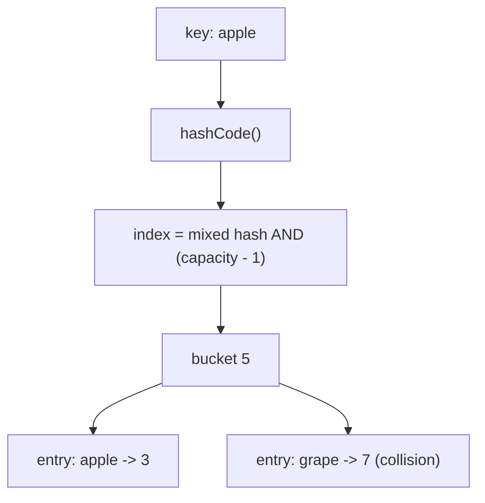
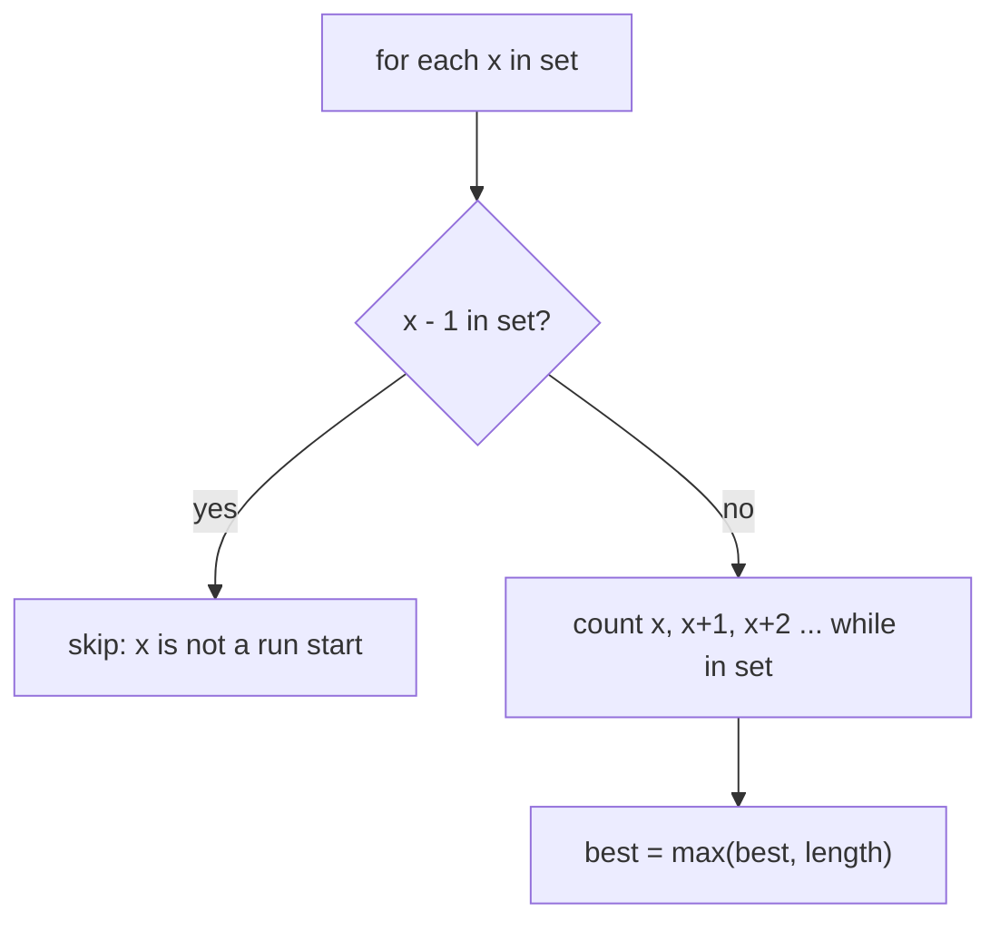
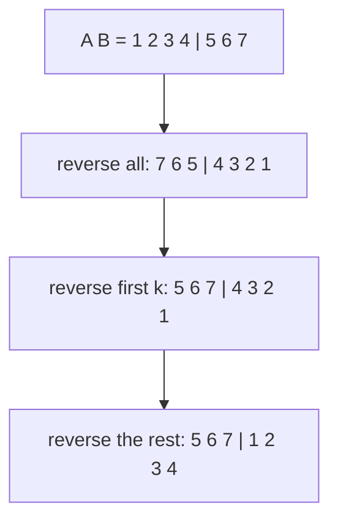

# Arrays, Strings & Hashing

[⬅ Back to index](../README.md)

Covers: the bread-and-butter problems: hashing for lookups and counts, in-place array manipulation, matrix traversal and string handling, with the brute force, the optimal idea, Kotlin (and Swift where useful) code and complexity for each.

---

## Hashing

### 1. How does a hash map work, and why is it O(1)?

**📘 Concept** · ⭐ Product/FAANG favourite

<details>
<summary>Answer</summary>

**In short:** A hash map is an array of **buckets**. A hash function turns each key into an integer, the integer is reduced to a bucket index, and the entry is stored there. Lookups jump straight to one bucket, so they cost O(1) **on average** — as long as the hash spreads keys evenly and the table grows when it gets full (the **load factor**). Keys that land in the same bucket **collide**; with bad hashing every key collides and operations fall to O(n). Java's (and so Kotlin/JVM's) `HashMap` limits that damage by turning a crowded bucket into a small red-black tree, giving O(log n) for that bucket.

#### The moving parts

1. **Hash function** — `key.hashCode()` in Kotlin/Java, `Hashable.hash(into:)` in Swift. Equal keys **must** produce equal hashes; unequal keys should *usually* produce different ones.
2. **Index** — the hash is mapped to `0 until capacity`. Java's `HashMap` keeps capacity a power of two and computes `index = (h ^ (h >>> 16)) & (capacity - 1)` — the XOR mixes high bits into the low bits that the mask keeps.
3. **Bucket** — holds every entry whose key mapped to that index.
4. **Equality check** — inside a bucket, the map compares the stored keys with `equals` (`==` in Swift) to find the exact one. The hash only narrows the search; equality decides.



#### Collisions: two ways to handle them

| Strategy | How it works | Used by |
|---|---|---|
| **Separate chaining** | Each bucket holds a small list (or tree) of entries | `java.util.HashMap` (so Kotlin on the JVM) |
| **Open addressing** | On collision, probe the next slots (linear probing: i+1, i+2, …) until a free one is found | Swift `Dictionary` / `Set` (linear probing) |

#### Load factor and resizing

The **load factor** is `entries / buckets`. As it rises, buckets get longer and lookups slower. Java's `HashMap` resizes when the load factor passes **0.75** (default), doubling the bucket array and redistributing every entry. One resize costs O(n), but because capacity doubles, resizes get rarer at the same rate — the total cost over n inserts is O(n), so each insert is **amortised O(1)** (the same argument as a dynamic array).

If you know the size up front, pre-size the map (`HashMap<Int, Int>(expectedSize * 4 / 3 + 1)` or Swift's `Dictionary(minimumCapacity:)`) to skip the resizes.

#### Why "O(1)" really means "O(1) average"

| Operation | Average | Worst case |
|---|---|---|
| get / put / remove / contains | O(1) | O(n) with naive chaining; O(log n) per bucket in Java 8+ `HashMap` once treeified |
| iterate all entries | O(n + capacity) | same |

The worst case happens when many keys share a bucket — a bad `hashCode` (e.g. one that returns a constant) or deliberately crafted keys (hash-flooding attacks). Two defences:

- **Treeified buckets (Java 8+):** when one bucket reaches 8 entries and the table has at least 64 buckets, `HashMap` converts that bucket's list into a red-black tree (and back to a list when it shrinks to 6). Lookups in it become O(log n), best when keys are `Comparable`.
- **Randomised seeds (Swift):** Swift's `Hasher` is seeded randomly per process, so attackers can't predict which keys collide (and iteration order differs between runs — never rely on it).

In interviews, say "O(1) average, assuming a good hash function" — that is the expected answer.

#### Kotlin and Swift specifics that bite in interviews

- `mutableMapOf()` / `mutableSetOf()` in Kotlin return `LinkedHashMap` / `LinkedHashSet` — they keep **insertion order** at the cost of a bit more memory. `HashMap()` / `hashMapOf()` gives no ordering guarantee.
- **Arrays are bad keys in Kotlin/Java.** `IntArray` and `Array` use identity `hashCode`/`equals`, so two arrays with the same contents are *different* keys. Use a `String`, a `List<Int>` (structural equality) or `contentHashCode` wrappers. In Swift, `[Int]` is `Hashable` by value and works fine as a key.
- **Data classes** generate `equals`/`hashCode` from their properties — good keys. Normal classes use identity unless you override both.
- **Never mutate a key** after inserting it — its hash changes and the entry becomes unreachable.
- Counting idioms: Kotlin `map[x] = (map[x] ?: 0) + 1` or `map.merge(x, 1, Int::plus)`; Swift `counts[x, default: 0] += 1`.
- Boxing: `HashMap<Int, Int>` stores boxed `Integer`s on the JVM. When keys are small integers or lowercase letters, a plain `IntArray(26)` is faster and is the expected optimisation.

#### Hash map vs alternatives

| Need | Use |
|---|---|
| Lookup / count / dedupe by key | Hash map / hash set |
| Keys in sorted order, floor/ceiling queries | `TreeMap` (O(log n)); in Swift, a sorted array + binary search |
| Keys are small integers (0..25, 0..n) | Plain array as a direct-address table |

#### Common mistakes

- Claiming hash map operations are "always O(1)".
- Using `IntArray` as a key in Kotlin and wondering why lookups miss.
- Overriding `equals` without `hashCode` (or vice versa) — equal objects land in different buckets.
- Relying on iteration order of a `HashMap` or Swift `Dictionary`.

#### Follow-ups

- *Design a hash map from scratch?* Array of buckets with chaining, `hash % capacity`, resize at 0.75 load factor, handle update vs insert — a common warm-up (LeetCode "Design HashMap").
- *Why power-of-two capacity?* `h & (cap - 1)` is a cheap modulo; the hash is mixed first so low bits are well distributed.
- *Hash set vs hash map?* A set is a map with only keys (Java's `HashSet` literally wraps a `HashMap`).
- Language costs in more depth: [Kotlin & Swift for Coding Interviews](03-kotlin-swift-for-interviews.md).

</details>

### 2. Two Sum

**🟢 Easy** · ⭐ Product/FAANG favourite (commonly reported at Google, Amazon, Meta)

<details>
<summary>Answer</summary>

**In short:** Walk the array once. For each number `x`, ask a hash map "have I already seen `target - x`?" If yes, you have the pair; if not, store `x → index` and move on. One pass, O(n) time and O(n) space — the map turns the inner "search for the partner" loop of brute force into an O(1) lookup.

#### Problem

Given an integer array `nums` and a `target`, return the indices of the two different elements that add up to `target`. Exactly one answer exists.

- `nums = [2, 7, 11, 15], target = 9` → `[0, 1]`
- `nums = [3, 2, 4], target = 6` → `[1, 2]`
- `nums = [3, 3], target = 6` → `[0, 1]`

#### Clarifying questions & edge cases

- Is exactly one solution guaranteed? If not, what to return (empty array, `null`)?
- Can I use the same element twice? (No — `[3, 2, 4], 6` must not return `[0, 0]`.)
- Duplicates (`[3, 3]`), negatives and zero — all handled by the map approach.
- Return indices or values? Any order?
- Overflow: `target - x` can overflow `Int` if values are near the limits; use `Long` if constraints allow such values.

#### Brute force

Try every pair `i < j` and check `nums[i] + nums[j] == target`. O(n²) time, O(1) space. Sorting + two pointers is O(n log n), but sorting loses the original indices unless you sort index pairs (see [Two Sum II](08-two-pointers-sliding-window.md) for the sorted version).

#### Key insight

For each `x`, its partner is fully determined: `target - x`. So the question "is there a `j` with `nums[j] == target - x`?" is a **membership lookup**, and lookups are what hash maps do in O(1).

Check **before** you insert. That one ordering decision handles two edge cases at once:

- An element never pairs with itself (`[3, 2, 4], 6`: when we see the `3`, the map is empty, so we don't return `[0, 0]`).
- Duplicates work (`[3, 3], 6`: the second `3` finds the first one already in the map).

#### Walkthrough

`nums = [3, 2, 4], target = 6`

| i | x | need = target - x | map before | found? | map after |
|---|---|---|---|---|---|
| 0 | 3 | 3 | {} | no | {3→0} |
| 1 | 2 | 4 | {3→0} | no | {3→0, 2→1} |
| 2 | 4 | 2 | {3→0, 2→1} | yes, at 1 | return [1, 2] |

#### Kotlin

```kotlin
fun twoSum(nums: IntArray, target: Int): IntArray {
    val indexOf = HashMap<Int, Int>()          // value -> index where we saw it
    for ((i, x) in nums.withIndex()) {
        val j = indexOf[target - x]            // has the partner appeared already?
        if (j != null) return intArrayOf(j, i)
        indexOf[x] = i                         // insert AFTER checking
    }
    return intArrayOf()                        // no pair (not reached if one is guaranteed)
}
```

#### Complexity

- **Time:** O(n) average — one pass, O(1) average map operations.
- **Space:** O(n) — the map can hold every element before the pair is found.

#### Common mistakes

- Inserting before checking, then returning `[i, i]` when `x * 2 == target`.
- Filling the whole map first and then searching without checking `j != i`.
- Sorting the array and returning indices of the *sorted* array.
- Using `nums.indexOf(target - x)` inside the loop — that is a hidden O(n) scan, making the solution O(n²).

#### Follow-ups

- *Array is sorted, O(1) space?* Two pointers — [Two Pointers & Sliding Window](08-two-pointers-sliding-window.md).
- *Return all unique pairs / three numbers?* Sort + two pointers (3Sum, also in topic 08).
- *Count pairs with sum = target?* Store counts instead of indices: `pairs += count[target - x]`, then `count[x]++`.
- *Data stream (add/find)?* "Two Sum III": keep a count map; `find(value)` scans the keys — O(n) per find, O(1) per add (or the reverse trade-off with a set of all sums).

</details>

### 3. Contains Duplicate

**🟢 Easy**

<details>
<summary>Answer</summary>

**In short:** Put each element into a hash set; the moment an insert finds the value already there, return `true`. O(n) time and O(n) space. If memory matters more than time, sort and compare neighbours — O(n log n) time and O(1) extra space (beyond the sort).

#### Problem

Return `true` if any value appears at least twice in the array, `false` if every element is distinct.

- `[1, 2, 3, 1]` → `true`
- `[1, 2, 3, 4]` → `false`
- `[]` or `[7]` → `false`

#### Clarifying questions & edge cases

- Empty or single-element array → `false`.
- May I modify the input (sorting in place)? This decides between the two approaches.
- Value range: if values are small and bounded (e.g. 0..10⁴), a boolean array beats a hash set.

#### Brute force

Compare every pair — O(n²) time, O(1) space. Too slow for n = 10⁵.

#### Optimal approach

A set answers "have I seen this before?" in O(1) average. Scan once:

1. For each `x`, try `seen.add(x)`.
2. Kotlin's `add` returns `false` if `x` was already present (Swift's `insert` returns `(inserted: false, …)`). That's the duplicate — return `true` immediately.
3. If the scan finishes, every value was new → `false`.

The early exit matters: on inputs with an early duplicate, you stop after a few elements.

**Sorting alternative:** after sorting, equal values are adjacent, so a duplicate exists iff some `a[i] == a[i-1]`. Useful when the interviewer says "O(1) extra space" and allows mutation.

#### Walkthrough

`[1, 2, 3, 1]`

| i | x | seen before | add returns | action |
|---|---|---|---|---|
| 0 | 1 | {} | true | continue |
| 1 | 2 | {1} | true | continue |
| 2 | 3 | {1, 2} | true | continue |
| 3 | 1 | {1, 2, 3} | **false** | return true |

#### Kotlin

```kotlin
fun containsDuplicate(nums: IntArray): Boolean {
    val seen = HashSet<Int>(nums.size * 2)   // pre-size to avoid rehashing
    for (x in nums) {
        if (!seen.add(x)) return true        // add() is false if x was already there
    }
    return false
}

// O(1) extra space if mutation is allowed.
fun containsDuplicateBySorting(nums: IntArray): Boolean {
    nums.sort()
    for (i in 1 until nums.size) {
        if (nums[i] == nums[i - 1]) return true
    }
    return false
}
```

The one-liner `nums.toSet().size < nums.size` is correct and fine to mention, but it always builds the full set (no early exit).

#### Complexity

- **Hash set:** O(n) average time, O(n) space.
- **Sort:** O(n log n) time; O(1) extra space for primitive arrays (the JVM sorts `IntArray` with a dual-pivot quicksort, which uses O(log n) stack).

#### Common mistakes

- `if (seen.contains(x)) return true; seen.add(x)` — correct but does two lookups; `add`'s return value does both.
- Sorting the caller's array without asking — it's a side effect.
- Starting the sorted comparison at `i = 0` and reading `nums[-1]`.

#### Follow-ups

- **Contains Duplicate II** (duplicate within distance k): map `value → last index`; duplicate if `i - last[x] <= k`. Or keep a sliding set of the last k values. O(n).
- **Contains Duplicate III** (values within `t` and indices within `k`): bucket the values into buckets of width `t + 1` inside a sliding window, or use a `TreeSet` with `ceiling`. O(n) / O(n log k).
- *Find the duplicate in 1..n with O(1) space, no mutation?* Floyd's cycle detection — see [Linked Lists](12-linked-lists.md).

</details>

### 4. Valid Anagram

**🟢 Easy** · ⭐ Product/FAANG favourite

<details>
<summary>Answer</summary>

**In short:** Two strings are anagrams exactly when every character appears the same number of times in both. Count characters of `s` up and characters of `t` down in a 26-slot array; they're anagrams iff every slot ends at 0. O(n) time, O(1) space (26 counters). For Unicode input, use a hash map of characters instead of the fixed array.

#### Problem

Given strings `s` and `t`, return `true` if `t` is a rearrangement of the letters of `s`.

- `s = "anagram", t = "nagaram"` → `true`
- `s = "rat", t = "car"` → `false`

#### Clarifying questions & edge cases

- Only lowercase English letters? (LeetCode: yes. Follow-up: Unicode.)
- Different lengths → immediately `false`.
- Case sensitive? Spaces count? Agree before coding.
- Empty strings → `true`.

#### Brute force

Sort both strings and compare: O(n log n) time, O(n) space for the char arrays. Simple and correct — a fine first answer. A worse brute force removes each char of `s` from a list copy of `t` (O(n²)).

#### Key insight

"Same multiset of characters" is a **frequency** question. With only 26 possible characters, an `IntArray(26)` is a perfect hash table: index `c - 'a'`, no hashing, no boxing. Increment for `s`, decrement for `t`; any non-zero slot means one string has more of that letter.

#### Walkthrough

`s = "rat"`, `t = "car"` (only non-zero slots shown)

| step | char | counts after |
|---|---|---|
| s[0] | r | r:1 |
| s[1] | a | a:1, r:1 |
| s[2] | t | a:1, r:1, t:1 |
| t[0] | c | a:1, c:-1, r:1, t:1 |
| t[1] | a | c:-1, r:1, t:1 |
| t[2] | r | c:-1, t:1 |

Slots for `c` and `t` are non-zero → `false`.

#### Kotlin

```kotlin
fun isAnagram(s: String, t: String): Boolean {
    if (s.length != t.length) return false
    val counts = IntArray(26)
    for (i in s.indices) {
        counts[s[i] - 'a']++     // Char - Char gives an Int offset
        counts[t[i] - 'a']--
    }
    return counts.all { it == 0 }
}

// Unicode-safe version: count with a map.
fun isAnagramUnicode(s: String, t: String): Boolean {
    if (s.length != t.length) return false
    val counts = HashMap<Char, Int>()
    for (c in s) counts[c] = (counts[c] ?: 0) + 1
    for (c in t) {
        val left = (counts[c] ?: 0) - 1
        if (left < 0) return false   // t has more of c than s
        counts[c] = left
    }
    return true
}
```

(Strictly, Kotlin `Char` is a UTF-16 unit, so characters outside the Basic Multilingual Plane, like many emoji, are two `Char`s. Counting UTF-16 units still gives the right answer for anagram checks, because a surrogate pair is counted the same way in both strings — but mention it if Unicode comes up.)

#### Swift

Swift `String` can't be indexed by `Int`, and `count` walks the whole string (it counts grapheme clusters). For the lowercase-ASCII version, work on the UTF-8 bytes; for real Unicode, count `Character`s in a dictionary.

```swift
func isAnagram(_ s: String, _ t: String) -> Bool {
    guard s.utf8.count == t.utf8.count else { return false }
    var counts = [Int](repeating: 0, count: 26)
    let a = Int(UInt8(ascii: "a"))
    for byte in s.utf8 { counts[Int(byte) - a] += 1 }
    for byte in t.utf8 { counts[Int(byte) - a] -= 1 }
    return counts.allSatisfy { $0 == 0 }
}

// Unicode-aware: Character is a full grapheme cluster ("é", emoji, flags).
func isAnagramUnicode(_ s: String, _ t: String) -> Bool {
    var counts: [Character: Int] = [:]
    for ch in s { counts[ch, default: 0] += 1 }
    for ch in t {
        counts[ch, default: 0] -= 1
        if counts[ch]! < 0 { return false }
    }
    return counts.values.allSatisfy { $0 == 0 }
}
```

#### Complexity

- **Time:** O(n) — one pass over each string.
- **Space:** O(1) for the 26-slot array; O(k) for the map version, where k is the number of distinct characters.

#### Common mistakes

- Skipping the length check in the decrement-with-early-exit variant — `"ab"` vs `"a"` would wrongly pass.
- In Swift, calling `s.count` repeatedly or indexing with `s[s.index(s.startIndex, offsetBy: i)]` in a loop — O(n²).
- Using `'a'.code` arithmetic on uppercase or non-letter input without checking the alphabet.

#### Follow-ups

- *Group many strings into anagram groups?* [Group Anagrams](#5-group-anagrams).
- *Find all anagrams of `p` inside `s`?* Fixed-size sliding window with counts — see [Two Pointers & Sliding Window](08-two-pointers-sliding-window.md) (Permutation in String).
- *Minimum steps to make two strings anagrams?* Count difference: sum of positive slots after counting `s` up and `t` down.

</details>

### 5. Group Anagrams

**🟡 Medium** · ⭐ Product/FAANG favourite (commonly reported at Amazon, Meta)

<details>
<summary>Answer</summary>

**In short:** Give every word a **canonical key** that is identical for all its anagrams — either its sorted letters (`"eat"` → `"aet"`) or its 26 letter counts — and group words by that key in a hash map. Sorted keys cost O(n·k log k); count keys cost O(n·k), where n is the number of words and k the maximum word length.

#### Problem

Given an array of strings, group the anagrams together. Any order of groups and of words within a group is fine.

- `["eat", "tea", "tan", "ate", "nat", "bat"]` → `[["eat", "tea", "ate"], ["tan", "nat"], ["bat"]]`
- `[""]` → `[[""]]`

#### Clarifying questions & edge cases

- Lowercase English letters only? (Yes on LeetCode — enables the 26-count key.)
- Empty strings are valid words and group together.
- Does output order matter? (Usually no.)
- Duplicates (`["a", "a"]`) stay as two entries in the same group.

#### Brute force

Compare every word with every group's representative using [Valid Anagram](#4-valid-anagram): O(n² · k). Works, but the pairwise comparisons are the waste — anagram-ness is an equivalence relation, so a key per class removes them.

#### Key insight

If you can compute a value `key(word)` such that `key(a) == key(b)` **exactly when** `a` and `b` are anagrams, grouping becomes a single hash-map pass. Two such keys:

| Key | Example for "eat" | Cost per word | Notes |
|---|---|---|---|
| Sorted letters | `"aet"` | O(k log k) | Simplest to write; works for any alphabet |
| Letter counts | `"1#0#0#0#1#…#1#…"` | O(k + 26) | Linear; needs a fixed alphabet; use a separator so counts like 1,11 and 11,1 can't merge |

#### Walkthrough

Sorted-key version on `["eat", "tea", "tan", "ate", "nat", "bat"]`:

| word | key | map after |
|---|---|---|
| eat | aet | aet: [eat] |
| tea | aet | aet: [eat, tea] |
| tan | ant | aet: [eat, tea], ant: [tan] |
| ate | aet | aet: [eat, tea, ate], ant: [tan] |
| nat | ant | aet: [eat, tea, ate], ant: [tan, nat] |
| bat | abt | …, abt: [bat] |

Result: the map's values.

#### Kotlin

```kotlin
fun groupAnagrams(strs: Array<String>): List<List<String>> {
    val groups = HashMap<String, MutableList<String>>()
    for (word in strs) {
        val counts = IntArray(26)
        for (c in word) counts[c - 'a']++
        // IntArray has identity equals/hashCode, so turn the counts into a String key.
        val key = counts.joinToString("#")
        groups.getOrPut(key) { mutableListOf() }.add(word)
    }
    return groups.values.toList()
}

// Shorter, O(k log k) per word:
fun groupAnagramsSorted(strs: Array<String>): List<List<String>> =
    strs.groupBy { String(it.toCharArray().apply { sort() }) }.values.toList()
```

#### Swift

Swift arrays are `Hashable` by value, so `[Int]` works directly as a dictionary key — no string building needed. The `default:` subscript appends in place.

```swift
func groupAnagrams(_ strs: [String]) -> [[String]] {
    var groups: [[Int]: [String]] = [:]
    let a = Int(UInt8(ascii: "a"))
    for word in strs {
        var counts = [Int](repeating: 0, count: 26)
        for byte in word.utf8 { counts[Int(byte) - a] += 1 }
        groups[counts, default: []].append(word)
    }
    return Array(groups.values)
}

// Sorted-key version (works for any characters):
func groupAnagramsSorted(_ strs: [String]) -> [[String]] {
    Array(Dictionary(grouping: strs, by: { String($0.sorted()) }).values)
}
```

#### Complexity

- **Count key:** O(n · (k + 26)) = O(n·k) time; O(n·k) space for the map and output.
- **Sorted key:** O(n · k log k) time; same space.

#### Common mistakes

- Using `IntArray` (Kotlin) or `CharArray` as the map key — identity hashing puts every word in its own group.
- Building a count key without separators: counts `[1, 11]` and `[11, 1]` both become `"111"`.
- `it.toCharArray().sort().toString()` — `sort()` returns `Unit`, and `CharArray.toString()` is not the contents. Use `String(chars)` or `sorted().joinToString("")`.

#### Follow-ups

- *Very long words, few distinct letters?* Count key wins (linear). *Short words, huge alphabet?* Sorted key.
- *Group strings by shifting* (`"abc"`, `"bcd"`): key = differences between adjacent letters mod 26.
- *Return only groups of size > 1?* Filter the values.
- Prime-product keys (multiply a prime per letter) are a known trick but overflow quickly — mention, don't use.

</details>

### 6. Top K Frequent Elements

**🟡 Medium** · ⭐ Product/FAANG favourite (commonly reported at Amazon, Meta)

<details>
<summary>Answer</summary>

**In short:** Count frequencies with a hash map, then use **bucket sort by frequency**: a frequency can only be between 1 and n, so make n + 1 buckets where `bucket[f]` holds the values that occur exactly f times. Walk the buckets from high to low and take the first k values. O(n) time and O(n) space — better than sorting (O(n log n)) or a heap (O(n log k)).

#### Problem

Given an integer array and `k`, return the `k` most frequent values, in any order. The answer is guaranteed to be unique.

- `nums = [1, 1, 1, 2, 2, 3], k = 2` → `[1, 2]`
- `nums = [1], k = 1` → `[1]`

#### Clarifying questions & edge cases

- Ties at the k-th position? (LeetCode guarantees a unique answer; otherwise ask which to keep.)
- `k` equals the number of distinct values → return all of them.
- Negative numbers — fine, they're just map keys.
- Must the output be sorted by frequency? (Usually no.)

#### Brute force

Count with a map, then sort the distinct values by count descending and take k: O(n + d log d) where d ≤ n distinct values — so O(n log n) worst case. Perfectly acceptable as a first answer; the interviewer will ask "can you beat n log n?"

#### Key insight

Sorting is overkill because the sort keys (frequencies) are **small integers bounded by n**. Values bounded by n can be sorted in O(n) with counting/bucket sort: index an array by frequency. Then "the k most frequent" are simply the first k values met when walking buckets from `n` down to `1`.

The heap alternative (keep a min-heap of size k by frequency) is O(n log k) and is better for streams — it lives in [Heaps & Priority Queues](13-heaps-priority-queues.md).

#### Walkthrough

`nums = [1, 1, 1, 2, 2, 3], k = 2`, n = 6

1. Counts: `{1: 3, 2: 2, 3: 1}`
2. Buckets (index = frequency):

| frequency | 0 | 1 | 2 | 3 | 4 | 5 | 6 |
|---|---|---|---|---|---|---|---|
| values | – | [3] | [2] | [1] | – | – | – |

3. Walk from 6 down: buckets 6, 5, 4 empty → bucket 3 gives `1` → bucket 2 gives `2` → we have k = 2 values. Answer `[1, 2]`.

#### Kotlin

```kotlin
fun topKFrequent(nums: IntArray, k: Int): IntArray {
    val freq = HashMap<Int, Int>()
    for (x in nums) freq[x] = (freq[x] ?: 0) + 1

    // buckets[f] = values that appear exactly f times (f is in 1..n)
    val buckets = Array(nums.size + 1) { mutableListOf<Int>() }
    for ((value, count) in freq) buckets[count].add(value)

    val result = IntArray(k)
    var filled = 0
    for (count in nums.size downTo 1) {
        for (value in buckets[count]) {
            result[filled++] = value
            if (filled == k) return result
        }
    }
    return result
}
```

#### Complexity

- **Time:** O(n) — counting is O(n), building buckets O(d), walking buckets O(n + d).
- **Space:** O(n) — the map, n + 1 bucket lists, and the result.

#### Common mistakes

- Making only `d` buckets or `max(nums)` buckets — the index is the **frequency**, which can be as high as n, so you need `n + 1`.
- Forgetting to stop once k values are collected (returning too many).
- Sorting the whole `nums` array and counting runs — correct, but you've lost the O(n) bound you were asked for.

#### Follow-ups

- *Stream of numbers / k much smaller than n?* Min-heap of size k — [Heaps & Priority Queues](13-heaps-priority-queues.md).
- *Average O(n) without extra buckets?* Quickselect on the distinct values by frequency (also in topic 13).
- *Top K Frequent Words* (ties broken alphabetically)? Bucket lists need sorting, or a heap with a comparator `(count desc, word asc)`.

</details>

### 7. First Unique Character in a String

**🟢 Easy**

<details>
<summary>Answer</summary>

**In short:** Two passes. First pass: count every character (an `IntArray(26)` for lowercase letters). Second pass: walk the string in order and return the first index whose count is 1. O(n) time, O(1) space. The trick is that the *second* pass goes over the **string**, not over the counts, so "first" means first in the original order.

#### Problem

Return the index of the first character that appears exactly once in `s`, or `-1` if there is none.

- `"leetcode"` → `0` (`l`)
- `"loveleetcode"` → `2` (`v`)
- `"aabb"` → `-1`

#### Clarifying questions & edge cases

- Lowercase English letters only? (LeetCode: yes.)
- Empty string → `-1`.
- Return the index or the character? Case-sensitive?

#### Brute force

For each index `i`, scan the whole string to see if `s[i]` occurs anywhere else. The first one that doesn't is the answer. O(n²) time, O(1) space.

#### Key insight

Whether a character is unique depends on the **whole** string, so you can't decide on the first pass. But once you have counts, uniqueness is an O(1) lookup. Separating "gather facts" (pass 1) from "answer in order" (pass 2) is a pattern that appears constantly with hashing.

#### Walkthrough

`s = "loveleetcode"`

Pass 1 counts: `l:2, o:2, v:1, e:4, t:1, c:1, d:1`

Pass 2:

| i | s[i] | count | action |
|---|---|---|---|
| 0 | l | 2 | skip |
| 1 | o | 2 | skip |
| 2 | v | 1 | return 2 |

#### Kotlin

```kotlin
fun firstUniqChar(s: String): Int {
    val counts = IntArray(26)
    for (c in s) counts[c - 'a']++
    for (i in s.indices) {
        if (counts[s[i] - 'a'] == 1) return i   // first in original order
    }
    return -1
}
```

**Variant for very long strings:** store the *first index* of each character (or a sentinel for "seen twice"), then take the minimum index among the 26 letters. The second pass is then over 26 slots, not n characters — useful when the string is huge or is read once from a stream.

```kotlin
fun firstUniqCharOnePass(s: String): Int {
    val firstIndex = IntArray(26) { -1 }   // -1 = unseen, -2 = repeated
    for (i in s.indices) {
        val c = s[i] - 'a'
        firstIndex[c] = if (firstIndex[c] == -1) i else -2
    }
    return firstIndex.filter { it >= 0 }.minOrNull() ?: -1
}
```

#### Complexity

- **Time:** O(n) — two linear passes (or one pass + 26).
- **Space:** O(1) — 26 counters regardless of n. For a general alphabet, O(σ) where σ is the alphabet size.

#### Common mistakes

- Iterating over a `HashMap` of counts to find the "first" unique — hash maps have no order, so you get *some* unique character, not the first. (A `LinkedHashMap` would work, but the second string pass is simpler.)
- Returning the character when the index was asked for (or vice versa).
- In Swift, indexing the string with integer offsets in the second pass — use `for (i, ch) in s.enumerated()` or `Array(s.utf8)`.

#### Follow-ups

- *Characters arrive as a stream; answer "first unique so far" after each one?* Keep counts plus a queue (or `LinkedHashSet`) of candidates; pop from the front while the front's count > 1. Amortised O(1) per character.
- *First Unique Number* (design version with `add` and `showFirstUnique`) — same queue-plus-counts idea.
- *First repeating character?* One pass with a set: the first `add` that returns `false`.

</details>

### 8. Isomorphic Strings (and Word Pattern)

**🟢 Easy**

<details>
<summary>Answer</summary>

**In short:** Two strings are isomorphic if there is a **one-to-one** mapping between their characters. Keep two maps — `s → t` and `t → s` — and walk both strings together; if a character is already mapped to something different in *either* direction, return `false`. O(n) time, O(1) space for a fixed alphabet. Word Pattern is the same problem with words instead of characters on one side.

#### Problem

**Isomorphic Strings:** `s` and `t` are isomorphic if the characters of `s` can be replaced to get `t`, where each character maps to exactly one character and no two characters map to the same one (a character may map to itself).

- `"egg", "add"` → `true` (e→a, g→d)
- `"foo", "bar"` → `false` (o would need to map to both a and r)
- `"badc", "baba"` → `false` (b→b and d→b: two characters map to b)

**Word Pattern:** `pattern = "abba"`, `s = "dog cat cat dog"` → `true`; `"abba"`, `"dog cat cat fish"` → `false`.

#### Clarifying questions & edge cases

- Equal lengths? Different lengths (or different word counts for Word Pattern) → `false`.
- Alphabet: ASCII? (LeetCode: any valid ASCII character.)
- Word Pattern: are words separated by single spaces? Leading/trailing spaces?

#### Brute force

For every pair of positions `i, j`, check `s[i] == s[j]` exactly when `t[i] == t[j]`. That's the definition of isomorphic, and it's O(n²).

#### Key insight

A **one-directional** map only checks that each `s` character maps consistently. It misses the case where two different `s` characters map to the same `t` character (`"badc"` → `"baba"`: b→b, a→a, d→b, c→a — consistent forward, but b and d both go to b). A bijection needs the check in both directions, hence two maps.

An equivalent trick: two strings are isomorphic iff, at every position, the **last index where each character was seen** is the same in both strings. That's what the brute-force definition reduces to.

#### Walkthrough

`s = "badc"`, `t = "baba"`

| i | s[i] | t[i] | s→t | t→s | result |
|---|---|---|---|---|---|
| 0 | b | b | b→b | b→b | ok |
| 1 | a | a | a→a | a→a | ok |
| 2 | d | b | d→b (new) | b already → **b**, not d | return false |

#### Kotlin

```kotlin
fun isIsomorphic(s: String, t: String): Boolean {
    if (s.length != t.length) return false
    val sToT = HashMap<Char, Char>()
    val tToS = HashMap<Char, Char>()
    for (i in s.indices) {
        val a = s[i]
        val b = t[i]
        // getOrPut stores the mapping if new, otherwise returns the existing one.
        if (sToT.getOrPut(a) { b } != b) return false
        if (tToS.getOrPut(b) { a } != a) return false
    }
    return true
}

fun wordPattern(pattern: String, s: String): Boolean {
    val words = s.split(" ")
    if (words.size != pattern.length) return false
    val charToWord = HashMap<Char, String>()
    val wordToChar = HashMap<String, Char>()
    for (i in words.indices) {
        val c = pattern[i]
        val w = words[i]
        if (charToWord.getOrPut(c) { w } != w) return false
        if (wordToChar.getOrPut(w) { c } != c) return false
    }
    return true
}
```

**Array version** (fast, ASCII): `IntArray(256)` of "last seen index + 1" for each string; at each `i`, if `lastS[s[i]] != lastT[t[i]]` return `false`, else set both to `i + 1`.

#### Complexity

- **Time:** O(n) — one pass; for Word Pattern, O(total length of `s`) including the split.
- **Space:** O(σ) for the character maps (σ ≤ 256 for ASCII, so O(1)); O(number of words × word length) for Word Pattern.

#### Common mistakes

- Only one map — fails `"badc"/"baba"` (or `"abba"/"dog dog dog dog"` in Word Pattern).
- Word Pattern: forgetting the length check, so `"aaa"` vs `"dog dog dog dog"` slips through.
- Comparing boxed values with `===` instead of `==`/`!=` in Kotlin.

#### Follow-ups

- *Group strings that share a pattern* (Find and Replace Pattern)? Normalise each word to a pattern key: replace each char by the index of its first occurrence (`"abb"` → `[0, 1, 1]`), then compare keys.
- *Word Pattern II* (no spaces, pattern letters map to substrings)? Backtracking — see [Recursion & Backtracking](18-recursion-backtracking.md).

</details>

### 9. Longest Consecutive Sequence

**🟡 Medium** · ⭐ Product/FAANG favourite (commonly reported at Google, Amazon)

<details>
<summary>Answer</summary>

**In short:** Put all numbers in a hash set. A number `x` **starts** a run only if `x - 1` is not in the set; from each start, count upward `x + 1, x + 2, …` while they're in the set. Because counting only begins at starts, every number is visited by the inner loop at most once in total — O(n) time, O(n) space, without sorting.

#### Problem

Given an unsorted integer array, return the length of the longest run of consecutive integers (values, not positions). Must run in O(n).

- `[100, 4, 200, 1, 3, 2]` → `4` (`1, 2, 3, 4`)
- `[0, 3, 7, 2, 5, 8, 4, 6, 0, 1]` → `9`
- `[]` → `0`

#### Clarifying questions & edge cases

- Empty array → 0.
- Duplicates (`[1, 2, 2, 3]` → 3) — the set removes them.
- Negative numbers and `Int.MIN_VALUE`/`Int.MAX_VALUE`: `x - 1` and `x + 1` can overflow. Use `Long` or guard (`x != Int.MIN_VALUE`).

#### Brute force

For each `x`, count upward while `x + 1, x + 2, …` exist, using a linear scan for each lookup: O(n³). With a set for lookups: O(n²) in the worst case (e.g. `[1..n]`, starting from every element). Sorting and scanning runs is O(n log n) — a good stepping stone, but the problem asks for O(n).

#### Key insight

The O(n²) waste comes from counting the same run many times — from `1`, then from `2`, then from `3`… Only count from the **smallest** element of each run. `x` is the smallest exactly when `x - 1` is absent. Each element is then touched once by the outer loop and at most once by some inner loop (the run it belongs to), so the total work is O(n).

#### Walkthrough

`nums = [100, 4, 200, 1, 3, 2]`, set = `{100, 4, 200, 1, 3, 2}`

| x | x - 1 in set? | start? | run counted | best |
|---|---|---|---|---|
| 100 | 99 no | yes | 100 → length 1 | 1 |
| 4 | 3 yes | no | – | 1 |
| 200 | 199 no | yes | 200 → length 1 | 1 |
| 1 | 0 no | yes | 1, 2, 3, 4 → length 4 | 4 |
| 3 | 2 yes | no | – | 4 |
| 2 | 1 yes | no | – | 4 |



#### Kotlin

```kotlin
fun longestConsecutive(nums: IntArray): Int {
    val set = HashSet<Int>(nums.size * 2)
    for (x in nums) set.add(x)
    var best = 0
    for (x in set) {                                   // iterate the set: skips duplicates
        if (x != Int.MIN_VALUE && (x - 1) in set) continue   // not the start of a run
        var length = 1
        var current = x
        while (current != Int.MAX_VALUE && (current + 1) in set) {
            current++
            length++
        }
        best = maxOf(best, length)
    }
    return best
}
```

#### Complexity

- **Time:** O(n) average — building the set is O(n); the inner `while` loops together advance through each set element at most once.
- **Space:** O(n) for the set.

#### Common mistakes

- Dropping the "is it a start?" check — correct output but O(n²) time, which is what the interviewer is testing.
- Iterating `nums` instead of the set when there are many duplicates of a run start, e.g. `[1, 1, 1, …, 2, 3, …]` — each duplicate re-counts the run. Iterating the set avoids it.
- Overflow at `Int.MAX_VALUE` / `Int.MIN_VALUE`.

#### Follow-ups

- *Return the sequence itself?* Remember the start of the best run and its length.
- *Union-find solution?* Union `x` with `x + 1` when both exist; answer = largest component — also near O(n) ([Advanced Graphs](17-advanced-graphs.md)).
- *Longest consecutive path in a binary tree?* DFS carrying the current run length ([Trees & BSTs](14-trees-bst.md)).

</details>

### 10. Valid Sudoku

**🟡 Medium**

<details>
<summary>Answer</summary>

**In short:** Check that no digit repeats in any row, column or 3×3 box. Keep 9 "seen" sets (or boolean arrays) for rows, 9 for columns and 9 for boxes; for each filled cell compute its box index `(r / 3) * 3 + c / 3`, and if the digit is already marked in its row, column or box, the board is invalid. One pass over 81 cells — O(1) for a fixed board, O(n²) for an n×n board.

#### Problem

Given a 9×9 board of digits `'1'..'9'` and `'.'` for empty cells, decide whether the **filled** cells are valid: no repeated digit in any row, column, or 3×3 sub-box. The board does not need to be solvable.

#### Clarifying questions & edge cases

- Only check filled cells — empty cells are ignored.
- Validity, not solvability: a valid board may have no solution.
- Input format: `Array<CharArray>` with `'.'` for empty.

#### Brute force

Three separate passes: check each row (9 sets), then each column, then each box (with nested loops over the 3×3 cells). Still O(81), just more code. That's fine — the single-pass version is mostly about writing it cleanly and computing the box index.

#### Key insight

Every cell belongs to exactly one row, one column and one box. Number the boxes 0..8 left-to-right, top-to-bottom; then a cell's box is `(r / 3) * 3 + (c / 3)` — `r / 3` picks the band of three rows, `c / 3` picks the stack of three columns.

| | c 0-2 | c 3-5 | c 6-8 |
|---|---|---|---|
| **r 0-2** | box 0 | box 1 | box 2 |
| **r 3-5** | box 3 | box 4 | box 5 |
| **r 6-8** | box 6 | box 7 | box 8 |

With that, one pass marks each digit in three "seen" tables and detects any repeat immediately.

#### Walkthrough

Suppose `board[0][0] = '5'` and `board[1][2] = '5'`.

| cell | digit | row seen? | col seen? | box | box seen? | action |
|---|---|---|---|---|---|---|
| (0, 0) | 5 | no | no | 0 | no | mark row 0, col 0, box 0 |
| (1, 2) | 5 | row 1: no | col 2: no | (1/3)*3 + 2/3 = 0 | **yes** | return false |

The rows and columns are different, but both cells are in box 0 — exactly the case the box check exists for.

#### Kotlin

```kotlin
fun isValidSudoku(board: Array<CharArray>): Boolean {
    // seen[unit][digit] — digit index 0..8 for '1'..'9'
    val rows = Array(9) { BooleanArray(9) }
    val cols = Array(9) { BooleanArray(9) }
    val boxes = Array(9) { BooleanArray(9) }
    for (r in 0 until 9) {
        for (c in 0 until 9) {
            val ch = board[r][c]
            if (ch == '.') continue
            val d = ch - '1'
            val b = (r / 3) * 3 + c / 3
            if (rows[r][d] || cols[c][d] || boxes[b][d]) return false
            rows[r][d] = true
            cols[c][d] = true
            boxes[b][d] = true
        }
    }
    return true
}
```

A compact alternative some candidates like: one `HashSet<String>` with entries `"5 in row 0"`, `"5 in col 0"`, `"5 in box 0"` — `add` returning `false` means a repeat. Readable, but slower due to string building.

#### Complexity

- **Time:** O(81) = O(1) for a standard board; O(n²) for an n×n board with √n×√n boxes.
- **Space:** O(1) — 3 × 81 booleans (O(n²) in general).

#### Common mistakes

- Wrong box index, e.g. `r / 3 + c / 3` (collides: box (0,1) and (1,0) both give 1).
- Using `ch - '0'` as the index into a size-9 array — `'9' - '0'` = 9 is out of bounds. Use `ch - '1'`, or size-10 arrays.
- Trying to solve the board — not required.

#### Follow-ups

- *Sudoku Solver?* Backtracking with the same three tables for O(1) validity checks — [Recursion & Backtracking](18-recursion-backtracking.md).
- *Bitmasks instead of boolean arrays?* One `Int` per row/column/box; digit d is bit `1 shl d`. Same complexity, less memory ([Bit Manipulation & Math](21-bit-manipulation-math.md)).
- *Generalise to n×n?* Box index `(r / k) * k + c / k` with `k = √n`.

</details>

## In-place array manipulation

### 11. Product of Array Except Self

**🟡 Medium** · ⭐ Product/FAANG favourite (commonly reported at Amazon, Meta)

<details>
<summary>Answer</summary>

**In short:** The answer at `i` is (product of everything left of `i`) × (product of everything right of `i`). Fill the output array with prefix products in a left-to-right pass, then sweep right-to-left with a running suffix product, multiplying it in. O(n) time, O(1) extra space (the output array doesn't count), and no division — so zeros need no special handling.

#### Problem

Given `nums`, return `answer` where `answer[i]` is the product of all elements except `nums[i]`. Must be O(n) and must not use division. Products fit in a 32-bit int.

- `[1, 2, 3, 4]` → `[24, 12, 8, 6]`
- `[-1, 1, 0, -3, 3]` → `[0, 0, 9, 0, 0]`

#### Clarifying questions & edge cases

- Zeros: one zero makes every other answer 0; two zeros make everything 0. (The prefix/suffix method handles both automatically.)
- Negative numbers — no effect on the method.
- Overflow: guaranteed to fit on LeetCode; otherwise use `Long` or ask.
- Is the output array counted as extra space? (Conventionally no.)

#### Brute force

For each `i`, multiply all other elements: O(n²). The tempting O(n) shortcut — total product divided by `nums[i]` — is forbidden, and also breaks on zeros (division by zero, or needing to count zeros separately).

#### Key insight

Split "everything except `i`" into two contiguous pieces:

`answer[i] = (nums[0] × … × nums[i-1]) × (nums[i+1] × … × nums[n-1]) = prefix[i] × suffix[i]`

Both are running products, each computable in one pass. To save space, store prefixes directly in `answer`, then fold suffixes in with a single variable during a backward pass.

#### Walkthrough

`nums = [1, 2, 3, 4]`

Forward pass (`answer[i]` = product of everything left of i):

| i | 0 | 1 | 2 | 3 |
|---|---|---|---|---|
| answer (prefix) | 1 | 1 | 2 | 6 |

Backward pass with `suffix` (product of everything right of i):

| i | suffix before | answer[i] = prefix × suffix | suffix after (× nums[i]) |
|---|---|---|---|
| 3 | 1 | 6 × 1 = 6 | 4 |
| 2 | 4 | 2 × 4 = 8 | 12 |
| 1 | 12 | 1 × 12 = 12 | 24 |
| 0 | 24 | 1 × 24 = 24 | 24 |

Result `[24, 12, 8, 6]`.

#### Kotlin

```kotlin
fun productExceptSelf(nums: IntArray): IntArray {
    val n = nums.size
    val answer = IntArray(n)
    answer[0] = 1                                   // nothing to the left of index 0
    for (i in 1 until n) answer[i] = answer[i - 1] * nums[i - 1]
    var suffix = 1                                  // product of nums[i+1..n-1]
    for (i in n - 1 downTo 0) {
        answer[i] *= suffix
        suffix *= nums[i]
    }
    return answer
}
```

#### Swift

```swift
func productExceptSelf(_ nums: [Int]) -> [Int] {
    let n = nums.count
    var answer = [Int](repeating: 1, count: n)
    for i in stride(from: 1, to: n, by: 1) {       // safe when n == 1 (empty stride)
        answer[i] = answer[i - 1] * nums[i - 1]
    }
    var suffix = 1
    for i in stride(from: n - 1, through: 0, by: -1) {
        answer[i] *= suffix
        suffix *= nums[i]
    }
    return answer
}
```

Swift note: `for i in 1..<n` traps at runtime if `n == 0` (a range with upper bound below lower bound is invalid), whereas `stride` simply produces nothing. Also, Swift `*` **traps on overflow** instead of wrapping like Kotlin — with the problem's guarantee it's fine, but it's a real difference.

#### Complexity

- **Time:** O(n) — two passes.
- **Space:** O(1) extra — just `suffix`; the output array is required anyway. (The two-array version with separate `prefix[]` and `suffix[]` is O(n) extra and a good stepping stone to explain.)

#### Common mistakes

- Including `nums[i]` in its own prefix (off by one: `answer[i] = answer[i-1] * nums[i]`).
- Updating `suffix` **before** multiplying it into `answer[i]`.
- Using division and special-casing zeros — not allowed, and easy to get wrong.

#### Follow-ups

- *Division allowed?* Count zeros: 0 zeros → `total / nums[i]`; 1 zero → only the zero's position gets the product of the rest; 2+ zeros → all zeros.
- *Same idea elsewhere?* "Left and right passes" solve [Trapping Rain Water](08-two-pointers-sliding-window.md) and Candy ([Greedy](20-greedy.md)).
- *Range products with updates?* A segment tree, or prefix products with care for zeros.

</details>

### 12. Move Zeroes (and Remove Duplicates from Sorted Array)

**🟢 Easy**

<details>
<summary>Answer</summary>

**In short:** Use a **read pointer** that scans every element and a **write pointer** that marks where the next "kept" element goes. Whenever the read pointer finds an element to keep, put it at `write` and advance `write`. Everything before `write` is the finished, compacted result. O(n) time, O(1) space. Move Zeroes keeps non-zeros (and swaps so zeros end up at the back); Remove Duplicates keeps an element only if it differs from the last kept one.

#### Problem

**Move Zeroes:** move all `0`s to the end, keeping the relative order of the non-zero elements, in place.
`[0, 1, 0, 3, 12]` → `[1, 3, 12, 0, 0]`

**Remove Duplicates from Sorted Array:** given a sorted array, remove duplicates in place so each value appears once; return the new length `k` (the first `k` slots hold the result; the rest don't matter).
`[0, 0, 1, 1, 1, 2, 2, 3, 3, 4]` → `k = 5`, array starts `[0, 1, 2, 3, 4, …]`

#### Clarifying questions & edge cases

- In place, O(1) extra space? (Yes for both.)
- Must order be preserved? (Yes — rules out "swap with the end" tricks.)
- Empty array; all zeros; no zeros; all duplicates; single element.

#### Brute force

Copy the kept elements to a new list and write them back (O(n) time, O(n) space). For Move Zeroes, repeatedly bubbling each zero to the end is O(n²). Both miss the point: the interviewer wants the in-place read/write pattern.

#### Key insight

**Invariant:** `nums[0 until write]` always contains exactly the kept elements seen so far, in their original order. The read pointer is always at or ahead of `write`, so writing to `write` never destroys an element we haven't read yet. When the scan ends, the prefix is the answer.

- **Move Zeroes:** keep = non-zero. *Swap* `nums[read]` and `nums[write]` (instead of copying) so the zeros drift to the back and no second "fill with zeros" pass is needed.
- **Remove Duplicates (sorted):** keep `nums[read]` if it differs from the last kept value `nums[write - 1]`. Sorted order guarantees duplicates are adjacent.

#### Walkthrough

Move Zeroes on `[0, 1, 0, 3, 12]`:

| read | nums[read] | action | array after | write |
|---|---|---|---|---|
| 0 | 0 | skip | [0, 1, 0, 3, 12] | 0 |
| 1 | 1 | swap(1, 0) | [1, 0, 0, 3, 12] | 1 |
| 2 | 0 | skip | [1, 0, 0, 3, 12] | 1 |
| 3 | 3 | swap(3, 1) | [1, 3, 0, 0, 12] | 2 |
| 4 | 12 | swap(4, 2) | [1, 3, 12, 0, 0] | 3 |

#### Kotlin

```kotlin
fun moveZeroes(nums: IntArray) {
    var write = 0                        // next slot for a non-zero
    for (read in nums.indices) {
        if (nums[read] != 0) {
            val tmp = nums[write]        // swap keeps zeros moving to the back
            nums[write] = nums[read]
            nums[read] = tmp
            write++
        }
    }
}

fun removeDuplicates(nums: IntArray): Int {
    if (nums.isEmpty()) return 0
    var write = 1                        // nums[0] is always kept
    for (read in 1 until nums.size) {
        if (nums[read] != nums[write - 1]) {   // differs from the last kept value
            nums[write] = nums[read]
            write++
        }
    }
    return write
}
```

#### Complexity

- **Time:** O(n) — one pass each.
- **Space:** O(1).

Move Zeroes does at most one swap per non-zero. If writes are expensive, copy non-zeros forward and then fill the tail with zeros: same O(n), fewer writes when zeros are rare (the swap version also writes when `read == write`; you can skip that case).

#### Common mistakes

- Comparing with `nums[read - 1]` instead of `nums[write - 1]` in Remove Duplicates — works for "at most once", but fails for the "at most twice" variant, and is less clear about the invariant.
- Returning the array instead of the length `k`.
- Moving zeros by deleting from a `MutableList` (`removeAt` is O(n) → O(n²) total).

#### Follow-ups

- **Remove Duplicates II** (allow each value at most twice): keep `nums[read]` if `write < 2 || nums[read] != nums[write - 2]`. Generalises to "at most k".
- **Remove Element** (remove all copies of `val`): same pattern with keep = `x != val`.
- *Partition into three groups (0s, 1s, 2s)?* Dutch national flag — [Sort Colors](08-two-pointers-sliding-window.md).

</details>

### 13. Rotate Array

**🟡 Medium**

<details>
<summary>Answer</summary>

**In short:** Rotating right by `k` moves the last `k` elements to the front. Do it in place with **three reversals**: reverse the whole array, then reverse the first `k` elements, then reverse the rest. First set `k %= n`. O(n) time, O(1) space.

#### Problem

Rotate an array to the right by `k` steps, in place.

- `nums = [1, 2, 3, 4, 5, 6, 7], k = 3` → `[5, 6, 7, 1, 2, 3, 4]`
- `nums = [-1, -100, 3, 99], k = 2` → `[3, 99, -1, -100]`

#### Clarifying questions & edge cases

- `k` larger than `n`? Rotating by `n` is a no-op, so use `k % n`.
- `k = 0` or `n = 1` → unchanged.
- Left or right rotation? (Left by k = right by `n - k`.)
- In place required? Which extra space is allowed?

#### Brute force

Rotate by one step, k times: move the last element to the front and shift everything right. O(n·k) time — up to O(n²). Alternatively copy into a new array with `result[(i + k) % n] = nums[i]`: O(n) time but O(n) extra space — a fine first answer.

#### Key insight

Write the array as two blocks: `A` = first `n - k` elements, `B` = last `k`. We want `B A`. Reversing the whole thing gives `rev(B) rev(A)` — the blocks are in the right *places* but each is backwards. Reversing each block again fixes them: `B A`.



#### Walkthrough

`[1, 2, 3, 4, 5, 6, 7]`, `k = 3`

| step | range reversed | array |
|---|---|---|
| start | – | [1, 2, 3, 4, 5, 6, 7] |
| 1 | 0..6 | [7, 6, 5, 4, 3, 2, 1] |
| 2 | 0..2 | [5, 6, 7, 4, 3, 2, 1] |
| 3 | 3..6 | [5, 6, 7, 1, 2, 3, 4] |

#### Kotlin

```kotlin
fun rotate(nums: IntArray, k: Int) {
    val n = nums.size
    if (n == 0) return
    val shift = k % n                    // rotating by n is a no-op
    reverse(nums, 0, n - 1)
    reverse(nums, 0, shift - 1)
    reverse(nums, shift, n - 1)
}

private fun reverse(nums: IntArray, from: Int, to: Int) {
    var l = from
    var r = to
    while (l < r) {
        val tmp = nums[l]; nums[l] = nums[r]; nums[r] = tmp
        l++; r--
    }
}
```

(Kotlin's stdlib also has `nums.reverse(fromIndex, toIndex)` with an **exclusive** end — handy, but be explicit about the bounds if you use it.)

#### Complexity

- **Time:** O(n) — each element is swapped about twice.
- **Space:** O(1).

#### Common mistakes

- Forgetting `k %= n` — `reverse(0, k - 1)` then runs past the end when `k > n`.
- Reversing the blocks in the wrong order (that rotates left instead of right). Sanity-check with `[1, 2, 3], k = 1` → `[3, 1, 2]`.
- Using `n - k` where `k` is needed (or vice versa) for the split point.

#### Follow-ups

- *Another O(1)-space method?* **Cyclic replacements:** move each element to `(i + k) % n`, following the cycle; there are `gcd(n, k)` cycles. Correct but trickier to get right — the reversal trick is the interview favourite.
- *Rotate a string / check if one string is a rotation of another?* `t` is a rotation of `s` iff `s.length == t.length` and `t` is a substring of `s + s`.
- *Rotate a linked list?* Find the length, connect tail to head, break at `n - k` — [Linked Lists](12-linked-lists.md).

</details>

## Matrix traversal

### 14. Spiral Matrix

**🟡 Medium** · ⭐ Product/FAANG favourite (commonly reported at Microsoft, Amazon)

<details>
<summary>Answer</summary>

**In short:** Keep four boundaries — `top`, `bottom`, `left`, `right`. Walk the top row left→right and move `top` down; walk the right column top→bottom and move `right` in; then, **only if rows and columns remain**, walk the bottom row right→left and the left column bottom→top, shrinking those boundaries. Repeat until the boundaries cross. O(m·n) time, O(1) extra space.

#### Problem

Return all elements of an `m × n` matrix in clockwise spiral order.

```
1 2 3
4 5 6      →  [1, 2, 3, 6, 9, 8, 7, 4, 5]
7 8 9
```

`[[1, 2, 3, 4], [5, 6, 7, 8], [9, 10, 11, 12]]` → `[1, 2, 3, 4, 8, 12, 11, 10, 9, 5, 6, 7]`

#### Clarifying questions & edge cases

- Empty matrix or empty rows → `[]`.
- Non-square matrices — a single row, a single column, more columns than rows. These are where most bugs hide.
- Clockwise starting at top-left? (Yes.)

#### Brute force

Simulate a walker with a direction vector and a `visited` boolean matrix: move forward; if the next cell is out of bounds or visited, turn right. O(m·n) time but O(m·n) extra space. A valid answer — the boundary version just removes the visited matrix.

#### Key insight

The spiral peels the matrix like an onion: each lap removes the outer ring. The four boundaries describe the remaining unvisited rectangle. After the top row and right column are taken, the rectangle may have collapsed to nothing (a single row or column), so the bottom-row and left-column walks need their own guards — otherwise they re-visit cells going backwards.

#### Walkthrough

3×4 matrix `[[1, 2, 3, 4], [5, 6, 7, 8], [9, 10, 11, 12]]`

| step | walk | output added | top, bottom, left, right after |
|---|---|---|---|
| 1 | top row 0, c 0..3 | 1 2 3 4 | 1, 2, 0, 3 |
| 2 | right col 3, r 1..2 | 8 12 | 1, 2, 0, 2 |
| 3 | bottom row 2, c 2..0 (top ≤ bottom) | 11 10 9 | 1, 1, 0, 2 |
| 4 | left col 0, r 1..1 (left ≤ right) | 5 | 1, 1, 1, 2 |
| 5 | top row 1, c 1..2 | 6 7 | 2, 1, 1, 2 |
| 6 | right col 2, r 2..1 (empty) | – | 2, 1, 1, 1 |
| 7 | top > bottom → skip bottom row; left ≤ right but col walk r 1..2 is empty | – | stop |

Result: `1 2 3 4 8 12 11 10 9 5 6 7`. Step 7 is exactly where a missing guard would re-add `6` or `7`.

#### Kotlin

```kotlin
fun spiralOrder(matrix: Array<IntArray>): List<Int> {
    val result = ArrayList<Int>()
    if (matrix.isEmpty() || matrix[0].isEmpty()) return result
    var top = 0
    var bottom = matrix.size - 1
    var left = 0
    var right = matrix[0].size - 1
    while (top <= bottom && left <= right) {
        for (c in left..right) result.add(matrix[top][c])
        top++
        for (r in top..bottom) result.add(matrix[r][right])     // empty range if top > bottom
        right--
        if (top <= bottom) {                                     // a bottom row still exists
            for (c in right downTo left) result.add(matrix[bottom][c])
            bottom--
        }
        if (left <= right) {                                     // a left column still exists
            for (r in bottom downTo top) result.add(matrix[r][left])
            left++
        }
    }
    return result
}
```

#### Swift

The big Swift difference: a closed range `a...b` with `a > b` **crashes** at runtime, while Kotlin's `a..b` is just empty. Use `stride`, which yields nothing for an empty span in either direction.

```swift
func spiralOrder(_ matrix: [[Int]]) -> [Int] {
    guard let firstRow = matrix.first, !firstRow.isEmpty else { return [] }
    var result: [Int] = []
    result.reserveCapacity(matrix.count * firstRow.count)
    var top = 0, bottom = matrix.count - 1
    var left = 0, right = firstRow.count - 1
    while top <= bottom && left <= right {
        for c in stride(from: left, through: right, by: 1) { result.append(matrix[top][c]) }
        top += 1
        for r in stride(from: top, through: bottom, by: 1) { result.append(matrix[r][right]) }
        right -= 1
        if top <= bottom {
            for c in stride(from: right, through: left, by: -1) { result.append(matrix[bottom][c]) }
            bottom -= 1
        }
        if left <= right {
            for r in stride(from: bottom, through: top, by: -1) { result.append(matrix[r][left]) }
            left += 1
        }
    }
    return result
}
```

#### Complexity

- **Time:** O(m·n) — every cell is added exactly once.
- **Space:** O(1) extra (the output list of size m·n is required).

#### Common mistakes

- Missing the `top <= bottom` / `left <= right` guards — duplicates on single-row or single-column leftovers (test `[[1, 2, 3]]` and `[[1], [2], [3]]`).
- Swift: `for r in top...bottom` after `top` has passed `bottom` → crash.
- Off-by-one when moving boundaries (moving `top` before vs after walking the row).

#### Follow-ups

- **Spiral Matrix II** (fill 1..n² in spiral order): identical boundary loop, writing instead of reading.
- *Counter-clockwise or starting elsewhere?* Change the order of the four walks.
- *Diagonal traverse?* Group cells by `r + c` and alternate direction per diagonal.

</details>

### 15. Rotate Image

**🟡 Medium** · ⭐ Product/FAANG favourite (commonly reported at Amazon, Microsoft)

<details>
<summary>Answer</summary>

**In short:** To rotate an n×n matrix 90° clockwise in place, **transpose** it (swap `m[i][j]` with `m[j][i]`) and then **reverse each row**. Two simple passes, O(n²) time, O(1) space. Counter-clockwise is transpose then reverse each column (or reverse rows top-to-bottom, then transpose).

#### Problem

Rotate a square `n × n` matrix by 90 degrees clockwise, in place (no second matrix).

```
1 2 3        7 4 1
4 5 6   →    8 5 2
7 8 9        9 6 3
```

#### Clarifying questions & edge cases

- Always square? (Yes — non-square can't be rotated in place since the shape changes.)
- Clockwise or counter-clockwise?
- n = 1 → unchanged; n = 0 → nothing to do.

#### Brute force

Allocate a new matrix with `rotated[j][n - 1 - i] = matrix[i][j]`, then copy it back. O(n²) time, O(n²) extra space — violates "in place", but deriving this formula is the useful first step.

#### Key insight

The clockwise mapping is `(i, j) → (j, n - 1 - i)`. That's two simpler moves composed:

1. **Transpose:** `(i, j) → (j, i)` — reflect across the main diagonal.
2. **Reverse each row (horizontal flip):** `(j, i) → (j, n - 1 - i)`.

Both are easy to do in place with swaps: transpose swaps pairs across the diagonal (only `j > i`, or you swap everything back), and row reversal is a two-pointer swap per row.

#### Walkthrough

| stage | matrix |
|---|---|
| start | `[1 2 3] [4 5 6] [7 8 9]` |
| transpose | `[1 4 7] [2 5 8] [3 6 9]` |
| reverse each row | `[7 4 1] [8 5 2] [9 6 3]` |

Check one cell: `1` started at `(0, 0)`; the formula says it goes to `(0, 2)` — top-right. ✔

#### Kotlin

```kotlin
fun rotate(matrix: Array<IntArray>) {
    val n = matrix.size
    // 1) Transpose: swap across the main diagonal (j > i only, so each pair swaps once).
    for (i in 0 until n) {
        for (j in i + 1 until n) {
            val tmp = matrix[i][j]
            matrix[i][j] = matrix[j][i]
            matrix[j][i] = tmp
        }
    }
    // 2) Reverse every row in place.
    for (row in matrix) row.reverse()
}
```

**Alternative — rotate four cells at a time (layer by layer):** for each layer and each offset, the four cells `(i, j) → (j, n-1-i) → (n-1-i, n-1-j) → (n-1-j, i)` form a cycle; save one and shift the other three. Same complexity, one pass, but much easier to get indices wrong. Mention it; write the transpose version unless asked.

#### Complexity

- **Time:** O(n²) — each cell is touched a constant number of times.
- **Space:** O(1).

#### Common mistakes

- Transposing with `j in 0 until n` — every pair is swapped twice, leaving the matrix unchanged.
- Reversing columns instead of rows (that gives counter-clockwise).
- Trying to rotate a non-square matrix in place.

#### Follow-ups

- *Counter-clockwise?* Transpose, then reverse each column (equivalently: reverse each row first, then transpose).
- *180°?* Reverse the order of rows, then reverse each row.
- *Rotate a non-square m×n matrix?* Must allocate an n×m result: `result[j][m - 1 - i] = matrix[i][j]`.
- *Determine whether a matrix can be obtained by rotation?* Rotate up to 4 times and compare.

</details>

### 16. Set Matrix Zeroes

**🟡 Medium**

<details>
<summary>Answer</summary>

**In short:** You must zero every row and column that contains a 0, but zeroing as you scan would create fake zeros that spread. First **record** which rows and columns to clear, then clear them. Recording in two sets is O(m + n) space; the O(1)-space trick uses the **first row and first column of the matrix itself** as the markers, with two booleans remembering whether the first row/column themselves need clearing.

#### Problem

If an element of an `m × n` matrix is 0, set its entire row and column to 0, in place.

```
1 1 1        1 0 1
1 0 1   →    0 0 0
1 1 1        1 0 1
```

`[[0, 1, 2, 0], [3, 4, 5, 2], [1, 3, 1, 5]]` → `[[0, 0, 0, 0], [0, 4, 5, 0], [0, 3, 1, 0]]`

#### Clarifying questions & edge cases

- Only *original* zeros trigger clearing (not zeros we write).
- Zeros in the first row or column — the trickiest case for the O(1) version.
- 1×1 matrix, single row, single column.

#### Brute force

Copy the matrix (O(m·n) space), scan the copy, and clear rows/columns in the original. Better: two boolean arrays `zeroRow[m]`, `zeroCol[n]` filled in one pass, then clear in a second pass — O(m·n) time, O(m + n) space. This is a solid answer; the follow-up is "O(1) space".

#### Key insight

The markers `zeroRow[r]` and `zeroCol[c]` can live **inside the matrix**: use `matrix[r][0]` as the row marker and `matrix[0][c]` as the column marker. Those cells are going to become 0 anyway if their row/column is marked, so overwriting them loses nothing — except information about whether the first row and first column *themselves* originally had a zero. Save those two facts in booleans **before** using the first row/column as markers, and clear them **last**.

Order matters:

1. Remember `firstRowZero`, `firstColZero`.
2. For inner cells `(r ≥ 1, c ≥ 1)` with value 0, set `matrix[r][0] = 0` and `matrix[0][c] = 0`.
3. For inner cells, zero them if their row marker or column marker is 0.
4. Finally clear the first row / first column using the two booleans.

#### Walkthrough

`[[0, 1, 2, 0], [3, 4, 5, 2], [1, 3, 1, 5]]`

- Step 1: first row contains 0 → `firstRowZero = true`; first column contains 0 (at (0,0)) → `firstColZero = true`.
- Step 2: inner cells (rows 1–2, cols 1–3) have no zeros → markers unchanged. The first row is still `[0, 1, 2, 0]`, so columns 0 and 3 are marked by the original zeros.
- Step 3: inner cells in column 3 (marker `matrix[0][3] = 0`) become 0:

| | c0 | c1 | c2 | c3 |
|---|---|---|---|---|
| r0 | 0 | 1 | 2 | 0 |
| r1 | 3 | 4 | 5 | **0** |
| r2 | 1 | 3 | 1 | **0** |

- Step 4: `firstRowZero` → row 0 all zeros; `firstColZero` → column 0 all zeros:

| | c0 | c1 | c2 | c3 |
|---|---|---|---|---|
| r0 | 0 | 0 | 0 | 0 |
| r1 | 0 | 4 | 5 | 0 |
| r2 | 0 | 3 | 1 | 0 |

#### Kotlin

```kotlin
fun setZeroes(matrix: Array<IntArray>) {
    val m = matrix.size
    val n = matrix[0].size
    // Save whether the marker row/column need clearing themselves.
    val firstRowZero = matrix[0].any { it == 0 }
    val firstColZero = (0 until m).any { matrix[it][0] == 0 }

    // Use row 0 and column 0 as markers for the inner cells.
    for (r in 1 until m) for (c in 1 until n) {
        if (matrix[r][c] == 0) {
            matrix[r][0] = 0
            matrix[0][c] = 0
        }
    }
    // Clear inner cells based on the markers.
    for (r in 1 until m) for (c in 1 until n) {
        if (matrix[r][0] == 0 || matrix[0][c] == 0) matrix[r][c] = 0
    }
    // Clear the marker row/column last.
    if (firstRowZero) for (c in 0 until n) matrix[0][c] = 0
    if (firstColZero) for (r in 0 until m) matrix[r][0] = 0
}
```

#### Complexity

- **Time:** O(m·n) — a constant number of passes over the matrix.
- **Space:** O(1) — two booleans (vs O(m + n) for the marker-array version).

#### Common mistakes

- Zeroing rows/columns immediately during the first scan — new zeros trigger more clearing and the whole matrix ends up 0.
- Clearing the first row/column **before** step 3 — that destroys the markers and wipes everything.
- Using one shared `matrix[0][0]` for both "row 0" and "column 0" without a separate flag — the most common bug in the O(1) version.

#### Follow-ups

- *Game of Life* (update every cell based on neighbours, in place)? Same idea of encoding extra state inside the cells (e.g. 2 = "was alive, now dead").
- *Sentinel values instead of markers?* Writing a special value like `Int.MIN_VALUE` works only if it can't appear in the input — fragile; the marker approach is safer.
- More in-place marking tricks: [Problem-Solving Tricks](06-problem-solving-tricks.md).

</details>

## Strings

### 17. Longest Common Prefix

**🟢 Easy**

<details>
<summary>Answer</summary>

**In short:** Scan **vertically**: compare character `i` of the first string against character `i` of every other string; stop at the first index where some string is too short or differs, and return the first string up to that index. O(S) time where S is the total number of characters (worst case), O(1) extra space.

#### Problem

Return the longest prefix shared by all strings in the array, or `""` if there is none.

- `["flower", "flow", "flight"]` → `"fl"`
- `["dog", "racecar", "car"]` → `""`
- `["alone"]` → `"alone"`

#### Clarifying questions & edge cases

- Empty array → `""`. One string → that string.
- An empty string anywhere → `""`.
- Case sensitive? (Usually yes.)
- Will we answer many queries over the same set of strings? (That points to a trie.)

#### Brute force

**Horizontal scanning:** start with `prefix = strs[0]`, and for each next string shrink `prefix` until that string starts with it. Also O(S), but repeated `startsWith` + `substring` calls create many temporary strings. Vertical scanning stops as soon as any string disagrees, which is better when one short string sits near the end of the array.

#### Key insight

The common prefix can't be longer than the **shortest** string, and the first mismatch at any position ends it for everyone. Checking column by column — position 0 in all strings, then position 1, … — touches at most `n × (answer length + 1)` characters and stops at the earliest possible moment.

A neat alternative: after **sorting** the strings, the common prefix of the whole array equals the common prefix of just the first and last strings (the most different pair in lexicographic order). That's O(S log n) because of the sort — elegant, but slower.

#### Walkthrough

`["flower", "flow", "flight"]`, with `first = "flower"`

| i | first[i] | "flow"[i] | "flight"[i] | result |
|---|---|---|---|---|
| 0 | f | f (match) | f (match) | continue |
| 1 | l | l (match) | l (match) | continue |
| 2 | o | o (match) | i (**differs**) | return `"fl"` |

#### Kotlin

```kotlin
fun longestCommonPrefix(strs: Array<String>): String {
    if (strs.isEmpty()) return ""
    val first = strs[0]
    for (i in first.indices) {
        val c = first[i]
        for (j in 1 until strs.size) {
            // Another string ended, or differs here: the prefix is first[0 until i].
            if (i >= strs[j].length || strs[j][i] != c) return first.substring(0, i)
        }
    }
    return first   // every string starts with the whole first string
}

// Sort-based alternative: only the two extremes matter after sorting.
fun longestCommonPrefixSorted(strs: Array<String>): String {
    if (strs.isEmpty()) return ""
    val sorted = strs.sorted()
    val a = sorted.first()
    val b = sorted.last()
    var i = 0
    while (i < a.length && i < b.length && a[i] == b[i]) i++
    return a.substring(0, i)
}
```

(Kotlin also has `a.commonPrefixWith(b)`, which you can fold over the array — but write the loop in an interview unless told otherwise.)

#### Complexity

- **Time:** O(S) worst case, where S is the sum of all lengths (all strings identical); usually much less, since we stop at the first mismatch. Sort version: O(S log n).
- **Space:** O(1) extra besides the returned substring.

#### Common mistakes

- Reading `strs[j][i]` without checking `i < strs[j].length` → `StringIndexOutOfBoundsException` on `["ab", "a"]`.
- Building the prefix with `+=` character by character — works, but a single `substring` at the end is cleaner.
- In Swift, `s[i]` with an `Int` doesn't compile; convert each string with `Array(s)` once, or walk the strings' iterators together.

#### Follow-ups

- *Many queries against the same set?* Build a trie once — [Tries & String Algorithms](15-tries-string-algorithms.md).
- *Divide and conquer?* LCP of the left half and right half, then LCP of the two results — O(S) time, O(log n) recursion depth.
- *Binary search on the prefix length?* Check "do all strings share the first `mid` characters?" — O(S log m), m = shortest length.

</details>

### 18. Reverse Words in a String

**🟡 Medium** · ⭐ Product/FAANG favourite (commonly reported at Microsoft)

<details>
<summary>Answer</summary>

**In short:** Extract the words (skipping any run of spaces) and join them in reverse order with single spaces. Scanning from the end and appending each word to a `StringBuilder` does it in one O(n) pass. If the input is a mutable char array and O(1) extra space is required: **reverse the whole array, then reverse each word**, compacting extra spaces as you go.

#### Problem

Reverse the order of the words in a string. Words are separated by one or more spaces; the result must have single spaces between words and no leading or trailing spaces.

- `"the sky is blue"` → `"blue is sky the"`
- `"  hello world  "` → `"world hello"`
- `"a good   example"` → `"example good a"`

#### Clarifying questions & edge cases

- Leading, trailing and repeated spaces → all collapse (confirm).
- Only spaces as separators, or any whitespace (tabs, newlines)?
- Only spaces → `""`. Single word → itself.
- Is the input mutable (`CharArray`) and is O(1) extra space required?

#### Brute force

The library one-liner is a perfectly good first answer and shows you know the APIs:

```kotlin
fun reverseWordsSimple(s: String): String =
    s.trim().split(Regex("\\s+")).reversed().joinToString(" ")
```

O(n) time and O(n) space. Interviewers then usually ask you to do it **without** split/regex, or in place. `trim()` matters: `"  hello".split(Regex("\\s+"))` yields a leading empty string.

#### Key insight

Reading words **from the end** produces them in exactly the order we want to output them, so one backward scan can build the answer directly: skip spaces, mark the word's last character, walk left to its start, append it. No intermediate list of words is needed.

For the in-place version, use the same trick as [Rotate Array](#13-rotate-array): reversing the whole string puts the words in the right order but spells each one backwards; reversing each word again fixes the spelling.

| step | content |
|---|---|
| start | `"the sky is blue"` |
| reverse all | `"eulb si yks eht"` |
| reverse each word | `"blue is sky the"` |

#### Walkthrough

Backward scan on `"  hello world  "` (indices 0..14: spaces at 0-1, `hello` at 2-6, space at 7, `world` at 8-12, spaces at 13-14):

| step | skip spaces (i →) | end | walk left (i →) | append | builder |
|---|---|---|---|---|---|
| 1 | 14 → 12 | 12 | 12 → 7 | s[8..12] = `world` | `"world"` |
| 2 | 7 → 6 | 6 | 6 → 1 | s[2..6] = `hello` | `"world hello"` |
| 3 | 1 → -1 | – | – | – | stop |

#### Kotlin

```kotlin
fun reverseWords(s: String): String {
    val sb = StringBuilder()
    var i = s.length - 1
    while (i >= 0) {
        while (i >= 0 && s[i] == ' ') i--      // skip spaces
        if (i < 0) break
        val end = i                             // last char of the word
        while (i >= 0 && s[i] != ' ') i--      // stop at the char before the word
        if (sb.isNotEmpty()) sb.append(' ')
        sb.append(s, i + 1, end + 1)            // append s[i+1 .. end]
    }
    return sb.toString()
}
```

In-place version on a `CharArray` (returns the new length; the answer is `chars[0 until length]`):

```kotlin
fun reverseWordsInPlace(chars: CharArray): Int {
    fun reverse(from: Int, to: Int) {
        var l = from
        var r = to
        while (l < r) { val t = chars[l]; chars[l] = chars[r]; chars[r] = t; l++; r-- }
    }
    reverse(0, chars.size - 1)                    // words now in order, spelled backwards
    var write = 0
    var read = 0
    while (read < chars.size) {
        if (chars[read] == ' ') { read++; continue }
        if (write > 0) chars[write++] = ' '       // exactly one space between words
        val start = write
        while (read < chars.size && chars[read] != ' ') chars[write++] = chars[read++]
        reverse(start, write - 1)                 // fix this word's spelling
    }
    return write
}
```

Compaction is safe because `write` never overtakes `read`: a separator space is written only after at least one input space was skipped.

#### Complexity

- **Time:** O(n) — each character is visited a constant number of times.
- **Space:** O(n) for the output `StringBuilder` (JVM strings are immutable, so a new string is unavoidable); O(1) extra for the `CharArray` version.

#### Common mistakes

- `s.split(" ")` — produces empty strings for repeated spaces, giving double spaces in the output.
- Forgetting `trim()` before `split(Regex("\\s+"))`.
- Building the result with `result = word + " " + result` in a loop — O(n²), since each concatenation copies the whole string.
- Leaving a trailing space.

#### Follow-ups

- **Reverse Words in a String III** (reverse letters inside each word, keep word order): just the "reverse each word" step.
- **String Compression** (`['a','a','b','b','c','c','c']` → `"a2b2c3"`, in place): the same read/write compaction — read a run, write the character, then the count's digits (only if count > 1). O(n) time, O(1) space.
- *Swift?* `String` is immutable-by-value and not integer-indexable; do the in-place version on `var chars = Array(s)` and build `String(chars[0..<length])`.

</details>

### 19. Encode and Decode Strings

**🟡 Medium** · ⭐ Product/FAANG favourite

<details>
<summary>Answer</summary>

**In short:** Prefix every string with its **length and a delimiter**: `["lint", "co#de"]` → `"4#lint5#co#de"`. To decode, read digits up to the next `#`, parse the length L, and take exactly the next L characters — whatever they contain, including `#` or digits. Because the length says where each string ends, nothing needs escaping. O(total length) in both directions.

#### Problem

Design `encode(List<String>): String` and `decode(String): List<String>` so that `decode(encode(strs)) == strs` for **any** strings, including empty strings and strings containing any character. (LeetCode 271 is a premium problem; it appears on most popular free study lists too.)

- `["lint", "code", "love", "you"]` → encode → decode → the same list
- `["", ""]` must round-trip to two empty strings, not to `[]` or `[""]`

#### Clarifying questions & edge cases

- Which characters can appear? (Any — including your favourite delimiter. That's the point.)
- Empty list vs a list with one empty string: `[]` and `[""]` must encode differently.
- Long strings: lengths can have many digits — the format must allow that.

#### Brute force

Join with a delimiter, e.g. `strs.joinToString(",")`. It breaks as soon as a string contains `,`, and it can't tell `[]` from `[""]`. Choosing an "unlikely" delimiter (a non-printable character) only hides the bug. **Escaping** works (e.g. double every `#` in the content and use a lone `#` plus a marker as the separator), but it's fiddly, and both sides must examine every character for special cases.

#### Key insight

A delimiter-only format has to *search* for the end of each string, so content can confuse it. A **length prefix** lets the decoder *count* instead: after reading the header `5#`, the next 5 characters are data, no matter what they are. The `#` after the length is still needed because the length has a variable number of digits — but the decoder only looks for `#` inside a header, where only digits can come before it.

This is how real wire formats work (HTTP `Content-Length`, protobuf length-delimited fields, TLV encodings).

#### Walkthrough

`strs = ["lint", "co#de", ""]` → encoded `"4#lint5#co#de0#"`

| i (start) | header | L | data taken | next i |
|---|---|---|---|---|
| 0 | `4` (`#` at index 1) | 4 | `lint` (2..5) | 6 |
| 6 | `5` (`#` at index 7) | 5 | `co#de` (8..12) | 13 |
| 13 | `0` (`#` at index 14) | 0 | `""` | 15 = end |

The `#` inside `co#de` is never mistaken for a delimiter, because at that point we are counting data characters, not searching.

#### Kotlin

```kotlin
class Codec {
    fun encode(strs: List<String>): String {
        val sb = StringBuilder()
        for (s in strs) sb.append(s.length).append('#').append(s)   // "len#content"
        return sb.toString()
    }

    fun decode(s: String): List<String> {
        val result = mutableListOf<String>()
        var i = 0
        while (i < s.length) {
            var j = i
            while (s[j] != '#') j++                         // header: digits up to '#'
            val length = s.substring(i, j).toInt()
            val start = j + 1
            result.add(s.substring(start, start + length))  // exactly `length` chars
            i = start + length
        }
        return result
    }
}
```

Fixed-width alternative: always write the length as, say, 8 hex digits (or 4 raw bytes), so no `#` is needed. It wastes a little space on short strings but makes decoding even simpler.

#### Complexity

- **Time:** O(N) for encode and decode, where N is the total number of characters (plus header digits).
- **Space:** O(N) for the output; O(1) extra otherwise.

#### Common mistakes

- Splitting the encoded string on `#` — breaks on content containing `#`, which is exactly what's being tested.
- Writing only one digit of the length — breaks for strings of 10+ characters.
- Searching for `#` from the start of the whole string (`indexOf('#')` without a start index) instead of from the current header.
- Building the encoded string with `+=` in a loop (O(N²) for many strings).
- Mishandling empty strings: `"0#"` must decode to `""`.

#### Follow-ups

- *Characters or bytes?* For network transfer, encode to UTF-8 bytes and use byte lengths — character counts and byte counts differ for non-ASCII text.
- *Serialise a tree or nested structure?* Same principle: unambiguous markers or lengths — see Serialize and Deserialize Binary Tree in [Trees & Binary Search Trees](14-trees-bst.md).
- *Why not just use JSON?* Fine in production code, but the interviewer wants to see you design an unambiguous format yourself.

</details>

---

[⬅ Previous: Problem-Solving Tricks Worth Knowing](06-problem-solving-tricks.md) · [⬅ Back to index](../README.md) · [Next: Two Pointers & Sliding Window ➡](08-two-pointers-sliding-window.md)
