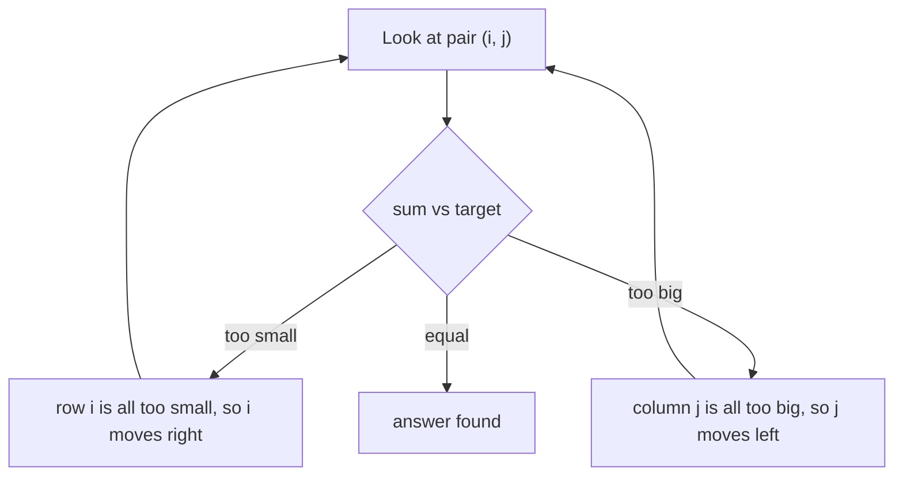
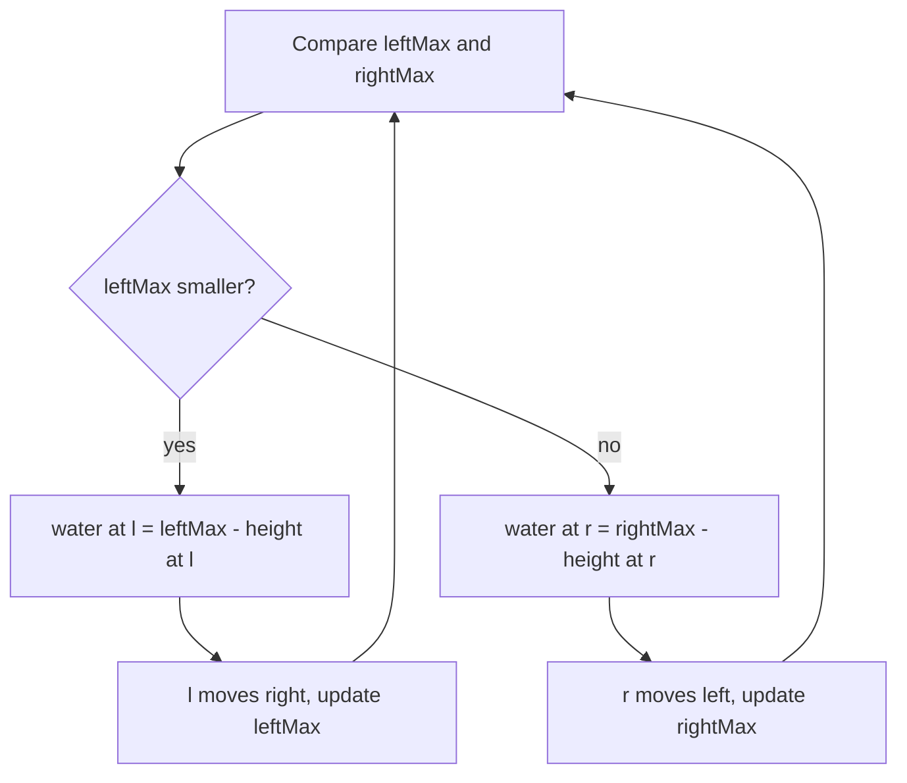
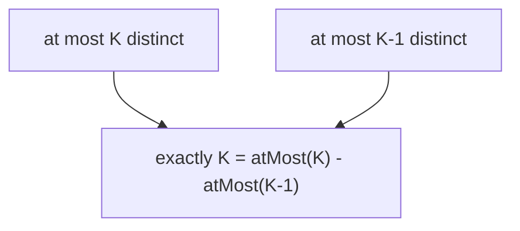
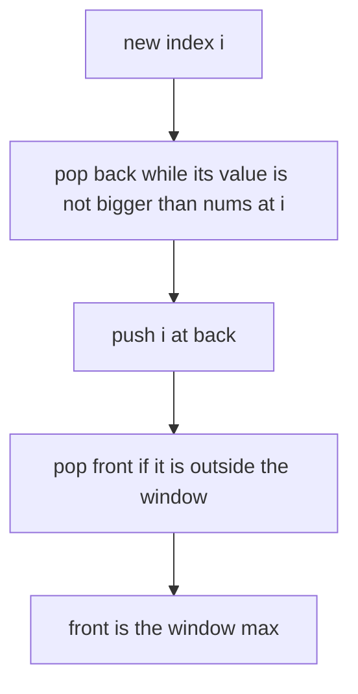

# Two Pointers & Sliding Window

[⬅ Back to index](../README.md)

Covers: two pointers and sliding windows from first principles: why the pointers can move without missing answers, fixed vs variable windows, keeping counts inside the window, and the 'at most K' trick — through the problems interviewers ask most.

---

## Two pointers

### 1. Why are two pointers correct? (the elimination argument)

**📘 Concept**

<details>
<summary>Answer</summary>

**In short:** A two-pointer solution looks at only O(n) pairs out of O(n²), and it is still correct because every time a pointer moves, it moves past a position that **provably cannot be part of a better answer**. The proof is always the same shape: "with the other pointer fixed where it is (or anywhere still reachable), this element can't do better, so throw it away." If you can say that sentence for your problem, two pointers work; if you can't, they probably don't.

#### The search space is a grid

Take Two Sum on a sorted array: find `i < j` with `a[i] + a[j] == target`. Every candidate pair is a cell `(i, j)` in the upper triangle of an n×n grid. Brute force visits every cell — O(n²).

Two pointers start at `i = 0`, `j = n - 1` — the top-right corner of that triangle — and each step deletes a whole **row or column** of the grid:

- If `a[i] + a[j] < target`: `a[j]` is the biggest value `a[i]` can still be paired with. If even that sum is too small, then `a[i]` paired with **any** remaining `j' ≤ j` is too small. Row `i` is dead → `i++`.
- If `a[i] + a[j] > target`: `a[i]` is the smallest partner left for `a[j]`. If even that is too big, column `j` is dead → `j--`.
- If equal: found it.

Each step removes one row or one column, there are n of them, so at most n steps. No cell containing the answer is ever deleted, because we only delete rows/columns we proved are useless. That is the whole argument.



#### The same argument in other problems

| Problem | Which pointer moves | Why the discarded side can't win |
|---|---|---|
| [Two Sum II](#3-two-sum-ii-input-array-is-sorted) | the one that makes the sum move toward target | sorted order: the other pointer is already the extreme partner |
| [Container With Most Water](#5-container-with-most-water) | the **shorter** wall | width only shrinks from here, and height is capped by this short wall — it can never beat the current area |
| [Trapping Rain Water](#6-trapping-rain-water) | the side with the smaller running max | that side's water level is fully decided by its own max |
| Sliding window (variable) | left edge moves when the window is invalid | if `[l, r]` is invalid, every longer window `[l, r']` is also invalid (monotonic condition) |

#### Same-direction pointers (sliding window) use a related argument

For "longest window satisfying X", the invariant is **monotonicity**: if a window is valid, every window inside it is valid; if it's invalid, every window containing it is invalid. So for each right end `r`, the best left end `l(r)` never moves left as `r` grows. That is why `l` only moves forward and the whole scan is O(n) — each index enters the window once and leaves once.

When the condition is **not** monotonic — for example "subarray sum equals K" with negative numbers — shrinking from the left might later become useful again, and the window breaks. That problem needs a prefix sum + hash map instead (see [Problem-Solving Tricks](06-problem-solving-tricks.md)).

#### How to use this in an interview

1. Before coding, say the elimination sentence out loud: "If the left height is smaller, no container using the left wall with any narrower width can be bigger, so I can drop it."
2. Check monotonicity for windows: "Adding an element can only make the window more invalid, and removing one can only make it more valid."
3. If neither holds (unsorted array, negative numbers for sums), reach for hashing, prefix sums or sorting first.

#### Common mistakes

- Using two pointers on an **unsorted** array for Two Sum — the elimination needs sorted order.
- Moving the "wrong" pointer (e.g. the taller wall in Container With Most Water) — the proof breaks and answers are missed.
- Using a sliding window for sums with negative numbers.

#### Follow-ups

- *Can you prove 3Sum is O(n²)?* Fix one element, then the rest is Two Sum II — n × O(n). See [3Sum](#4-3sum).
- *When does a window need a deque or a map?* When the "is it valid / what's the best" question needs more than a counter — see [Sliding Window Maximum](#16-sliding-window-maximum).
- *Template?* See [Reusable Code Templates](05-reusable-templates.md).

</details>

### 2. Valid Palindrome

**🟢 Easy** · ⭐ Product/FAANG favourite (commonly reported at Meta)

<details>
<summary>Answer</summary>

**In short:** Put one pointer at each end, skip characters that aren't letters or digits, compare the two characters case-insensitively, and move both inwards. Any mismatch means "not a palindrome". O(n) time, O(1) extra space — no need to build a cleaned copy of the string.

#### Problem

Given a string, decide whether it reads the same forwards and backwards after lowercasing and ignoring every non-alphanumeric character.

- `"A man, a plan, a canal: Panama"` → `true` (`amanaplanacanalpanama`)
- `"race a car"` → `false`
- `" "` → `true` (empty after cleaning)

#### Clarifying questions & edge cases

- Which characters count? Letters and digits only (ASCII in the LeetCode version). Ask whether Unicode letters matter.
- Empty or all-punctuation string → `true`.
- Digits are compared as-is: `"0P"` → `false`.

#### Brute force

Build a cleaned, lowercased string, reverse it and compare. O(n) time, but O(n) extra space. Perfectly fine as a first answer — the interviewer will then ask for O(1) space.

#### Optimal approach

A palindrome means `s[i] == s[n-1-i]` for every i. Two pointers walk exactly those pairs:

1. `l = 0`, `r = n - 1`.
2. While `l < r`: move `l` right until it points at an alphanumeric char (or meets `r`); same for `r` moving left.
3. Compare `lowercase(s[l])` with `lowercase(s[r])`. Different → `false`. Equal → `l++`, `r--`.
4. If the pointers meet, every pair matched → `true`.

#### Walkthrough

`s = "A b,a"` (indices 0..4: `A`, ` `, `b`, `,`, `a`)

| step | l | r | s[l] | s[r] | action |
|---|---|---|---|---|---|
| 1 | 0 | 4 | A | a | equal (case-insensitive), l=1, r=3 |
| 2 | 1 → 2 | 3 → 2 | b | b | skipped space and comma; now l == r, stop |
| — | | | | | return true |

#### Kotlin

```kotlin
fun isPalindrome(s: String): Boolean {
    var l = 0
    var r = s.length - 1
    while (l < r) {
        // Skip non-alphanumeric characters from both ends.
        while (l < r && !s[l].isLetterOrDigit()) l++
        while (l < r && !s[r].isLetterOrDigit()) r--
        if (s[l].lowercaseChar() != s[r].lowercaseChar()) return false
        l++
        r--
    }
    return true
}
```

#### Complexity

- **Time:** O(n) — each pointer crosses each character at most once.
- **Space:** O(1) — only two indices.

#### Common mistakes

- Forgetting `l < r` inside the skip loops — on `".,"` the pointers run off the string.
- Building the cleaned string with `+=` in a loop (O(n²) in the worst case) — use a `StringBuilder` if you go that route.
- `isLetterOrDigit()` accepts Unicode letters too; for strict ASCII, check ranges `'a'..'z'`, `'A'..'Z'`, `'0'..'9'`.

#### Follow-ups

- **Valid Palindrome II** (delete at most one char): on the first mismatch, check whether `s[l+1..r]` **or** `s[l..r-1]` is a palindrome. Still O(n).
- *Palindrome linked list?* Fast/slow pointers to find the middle, reverse the second half — see [Linked Lists](12-linked-lists.md).
- *Longest palindromic substring?* Expand around centres — see [Tries & String Algorithms](15-tries-string-algorithms.md).

</details>

### 3. Two Sum II (Input Array Is Sorted)

**🟡 Medium**

<details>
<summary>Answer</summary>

**In short:** Because the array is sorted, start with the smallest and largest values; if their sum is too small move the left pointer right (to increase it), if too big move the right pointer left. Each move safely discards one element, so you find the pair in O(n) time and O(1) space — better than the hash-map Two Sum's O(n) space.

#### Problem

Given a 1-indexed array sorted in non-decreasing order and a target, return the 1-based indices `[i, j]` (`i < j`) of the two numbers that add up to the target. Exactly one solution exists; you may not use the same element twice; use only constant extra space.

- `numbers = [2, 7, 11, 15], target = 9` → `[1, 2]`
- `numbers = [-1, 0], target = -1` → `[1, 2]`

#### Clarifying questions & edge cases

- Is a solution guaranteed? (Yes on LeetCode — otherwise return `[-1, -1]` or empty.)
- Duplicates are fine: `[3, 3], 6` → `[1, 2]`.
- Negative numbers are fine — sorted order is all we need.
- 1-based output indices — easy to forget.

#### Brute force

Check every pair — O(n²). Or for each `a[i]`, binary search for `target - a[i]` — O(n log n). Or the classic hash-map Two Sum — O(n) time but O(n) space, which breaks the constant-space requirement.

#### Key insight

With `l` at the smallest remaining value and `r` at the largest:

- `a[l] + a[r] < target` → `a[l]` is too small even with the **largest** partner, so it is useless for every partner. Drop it: `l++`.
- `a[l] + a[r] > target` → `a[r]` is too big even with the **smallest** partner. Drop it: `r--`.

This is the elimination argument from [question 1](#1-why-are-two-pointers-correct-the-elimination-argument): every step removes one candidate without losing the answer.

#### Walkthrough

`numbers = [1, 3, 4, 6, 9]`, `target = 10`

| step | l | r | a[l] + a[r] | action |
|---|---|---|---|---|
| 1 | 0 | 4 | 1 + 9 = 10 | found → return [1, 5] |

A harder one, `target = 7`:

| step | l | r | a[l] + a[r] | action |
|---|---|---|---|---|
| 1 | 0 | 4 | 1 + 9 = 10 | too big → r-- |
| 2 | 0 | 3 | 1 + 6 = 7 | found → return [1, 4] |

#### Kotlin

```kotlin
fun twoSum(numbers: IntArray, target: Int): IntArray {
    var l = 0
    var r = numbers.size - 1
    while (l < r) {
        val sum = numbers[l] + numbers[r]
        when {
            sum == target -> return intArrayOf(l + 1, r + 1) // 1-based
            sum < target -> l++   // need a bigger sum
            else -> r--           // need a smaller sum
        }
    }
    return intArrayOf(-1, -1) // not reached when a solution is guaranteed
}
```

#### Complexity

- **Time:** O(n) — every iteration moves one pointer inwards.
- **Space:** O(1).

#### Common mistakes

- Returning 0-based indices.
- `while (l <= r)` — would let an element pair with itself.
- Overflow: with values near `Int.MAX_VALUE`, use `numbers[l].toLong() + numbers[r]`. (LeetCode's constraints keep it in range, but mention it.)

#### Follow-ups

- *Unsorted input?* Hash map Two Sum, O(n) time/space — see [Arrays, Strings & Hashing](07-arrays-strings-hashing.md). Or sort with indices, then two pointers, O(n log n).
- *Count all pairs with sum < target?* When `a[l] + a[r] < target`, all pairs `(l, l+1..r)` work: add `r - l`, then `l++`.
- *Three numbers?* Fix one, run this on the rest — [3Sum](#4-3sum).

</details>

### 4. 3Sum

**🟡 Medium** · ⭐ Product/FAANG favourite (commonly reported at Meta, Amazon, Google)

<details>
<summary>Answer</summary>

**In short:** Sort the array, fix the first number `a[i]`, and run the sorted Two Sum (two pointers) on the part to its right looking for `-a[i]`. Skip equal values for `i`, and after each found triplet skip equal values for both pointers, so every triplet is reported once. O(n²) time, O(1) extra space (ignoring sort space and output).

#### Problem

Return all **unique** triplets `[a, b, c]` from the array (different indices) with `a + b + c == 0`.

- `[-1, 0, 1, 2, -1, -4]` → `[[-1, -1, 2], [-1, 0, 1]]`
- `[0, 1, 1]` → `[]`
- `[0, 0, 0]` → `[[0, 0, 0]]`

#### Clarifying questions & edge cases

- "Unique" means unique **value** triplets, not index triplets — `[-1, 0, 1]` must appear once even if there are two `-1`s.
- Fewer than 3 elements → empty.
- Many zeros, e.g. `[0, 0, 0, 0]` → exactly one `[0, 0, 0]`.
- Does output order matter? Usually not.

#### Brute force

Three nested loops, put sorted triplets in a set to dedupe — O(n³). A better brute force: for each pair, look up `-(a+b)` in a hash set — O(n²) time but dedupe with a set of triplets is messy and uses O(n) extra space.

#### Key insight

Sorting does two jobs at once:

1. It turns the inner problem into [Two Sum II](#3-two-sum-ii-input-array-is-sorted), which runs in O(n) with two pointers.
2. It puts duplicates next to each other, so you can skip them with a simple `a[k] == a[k-1]` check instead of a set.

Steps:

1. Sort.
2. For each `i` (0..n-3): if `i > 0 && a[i] == a[i-1]`, skip — same first number gives the same triplets. If `a[i] > 0`, stop — three numbers ≥ a positive can't sum to 0.
3. `l = i + 1`, `r = n - 1`. While `l < r`: compare `a[i] + a[l] + a[r]` with 0 and move pointers as in Two Sum II.
4. On a hit: record it, then `l++` while `a[l] == a[l-1]` and `r--` while `a[r] == a[r+1]`, to skip repeated second/third numbers.

#### Walkthrough

Sorted: `[-4, -1, -1, 0, 1, 2]`

| i (a[i]) | l | r | sum | action |
|---|---|---|---|---|
| 0 (-4) | 1 | 5 | -4-1+2 = -3 | too small → l++ |
| | … | 5 | all < 0 | l reaches r, done |
| 1 (-1) | 2 | 5 | -1-1+2 = 0 | **record [-1,-1,2]**, l=3, r=4 |
| | 3 | 4 | -1+0+1 = 0 | **record [-1,0,1]**, l=4, r=3 → stop |
| 2 (-1) | | | | same as a[1] → skip |
| 3 (0) | 4 | 5 | 0+1+2 = 3 | too big → r-- → l == r, done |

#### Kotlin

```kotlin
fun threeSum(nums: IntArray): List<List<Int>> {
    val a = nums.sortedArray()
    val result = mutableListOf<List<Int>>()
    for (i in 0 until a.size - 2) {
        if (a[i] > 0) break                       // smallest is positive: no more zeros possible
        if (i > 0 && a[i] == a[i - 1]) continue   // same first value as before
        var l = i + 1
        var r = a.size - 1
        while (l < r) {
            val sum = a[i] + a[l] + a[r]
            when {
                sum < 0 -> l++
                sum > 0 -> r--
                else -> {
                    result.add(listOf(a[i], a[l], a[r]))
                    l++
                    r--
                    while (l < r && a[l] == a[l - 1]) l++ // skip duplicate second values
                    while (l < r && a[r] == a[r + 1]) r-- // skip duplicate third values
                }
            }
        }
    }
    return result
}
```

#### Swift

```swift
func threeSum(_ nums: [Int]) -> [[Int]] {
    let a = nums.sorted()
    var result: [[Int]] = []
    guard a.count >= 3 else { return result }   // 0..<(count - 2) would trap otherwise
    for i in 0..<(a.count - 2) {
        if a[i] > 0 { break }
        if i > 0 && a[i] == a[i - 1] { continue }
        var l = i + 1, r = a.count - 1
        while l < r {
            let sum = a[i] + a[l] + a[r]
            if sum < 0 {
                l += 1
            } else if sum > 0 {
                r -= 1
            } else {
                result.append([a[i], a[l], a[r]])
                l += 1
                r -= 1
                while l < r && a[l] == a[l - 1] { l += 1 }
                while l < r && a[r] == a[r + 1] { r -= 1 }
            }
        }
    }
    return result
}
```

The `guard` matters in Swift: `0..<(a.count - 2)` with `count < 2` builds a range with a negative upper bound and **crashes**, while Kotlin's `0 until -1` is just empty.

#### Complexity

- **Time:** O(n²) — O(n log n) sort plus n iterations of an O(n) two-pointer scan.
- **Space:** O(1) extra beyond the output (O(n) if you count the sorted copy; sorting in place avoids it).

#### Common mistakes

- Deduping only `i` and not `l`/`r` (or the reverse) → repeated triplets like `[-2, 0, 2]` twice in `[-2, 0, 0, 2, 2]`.
- Skipping duplicates of `i` with `a[i] == a[i+1]` instead of `a[i-1]` — this skips the first occurrence and misses triplets such as `[-1, -1, 2]`.
- Using a `HashSet<List<Int>>` to dedupe — works, but interviewers want the sort-based skip.

#### Follow-ups

- **3Sum Closest:** same loop, track the sum with the smallest `|sum - target|`; no dedupe needed.
- **4Sum / kSum:** add one more outer loop per extra number (with the same skip), giving O(n^(k-1)); watch overflow — use `Long` for the sum.
- **3Sum Smaller (count triplets with sum < target):** when the sum is small, add `r - l` and `l++`.

</details>

### 5. Container With Most Water

**🟡 Medium** · ⭐ Product/FAANG favourite (commonly reported at Amazon, Google)

<details>
<summary>Answer</summary>

**In short:** Start with the widest container (pointers at both ends) and repeatedly move the pointer at the **shorter** wall inwards, tracking the best area. Moving the shorter wall is safe because any container that keeps it is narrower and still capped at its height, so it can never beat what you've just measured. O(n) time, O(1) space.

#### Problem

`height[i]` is a vertical line at x = i. Pick two lines that, with the x-axis, hold the most water. Area = `min(height[i], height[j]) * (j - i)`.

- `[1, 8, 6, 2, 5, 4, 8, 3, 7]` → `49` (lines at index 1 and 8: min(8, 7) × 7)
- `[1, 1]` → `1`

#### Clarifying questions & edge cases

- At least two lines? (Yes on LeetCode.)
- Zero heights are allowed → area 0.
- Lines are thin — no "blocking" by lines in between (that's [Trapping Rain Water](#6-trapping-rain-water), a different problem).

#### Brute force

Try every pair: O(n²). Too slow for n = 10⁵.

#### Key insight

Suppose `height[l] <= height[r]`. Consider any container that uses `l` with some other right wall `r' < r`:

- its width `r' - l` is **smaller** than `r - l`,
- its height is `min(height[l], height[r']) <= height[l]`, so **no taller** than now.

So every remaining container that uses `l` has area ≤ the one we just computed. Line `l` is finished — move it. (Symmetric when the right wall is shorter.) If both walls are equal, moving either is safe: any better container must drop both, because keeping either one caps the height at the same value with less width.

Moving the **taller** wall instead is wrong: the shorter wall still caps the height while width shrinks, so you can only lose — and you skip containers that might have been better.

#### Walkthrough

`height = [1, 8, 6, 2, 5, 4, 8, 3, 7]`

| step | l (h) | r (h) | area | best | move |
|---|---|---|---|---|---|
| 1 | 0 (1) | 8 (7) | 1 × 8 = 8 | 8 | left shorter → l++ |
| 2 | 1 (8) | 8 (7) | 7 × 7 = 49 | 49 | right shorter → r-- |
| 3 | 1 (8) | 7 (3) | 3 × 6 = 18 | 49 | r-- |
| 4 | 1 (8) | 6 (8) | 8 × 5 = 40 | 49 | equal → r-- |
| 5 | 1 (8) | 5 (4) | 4 × 4 = 16 | 49 | r-- |
| … | | | smaller | 49 | until l == r |

#### Kotlin

```kotlin
fun maxArea(height: IntArray): Int {
    var l = 0
    var r = height.size - 1
    var best = 0
    while (l < r) {
        val h = minOf(height[l], height[r])
        best = maxOf(best, h * (r - l))
        // The shorter wall can't be part of any better container: drop it.
        if (height[l] < height[r]) l++ else r--
    }
    return best
}
```

#### Complexity

- **Time:** O(n) — one pointer moves per step.
- **Space:** O(1).

#### Common mistakes

- Moving the taller wall, or moving both pointers each step.
- Confusing it with Trapping Rain Water (sums water over all bars vs. one container).
- Overflow: `10⁴ × 10⁵` = 10⁹ fits in `Int`, but say you've checked the constraints.

#### Follow-ups

- *Can you skip faster?* After moving, you can keep moving while the new wall is not taller than the one you left — same complexity, fewer area computations.
- *Why is this not a greedy guess?* It's the elimination argument — see [question 1](#1-why-are-two-pointers-correct-the-elimination-argument).
- *Trapping water between all bars?* [Trapping Rain Water](#6-trapping-rain-water).

</details>

### 6. Trapping Rain Water

**🔴 Hard** · ⭐ Product/FAANG favourite (commonly reported at Amazon, Google, Meta)

<details>
<summary>Answer</summary>

**In short:** The water above bar i is `min(maxLeft(i), maxRight(i)) - height[i]`. Instead of precomputing both max arrays, walk two pointers inwards while keeping `leftMax` and `rightMax`: whichever side has the smaller max is fully decided (the other side has at least that tall a wall), so add its water and move it. O(n) time, O(1) space.

#### Problem

Given non-negative bar heights of width 1, compute how much rain water is trapped between them.

- `[0, 1, 0, 2, 1, 0, 1, 3, 2, 1, 2, 1]` → `6`
- `[4, 2, 0, 3, 2, 5]` → `9`

#### Clarifying questions & edge cases

- Fewer than 3 bars → 0 (nothing can be held).
- Strictly increasing or decreasing heights → 0.
- Can the answer overflow? `n × maxHeight` = 2·10⁴ × 10⁵ = 2·10⁹ — just over `Int.MAX_VALUE` in theory; use `Long` if unsure (LeetCode's tests fit in `Int`).

#### Brute force

For each bar, scan left for the tallest bar and right for the tallest bar: O(n²).

Better: precompute `maxLeft[i]` and `maxRight[i]` arrays in two passes, then sum `min(maxLeft[i], maxRight[i]) - height[i]`. O(n) time, O(n) space. This is a great stepping stone to say out loud.

#### Key insight

We don't need **both** exact maxes — we need the **smaller** one. Keep:

- `leftMax` = tallest bar in `height[0..l]`
- `rightMax` = tallest bar in `height[r..n-1]`

If `leftMax < rightMax`, then for position `l` the true right max (over `l..n-1`) is **at least** `rightMax`, which is already bigger than `leftMax`. So the water at `l` is exactly `leftMax - height[l]` — the left side is the bottleneck. Add it and move `l`. Otherwise handle `r` symmetrically.



#### Walkthrough

`height = [4, 2, 0, 3, 2, 5]` (update the max first, then add `max - height`)

| step | l | r | leftMax | rightMax | side | water added | total |
|---|---|---|---|---|---|---|---|
| 1 | 0 | 5 | 4 | 5 | left (4 < 5) | 4 - 4 = 0 | 0 |
| 2 | 1 | 5 | 4 | 5 | left | 4 - 2 = 2 | 2 |
| 3 | 2 | 5 | 4 | 5 | left | 4 - 0 = 4 | 6 |
| 4 | 3 | 5 | 4 | 5 | left | 4 - 3 = 1 | 7 |
| 5 | 4 | 5 | 4 | 5 | left | 4 - 2 = 2 | 9 |
| 6 | 5 | 5 | | | l == r | stop | **9** |

#### Kotlin

```kotlin
fun trap(height: IntArray): Int {
    var l = 0
    var r = height.size - 1
    var leftMax = 0
    var rightMax = 0
    var water = 0
    while (l < r) {
        leftMax = maxOf(leftMax, height[l])
        rightMax = maxOf(rightMax, height[r])
        if (leftMax < rightMax) {
            // Left side is the bottleneck: its level is exactly leftMax.
            water += leftMax - height[l]
            l++
        } else {
            water += rightMax - height[r]
            r--
        }
    }
    return water
}
```

Updating the max **before** adding means `max - height` is never negative.

#### Complexity

- **Time:** O(n) — single pass with two pointers.
- **Space:** O(1) (vs O(n) for the prefix-max arrays version).

#### Common mistakes

- Comparing `height[l] < height[r]` but subtracting from the wrong max — pick one consistent rule (comparing heights also works if you update the max on the side you move; comparing maxes is easiest to justify).
- Forgetting that the bars themselves don't hold water — subtract `height[i]`.
- Trying to make it a Container With Most Water variant — here every bar contributes.

#### Follow-ups

- **Monotonic stack version:** process bars left to right, pop shorter bars and fill "layers" between the popped bar's neighbours — O(n) time/space. See [Stacks, Queues & Monotonic Stack](11-stacks-queues-monotonic.md).
- **Trapping Rain Water II (2D grid):** min-heap BFS from the border inwards — the "lowest wall decides" idea in 2D. See [Heaps & Priority Queues](13-heaps-priority-queues.md).
- *Which version to code first?* State the prefix-max arrays version, then optimise to two pointers.

</details>

### 7. Sort Colors (Dutch National Flag)

**🟡 Medium**

<details>
<summary>Answer</summary>

**In short:** Keep three regions with three pointers: `[0, low)` are 0s, `[low, mid)` are 1s, `(high, n-1]` are 2s, and `[mid, high]` is unknown. Look at `a[mid]`: a 0 is swapped to `low` (both advance), a 1 just advances `mid`, a 2 is swapped to `high` (only `high` shrinks, because the swapped-in value is still unknown). One pass, O(n) time, O(1) space.

#### Problem

Sort an array containing only 0, 1 and 2 (red, white, blue) **in place**, without a library sort.

- `[2, 0, 2, 1, 1, 0]` → `[0, 0, 1, 1, 2, 2]`
- `[2, 0, 1]` → `[0, 1, 2]`

#### Clarifying questions & edge cases

- In place, one pass expected (the follow-up on LeetCode).
- Single element or all the same value → unchanged.
- Only values 0/1/2? (Yes.)

#### Brute force

Counting sort: count 0s, 1s, 2s, then overwrite the array. Two passes, O(n) time, O(1) space — correct and a fine first answer. The interviewer will then ask for **one pass**.

#### Key insight

Maintain this invariant at all times:

| range | contents |
|---|---|
| `[0, low)` | all 0 |
| `[low, mid)` | all 1 |
| `[mid, high]` | not looked at yet |
| `(high, n-1]` | all 2 |

Each step shrinks the unknown region by one:

- `a[mid] == 0`: swap with `a[low]`. The value coming from `low` is a 1 (or `low == mid`), so it's already classified — advance **both** `low` and `mid`.
- `a[mid] == 1`: it belongs where it is — `mid++`.
- `a[mid] == 2`: swap with `a[high]`, `high--`. **Don't** advance `mid`: the value swapped in from `high` hasn't been examined.

Stop when `mid > high` (unknown region empty).

#### Walkthrough

`[2, 0, 2, 1, 1, 0]`

| step | array | low | mid | high | action |
|---|---|---|---|---|---|
| 0 | 2 0 2 1 1 0 | 0 | 0 | 5 | a[mid]=2 → swap with high |
| 1 | 0 0 2 1 1 2 | 0 | 0 | 4 | a[mid]=0 → swap with low, low++, mid++ |
| 2 | 0 0 2 1 1 2 | 1 | 1 | 4 | 0 → swap (self), low++, mid++ |
| 3 | 0 0 2 1 1 2 | 2 | 2 | 4 | 2 → swap with high |
| 4 | 0 0 1 1 2 2 | 2 | 2 | 3 | 1 → mid++ |
| 5 | 0 0 1 1 2 2 | 2 | 3 | 3 | 1 → mid++ |
| 6 | | 2 | 4 | 3 | mid > high → done |

#### Kotlin

```kotlin
fun sortColors(nums: IntArray) {
    var low = 0
    var mid = 0
    var high = nums.size - 1
    while (mid <= high) {
        when (nums[mid]) {
            0 -> { nums.swap(low, mid); low++; mid++ }
            1 -> mid++
            else -> { nums.swap(mid, high); high-- } // don't advance mid: new value unseen
        }
    }
}

private fun IntArray.swap(i: Int, j: Int) {
    val t = this[i]; this[i] = this[j]; this[j] = t
}
```

#### Complexity

- **Time:** O(n) — each step either advances `mid` or shrinks `high`, so at most n steps.
- **Space:** O(1).

#### Common mistakes

- Advancing `mid` after swapping with `high` → a 0 swapped in from the right stays in the middle.
- Loop condition `mid < high` instead of `mid <= high` → the last unknown element is never checked.
- Using `high = n` (exclusive) but swapping with `a[high]` — pick inclusive or exclusive and stick to it.

#### Follow-ups

- *Why is this called the Dutch national flag?* Dijkstra's name for the three-colour partition (the flag has three bands).
- *Where else is 3-way partitioning used?* Quicksort with many duplicates (partition into `< pivot`, `== pivot`, `> pivot`) and quickselect — see [Heaps & Priority Queues](13-heaps-priority-queues.md).
- *k colours?* Counting sort in O(n + k), or repeated partitioning.

</details>

## Sliding window

### 8. Best Time to Buy and Sell Stock

**🟢 Easy** · ⭐ Product/FAANG favourite (commonly reported at Amazon, Meta, Microsoft)

<details>
<summary>Answer</summary>

**In short:** Scan once, keeping the lowest price seen so far (the best day to have bought) and, at each day, the profit if you sold today. It's a two-pointer window where the left edge jumps to any new minimum. O(n) time, O(1) space.

#### Problem

`prices[i]` is a stock price on day i. Choose one day to buy and a **later** day to sell to maximise profit; return 0 if no profit is possible.

- `[7, 1, 5, 3, 6, 4]` → `5` (buy at 1, sell at 6)
- `[7, 6, 4, 3, 1]` → `0`

#### Clarifying questions & edge cases

- One transaction only (other versions allow many — see follow-ups).
- Must sell **after** buying — you can't take `max - min` over the whole array.
- Single price or decreasing prices → 0.

#### Brute force

Every pair `i < j`, profit `prices[j] - prices[i]` — O(n²).

#### Key insight

For a fixed selling day `j`, the best buying day is the **minimum** of `prices[0..j-1]`. So keep a running minimum: when you see a new lower price, any future sale is better off buying there (the left pointer jumps to it). Otherwise compute today's profit against the minimum.

In window terms: `buy` is the left pointer, `sell` the right pointer. When `prices[sell] < prices[buy]`, the window is "bad" and the left edge jumps straight to `sell` — no older buying day can ever beat a lower price that comes later.

#### Walkthrough

`[7, 1, 5, 3, 6, 4]`

| day | price | minSoFar | profit today | best |
|---|---|---|---|---|
| 0 | 7 | 7 | 0 | 0 |
| 1 | 1 | 1 | 0 | 0 |
| 2 | 5 | 1 | 4 | 4 |
| 3 | 3 | 1 | 2 | 4 |
| 4 | 6 | 1 | 5 | **5** |
| 5 | 4 | 1 | 3 | 5 |

#### Kotlin

```kotlin
fun maxProfit(prices: IntArray): Int {
    var minPrice = Int.MAX_VALUE
    var best = 0
    for (price in prices) {
        if (price < minPrice) {
            minPrice = price            // better day to have bought
        } else {
            best = maxOf(best, price - minPrice) // sell today
        }
    }
    return best
}
```

#### Complexity

- **Time:** O(n) — one pass.
- **Space:** O(1).

#### Common mistakes

- Returning `max - min` of the whole array (ignores the order of days).
- Initialising `best` to a negative number — the answer is never below 0.
- Initialising `minPrice` with `prices[0]` without checking for an empty array.

#### Follow-ups

- **Stock II (unlimited transactions):** add every positive day-to-day difference — greedy, O(n).
- **With cooldown / fee / at most k transactions:** state-machine DP — see [Dynamic Programming](19-dynamic-programming.md).
- *Connection to Kadane?* Profit is the maximum subarray sum of daily differences — see [Problem-Solving Tricks](06-problem-solving-tricks.md).

</details>

### 9. Longest Substring Without Repeating Characters

**🟡 Medium** · ⭐ Product/FAANG favourite (commonly reported at Amazon, Google, Meta, Microsoft)

<details>
<summary>Answer</summary>

**In short:** Grow a window `[left, right]` one character at a time and keep the window free of duplicates. Store the last index where each character was seen; when `s[right]` was last seen **inside** the window, jump `left` to just after that index. The answer is the largest window size seen. O(n) time, O(min(n, alphabet)) space.

#### Problem

Return the length of the longest substring (contiguous) with no repeated characters.

- `"abcabcbb"` → `3` (`"abc"`)
- `"bbbbb"` → `1`
- `"pwwkew"` → `3` (`"wke"`; `"pwke"` is a subsequence, not a substring)

#### Clarifying questions & edge cases

- Empty string → 0.
- Character set: lowercase only, ASCII, or any Unicode? (Decides `IntArray(128)` vs a map.)
- Spaces and digits count as characters.
- Return the length or the substring itself? (Track `bestStart` too if needed.)

#### Brute force

Check every substring and test it for duplicates with a set — O(n³), or O(n²) if you extend each start until the first repeat.

#### Key insight

The condition "no duplicates" is **monotonic**: if `[l, r]` has a duplicate, every bigger window containing it does too; if it has none, every smaller window inside it has none. So for each `right`, the best `left` never moves backwards — the classic variable-size sliding window (see [question 1](#1-why-are-two-pointers-correct-the-elimination-argument)).

Two ways to shrink:

1. **Set + shrink loop:** while `s[right]` is in the set, remove `s[left]` and `left++`.
2. **Last-seen index (jump):** if `s[right]` was last seen at `prev >= left`, set `left = prev + 1` in one step.

Both are O(n). The jump version is shorter. The important detail is `prev >= left`: an old occurrence **before** the window must be ignored.

#### Walkthrough

`s = "abba"` (this input catches the classic bug)

| right | char | lastSeen before | left | window | best |
|---|---|---|---|---|---|
| 0 | a | — | 0 | "a" | 1 |
| 1 | b | — | 0 | "ab" | 2 |
| 2 | b | b at 1 (≥ 0) | 2 | "b" | 2 |
| 3 | a | a at 0 (**< 2**, ignore) | 2 | "ba" | 2 |

Without the `prev >= left` check, step 3 would move `left` **back** to 1 and report "bba" (length 3) — wrong.

#### Kotlin

```kotlin
fun lengthOfLongestSubstring(s: String): Int {
    val lastSeen = HashMap<Char, Int>()
    var left = 0
    var best = 0
    for (right in s.indices) {
        val c = s[right]
        val prev = lastSeen[c]
        // Only a repeat inside the current window forces left to move.
        if (prev != null && prev >= left) left = prev + 1
        lastSeen[c] = right
        best = maxOf(best, right - left + 1)
    }
    return best
}
```

For ASCII input, `IntArray(128) { -1 }` instead of the map is faster and avoids boxing.

#### Swift

```swift
func lengthOfLongestSubstring(_ s: String) -> Int {
    let chars = Array(s)              // Swift String isn't integer-indexable
    var lastSeen: [Character: Int] = [:]
    var left = 0, best = 0
    for right in 0..<chars.count {
        let c = chars[right]
        if let prev = lastSeen[c], prev >= left {
            left = prev + 1
        }
        lastSeen[c] = right
        best = max(best, right - left + 1)
    }
    return best
}
```

`Array(s)` gives `[Character]` in O(n) once; indexing a `String` with `s.index(s.startIndex, offsetBy: i)` inside the loop would make each access O(n) and the solution O(n²). For pure ASCII you can use `Array(s.utf8)` (`[UInt8]`) and a fixed-size `[Int](repeating: -1, count: 128)`.

#### Complexity

- **Time:** O(n) — `right` visits each character once; `left` only moves forward.
- **Space:** O(min(n, k)) where k is the alphabet size (O(1) for a fixed 128-entry array).

#### Common mistakes

- Missing `prev >= left` → `left` jumps backwards (fails `"abba"`).
- Computing the length as `right - left` (off by one).
- Clearing the whole set when a duplicate appears and restarting — misses windows like `"dvdf"` → 3 (`"vdf"`).

#### Follow-ups

- *At most K distinct characters?* Same window with a count map — see [question 14](#14-fruit-into-baskets-longest-substring-with-at-most-k-distinct-characters).
- *Return the substring?* Record `bestStart` when `best` improves, return `s.substring(bestStart, bestStart + best)`.
- *Streaming input?* The jump version only needs the last-seen map and the current position, so it works online.

</details>

### 10. Longest Repeating Character Replacement

**🟡 Medium**

<details>
<summary>Answer</summary>

**In short:** A window can be turned into one repeated letter if `windowLength - countOfMostFrequentLetter <= k` (replace everything else). Slide a window, keep letter counts and the highest count `maxFreq`; when the window needs more than k replacements, move `left` by one. `maxFreq` never needs to decrease, because the answer only improves when `maxFreq` grows. O(n) time, O(26) space.

#### Problem

Given an uppercase string `s` and integer `k`, you may change at most k characters to any letter. Return the length of the longest substring of one repeated letter you can get.

- `s = "ABAB", k = 2` → `4` (change both A's or both B's)
- `s = "AABABBA", k = 1` → `4` (`"AABA"` → `"AAAA"`)

#### Clarifying questions & edge cases

- Alphabet: uppercase A–Z only (so a 26-int array works).
- `k >= n` → answer is n.
- `k = 0` → longest run of one letter.

#### Brute force

For every substring, count letters and check `length - maxCount <= k`: O(n²·26) or O(n²) with incremental counting.

#### Key insight

1. **Window validity:** the cheapest way to make a window uniform is to keep its most frequent letter and replace the rest. Replacements needed = `len - maxFreq`. Valid iff that is ≤ k.
2. **Monotonic:** a sub-window of a valid window is valid; so a sliding window works.
3. **The `maxFreq` trick:** when `left` moves, the true max count inside the window might drop, and recomputing it costs 26. But we don't need to: we only care about windows **longer than the best so far**, and a longer valid window requires `len - maxFreq <= k` with a **larger** `maxFreq` than we've ever seen. So a stale (too-high) `maxFreq` can only let a window of the current best size survive — it never produces a wrong larger answer. The window therefore never shrinks: each step it either grows by one or slides by one.

#### Walkthrough

`s = "AABABBA"`, `k = 1`

| right | char | counts (A,B) | maxFreq | window | len - maxFreq | action | best |
|---|---|---|---|---|---|---|---|
| 0 | A | 1,0 | 1 | A | 0 | ok | 1 |
| 1 | A | 2,0 | 2 | AA | 0 | ok | 2 |
| 2 | B | 2,1 | 2 | AAB | 1 | ok | 3 |
| 3 | A | 3,1 | 3 | AABA | 1 | ok | 4 |
| 4 | B | 3,2 | 3 | AABAB | 2 | slide: drop A | 4 |
| 5 | B | 2,3 | 3 | ABABB | 2 | slide: drop A | 4 |
| 6 | A | 2,3 | 3 | BABBA | 2 | slide: drop B | 4 |

The window size stays at 4 after step 3 — the answer is **4**.

#### Kotlin

```kotlin
fun characterReplacement(s: String, k: Int): Int {
    val count = IntArray(26)
    var left = 0
    var maxFreq = 0   // highest single-letter count seen in any window so far
    var best = 0
    for (right in s.indices) {
        count[s[right] - 'A']++
        maxFreq = maxOf(maxFreq, count[s[right] - 'A'])
        // Too many letters to replace: slide the window (size stays the same).
        if (right - left + 1 - maxFreq > k) {
            count[s[left] - 'A']--
            left++
        }
        best = maxOf(best, right - left + 1)
    }
    return best
}
```

`if` is enough instead of `while`: the window grows by one per step, so it can be at most one over the limit. A `while` is also correct and easier to defend if you recompute `maxFreq` honestly.

#### Complexity

- **Time:** O(n) — each character enters and leaves the window once.
- **Space:** O(1) — 26 counters.

#### Common mistakes

- Using the number of **distinct** letters instead of `len - maxFreq`.
- Trying to "decrease" `maxFreq` when shrinking without recomputing it from all 26 counts (either recompute, O(26n), or leave it stale as explained).
- Using `s[i] - 'a'` on uppercase input → negative index.

#### Follow-ups

- *Binary-only version?* That's [Max Consecutive Ones III](#11-max-consecutive-ones-iii): count the zeros in the window.
- *Prove the stale `maxFreq` is safe?* Answer only increases when a window of length `best + 1` has `len - maxFreq <= k`, which needs a real count of `maxFreq` in that window — the stale value only blocks growth, it never fakes it.
- *Unicode or lowercase?* Use a map or a bigger array; the logic is the same.

</details>

### 11. Max Consecutive Ones III

**🟡 Medium**

<details>
<summary>Answer</summary>

**In short:** Rephrase "flip at most k zeros" as "find the longest window containing at most k zeros". Grow the window to the right, count zeros inside it, and move `left` forward while there are more than k. O(n) time, O(1) space.

#### Problem

Given a binary array `nums` and an integer `k`, return the maximum number of consecutive 1s if you can flip at most k 0s.

- `nums = [1,1,1,0,0,0,1,1,1,1,0], k = 2` → `6` (flip the zeros at indices 4 and 5; indices 4..9 become six 1s)
- `nums = [0,0,1,1], k = 0` → `2`

#### Clarifying questions & edge cases

- `k = 0` → longest run of 1s.
- `k >= number of zeros` → whole array.
- All zeros → `min(k, n)`.

#### Brute force

For each start, extend right counting zeros until it exceeds k — O(n²).

#### Key insight

You never actually flip anything. Any window with `zeros <= k` can be made all-ones, so the problem is just "longest subarray with at most k zeros". That condition is monotonic (adding elements can only add zeros), so a variable window works: expand `right`, and while `zeros > k`, move `left` (decrementing `zeros` if a 0 leaves).

#### Walkthrough

`nums = [1,1,1,0,0,0,1,1,1,1,0]`, `k = 2`

| right | nums[right] | zeros | left after shrink | window len | best |
|---|---|---|---|---|---|
| 0–2 | 1 | 0 | 0 | 3 | 3 |
| 3 | 0 | 1 | 0 | 4 | 4 |
| 4 | 0 | 2 | 0 | 5 | 5 |
| 5 | 0 | 3 → 2 | 4 (dropped 1,1,1,0) | 2 | 5 |
| 6 | 1 | 2 | 4 | 3 | 5 |
| 7 | 1 | 2 | 4 | 4 | 5 |
| 8 | 1 | 2 | 4 | 5 | 5 |
| 9 | 1 | 2 | 4 | 6 | **6** |
| 10 | 0 | 3 → 2 | 5 | 6 | 6 |

#### Kotlin

```kotlin
fun longestOnes(nums: IntArray, k: Int): Int {
    var left = 0
    var zeros = 0
    var best = 0
    for (right in nums.indices) {
        if (nums[right] == 0) zeros++
        while (zeros > k) {             // too many flips needed: shrink
            if (nums[left] == 0) zeros--
            left++
        }
        best = maxOf(best, right - left + 1)
    }
    return best
}
```

#### Complexity

- **Time:** O(n) — `left` and `right` each move at most n times.
- **Space:** O(1).

#### Common mistakes

- Actually modifying the array to "flip" zeros.
- Decrementing `zeros` when the element leaving the window is a 1.
- Resetting `left = right + 1` on the (k+1)-th zero — loses windows that should keep earlier ones.

#### Follow-ups

- **Max Consecutive Ones II** (k = 1, streaming input that can't be stored): keep the index of the last zero instead of the array — O(1) memory.
- **Longest Subarray of 1's After Deleting One Element:** same window with k = 1, answer `best - 1` (you must delete one element).
- *Generalisation?* [Longest Repeating Character Replacement](#10-longest-repeating-character-replacement) — "zeros" becomes "letters that aren't the most frequent one".

</details>

### 12. Permutation in String

**🟡 Medium**

<details>
<summary>Answer</summary>

**In short:** A permutation of `s1` is a substring of `s2` with exactly the same letter counts and the same length. Slide a **fixed-size** window of length `|s1|` over `s2`, add the new character and remove the one that falls out, and compare the window's 26 counts with `s1`'s counts. O(26·n) time (or O(n) with a "matches" counter), O(1) space.

#### Problem

Return `true` if `s2` contains a permutation of `s1` as a contiguous substring.

- `s1 = "ab", s2 = "eidbaooo"` → `true` (`"ba"`)
- `s1 = "ab", s2 = "eidboaoo"` → `false`

#### Clarifying questions & edge cases

- Lowercase English letters only? (Yes → `IntArray(26)`.)
- `s1` longer than `s2` → `false` immediately.
- Duplicate letters in `s1` (`"aab"`) — counts, not sets, handle this.

#### Brute force

Generate all permutations of `s1` (O(m!)) and search for each — hopeless. Slightly better: sort every substring of length m and compare with sorted `s1` — O(n·m log m).

#### Key insight

"Permutation of `s1`" = "same multiset of letters" = "same 26 counts". Every candidate substring has the same length m, so this is a **fixed-size window**: when `right` advances, exactly one character enters and one leaves (`s2[right - m]`). Updating counts is O(1) per step; comparing two 26-length arrays is O(26).

The **matches counter** optimisation keeps `matches` = number of letters (out of 26) whose window count equals the target count, and updates it only for the two letters that changed. Then the check is `matches == 26`, O(1) per step.

#### Walkthrough

`s1 = "ab"` (need: a=1, b=1), `s2 = "eidbaooo"`, window size 2

| right | added | removed | window | counts match? |
|---|---|---|---|---|
| 1 | i | — | "ei" | no |
| 2 | d | e | "id" | no |
| 3 | b | i | "db" | no |
| 4 | a | d | "ba" | **yes → true** |

#### Kotlin

```kotlin
fun checkInclusion(s1: String, s2: String): Boolean {
    val m = s1.length
    if (m > s2.length) return false
    val need = IntArray(26)
    val window = IntArray(26)
    for (c in s1) need[c - 'a']++
    for (right in s2.indices) {
        window[s2[right] - 'a']++                       // character enters
        if (right >= m) window[s2[right - m] - 'a']--   // character leaves
        if (right >= m - 1 && window.contentEquals(need)) return true
    }
    return false
}
```

#### Complexity

- **Time:** O(26·n) = O(n) — one pass with a constant-size comparison (O(n + m) overall including counting `s1`).
- **Space:** O(1) — two arrays of 26.

#### Common mistakes

- Using a variable-size window here — the length is fixed at m, which keeps the code simple.
- Comparing before the window has reached size m (`right >= m - 1` guard).
- Using `HashMap` equality with zero-count entries left behind (`{a=0}` ≠ `{}`) — remove keys at zero or use arrays.

#### Follow-ups

- **Find All Anagrams in a String:** same loop, collect `right - m + 1` every time counts match instead of returning.
- *Large or Unicode alphabet?* Use a map plus a counter of how many distinct characters are fully matched — the same bookkeeping as [Minimum Window Substring](#13-minimum-window-substring).
- *Minimum window containing s1's letters but not necessarily contiguous permutation?* That's Minimum Window Substring — variable-size window.

</details>

### 13. Minimum Window Substring

**🔴 Hard** · ⭐ Product/FAANG favourite (commonly reported at Meta, Amazon, Google)

<details>
<summary>Answer</summary>

**In short:** Expand `right` until the window covers every character of `t` (with multiplicity), then shrink `left` as far as possible while it still covers, recording the smallest window; repeat. Track a `need` count per character and a single `missing` counter, so "does it cover?" is an O(1) check. O(|s| + |t|) time, O(alphabet) space.

#### Problem

Given strings `s` and `t`, return the shortest substring of `s` that contains every character of `t`, including duplicates. Return `""` if none exists (the answer is unique on LeetCode).

- `s = "ADOBECODEBANC", t = "ABC"` → `"BANC"`
- `s = "a", t = "aa"` → `""` (need two a's)

#### Clarifying questions & edge cases

- Duplicates in `t` must be matched by count (`t = "AAB"` needs two A's).
- Case-sensitive? (Yes — upper and lower case are different.)
- `t` longer than `s` → `""`.
- Character set: English letters (an `IntArray(128)` works); ask if Unicode is possible.

#### Brute force

Check every substring of `s` for coverage — O(n²) substrings × O(n) or O(alphabet) check = O(n²·k) at best. Too slow for n = 10⁵.

#### Key insight

This is the "shortest window" flavour of the variable window:

- **Longest-window problems** shrink while the window is **invalid**, and record after shrinking.
- **Shortest-window problems** shrink while the window is **valid**, and record **inside** the shrink loop (each step is a smaller valid window).

Coverage is monotonic: if `[l, r]` covers `t`, any larger window does too. So for each `right`, once covering, push `left` forward until just before it stops covering.

Bookkeeping trick: `need[c]` starts as the count of `c` in `t`. When `c` enters the window, `need[c]--`; when it leaves, `need[c]++`. A **negative** `need[c]` means surplus copies. `missing` = how many characters of `t` (with multiplicity) are still uncovered:

- on enter: if `need[c] > 0` before decrementing, it was useful → `missing--`
- on leave: if `need[c] > 0` after incrementing, we just lost a needed copy → `missing++`

The window covers `t` exactly when `missing == 0`.

#### Walkthrough

`s = "ADOBECODEBANC"`, `t = "ABC"` (key moments only)

| right | char | missing | shrink loop | best |
|---|---|---|---|---|
| 0–4 | A D O B E | 1 (C still needed) | — | — |
| 5 | C | 0 | record "ADOBEC" (6); drop A → missing 1, left = 1 | ADOBEC |
| 6–9 | O D E B | 1 | — (extra B goes negative) | ADOBEC |
| 10 | A | 0 | windows from left 1..5 all ≥ 6; dropping C at 5 → missing 1, left = 6 | ADOBEC |
| 11 | N | 1 | — | ADOBEC |
| 12 | C | 0 | "ODEBANC"(7), "DEBANC"(6), record "EBANC"(5), record "BANC"(4); drop B → missing 1 | **BANC** |

#### Kotlin

```kotlin
fun minWindow(s: String, t: String): String {
    if (t.isEmpty() || t.length > s.length) return ""
    val need = IntArray(128)
    for (c in t) need[c.code]++
    var missing = t.length          // characters of t not yet covered
    var left = 0
    var bestStart = 0
    var bestLen = Int.MAX_VALUE
    for (right in s.indices) {
        val c = s[right].code
        if (need[c] > 0) missing--  // this copy was actually needed
        need[c]--
        while (missing == 0) {      // valid: try to shrink
            if (right - left + 1 < bestLen) {
                bestLen = right - left + 1
                bestStart = left
            }
            val l = s[left].code
            need[l]++
            if (need[l] > 0) missing++ // removed a needed copy: window breaks
            left++
        }
    }
    return if (bestLen == Int.MAX_VALUE) "" else s.substring(bestStart, bestStart + bestLen)
}
```

#### Swift

```swift
func minWindow(_ s: String, _ t: String) -> String {
    // Input is ASCII letters, so UTF-8 bytes give O(1) indexing.
    let sb = Array(s.utf8), tb = Array(t.utf8)
    if tb.isEmpty || tb.count > sb.count { return "" }
    var need = [Int](repeating: 0, count: 128)
    for b in tb { need[Int(b)] += 1 }
    var missing = tb.count
    var left = 0, bestStart = 0, bestLen = Int.max
    for right in 0..<sb.count {
        let c = Int(sb[right])
        if need[c] > 0 { missing -= 1 }
        need[c] -= 1
        while missing == 0 {
            if right - left + 1 < bestLen {
                bestLen = right - left + 1
                bestStart = left
            }
            let l = Int(sb[left])
            need[l] += 1
            if need[l] > 0 { missing += 1 }
            left += 1
        }
    }
    if bestLen == Int.max { return "" }
    return String(decoding: sb[bestStart..<(bestStart + bestLen)], as: UTF8.self)
}
```

Working on `utf8` bytes avoids Swift's non-integer `String.Index` and is safe here because the input is ASCII. For arbitrary Unicode, use `Array(s)` (`[Character]`) with a `[Character: Int]` dictionary instead, and build the answer with `String(chars[start..<end])`.

#### Complexity

- **Time:** O(|s| + |t|) — each index of `s` enters and leaves the window at most once.
- **Space:** O(1) for a fixed 128-entry array (O(k) for a map over k distinct characters).

#### Common mistakes

- Recording the best window **after** the shrink loop (by then the window is invalid).
- Checking coverage by comparing whole maps every step — O(k) per step; the `missing` counter makes it O(1).
- Treating `t` as a set and ignoring duplicate counts.
- Building substrings inside the loop — store `bestStart`/`bestLen` and cut once at the end.

#### Follow-ups

- *Fixed-length version (window must be exactly a permutation)?* [Permutation in String](#12-permutation-in-string).
- *Minimum window subsequence (order matters)?* Different problem — two-pointer forward/backward scan or DP; see [Dynamic Programming](19-dynamic-programming.md).
- *Smallest subarray with sum ≥ target (positive numbers)?* Same "shrink while valid" shape with a running sum.

</details>

### 14. Fruit Into Baskets (Longest Substring with At Most K Distinct Characters)

**🟡 Medium**

<details>
<summary>Answer</summary>

**In short:** "Two baskets, one fruit type each" means "longest subarray with at most 2 distinct values". Keep a count map of the window; when it has more than K keys, shrink from the left, removing keys whose count reaches zero. The same code with K as a parameter solves "Longest Substring with At Most K Distinct Characters". O(n) time, O(K) space.

#### Problem

`fruits[i]` is the fruit type of tree i in a row. Starting anywhere, you pick one fruit from each tree moving right, and stop when you'd need a third type (you have two baskets, each holding one type). Return the maximum number of fruits.

- `[1, 2, 1]` → `3`
- `[0, 1, 2, 2]` → `3` (`[1, 2, 2]`)
- `[1, 2, 3, 2, 2]` → `4` (`[2, 3, 2, 2]`)

The general form: longest substring/subarray with **at most K distinct** values, e.g. `s = "eceba", k = 2` → `3` (`"ece"`).

#### Clarifying questions & edge cases

- `k = 0` → 0.
- Fewer than K distinct values in the whole array → whole length.
- Value range: small and non-negative (array counts) or arbitrary (map)?

#### Brute force

For each start, extend right with a set until a (K+1)-th type appears — O(n²).

#### Key insight

"At most K distinct" is monotonic: removing elements never increases the number of distinct values. So it's the standard longest-window template. The only care needed is in the shrink step: decrement the count of the element leaving, and **delete the key when it reaches 0** so `map.size` really is the number of distinct values.

#### Walkthrough

`fruits = [1, 2, 3, 2, 2]`, K = 2

| right | add | counts | distinct | shrink | window | best |
|---|---|---|---|---|---|---|
| 0 | 1 | {1:1} | 1 | — | [1] | 1 |
| 1 | 2 | {1:1, 2:1} | 2 | — | [1,2] | 2 |
| 2 | 3 | {1:1, 2:1, 3:1} | 3 | drop 1 → {2:1, 3:1} | [2,3] | 2 |
| 3 | 2 | {2:2, 3:1} | 2 | — | [2,3,2] | 3 |
| 4 | 2 | {2:3, 3:1} | 2 | — | [2,3,2,2] | **4** |

#### Kotlin

```kotlin
fun totalFruit(fruits: IntArray): Int = longestWithAtMostKDistinct(fruits, 2)

fun longestWithAtMostKDistinct(a: IntArray, k: Int): Int {
    val count = HashMap<Int, Int>()
    var left = 0
    var best = 0
    for (right in a.indices) {
        count[a[right]] = (count[a[right]] ?: 0) + 1
        while (count.size > k) {           // too many types: shrink
            val out = a[left]
            val c = count.getValue(out) - 1
            if (c == 0) count.remove(out) else count[out] = c
            left++
        }
        best = maxOf(best, right - left + 1)
    }
    return best
}
```

For strings, the same code works over `s[i]` with a `HashMap<Char, Int>` (or `IntArray(128)` plus a `distinct` counter that changes when a count goes 0 → 1 or 1 → 0).

#### Complexity

- **Time:** O(n) — each element enters and leaves once; map operations are O(1) average.
- **Space:** O(K) — at most K + 1 keys in the map.

#### Common mistakes

- Not removing zero-count keys, so `count.size` overstates distinct values.
- Resetting the window entirely when a third type appears (you must keep the most recent run, e.g. `[2]` before the `3`).
- Mixing up "at most K" with "exactly K" — see the next question for exactly K.

#### Follow-ups

- **Exactly K distinct (count the subarrays):** [Subarrays with K Different Integers](#15-subarrays-with-k-different-integers).
- *K = 2 in O(1) space?* Track the last two types and the length of the trailing run of the last type.
- *Count (not longest) subarrays with at most K distinct?* Add `right - left + 1` at each step instead of taking a max.

</details>

### 15. Subarrays with K Different Integers

**🔴 Hard**

<details>
<summary>Answer</summary>

**In short:** "Exactly K distinct" isn't monotonic, so a single window can't count it directly. But "at most K distinct" is: count those subarrays with a sliding window (each `right` adds `right - left + 1` subarrays ending there), then `exactly(K) = atMost(K) - atMost(K - 1)`. O(n) time, O(n) space for counts.

#### Problem

Return the number of contiguous subarrays of `nums` that contain **exactly** K distinct integers.

- `nums = [1, 2, 1, 2, 3], k = 2` → `7` (`[1,2]`, `[2,1]`, `[1,2]`, `[2,3]`, `[1,2,1]`, `[2,1,2]`, `[1,2,1,2]`)
- `nums = [1, 2, 1, 3, 4], k = 3` → `3`

#### Clarifying questions & edge cases

- Values are in `1..n` on LeetCode → a count array of size n + 1 works.
- K larger than the number of distinct values → 0.
- Result can be up to n(n+1)/2 ≈ 2·10⁸ for n = 2·10⁴ — fits in `Int`, but larger n would need `Long`.

#### Brute force

For each start, extend right with a set and count the ends where the set size is exactly K — O(n²).

#### Key insight

Why a direct window fails: for a fixed `right`, the valid lefts for "exactly K" form a **range** `[l1, l2]`, not "everything from l onward", so one left pointer can't describe it.

"At most K" is easier: for a fixed `right`, every left from the smallest valid `left` up to `right` works, so the number of valid subarrays ending at `right` is `right - left + 1`. Summing over all `right` counts every "at most K" subarray exactly once.

Then subtract: subarrays with at most K distinct minus those with at most K−1 distinct leaves exactly those with K.



This "exactly = atMost(K) − atMost(K−1)" trick also solves **Binary Subarrays With Sum** and **Count Number of Nice Subarrays**.

#### Walkthrough

`nums = [1, 2, 1, 2, 3]`

atMost(2):

| right | window after shrink | adds (right - left + 1) | running |
|---|---|---|---|
| 0 | [1] | 1 | 1 |
| 1 | [1,2] | 2 | 3 |
| 2 | [1,2,1] | 3 | 6 |
| 3 | [1,2,1,2] | 4 | 10 |
| 4 | [2,3] (dropped 1,2,1) | 2 | **12** |

atMost(1): windows `[1]`, `[2]`, `[1]`, `[2]`, `[3]` → 1 each → **5**.

Exactly 2 = 12 − 5 = **7**. ✓

#### Kotlin

```kotlin
fun subarraysWithKDistinct(nums: IntArray, k: Int): Int =
    atMostKDistinct(nums, k) - atMostKDistinct(nums, k - 1)

private fun atMostKDistinct(nums: IntArray, k: Int): Int {
    if (k <= 0) return 0
    val count = IntArray(nums.size + 1)   // values are in 1..n
    var distinct = 0
    var left = 0
    var total = 0
    for (right in nums.indices) {
        if (count[nums[right]]++ == 0) distinct++
        while (distinct > k) {
            if (--count[nums[left]] == 0) distinct--
            left++
        }
        total += right - left + 1           // subarrays ending at right
    }
    return total
}
```

If values aren't bounded by n, use a `HashMap<Int, Int>` exactly as in [question 14](#14-fruit-into-baskets-longest-substring-with-at-most-k-distinct-characters).

#### Complexity

- **Time:** O(n) — two linear passes.
- **Space:** O(n) for the count array (O(K) with a map).

#### Common mistakes

- Trying to count "exactly K" with one window and missing subarrays whose left can move further.
- Adding 1 per step instead of `right - left + 1`.
- Forgetting the `k <= 0` base case (atMost(0) is 0 for non-empty arrays).

#### Follow-ups

- *One-pass version?* Keep two lefts (`leftFar` for at most K, `leftNear` for at most K−1) and add `leftNear - leftFar` per step — same idea, one loop.
- **Binary Subarrays With Sum / Count Nice Subarrays:** same `atMost(goal) - atMost(goal - 1)` trick with a running sum (valid because all values are non-negative). With negatives, use prefix sum + hash map — see [Problem-Solving Tricks](06-problem-solving-tricks.md).
- *Longest instead of count?* [Fruit Into Baskets](#14-fruit-into-baskets-longest-substring-with-at-most-k-distinct-characters).

</details>

### 16. Sliding Window Maximum

**🔴 Hard** · ⭐ Product/FAANG favourite (commonly reported at Amazon, Google)

<details>
<summary>Answer</summary>

**In short:** Keep a deque of **indices** whose values are in decreasing order (a monotonic queue). For each new element, pop smaller-or-equal values from the back (they can never be a maximum again), push the new index, pop the front if it has left the window, and read the window max from the front. Every index is pushed and popped at most once: O(n) time, O(k) space.

#### Problem

Given `nums` and window size `k`, return the maximum of each window of size k as it slides from left to right.

- `nums = [1, 3, -1, -3, 5, 3, 6, 7], k = 3` → `[3, 3, 5, 5, 6, 7]`
- `nums = [1], k = 1` → `[1]`

#### Clarifying questions & edge cases

- `1 <= k <= n` (if `k > n`, ask what to return).
- Duplicates and negative values are allowed.
- Output size is `n - k + 1`.

#### Brute force

Scan each window: O(n·k). A max-heap of `(value, index)` with lazy removal of out-of-window tops gives O(n log n) — a good intermediate answer.

#### Key insight

If `nums[j] >= nums[i]` with `j > i`, then `i` can **never** be the maximum of any future window: `j` is at least as big and stays in the window longer. So `i` is useless the moment `j` arrives — drop it.

After dropping all such useless indices, the remaining ones have strictly **decreasing** values from front to back, and the front is the maximum of the current window. The front only needs removing when it falls out of the window (`index <= i - k`).



#### Walkthrough

`nums = [1, 3, -1, -3, 5, 3, 6, 7]`, `k = 3` (deque shows values; it stores their indices)

| i | nums[i] | deque after (values) | window | max |
|---|---|---|---|---|
| 0 | 1 | [1] | — | — |
| 1 | 3 | [3] (popped 1) | — | — |
| 2 | -1 | [3, -1] | [1,3,-1] | 3 |
| 3 | -3 | [3, -1, -3] | [3,-1,-3] | 3 |
| 4 | 5 | [5] (popped -3, -1, 3) | [-1,-3,5] | 5 |
| 5 | 3 | [5, 3] | [-3,5,3] | 5 |
| 6 | 6 | [6] (popped 3, 5) | [5,3,6] | 6 |
| 7 | 7 | [7] (popped 6) | [3,6,7] | 7 |

#### Kotlin

```kotlin
fun maxSlidingWindow(nums: IntArray, k: Int): IntArray {
    val result = IntArray(nums.size - k + 1)
    val deque = ArrayDeque<Int>()   // indices; values decreasing front to back
    for (i in nums.indices) {
        // Front index has slid out of the window.
        if (deque.isNotEmpty() && deque.first() <= i - k) deque.removeFirst()
        // Smaller (or equal) values behind i can never be a max again.
        while (deque.isNotEmpty() && nums[deque.last()] <= nums[i]) deque.removeLast()
        deque.addLast(i)
        if (i >= k - 1) result[i - k + 1] = nums[deque.first()]
    }
    return result
}
```

In Swift there's no built-in deque: use an array of indices plus a `head` integer for the front (`head += 1` instead of `removeFirst()`, which is O(n) on `Array`), and `popLast()` for the back. See [Kotlin & Swift for Coding Interviews](03-kotlin-swift-for-interviews.md).

#### Complexity

- **Time:** O(n) — each index is added once and removed at most once (amortised O(1) per step).
- **Space:** O(k) for the deque, plus O(n - k + 1) for the output.

#### Common mistakes

- Storing values instead of indices — you then can't tell when the front has left the window.
- Popping only strictly smaller values: works too, but keeps duplicates around; either is correct if the front check uses indices.
- Reading the max before the first full window (`i >= k - 1` guard).
- Using `removeFirst()` on a Swift `Array` inside the loop — O(n) each, O(n·k) total.

#### Follow-ups

- *Sliding window minimum?* Same deque with values increasing (pop back while `>=`).
- *Shortest Subarray with Sum at Least K (negatives allowed)?* Monotonic deque over prefix sums — the same "drop dominated indices" idea.
- *How does this relate to the monotonic stack?* It's a monotonic stack that can also remove from the front — see [Stacks, Queues & Monotonic Stack](11-stacks-queues-monotonic.md).

</details>

---

[⬅ Previous: Arrays, Strings & Hashing](07-arrays-strings-hashing.md) · [⬅ Back to index](../README.md) · [Next: Prefix Sums, Intervals & Sweep Line ➡](09-prefix-sums-intervals.md)
