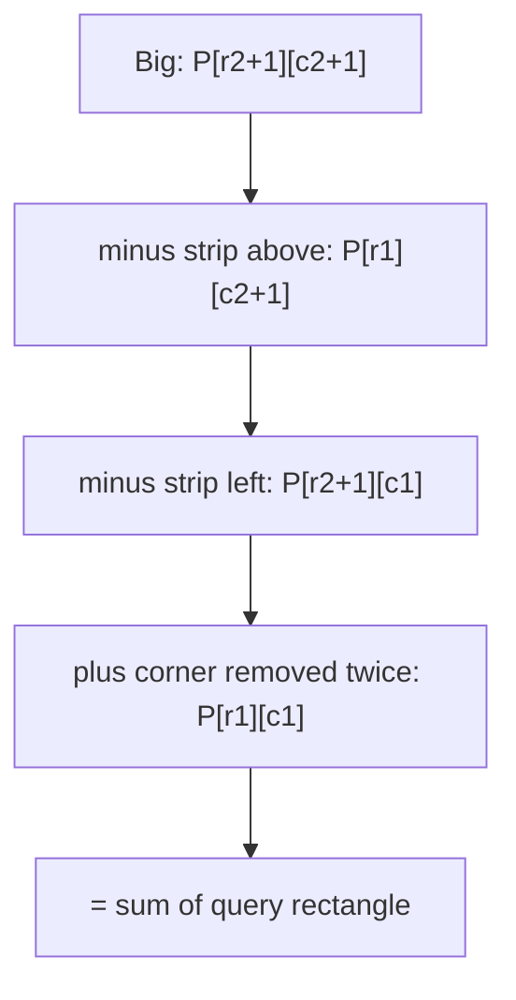
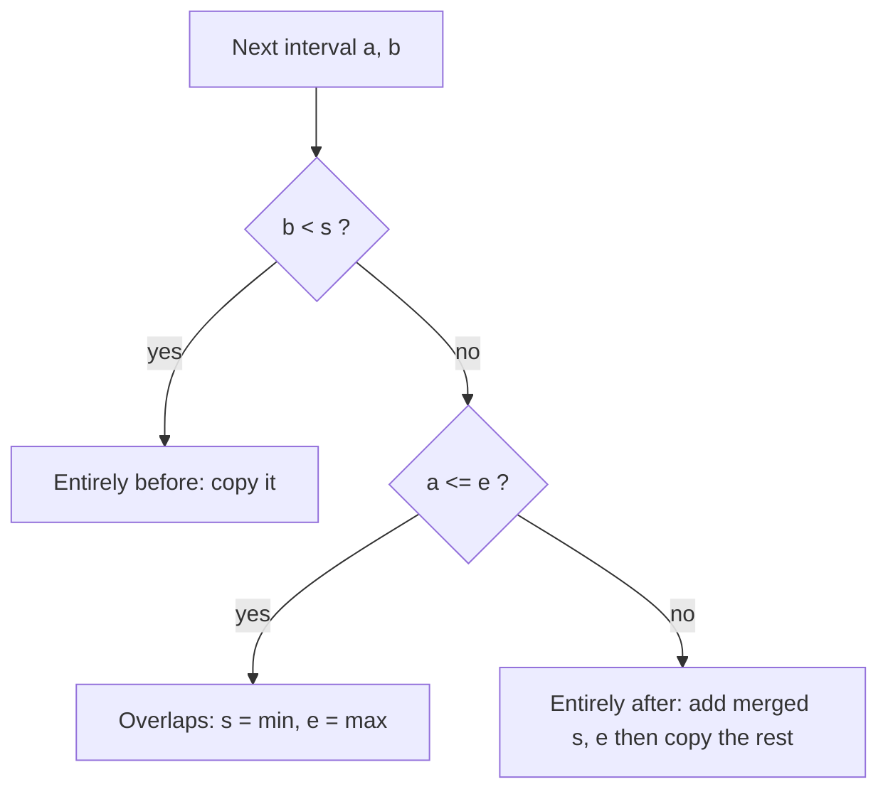
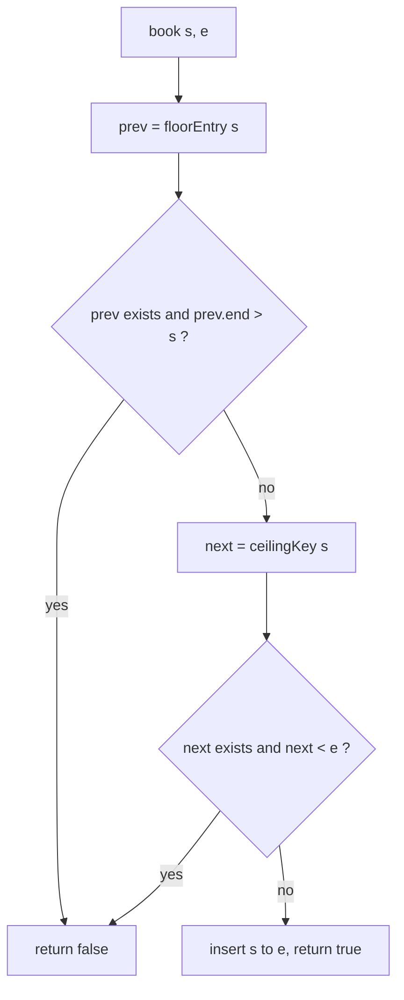

# Prefix Sums, Intervals & Sweep Line

[⬅ Back to index](../README.md)

Covers: prefix sums for fast range queries (1D and 2D) and interval problems solved by sorting and sweeping, with the edge cases (touching intervals, inclusive vs exclusive ends) that trip people up.

---

## Prefix sums

### 1. Range Sum Query - Immutable

**🟢 Easy** · ⭐ Product/FAANG favourite

<details>
<summary>Answer</summary>

**In short:** Precompute `prefix[i]` = sum of the first `i` elements (with `prefix[0] = 0`). The sum of `nums[l..r]` is then `prefix[r + 1] - prefix[l]` — one subtraction. O(n) to build, O(1) per query, O(n) space. This one idea (a range is the difference of two prefixes) powers every other prefix-sum problem in this file.

#### Problem

Design a class built from an integer array that answers many queries `sumRange(left, right)` — the sum of the elements between `left` and `right`, both inclusive. The array never changes.

- `nums = [-2, 0, 3, -5, 2, -1]`
- `sumRange(0, 2)` → `1`, `sumRange(2, 5)` → `-1`, `sumRange(0, 5)` → `-3`

#### Clarifying questions & edge cases

- How many queries? (Up to ~10⁴ on LeetCode — the point is that queries are many, so preprocessing pays off.)
- Is the array ever updated? If yes, a prefix array is the wrong tool (see follow-ups).
- Can the sum overflow `Int`? With large values or long arrays, store prefixes as `Long`.
- Are indices inclusive on both ends? Yes here — this is what decides the `r + 1`.

#### Brute force

Loop from `left` to `right` on every query: O(n) per query, O(n·q) total. With 10⁴ queries on a 10⁴-element array that is 10⁸ operations — too slow, and wasteful because the same partial sums are recomputed again and again.

#### Key insight

Sums over ranges are **differences of sums over prefixes**:

```
sum(l..r) = (nums[0] + … + nums[r]) - (nums[0] + … + nums[l-1])
          = prefix[r + 1]           - prefix[l]
```

Using an array one longer than `nums`, where `prefix[i]` covers the first `i` elements (a half-open range `[0, i)`), removes the special case for `l = 0`: `prefix[0] = 0` is "the sum of nothing". This shifted-by-one layout is the habit to build — it avoids `if (l == 0)` branches in every prefix-sum problem.

Prefix sums work for any operation that has an **inverse**: sums (subtract), XOR (XOR again), counts. They do **not** work directly for min/max, which have no inverse — those need a sparse table or a segment tree.

#### Walkthrough

`nums = [-2, 0, 3, -5, 2, -1]`

| i | 0 | 1 | 2 | 3 | 4 | 5 | 6 |
|---|---|---|---|---|---|---|---|
| nums[i - 1] | — | -2 | 0 | 3 | -5 | 2 | -1 |
| prefix[i] | 0 | -2 | -2 | 1 | -4 | -2 | -3 |

- `sumRange(0, 2)` = `prefix[3] - prefix[0]` = `1 - 0` = **1**
- `sumRange(2, 5)` = `prefix[6] - prefix[2]` = `-3 - (-2)` = **-1**
- `sumRange(0, 5)` = `prefix[6] - prefix[0]` = **-3**

#### Kotlin

```kotlin
class NumArray(nums: IntArray) {
    // prefix[i] = sum of nums[0 until i]; prefix[0] = 0 means "empty prefix"
    private val prefix = LongArray(nums.size + 1)

    init {
        for (i in nums.indices) prefix[i + 1] = prefix[i] + nums[i]
    }

    fun sumRange(left: Int, right: Int): Int =
        (prefix[right + 1] - prefix[left]).toInt() // inclusive right -> right + 1
}
```

Using `Long` costs nothing and removes any overflow worry while building; the final answer fits in `Int` under LeetCode's constraints.

#### Complexity

- **Time:** O(n) to build, O(1) per query.
- **Space:** O(n) for the prefix array.

#### Common mistakes

- Off-by-one: writing `prefix[right] - prefix[left]` (drops `nums[right]`) or `prefix[right] - prefix[left - 1]` with a same-length array (crashes for `left = 0`).
- Recomputing the prefix inside `sumRange` — the whole point is to build it once.
- Building the prefix in `Int` when values are large.

#### Follow-ups

- *The array gets point updates (Range Sum Query - Mutable)?* Updating a prefix array costs O(n). Use a Fenwick (binary indexed) tree or a segment tree: O(log n) for both update and query.
- *Count subarrays with sum K?* Prefix sums plus a hash map of prefixes seen so far — solved in [Problem-Solving Tricks](06-problem-solving-tricks.md) (Subarray Sum Equals K).
- *Many range **updates**, then read the array?* The inverse idea: a difference array — see [Car Pooling](#10-car-pooling) below and [Problem-Solving Tricks](06-problem-solving-tricks.md).

</details>

### 2. Range Sum Query 2D - Immutable

**🟡 Medium** · ⭐ Product/FAANG favourite

<details>
<summary>Answer</summary>

**In short:** Build a 2D prefix table where `P[i][j]` is the sum of the rectangle from `(0, 0)` to `(i-1, j-1)`. Any sub-rectangle sum is then four lookups by inclusion-exclusion: `P[r2+1][c2+1] - P[r1][c2+1] - P[r2+1][c1] + P[r1][c1]`. O(m·n) to build, O(1) per query.

#### Problem

Given an `m × n` matrix, answer many queries `sumRegion(row1, col1, row2, col2)`: the sum of the rectangle with top-left `(row1, col1)` and bottom-right `(row2, col2)`, inclusive. The matrix never changes.

- `matrix = [[1,2,3],[4,5,6],[7,8,9]]`, `sumRegion(1, 1, 2, 2)` → `5 + 6 + 8 + 9 = 28`

#### Clarifying questions & edge cases

- Many queries, immutable matrix? (Yes — otherwise see follow-ups.)
- Empty matrix / zero columns — guard the constructor.
- Overflow: large matrices of large values → use `Long` prefixes.
- Inclusive corners on both ends (yes).

#### Brute force

Sum the rectangle cell by cell: O(m·n) per query. A middle ground is a 1D prefix per row, which makes each query O(rows in the rectangle). The 2D table gets it to O(1).

#### Key insight

Think of `P[i][j]` as "everything above and to the left". To build it, add the cell to the region above and the region to the left — but the top-left corner region was then counted twice, so subtract it once:

```
P[i+1][j+1] = matrix[i][j] + P[i][j+1] + P[i+1][j] - P[i][j]
```

The query is the same inclusion-exclusion in reverse. Start with the big rectangle to the bottom-right corner, cut off the strip above the query and the strip to its left — the top-left corner block was cut twice, so add it back:



As in 1D, the extra row and column of zeros (size `(m+1) × (n+1)`) means no special cases for `row1 = 0` or `col1 = 0`.

#### Walkthrough

`matrix = [[1,2,3],[4,5,6],[7,8,9]]` gives this `P` (row 0 and column 0 are the zero padding):

| P | j=0 | j=1 | j=2 | j=3 |
|---|---|---|---|---|
| **i=0** | 0 | 0 | 0 | 0 |
| **i=1** | 0 | 1 | 3 | 6 |
| **i=2** | 0 | 5 | 12 | 21 |
| **i=3** | 0 | 12 | 27 | 45 |

Check one build step: `P[2][2] = matrix[1][1] + P[1][2] + P[2][1] - P[1][1] = 5 + 3 + 5 - 1 = 12` (= 1+2+4+5 ✓).

Query `sumRegion(1, 1, 2, 2)`: `P[3][3] - P[1][3] - P[3][1] + P[1][1] = 45 - 6 - 12 + 1 = 28` ✓.

#### Kotlin

```kotlin
class NumMatrix(matrix: Array<IntArray>) {
    private val rows = matrix.size
    private val cols = if (rows == 0) 0 else matrix[0].size
    // p[i][j] = sum of matrix[0 until i][0 until j]
    private val p = Array(rows + 1) { LongArray(cols + 1) }

    init {
        for (i in 0 until rows) {
            for (j in 0 until cols) {
                // cell + above + left - (top-left, counted twice)
                p[i + 1][j + 1] = matrix[i][j] + p[i][j + 1] + p[i + 1][j] - p[i][j]
            }
        }
    }

    fun sumRegion(row1: Int, col1: Int, row2: Int, col2: Int): Int =
        (p[row2 + 1][col2 + 1] - p[row1][col2 + 1] - p[row2 + 1][col1] + p[row1][col1]).toInt()
}
```

#### Complexity

- **Time:** O(m·n) to build, O(1) per query.
- **Space:** O(m·n) for the table.

#### Common mistakes

- Forgetting the `- P[i][j]` (build) or `+ P[r1][c1]` (query) — the double-counted corner.
- Mixing up which index gets `+1`: only the **bottom-right** corner (`r2`, `c2`) is shifted, because it is inclusive; the top-left (`r1`, `c1`) indexes "everything strictly above/left".
- Swapping rows and columns in the table dimensions on non-square matrices — test with a 2 × 3 matrix.

#### Follow-ups

- *Matrix with updates?* 2D Fenwick tree — O(log m · log n) per update and query.
- *Count sub-matrices that sum to a target?* Fix a pair of rows (O(m²)), collapse the columns between them into a 1D array of column sums, then run the 1D "subarray sum equals K" hash-map trick from [Problem-Solving Tricks](06-problem-solving-tricks.md): O(m²·n).
- *Maximal Square / largest rectangle of 1s?* Those are DP and stack problems — see [Dynamic Programming](19-dynamic-programming.md) and [Stacks, Queues & Monotonic Stack](11-stacks-queues-monotonic.md).

</details>

### 3. Continuous Subarray Sum

**🟡 Medium** · ⭐ Product/FAANG favourite (commonly reported at Meta)

<details>
<summary>Answer</summary>

**In short:** A subarray's sum is a multiple of `k` exactly when the two prefix sums around it have the **same remainder mod k**. Scan once, keep a map from remainder to the **earliest** index where it appeared (seeded with remainder 0 at index -1), and return true when a remainder repeats at least 2 positions later. O(n) time, O(min(n, k)) space.

#### Problem

Given an integer array and an integer `k`, return `true` if there is a contiguous subarray of **length at least 2** whose sum is a multiple of `k` (0 counts as a multiple of `k`).

- `nums = [23, 2, 4, 6, 7], k = 6` → `true` (`[2, 4]` sums to 6)
- `nums = [23, 2, 6, 4, 7], k = 13` → `false`
- `nums = [5, 0, 0], k = 3` → `true` (`[0, 0]` sums to 0)

#### Clarifying questions & edge cases

- Can values or `k` be negative or zero? On LeetCode `nums[i] ≥ 0` and `k ≥ 1`. If negatives are allowed, normalise remainders (see common mistakes).
- Length ≥ 2 — a single element that is a multiple of `k` does **not** count: `[6], k = 6` → `false`.
- Two zeros in a row always work (`0` is a multiple of every `k`).
- Overflow: values up to 10⁹ — keep the running remainder in `Long`, or reduce before adding.

#### Brute force

Try every subarray of length ≥ 2, keeping a running sum per start: O(n²). Fine for small inputs, too slow for n = 10⁵.

#### Key insight

Let `prefix[i]` be the sum of the first `i` elements. The subarray `nums[j..i-1]` has sum `prefix[i] - prefix[j]`, and

```
prefix[i] - prefix[j] ≡ 0 (mod k)   ⇔   prefix[i] mod k == prefix[j] mod k
```

So the question becomes: *do two prefix positions at least 2 apart share a remainder?* Walk through the array keeping the running remainder and a map `remainder → first index where we saw it`:

- Seed `0 → -1`: the empty prefix has remainder 0. This lets a subarray starting at index 0 be found.
- If the current remainder is new, record the current index.
- If it was seen at index `j` and `i - j ≥ 2`, the subarray `j+1..i` works.
- Never overwrite an existing entry — the **earliest** index gives the longest subarray, which is what makes the length-2 check pass whenever any valid pair exists.

This is the same "prefix + hash map" pattern as Subarray Sum Equals K in [Problem-Solving Tricks](06-problem-solving-tricks.md), with "equal remainder" in place of "difference equals K".

#### Walkthrough

`nums = [23, 2, 4, 6, 7], k = 6`, map starts as `{0: -1}`

| i | nums[i] | running sum mod 6 | seen before? | action |
|---|---|---|---|---|
| 0 | 23 | 5 | no | map[5] = 0 |
| 1 | 2 | (5 + 2) mod 6 = 1 | no | map[1] = 1 |
| 2 | 4 | (1 + 4) mod 6 = 5 | yes, at 0 | 2 - 0 = 2 ≥ 2 → **true** (subarray `[2, 4]`) |

Why keep the earliest index: in `[0, 0]` (any `k`) the remainder 0 is seen at -1 (seed), then at 0 — distance 1, not enough; at index 1, distance from -1 is 2 → true. If we had overwritten map[0] with 0, index 1 would only be distance 1 away and we would wrongly return false.

#### Kotlin

```kotlin
fun checkSubarraySum(nums: IntArray, k: Int): Boolean {
    val firstIndex = HashMap<Int, Int>()
    firstIndex[0] = -1                     // empty prefix has remainder 0
    var remainder = 0L
    for (i in nums.indices) {
        remainder = (remainder + nums[i]) % k // Long: remainder + 1e9 can exceed Int
        val r = remainder.toInt()
        val j = firstIndex[r]
        if (j == null) {
            firstIndex[r] = i                 // keep only the earliest index
        } else if (i - j >= 2) {
            return true
        }
    }
    return false
}
```

#### Complexity

- **Time:** O(n) — one pass, O(1) average per map operation.
- **Space:** O(min(n, k)) — at most `k` distinct remainders. (An `IntArray(k)` works when `k` is small, but `k` can be up to 2³¹ - 1, so a map is safer.)

#### Common mistakes

- Overwriting the stored index with the latest one — breaks the length check (see walkthrough).
- Forgetting the `0 → -1` seed — misses subarrays that start at index 0, like `[2, 4], k = 6`.
- Checking `i - j >= 1` (allows length-1 subarrays).
- With negative numbers, `%` in Kotlin/Swift can return a negative remainder; normalise with `((x % k) + k) % k` so `-1` and `k-1` match.

#### Follow-ups

- *Count the subarrays whose sum is divisible by k (Subarray Sums Divisible by K)?* Same remainders, but keep a **count** per remainder and add `count[r]` at each step (with normalised remainders, since that problem has negatives).
- *Return the longest such subarray?* Keep earliest indices and track the max `i - j`.
- *What if `k` could be 0?* Then "multiple of 0" means sum exactly 0 — use the raw prefix sum as the key instead of the remainder.

</details>

### 4. Contiguous Array

**🟡 Medium** · ⭐ Product/FAANG favourite

<details>
<summary>Answer</summary>

**In short:** Replace every 0 with -1. A subarray has equally many 0s and 1s exactly when its sum (the "balance") is 0, i.e. when two prefix balances are equal. Keep the first index of each balance in a map (seeded with balance 0 at index -1); at each index the longest balanced subarray ending there is `i - firstIndex[balance]`. O(n) time and space.

#### Problem

Given a binary array, return the length of the longest contiguous subarray with an equal number of 0s and 1s.

- `[0, 1]` → `2`
- `[0, 1, 0]` → `2`
- `[0, 0, 1, 0, 0, 0, 1, 1]` → `6` (`[1, 0, 0, 0, 1, 1]`)

#### Clarifying questions & edge cases

- Only 0s and 1s? (Yes.)
- No balanced subarray (all 0s or all 1s) → `0`.
- Return the length, not the subarray.
- n up to 10⁵ → O(n²) is too slow.

#### Brute force

For every start, extend to the right counting zeros and ones, and record the longest point where they are equal: O(n²) time, O(1) space.

#### Key insight

"Equal number of 0s and 1s" is awkward to track; a **sum of zero** is easy. Map `0 → -1` and `1 → +1` and keep a running balance. The subarray `j+1..i` is balanced exactly when `balance[i] == balance[j]` (it went up and back down by the same amount).

To make it the **longest**, pair each index with the **earliest** index that had the same balance. So:

- Map `balance → first index seen`, seeded with `0 → -1` (the empty prefix).
- At index `i`: if the balance has been seen, candidate length = `i - first[balance]`; otherwise store `i`.

Because the balance always lies in `[-n, n]`, you can replace the map with an `IntArray(2n + 1)` offset by `n` — faster and a nice point to mention.

#### Walkthrough

`nums = [0, 0, 1, 0, 0, 0, 1, 1]`, first = `{0: -1}`

| i | nums[i] | balance | first index of balance | length | best |
|---|---|---|---|---|---|
| 0 | 0 | -1 | new → store 0 | — | 0 |
| 1 | 0 | -2 | new → store 1 | — | 0 |
| 2 | 1 | -1 | 0 | 2 - 0 = 2 | 2 |
| 3 | 0 | -2 | 1 | 3 - 1 = 2 | 2 |
| 4 | 0 | -3 | new → store 4 | — | 2 |
| 5 | 0 | -4 | new → store 5 | — | 2 |
| 6 | 1 | -3 | 4 | 6 - 4 = 2 | 2 |
| 7 | 1 | -2 | 1 | 7 - 1 = **6** | **6** |

At `i = 7` the balance returns to -2, first seen at index 1, so indices 2..7 are balanced.

#### Kotlin

```kotlin
fun findMaxLength(nums: IntArray): Int {
    val n = nums.size
    // firstIndex[balance + n] = first index where that balance appeared; -2 = "not seen"
    val firstIndex = IntArray(2 * n + 1) { -2 }
    firstIndex[n] = -1                       // balance 0 before any element
    var balance = 0
    var best = 0
    for (i in 0 until n) {
        balance += if (nums[i] == 1) 1 else -1
        val slot = balance + n
        if (firstIndex[slot] == -2) {
            firstIndex[slot] = i             // keep the earliest occurrence
        } else {
            best = maxOf(best, i - firstIndex[slot])
        }
    }
    return best
}
```

#### Complexity

- **Time:** O(n) — one pass.
- **Space:** O(n) for the first-index array (or map).

#### Common mistakes

- Treating 0 as 0 instead of -1 — then "sum zero" means "all zeros", not "balanced".
- Updating the stored index on every visit (gives shortest, not longest).
- Missing the `0 → -1` seed — `[0, 1]` would return 0.
- Using `-1` as the "not seen" marker in the array version — `-1` is a real stored value (the seed), hence `-2` above.

#### Follow-ups

- *Count balanced subarrays instead of the longest?* Store **counts** per balance and add `count[balance]` at each step — the Subarray Sum Equals K pattern from [Problem-Solving Tricks](06-problem-solving-tricks.md).
- *Longest subarray where 1s outnumber 0s?* (Longest Well-Performing Interval.) Need the earliest index with balance `current - 1`; works because balance changes by ±1.
- *Three symbols (e.g. a/b/c equal counts)?* Use the pair of differences `(countA - countB, countB - countC)` as the map key.

</details>

## Intervals

### 5. Merge Intervals

**🟡 Medium** · ⭐ Product/FAANG favourite (commonly reported at Meta, Google, Amazon)

<details>
<summary>Answer</summary>

**In short:** Sort the intervals by start. Then every interval that overlaps the current merged block must come right after it, so one left-to-right sweep suffices: if the next start is `<=` the current block's end, extend the end to `max(end, next.end)`; otherwise close the block and start a new one. O(n log n) time for the sort, O(n) for the output.

#### Problem

Given a list of intervals `[start, end]`, merge all overlapping ones and return the non-overlapping intervals that cover the same points.

- `[[1,3],[2,6],[8,10],[15,18]]` → `[[1,6],[8,10],[15,18]]`
- `[[1,4],[4,5]]` → `[[1,5]]` (touching counts as overlapping)
- `[[1,4],[2,3]]` → `[[1,4]]` (one interval inside another)

#### Clarifying questions & edge cases

- **Do touching intervals merge?** `[1,4]` and `[4,5]` — on LeetCode yes (closed intervals). This single choice decides `<=` vs `<`. Always ask.
- Is the input sorted? Don't assume — sort it.
- Containment: `[1,10]` followed by `[2,3]` — the end must be `max`, not the later end.
- Empty input or a single interval → return as is.
- May I modify the input? (Copy if unsure.)

#### Brute force

Repeatedly look for any pair of overlapping intervals, merge them, and start again until no pair overlaps: O(n²) per pass, up to O(n³) overall. Or build a graph with an edge between overlapping intervals and take connected components: O(n²).

#### Key insight

After sorting by start, take the current merged block `[s, e]`. The next interval `[a, b]` has `a ≥ s`. Either:

- `a <= e` → it overlaps (or touches) the block, so the block grows to `[s, max(e, b)]`.
- `a > e` → it starts after the block ends. Every later interval starts at `≥ a > e` too, so **nothing later can overlap this block** — the block is final.

That second point is why sorting turns a pairwise problem into a single sweep: once a gap appears, the block can be closed for good.

#### Walkthrough

Sorted input: `[[1,3],[2,6],[8,10],[9,9],[15,18]]`

| next interval | current block | compare | action | result so far |
|---|---|---|---|---|
| [1,3] | — | — | start block | [[1,3]] |
| [2,6] | [1,3] | 2 <= 3 | extend end to max(3,6)=6 | [[1,6]] |
| [8,10] | [1,6] | 8 > 6 | close, new block | [[1,6],[8,10]] |
| [9,9] | [8,10] | 9 <= 10 | end stays max(10,9)=10 | [[1,6],[8,10]] |
| [15,18] | [8,10] | 15 > 10 | close, new block | [[1,6],[8,10],[15,18]] |

The `[9,9]` row shows why `max` matters: writing `end = 9` would shrink the block.

#### Kotlin

```kotlin
fun merge(intervals: Array<IntArray>): Array<IntArray> {
    val sorted = intervals.sortedBy { it[0] }       // sort by start
    val merged = mutableListOf<IntArray>()
    for (interval in sorted) {
        val last = merged.lastOrNull()
        if (last != null && interval[0] <= last[1]) {
            last[1] = maxOf(last[1], interval[1])  // overlap or touch: grow the block
        } else {
            merged.add(intArrayOf(interval[0], interval[1])) // copy, don't alias the input
        }
    }
    return merged.toTypedArray()
}
```

#### Swift

```swift
func merge(_ intervals: [[Int]]) -> [[Int]] {
    let sorted = intervals.sorted { $0[0] < $1[0] }
    var merged: [[Int]] = []
    for interval in sorted {
        if let last = merged.last, interval[0] <= last[1] {
            // `last` is a copy (value type) — write through the array index
            merged[merged.count - 1][1] = max(last[1], interval[1])
        } else {
            merged.append(interval)
        }
    }
    return merged
}
```

In Swift, arrays are value types: `var last = merged.last!; last[1] = …` changes a **copy** and the result silently stays wrong. Writing through `merged[merged.count - 1]` updates the stored element. In Kotlin the opposite risk exists — `IntArray` is a reference, so appending the input interval itself and then mutating it would change the caller's array; hence the copy.

#### Complexity

- **Time:** O(n log n) — the sort dominates; the sweep is O(n).
- **Space:** O(n) for the sorted copy and output (O(log n) extra if you sort in place and don't count the output).

#### Common mistakes

- `last[1] = interval[1]` instead of `max` — breaks on contained intervals.
- Using `<` when touching intervals should merge (or `<=` when they shouldn't) — clarify first.
- Forgetting to sort, or sorting by end.
- Comparator `a[0] - b[0]` overflows for values near `Int.MIN_VALUE`/`MAX_VALUE`; `sortedBy`/`compareBy` don't.

#### Follow-ups

- *Intervals arrive one at a time (a stream) and you must keep them merged?* Keep a sorted map start → end (`TreeMap`) and merge with neighbours on insert — O(log n) plus the merged ones. See [My Calendar I](#12-my-calendar-i) for the floor/ceiling technique.
- *Input already sorted and you add one interval?* That is [Insert Interval](#6-insert-interval) — O(n), no sort.
- *Total length covered by the union?* Merge, then sum `end - start` of each block.

</details>

### 6. Insert Interval

**🟡 Medium** · ⭐ Product/FAANG favourite (commonly reported at Google)

<details>
<summary>Answer</summary>

**In short:** The list is already sorted and non-overlapping, so do it in three linear phases: copy every interval that ends before the new one starts; absorb every interval that overlaps the new one (expanding it with `min` start and `max` end); copy the rest. O(n) time, O(n) for the output — no sort needed.

#### Problem

Given non-overlapping intervals sorted by start and one `newInterval`, insert it so the list stays sorted and non-overlapping (merge where needed).

- `intervals = [[1,3],[6,9]], newInterval = [2,5]` → `[[1,5],[6,9]]`
- `intervals = [[1,2],[3,5],[6,7],[8,10],[12,16]], newInterval = [4,8]` → `[[1,2],[3,10],[12,16]]`

#### Clarifying questions & edge cases

- Empty list → `[newInterval]`.
- New interval before everything / after everything / between two without touching.
- Touching counts as overlap (`[1,2]` + `[2,3]` → `[1,3]`), as in Merge Intervals.
- New interval swallowing all of them.
- Return a new list or modify in place? (New list is simpler and still O(n).)

#### Brute force

Append the new interval and run [Merge Intervals](#5-merge-intervals): O(n log n). Correct, and a reasonable first answer — but it ignores that the input is already sorted. Inserting into the right position first (binary search) and then merging gets you to O(n) too, but the three-phase scan is simpler.

#### Key insight

Relative to `newInterval = [s, e]`, every existing interval `[a, b]` falls into exactly one of three groups, and because the list is sorted, the groups appear **in order**:



1. **Before:** `b < s` — ends before the new one starts. Copy.
2. **Overlapping:** `a <= e` (and not before) — fold it into the new interval: `s = min(s, a)`, `e = max(e, b)`.
3. **After:** `a > e`. Emit the (possibly grown) new interval once, then copy everything else.

The strict `<` in phase 1 and `<=` in phase 2 make touching intervals merge.

#### Walkthrough

`intervals = [[1,2],[3,5],[6,7],[8,10],[12,16]]`, `new = [4,8]`

| i | interval | test | phase | new interval | output |
|---|---|---|---|---|---|
| 0 | [1,2] | 2 < 4 | before | [4,8] | [1,2] |
| 1 | [3,5] | 5 ≥ 4, 3 <= 8 | overlap | [3,8] | [1,2] |
| 2 | [6,7] | 6 <= 8 | overlap | [3,8] | [1,2] |
| 3 | [8,10] | 8 <= 8 | overlap | [3,10] | [1,2] |
| 4 | [12,16] | 12 > 10 | after | emit [3,10] | [1,2], [3,10], [12,16] |

#### Kotlin

```kotlin
fun insert(intervals: Array<IntArray>, newInterval: IntArray): Array<IntArray> {
    val result = mutableListOf<IntArray>()
    var start = newInterval[0]
    var end = newInterval[1]
    var i = 0
    val n = intervals.size

    // 1. Intervals that end before the new one starts
    while (i < n && intervals[i][1] < start) result.add(intervals[i++])

    // 2. Intervals that overlap (or touch) the new one: absorb them
    while (i < n && intervals[i][0] <= end) {
        start = minOf(start, intervals[i][0])
        end = maxOf(end, intervals[i][1])
        i++
    }
    result.add(intArrayOf(start, end))

    // 3. Everything after
    while (i < n) result.add(intervals[i++])
    return result.toTypedArray()
}
```

#### Complexity

- **Time:** O(n) — each interval is looked at once.
- **Space:** O(n) for the output (O(1) extra otherwise).

#### Common mistakes

- Forgetting to add the new interval when it goes at the very end (phase 2 loop never runs, phase 3 is empty) — the `result.add` sits between the loops, so it always happens exactly once.
- Only updating `end` in phase 2 — the first overlapping interval can start **before** `newInterval` (`[3,5]` above), so `start` needs `min` too.
- Wrong comparisons: phase 1 must be `b < s`, phase 2 `a <= e` — swapping in `<=`/`<` changes whether touching intervals merge.

#### Follow-ups

- *Very long list, few overlaps?* Binary search the boundaries of phases 1 and 3 (by end and by start): O(log n) to find them, though building the output array is still O(n). See [Binary Search](10-binary-search.md).
- *Remove an interval instead (Remove Interval)?* Same three-way scan; overlapping intervals are split into the parts left of `s` and right of `e`.
- *Many inserts?* Use a sorted map (see [My Calendar I](#12-my-calendar-i)).

</details>

### 7. Non-overlapping Intervals

**🟡 Medium** · ⭐ Product/FAANG favourite

<details>
<summary>Answer</summary>

**In short:** Minimum removals = `n -` the maximum number of intervals you can keep with no overlap. To keep the most, sort by **end** and greedily keep each interval that starts at or after the end of the last kept one — the interval that finishes first leaves the most room for the rest. O(n log n) time, O(1) extra space.

#### Problem

Return the minimum number of intervals to remove so that the remaining ones don't overlap. Intervals that only touch (`[1,2]` and `[2,3]`) do **not** overlap here.

- `[[1,2],[2,3],[3,4],[1,3]]` → `1` (remove `[1,3]`)
- `[[1,2],[1,2],[1,2]]` → `2`
- `[[1,2],[2,3]]` → `0`

#### Clarifying questions & edge cases

- Do touching intervals overlap? Here no — that is the `>=` in the greedy check. (It differs from [Merge Intervals](#5-merge-intervals) and [Arrows](#9-minimum-number-of-arrows-to-burst-balloons) — read the statement.)
- Duplicates — keep one, remove the rest.
- Empty input → 0.
- Negative coordinates are fine.

#### Brute force

Try every subset and keep the largest non-overlapping one: O(2ⁿ). A DP like Longest Increasing Subsequence (sort by start, `dp[i]` = most intervals kept ending with `i`) is O(n²) — correct, but the greedy is simpler and faster.

#### Key insight

This is the classic **activity selection** problem: keep as many intervals as possible. Greedy rule: **always keep the interval that ends earliest** among those compatible with what you've kept.

Why it's safe (exchange argument): take any optimal selection. Its first interval ends at some time `t`. The greedy's first pick ends at `t' <= t` (it is the earliest end). Replace the optimal first interval with the greedy one — it ends no later, so it can't clash with anything the optimal kept afterwards. The optimal stays the same size, now agreeing with greedy on the first choice. Repeat for the rest. So greedy keeps as many as the optimum. (More on exchange arguments in [Greedy Algorithms](20-greedy.md).)

Sorting by **start** instead fails: `[[1,100],[2,3],[4,5]]` — keeping `[1,100]` first blocks two intervals.

#### Walkthrough

Input `[[1,2],[2,3],[3,4],[1,3]]`, sorted by end: `[1,2], [2,3], [1,3], [3,4]`

| interval | lastEnd | start >= lastEnd? | action | kept |
|---|---|---|---|---|
| [1,2] | -∞ | yes | keep, lastEnd = 2 | 1 |
| [2,3] | 2 | 2 >= 2 yes | keep, lastEnd = 3 | 2 |
| [1,3] | 3 | 1 < 3 no | remove | 2 |
| [3,4] | 3 | 3 >= 3 yes | keep, lastEnd = 4 | 3 |

Removed = 4 - 3 = **1**.

#### Kotlin

```kotlin
fun eraseOverlapIntervals(intervals: Array<IntArray>): Int {
    val byEnd = intervals.sortedBy { it[1] }   // earliest finish first
    var kept = 0
    var lastEnd = Int.MIN_VALUE
    for (interval in byEnd) {
        if (interval[0] >= lastEnd) {          // touching is allowed: >=
            kept++
            lastEnd = interval[1]
        }
    }
    return intervals.size - kept
}
```

An equivalent variant sorts by start and, on an overlap, removes whichever of the two intervals ends later (keep `lastEnd = min(lastEnd, end)`). Both are O(n log n); the sort-by-end version is easier to justify.

#### Complexity

- **Time:** O(n log n) for the sort; the scan is O(n).
- **Space:** O(n) for the sorted copy (O(log n) if you sort in place).

#### Common mistakes

- Sorting by start and always keeping the earlier-starting interval (counter-example above).
- Using `>` instead of `>=` — then `[1,2],[2,3]` would count as overlapping.
- Returning the number **kept** instead of removed.
- Initialising `lastEnd` to 0 when starts can be negative.

#### Follow-ups

- *Maximum number of non-overlapping meetings you can attend?* That is `kept` itself.
- *Weighted intervals (maximise total value)?* Greedy no longer works — sort by end, DP with binary search for the last compatible interval: O(n log n). See [Dynamic Programming](19-dynamic-programming.md).
- *Closed intervals where touching **does** overlap?* Change `>=` to `>` — that turns this into [Minimum Number of Arrows](#9-minimum-number-of-arrows-to-burst-balloons).

</details>

### 8. Meeting Rooms I and II

**🟡 Medium** · ⭐ Product/FAANG favourite (commonly reported at Google, Meta, Amazon)

<details>
<summary>Answer</summary>

**In short:** **Meeting Rooms I** (can one person attend all?) — sort by start and check that no meeting starts before the previous one ends: O(n log n). **Meeting Rooms II** (minimum rooms) — the answer is the maximum number of meetings running at the same moment. Sort by start and keep a min-heap of end times of rooms in use; reuse the room that frees earliest if it is free in time, else open a new room. Or sweep sorted start and end times separately. Both O(n log n).

#### Problem

Given meeting time intervals `[start, end)`:

- **I:** can a person attend all meetings? `[[0,30],[5,10],[15,20]]` → `false`; `[[7,10],[2,4]]` → `true`.
- **II:** what is the minimum number of conference rooms needed? `[[0,30],[5,10],[15,20]]` → `2`; `[[7,10],[2,4]]` → `1`.

(Both are LeetCode Premium problems — I is rated Easy, II Medium — and both are very commonly asked.)

#### Clarifying questions & edge cases

- **A meeting ending at 10 and one starting at 10 — same room?** Usually yes (half-open `[start, end)`). This decides `<=` vs `<`.
- Empty list → I: `true`, II: `0`.
- Unsorted input — sort it.
- Identical meetings → each needs its own room.

#### Brute force

I: compare every pair for overlap — O(n²). II: for every meeting start, count how many meetings are running at that moment — O(n²). (The max concurrency is always reached at some meeting's start time, so checking only starts is enough.)

#### Key insight

**Rooms needed = the maximum number of meetings in progress at any instant.** Two ways to compute it:

1. **Min-heap of end times.** Process meetings by start time. The heap holds, for each room, when it becomes free. For the next meeting, look at the room that frees **earliest** (heap top). If it is free by the time this meeting starts (`top <= start`), reuse it (pop). Then push this meeting's end. The heap size never shrinks, so at the end it equals the number of rooms opened. Using the earliest-free room is safe: if that one isn't free yet, none is.
2. **Two sorted arrays (sweep).** Sort all starts and all ends separately. Walk through the starts; before counting a start, release every meeting whose end is `<= start`. Track the max number active. You don't need to know *which* meeting ended — only *how many* have.

Picture it as a sweep line moving left to right over time: +1 at each start, -1 at each end, answer = highest level reached. Ends are processed before starts at the same time, so back-to-back meetings share a room.

#### Walkthrough

Heap approach on `[[0,30],[5,10],[15,20],[10,15]]`, sorted by start: `[0,30], [5,10], [10,15], [15,20]`

| meeting | heap before (end times) | top <= start? | action | heap after | rooms |
|---|---|---|---|---|---|
| [0,30] | {} | — | new room | {30} | 1 |
| [5,10] | {30} | 30 <= 5 no | new room | {10, 30} | 2 |
| [10,15] | {10, 30} | 10 <= 10 yes | reuse: pop 10, push 15 | {15, 30} | 2 |
| [15,20] | {15, 30} | 15 <= 15 yes | reuse: pop 15, push 20 | {20, 30} | 2 |

Answer: **2**.

#### Kotlin

```kotlin
import java.util.PriorityQueue

// Meeting Rooms I
fun canAttendMeetings(intervals: Array<IntArray>): Boolean {
    val sorted = intervals.sortedBy { it[0] }
    for (i in 1 until sorted.size) {
        if (sorted[i][0] < sorted[i - 1][1]) return false // starts before previous ends
    }
    return true
}

// Meeting Rooms II
fun minMeetingRooms(intervals: Array<IntArray>): Int {
    val sorted = intervals.sortedBy { it[0] }
    val roomFreeAt = PriorityQueue<Int>()                  // min-heap of end times
    for (meeting in sorted) {
        if (roomFreeAt.isNotEmpty() && roomFreeAt.peek() <= meeting[0]) {
            roomFreeAt.poll()                              // reuse the earliest-free room
        }
        roomFreeAt.add(meeting[1])
    }
    return roomFreeAt.size
}
```

#### Swift

Swift has no built-in heap, so the two-array sweep is the natural choice (no hand-written heap needed — see [Heaps & Priority Queues](13-heaps-priority-queues.md) if you want the heap version):

```swift
func minMeetingRooms(_ intervals: [[Int]]) -> Int {
    let starts = intervals.map { $0[0] }.sorted()
    let ends = intervals.map { $0[1] }.sorted()
    var active = 0, best = 0, e = 0
    for s in starts {
        // release every meeting that has ended by time s (end == s frees the room)
        while e < ends.count && ends[e] <= s {
            active -= 1
            e += 1
        }
        active += 1
        best = max(best, active)
    }
    return best
}
```

Trace on `[[0,30],[5,10],[15,20]]`: starts `[0,5,15]`, ends `[10,20,30]`. s=0 → active 1; s=5 → 10 > 5, active 2; s=15 → release end 10, active 1, then 2. Best **2**.

#### Complexity

- **Time:** O(n log n) — sorting, plus n heap operations of O(log n) each (or a linear sweep).
- **Space:** O(n) — the heap or the two arrays.

#### Common mistakes

- Using `<` instead of `<=` for the "room is free" check — back-to-back meetings then need extra rooms.
- Not sorting by start before using the heap — the greedy reuse only works in start order.
- Popping **all** finished rooms from the heap and then returning `heap.size` — the size then means "rooms busy at the end", not the max. (Either pop at most one per meeting as above, or track a running max.)
- Counting overlaps pairwise and thinking that's the answer — three meetings can pairwise overlap only two at a time.

#### Follow-ups

- *Which room does each meeting get (Meeting Rooms III: lowest-numbered free room, delays when none free)?* Two heaps: free room numbers, and busy rooms keyed by (free time, room number).
- *Minimum number of railway platforms?* The same problem with arrival/departure times — see [Greedy Algorithms](20-greedy.md).
- *Maximum concurrent sessions given many range updates?* Sweep with +1/-1 events — see [Car Pooling](#10-car-pooling).

</details>

### 9. Minimum Number of Arrows to Burst Balloons

**🟡 Medium**

<details>
<summary>Answer</summary>

**In short:** Sort balloons by their right end. Shoot the first arrow at the smallest right end — as far right as possible while still bursting that balloon, so it also hits every balloon that has started by then. Skip all balloons whose start is `<=` the arrow's position; the first one that starts after it needs a new arrow at its own end. O(n log n) time, O(1) extra space.

#### Problem

Balloons are horizontal ranges `[xStart, xEnd]` on the x-axis. An arrow shot vertically at `x` bursts every balloon with `xStart <= x <= xEnd`. Return the minimum number of arrows needed to burst all balloons.

- `[[10,16],[2,8],[1,6],[7,12]]` → `2` (arrows at x = 6 and x = 12)
- `[[1,2],[3,4],[5,6],[7,8]]` → `4`
- `[[1,2],[2,3],[3,4],[4,5]]` → `2` (touching balloons share an arrow: x = 2 and x = 4)

#### Clarifying questions & edge cases

- Closed ranges — touching balloons **can** share an arrow. That is why the check is `start > arrow`, not `>=`.
- Coordinates span the full `Int` range (−2³¹ to 2³¹−1 on LeetCode) — a comparator written as `a[1] - b[1]` overflows.
- Empty input → 0 (LeetCode guarantees at least one balloon).
- Nested balloons (`[1,10]` and `[3,4]`).

#### Brute force

Simulate: repeatedly pick the x that bursts the most remaining balloons (try every endpoint) — O(n²) per arrow, O(n³) total, and the "most balloons first" greedy isn't even guaranteed optimal. Not worth coding.

#### Key insight

This is [Non-overlapping Intervals](#7-non-overlapping-intervals) in disguise: the number of arrows equals the maximum number of **pairwise disjoint** balloons (each needs its own arrow, and the greedy shows that many arrows suffice).

Greedy rule: take the balloon that **ends first**. Some arrow must hit it, at an `x <= its end`. Moving that arrow right up to its end never loses a balloon — any balloon the arrow hit further left that is still un-burst ends at or after this end (we sorted by end) and starts at or before the old `x`, so it still contains the end point. So shoot at the smallest end, remove everything it hits, repeat.

Note the subtle difference from Non-overlapping Intervals: there, touching intervals were compatible (`>=`); here touching balloons are hit by one arrow, so a new arrow is needed only when `start > arrow` (strictly).

#### Walkthrough

`[[10,16],[2,8],[1,6],[7,12]]` sorted by end: `[1,6], [2,8], [7,12], [10,16]`

| balloon | arrow at | start > arrow? | action | arrows |
|---|---|---|---|---|
| [1,6] | — | — | first arrow at 6 | 1 |
| [2,8] | 6 | 2 > 6 no | already burst | 1 |
| [7,12] | 6 | 7 > 6 yes | new arrow at 12 | 2 |
| [10,16] | 12 | 10 > 12 no | already burst | 2 |

#### Kotlin

```kotlin
fun findMinArrowShots(points: Array<IntArray>): Int {
    if (points.isEmpty()) return 0
    val byEnd = points.sortedBy { it[1] }      // no subtraction comparator: avoids overflow
    var arrows = 1
    var arrowAt = byEnd[0][1]                  // shoot at the earliest end
    for (balloon in byEnd) {
        if (balloon[0] > arrowAt) {            // starts after the arrow: not burst
            arrows++
            arrowAt = balloon[1]
        }
    }
    return arrows
}
```

#### Complexity

- **Time:** O(n log n) — sort; the scan is O(n).
- **Space:** O(n) for the sorted copy (O(log n) sorting in place).

#### Common mistakes

- `sortWith { a, b -> a[1] - b[1] }` — overflows on inputs like `[[-2147483646,-2147483645],[2147483646,2147483647]]` and sorts wrongly. Use `sortedBy`/`compareBy` or `Integer.compare`.
- Using `>=` — then touching balloons get separate arrows.
- Sorting by start and shooting at the first balloon's end without shrinking — if you sort by start, you must keep `arrowAt = min(arrowAt, end)` as you go.

#### Follow-ups

- *Return the arrow positions?* Record `arrowAt` each time you shoot.
- *How does this relate to Non-overlapping Intervals?* Arrows = maximum disjoint set (closed intervals); removals there = `n - ` maximum disjoint set (half-open intervals).
- *Points on a line, cover them with the fewest fixed-length segments?* Same greedy: sort, place each segment starting at the first uncovered point.

</details>

## Sweep line and sorted structures

### 10. Car Pooling

**🟡 Medium** · ⭐ Product/FAANG favourite

<details>
<summary>Answer</summary>

**In short:** Turn each trip into two events: `+passengers` at its pickup location and `-passengers` at its drop-off. Sweep the locations left to right keeping a running total (the load); if it ever exceeds the capacity, return false. With small coordinates use a **difference array** (O(n + maxLocation)); in general sort the events, putting drop-offs before pickups at the same spot (O(n log n)).

#### Problem

A car drives only east with `capacity` empty seats. Each trip is `[numPassengers, from, to]`: pick up at `from`, drop off at `to`. Return whether all trips can be done without ever exceeding the capacity.

- `trips = [[2,1,5],[3,3,7]], capacity = 4` → `false` (5 people between 3 and 5)
- same trips, `capacity = 5` → `true`
- `trips = [[2,1,5],[3,5,7]], capacity = 3` → `true` (the first group leaves at 5 as the second gets in)

#### Clarifying questions & edge cases

- At the same location, do drop-offs happen before pickups? Yes — passengers are in the car on `[from, to)`, half-open.
- Location range? On LeetCode `0 <= from < to <= 1000` — small enough for an array.
- Can a single trip exceed capacity on its own? Then false (the sweep catches it).
- Order of trips in the input — arbitrary.

#### Brute force

For each location from 0 to the max, add up the passengers of every trip covering it: O(n · L) where L is the range of locations. Or, for each trip's pickup point, sum all trips active there: O(n²).

#### Key insight

The load only changes at pickups and drop-offs, so you only need to look there. Each trip adds `+k` to the load over `[from, to)`: that is a **range update**, and a difference array turns a range update into two point updates:

```
diff[from] += k
diff[to]   -= k
load at x  = diff[0] + diff[1] + … + diff[x]   (a prefix sum)
```

So: apply all trips to `diff`, then take the running prefix sum — it is exactly the load at each location. This "+1 at start, -1 at end, prefix sum" sweep line is the general tool for "how many things are active at once" (meeting rooms, flights booked, population per year).

When coordinates are huge (e.g. timestamps up to 10⁹), don't allocate an array — create `(location, change)` events, sort them, and sweep. Sort ties by change so `-k` (drop-off) comes before `+k` (pickup) at the same location.

#### Walkthrough

`trips = [[2,1,5],[3,3,7]], capacity = 4`

| location | 0 | 1 | 2 | 3 | 4 | 5 | 6 | 7 |
|---|---|---|---|---|---|---|---|---|
| diff | 0 | +2 | 0 | +3 | 0 | -2 | 0 | -3 |
| load (prefix) | 0 | 2 | 2 | **5** | | | | |

At location 3 the load is 5 > 4 → **false**. With `capacity = 5` the sweep continues: 5, 3, 3, 0 → **true**.

#### Kotlin

```kotlin
// Difference array: O(n + maxLocation), good when locations are small
fun carPooling(trips: Array<IntArray>, capacity: Int): Boolean {
    val maxLocation = trips.maxOfOrNull { it[2] } ?: return true
    val diff = IntArray(maxLocation + 1)
    for ((passengers, from, to) in trips) {
        diff[from] += passengers   // get in at from
        diff[to] -= passengers     // get out at to (before anyone gets in there)
    }
    var load = 0
    for (change in diff) {
        load += change
        if (load > capacity) return false
    }
    return true
}

// Sorted events: O(n log n), works for any coordinate range
fun carPoolingEvents(trips: Array<IntArray>, capacity: Int): Boolean {
    val events = ArrayList<IntArray>()               // [location, change]
    for (t in trips) {
        events.add(intArrayOf(t[1], t[0]))
        events.add(intArrayOf(t[2], -t[0]))
    }
    // by location; at equal locations negative changes (drop-offs) first
    events.sortWith(compareBy<IntArray>({ it[0] }, { it[1] }))
    var load = 0
    for (e in events) {
        load += e[1]
        if (load > capacity) return false
    }
    return true
}
```

#### Complexity

- **Difference array:** O(n + L) time, O(L) space, where L is the max location.
- **Sorted events:** O(n log n) time, O(n) space.

#### Common mistakes

- Processing pickups before drop-offs at the same location — `[[2,1,5],[3,5,7]], capacity = 3` would wrongly fail.
- Writing `diff[to + 1] -= k` (inclusive-end habit from range-update problems) — here passengers leave **at** `to`.
- Checking the capacity only at the end, not during the sweep.

#### Follow-ups

- *Corporate Flight Bookings (add seats to every flight in a range, return totals)?* The same difference array with an inclusive end: `diff[first] += k`, `diff[last + 1] -= k`.
- *Maximum number of overlapping intervals / the busiest time?* Same sweep; track the max load and where it occurred — that is [Meeting Rooms II](#8-meeting-rooms-i-and-ii).
- *Online version — trips arrive one by one?* A `TreeMap<location, change>` and re-sweep, or a segment tree with range add and range max for O(log L) per trip. (The difference-array trick itself is covered in [Problem-Solving Tricks](06-problem-solving-tricks.md).)

</details>

### 11. Interval List Intersections

**🟡 Medium** · ⭐ Product/FAANG favourite (commonly reported at Meta)

<details>
<summary>Answer</summary>

**In short:** Walk both sorted lists with two pointers. The intersection of `[a1, a2]` and `[b1, b2]` is `[max(a1, b1), min(a2, b2)]` — valid if `max <= min`. Then advance the pointer whose interval **ends first**, because it can't intersect anything further in the other list. O(m + n) time, O(1) extra space besides the output.

#### Problem

Two lists of closed intervals, each sorted and pairwise disjoint within itself. Return the intersection of the two lists (all points in both), as a list of intervals.

- `A = [[0,2],[5,10],[13,23],[24,25]]`, `B = [[1,5],[8,12],[15,24],[25,26]]` → `[[1,2],[5,5],[8,10],[15,23],[24,24],[25,25]]`
- `A = [[1,3],[5,9]]`, `B = []` → `[]`

#### Clarifying questions & edge cases

- Closed intervals — touching at one point gives a single-point intersection like `[5,5]`.
- Either list empty → empty result.
- One interval in A can intersect several in B (and the other way round).
- Inputs are sorted and disjoint within each list — the two-pointer argument depends on it.

#### Brute force

Compare every pair: O(m·n). Correct but ignores the sorting.

#### Key insight

Two facts make the linear scan work:

1. **Intersection of two intervals** is `[max(starts), min(ends)]`; it is non-empty exactly when `max(starts) <= min(ends)`.
2. **Which pointer to advance:** suppose `A[i]` ends first (`A[i].end <= B[j].end`). Every later interval in B starts after `B[j]` ends (lists are disjoint and sorted), so after `A[i].end` — it can't touch `A[i]`. So `A[i]` is finished: `i++`. `B[j]` may still overlap `A[i+1]`, so keep `j`.

It is the same elimination idea as two pointers in [Two Pointers & Sliding Window](08-two-pointers-sliding-window.md): each step discards one interval that can't contribute any more.

#### Walkthrough

`A = [[0,2],[5,10],[13,23],[24,25]]`, `B = [[1,5],[8,12],[15,24],[25,26]]`

| A[i] | B[j] | max start | min end | intersection | advance |
|---|---|---|---|---|---|
| [0,2] | [1,5] | 1 | 2 | [1,2] | i (2 < 5) |
| [5,10] | [1,5] | 5 | 5 | [5,5] | j (5 < 10) |
| [5,10] | [8,12] | 8 | 10 | [8,10] | i (10 < 12) |
| [13,23] | [8,12] | 13 | 12 | none | j (12 < 23) |
| [13,23] | [15,24] | 15 | 23 | [15,23] | i (23 < 24) |
| [24,25] | [15,24] | 24 | 24 | [24,24] | j (24 < 25) |
| [24,25] | [25,26] | 25 | 25 | [25,25] | i (25 < 26) → A done |

#### Kotlin

```kotlin
fun intervalIntersection(first: Array<IntArray>, second: Array<IntArray>): Array<IntArray> {
    val result = mutableListOf<IntArray>()
    var i = 0
    var j = 0
    while (i < first.size && j < second.size) {
        val lo = maxOf(first[i][0], second[j][0])
        val hi = minOf(first[i][1], second[j][1])
        if (lo <= hi) result.add(intArrayOf(lo, hi))   // closed: a single point counts
        // the interval that ends first cannot meet anything later in the other list
        if (first[i][1] < second[j][1]) i++ else j++
    }
    return result.toTypedArray()
}
```

When both end at the same point, advancing either one is fine: the interval left behind can't meet the other list's next interval (which starts after that point), so it simply gets advanced on the next step.

#### Complexity

- **Time:** O(m + n) — each step advances one pointer.
- **Space:** O(1) extra; the output can hold up to m + n intervals.

#### Common mistakes

- Advancing by **start** instead of by **end**.
- Advancing both pointers after finding an intersection — misses cases where one interval intersects several in the other list (`[5,10]` meets both `[1,5]` and `[8,12]` above).
- Using `lo < hi` — drops single-point intersections like `[5,5]`.

#### Follow-ups

- *Union of the two lists instead?* Merge the two sorted lists by start (like merging sorted arrays), then apply [Merge Intervals](#5-merge-intervals)'s sweep — O(m + n).
- *Free time common to all employees (Employee Free Time)?* Merge all schedules (heap of k lists or sort), then report the gaps between merged blocks.
- *k lists instead of two?* Intersect pairwise repeatedly, or sweep all endpoints with a counter and keep regions where the count is k.

</details>

### 12. My Calendar I

**🟡 Medium** · ⭐ Product/FAANG favourite (commonly reported at Google)

<details>
<summary>Answer</summary>

**In short:** Keep the accepted bookings in a sorted map `start → end` (Kotlin/Java `TreeMap`). A new booking `[s, e)` conflicts only with its two neighbours: the booking with the greatest start `<= s` (conflict if it ends after `s`) and the booking with the smallest start `>= s` (conflict if it starts before `e`). Check both in O(log n) and insert. O(log n) per booking, O(n) space.

#### Problem

Implement `MyCalendar` with `book(start, end): Boolean`. A booking is the half-open range `[start, end)`. Add it and return `true` if it doesn't overlap any existing booking; otherwise reject it and return `false`.

- `book(10, 20)` → `true`
- `book(15, 25)` → `false` (overlaps `[10, 20)`)
- `book(20, 30)` → `true` (touching `20` is fine — half-open)

#### Clarifying questions & edge cases

- Half-open intervals: `[10,20)` and `[20,30)` don't overlap.
- Number of calls? (LeetCode: up to 1000 — O(n) per call passes, but interviewers expect the O(log n) version.)
- Same start as an existing booking → always a conflict.
- New booking entirely containing an existing one (`[5, 40)` vs `[10, 20)`).

#### Brute force

Keep a list of bookings and check the new one against each: two half-open intervals `[s1, e1)` and `[s2, e2)` overlap exactly when `s1 < e2 && s2 < e1`. O(n) per booking, O(n²) overall. Memorise that overlap test — it handles containment and every other case in one line.

#### Key insight

Accepted bookings never overlap each other, so sorted by start they are also sorted by end. A new booking can only clash with its **immediate neighbours** in that order:

- **Previous** booking `p` = greatest start `<= s`. Everything before `p` ends before `p` starts, so if `p` doesn't reach `s`, nothing earlier does. Conflict if `p.end > s`.
- **Next** booking `q` = smallest start `>= s`. Everything after `q` starts even later, so if `q` starts at or after `e`, nothing later clashes. Conflict if `q.start < e`.

A balanced BST answers "greatest key `<=` x" and "smallest key `>=` x" in O(log n): `TreeMap.floorEntry` and `TreeMap.ceilingKey`.



#### Walkthrough

| call | floor (prev) | prev.end > s? | ceiling (next start) | next < e? | result | map after |
|---|---|---|---|---|---|---|
| book(10, 20) | none | — | none | — | true | {10→20} |
| book(15, 25) | 10→20 | 20 > 15 yes | — | — | **false** | {10→20} |
| book(20, 30) | 10→20 | 20 > 20 no | none | — | true | {10→20, 20→30} |
| book(5, 10) | none | — | 10 | 10 < 10 no | true | {5→10, 10→20, 20→30} |
| book(5, 15) | 5→10 | 10 > 5 yes | — | — | **false** | unchanged |

#### Kotlin

```kotlin
import java.util.TreeMap

class MyCalendar {
    private val bookings = TreeMap<Int, Int>()   // start -> end, non-overlapping

    fun book(start: Int, end: Int): Boolean {
        val prev = bookings.floorEntry(start)    // greatest start <= start
        if (prev != null && prev.value > start) return false
        val nextStart = bookings.ceilingKey(start) // smallest start >= start
        if (nextStart != null && nextStart < end) return false
        bookings[start] = end
        return true
    }
}
```

**Swift note:** the standard library has no sorted map. Options: a sorted array of `(start, end)` with a hand-written binary search for the insertion index, checking the neighbours at `idx - 1` and `idx` — O(log n) to check, O(n) to insert (shifting); or just the O(n) list scan with the overlap test, which is fine for 1000 calls. Say this trade-off out loud. See [Kotlin & Swift for Coding Interviews](03-kotlin-swift-for-interviews.md).

#### Complexity

- **Time:** O(log n) per `book` with a `TreeMap` (O(n) with the list or sorted-array approach).
- **Space:** O(n) for the stored bookings.

#### Common mistakes

- Checking only one neighbour — `[5, 40)` passes the floor check if nothing starts before 5, but the ceiling check catches `[10, 20)`.
- Using `>=`/`<=` in the checks — makes touching bookings (`[10,20)` then `[20,30)`) conflict.
- Writing an overlap test with several `if` cases for containment and partial overlap instead of `s1 < e2 && s2 < e1`.
- Inserting before checking both neighbours.

#### Follow-ups

- *My Calendar II (allow double bookings, reject triple)?* Keep a list of bookings and a list of overlaps (pairwise intersections); reject if the new one hits any overlap — O(n) per call. Or a sweep: `TreeMap` of `+1/-1` changes, re-sweep and reject if the running count reaches 3.
- *My Calendar III (return the max k-booking so far)?* The same difference-map sweep (`TreeMap<time, change>`), returning the max running sum — O(n) per call; a segment tree with lazy range add gets O(log C).
- *Free slots of a given length?* Walk the sorted map and report gaps between `prev.end` and `next.start` — or see [Meeting Rooms I and II](#8-meeting-rooms-i-and-ii) for the multi-room version.

</details>

---

[⬅ Previous: Two Pointers & Sliding Window](08-two-pointers-sliding-window.md) · [⬅ Back to index](../README.md) · [Next: Binary Search ➡](10-binary-search.md)
