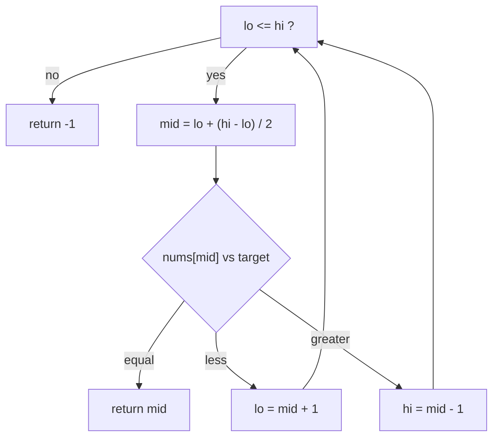
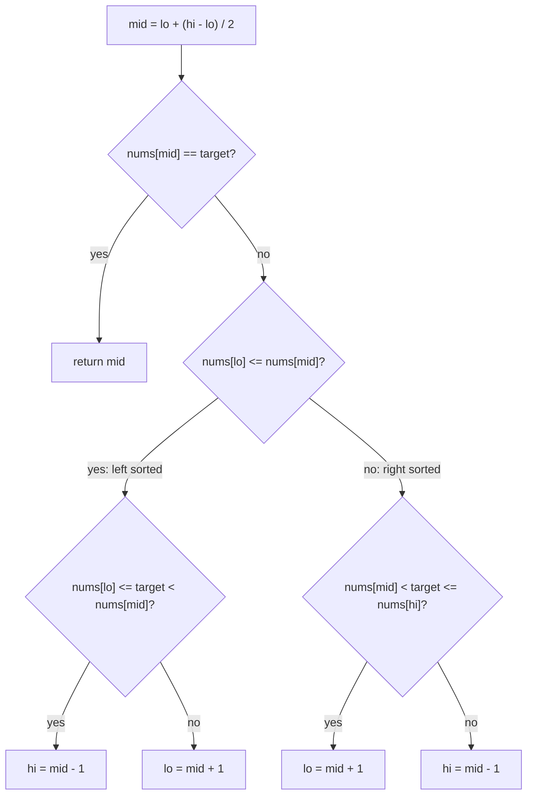
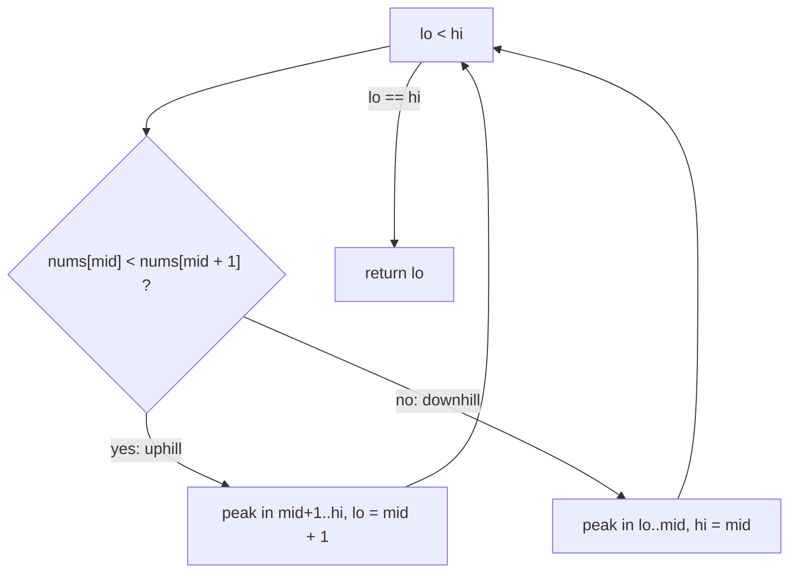

# Binary Search

[⬅ Back to index](../README.md)

Covers: binary search beyond 'find x in a sorted array': lower and upper bounds, rotated and 2D arrays, peaks, and binary search on the answer, with a single loop shape that avoids off-by-one bugs.

---

## Foundations

### 1. Binary Search

**🟢 Easy** · ⭐ Product/FAANG favourite

<details>
<summary>Answer</summary>

**In short:** Keep a range `[lo, hi]` that must contain the target if it exists. Look at the middle element: if it's the target you're done; if it's smaller, the target can only be to the right, so drop the left half; otherwise drop the right half. Each step halves the range, so it takes O(log n) time and O(1) space.

#### Problem

Given an array of distinct integers sorted in ascending order and a `target`, return the index of `target`, or `-1` if it isn't there.

- `nums = [-1, 0, 3, 5, 9, 12]`, `target = 9` → `4`
- `nums = [-1, 0, 3, 5, 9, 12]`, `target = 2` → `-1`

#### Clarifying questions & edge cases

- Is it really sorted, and ascending? Binary search is only correct on sorted (more generally, monotone) data.
- Duplicates? If yes, "which index?" matters — that's lower/upper bound, see [First and Last Position](#4-find-first-and-last-position-of-element-in-sorted-array).
- Empty array → `-1` (the loop must not run at all).
- Very large arrays: the midpoint formula `(lo + hi) / 2` can overflow.

#### Brute force

Scan left to right until you find `target`. O(n) time. It ignores the one thing the problem gives you — sortedness — which is the hint that O(log n) is expected.

#### Key insight

Sortedness means one comparison tells you about a whole half of the array. If `nums[mid] < target`, then every element at or before `mid` is also `< target` (they're even smaller), so none of them can be the answer. One comparison throws away half the candidates.

The **invariant** that makes the code correct:

> If `target` is in the array, its index is inside `[lo, hi]`.

- At the start, `lo = 0`, `hi = n - 1` — the whole array, so the invariant holds.
- `nums[mid] < target` → the answer is right of `mid`, so `lo = mid + 1` keeps the invariant.
- `nums[mid] > target` → the answer is left of `mid`, so `hi = mid - 1` keeps it.
- The loop runs while the range is non-empty (`lo <= hi`). When `lo > hi` the range is empty, so by the invariant the target isn't present.

Every iteration either returns or shrinks the range by at least one (`mid` itself is excluded), so the loop always terminates.



#### Walkthrough

`nums = [-1, 0, 3, 5, 9, 12]`

Target `9`:

| step | lo | hi | mid | nums[mid] | action |
|---|---|---|---|---|---|
| 1 | 0 | 5 | 2 | 3 | 3 < 9 → lo = 3 |
| 2 | 3 | 5 | 4 | 9 | found → return 4 |

Target `2` (not present):

| step | lo | hi | mid | nums[mid] | action |
|---|---|---|---|---|---|
| 1 | 0 | 5 | 2 | 3 | 3 > 2 → hi = 1 |
| 2 | 0 | 1 | 0 | -1 | -1 < 2 → lo = 1 |
| 3 | 1 | 1 | 1 | 0 | 0 < 2 → lo = 2 |
| — | 2 | 1 | | | lo > hi → return -1 |

#### Kotlin

```kotlin
fun search(nums: IntArray, target: Int): Int {
    var lo = 0
    var hi = nums.size - 1              // closed range [lo, hi]
    while (lo <= hi) {                  // non-empty range
        val mid = lo + (hi - lo) / 2    // no overflow, unlike (lo + hi) / 2
        when {
            nums[mid] == target -> return mid
            nums[mid] < target -> lo = mid + 1   // answer is right of mid
            else -> hi = mid - 1                 // answer is left of mid
        }
    }
    return -1
}
```

#### Swift

```swift
func search(_ nums: [Int], _ target: Int) -> Int {
    var lo = 0
    var hi = nums.count - 1
    while lo <= hi {
        let mid = lo + (hi - lo) / 2   // (lo + hi) would trap on overflow in Swift
        if nums[mid] == target {
            return mid
        } else if nums[mid] < target {
            lo = mid + 1
        } else {
            hi = mid - 1
        }
    }
    return -1
}
```

#### Complexity

- **Time:** O(log n) — the range halves each iteration, so at most about log₂(n) + 1 iterations.
- **Space:** O(1) — two indices. (A recursive version uses O(log n) stack; iterative is preferred.)

#### Common mistakes

- `while (lo < hi)` with a closed range — misses the last remaining element (e.g. a one-element array).
- `lo = mid` or `hi = mid` with a closed range — can loop forever when `lo` and `hi` are adjacent.
- `(lo + hi) / 2` — overflows for huge indices. In Kotlin/Java it silently goes negative (this exact bug sat in Java's `Arrays.binarySearch` for years); in Swift it crashes, since integer overflow traps.
- Using it on unsorted input, or on data sorted in the opposite direction.

#### Follow-ups

- *Return where it would be inserted?* That's lower bound — [Search Insert Position](#3-search-insert-position).
- *Duplicates — first or last occurrence?* [First and Last Position](#4-find-first-and-last-position-of-element-in-sorted-array).
- *Can you use the standard library?* Kotlin's `IntArray.binarySearch` / `List.binarySearch` return `-(insertionPoint) - 1` when missing and give no guarantee which duplicate they hit. Swift's standard library has no binary search, so you write it yourself. Interviewers usually want it hand-written anyway.

</details>

### 2. How do you never get binary search bounds wrong?

**📘 Concept** · ⭐ Product/FAANG favourite

<details>
<summary>Answer</summary>

**In short:** Turn every binary search into the same question: "the predicate `ok(i)` is false, false, ..., false, true, ..., true — where is the **first true**?" Search a half-open range `[lo, hi)`, loop `while (lo < hi)`, set `hi = mid` when `ok(mid)` is true and `lo = mid + 1` otherwise, and return `lo`. Because the range strictly shrinks every step and the invariant "everything left of `lo` is false, everything from `hi` on is true" always holds, you get termination and correctness for free.

#### Why people get it wrong

There are three choices that must agree with each other, and most bugs come from mixing them:

1. **The range shape**: closed `[lo, hi]` or half-open `[lo, hi)`.
2. **The loop condition**: `lo <= hi` or `lo < hi`.
3. **The updates**: `lo = mid` / `lo = mid + 1`, `hi = mid` / `hi = mid - 1`.

Change one without the others and you get either an infinite loop or a skipped element. The cure is to pick one shape and always reason with an invariant instead of by trial and error.

#### The one shape: first index where the predicate is true

Almost every binary search question can be phrased as a monotone yes/no predicate over a range:

| index | 0 | 1 | 2 | 3 | 4 | 5 |
|---|---|---|---|---|---|---|
| `ok(i)` | F | F | F | T | T | T |

You want the boundary — the first `T` (here 3). If there's no `T` at all, the answer is `hi` itself (the "not found / insert at the end" position).

```kotlin
// Returns the first i in [lo, hi) with ok(i) == true, or hi if there is none.
inline fun firstTrue(lo0: Int, hi0: Int, ok: (Int) -> Boolean): Int {
    var lo = lo0
    var hi = hi0
    while (lo < hi) {                 // range [lo, hi) is non-empty
        val mid = lo + (hi - lo) / 2  // lo <= mid < hi
        if (ok(mid)) hi = mid         // mid might be the answer: keep it
        else lo = mid + 1             // mid is false: discard it
    }
    return lo                         // lo == hi == boundary
}
```

```swift
// Swift version of the same template.
func firstTrue(_ lo0: Int, _ hi0: Int, _ ok: (Int) -> Bool) -> Int {
    var lo = lo0, hi = hi0
    while lo < hi {
        let mid = lo + (hi - lo) / 2
        if ok(mid) { hi = mid } else { lo = mid + 1 }
    }
    return lo
}
```

#### Why it is correct

**Invariant:** every index `< lo` is false; every index `>= hi` is true (or is the "none" position `hi0`).

- At the start, nothing is left of `lo0` and nothing is at or past `hi0` inside the range, so it holds trivially.
- `ok(mid)` is true → by monotonicity everything from `mid` on is true, so `hi = mid` keeps the invariant.
- `ok(mid)` is false → everything up to and including `mid` is false, so `lo = mid + 1` keeps it.
- When the loop stops, `lo == hi`: everything before is false, everything from there is true. That's exactly the first true.

**Termination:** with `lo < hi`, the floor midpoint satisfies `lo <= mid < hi`. So `hi = mid` makes `hi` strictly smaller, and `lo = mid + 1` makes `lo` strictly larger. The range shrinks every step, so the loop must end.

#### The infinite-loop trap (`lo = mid`)

If you write the "last true" version naively — `if (ok(mid)) lo = mid else hi = mid - 1` — then with `lo = 4, hi = 5` the floor midpoint is 4, `ok(4)` is true, `lo` stays 4, forever. Two fixes:

- Use the upper midpoint `mid = lo + (hi - lo + 1) / 2` whenever you assign `lo = mid`.
- Or, simpler: **last true of `p` = (first true of `not p`) − 1.** Then you only ever need one template.

#### Mapping common questions onto the template

| question | range | predicate `ok(i)` | answer |
|---|---|---|---|
| lower bound (first `>= x`) | `[0, n)` | `a[i] >= x` | `firstTrue` |
| upper bound (first `> x`) | `[0, n)` | `a[i] > x` | `firstTrue` |
| last `<= x` | `[0, n)` | `a[i] > x` | `firstTrue − 1` |
| exact match | `[0, n)` | `a[i] >= x` | lower bound `i`, then check `i < n && a[i] == x` |
| count of `x` | `[0, n)` | — | upper bound − lower bound |
| smallest feasible answer | `[minAns, maxAns + 1)` | `feasible(v)` | `firstTrue` ([binary search on the answer](#10-koko-eating-bananas)) |

#### Tiny trace

First index with `a[i] >= 5` in `a = [1, 3, 5, 5, 7]`, range `[0, 5)`:

| lo | hi | mid | a[mid] | ok? | update |
|---|---|---|---|---|---|
| 0 | 5 | 2 | 5 | T | hi = 2 |
| 0 | 2 | 1 | 3 | F | lo = 2 |
| 2 | 2 | | | | stop → 2 |

#### A checklist before you code

1. **What is the search space?** Indices `0..n`, or values like `1..max(piles)`. Should "not found" be representable (then `hi` is one past the end)?
2. **What is the predicate, and is it monotone?** Write down the F...FT...T picture. If you can't, binary search may not apply — or you need a different invariant (see [Find Peak Element](#8-find-peak-element), where the invariant is "a peak exists in range").
3. **First true or last true?** Convert "last" into "first of the opposite, minus one".
4. **Midpoint:** `lo + (hi - lo) / 2`. Use `Long` when the space is values up to 1e9 or more and you multiply.
5. **Test on sizes 0, 1 and 2**, and on "all false" and "all true". Those four cases catch nearly every bug.

#### Other styles (so you can read anyone's code)

| style | init | loop | updates | when it ends |
|---|---|---|---|---|
| closed | `hi = n - 1` | `lo <= hi` | `lo = mid + 1`, `hi = mid - 1` | `lo = hi + 1`; good for "find exact x" |
| half-open | `hi = n` | `lo < hi` | `lo = mid + 1`, `hi = mid` | `lo == hi`; good for boundaries |

Both are fine. The classic [Binary Search](#1-binary-search) uses the closed style because it returns as soon as it finds the target; everything boundary-shaped in this file uses the half-open style.

#### Real-valued searches

When the answer is a real number (e.g. a square root to 1e-6), don't compare `lo` and `hi` with `==`. Run a fixed number of iterations (about 60-100 halvings is far beyond double precision) or loop while `hi - lo > eps`.

#### Follow-ups

- *Why not ternary search?* It needs a unimodal function and does more comparisons per step; binary search on the slope (`f(mid) < f(mid + 1)`) does the same job — that's how [Find Peak Element](#8-find-peak-element) works.
- *Template reference:* the same loop shapes are collected in [Reusable Templates](05-reusable-templates.md).

</details>

### 3. Search Insert Position

**🟢 Easy**

<details>
<summary>Answer</summary>

**In short:** The insert position is the first index whose value is `>= target` — the lower bound. If the target exists, that's its index; if not, that's where it belongs. Binary search for it on the half-open range `[0, n)`, which naturally returns `n` when every element is smaller. O(log n) time, O(1) space.

#### Problem

Given a sorted array of distinct integers and a `target`, return the index of `target` if present, otherwise the index where it would be inserted to keep the array sorted.

- `[1, 3, 5, 6]`, `5` → `2`
- `[1, 3, 5, 6]`, `2` → `1`
- `[1, 3, 5, 6]`, `7` → `4`

#### Clarifying questions & edge cases

- Target bigger than everything → `n` (one past the end), so the search range must include `n`.
- Target smaller than everything → `0`.
- Duplicates? Not in this problem; if they existed, "first index `>= target`" still gives a valid (leftmost) insert spot.

#### Brute force

Walk from the left and return the first index with `nums[i] >= target`, or `n`. O(n).

#### Key insight

The brute force is already describing a predicate: `nums[i] >= target`. In a sorted array it's false for a prefix and true for the rest, so "first true" is a binary search. Notice that "found" and "insert position" are the same index — you don't need a separate equality check at all.

#### Walkthrough

`nums = [1, 3, 5, 6]`, `target = 2`, range `[0, 4)`:

| lo | hi | mid | nums[mid] | nums[mid] >= 2? | update |
|---|---|---|---|---|---|
| 0 | 4 | 2 | 5 | yes | hi = 2 |
| 0 | 2 | 1 | 3 | yes | hi = 1 |
| 0 | 1 | 0 | 1 | no | lo = 1 |
| 1 | 1 | | | | return 1 |

With `target = 7` every check is "no", `lo` keeps moving right and ends at `4`.

#### Kotlin

```kotlin
fun searchInsert(nums: IntArray, target: Int): Int {
    var lo = 0
    var hi = nums.size                     // half-open: n is a valid answer
    while (lo < hi) {
        val mid = lo + (hi - lo) / 2
        if (nums[mid] >= target) hi = mid  // mid could be the first >= target
        else lo = mid + 1                  // mid is too small
    }
    return lo
}
```

#### Complexity

- **Time:** O(log n).
- **Space:** O(1).

#### Common mistakes

- Starting with `hi = n - 1` — then the "insert at the end" answer `n` is unreachable (`[1, 3]`, `5` would wrongly return 1).
- Using the closed-range classic loop and returning `-1` on a miss: you need to return `lo` instead (in the closed style, `lo` also ends at the insert position — worth knowing).

#### Follow-ups

- *Insert into a sorted list efficiently?* Finding the spot is O(log n), but shifting elements is O(n). For many inserts use a balanced tree (`java.util.TreeMap`/`TreeSet`) — see [Prefix Sums & Intervals](09-prefix-sums-intervals.md) for My Calendar.
- *Used where?* Patience sorting for [Longest Increasing Subsequence](19-dynamic-programming.md) uses exactly this lower bound.

</details>

### 4. Find First and Last Position of Element in Sorted Array

**🟡 Medium** · ⭐ Product/FAANG favourite (commonly reported at Meta)

<details>
<summary>Answer</summary>

**In short:** Run two boundary searches. The first position is the lower bound (first index with `nums[i] >= target`); the last position is the upper bound (first index with `nums[i] > target`) minus one. If the lower bound is off the end or doesn't hold `target`, it's absent. Two O(log n) searches, O(1) space.

#### Problem

Given a sorted array that may contain duplicates, return `[first, last]` — the first and last index of `target` — or `[-1, -1]` if it doesn't appear. Must run in O(log n).

- `[5, 7, 7, 8, 8, 10]`, `8` → `[3, 4]`
- `[5, 7, 7, 8, 8, 10]`, `6` → `[-1, -1]`
- `[]`, `0` → `[-1, -1]`

#### Clarifying questions & edge cases

- Empty array → `[-1, -1]`.
- All elements equal to the target → `[0, n - 1]`.
- Target smaller/larger than every element.

#### Brute force

Linear scan: O(n). A tempting "improvement" — find any occurrence with classic binary search, then expand left and right — is still O(n) in the worst case (an array of all 8s).

#### Key insight

The occurrences of `target` form one contiguous block. Its two edges are boundaries of two monotone predicates:

| index | 0 | 1 | 2 | 3 | 4 | 5 |
|---|---|---|---|---|---|---|
| nums | 5 | 7 | 7 | 8 | 8 | 10 |
| `>= 8` | F | F | F | **T** | T | T |
| `> 8` | F | F | F | F | F | **T** |

- First `>= 8` is index 3 → start of the block.
- First `> 8` is index 5 → one past the end of the block, so last = 4.

One helper ("first index where the predicate is true") covers both — see [the bounds concept](#2-how-do-you-never-get-binary-search-bounds-wrong).

#### Walkthrough

Lower bound for 8 (predicate `>= 8`), range `[0, 6)`:

| lo | hi | mid | nums[mid] | ok? | update |
|---|---|---|---|---|---|
| 0 | 6 | 3 | 8 | T | hi = 3 |
| 0 | 3 | 1 | 7 | F | lo = 2 |
| 2 | 3 | 2 | 7 | F | lo = 3 |
| 3 | 3 | | | | first = 3 |

Upper bound for 8 (predicate `> 8`):

| lo | hi | mid | nums[mid] | ok? | update |
|---|---|---|---|---|---|
| 0 | 6 | 3 | 8 | F | lo = 4 |
| 4 | 6 | 5 | 10 | T | hi = 5 |
| 4 | 5 | 4 | 8 | F | lo = 5 |
| 5 | 5 | | | | last = 5 − 1 = 4 |

#### Kotlin

```kotlin
fun searchRange(nums: IntArray, target: Int): IntArray {
    val first = firstIndex(nums) { it >= target }
    if (first == nums.size || nums[first] != target) return intArrayOf(-1, -1)
    val last = firstIndex(nums) { it > target } - 1
    return intArrayOf(first, last)
}

// First index i in [0, n) with ok(nums[i]), or n if none.
private inline fun firstIndex(nums: IntArray, ok: (Int) -> Boolean): Int {
    var lo = 0
    var hi = nums.size
    while (lo < hi) {
        val mid = lo + (hi - lo) / 2
        if (ok(nums[mid])) hi = mid else lo = mid + 1
    }
    return lo
}
```

#### Complexity

- **Time:** O(log n) — two independent binary searches.
- **Space:** O(1).

#### Common mistakes

- Checking `nums[first] != target` without first checking `first == nums.size` → index out of bounds when the target is larger than everything.
- Writing two slightly different hand-rolled loops and getting one of them off by one. One helper with a predicate avoids this.
- Expanding outwards from a found index — O(n) on all-equal input, which fails the stated requirement.

#### Follow-ups

- *Count occurrences of x?* `upperBound − lowerBound`, O(log n).
- *Find K Closest Elements?* Binary search the left edge `i` of the length-k window in `[0, n − k)`: the window should move right iff `x − a[i] > a[i + k] − x`. O(log(n − k) + k).
- *Number of elements in a range [a, b]?* `upperBound(b) − lowerBound(a)`.

</details>

### 5. Sqrt(x)

**🟢 Easy**

<details>
<summary>Answer</summary>

**In short:** The integer square root is the largest `m` with `m * m <= x`, equivalently "first `m` with `m * m > x`, minus one". `m * m > x` is monotone in `m`, so binary search over `m` in `[0, x + 1)`. Use `Long` so `m * m` can't overflow. O(log x) time, O(1) space.

#### Problem

Given a non-negative integer `x`, return `floor(sqrt(x))` without using a built-in power or square-root function.

- `4` → `2`
- `8` → `2` (sqrt is 2.828...)
- `0` → `0`

#### Clarifying questions & edge cases

- `x = 0` and `x = 1` — both are their own square root.
- `x = Int.MAX_VALUE` (2147483647) → `46340`. Here `mid * mid` overflows a 32-bit `Int`, which is the whole trap of this problem.
- Floor, not round.

#### Brute force

Try `m = 0, 1, 2, ...` while `(m + 1)^2 <= x`. O(√x) — about 46,000 steps for the largest `Int`. Fine in practice, but the interviewer wants O(log x).

#### Key insight

This is **binary search on the answer**: you aren't searching an array, you're searching the number line. The predicate `m * m > x` is false for small `m` and true from some point on, so the first true is `floor(sqrt(x)) + 1`.

```
m:          0  1  2  3  4  5 ...
m*m > 8 ?   F  F  F  T  T  T
                     ^ first true = 3, answer = 2
```

The range `[0, x + 1)` always contains the boundary (since `(x + 1)^2 > x`). `x + 1` and `mid * mid` are computed in `Long`.

#### Walkthrough

`x = 8`, range `[0, 9)`:

| lo | hi | mid | mid² | mid² > 8? | update |
|---|---|---|---|---|---|
| 0 | 9 | 4 | 16 | yes | hi = 4 |
| 0 | 4 | 2 | 4 | no | lo = 3 |
| 3 | 4 | 3 | 9 | yes | hi = 3 |
| 3 | 3 | | | | return 3 − 1 = 2 |

#### Kotlin

```kotlin
fun mySqrt(x: Int): Int {
    var lo = 0L
    var hi = x.toLong() + 1            // first m with m*m > x lies in [0, x+1]
    while (lo < hi) {
        val mid = lo + (hi - lo) / 2
        if (mid * mid > x) hi = mid    // Long multiplication: no overflow
        else lo = mid + 1
    }
    return (lo - 1).toInt()            // last m with m*m <= x
}
```

An alternative that stays in `Int`: compare `mid > x / mid` instead of `mid * mid > x` (guard `mid == 0`). It works but is easier to get subtly wrong; using `Long` is clearer.

#### Complexity

- **Time:** O(log x) — about 32 iterations at most.
- **Space:** O(1).

#### Common mistakes

- `mid * mid` in `Int` → overflow for `mid > 46340`, giving negative numbers and wrong branches.
- `hi = x` with a half-open loop → `x = 1` returns 0 (the boundary 2 is outside the range). That's why the range is `[0, x + 1)`.
- Returning `lo` instead of `lo − 1` (that's the first *too big* value).

#### Follow-ups

- *Valid Perfect Square?* Same search, then check `r * r == x`.
- *Newton's method?* `r = (r + x / r) / 2` starting from `r = x` converges quadratically; mention it as the "faster in practice" alternative.
- *Real-valued sqrt to 1e-6?* Binary search on doubles for a fixed number of iterations (e.g. 100), comparing `mid * mid` with `x`.
- *Cube root, k-th root?* Same predicate with `mid^k`; watch overflow even harder (cap the multiplication early).

</details>

## Rotated arrays, peaks and 2D

### 6. Find Minimum in Rotated Sorted Array

**🟡 Medium**

<details>
<summary>Answer</summary>

**In short:** In a rotated sorted array, every element of the "upper" run is bigger than the last element, and every element of the "lower" run (which starts with the minimum) is `<=` the last element. So `nums[i] <= nums[n - 1]` is false, false, ..., true, true — and the minimum is the first true. One binary search: O(log n) time, O(1) space.

#### Problem

A sorted array of distinct integers was rotated some unknown number of times (e.g. `[0,1,2,4,5,6,7]` → `[4,5,6,7,0,1,2]`). Return its minimum in O(log n).

- `[3, 4, 5, 1, 2]` → `1`
- `[4, 5, 6, 7, 0, 1, 2]` → `0`
- `[11, 13, 15, 17]` → `11` (rotated n times = not rotated)

#### Clarifying questions & edge cases

- Distinct values? Yes here. With duplicates it's a different (harder) problem — see follow-ups.
- Not rotated at all → the minimum is `nums[0]`.
- Single element.

#### Brute force

`nums.min()`: O(n). It doesn't use the structure at all.

#### Key insight

Picture the array as two ascending runs, the second one entirely below the first:

```
value
  7 |       *
  6 |     *
  5 |   *
  4 | *
  2 |               *    <- last element
  1 |             *
  0 |           *        <- minimum
    +-----------------
      0 1 2 3 4 5 6   index
```

Compare each element with the **last** element:

| index | 0 | 1 | 2 | 3 | 4 | 5 | 6 |
|---|---|---|---|---|---|---|---|
| nums | 4 | 5 | 6 | 7 | 0 | 1 | 2 |
| `<= 2`? | F | F | F | F | **T** | T | T |

The left run is all `> last` and the right run is all `<= last`, so the predicate is monotone and its first true is the minimum. If the array isn't rotated, everything is `<= last` and the first true is index 0 — correct again.

Why compare with the **last** element rather than the first? With `nums[i] >= nums[0]` an unrotated array is all true and gives no boundary — you'd need a special case. The last element works for every rotation.

#### Walkthrough

`nums = [3, 4, 5, 1, 2]`, last = 2, range `[0, 4]` (index 4 is known to be true, so it can be `hi`):

| lo | hi | mid | nums[mid] | `<= 2`? | update |
|---|---|---|---|---|---|
| 0 | 4 | 2 | 5 | no | lo = 3 |
| 3 | 4 | 3 | 1 | yes | hi = 3 |
| 3 | 3 | | | | min = nums[3] = 1 |

#### Kotlin

```kotlin
fun findMin(nums: IntArray): Int {
    val last = nums[nums.size - 1]
    var lo = 0
    var hi = nums.size - 1          // index n-1 always satisfies the predicate
    while (lo < hi) {
        val mid = lo + (hi - lo) / 2
        if (nums[mid] <= last) hi = mid   // mid is in the lower run
        else lo = mid + 1                 // mid is in the upper run
    }
    return nums[lo]
}
```

You'll often see `nums[mid] > nums[hi]` instead of comparing with the fixed last element. Both are correct for distinct values; the fixed version makes the monotone predicate explicit.

#### Complexity

- **Time:** O(log n).
- **Space:** O(1).

#### Common mistakes

- Comparing with `nums[0]` and forgetting the unrotated case.
- Comparing with `nums[lo]` in a closed `lo <= hi` loop — easy to lose the minimum by doing `hi = mid - 1` on it.
- Returning the index when the value was asked for (or vice versa).

#### Follow-ups

- *How many times was it rotated?* The index of the minimum.
- *Duplicates allowed (Find Minimum II, Hard)?* When `nums[mid] == nums[hi]` you can't tell which run `mid` is in (e.g. `[1,1,1,0,1]` vs `[1,0,1,1,1]`), so just do `hi--`. Still correct, but worst case O(n) — and you should say that O(log n) is impossible in the worst case.
- *Search for a target?* Find the pivot this way, then binary search the correct run — or do it in one pass: [Search in Rotated Sorted Array](#7-search-in-rotated-sorted-array).

</details>

### 7. Search in Rotated Sorted Array

**🟡 Medium** · ⭐ Product/FAANG favourite (commonly reported at Meta, Amazon, Microsoft)

<details>
<summary>Answer</summary>

**In short:** At any `mid`, at least one of the halves `[lo, mid]` or `[mid, hi]` is normally sorted — you can tell which by comparing `nums[lo]` with `nums[mid]`. Check whether the target lies inside the sorted half's value range: if yes, search there; if no, search the other half. O(log n) time, O(1) space.

#### Problem

A sorted array of distinct integers has been rotated at an unknown pivot. Given `target`, return its index or `-1`, in O(log n).

- `[4, 5, 6, 7, 0, 1, 2]`, `0` → `4`
- `[4, 5, 6, 7, 0, 1, 2]`, `3` → `-1`
- `[1]`, `0` → `-1`

#### Clarifying questions & edge cases

- Distinct values? (With duplicates see follow-ups.)
- Not rotated → plain binary search must still work.
- One or two elements — the `nums[lo] <= nums[mid]` check must handle `lo == mid`.

#### Brute force

Linear scan, O(n). Alternatively: find the pivot with [Find Minimum](#6-find-minimum-in-rotated-sorted-array) (O(log n)), decide which run the target belongs to by comparing with the last element, and binary search that run. That's a perfectly good O(log n) answer — two searches instead of one.

#### Key insight

Cut a rotated array anywhere and **at least one side is sorted** (the rotation point can be in only one of them). For a sorted side you know its exact value range from its two ends, so "is the target in here?" is a constant-time question:

- If `nums[lo] <= nums[mid]`, the left half `[lo..mid]` is sorted. The target is in it iff `nums[lo] <= target < nums[mid]`.
- Otherwise the right half `[mid..hi]` is sorted. The target is in it iff `nums[mid] < target <= nums[hi]`.

Whichever side the target can't be in gets discarded, exactly like classic binary search. The invariant is the same: "if target exists, it's in `[lo, hi]`".



#### Walkthrough

`nums = [4, 5, 6, 7, 0, 1, 2]`, `target = 0`:

| lo | hi | mid | nums[mid] | sorted half | target inside? | update |
|---|---|---|---|---|---|---|
| 0 | 6 | 3 | 7 | left `[4..7]` | 4 <= 0? no | lo = 4 |
| 4 | 6 | 5 | 1 | left `[0..1]` | 0 <= 0 < 1 yes | hi = 4 |
| 4 | 4 | 4 | 0 | — | found | return 4 |

#### Kotlin

```kotlin
fun search(nums: IntArray, target: Int): Int {
    var lo = 0
    var hi = nums.size - 1
    while (lo <= hi) {
        val mid = lo + (hi - lo) / 2
        if (nums[mid] == target) return mid
        if (nums[lo] <= nums[mid]) {
            // Left half [lo..mid] is sorted.
            if (target >= nums[lo] && target < nums[mid]) hi = mid - 1
            else lo = mid + 1
        } else {
            // Right half [mid..hi] is sorted.
            if (target > nums[mid] && target <= nums[hi]) lo = mid + 1
            else hi = mid - 1
        }
    }
    return -1
}
```

#### Swift

```swift
func search(_ nums: [Int], _ target: Int) -> Int {
    var lo = 0
    var hi = nums.count - 1
    while lo <= hi {
        let mid = lo + (hi - lo) / 2
        if nums[mid] == target { return mid }
        if nums[lo] <= nums[mid] {
            // Left half is sorted.
            if nums[lo] <= target && target < nums[mid] { hi = mid - 1 } else { lo = mid + 1 }
        } else {
            // Right half is sorted.
            if nums[mid] < target && target <= nums[hi] { lo = mid + 1 } else { hi = mid - 1 }
        }
    }
    return -1
}
```

#### Complexity

- **Time:** O(log n) — one comparison-driven halving per iteration.
- **Space:** O(1).

#### Common mistakes

- `nums[lo] < nums[mid]` (strict) instead of `<=`. When `lo == mid` (two elements left), the left "half" is the single element `nums[mid]`, which is sorted; with `<` the code wrongly treats the right side as sorted. `[3, 1]`, target `1` returns `-1` with the strict version.
- Getting the inclusive ends of the range checks wrong: the sorted half's own end values (`nums[lo]` on the left, `nums[hi]` on the right) are candidates, so those comparisons must be inclusive.
- Trying to find the pivot and searching in the same loop with tangled conditions. Keep it to the two clean cases above.

#### Follow-ups

- *Duplicates (Search in Rotated Sorted Array II)?* If `nums[lo] == nums[mid] == nums[hi]` you can't tell which half is sorted — shrink with `lo++; hi--` and continue. Worst case O(n) (e.g. `[1,1,1,1,1,2,1]`).
- *Return the rotation count / minimum?* [Find Minimum in Rotated Sorted Array](#6-find-minimum-in-rotated-sorted-array).
- *Why not just find the pivot first?* Totally acceptable; say both and pick the one you can code bug-free.

</details>

### 8. Find Peak Element

**🟡 Medium** · ⭐ Product/FAANG favourite (commonly reported at Meta, Google)

<details>
<summary>Answer</summary>

**In short:** Compare `nums[mid]` with its right neighbour. If `nums[mid] < nums[mid + 1]` you're on an uphill slope, and since the array "falls off" to −∞ at the right end, a peak must exist to the right — so `lo = mid + 1`. Otherwise a peak exists at `mid` or to its left — `hi = mid`. The array isn't sorted; what makes binary search valid is the invariant "the range `[lo, hi]` always contains a peak". O(log n) time, O(1) space.

#### Problem

A peak is an element strictly greater than its neighbours. Treat `nums[-1]` and `nums[n]` as −∞, and assume adjacent elements are never equal. Return the index of **any** peak, in O(log n).

- `[1, 2, 3, 1]` → `2`
- `[1, 2, 1, 3, 5, 6, 4]` → `1` or `5`

#### Clarifying questions & edge cases

- Any peak, or a specific one (global max)? Any. The global max needs O(n).
- Adjacent values distinct? Yes — that's what makes the slope well defined.
- Single element → index 0. Strictly increasing → last index. Strictly decreasing → 0.

#### Brute force

Return the first `i` with `nums[i] > nums[i + 1]` (or `n − 1`). O(n) — and correct, because the first downhill step is a peak.

#### Key insight

Think of walking uphill. If `nums[mid] < nums[mid + 1]`, keep walking right: values can't rise forever because `nums[n]` is −∞, so somewhere at or after `mid + 1` the walk must stop going up — and the place it stops is a peak. Symmetrically, if `nums[mid] > nums[mid + 1]`, then walking left from `mid` must also stop at a peak (because `nums[-1]` is −∞), and `mid` itself may be that peak.

So the invariant is: **`[lo, hi]` contains a peak**. It holds at the start (the whole array, with −∞ on both sides), and each step keeps the half that is guaranteed to contain one. When `lo == hi`, that single index is a peak.



This is a key lesson: binary search needs a rule that safely throws away half the range, **not** a sorted array.

#### Walkthrough

`nums = [1, 2, 1, 3, 5, 6, 4]`:

| lo | hi | mid | nums[mid] | nums[mid+1] | slope | update |
|---|---|---|---|---|---|---|
| 0 | 6 | 3 | 3 | 5 | up | lo = 4 |
| 4 | 6 | 5 | 6 | 4 | down | hi = 5 |
| 4 | 5 | 4 | 5 | 6 | up | lo = 5 |
| 5 | 5 | | | | | return 5 |

The other peak (index 1) was in the discarded half — fine, any peak is accepted.

#### Kotlin

```kotlin
fun findPeakElement(nums: IntArray): Int {
    var lo = 0
    var hi = nums.size - 1
    while (lo < hi) {
        val mid = lo + (hi - lo) / 2           // mid < hi, so mid + 1 is in range
        if (nums[mid] < nums[mid + 1]) lo = mid + 1   // uphill: peak to the right
        else hi = mid                                 // downhill: peak at mid or left
    }
    return lo
}
```

#### Complexity

- **Time:** O(log n).
- **Space:** O(1).

#### Common mistakes

- Comparing with `nums[mid - 1]` and the floor midpoint — `mid` can equal `lo` (even 0), so you'd need extra bounds checks. Comparing with `mid + 1` is always safe because `mid < hi`.
- `while (lo <= hi)` with `hi = mid` → infinite loop when `lo == hi`.
- Believing the array must be sorted for binary search, and therefore not trying it.

#### Follow-ups

- *Peak Index in a Mountain Array?* Same code; the mountain guarantees exactly one peak.
- *Find in Mountain Array (Hard)?* Find the peak with this search, then binary search the ascending side, then (if not found) the descending side with reversed comparisons. Three O(log n) searches.
- *2D peak (Find a Peak Element II)?* Binary search on the middle row: take its maximum column, compare with the cells above/below and move toward the bigger neighbour. O(n log m).

</details>

### 9. Search a 2D Matrix (I and II)

**🟡 Medium**

<details>
<summary>Answer</summary>

**In short:** **Version I** (each row sorted, and each row starts after the previous row ends) is just a sorted array of length `m·n` laid out row by row — binary search a virtual index `i` and read `matrix[i / n][i % n]`, O(log(m·n)). **Version II** (rows sorted and columns sorted, but rows can overlap) isn't globally sorted, so use the staircase walk from the top-right corner: bigger than target → move left, smaller → move down. Each step discards a whole row or column: O(m + n).

#### Problem

**I.** An `m × n` matrix where each row is sorted ascending and the first value of each row is greater than the last value of the previous row. Does `target` exist?

```
[ 1,  3,  5,  7]
[10, 11, 16, 20]      target = 3  → true
[23, 30, 34, 60]      target = 13 → false
```

**II.** An `m × n` matrix where every row is sorted left to right and every column is sorted top to bottom. Does `target` exist?

```
[ 1,  4,  7, 11, 15]
[ 2,  5,  8, 12, 19]
[ 3,  6,  9, 16, 22]  target = 5  → true
[10, 13, 14, 17, 24]  target = 20 → false
[18, 21, 23, 26, 30]
```

#### Clarifying questions & edge cases

- Which guarantee do we have — version I's "rows continue each other", or only II's "rows and columns sorted"? The algorithms differ.
- Empty matrix or empty rows → `false`.
- `m · n` overflow? Up to 100 × 100 on LeetCode, so no; mention `Long` if it could be huge.

#### Brute force

Scan every cell: O(m·n). A better middle ground for both: binary search each row, O(m log n).

#### Key insight — version I

Read the matrix row by row and you get one sorted list: `1, 3, 5, 7, 10, 11, ...`. You don't need to build it — map a virtual index `i` in `[0, m·n)` to `row = i / n`, `col = i % n` and run classic [Binary Search](#1-binary-search) on it.

(An equally good alternative: binary search the first column for the right row, then binary search inside that row. Same O(log m + log n) = O(log(m·n)).)

#### Key insight — version II

The flattened order is no longer sorted (row 0 ends with 15, row 1 starts with 2), so a single binary search can't work. Instead start at the **top-right** corner. That cell is the largest in its row and the smallest in its column (among the rows/columns still in play):

- `cell > target` → everything below it in this column is even bigger, so the whole column is out: move **left**.
- `cell < target` → everything left of it in this row is even smaller, so the whole row is out: move **down**.

Each step eliminates one row or one column, so after at most `m + n` steps you either find it or walk off the matrix. It's the same elimination argument as the two-pointer technique in [Two Pointers & Sliding Window](08-two-pointers-sliding-window.md). (Bottom-left works too; top-left and bottom-right don't, because both moves from there go the same direction in value.)

#### Walkthrough

Version I, `target = 3`, virtual range `[0, 11]`, `n = 4`:

| lo | hi | mid | (row, col) | value | update |
|---|---|---|---|---|---|
| 0 | 11 | 5 | (1, 1) | 11 | 11 > 3 → hi = 4 |
| 0 | 4 | 2 | (0, 2) | 5 | 5 > 3 → hi = 1 |
| 0 | 1 | 0 | (0, 0) | 1 | 1 < 3 → lo = 1 |
| 1 | 1 | 1 | (0, 1) | 3 | found |

Version II, `target = 5`, start at `(0, 4)`:

| (row, col) | value | action |
|---|---|---|
| (0, 4) | 15 | > 5 → col 3 |
| (0, 3) | 11 | > 5 → col 2 |
| (0, 2) | 7 | > 5 → col 1 |
| (0, 1) | 4 | < 5 → row 1 |
| (1, 1) | 5 | found |

#### Kotlin

```kotlin
// Version I: the matrix is one sorted array in row-major order.
fun searchMatrix(matrix: Array<IntArray>, target: Int): Boolean {
    if (matrix.isEmpty() || matrix[0].isEmpty()) return false
    val cols = matrix[0].size
    var lo = 0
    var hi = matrix.size * cols - 1
    while (lo <= hi) {
        val mid = lo + (hi - lo) / 2
        val value = matrix[mid / cols][mid % cols]   // virtual index -> cell
        when {
            value == target -> return true
            value < target -> lo = mid + 1
            else -> hi = mid - 1
        }
    }
    return false
}

// Version II: rows and columns sorted independently. Staircase from top-right.
fun searchMatrixII(matrix: Array<IntArray>, target: Int): Boolean {
    if (matrix.isEmpty() || matrix[0].isEmpty()) return false
    var row = 0
    var col = matrix[0].size - 1
    while (row < matrix.size && col >= 0) {
        val value = matrix[row][col]
        when {
            value == target -> return true
            value > target -> col--   // whole column below is too big
            else -> row++             // whole row to the left is too small
        }
    }
    return false
}
```

#### Complexity

- **Version I:** O(log(m·n)) time, O(1) space.
- **Version II:** O(m + n) time — each step moves one row down or one column left; O(1) space.
- Per-row binary search (works for both): O(m log n); better than staircase only when `m` is much smaller than `n`.

#### Common mistakes

- Using `mid / rows` instead of `mid / cols` for the row index (only wrong for non-square matrices, so the square example won't catch it).
- Applying the flattened binary search to version II — it returns wrong answers because the flattened order isn't sorted.
- Starting the staircase at the top-left: both moves increase the value, so nothing gets eliminated.

#### Follow-ups

- *Kth Smallest Element in a Sorted Matrix (version II layout)?* Binary search on the **value** in `[min, max]`; count cells `<= mid` with the same staircase walk in O(n); first value whose count is `>= k`. O(n log(max − min)). A heap-based alternative is in [Heaps & Priority Queues](13-heaps-priority-queues.md).
- *Count negative numbers in a sorted matrix?* Same staircase, O(m + n).
- *Why not O(log) for version II?* There's a lower bound: you can't beat roughly O(m + n) in general for this layout (for a square matrix, the anti-diagonal can hold n unrelated values).

</details>

## Binary search on the answer

### 10. Koko Eating Bananas

**🟡 Medium** · ⭐ Product/FAANG favourite

<details>
<summary>Answer</summary>

**In short:** Don't search the array — search the **answer**. If Koko can finish at speed `k`, she can finish at any faster speed, so `canFinish(k)` is false, ..., false, true, ..., true over `k = 1..max(piles)`. Binary search for the first true; each check costs O(n). Total O(n log M) where M is the largest pile, O(1) space.

#### Problem

There are `n` piles of bananas and `h` hours. Each hour Koko picks one pile and eats up to `k` bananas from it (if the pile has fewer, she finishes it and waits out the hour). Return the minimum integer speed `k` that lets her eat everything within `h` hours. It's guaranteed that `h >= n`.

- `piles = [3, 6, 7, 11]`, `h = 8` → `4`
- `piles = [30, 11, 23, 4, 20]`, `h = 5` → `30`
- `piles = [30, 11, 23, 4, 20]`, `h = 6` → `23`

#### Clarifying questions & edge cases

- `h == n` → she must clear one pile per hour → answer is `max(piles)`.
- Large values: piles up to 1e9 and `n` up to 1e4, so the total hours at `k = 1` can reach 1e13 — that overflows a 32-bit `Int`. Sum in `Long`.
- Speed must be at least 1.

#### Brute force

Try `k = 1, 2, 3, ...` and return the first speed that works. Each check is O(n) and there can be up to `max(piles)` speeds: O(n · M), up to 1e13 operations. Too slow.

#### Key insight

The hours needed at speed `k` is `sum(ceil(pile / k))`. As `k` grows, every term can only shrink or stay the same, so the hours are **non-increasing** in `k` and `hours(k) <= h` is a monotone predicate:

| k | 1 | 2 | 3 | **4** | 5 | 6 | ... | 11 |
|---|---|---|---|---|---|---|---|---|
| hours | 27 | 15 | 10 | **8** | 8 | 6 | ... | 4 |
| `<= 8`? | F | F | F | **T** | T | T | ... | T |

That's the general recipe for **binary search on the answer**:

1. The question asks for the minimum (or maximum) value that satisfies something.
2. You can check "does value `v` work?" quickly — usually greedily in O(n).
3. If `v` works, every bigger `v` works (monotone).
4. Pick bounds: the smallest value that could possibly work and one that surely works.

Here the bounds are `lo = 1` and `hi = max(piles)` — at that speed every pile takes exactly one hour, so `n <= h` hours always suffices.

#### Walkthrough

`piles = [3, 6, 7, 11]`, `h = 8`, search `[1, 11]` (11 is known to work):

| lo | hi | mid | hours at mid | `<= 8`? | update |
|---|---|---|---|---|---|
| 1 | 11 | 6 | 1+1+2+2 = 6 | yes | hi = 6 |
| 1 | 6 | 3 | 1+2+3+4 = 10 | no | lo = 4 |
| 4 | 6 | 5 | 1+2+2+3 = 8 | yes | hi = 5 |
| 4 | 5 | 4 | 1+2+2+3 = 8 | yes | hi = 4 |
| 4 | 4 | | | | return 4 |

#### Kotlin

```kotlin
fun minEatingSpeed(piles: IntArray, h: Int): Int {
    var lo = 1
    var hi = piles.max()                // this speed always works since h >= n
    while (lo < hi) {
        val mid = lo + (hi - lo) / 2
        if (hoursNeeded(piles, mid) <= h) hi = mid   // fast enough: try slower
        else lo = mid + 1                            // too slow
    }
    return lo
}

private fun hoursNeeded(piles: IntArray, speed: Int): Long {
    var total = 0L                      // can exceed Int.MAX_VALUE
    for (p in piles) {
        total += (p.toLong() + speed - 1) / speed    // ceil(p / speed)
    }
    return total
}
```

#### Swift

```swift
func minEatingSpeed(_ piles: [Int], _ h: Int) -> Int {
    var lo = 1
    var hi = piles.max()!               // non-empty by the constraints
    while lo < hi {
        let mid = lo + (hi - lo) / 2
        var hours = 0                   // Swift Int is 64-bit on iOS/macOS, so no overflow here
        for p in piles {
            hours += (p + mid - 1) / mid
        }
        if hours <= h { hi = mid } else { lo = mid + 1 }
    }
    return lo
}
```

#### Complexity

- **Time:** O(n log M) — about log₂(1e9) ≈ 30 checks, each O(n).
- **Space:** O(1).

#### Common mistakes

- Summing hours in `Int` in Kotlin/Java → overflow makes the sum negative, which looks "fast enough" and returns a too-small speed.
- Floating-point `ceil(p / k)` with integer division inside (`ceil(p / k)` where `p / k` already truncated). Use `(p + k - 1) / k`.
- Starting `lo` at 0 → division by zero.
- Returning `mid` from inside the loop the first time it works — that's *a* working speed, not the minimum.

#### Follow-ups

- *Speed up the check?* Stop summing as soon as `total > h`.
- *Same pattern:* [Capacity To Ship Packages](#11-capacity-to-ship-packages-within-d-days), [Split Array Largest Sum](#12-split-array-largest-sum), Minimum Number of Days to Make m Bouquets (search the day), Magnetic Force Between Two Balls (maximise the minimum gap — "last true").
- *Template:* the general form is in [Reusable Templates](05-reusable-templates.md).

</details>

### 11. Capacity To Ship Packages Within D Days

**🟡 Medium**

<details>
<summary>Answer</summary>

**In short:** Binary search the ship capacity between `max(weights)` (any less and the heaviest package never fits) and `sum(weights)` (everything in one day). For a candidate capacity, greedily load packages in order and count the days needed; the first capacity needing `<= days` days is the answer. O(n log(sum)) time, O(1) space.

#### Problem

Packages with given weights must be shipped **in the given order** within `days` days. Each day you load consecutive packages onto a ship as long as the total stays within its capacity. Find the minimum capacity that ships everything on time.

- `weights = [1, 2, 3, 4, 5, 6, 7, 8, 9, 10]`, `days = 5` → `15` (days: `[1..5]`, `[6, 7]`, `[8]`, `[9]`, `[10]`)
- `weights = [3, 2, 2, 4, 1, 4]`, `days = 3` → `6`
- `weights = [1, 2, 3, 1, 1]`, `days = 4` → `3`

#### Clarifying questions & edge cases

- Order must be preserved? Yes — that's what makes the greedy check valid (otherwise it's bin packing, which is NP-hard).
- `days >= n` → answer is `max(weights)`. `days == 1` → `sum(weights)`.
- Sum overflow: on LeetCode `n <= 5·10⁴` and weights `<= 500`, so the sum fits in `Int`; use `Long` if limits are larger.

#### Brute force

Try every capacity from `max(weights)` upwards and return the first that works: O(n · sum). Or DP over split points: O(n² · days). Both too slow.

#### Key insight

Two separate facts make this work:

1. **Monotonicity.** If capacity `c` can ship in `D` days, capacity `c + 1` can too (use the same loading). So `daysNeeded(c) <= days` is F...F T...T over `c`.
2. **Greedy check is optimal.** For a fixed capacity, putting as many packages as possible on each day never hurts: pushing a package to a later day only leaves more for the remaining days. So "fill each day until the next package doesn't fit" computes the true minimum number of days in O(n).

Bounds: `lo = max(weights)`, `hi = sum(weights)` — the answer is always in between, and `hi` always works.

#### Walkthrough

`weights = [1..10]`, `days = 5`, search `[10, 55]`:

| lo | hi | mid | greedy days at mid | `<= 5`? | update |
|---|---|---|---|---|---|
| 10 | 55 | 32 | [1..7], [8, 9, 10] → 2 | yes | hi = 32 |
| 10 | 32 | 21 | [1..6], [7, 8], [9, 10] → 3 | yes | hi = 21 |
| 10 | 21 | 15 | [1..5], [6, 7], [8], [9], [10] → 5 | yes | hi = 15 |
| 10 | 15 | 12 | [1..4], [5, 6], [7], [8], [9], [10] → 6 | no | lo = 13 |
| 13 | 15 | 14 | [1..4], [5, 6], [7], [8], [9], [10] → 6 | no | lo = 15 |
| 15 | 15 | | | | return 15 |

#### Kotlin

```kotlin
fun shipWithinDays(weights: IntArray, days: Int): Int {
    var lo = weights.max()          // must fit the heaviest package
    var hi = weights.sum()          // ship everything in one day
    while (lo < hi) {
        val mid = lo + (hi - lo) / 2
        if (daysNeeded(weights, mid) <= days) hi = mid
        else lo = mid + 1
    }
    return lo
}

// Greedy: load each day until the next package would overflow.
private fun daysNeeded(weights: IntArray, capacity: Int): Int {
    var needed = 1
    var load = 0
    for (w in weights) {
        if (load + w > capacity) {  // start a new day
            needed++
            load = 0
        }
        load += w
    }
    return needed
}
```

#### Complexity

- **Time:** O(n log S), S = `sum(weights)` — about log₂(2.5·10⁷) ≈ 25 checks of O(n).
- **Space:** O(1).

#### Common mistakes

- `lo = 1` (or 0) — then a capacity smaller than one package "passes" the greedy check because the code puts the oversized package alone on a day anyway. Starting at `max(weights)` avoids that bug (or explicitly reject `w > capacity`).
- Starting `needed` at 0 and forgetting to count the last day.
- Sorting the weights — the order is fixed.

#### Follow-ups

- *Split into exactly k parts minimising the largest sum?* Identical — [Split Array Largest Sum](#12-split-array-largest-sum).
- *Same problem in disguise:* "allocate books to students", "painter's partition", "minimise the maximum workload" — all the same search plus greedy check.
- *Maximise the minimum instead?* Flip the predicate (e.g. Divide Chocolate, Magnetic Force Between Two Balls) and search for the **last** true.

</details>

### 12. Split Array Largest Sum

**🔴 Hard**

<details>
<summary>Answer</summary>

**In short:** Binary search the answer `cap` = the largest allowed subarray sum, in `[max(nums), sum(nums)]`. For each `cap`, greedily cut the array into as few pieces as possible with each piece `<= cap`; if that takes `<= k` pieces, `cap` is achievable. The smallest achievable `cap` is the answer. O(n log(sum)) time, O(1) space. (A DP solution exists but is O(k·n²).)

#### Problem

Split `nums` (non-negative integers) into exactly `k` non-empty contiguous subarrays so that the largest subarray sum is as small as possible. Return that minimal largest sum.

- `nums = [7, 2, 5, 10, 8]`, `k = 2` → `18` (`[7, 2, 5] | [10, 8]`)
- `nums = [1, 2, 3, 4, 5]`, `k = 2` → `9` (`[1, 2, 3] | [4, 5]`)

#### Clarifying questions & edge cases

- Non-negative values? Yes — that's what makes the greedy check and the monotonicity hold.
- `k == 1` → `sum(nums)`; `k == n` → `max(nums)`.
- Sum range: `n <= 1000`, values `<= 10⁶` → sum up to 10⁹, which fits in `Int` but only just; use `Long` if limits grow.

#### Brute force

Try every way to place `k − 1` cuts among `n − 1` gaps: C(n − 1, k − 1) splits — exponential.

A better classical answer is DP: `dp[i][j]` = best largest sum for the first `i` elements in `j` pieces, `dp[i][j] = min over p of max(dp[p][j − 1], sum(p..i−1))`. That's O(k · n²) time, O(k · n) space — fine for n = 1000, k = 50 (5·10⁷), and worth mentioning before the binary search.

#### Key insight

Flip the question from "what's the best split?" to "**given a limit `cap`, can I split into at most `k` pieces?**"

- **Checking is easy and greedy:** walk left to right, extend the current piece while its sum stays `<= cap`, otherwise start a new piece. Extending a piece as far as possible never makes later pieces worse, so this gives the minimum number of pieces.
- **"At most k" is enough for "exactly k":** if you can do it with fewer than `k` pieces, you can split some piece further (there are `n >= k` elements) and piece sums only go down — the max stays `<= cap`.
- **Monotone:** a larger `cap` never needs more pieces.

So `pieces(cap) <= k` is F...F T...T over `cap`, and we search for the first true. This is exactly [Capacity To Ship Packages](#11-capacity-to-ship-packages-within-d-days) with "days" renamed to "pieces".

#### Walkthrough

`nums = [7, 2, 5, 10, 8]`, `k = 2`, search `[10, 32]`:

| lo | hi | mid | greedy pieces | count | `<= 2`? | update |
|---|---|---|---|---|---|---|
| 10 | 32 | 21 | [7,2,5] [10,8] | 2 | yes | hi = 21 |
| 10 | 21 | 15 | [7,2,5] [10] [8] | 3 | no | lo = 16 |
| 16 | 21 | 18 | [7,2,5] [10,8] | 2 | yes | hi = 18 |
| 16 | 18 | 17 | [7,2,5] [10] [8] | 3 | no | lo = 18 |
| 18 | 18 | | | | | return 18 |

#### Kotlin

```kotlin
fun splitArray(nums: IntArray, k: Int): Int {
    var lo = nums.max()            // a piece must hold the biggest element
    var hi = nums.sum()            // one piece holds everything
    while (lo < hi) {
        val mid = lo + (hi - lo) / 2
        if (piecesNeeded(nums, mid) <= k) hi = mid   // achievable: try smaller
        else lo = mid + 1
    }
    return lo
}

// Minimum number of contiguous pieces with every piece sum <= cap.
private fun piecesNeeded(nums: IntArray, cap: Int): Int {
    var pieces = 1
    var current = 0
    for (x in nums) {
        if (current + x > cap) {   // x doesn't fit: cut before it
            pieces++
            current = 0
        }
        current += x
    }
    return pieces
}
```

#### Complexity

- **Time:** O(n log S), S = `sum(nums)` — about 30 greedy passes.
- **Space:** O(1).
- DP alternative: O(k · n²) time, O(k · n) space (or O(n) with rolling rows).

#### Common mistakes

- Thinking you must hit exactly `k` pieces in the check — `<= k` is the right test (see the insight).
- `lo = 0` or `lo = min(nums)`: values below `max(nums)` can't be achieved, but the naive greedy will "pass" them by isolating the big element.
- Returning the sum of the pieces instead of the cap.

#### Follow-ups

- *Negative numbers allowed?* Monotonicity and the greedy check break; fall back to DP.
- *Return the actual split?* Run the greedy once more with the final `cap`, then, if it made fewer than `k` pieces, split off single elements from the end until you have `k`.
- *Maximise the minimum piece sum instead (Divide Chocolate)?* Same idea with the predicate "can I make at least `k` pieces each `>= v`", searching for the last true.

</details>

## Applied binary search

### 13. Time Based Key-Value Store

**🟡 Medium** · ⭐ Product/FAANG favourite

<details>
<summary>Answer</summary>

**In short:** Keep, per key, a list of `(timestamp, value)` pairs. Because `set` is called with strictly increasing timestamps, each list is already sorted, so appending is O(1). For `get(key, t)`, binary search for the last entry with `timestamp <= t` (= first entry with `timestamp > t`, minus one). `set` O(1), `get` O(log n), space O(total sets).

#### Problem

Design `TimeMap` with:

- `set(key, value, timestamp)` — store `value` for `key` at `timestamp`.
- `get(key, timestamp)` — return the value set at the largest `timestamp_prev <= timestamp`, or `""` if none.

The timestamps passed to `set` are strictly increasing.

```
set("foo", "bar", 1)
get("foo", 1)  -> "bar"
get("foo", 3)  -> "bar"     (latest at or before 3 is time 1)
set("foo", "bar2", 4)
get("foo", 4)  -> "bar2"
get("foo", 5)  -> "bar2"
get("foo", 0)  -> ""        (nothing at or before 0)
```

#### Clarifying questions & edge cases

- Are `set` timestamps increasing? Yes here — this is what lets you append instead of insert. If not, you need a sorted structure (see follow-ups).
- Unknown key → `""`. Query earlier than the first timestamp → `""`.
- Two `set`s with the same key and timestamp? Not possible with strictly increasing timestamps.

#### Brute force

Store all entries per key and scan them on `get`, keeping the best timestamp `<= t`. `get` is O(n) per call — too slow with up to 2·10⁵ calls.

#### Key insight

A `get` is a "**floor**" query: the last timestamp `<= t`. On a sorted list that's an upper-bound binary search:

| index | 0 | 1 | 2 |
|---|---|---|---|
| timestamps | 1 | 4 | 9 |
| `> 5`? | F | F | **T** |

First true is index 2, so the floor is index 1 (timestamp 4). If the first true is index 0, every timestamp is `> t` and there's no answer. See [the bounds concept](#2-how-do-you-never-get-binary-search-bounds-wrong) for the "last true = first true of the opposite − 1" trick.

Storing timestamps and values in two parallel lists keeps the search over a plain `MutableList<Int>`.

#### Walkthrough

Key `"foo"` holds timestamps `[1, 4]`, values `["bar", "bar2"]`.

`get("foo", 3)`: search first index with `ts > 3` in `[0, 2)`:

| lo | hi | mid | ts[mid] | `> 3`? | update |
|---|---|---|---|---|---|
| 0 | 2 | 1 | 4 | yes | hi = 1 |
| 0 | 1 | 0 | 1 | no | lo = 1 |
| 1 | 1 | | | | floor index = 0 → "bar" |

`get("foo", 0)`: `ts[0] = 1 > 0`, so the search ends at `lo = 0` → no floor → `""`.

#### Kotlin

```kotlin
class TimeMap {
    private class History {
        val times = mutableListOf<Int>()
        val values = mutableListOf<String>()
    }

    private val store = HashMap<String, History>()

    fun set(key: String, value: String, timestamp: Int) {
        val history = store.getOrPut(key) { History() }
        history.times.add(timestamp)      // timestamps arrive increasing: stays sorted
        history.values.add(value)
    }

    fun get(key: String, timestamp: Int): String {
        val history = store[key] ?: return ""
        val times = history.times
        // First index with times[i] > timestamp.
        var lo = 0
        var hi = times.size
        while (lo < hi) {
            val mid = lo + (hi - lo) / 2
            if (times[mid] > timestamp) hi = mid else lo = mid + 1
        }
        return if (lo == 0) "" else history.values[lo - 1]   // floor = lo - 1
    }
}
```

#### Complexity

- **`set`:** O(1) amortised (map lookup + list append).
- **`get`:** O(log m), m = number of entries for that key.
- **Space:** O(total number of `set` calls).

#### Common mistakes

- Searching for "first `>= t`" and returning it — that's the ceiling, not the floor. When the exact timestamp is missing you return a *future* value.
- Forgetting the `lo == 0` case → index −1.
- Using a sorted insert (`add(index, ...)`) when timestamps are already increasing — wasted O(n).

#### Follow-ups

- *Timestamps not increasing?* Use `java.util.TreeMap<Int, String>` per key and `floorEntry(t)` — O(log m) for both `set` and `get`. Swift has no sorted map in the standard library, so you'd binary-search an array and insert (O(m) per insert) or hand-roll a balanced tree; say so.
- *Same idea elsewhere:* Snapshot Array stores per-index `(snapId, value)` histories and answers with the same floor search — see [Design-Style Coding](22-design-style-coding.md).
- *Thread safety / memory?* Mention a lock or concurrent map, and evicting entries older than some retention window.

</details>

### 14. Median of Two Sorted Arrays

**🔴 Hard** · ⭐ Product/FAANG favourite (commonly reported at Google, Amazon)

<details>
<summary>Answer</summary>

**In short:** Binary search the **partition**, not the values. Choose `i` elements from the shorter array `A` and `j = half − i` from `B` to form the "left half" of the merged array. The partition is correct when `A[i−1] <= B[j]` and `B[j−1] <= A[i]`; if `A[i−1]` is too big, move `i` left, otherwise move it right. Then the median comes from the four border values. O(log(min(m, n))) time, O(1) space.

#### Problem

Given two sorted arrays `A` (size m) and `B` (size n), return the median of all `m + n` values, in O(log(m + n)).

- `A = [1, 3]`, `B = [2]` → `2.0`
- `A = [1, 2]`, `B = [3, 4]` → `2.5`

#### Clarifying questions & edge cases

- One array empty → median of the other.
- Total length odd vs even.
- Overflow when averaging two big `Int`s → add as `Long`/`Double`.
- Duplicates and equal values across arrays are fine.

#### Brute force

Merge the two arrays (as in merge sort) and pick the middle: O(m + n) time, O(m + n) space. Improve to O(1) space by merging with two pointers and stopping at the middle. A great first answer — then say "the sortedness lets us do better".

#### Key insight

The median splits the merged array into a left half and a right half of equal size (left gets the extra one when the total is odd), with **every left value `<=` every right value**.

The left half consists of some prefix of `A` (length `i`) plus some prefix of `B` (length `j`), with `i + j = half = (m + n + 1) / 2`. Choosing `i` fixes `j`. So the whole problem is: **find the right `i`**.

```
          left half            |       right half
A:   A[0] ... A[i-1]           |   A[i] ... A[m-1]
B:   B[0] ... B[j-1]           |   B[j] ... B[n-1]
```

Within each array the order is already right; we only need the cross conditions:

- `A[i−1] <= B[j]` and `B[j−1] <= A[i]` → correct partition.
- `A[i−1] > B[j]` → took too many from A: move `i` left (`hi = i − 1`).
- `B[j−1] > A[i]` → took too few from A: move `i` right (`lo = i + 1`).

Missing neighbours (`i = 0`, `i = m`, `j = 0`, `j = n`) are treated as −∞/+∞. Search `i` in `[0, m]` over the **shorter** array, so `j` always stays within `[0, n]`.

Once found:

- odd total → median = `max(A[i−1], B[j−1])` (the largest left value);
- even total → median = `(max(A[i−1], B[j−1]) + min(A[i], B[j])) / 2`.

#### Walkthrough

`A = [1, 2]`, `B = [3, 4]` (A is the shorter or equal one), `m = n = 2`, `half = 2`, search `i` in `[0, 2]`:

| lo | hi | i | j | A left / right | B left / right | check | update |
|---|---|---|---|---|---|---|---|
| 0 | 2 | 1 | 1 | 1 / 2 | 3 / 4 | `B[j−1]=3 > A[i]=2` | lo = 2 |
| 2 | 2 | 2 | 0 | 2 / +∞ | −∞ / 3 | `2 <= 3` and `−∞ <= +∞` | done |

Even total → `(max(2, −∞) + min(+∞, 3)) / 2 = (2 + 3) / 2 = 2.5`.

`A = [1, 3]`, `B = [2]` → swap so `A = [2]`, `B = [1, 3]`, `half = 2`:

| lo | hi | i | j | A left / right | B left / right | check | update |
|---|---|---|---|---|---|---|---|
| 0 | 1 | 0 | 2 | −∞ / 2 | 3 / +∞ | `B[j−1]=3 > A[i]=2` | lo = 1 |
| 1 | 1 | 1 | 1 | 2 / +∞ | 1 / 3 | `2 <= 3` and `1 <= +∞` | done |

Odd total → `max(2, 1) = 2.0`.

#### Kotlin

```kotlin
fun findMedianSortedArrays(nums1: IntArray, nums2: IntArray): Double {
    // Binary search over the shorter array so j stays in range.
    val a = if (nums1.size <= nums2.size) nums1 else nums2
    val b = if (nums1.size <= nums2.size) nums2 else nums1
    val m = a.size
    val n = b.size
    val half = (m + n + 1) / 2           // left half gets the extra element

    var lo = 0
    var hi = m
    while (lo <= hi) {
        val i = lo + (hi - lo) / 2       // elements taken from a
        val j = half - i                 // elements taken from b
        val aLeft = if (i == 0) Int.MIN_VALUE else a[i - 1]
        val aRight = if (i == m) Int.MAX_VALUE else a[i]
        val bLeft = if (j == 0) Int.MIN_VALUE else b[j - 1]
        val bRight = if (j == n) Int.MAX_VALUE else b[j]

        when {
            aLeft > bRight -> hi = i - 1     // too many from a
            bLeft > aRight -> lo = i + 1     // too few from a
            else -> {                        // valid partition
                val leftMax = maxOf(aLeft, bLeft)
                if ((m + n) % 2 == 1) return leftMax.toDouble()
                val rightMin = minOf(aRight, bRight)
                return (leftMax.toLong() + rightMin) / 2.0   // Long: no overflow
            }
        }
    }
    throw IllegalArgumentException("Input arrays must be sorted")
}
```

#### Complexity

- **Time:** O(log(min(m, n))) — binary search over the shorter array's partition points.
- **Space:** O(1).

#### Common mistakes

- Searching over the longer array → `j` goes negative or past `n` and you index out of bounds.
- `half = (m + n) / 2` with "median = left max" for odd totals — then the extra element is on the right and you'd need `min(right)` instead. Pick one convention and stick to it.
- Averaging with `(leftMax + rightMin) / 2` in `Int` → overflow and integer division. Use `Long` and `/ 2.0`.
- Forgetting the sentinel cases `i = 0`, `i = m`, `j = 0`, `j = n`.

#### Follow-ups

- *K-th smallest of two sorted arrays?* Same partition with `half` replaced by `k`, or the recursive "discard k/2 elements" approach, O(log k).
- *Median of a stream?* Two heaps — see [Problem-Solving Tricks](06-problem-solving-tricks.md) (Find Median from Data Stream).
- *Median of k sorted arrays?* Binary search on the value range and count elements `<= mid` with a lower/upper bound in each array: O(k log n log(range)).

</details>

---

[⬅ Previous: Prefix Sums, Intervals & Sweep Line](09-prefix-sums-intervals.md) · [⬅ Back to index](../README.md) · [Next: Stacks, Queues & Monotonic Stack ➡](11-stacks-queues-monotonic.md)
