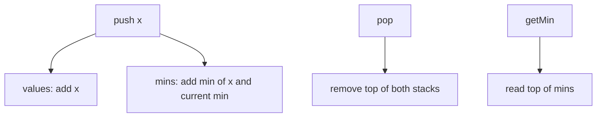
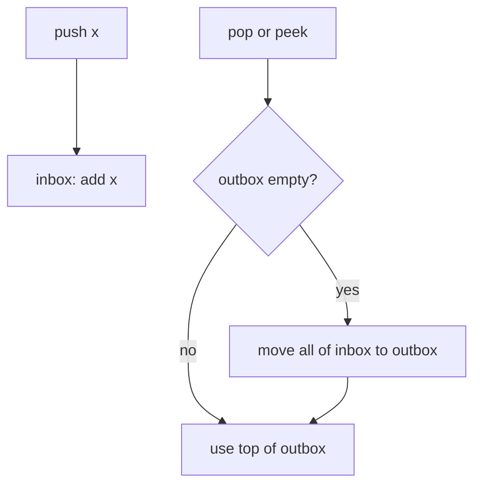
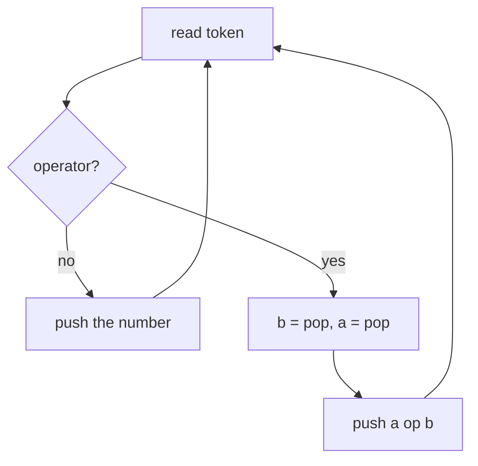
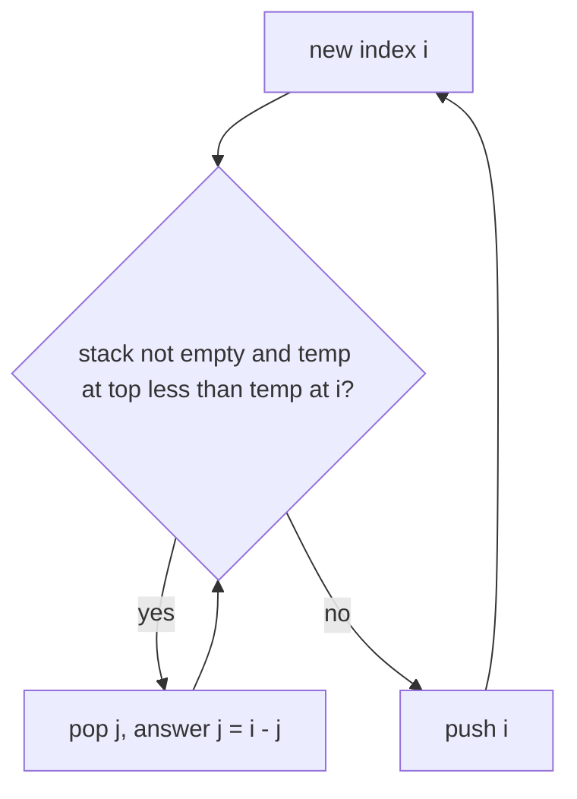
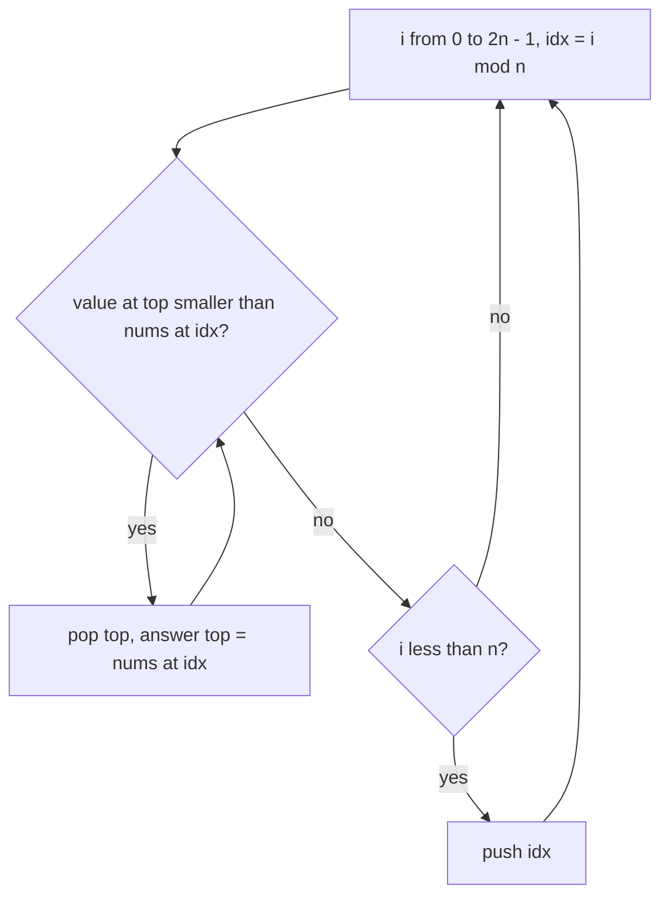
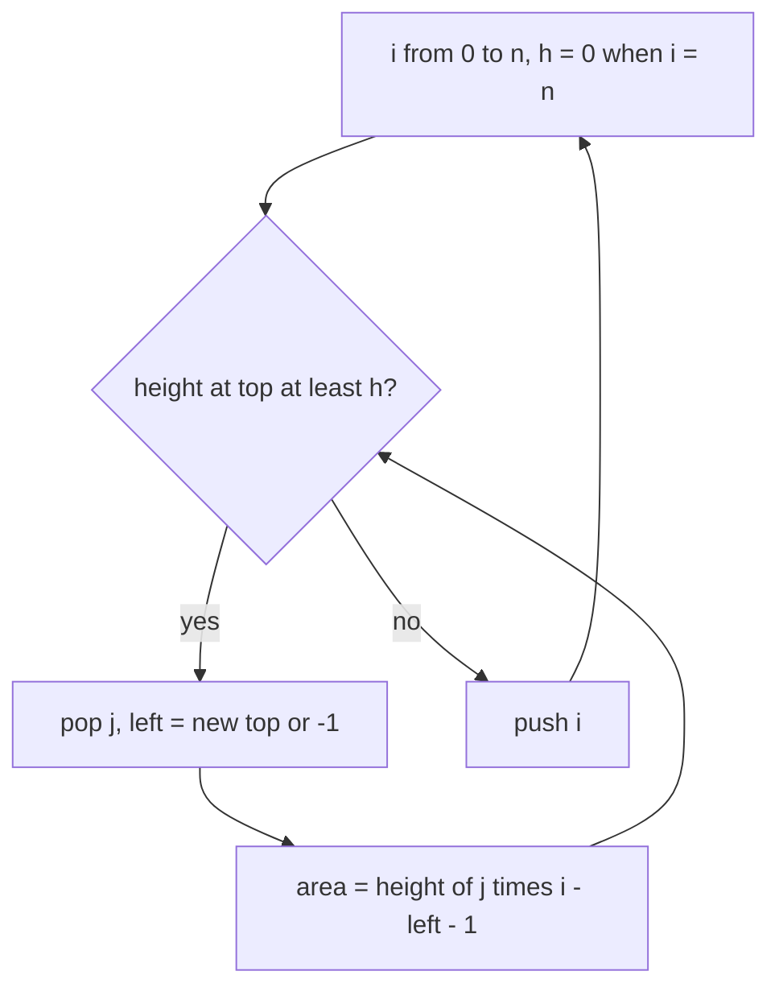

# Stacks, Queues & Monotonic Stack

[⬅ Back to index](../README.md)

Covers: stacks and queues as problem-solving tools: matching and nesting, evaluating expressions, and the monotonic stack for 'next greater/smaller' problems, including the hardest classic, the largest rectangle in a histogram.

---

## Matching, nesting & stack-based design

### 1. Valid Parentheses

**🟢 Easy** · ⭐ Product/FAANG favourite (commonly reported at Amazon, Meta)

<details>
<summary>Answer</summary>

**In short:** Brackets nest, and the most recently opened bracket must be the first one closed — that is exactly last-in-first-out, so use a stack. Push every opening bracket; on a closing bracket, the top of the stack must be its matching opener (pop it), otherwise the string is invalid. At the end the stack must be empty. O(n) time, O(n) space.

#### Problem

Given a string made only of `()[]{}`, decide whether every bracket is closed by the same type, in the correct order.

- `"()[]{}"` → `true`
- `"([{}])"` → `true`
- `"(]"` → `false`
- `"([)]"` → `false` (the `[` is still open when `)` arrives)

#### Clarifying questions & edge cases

- Empty string → `true` (nothing is unbalanced). Ask, but this is LeetCode's convention.
- Only the three bracket types, or other characters too? If other characters can appear, simply ignore them.
- Odd length → it can't be valid; a cheap early exit.
- A closing bracket with an empty stack (`"]"`) → invalid. Leftover openers at the end (`"(("`) → invalid. These two are the bugs people forget.

#### Brute force

Repeatedly delete adjacent pairs `"()"`, `"[]"`, `"{}"` until nothing changes; the string is valid if it ends empty. Each pass is O(n) and you may need O(n) passes, so O(n²). It works, and it's a nice way to *see* why a stack is right: the pair you delete is always the innermost one, which is always the top of the stack.

#### Key insight

When you meet a closing bracket, the only opener it is allowed to close is the **most recent unclosed** one. Anything opened earlier is still waiting outside it. "Most recent unclosed" is the top of a stack:

- Opening bracket → push it (it's now the innermost open bracket).
- Closing bracket → the top must be the matching opener. Pop it; the next opener out becomes the innermost again.

A mapping from closer to opener (`')' -> '('`) keeps the code short and avoids a chain of `if`s.

#### Walkthrough

`s = "([{}])"` then `s = "([)]"`

| char | action | stack after |
|---|---|---|
| `(` | push | `(` |
| `[` | push | `( [` |
| `{` | push | `( [ {` |
| `}` | top is `{` ✓ pop | `( [` |
| `]` | top is `[` ✓ pop | `(` |
| `)` | top is `(` ✓ pop | empty → **true** |

| char | action | stack after |
|---|---|---|
| `(` | push | `(` |
| `[` | push | `( [` |
| `)` | top is `[` but need `(` ✗ | **false** |

#### Kotlin

```kotlin
fun isValid(s: String): Boolean {
    if (s.length % 2 == 1) return false              // can't pair up an odd count
    val openerFor = mapOf(')' to '(', ']' to '[', '}' to '{')
    val stack = ArrayDeque<Char>()
    for (c in s) {
        val opener = openerFor[c]
        if (opener == null) {
            stack.addLast(c)                          // an opening bracket: now the innermost
        } else if (stack.isEmpty() || stack.removeLast() != opener) {
            return false                              // nothing to close, or wrong type
        }
    }
    return stack.isEmpty()                            // leftover openers = invalid
}
```

Use Kotlin's `ArrayDeque` (or `java.util.ArrayDeque`) as the stack. Avoid `java.util.Stack`: it extends `Vector`, so every call is synchronized and it exposes index-based methods a stack shouldn't have.

#### Swift

```swift
func isValid(_ s: String) -> Bool {
    let openerFor: [Character: Character] = [")": "(", "]": "[", "}": "{"]
    var stack: [Character] = []          // a Swift Array is the idiomatic stack
    for c in s {
        if let opener = openerFor[c] {
            // popLast() returns nil on an empty stack, so one guard covers both failure cases.
            guard let top = stack.popLast(), top == opener else { return false }
        } else {
            stack.append(c)
        }
    }
    return stack.isEmpty
}
```

Iterating `for c in s` over a Swift `String` gives `Character`s directly, so no index conversion is needed here.

#### Complexity

- **Time:** O(n) — each character is pushed and popped at most once.
- **Space:** O(n) — worst case is all openers, e.g. `"(((((("`.

#### Common mistakes

- Returning `true` without checking the stack is empty at the end (`"(("` passes the loop).
- Calling `pop`/`removeLast` on an empty stack (`"]"`) and crashing instead of returning `false`.
- Counting brackets instead of using a stack — counts accept `"([)]"`. Counting only works when there is **one** bracket type.

#### Follow-ups

- *Only one bracket type?* Replace the stack with a counter: `+1` on `(`, `-1` on `)`, fail if it ever goes negative, and it must end at 0. O(1) space.
- *Minimum Remove to Make Valid Parentheses* (Medium, a Meta favourite): stack of indices of unmatched `(`, and drop any `)` that has no partner; remove the leftover indices at the end.
- *Longest Valid Parentheses* (Hard): stack of indices with a "last invalid position" base at the bottom; length = `i - stack.top` after each match. A DP solution also exists — see [Dynamic Programming](19-dynamic-programming.md).

</details>

### 2. Min Stack

**🟡 Medium** · ⭐ Product/FAANG favourite

<details>
<summary>Answer</summary>

**In short:** Alongside every value, store the minimum of the stack **at the moment it was pushed** (a second stack, or pairs). Because a stack only ever changes at the top, the minimum below any element never changes while that element is there, so `getMin()` is just "read the top's stored minimum". All four operations are O(1); space is O(n).

#### Problem

Design a stack with `push(x)`, `pop()`, `top()` and `getMin()`, where **every** operation runs in O(1) time.

```
push(-2), push(0), push(-3)
getMin() → -3
pop()
top()    → 0
getMin() → -2
```

#### Clarifying questions & edge cases

- Will `pop`, `top` or `getMin` ever be called on an empty stack? (LeetCode guarantees no; in a real API, throw or return null.)
- Duplicates of the minimum (`push(1), push(1), pop()`) — the min must still be 1. This breaks naive "store a single min variable" designs.
- Value range: full `Int` range — matters for the "encoded value" trick below (it overflows `Int`).

#### Brute force

Keep a normal stack and scan it in `getMin()`: O(n) per call. Or keep a single `min` variable: push is easy, but after popping the current minimum you don't know the next one without rescanning. The real problem is **restoring the old minimum after a pop**.

#### Key insight

A stack is a history. When an element sits at depth `d`, everything below it is frozen until it's popped. So the minimum of "this element and everything below" is a fixed fact you can compute once, at push time:

`minAt[i] = min(value[i], minAt[i - 1])`

Popping removes the top value and its stored min together, and the new top already carries the correct minimum for the smaller stack. Nothing needs to be "restored" because it was never lost.



#### Walkthrough

| operation | values (bottom → top) | mins (bottom → top) | result |
|---|---|---|---|
| push(-2) | -2 | -2 | |
| push(0) | -2, 0 | -2, -2 | |
| push(-3) | -2, 0, -3 | -2, -2, -3 | |
| getMin() | | | -3 |
| pop() | -2, 0 | -2, -2 | |
| top() | | | 0 |
| getMin() | | | -2 |

#### Kotlin

```kotlin
class MinStack {
    private val values = ArrayDeque<Int>()
    private val mins = ArrayDeque<Int>()      // mins[i] = minimum of values[0..i]

    fun push(x: Int) {
        values.addLast(x)
        mins.addLast(if (mins.isEmpty()) x else minOf(x, mins.last()))
    }

    fun pop() {
        values.removeLast()
        mins.removeLast()                     // the min below is already correct
    }

    fun top(): Int = values.last()

    fun getMin(): Int = mins.last()
}
```

**Space-saving variant:** push onto `mins` only when `x <= mins.last()`, and pop from `mins` only when the popped value equals `mins.last()`. The `<=` (not `<`) is essential so duplicate minimums are each recorded. This saves space when values mostly increase, but the worst case is still O(n).

**O(1) extra space trick** (a common follow-up): store only one `min` and push an encoded value `2 * x - min` when `x < min`. When you pop a value smaller than `min`, you know it was encoded and can recover the previous minimum as `2 * min - encoded`. It needs `Long` to avoid overflow and is easy to get wrong; mention it, but code the two-stack version unless asked.

#### Complexity

- **Time:** O(1) for every operation — each touches only the top of two stacks.
- **Space:** O(n) — one extra stored minimum per element.

#### Common mistakes

- A single `min` variable and no history: after popping the minimum, `getMin()` is wrong.
- In the space-saving variant, pushing onto `mins` only on `x < min` — then `push(1), push(1), pop()` loses the min.
- Comparing boxed `Int`s with `===` in a variant that stores objects — use `==`.

#### Follow-ups

- *Max Stack with `popMax()`* (Hard): two stacks no longer suffice; use a doubly linked list plus a `TreeMap<Int, list of nodes>` for O(log n) operations.
- *Min Queue:* build it from two min stacks (the queue-from-two-stacks trick in [Implement Queue using Stacks](#3-implement-queue-using-stacks)), or use a monotonic deque as in Sliding Window Maximum — see [Two Pointers & Sliding Window](08-two-pointers-sliding-window.md).
- *Thread safety?* Wrap the operations in a lock; the two stacks must change together atomically.

</details>

### 3. Implement Queue using Stacks

**🟢 Easy**

<details>
<summary>Answer</summary>

**In short:** Use an `inbox` stack for pushes and an `outbox` stack for pops. When `outbox` is empty and you need the front, pour everything from `inbox` into `outbox` — that reverses the order, so the oldest element ends up on top. Each element is moved at most once, so every operation is **amortised O(1)**, even though a single pop can cost O(n).

#### Problem

Implement a FIFO queue (`push`, `pop`, `peek`, `empty`) using only standard stack operations (push to top, pop/peek from top, size, isEmpty).

```
push(1), push(2)
peek()  → 1
pop()   → 1
empty() → false
```

#### Clarifying questions & edge cases

- Will `pop`/`peek` be called on an empty queue? (LeetCode: no. In real code, throw.)
- Is amortised O(1) acceptable, or must every single operation be worst-case O(1)? (The two-stack queue is amortised; a worst-case O(1) version exists but is much more complex.)
- Interleaved pushes and pops — the main correctness trap.

#### Brute force

Keep one "main" stack in queue order and, on each `push`, move everything to a helper stack, push the new element, and move everything back. Push is O(n), pop is O(1). Correct but wasteful: elements are shuffled back and forth on every push.

#### Key insight

Reversing a stack once turns LIFO into FIFO. Pour the inbox into the outbox and the **oldest** element is on top of the outbox. The crucial rule: **only pour when the outbox is empty.** If the outbox still has elements, they are all older than anything in the inbox, so they must come out first; pouring new items on top of them would break the order.

**Amortised argument:** follow a single element. It is pushed onto `inbox` once, moved to `outbox` once, and popped from `outbox` once — three O(1) operations in its whole life. Over any sequence of `m` operations the total work is O(m), so the average per operation is O(1), even though one particular `pop` might move n elements.



#### Walkthrough

| operation | inbox (bottom → top) | outbox (bottom → top) | result |
|---|---|---|---|
| push(1) | 1 | | |
| push(2) | 1, 2 | | |
| peek() | — pour → | 2, 1 | 1 |
| push(3) | 3 | 2, 1 | |
| pop() | 3 | 2 | 1 |
| pop() | 3 | | 2 |
| pop() | — pour → | 3 → popped | 3 |

Notice that `3` waited in `inbox` while `2` (older) was still in `outbox` — that's the "only pour when empty" rule at work.

#### Kotlin

```kotlin
class MyQueue {
    private val inbox = ArrayDeque<Int>()     // newest on top
    private val outbox = ArrayDeque<Int>()    // oldest on top

    fun push(x: Int) {
        inbox.addLast(x)
    }

    fun pop(): Int {
        refill()
        return outbox.removeLast()
    }

    fun peek(): Int {
        refill()
        return outbox.last()
    }

    fun empty(): Boolean = inbox.isEmpty() && outbox.isEmpty()

    // Pour only when outbox is empty; otherwise its elements are older and must leave first.
    private fun refill() {
        if (outbox.isEmpty()) {
            while (inbox.isNotEmpty()) outbox.addLast(inbox.removeLast())
        }
    }
}
```

In a real Kotlin program you'd just use `ArrayDeque` as a queue (`addLast` / `removeFirst`); in Swift, an `Array` with `removeFirst()` is O(n), so either use the two-stack trick or keep a head index. See [Kotlin & Swift for Coding Interviews](03-kotlin-swift-for-interviews.md).

#### Complexity

- **Time:** `push` and `empty` O(1); `pop` and `peek` amortised O(1), worst case O(n) for the call that pours.
- **Space:** O(n) for the elements.

#### Common mistakes

- Pouring on every `pop` even when `outbox` isn't empty — breaks FIFO order.
- Pouring back from `outbox` to `inbox` after each pop — correct but O(n) per operation, losing the whole point.
- Saying "O(1)" without "amortised" — interviewers listen for that word.

#### Follow-ups

- *Implement Stack using Queues:* on each push, add to the queue then rotate the previous `size - 1` elements behind it, so the newest is at the front. Push O(n), pop O(1).
- *Where is this used for real?* Functional languages build immutable queues this way (two immutable lists), and it's the basis of the "min queue from two min stacks" trick.
- *Amortised analysis in general* — see [Complexity Analysis](02-complexity-analysis.md).

</details>

### 4. Simplify Path

**🟡 Medium**

<details>
<summary>Answer</summary>

**In short:** Split the path on `/` and treat it as a walk through directories with a stack: a normal name is pushed (go into it), `..` pops (go up, if not already at the root), and empty parts and `.` are ignored. Join the stack with `/` and put a `/` in front. O(n) time, O(n) space.

#### Problem

Given an absolute Unix-style path, return its canonical form: a single leading `/`, single slashes between names, no trailing slash, and no `.` or `..` components.

- `"/home/"` → `"/home"`
- `"/home//foo/"` → `"/home/foo"`
- `"/a/./b/../../c/"` → `"/c"`
- `"/../"` → `"/"` (you can't go above the root)
- `"/.../a"` → `"/.../a"` (`...` is an ordinary name)

#### Clarifying questions & edge cases

- Is the input always absolute (starts with `/`)? (Yes on LeetCode.)
- `..` at the root stays at the root — don't pop an empty stack.
- Multiple slashes produce empty parts after splitting — skip them.
- Only exactly `"."` and `".."` are special; `"..."`, `".hidden"` and `"a.."` are names.
- If everything cancels out, the answer is `"/"`, not `""`.

#### Brute force

Repeatedly apply string replacements (`"//"` → `"/"`, `"/./"` → `"/"`, remove `"/name/../"`) until nothing changes. It's fiddly, easy to get wrong with names like `...`, and O(n²) in the worst case. Thinking of the path as a sequence of moves is far cleaner.

#### Key insight

A path is a series of instructions from the root: "go into `a`", "stay here", "go up one level". Your current location is the list of directories you've entered and not yet left — and "go up" always leaves the **most recently entered** directory. Last in, first out: a stack.

| part | meaning | stack action |
|---|---|---|
| `""` (from `//` or edges) | nothing | skip |
| `"."` | stay | skip |
| `".."` | go up | pop if not empty |
| anything else | enter | push |

#### Walkthrough

`"/a/./b/../../c/"` splits into `["", "a", ".", "b", "..", "..", "c", ""]`.

| part | action | stack |
|---|---|---|
| `""` | skip | |
| `a` | push | a |
| `.` | skip | a |
| `b` | push | a, b |
| `..` | pop | a |
| `..` | pop | (empty) |
| `c` | push | c |
| `""` | skip | c |

Result: `"/" + "c"` = **`"/c"`**.

#### Kotlin

```kotlin
fun simplifyPath(path: String): String {
    val stack = ArrayDeque<String>()
    for (part in path.split('/')) {
        when (part) {
            "", "." -> {}                                     // empty (from "//") or "stay here"
            ".." -> if (stack.isNotEmpty()) stack.removeLast() // go up, but never above root
            else -> stack.addLast(part)                       // a real directory name
        }
    }
    return "/" + stack.joinToString("/")                      // empty stack gives "/"
}
```

Using the `ArrayDeque` as a stack *and* reading it front-to-back with `joinToString` is the convenient part: the bottom of the stack is the outermost directory.

#### Complexity

- **Time:** O(n) — splitting and joining are linear in the path length.
- **Space:** O(n) — the parts and the stack.

#### Common mistakes

- Popping on `..` when the stack is empty (crash) instead of ignoring it.
- Treating any part that starts with `.` as special — only `.` and `..` exactly are.
- Returning `""` when the stack is empty, instead of `"/"`.
- Building the result in reverse order by popping — the bottom of the stack comes first.

#### Follow-ups

- *Relative paths / a `cd` command* (Simplify Path's sibling): start the stack from the current directory's parts instead of empty, unless the argument starts with `/`.
- *Without `split`?* Walk the string with an index, reading one name at a time between slashes — same logic, O(1) extra besides the stack.
- *Symlinks?* Then `..` depends on the resolved target; a pure string stack is no longer enough — you'd need the file system.

</details>

### 5. Asteroid Collision

**🟡 Medium**

<details>
<summary>Answer</summary>

**In short:** Scan left to right with a stack of surviving asteroids. Only a **left-moving** new asteroid can hit something, and it can only hit **right-moving** asteroids on top of the stack. While that's the case, compare sizes: the smaller explodes (pop the top, or drop the new one), equal sizes both explode. If the new asteroid survives, push it. Each asteroid is pushed and popped at most once: O(n) time, O(n) space.

#### Problem

Each integer is an asteroid: the absolute value is its size, the sign its direction (positive = right, negative = left). All move at the same speed. When two meet, the smaller one explodes; equal sizes both explode. Return the state after all collisions.

- `[5, 10, -5]` → `[5, 10]` (`-5` hits `10` and explodes)
- `[8, -8]` → `[]`
- `[10, 2, -5]` → `[10]` (`-5` destroys `2`, then is destroyed by `10`)
- `[-2, -1, 1, 2]` → `[-2, -1, 1, 2]` (moving apart — no collisions)

#### Clarifying questions & edge cases

- Zero values? (No — LeetCode guarantees non-zero.)
- A left-mover with nothing on its left, or only left-movers on its left, never collides: `[-1, -2]` stays as is.
- A right-mover after a left-mover (`[-1, 1]`) never collides — they move apart. **Only "right then left" collides.**
- One left-mover can destroy a whole chain of smaller right-movers.

#### Brute force

Simulate in rounds: scan for any adjacent pair `(positive, negative)`, resolve it, and repeat until no such pair exists. Each round is O(n) and there can be O(n) rounds: O(n²).

#### Key insight

Look at the survivors so far, from left to right. Once processed, they can't collide with each other anymore (otherwise you'd have resolved it). A new asteroid `a`:

- If `a > 0` (moving right), nothing to its left can reach it, and it hasn't met anything to its right yet → push it.
- If `a < 0` (moving left), it will meet the **nearest** survivor to its left first — the top of the stack. If that top is moving right, they collide; resolve it, and if `a` survives, it continues to the next top. If the top is moving left (or the stack is empty), `a` flies away safely.

That "nearest one first, then the next one" pattern is why a stack fits.

#### Walkthrough

`[10, 2, -5]` then `[8, -8]`

| asteroid | stack before | what happens | stack after |
|---|---|---|---|
| 10 | | moving right → push | 10 |
| 2 | 10 | moving right → push | 10, 2 |
| -5 | 10, 2 | top 2 < 5 → pop 2, keep going | 10 |
| | 10 | top 10 > 5 → -5 explodes | **10** |

| asteroid | stack before | what happens | stack after |
|---|---|---|---|
| 8 | | push | 8 |
| -8 | 8 | equal → both explode | **(empty)** |

#### Kotlin

```kotlin
fun asteroidCollision(asteroids: IntArray): IntArray {
    val stack = ArrayDeque<Int>()
    for (a in asteroids) {
        var alive = true
        // Only a left-mover hitting a right-mover on top of the stack collides.
        while (alive && a < 0 && stack.isNotEmpty() && stack.last() > 0) {
            val top = stack.last()
            when {
                top < -a -> stack.removeLast()          // top explodes; a keeps flying left
                top == -a -> { stack.removeLast(); alive = false }   // both explode
                else -> alive = false                   // a explodes
            }
        }
        if (alive) stack.addLast(a)
    }
    return stack.toIntArray()                            // bottom-to-top is left-to-right
}
```

#### Complexity

- **Time:** O(n) — each asteroid is pushed at most once and popped at most once, so the inner loop runs O(n) times in total (amortised).
- **Space:** O(n) for the stack (which is also the output).

#### Common mistakes

- Treating `(negative on stack, positive new)` as a collision — they're moving apart.
- Forgetting the **equal** case (both disappear) or handling it by popping but still pushing `a`.
- Using `if` instead of `while`: one big left-mover may destroy several right-movers in a row.

#### Follow-ups

- *Different speeds?* Then order of collisions depends on time — this becomes Car Fleet II (Hard), solved with a monotonic stack of collision times. See [Car Fleet](#13-car-fleet).
- *Return the number of survivors only?* Same algorithm; return `stack.size`.
- *Why is it O(n) despite the nested loop?* Amortised argument: total pops ≤ total pushes ≤ n — the same reasoning as every monotonic stack below.

</details>

### 6. Decode String

**🟡 Medium** · ⭐ Product/FAANG favourite

<details>
<summary>Answer</summary>

**In short:** `k[...]` nests like brackets, so when you hit `[` you **save** the work in progress (the string built so far and the repeat count) on stacks and start a fresh string for the inside. When you hit `]`, pop the saved string and count, and append the inside `count` times to it. Digits build multi-digit counts; letters append to the current string. O(output length) time.

#### Problem

Decode a string encoded as `k[encoded]`, meaning `encoded` repeated `k` times; encodings can nest.

- `"3[a]2[bc]"` → `"aaabcbc"`
- `"3[a2[c]]"` → `"accaccacc"`
- `"2[abc]3[cd]ef"` → `"abcabccdcdcdef"`
- `"10[a]"` → `"aaaaaaaaaa"` (multi-digit count)

#### Clarifying questions & edge cases

- Is the input always valid (balanced brackets, a number before every `[`)? (Yes on LeetCode.)
- Counts can have several digits — build them as `k = k * 10 + digit`.
- Letters can appear outside any brackets (`"ef"` at the end), and before a nested group (`"a2[c]"`).
- Output size can be much larger than the input (`"100[100[a]]"` is 10,000 characters) — complexity depends on the output.

#### Brute force

Find an innermost `k[letters]` (one with no `[` inside), replace it with its expansion, and repeat until no brackets remain. Each replacement rebuilds the string, so it's roughly O(output × depth) and awkward to code. The stack version does the same "innermost first" work in a single pass.

#### Key insight

When you meet `[`, you're about to decode an inner string, but you're in the middle of building an outer one. Two things must be remembered until the matching `]`:

1. the outer string built so far, and
2. how many times the inner string must be repeated.

Nesting means the most recently saved context is the first to be resumed — a stack. Keep two stacks (or one stack of pairs):

- digit → `k = k * 10 + digit`
- `[` → push `(current, k)`, then `current = ""`, `k = 0`
- `]` → pop `(outer, times)`, `current = outer + current repeated times`
- letter → append to `current`

#### Walkthrough

`s = "3[a2[c]]"`

| char | action | counts stack | saved strings stack | current |
|---|---|---|---|---|
| `3` | k = 3 | | | `""` |
| `[` | save ("", 3), reset | 3 | `""` | `""` |
| `a` | append | 3 | `""` | `a` |
| `2` | k = 2 | 3 | `""` | `a` |
| `[` | save ("a", 2), reset | 3, 2 | `""`, `a` | `""` |
| `c` | append | 3, 2 | `""`, `a` | `c` |
| `]` | pop 2 and "a": "a" + "cc" | 3 | `""` | `acc` |
| `]` | pop 3 and "": "" + "acc"×3 | | | **`accaccacc`** |

#### Kotlin

```kotlin
fun decodeString(s: String): String {
    val counts = ArrayDeque<Int>()
    val saved = ArrayDeque<StringBuilder>()       // the outer string we paused at each '['
    var current = StringBuilder()
    var k = 0
    for (c in s) {
        when {
            c.isDigit() -> k = k * 10 + (c - '0')  // multi-digit counts
            c == '[' -> {
                counts.addLast(k)
                saved.addLast(current)
                current = StringBuilder()          // start decoding the inside fresh
                k = 0
            }
            c == ']' -> {
                val times = counts.removeLast()
                val inner = current.toString()
                current = saved.removeLast()       // resume the outer string
                repeat(times) { current.append(inner) }
            }
            else -> current.append(c)
        }
    }
    return current.toString()
}
```

**Recursive alternative:** a function `decode(i)` that reads letters and numbers until it sees `]`, and on `k[` calls itself for the inside and repeats the result. The call stack replaces the explicit stacks; it reads nicely but needs a shared index (a field or an `IntArray(1)`) to know where the inner call stopped.

#### Complexity

- **Time:** O(output length + input length) — every output character is appended a bounded number of times per nesting level; strictly, an inner character is copied once per enclosing level, so O(output × depth) in the worst case. Say "linear in the output size, times nesting depth for copying".
- **Space:** O(output length) for the strings, plus O(depth) for the stacks.

#### Common mistakes

- Reading the count as a single digit (`c - '0'`) — breaks `"10[a]"`.
- Forgetting to reset `k = 0` after pushing it — the next count gets polluted.
- Pushing only the count and losing the text before `[` (`"a2[c]"` → `"cc"` instead of `"acc"`).
- Using `String` concatenation in a loop instead of `StringBuilder` — quadratic copying.

#### Follow-ups

- *Encode instead (Encode String with Shortest Length, Hard):* interval DP over substrings — see [Dynamic Programming](19-dynamic-programming.md).
- *Return only the k-th character of the decoded string* (Decoded String at Index): don't build it; compute the decoded length, then walk backwards with `k %= size`.
- *Invalid input?* Validate brackets with the [Valid Parentheses](#1-valid-parentheses) stack first, and check that a number precedes every `[`.

</details>

## Evaluating expressions

### 7. Evaluate Reverse Polish Notation

**🟡 Medium**

<details>
<summary>Answer</summary>

**In short:** In postfix notation every operator applies to the two most recent values that haven't been used yet — so keep a stack of values. Push numbers; on an operator, pop the **right** operand, then the **left** operand, compute, and push the result. The single value left at the end is the answer. O(n) time, O(n) space.

#### Problem

Evaluate an arithmetic expression given as tokens in Reverse Polish (postfix) Notation, with `+ - * /` and integer division that truncates toward zero.

- `["2", "1", "+", "3", "*"]` → `((2 + 1) * 3)` = `9`
- `["4", "13", "5", "/", "+"]` → `(4 + (13 / 5))` = `6`
- `["3", "-4", "/"]` → `0` (truncation toward zero, not floor)

#### Clarifying questions & edge cases

- Is the expression always valid? (Yes on LeetCode; in production check the stack has 2 values before each operator and exactly 1 at the end.)
- Negative numbers like `"-11"` are numbers, not the `-` operator — compare the **whole token**, not its first character.
- Division by zero? (Not in the tests; ask.)
- Truncation: Kotlin, Java and Swift integer division already truncate toward zero; Python's `//` floors (a classic trap if you know Python).

#### Brute force

Repeatedly find the first operator, combine the two tokens before it into one value, and rebuild the list — O(n²). The stack makes each step O(1).

#### Key insight

Postfix needs no brackets and no precedence rules because the order of operations is baked into the token order: an operator always applies to the two values produced most recently. A stack holds exactly "values produced so far, most recent on top". The only subtle point is **operand order**: the first value popped is the **right** operand (`b`), the second is the left (`a`), so compute `a - b` and `a / b`.



#### Walkthrough

`["4", "13", "5", "/", "+"]`

| token | action | stack (bottom → top) |
|---|---|---|
| 4 | push | 4 |
| 13 | push | 4, 13 |
| 5 | push | 4, 13, 5 |
| / | b = 5, a = 13 → 13 / 5 = 2 | 4, 2 |
| + | b = 2, a = 4 → 6 | **6** |

#### Kotlin

```kotlin
fun evalRPN(tokens: Array<String>): Int {
    val stack = ArrayDeque<Int>()
    for (token in tokens) {
        when (token) {
            "+", "-", "*", "/" -> {
                val b = stack.removeLast()        // right operand was pushed last
                val a = stack.removeLast()
                stack.addLast(
                    when (token) {
                        "+" -> a + b
                        "-" -> a - b
                        "*" -> a * b
                        else -> a / b             // Int division truncates toward zero
                    }
                )
            }
            else -> stack.addLast(token.toInt()) // includes negatives like "-11"
        }
    }
    return stack.last()
}
```

Matching the whole token (`"-"`) rather than `token[0] == '-'` is what keeps `"-11"` a number.

#### Complexity

- **Time:** O(n) — one push or two pops plus a push per token.
- **Space:** O(n) — at most about n/2 + 1 values are on the stack at once.

#### Common mistakes

- Swapping operands: computing `b - a` or `b / a`.
- Checking `token[0]` to detect an operator — `"-11"` becomes an operator.
- Porting from Python and using floor division semantics.

#### Follow-ups

- *Convert infix to postfix* (shunting-yard algorithm): an operator stack; pop operators of higher or equal precedence before pushing a new one; `(` is pushed, `)` pops back to `(`. This is the general machinery behind [Basic Calculator II](#8-basic-calculator-ii).
- *Overflow?* Intermediate products can exceed `Int`; use `Long` if the constraints allow large values.
- *Evaluate prefix (Polish) notation?* Scan right to left with the same stack, and the first popped value is now the **left** operand.

</details>

### 8. Basic Calculator II

**🟡 Medium** · ⭐ Product/FAANG favourite (commonly reported at Meta)

<details>
<summary>Answer</summary>

**In short:** Split the expression into **terms** separated by `+` and `-`; inside a term, `*` and `/` are applied immediately. Keep a stack of finished terms (pushing `+num` or `-num`), and when the operator before a number is `*` or `/`, combine it with the top of the stack instead. The answer is the sum of the stack. The stack can be replaced by two variables (`result` and the open `last` term) for O(1) space. O(n) time.

#### Problem

Evaluate a string expression with non-negative integers, `+ - * /` and spaces (no parentheses). Integer division truncates toward zero. Don't use `eval`.

- `"3+2*2"` → `7`
- `" 3/2 "` → `1`
- `" 3+5 / 2 "` → `5`
- `"14-3/2"` → `13`

#### Clarifying questions & edge cases

- Parentheses? Not in II. (Basic Calculator I has `+ -` and parentheses; III has everything — see follow-ups.)
- Unary minus (`"-3+2"`)? Not in II's input; I handles it.
- Spaces anywhere — skip them, but don't let a space end a number by itself.
- Multi-digit numbers (`"123"`) — build with `num * 10 + digit`.
- Overflow: LeetCode guarantees the answer and intermediates fit in a 32-bit int.

#### Brute force

Two passes: first scan for `*` and `/` and collapse each into one number (rebuilding a token list), then sum the `+`/`-` list. Correct, but more code and an extra list. The single-pass version below is what interviewers expect.

#### Key insight

Precedence means a `+` or `-` **finishes** the previous term, while `*` or `/` **extends** it. So you never need to look ahead — you only need to remember the operator that came **before** the current number:

| previous operator | what to do with `num` |
|---|---|
| `+` | push `num` (a new term) |
| `-` | push `-num` (a new, negative term) |
| `*` | pop the top, push `top * num` |
| `/` | pop the top, push `top / num` (truncates toward zero, also for negative terms) |

You act on a number when you reach the **next** operator (or the end of the string, which is why a sentinel at the end is handy). Storing `-num` makes subtraction just addition, and `-3 / 2 = -1` in Kotlin truncates exactly as required.

Only the **top** of the stack is ever modified, and everything below it is just summed at the end — so you can replace the stack with `result` (sum of closed terms) and `last` (the open term). That's the O(1)-space version.

#### Walkthrough

`"14-3/2"`, using the stack version (a number is applied when the next operator or the end arrives):

| position | char | num | previous op | action | stack |
|---|---|---|---|---|---|
| 0-1 | `1`,`4` | 14 | `+` | | |
| 2 | `-` | 14 | `+` | push 14; op = `-` | 14 |
| 3 | `3` | 3 | `-` | | 14 |
| 4 | `/` | 3 | `-` | push -3; op = `/` | 14, -3 |
| 5 | `2` | 2 | `/` | | 14, -3 |
| end | | 2 | `/` | pop -3, push -3 / 2 = -1 | 14, -1 |

Sum = 14 + (-1) = **13**.

#### Kotlin

Stack version (easiest to explain):

```kotlin
fun calculate(s: String): Int {
    val stack = ArrayDeque<Int>()
    var num = 0
    var op = '+'                                   // the operator before the current number
    for (i in s.indices) {
        val c = s[i]
        if (c.isDigit()) num = num * 10 + (c - '0')
        // Apply num at an operator, or at the last character of the string.
        if ((!c.isDigit() && c != ' ') || i == s.length - 1) {
            when (op) {
                '+' -> stack.addLast(num)
                '-' -> stack.addLast(-num)
                '*' -> stack.addLast(stack.removeLast() * num)
                '/' -> stack.addLast(stack.removeLast() / num)
            }
            op = c
            num = 0
        }
    }
    return stack.sum()
}
```

O(1)-space version (what you offer as the optimisation):

```kotlin
fun calculateConstantSpace(s: String): Int {
    var result = 0      // sum of finished terms
    var last = 0        // the current term, still open to * and /
    var num = 0
    var op = '+'
    for (i in 0..s.length) {
        val c = if (i < s.length) s[i] else '+'    // sentinel flushes the final number
        when {
            c.isDigit() -> num = num * 10 + (c - '0')
            c == ' ' -> {}
            else -> {
                when (op) {
                    '+' -> { result += last; last = num }
                    '-' -> { result += last; last = -num }
                    '*' -> last *= num
                    '/' -> last /= num
                }
                op = c
                num = 0
            }
        }
    }
    return result + last
}
```

#### Complexity

- **Time:** O(n) — one pass over the characters.
- **Space:** O(n) for the stack version (one entry per term); O(1) for the two-variable version.

#### Common mistakes

- Applying the **current** operator to the number instead of the **previous** one.
- Forgetting the last number: with `if (operator)` only, the final number never gets processed — use `i == s.length - 1` or a sentinel.
- Letting a space trigger the "apply" branch (the `c != ' '` check) — `"3 + 2"` would push 3 twice.
- Using floor division for negative terms (a Python habit): `-3 / 2` must be `-1`.

#### Follow-ups

- *Basic Calculator I* (Hard; `+ -`, parentheses, unary minus): keep `result` and `sign`; on `(` push `result` and `sign` onto a stack and reset; on `)` pop and combine: `result = poppedResult + poppedSign * result`.
- *Basic Calculator III* (all operators and parentheses): recursion — on `(` recursively evaluate until the matching `)` and treat the returned value as a number in this II loop; or the shunting-yard two-stack algorithm from [Evaluate Reverse Polish Notation](#7-evaluate-reverse-polish-notation).
- *Expression Add Operators* (Hard): the same `last` trick for undoing a multiplication inside backtracking — see [Recursion & Backtracking](18-recursion-backtracking.md).

</details>

## Monotonic stack

### 9. Daily Temperatures

**🟡 Medium** · ⭐ Product/FAANG favourite

<details>
<summary>Answer</summary>

**In short:** This is the canonical **monotonic stack** problem: "for each element, find the next element to the right that's greater". Keep a stack of indices still waiting for a warmer day; their temperatures are decreasing from bottom to top. Each new day pops every waiting day that is colder than it — for each popped index, today is its answer. Every index is pushed and popped at most once, so O(n) time and O(n) space instead of O(n²).

#### Problem

Given daily temperatures, return for each day how many days you must wait for a warmer temperature (0 if never).

- `[73, 74, 75, 71, 69, 72, 76, 73]` → `[1, 1, 4, 2, 1, 1, 0, 0]`
- `[30, 40, 50, 60]` → `[1, 1, 1, 0]`
- `[30, 20, 10]` → `[0, 0, 0]`

#### Clarifying questions & edge cases

- "Warmer" means strictly greater — an equal temperature doesn't count.
- Days with no warmer day ahead get 0 (they're simply left on the stack at the end).
- Answer is a distance (`j - i`), so store **indices** on the stack, not temperatures.

#### Brute force

For each day, scan forward until a warmer day: O(n²) in the worst case (a decreasing sequence, or many equal values). A known O(n·range) trick exists because temperatures are in 30..100, but the stack is the general answer.

#### Key insight

Think of days that haven't found their warmer day yet as **waiting**. Two facts:

1. When a new day arrives, it answers every waiting day that is colder than it.
2. The waiting days are always in **decreasing** order of temperature from bottom to top. Why? If a warmer day arrived after a colder one, the colder one would have been answered (popped) already.

So the colder waiting days are all at the **top**, and you pop them one by one until the top is at least as warm as today. Then today joins the waiting list. That decreasing order is what "monotonic stack" means.

**Why O(n) despite the inner `while`:** each index is pushed once and popped at most once, so the total number of pops over the whole run is at most n.

#### The monotonic stack template (one idea, four questions)

| question for each `i` | stack order (bottom → top) | pop while | answer for popped `j` |
|---|---|---|---|
| next **greater** to the right | decreasing | `a[top] < a[i]` | `i` |
| next **smaller** to the right | increasing | `a[top] > a[i]` | `i` |
| previous greater / smaller | same orders | same conditions | after popping, the remaining top is `i`'s answer |

Two rules to remember: (1) **the element that pops you is your next greater/smaller; the element left below you after you're pushed is your previous one.** (2) Strict `<` vs `<=` decides how ties behave — choose deliberately (it matters in [Largest Rectangle in Histogram](#14-largest-rectangle-in-histogram) and sum-of-subarray-minimums problems).



#### Walkthrough

`[73, 74, 75, 71, 69, 72, 76, 73]` — the stack shows `index(temp)`.

| i | temp | popped (answer set) | stack after |
|---|---|---|---|
| 0 | 73 | | 0(73) |
| 1 | 74 | 0 → 1 | 1(74) |
| 2 | 75 | 1 → 1 | 2(75) |
| 3 | 71 | | 2(75), 3(71) |
| 4 | 69 | | 2(75), 3(71), 4(69) |
| 5 | 72 | 4 → 1, 3 → 2 | 2(75), 5(72) |
| 6 | 76 | 5 → 1, 2 → 4 | 6(76) |
| 7 | 73 | | 6(76), 7(73) |

Indices 6 and 7 never get popped: their answer stays 0. Result: `[1, 1, 4, 2, 1, 1, 0, 0]`.

#### Kotlin

```kotlin
fun dailyTemperatures(temperatures: IntArray): IntArray {
    val answer = IntArray(temperatures.size)             // default 0 = never warmer
    val waiting = ArrayDeque<Int>()                      // indices, temps decreasing bottom → top
    for (i in temperatures.indices) {
        while (waiting.isNotEmpty() && temperatures[waiting.last()] < temperatures[i]) {
            val j = waiting.removeLast()
            answer[j] = i - j                            // today is j's first warmer day
        }
        waiting.addLast(i)
    }
    return answer
}
```

For maximum speed you can replace the `ArrayDeque<Int>` with an `IntArray` plus a `top` pointer — no boxing. Worth mentioning, not necessary.

#### Swift

```swift
func dailyTemperatures(_ temperatures: [Int]) -> [Int] {
    var answer = [Int](repeating: 0, count: temperatures.count)
    var waiting: [Int] = []                // indices still waiting for a warmer day
    for (i, t) in temperatures.enumerated() {
        while let j = waiting.last, temperatures[j] < t {
            waiting.removeLast()
            answer[j] = i - j
        }
        waiting.append(i)
    }
    return answer
}
```

`while let j = waiting.last, condition` is the idiomatic Swift way to write "while the stack is non-empty and its top satisfies something".

#### Complexity

- **Time:** O(n) amortised — n pushes and at most n pops in total.
- **Space:** O(n) — the stack in the worst case (a decreasing sequence) plus the output.

#### Common mistakes

- Storing temperatures instead of indices — you then can't compute the distance.
- Using `<=` in the pop condition — equal temperatures would wrongly count as "warmer".
- Believing the nested loop is O(n²) and abandoning a correct solution; explain the amortised argument instead.

#### Follow-ups

- *Right-to-left version:* iterate from the end and keep a stack of candidates to the right; pop everything `<= t[i]` (they're useless for anyone further left), then the top is `i`'s answer. Same complexity; some find it easier to reason about.
- *O(1) extra space:* iterate from the right and jump using already-computed answers (`j += answer[j]`) — still amortised O(n).
- *Sliding Window Maximum* uses the same "pop the dominated elements" idea in a **deque** (a monotonic queue), and *Trapping Rain Water* has a monotonic-stack solution too — both are covered in [Two Pointers & Sliding Window](08-two-pointers-sliding-window.md).

</details>

### 10. Next Greater Element I and II (circular)

**🟡 Medium**

<details>
<summary>Answer</summary>

**In short:** Both are the [Daily Temperatures](#9-daily-temperatures) monotonic stack, returning a **value** instead of a distance. **I** (Easy): run the stack over `nums2` once, record `nextGreater[value]` in a map, then answer each query from `nums1` by lookup — O(n + m). **II** (Medium, circular array): loop over the array **twice** (`i % n`) so elements near the end can find a greater element at the start; only push indices during the first pass. O(n) time, O(n) space.

#### Problem

**I.** `nums1` is a subset of `nums2` (all values distinct). For each `x` in `nums1`, find the first element to the right of `x`'s position **in `nums2`** that is greater than `x`, or -1.

- `nums1 = [4, 1, 2]`, `nums2 = [1, 3, 4, 2]` → `[-1, 3, -1]`

**II.** For a **circular** array (after the last element comes the first), return the next greater value for every element, or -1.

- `[1, 2, 1]` → `[2, -1, 2]` (the last `1` wraps around to find `2`)
- `[1, 2, 3, 4, 3]` → `[2, 3, 4, -1, 4]`

#### Clarifying questions & edge cases

- I: values are distinct, so a value-to-answer map is safe. If duplicates were allowed, you'd need index-based answers.
- II: duplicates **are** allowed (`[1, 1, 1]` → `[-1, -1, -1]`), so store indices on the stack.
- II: the maximum element always gets -1 — nothing is greater, even going all the way round.
- "Greater" is strict.

#### Brute force

I: for each query, find it in `nums2` and scan right — O(m · n). II: for each `i`, scan `i+1, i+2, …` wrapping around up to n-1 steps — O(n²).

#### Key insight

**I.** The queries don't change the underlying question; it's always "next greater in `nums2`". So compute it once for **all** of `nums2` with the monotonic stack (pop smaller values when a bigger one arrives, the arriving value is their answer), store it in a hash map, and answer queries in O(1) each.

**II.** In a circular array, the next greater element of `i` is either to its right, or at the start of the array (before `i`). Iterating `2n` times over `i % n` simulates "the array followed by itself", so every element sees everything after it in circular order. In the second pass we only **pop** (answer waiting elements) — pushing again would be pointless, since those elements already have their final answer or are waiting already.



#### Walkthrough

**II** on `[1, 2, 1]` (n = 3), stack holds indices. Answers start as -1.

| i | idx | value | popped → answer | stack after |
|---|---|---|---|---|
| 0 | 0 | 1 | | 0 |
| 1 | 1 | 2 | 0 → 2 | 1 |
| 2 | 2 | 1 | | 1, 2 |
| 3 | 0 | 1 | (1 is not > 1) | 1, 2 (no push) |
| 4 | 1 | 2 | 2 → 2 | 1 |
| 5 | 2 | 1 | | 1 |

Index 1 (value 2, the maximum) is never popped: `[2, -1, 2]`.

#### Kotlin

```kotlin
// Next Greater Element I
fun nextGreaterElement(nums1: IntArray, nums2: IntArray): IntArray {
    val nextGreater = HashMap<Int, Int>()
    val stack = ArrayDeque<Int>()                     // values, decreasing bottom → top
    for (x in nums2) {
        while (stack.isNotEmpty() && stack.last() < x) {
            nextGreater[stack.removeLast()] = x       // x is the first bigger value to its right
        }
        stack.addLast(x)
    }
    return IntArray(nums1.size) { nextGreater[nums1[it]] ?: -1 }
}

// Next Greater Element II (circular)
fun nextGreaterElements(nums: IntArray): IntArray {
    val n = nums.size
    val answer = IntArray(n) { -1 }
    val stack = ArrayDeque<Int>()                     // indices waiting for a greater value
    for (i in 0 until 2 * n) {
        val idx = i % n
        while (stack.isNotEmpty() && nums[stack.last()] < nums[idx]) {
            answer[stack.removeLast()] = nums[idx]
        }
        if (i < n) stack.addLast(idx)                 // second lap only answers, never waits
    }
    return answer
}
```

#### Complexity

- **I — Time:** O(n + m) for `nums2` of size n and `nums1` of size m. **Space:** O(n) for the map and stack.
- **II — Time:** O(n) — 2n iterations, n pushes, at most n pops. **Space:** O(n).

#### Common mistakes

- In I, searching `nums2` for each query (O(m·n)) instead of precomputing.
- In II, pushing during the second lap too — harmless for correctness here but wasted work, and in variants it double-counts.
- In II, storing values instead of indices — with duplicates you can't tell which element to answer.
- Doubling the array physically (`nums + nums`) — works, but `i % n` avoids the copy.

#### Follow-ups

- *Next Greater Element III* (Medium): a different problem — the next permutation of the digits of a number. See [Problem-Solving Tricks](06-problem-solving-tricks.md) for next permutation.
- *Next greater node in a linked list:* copy values into a list, then the same stack.
- *Previous greater element?* Same pass: after popping, the element left on top (if any) is the current element's previous greater. That's the core of [Online Stock Span](#11-online-stock-span).

</details>

### 11. Online Stock Span

**🟡 Medium**

<details>
<summary>Answer</summary>

**In short:** The span of today's price is the number of consecutive days, ending today, with price ≤ today's — i.e. the distance back to the **previous greater** price. Keep a stack of `(price, span)` pairs with prices strictly decreasing. When a new price arrives, pop every pair with price ≤ it and **add their spans to today's span** (those days are all covered by today), then push `(price, span)`. Each price is pushed and popped once: amortised O(1) per call.

#### Problem

Design `StockSpanner` with `next(price)`, called once per day, returning today's span: how many consecutive days up to and including today had a price ≤ today's.

Prices `100, 80, 60, 70, 60, 75, 85` → spans `1, 1, 1, 2, 1, 4, 6`.

#### Clarifying questions & edge cases

- "Less than **or equal**" — equal prices extend the span.
- It's **online**: you get one price at a time and must answer immediately (no look-ahead, no array of all prices).
- Up to 10⁴ calls on LeetCode — O(n) per call would be fine there, but interviewers want the amortised O(1).

#### Brute force

Store all prices; for each new price, walk backwards while prices are ≤ today. O(n) per call, O(n²) for a decreasing-then-spiking series.

#### Key insight

When today's price `p` beats yesterday's, it also beats everything yesterday already "covered" in its span — so you don't need to walk those days one by one. Jump over them by adding yesterday's span. Generalised: keep only prices that are still **useful as barriers**. A day whose price is ≤ some later price can never be the barrier for a future day (the later, higher day would stop the walk first). Remove it, but keep its span folded into the day that removed it.

What's left on the stack is a strictly decreasing sequence of prices — the monotonic stack — and each entry's span counts itself plus every day it absorbed.

#### Walkthrough

| price | popped (span) | today's span | stack after (price, span) |
|---|---|---|---|
| 100 | | 1 | (100,1) |
| 80 | | 1 | (100,1) (80,1) |
| 60 | | 1 | (100,1) (80,1) (60,1) |
| 70 | (60,1) | 1 + 1 = **2** | (100,1) (80,1) (70,2) |
| 60 | | 1 | (100,1) (80,1) (70,2) (60,1) |
| 75 | (60,1), (70,2) | 1 + 1 + 2 = **4** | (100,1) (80,1) (75,4) |
| 85 | (75,4), (80,1) | 1 + 4 + 1 = **6** | (100,1) (85,6) |

#### Kotlin

```kotlin
class StockSpanner {
    // Pairs of (price, span); prices strictly decreasing bottom → top.
    private val prices = ArrayDeque<Int>()
    private val spans = ArrayDeque<Int>()

    fun next(price: Int): Int {
        var span = 1                                   // today itself
        while (prices.isNotEmpty() && prices.last() <= price) {
            prices.removeLast()
            span += spans.removeLast()                 // absorb the days that one covered
        }
        prices.addLast(price)
        spans.addLast(span)
        return span
    }
}
```

Alternative: keep a running day counter and a stack of `(price, dayIndex)`; the span is `today - indexOfPreviousGreater` (or `today + 1` if the stack is empty). Same idea expressed as "previous greater element".

#### Complexity

- **Time:** amortised O(1) per `next` — each price is pushed once and popped at most once over all calls; a single call can be O(n).
- **Space:** O(n) in the worst case (strictly decreasing prices are never popped).

#### Common mistakes

- Popping with `<` instead of `<=` — equal prices must be absorbed.
- Starting `span` at 0 — today always counts.
- Keeping a full price history and walking it — correct but O(n) per call.

#### Follow-ups

- *Offline version over an array:* it's exactly "distance to previous greater element", computed with one left-to-right monotonic stack pass.
- *Sum of Subarray Minimums* (Medium): for each element, previous-smaller and next-smaller distances (two monotonic stacks) give how many subarrays it's the minimum of; mind strict vs non-strict on one side to avoid double counting.
- *Stock problems with buying/selling* are a different family — see [Dynamic Programming](19-dynamic-programming.md) and [Two Pointers & Sliding Window](08-two-pointers-sliding-window.md).

</details>

### 12. Remove K Digits

**🟡 Medium**

<details>
<summary>Answer</summary>

**In short:** To make a number as small as possible, the leftmost digits matter most, so greedily remove any digit that is **larger than the digit after it** — scanning left to right with a stack, pop while the top is bigger than the current digit and you still have removals left. That keeps the stack non-decreasing (a monotonic stack). If removals remain at the end, cut them from the tail (the largest digits). Strip leading zeros; return `"0"` if nothing is left. O(n) time, O(n) space.

#### Problem

Given a non-negative integer as a string `num` and an integer `k`, remove exactly `k` digits so that the remaining number is as small as possible.

- `num = "1432219", k = 3` → `"1219"`
- `num = "10200", k = 1` → `"200"` (remove the `1`; leading zeros are dropped)
- `num = "10", k = 2` → `"0"`
- `num = "12345", k = 2` → `"123"` (increasing: remove from the end)

#### Clarifying questions & edge cases

- `k` ≤ `num.length` (guaranteed). If `k == num.length`, the answer is `"0"`.
- Leading zeros in the result must be removed, but zeros inside the number stay.
- The number can be up to 10⁵ digits — you can't convert it to `Long`, and trying all subsets is impossible.

#### Brute force

Try every way to remove k digits — C(n, k) options. Or do k rounds of "remove the single digit that gives the smallest result", each O(n) to find (the first digit bigger than its successor): O(n·k). That second idea is already the right greedy, just slow.

#### Key insight

Compare two numbers of the same length: the first differing digit from the left decides. So to minimise, make the **first** digit as small as possible, then the second, and so on.

Where should one removal go? Find the first position where a digit is **bigger than the next digit** (a "peak") and remove it — this makes that position smaller and leaves everything to the left unchanged. If the digits are non-decreasing, there's no peak and removing the last digit is best.

Doing that repeatedly is the stack algorithm: the stack holds the digits kept so far, always non-decreasing. When a new digit `d` is smaller than the top, the top is a peak — pop it (if removals remain) and check again, because the new top may also be bigger than `d`.

#### Walkthrough

`num = "1432219", k = 3`

| digit | pops (k left after) | stack after |
|---|---|---|
| 1 | | 1 |
| 4 | | 1 4 |
| 3 | 4 > 3 pop (k = 2) | 1 3 |
| 2 | 3 > 2 pop (k = 1) | 1 2 |
| 2 | 2 > 2? no | 1 2 2 |
| 1 | 2 > 1 pop (k = 0) | 1 2 1 |
| 9 | k = 0, no pops | 1 2 1 9 |

k is 0, no leading zeros → **`"1219"`**.

For `"10200", k = 1`: `1`, then `0` pops `1` (k = 0), giving `0 2 0 0` → strip leading zero → `"200"`.

#### Kotlin

```kotlin
fun removeKdigits(num: String, k: Int): String {
    var remaining = k
    val stack = StringBuilder()                        // kept digits, non-decreasing
    for (d in num) {
        // The top is a "peak" before a smaller digit: removing it makes the number smaller.
        while (remaining > 0 && stack.isNotEmpty() && stack.last() > d) {
            stack.deleteCharAt(stack.length - 1)
            remaining--
        }
        stack.append(d)
    }
    stack.setLength(stack.length - remaining)          // leftovers: drop the largest tail digits
    val firstNonZero = stack.indexOfFirst { it != '0' }
    return if (firstNonZero == -1) "0" else stack.substring(firstNonZero)
}
```

A `StringBuilder` works as a character stack (`append`, `deleteCharAt(last)`, `last()`) and avoids converting back to a string at the end.

#### Complexity

- **Time:** O(n) — each digit is appended once and deleted at most once.
- **Space:** O(n) for the builder.

#### Common mistakes

- Forgetting the leftover removals when the digits are increasing (`"12345", k = 2` must become `"123"`).
- Returning `""` instead of `"0"` when everything is removed or only zeros remain.
- Stripping leading zeros with `toInt()`/`toLong()` — overflows for long inputs.
- Popping on `>=` — equal digits shouldn't be removed early; it doesn't change the value but wastes removals that could hit a real peak later.

#### Follow-ups

- *Remove Duplicate Letters / Smallest Subsequence of Distinct Characters* (Medium): same monotonic-stack greedy, but you may only pop a letter if it appears again later, and you skip letters already in the stack.
- *Largest number after removing k digits?* Mirror it: pop while the top is **smaller** than the current digit.
- *Create Maximum Number* (Hard): this greedy picks the best subsequence of each length from two arrays, then merges them.

</details>

### 13. Car Fleet

**🟡 Medium**

<details>
<summary>Answer</summary>

**In short:** Sort cars by starting position, closest to the target first, and compute each car's arrival time if it drove alone: `(target - position) / speed`. Walking from the front, a car whose time is **≤** the fleet ahead of it catches up and joins that fleet (it's slowed down to the fleet's time). A car whose time is **greater** can't catch up, so it starts a new fleet. The fleet times form a stack that only grows with increasing times; the answer is its size. O(n log n) time for the sort.

#### Problem

`n` cars drive toward `target` on a one-lane road. Car `i` starts at `position[i]` with `speed[i]`. A faster car can't pass; when it catches up, it drives at the slower car's speed and they form a **fleet**. A car catching up exactly at the target also joins the fleet. How many fleets arrive?

- `target = 12, position = [10, 8, 0, 5, 3], speed = [2, 4, 1, 1, 3]` → `3`
- `target = 10, position = [3], speed = [3]` → `1`
- `target = 100, position = [0, 2, 4], speed = [4, 2, 1]` → `1`

#### Clarifying questions & edge cases

- Positions are distinct (guaranteed); all are less than `target`.
- Catching up exactly at the target counts as the same fleet — so the comparison is `<=`, not `<`.
- Floating-point times: equal times must compare equal. With these constraints doubles work in practice; to be exact, compare `(target - p1) * s2` with `(target - p2) * s1` using `Long`.

#### Brute force

Simulate time step by step (or event by event, finding the next collision each time) and merge cars as they meet. Collisions happen at fractional times, so step simulation is inexact, and event simulation is O(n²). Too complicated — there's a much simpler view.

#### Key insight

Only the car **directly ahead** can block a car (single lane, no passing). So process cars from the one closest to the target backwards:

- The front car leads its own fleet; its arrival time is `t`.
- The next car would arrive at its own time `t2`. If `t2 <= t`, it would have reached the car ahead at or before the target, so it joins that fleet and arrives at time `t` — its own speed no longer matters.
- If `t2 > t`, it never catches up: it leads a new fleet with time `t2`, and becomes the "car ahead" for everything behind it.

So the fleet arrival times, from front to back, strictly increase — a monotonic stack. You only ever compare against the top, so a single variable (`slowestAhead`) is enough, but explaining it as a stack shows the pattern.

#### Walkthrough

`target = 12`. Sorted by position, closest first:

| position | speed | time alone | compare with top | fleets (stack of times) |
|---|---|---|---|---|
| 10 | 2 | 1.0 | empty → new fleet | 1.0 |
| 8 | 4 | 1.0 | 1.0 ≤ 1.0 → joins | 1.0 |
| 5 | 1 | 7.0 | 7.0 > 1.0 → new fleet | 1.0, 7.0 |
| 3 | 3 | 3.0 | 3.0 ≤ 7.0 → joins | 1.0, 7.0 |
| 0 | 1 | 12.0 | 12.0 > 7.0 → new fleet | 1.0, 7.0, 12.0 |

Three fleets.

#### Kotlin

```kotlin
fun carFleet(target: Int, position: IntArray, speed: IntArray): Int {
    val order = position.indices.sortedByDescending { position[it] }   // closest to target first
    val fleetTimes = ArrayDeque<Double>()                // increasing arrival times, front to back
    for (i in order) {
        val time = (target - position[i]).toDouble() / speed[i]
        if (fleetTimes.isEmpty() || time > fleetTimes.last()) {
            fleetTimes.addLast(time)                     // can't catch up: leads a new fleet
        }                                                // else: joins the fleet ahead
    }
    return fleetTimes.size
}
```

Only `fleetTimes.last()` is ever read, so replacing the stack with one `Double` and a counter gives O(1) extra space beyond the sort.

#### Complexity

- **Time:** O(n log n) for sorting; the scan is O(n). (Bucket sort by position gives O(n + target) if positions are small.)
- **Space:** O(n) for the sorted order (and the stack).

#### Common mistakes

- Processing from the back (smallest position) first — the blocking relationship goes from front to back.
- Using `<` instead of `<=`: a car meeting the fleet exactly at the target joins it.
- Integer division for the time: `(12 - 10) / 4` would be 0 — convert to `Double` (or use cross-multiplication).
- Trying to simulate actual collisions.

#### Follow-ups

- *Car Fleet II* (Hard): return the time each car collides with the car ahead. Go from the front with a stack of cars; pop cars that are faster than the current one or that will have already merged into a fleet before the current car could reach them; the remaining top gives the collision time.
- *Exact comparison:* compare `(target - p1).toLong() * s2` vs `(target - p2).toLong() * s1` instead of dividing.
- *Related "only the neighbour matters" stack problem:* [Asteroid Collision](#5-asteroid-collision).

</details>

### 14. Largest Rectangle in Histogram

**🔴 Hard** · ⭐ Product/FAANG favourite

<details>
<summary>Answer</summary>

**In short:** The best rectangle uses some bar's full height and extends left and right until it hits a **shorter** bar. So for each bar you need its previous-smaller and next-smaller indices — a monotonic stack gives both in one pass. Keep indices with increasing heights; when the current bar is shorter than the top, pop the top: the current index is its next-smaller, and the new top is its previous-smaller, so its rectangle is `height × (i - newTop - 1)`. A sentinel height 0 at the end flushes the stack. O(n) time, O(n) space.

#### Problem

Given bar heights of width 1, return the area of the largest rectangle that fits inside the histogram.

- `[2, 1, 5, 6, 2, 3]` → `10` (the bars 5 and 6, height 5, width 2)
- `[2, 4]` → `4`
- `[2, 2, 2]` → `6`

#### Clarifying questions & edge cases

- Empty array → 0. A single bar → its height.
- Heights can be 0 — a 0 bar splits the histogram.
- Overflow: LeetCode limits (n ≤ 10⁵, heights ≤ 10⁴) keep the area ≤ 10⁹, which fits in `Int`; use `Long` if limits are larger.
- Equal heights: the algorithm must still give the full width (see the `>=` note below).

#### Brute force

For every pair `(i, j)`, the rectangle's height is `min(heights[i..j])`; keep the running minimum as `j` grows: O(n²). Or, for each bar, expand left and right while bars are at least as tall: also O(n²) in the worst case (all equal heights). Say the "expand from each bar" version out loud — it leads straight to the insight.

#### Key insight

Any maximal rectangle is limited by its **shortest** bar, and that bar's height is the rectangle's height. So it's enough to consider, for each bar `j`, the widest rectangle with exactly height `heights[j]`:

- it extends left until just after the **previous smaller** bar `L`, and
- right until just before the **next smaller** bar `R`,
- so its area is `heights[j] * (R - L - 1)`.

With an increasing monotonic stack, both come for free at the moment `j` is popped:

- `j` gets popped by `i` because `heights[i] < heights[j]`, and nothing between them was smaller (otherwise it would have popped `j` first) → **`R = i`**.
- After popping, the element below `j` in the stack is smaller than `j` and everything between them was taller (they were popped earlier) → **`L = new top`**, or `-1` if the stack is empty (no smaller bar on the left, so the rectangle reaches index 0).

A final bar of height 0 (the sentinel at `i = n`) is smaller than everything, so every remaining bar gets popped and measured.



#### Walkthrough

`[2, 1, 5, 6, 2, 3]`, stack shows `index(height)`.

| i | h | pops: bar → width → area | best | stack after |
|---|---|---|---|---|
| 0 | 2 | | 0 | 0(2) |
| 1 | 1 | 0(2): left -1, width 1 → 2 | 2 | 1(1) |
| 2 | 5 | | 2 | 1(1) 2(5) |
| 3 | 6 | | 2 | 1(1) 2(5) 3(6) |
| 4 | 2 | 3(6): left 2, width 1 → 6; 2(5): left 1, width 2 → **10** | 10 | 1(1) 4(2) |
| 5 | 3 | | 10 | 1(1) 4(2) 5(3) |
| 6 | 0 | 5(3): width 1 → 3; 4(2): left 1, width 4 → 8; 1(1): left -1, width 6 → 6 | 10 | 6(0) |

Answer **10**: bar 2 (height 5) spans indices 2..3.

**Ties:** popping on `>=` means for equal heights, the earlier bar is popped by the later one with a too-short width — but the later bar has the same height and is measured later with the full width. With `[2, 2, 2]` the last bar is popped by the sentinel with left = -1, width 3 → 6. Either `>` or `>=` gives the right answer; just don't mix them up within one solution.

#### Kotlin

```kotlin
fun largestRectangleArea(heights: IntArray): Int {
    val n = heights.size
    val stack = ArrayDeque<Int>()                      // indices, heights increasing bottom → top
    var best = 0
    for (i in 0..n) {
        val h = if (i == n) 0 else heights[i]          // sentinel 0 flushes the stack at the end
        while (stack.isNotEmpty() && heights[stack.last()] >= h) {
            val height = heights[stack.removeLast()]
            val left = if (stack.isEmpty()) -1 else stack.last()   // previous smaller bar
            best = maxOf(best, height * (i - left - 1))            // i is the next smaller bar
        }
        stack.addLast(i)
    }
    return best
}
```

#### Swift

```swift
func largestRectangleArea(_ heights: [Int]) -> Int {
    let n = heights.count
    var stack: [Int] = []              // indices, heights increasing bottom → top
    var best = 0
    for i in 0...n {                   // 0...n includes the sentinel step i == n
        let h = i == n ? 0 : heights[i]
        while let top = stack.last, heights[top] >= h {
            stack.removeLast()
            let left = stack.last ?? -1
            best = max(best, heights[top] * (i - left - 1))
        }
        stack.append(i)
    }
    return best
}
```

Swift's `Int` is 64-bit on all modern platforms, so overflow isn't a concern here.

#### Complexity

- **Time:** O(n) — each index is pushed once and popped once.
- **Space:** O(n) — the stack holds at most n + 1 indices.

#### Common mistakes

- Using `i - top` as the width instead of `i - newTop - 1` — this ignores the taller bars to the left that were popped earlier but still belong to the rectangle.
- Forgetting the sentinel (or a final cleanup loop), so bars in an increasing run are never measured (`[1, 2, 3]` would return 0).
- Reading `heights[i]` when `i == n` — guard the sentinel step.
- Computing width with `left = -1` wrong when the stack becomes empty: the rectangle then spans `0..i-1`, width `i`.

#### Follow-ups

- *Maximal Rectangle* (Hard, a binary matrix): treat each row as the base of a histogram where `height[c]` counts consecutive 1s ending at that row, and run this algorithm per row — O(rows × cols).
- *Trapping Rain Water with a stack:* keep a **decreasing** stack of indices; when a taller bar arrives, pop the bottom of a "valley", and the water above it is `(min(left wall, right wall) - valley height) × distance between the walls`, filled layer by layer. O(n) time and space — the two-pointer O(1)-space version is in [Two Pointers & Sliding Window](08-two-pointers-sliding-window.md).
- *Two-pass version:* compute `prevSmaller[]` and `nextSmaller[]` arrays with two monotonic stack passes, then take the max of `h[j] * (next[j] - prev[j] - 1)`. Easier to debug, same complexity.

</details>

---

[⬅ Previous: Binary Search](10-binary-search.md) · [⬅ Back to index](../README.md) · [Next: Linked Lists ➡](12-linked-lists.md)
