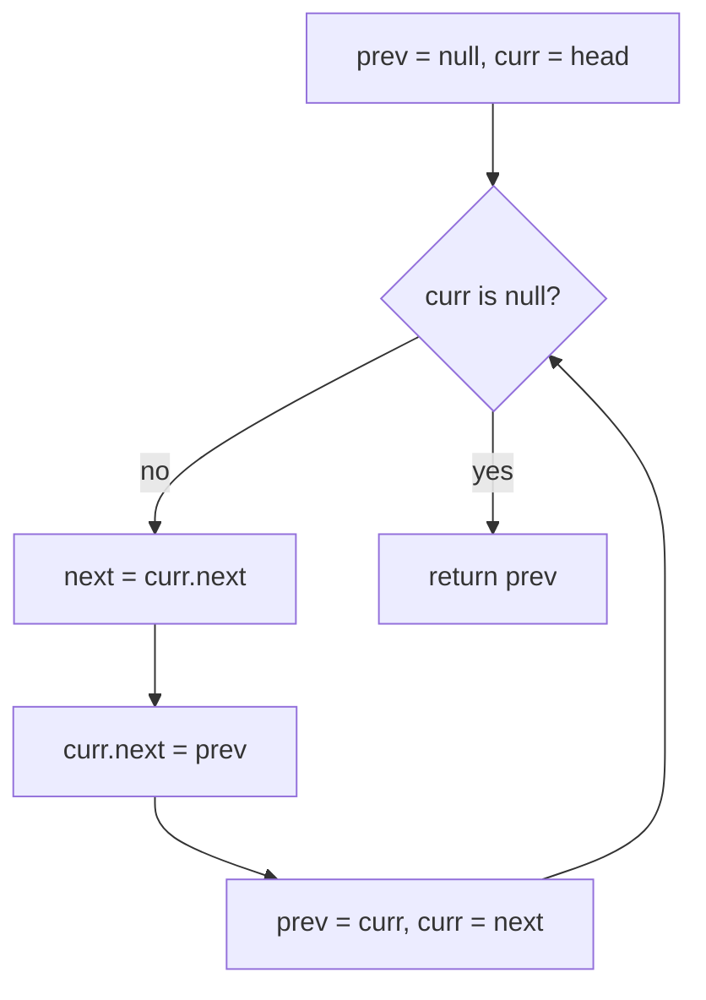
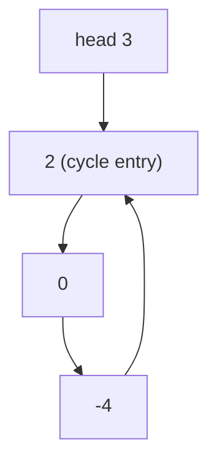
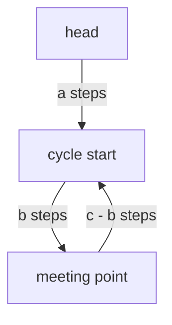
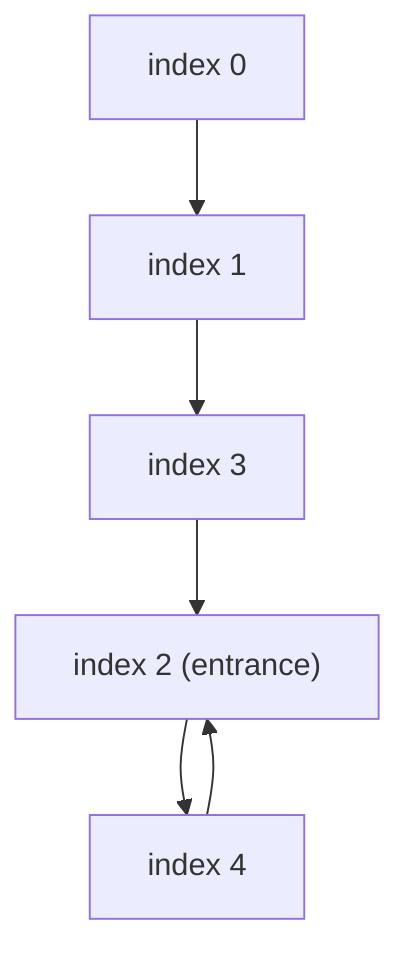
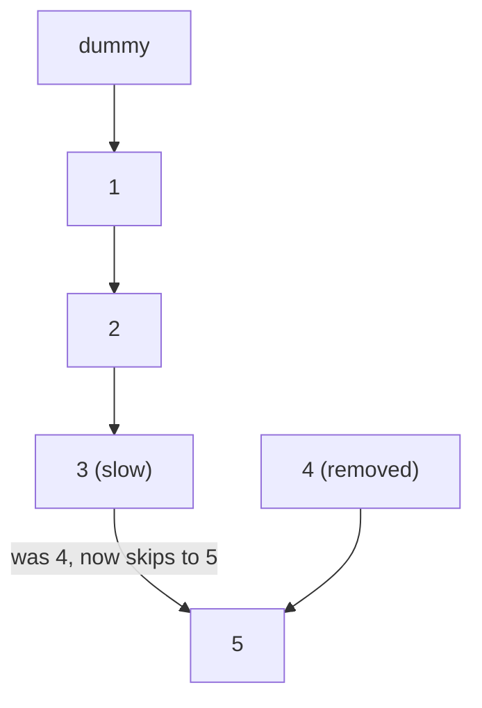
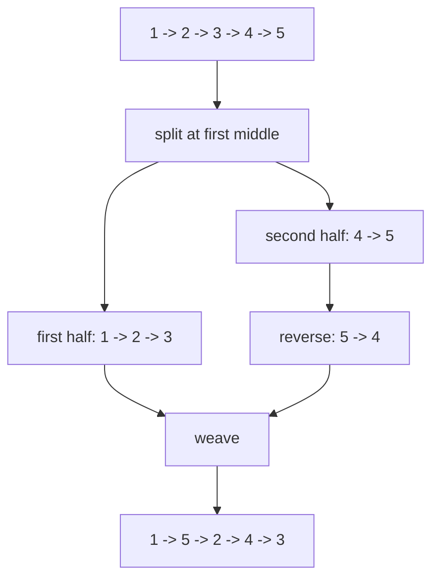
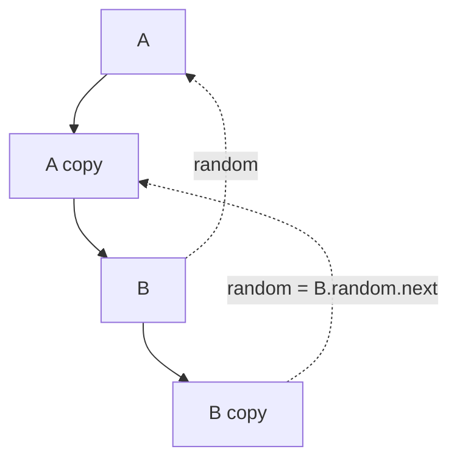
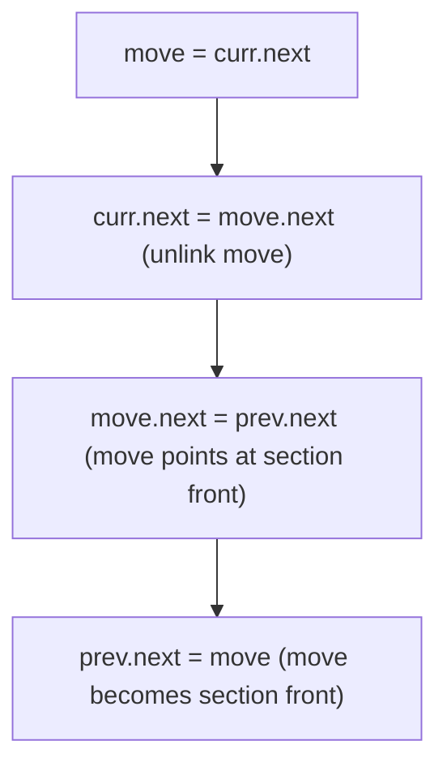
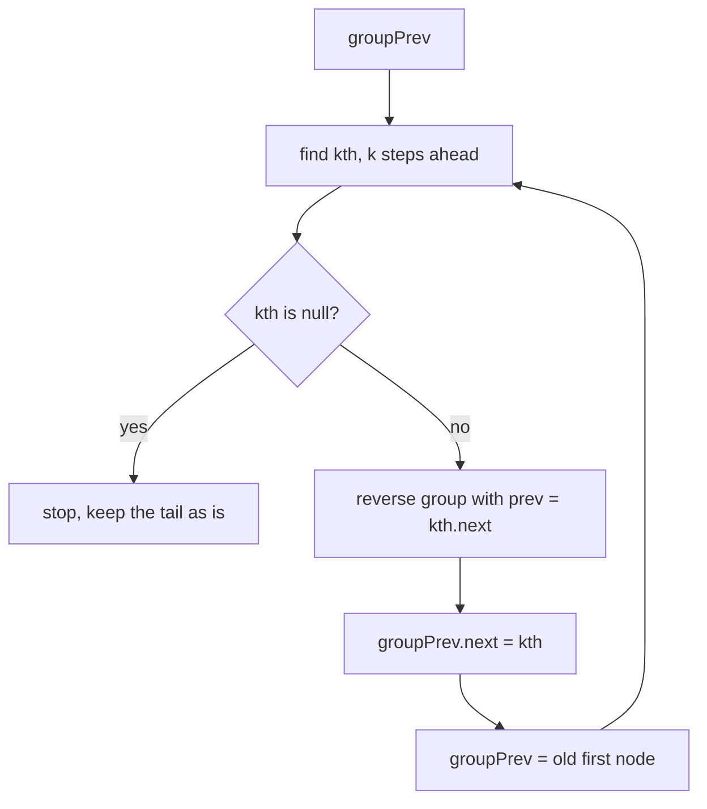

# Linked Lists

[⬅ Back to index](../README.md)

Covers: pointer manipulation without bugs: reversing (whole, part, k-group), merging, fast and slow pointers for cycles and middles, and the dummy-node habit, with diagrams of how the pointers move.

---

## Reversal and merging basics

### 1. Reverse Linked List

**🟢 Easy** · ⭐ Product/FAANG favourite (commonly reported at Amazon, Microsoft, Meta)

<details>
<summary>Answer</summary>

**In short:** Walk the list once with three pointers — `prev`, `curr` and `next`. At each node, save `curr.next`, point `curr.next` back at `prev`, then step both `prev` and `curr` forward. When `curr` falls off the end, `prev` is the new head. O(n) time, O(1) space. The recursive version reverses the rest of the list first and then hooks the current node onto its tail, using O(n) stack space.

#### The ListNode used throughout this file

Every answer in this file uses the LeetCode-style node. Nodes are **classes** (reference types), because several pointers must be able to refer to the *same* node — in Swift a `struct` would be copied and could not even be recursive.

```kotlin
// Kotlin: `val` is a keyword, so LeetCode escapes it with backticks.
class ListNode(var `val`: Int) {
    var next: ListNode? = null
}
```

```swift
// Swift: a class, so nodes are shared references (a struct would be copied).
public class ListNode {
    public var val: Int
    public var next: ListNode?
    public init(_ val: Int, _ next: ListNode? = nil) {
        self.val = val
        self.next = next
    }
}
```

Two habits that prevent most linked-list bugs, and that you will see in every answer below:

- **Save before you overwrite.** The moment you change `node.next`, you lose the rest of the list unless you stored it first.
- **Use a dummy (sentinel) node** whenever the head itself might change or be removed. It gives "the node before the head" a real object, so there's no special case. See [Merge Two Sorted Lists](#2-merge-two-sorted-lists).

#### Problem

Given the head of a singly linked list, reverse it and return the new head.

- `1 → 2 → 3 → 4 → 5` → `5 → 4 → 3 → 2 → 1`
- `1 → 2` → `2 → 1`
- empty list → empty list

#### Clarifying questions & edge cases

- Empty list (`head == null`) and single node — both should be returned as they are.
- In-place, or may I allocate new nodes? In-place is expected.
- Is the list guaranteed to be acyclic? (Yes in the standard problem.)

#### Brute force

Push every value (or node) onto a stack, then pop them to rebuild the list. O(n) time but O(n) extra space, and it misses what the question is testing: rewiring pointers in place.

#### Key insight

Reversing a list means flipping every arrow. You can flip arrows one at a time from the front, as long as you keep hold of two things: the part you've already reversed (`prev`, its head) and the part you haven't touched yet (`curr`). The only danger is losing the untouched part when you flip `curr.next` — so save it in `next` first.

Invariant at the top of each loop iteration: `prev` is the head of a correctly reversed list of all nodes already visited, and `curr` is the head of the untouched remainder.

#### Walkthrough

`1 → 2 → 3`, start with `prev = null`, `curr = 1`.

| step | next (saved) | rewire | prev after | curr after | reversed part |
|---|---|---|---|---|---|
| 1 | 2 | 1.next = null | 1 | 2 | `1` |
| 2 | 3 | 2.next = 1 | 2 | 3 | `2 → 1` |
| 3 | null | 3.next = 2 | 3 | null | `3 → 2 → 1` |

`curr` is null, so return `prev` (node 3).



#### Kotlin

```kotlin
// Iterative: O(n) time, O(1) space.
fun reverseList(head: ListNode?): ListNode? {
    var prev: ListNode? = null
    var curr = head
    while (curr != null) {
        val next = curr.next   // save the rest before we overwrite the link
        curr.next = prev       // flip this arrow
        prev = curr            // grow the reversed part
        curr = next            // move into the untouched part
    }
    return prev
}

// Recursive: reverse everything after head, then attach head at the end.
fun reverseListRecursive(head: ListNode?): ListNode? {
    if (head?.next == null) return head        // 0 or 1 node: already reversed
    val newHead = reverseListRecursive(head.next)
    head.next!!.next = head                    // the old next node is now the tail; point it back at head
    head.next = null                           // head becomes the new tail
    return newHead
}
```

How the recursive version thinks: trust the call to reverse `2 → 3` into `3 → 2` and hand back `3`. Node `1` still points at `2`, which is now the tail of the reversed part, so `1.next.next = 1` appends `1`, and `1.next = null` cuts the old forward arrow (otherwise `1 ↔ 2` forms a cycle).

#### Swift

```swift
func reverseList(_ head: ListNode?) -> ListNode? {
    var prev: ListNode? = nil
    var curr = head
    while let node = curr {
        let next = node.next   // save the rest
        node.next = prev       // flip the arrow
        prev = node
        curr = next
    }
    return prev
}

func reverseListRecursive(_ head: ListNode?) -> ListNode? {
    guard let head = head, let second = head.next else { return head }
    let newHead = reverseListRecursive(second)
    second.next = head   // second is now the tail of the reversed part
    head.next = nil
    return newHead
}
```

#### Complexity

- **Time:** O(n) for both — every node is visited once.
- **Space:** O(1) iterative; O(n) recursive because of the call stack (a 100,000-node list can overflow the stack, which is a good reason to prefer the iterative version in production).

#### Common mistakes

- Overwriting `curr.next` before saving it — the rest of the list is lost.
- Returning `head` or `curr` instead of `prev` at the end (`curr` is null, `head` is now the tail).
- In the recursive version, forgetting `head.next = null` — the last two nodes point at each other and form a cycle.
- Calling the recursive version on very long lists without mentioning stack depth.

#### Follow-ups

- *Reverse only positions left..right?* See [Reverse Linked List II](#13-reverse-linked-list-ii).
- *Reverse in groups of k?* See [Reverse Nodes in k-Group](#14-reverse-nodes-in-k-group).
- *Reverse a doubly linked list?* Same loop, but swap `next` and `prev` on every node; the new head is the old tail.

</details>

### 2. Merge Two Sorted Lists

**🟢 Easy** · ⭐ Product/FAANG favourite (commonly reported at Amazon, Microsoft)

<details>
<summary>Answer</summary>

**In short:** Create a dummy node and a `tail` pointer. Repeatedly compare the heads of the two lists, attach the smaller node to `tail`, and advance that list. When one list runs out, attach the rest of the other in one step. Return `dummy.next`. O(n + m) time, O(1) extra space — you're relinking existing nodes, not copying them.

#### Problem

Given the heads of two lists, each sorted ascending, splice them into one sorted list and return its head.

- `1 → 2 → 4` and `1 → 3 → 4` → `1 → 1 → 2 → 3 → 4 → 4`
- empty and `0` → `0`

#### Clarifying questions & edge cases

- Either or both lists may be empty.
- Duplicates across lists are kept.
- Should I reuse the existing nodes (splice) or create new ones? Splicing is expected.

#### Brute force

Copy every value into an array, sort it, and build a new list: O((n + m) log(n + m)) time and O(n + m) space. It ignores that both inputs are already sorted.

#### Key insight: the dummy-node habit

The merge step from merge sort works on lists too: the smallest remaining element is always at the front of one of the two lists. The annoying part is the **first** node — the head of the result isn't known until after the first comparison, so naive code needs an `if (result == null)` branch.

A **dummy node** removes that branch. It's a throwaway node that sits before the real head; `tail` starts at it, every attach is just `tail.next = node; tail = node`, and the answer is `dummy.next`. Use a dummy node whenever the head of the output might be any node or might be deleted — it shows up again in [Remove Nth Node From End](#7-remove-nth-node-from-end-of-list), [Add Two Numbers](#11-add-two-numbers) and [Reverse Linked List II](#13-reverse-linked-list-ii).

When one list runs out, the other is already sorted and all its values are ≥ everything merged so far, so attach it whole.

#### Walkthrough

`a = 1 → 2 → 4`, `b = 1 → 3 → 4`.

| step | a head | b head | pick | result so far |
|---|---|---|---|---|
| 1 | 1 | 1 | a's 1 (ties: take a, keeps it stable) | 1 |
| 2 | 2 | 1 | b's 1 | 1 1 |
| 3 | 2 | 3 | a's 2 | 1 1 2 |
| 4 | 4 | 3 | b's 3 | 1 1 2 3 |
| 5 | 4 | 4 | a's 4 | 1 1 2 3 4 |
| 6 | null | 4 | attach rest of b | 1 1 2 3 4 4 |

#### Kotlin

```kotlin
fun mergeTwoLists(list1: ListNode?, list2: ListNode?): ListNode? {
    val dummy = ListNode(0)   // sentinel before the real head
    var tail = dummy
    var a = list1
    var b = list2
    while (a != null && b != null) {
        if (a.`val` <= b.`val`) {   // <= keeps equal elements in order (stable)
            tail.next = a
            a = a.next
        } else {
            tail.next = b
            b = b.next
        }
        tail = tail.next!!
    }
    tail.next = a ?: b        // at most one list is left; attach it whole
    return dummy.next
}
```

The recursive version is worth mentioning — if `a.val <= b.val`, set `a.next = merge(a.next, b)` and return `a`, otherwise the mirror image — but it uses O(n + m) stack space.

#### Swift

```swift
func mergeTwoLists(_ list1: ListNode?, _ list2: ListNode?) -> ListNode? {
    let dummy = ListNode(0)
    var tail = dummy
    var a = list1
    var b = list2
    while let x = a, let y = b {
        if x.val <= y.val {
            tail.next = x
            a = x.next
        } else {
            tail.next = y
            b = y.next
        }
        tail = tail.next!
    }
    tail.next = a ?? b
    return dummy.next
}
```

#### Complexity

- **Time:** O(n + m) — each node is attached exactly once.
- **Space:** O(1) extra — only the dummy and a few pointers (O(n + m) stack for the recursive version).

#### Common mistakes

- Forgetting to advance `tail`, so every node overwrites the same `next`.
- Looping until *both* lists are empty and then dereferencing a null head.
- Returning `dummy` instead of `dummy.next`.

#### Follow-ups

- *Merge k sorted lists?* Use a min-heap of the k heads (O(N log k)) or merge pairwise — see [Heaps & Priority Queues](13-heaps-priority-queues.md).
- *Sort a linked list (Sort List)?* Merge sort: split with fast/slow pointers ([Middle of the Linked List](#3-middle-of-the-linked-list)), sort each half, merge with this function. O(n log n) time, O(log n) recursion stack.
- *Merge two sorted arrays in place (Merge Sorted Array)?* Fill from the back with two pointers, so nothing is overwritten before it has been read.

</details>

## Fast and slow pointers

### 3. Middle of the Linked List

**🟢 Easy**

<details>
<summary>Answer</summary>

**In short:** Move a `slow` pointer one step and a `fast` pointer two steps at a time. When `fast` reaches the end, `slow` has covered exactly half the distance, so it's at the middle. With `while (fast != null && fast.next != null)` you get the **second** middle for even lengths. O(n) time, O(1) space, one pass.

#### Problem

Return the middle node of a singly linked list. If there are two middles (even length), return the second one.

- `1 → 2 → 3 → 4 → 5` → node `3`
- `1 → 2 → 3 → 4 → 5 → 6` → node `4`

#### Clarifying questions & edge cases

- Even length: first or second middle? LeetCode wants the second; split-in-half problems (like [Palindrome Linked List](#8-palindrome-linked-list) or merge sort) often want the first. Know how to get both.
- Single node → that node. The problem guarantees at least one node.

#### Brute force

Two passes: count the nodes (`n`), then walk `n / 2` steps from the head. Also O(n) time and O(1) space — perfectly acceptable — but the interviewer usually asks for one pass, and the fast/slow idea is what the rest of this section builds on.

#### Key insight

If two runners start together and one runs twice as fast, when the fast one finishes the slow one is halfway. After `k` iterations, `slow` is at index `k` and `fast` at index `2k`. The loop stops when `fast` can't take two more steps:

- Odd length `n = 2m + 1`: `fast` stops on the last node (index `2m`), so `slow` is at `m` — the exact middle.
- Even length `n = 2m`: `fast` stops at null (index `2m`), so `slow` is at `m` — the **second** middle.

To get the **first** middle instead, change the loop to `while (fast.next != null && fast.next.next != null)` (starting with both at head) — `fast` stops one step earlier.

#### Walkthrough

`1 → 2 → 3 → 4 → 5 → 6` (indices 0..5)

| iteration | slow (value) | fast (value) | can fast move 2? |
|---|---|---|---|
| start | 1 | 1 | yes |
| 1 | 2 | 3 | yes |
| 2 | 3 | 5 | yes (5 → 6 → null) |
| 3 | 4 | null | stop |

Return node `4`, the second middle.

#### Kotlin

```kotlin
fun middleNode(head: ListNode?): ListNode? {
    var slow = head
    var fast = head
    // fast needs two valid steps; checking fast first avoids a null dereference
    while (fast != null && fast.next != null) {
        slow = slow!!.next
        fast = fast.next!!.next
    }
    return slow
}

// Variant: first middle for even lengths (useful for splitting a list in half).
fun firstMiddle(head: ListNode): ListNode {
    var slow = head
    var fast = head
    while (fast.next != null && fast.next!!.next != null) {
        slow = slow.next!!
        fast = fast.next!!.next!!
    }
    return slow
}
```

#### Complexity

- **Time:** O(n) — `fast` crosses the list once.
- **Space:** O(1).

#### Common mistakes

- Checking `fast.next != null` without first checking `fast != null` — crashes on even lengths.
- Using the wrong variant when splitting a list: if you need to cut the list after the middle, you need the node **before** the second half (the first middle), otherwise a 2-node list never splits and merge sort recurses forever.

#### Follow-ups

- *Delete the middle node?* Track the node before `slow` (or start `fast` one step ahead) and unlink `slow.next`.
- *Why is this the basis for cycle detection?* If there is a cycle, `fast` never reaches null and instead laps `slow` — see [Linked List Cycle](#4-linked-list-cycle).
- *Sort a linked list?* Split at the first middle, sort halves, merge with [Merge Two Sorted Lists](#2-merge-two-sorted-lists).

</details>

### 4. Linked List Cycle

**🟢 Easy** · ⭐ Product/FAANG favourite (commonly reported at Amazon, Microsoft)

<details>
<summary>Answer</summary>

**In short:** Floyd's tortoise and hare: `slow` moves one step, `fast` moves two. If the list ends, `fast` hits null — no cycle. If there is a cycle, both pointers end up going round it, and because `fast` gains exactly one node per step on `slow`, it must land on `slow` within one lap — they meet. O(n) time, O(1) space. (A hash set of visited nodes also works but costs O(n) space.)

#### Problem

Given the head of a linked list, return `true` if some node's `next` points back to an earlier node (the list loops forever), else `false`.

- `3 → 2 → 0 → -4 → (back to 2)` → `true`
- `1 → 2 → null` → `false`

#### Clarifying questions & edge cases

- Empty list or single node without a self-loop → `false`. A single node whose `next` is itself → `true`.
- Can I modify the list (e.g. mark visited nodes)? Usually no — and you shouldn't need to.
- Compare nodes by **identity**, not by value: values can repeat.

#### Brute force

Walk the list, storing each node reference in a `HashSet`. If you meet a node that's already in the set, there's a cycle; if you reach null, there isn't. O(n) time, O(n) space. Mention it first — then the interviewer asks for O(1) space.

#### Key insight

Picture two runners on a track. If the track is a straight road, the fast runner just reaches the end. If the road leads into a loop, both runners eventually enter the loop and run forever; the fast one starts lapping the slow one.

Why can't `fast` jump over `slow`? Measure the gap from `fast` forward to `slow` around the cycle. Each step, `slow` moves 1 and `fast` moves 2, so the gap **shrinks by exactly 1**. A gap that drops by 1 each step must hit 0 — it can't skip from 1 to −1. So they meet, and they meet within at most `c` steps after `slow` enters the cycle (`c` = cycle length, the largest possible gap).

(This is also why speeds 1 and 2 are the standard choice: with speeds 1 and 3 the gap shrinks by 2, so on an even-length cycle with an odd starting gap the pointers skip over each other forever.)



#### Walkthrough

`3 → 2 → 0 → -4 → (2)`

| step | slow | fast | met? |
|---|---|---|---|
| start | 3 | 3 | — |
| 1 | 2 | 0 | no |
| 2 | 0 | 2 | no (fast went -4 → 2) |
| 3 | -4 | -4 | yes (fast went 0 → -4) |

#### Kotlin

```kotlin
fun hasCycle(head: ListNode?): Boolean {
    var slow = head
    var fast = head
    while (fast != null && fast.next != null) {
        slow = slow!!.next
        fast = fast.next!!.next
        if (slow === fast) return true   // === : same node object, not equal values
    }
    return false   // fast reached the end, so the list terminates
}
```

#### Swift

```swift
func hasCycle(_ head: ListNode?) -> Bool {
    var slow = head
    var fast = head
    while let f = fast, let next = f.next {
        slow = slow?.next
        fast = next.next
        if slow === fast { return true }   // identity check on class instances
    }
    return false
}
```

Note the `===` in both languages. Kotlin's `==` calls `equals` (identity for a plain class, but not if someone made `ListNode` a `data class`); Swift's `==` doesn't even compile for a class unless it's `Equatable`. Use identity.

#### Complexity

- **Time:** O(n) — before the cycle `slow` takes `a` steps (the tail length); inside it they meet within `c` more steps; `a + c ≤ n`.
- **Space:** O(1).

#### Common mistakes

- Checking `slow == fast` **before** moving — they both start at `head`, so it returns `true` immediately.
- Comparing values instead of node identity.
- Forgetting the `fast.next != null` check — a 1-node list crashes.

#### Follow-ups

- *Where does the cycle start?* See [Linked List Cycle II](#5-linked-list-cycle-ii).
- *How long is the cycle?* After they meet, keep `slow` still and walk another pointer round until it returns, counting steps.
- *Same idea on a function instead of a list?* Happy Number (repeatedly sum squares of digits) and [Find the Duplicate Number](#6-find-the-duplicate-number) are cycle detection on `x → f(x)`.

</details>

### 5. Linked List Cycle II

**🟡 Medium** · ⭐ Product/FAANG favourite

<details>
<summary>Answer</summary>

**In short:** Run Floyd's fast/slow pointers until they meet inside the cycle. Then put one pointer back at the head and move both pointers **one** step at a time; the node where they meet again is the start of the cycle. It works because the distance from the head to the cycle start equals the distance from the meeting point forward to the cycle start (plus whole laps). O(n) time, O(1) space.

#### Problem

Return the node where the cycle begins, or null if there's no cycle. Don't modify the list.

- `3 → 2 → 0 → -4 → (back to 2)` → node `2`
- `1 → 2 → (back to 1)` → node `1`
- `1 → null` → null

#### Clarifying questions & edge cases

- No cycle → null (the first phase ends with `fast` hitting null).
- The cycle may start at the head (tail length 0) — the second phase then returns immediately.
- Self-loop on one node → that node.

#### Brute force

Hash set of visited nodes: the first node you see twice is the cycle start. O(n) time, O(n) space. Easy and correct; the O(1)-space version is the real question.

#### Key insight: why resetting to head works

Name the distances:

- `a` = steps from the head to the cycle start,
- `c` = cycle length,
- `b` = steps from the cycle start forward to where slow and fast meet (`0 ≤ b < c`).



When they meet, `slow` has walked `a + b` steps. (It hasn't finished a lap: once slow enters the cycle, fast closes the gap within fewer than `c` steps — see [Linked List Cycle](#4-linked-list-cycle).) `fast` has walked twice as far, `2(a + b)`, and it's at the same node, so the extra `a + b` it walked must be a whole number of laps:

`2(a + b) − (a + b) = k·c`  →  `a + b = k·c`  →  `a = k·c − b = (k − 1)·c + (c − b)`

Read the last expression in words: walking `a` steps from the meeting point is the same as walking `c − b` steps (which reaches the cycle start) plus some whole laps (which return to the cycle start). So a pointer from the **head** and a pointer from the **meeting point**, both moving one step at a time, arrive at the cycle start at the same moment — after exactly `a` steps. That's the node to return.

#### Walkthrough

`3 → 2 → 0 → -4 → (2)`: `a = 1`, `c = 3`.

Phase 1 (from the previous question) meets at `-4`, which is `b = 2` steps past the start. Check: `a + b = 3 = 1·c` ✓.

| phase 2 step | p1 (from head) | p2 (from meeting) |
|---|---|---|
| start | 3 | -4 |
| 1 | 2 | 2 → equal, return node 2 |

#### Kotlin

```kotlin
fun detectCycle(head: ListNode?): ListNode? {
    var slow = head
    var fast = head
    // Phase 1: find a meeting point inside the cycle (or prove there is none).
    while (fast != null && fast.next != null) {
        slow = slow!!.next
        fast = fast.next!!.next
        if (slow === fast) {
            // Phase 2: head and meeting point are equally far from the cycle start.
            var p1 = head
            var p2 = slow
            while (p1 !== p2) {
                p1 = p1!!.next
                p2 = p2!!.next
            }
            return p1
        }
    }
    return null
}
```

#### Swift

```swift
func detectCycle(_ head: ListNode?) -> ListNode? {
    var slow = head
    var fast = head
    while let f = fast, let next = f.next {
        slow = slow?.next
        fast = next.next
        if slow === fast {
            var p1 = head
            var p2 = slow
            while p1 !== p2 {
                p1 = p1?.next
                p2 = p2?.next
            }
            return p1
        }
    }
    return nil
}
```

#### Complexity

- **Time:** O(n) — phase 1 is at most `a + c` steps, phase 2 is exactly `a` steps.
- **Space:** O(1).

#### Common mistakes

- In phase 2, moving the second pointer two steps — both must move one step.
- Starting phase 2 from `slow.next` or `head.next` — off-by-one, returns the wrong node.
- Claiming the meeting point *is* the cycle start; it generally isn't.
- Not being able to explain the `a = (k − 1)c + (c − b)` argument — interviewers often ask "why does this work?"

#### Follow-ups

- *Length of the tail before the cycle?* It's the number of phase-2 steps, `a`.
- *Same trick on an array?* [Find the Duplicate Number](#6-find-the-duplicate-number).
- *Two lists that might share nodes?* Connect one list's tail to its head and run this on the other — or use the simpler approach in [Intersection of Two Linked Lists](#10-intersection-of-two-linked-lists).

</details>

### 6. Find the Duplicate Number

**🟡 Medium** · ⭐ Product/FAANG favourite

<details>
<summary>Answer</summary>

**In short:** Treat the array as a linked list where index `i` points to index `nums[i]`. Because there are `n + 1` slots but only values `1..n`, two indices point to the same place, which creates a cycle — and the duplicate value is exactly the **cycle entrance**. Run Floyd's algorithm from [Linked List Cycle II](#5-linked-list-cycle-ii) on `i → nums[i]` starting at index 0. O(n) time, O(1) space, array untouched.

#### Problem

An array of `n + 1` integers contains values in `1..n`, so at least one value repeats. Exactly one value is repeated (possibly many times). Find it without modifying the array and using O(1) extra space.

- `[1, 3, 4, 2, 2]` → `2`
- `[3, 1, 3, 4, 2]` → `3`
- `[3, 3, 3, 3, 3]` → `3`

#### Clarifying questions & edge cases

- The constraints (don't modify, O(1) space, better than O(n²)) are what rule out the easy answers — confirm them.
- The duplicate can appear more than twice — so "sum minus n(n+1)/2" and XOR tricks **don't** work.
- Values are always in `1..n`, so `nums[i]` is always a valid index.

#### Brute force and the other answers

| approach | time | space | breaks a rule? |
|---|---|---|---|
| compare every pair | O(n²) | O(1) | too slow |
| sort, look for neighbours | O(n log n) | O(1)–O(n) | modifies the array |
| hash set | O(n) | O(n) | extra space |
| mark seen by negating `nums[abs(x)]` | O(n) | O(1) | modifies the array |
| binary search on the value: count elements ≤ mid | O(n log n) | O(1) | none — a good second answer ([Binary Search](10-binary-search.md)) |
| Floyd's cycle detection | O(n) | O(1) | none |

#### Key insight: the array is a linked list

Draw an arrow from every index `i` to index `nums[i]`. Every node has exactly one outgoing arrow, so starting anywhere and following arrows you must eventually repeat a node — a "rho" shape (a tail that runs into a loop).

- Start at index **0**. No value equals 0, so nothing points to 0 — it's never on the loop; it's the head of the tail.
- The node where the tail joins the loop has **two** incoming arrows (one from the tail, one from inside the loop). Two different indices `i ≠ j` with `nums[i] == nums[j]` — that index *is* the duplicate value.

So "find the duplicate" = "find the cycle entrance", which is exactly Linked List Cycle II with `next(i) = nums[i]`.

For `[1, 3, 4, 2, 2]`:



Indices 3 and 4 both point to 2, so 2 is the duplicate.

#### Walkthrough

`nums = [1, 3, 4, 2, 2]`. `slow = nums[0] = 1`, `fast = nums[nums[0]] = 3`.

| phase | slow | fast | note |
|---|---|---|---|
| 1 | 1 | 3 | start (already one step in) |
| 1 | 3 | 4 | slow = nums[1], fast = nums[nums[3]] = nums[2] |
| 1 | 2 | 4 | fast = nums[nums[4]] = nums[2] |
| 1 | 4 | 4 | meet at index 4 |
| 2 | 0 | 4 | reset slow to index 0 |
| 2 | 1 | 2 | both move one step |
| 2 | 3 | 4 | |
| 2 | 2 | 2 | meet — answer 2 |

#### Kotlin

```kotlin
fun findDuplicate(nums: IntArray): Int {
    // Phase 1: find a meeting point inside the cycle of i -> nums[i].
    var slow = nums[0]
    var fast = nums[nums[0]]
    while (slow != fast) {
        slow = nums[slow]
        fast = nums[nums[fast]]
    }
    // Phase 2: from the head (index 0) and the meeting point, one step each.
    slow = 0
    while (slow != fast) {
        slow = nums[slow]
        fast = nums[fast]
    }
    return slow   // the cycle entrance = the duplicated value
}
```

Here `==` on `Int` is correct — the "nodes" are indices, so comparing them *is* comparing identity.

#### Complexity

- **Time:** O(n) — same argument as Linked List Cycle II: the tail and the cycle each have at most n + 1 nodes.
- **Space:** O(1).

#### Common mistakes

- Starting phase 1 with `slow = fast = 0` and a `while (slow != fast)` loop — the loop never runs. Either pre-advance (as above) or use a do-while.
- Resetting to `nums[0]` instead of `0` in phase 2 — the head of the list is index 0, not its successor.
- Using the sum or XOR trick when the duplicate can repeat more than twice.

#### Follow-ups

- *Why must we start at index 0?* It's the only index guaranteed not to be on the cycle (nothing points to it), so it's a true "head".
- *Find all duplicates where values are 1..n and you may modify the array?* Negate `nums[abs(x) - 1]`; seeing an already negative value means `x` repeats — see [Arrays, Strings & Hashing](07-arrays-strings-hashing.md).
- *First missing positive?* Cyclic sort / index-as-hash, same family of tricks.

</details>

### 7. Remove Nth Node From End of List

**🟡 Medium** · ⭐ Product/FAANG favourite (commonly reported at Meta, Amazon)

<details>
<summary>Answer</summary>

**In short:** Use two pointers with a fixed gap. Start both at a dummy node before the head, move `fast` `n + 1` steps ahead, then move both together until `fast` falls off the end. Now `slow` is exactly the node **before** the one to delete, so `slow.next = slow.next.next`. The dummy node makes deleting the head a non-special case. One pass, O(n) time, O(1) space.

#### Problem

Remove the n-th node counted from the end of the list and return the head.

- `1 → 2 → 3 → 4 → 5`, `n = 2` → `1 → 2 → 3 → 5`
- `1`, `n = 1` → empty
- `1 → 2`, `n = 2` → `2` (the head is removed)

#### Clarifying questions & edge cases

- Is `n` always valid (`1 ≤ n ≤ length`)? On LeetCode yes; in an interview, ask what to do otherwise.
- Removing the head (`n == length`) — the classic bug. The dummy node handles it.
- Single-node list.

#### Brute force

Two passes: count the length `L`, then walk `L − n` steps from a dummy node and unlink the next node. O(n) time, O(1) space — fine, but the follow-up "can you do it in one pass?" is almost guaranteed.

#### Key insight

"n-th from the end" is a **distance from the end**. If two pointers walk together with a fixed gap of `n + 1` nodes, then when the leading one reaches null (one past the last node), the trailing one is `n + 1` nodes behind null — i.e. right before the n-th node from the end. That's exactly where you need to be to unlink it, because in a singly linked list you delete a node by changing its **predecessor**.

Why the dummy? If the head is the node to remove, its predecessor doesn't exist. With a dummy in front, every node has a predecessor, and you return `dummy.next`.

#### Walkthrough

`D → 1 → 2 → 3 → 4 → 5`, `n = 2`. First move `fast` `n + 1 = 3` steps from `D`.

| stage | slow | fast |
|---|---|---|
| after gap | D | 3 |
| move | 1 | 4 |
| move | 2 | 5 |
| move | 3 | null → stop |

`slow = 3`, so unlink `3.next` (node 4): `3.next = 5`. Result `1 → 2 → 3 → 5`.



#### Kotlin

```kotlin
fun removeNthFromEnd(head: ListNode?, n: Int): ListNode? {
    val dummy = ListNode(0)
    dummy.next = head
    var fast: ListNode? = dummy
    var slow: ListNode = dummy
    // Open a gap of n + 1 nodes between slow and fast.
    repeat(n + 1) { fast = fast?.next }
    // Move together; when fast is null, slow is just before the target.
    while (fast != null) {
        fast = fast!!.next
        slow = slow.next!!
    }
    slow.next = slow.next?.next   // unlink the n-th node from the end
    return dummy.next
}
```

#### Complexity

- **Time:** O(L) — `fast` walks the list once, `slow` a bit less.
- **Space:** O(1).

#### Common mistakes

- Opening a gap of `n` instead of `n + 1` — `slow` ends up *on* the target, and you can't unlink a node from itself in a singly linked list.
- No dummy node, then crashing (or returning the old head) when `n == length`.
- Returning `head` instead of `dummy.next` — wrong when the head was removed.

#### Follow-ups

- *What if n can be larger than the length?* While opening the gap, if `fast` becomes null too early (before n + 1 steps), return the list unchanged.
- *Return the k-th node from the end instead of deleting it?* Same gap, but `k` instead of `k + 1`, and return `slow`.
- *Delete a node when you're given only that node (not the head)?* Copy `node.next`'s value into it and unlink `node.next` — doesn't work for the tail.

</details>

### 8. Palindrome Linked List

**🟢 Easy** · ⭐ Product/FAANG favourite (commonly reported at Amazon, Meta)

<details>
<summary>Answer</summary>

**In short:** Find the middle with fast/slow pointers, reverse the second half in place, then walk one pointer from the head and one from the start of the reversed half, comparing values. Restore the second half afterwards to be polite. O(n) time, O(1) extra space. The easy alternative — copy values into an array and two-pointer it — is O(n) space.

#### Problem

Return `true` if the list's values read the same forwards and backwards.

- `1 → 2 → 2 → 1` → `true`
- `1 → 2 → 3 → 2 → 1` → `true`
- `1 → 2` → `false`

#### Clarifying questions & edge cases

- Empty or single-node list → `true`.
- Odd length: the middle node matches itself; it doesn't need comparing.
- May I modify the list temporarily? If not, the O(1)-space answer must restore it before returning — mention this.

#### Brute force

Copy all values into an `IntArray`/list and check it with two pointers from both ends. O(n) time and O(n) space. A recursive "compare on the way back up" trick also exists but uses O(n) stack.

#### Key insight

A singly linked list can't walk backwards, so make the second half walk forwards *from the end* by reversing it. Three building blocks you already know:

1. [Middle of the Linked List](#3-middle-of-the-linked-list) — use the **first** middle so the first half is the same length as the second (or one longer for odd lengths).
2. [Reverse Linked List](#1-reverse-linked-list) on everything after the middle.
3. Compare pairwise until the reversed half runs out. For odd lengths, the extra middle node stays in the first half and is never compared — correct, since it matches itself.

#### Walkthrough

`1 → 2 → 3 → 2 → 1`

| step | state |
|---|---|
| find first middle | `slow` stops at `3` (index 2) |
| reverse `slow.next` | second half `2 → 1` becomes `1 → 2` |
| compare | `1 = 1`, `2 = 2`, reversed half exhausted |
| restore | reverse `1 → 2` back and reattach to `3` |
| result | `true` |

`1 → 2 → 2 → 1`: first middle is the first `2`; the second half `2 → 1` reverses to `1 → 2`; compare `1 = 1`, `2 = 2` → `true`.

#### Kotlin

```kotlin
fun isPalindrome(head: ListNode?): Boolean {
    if (head?.next == null) return true

    // 1. End of the first half (first middle for even lengths).
    var slow: ListNode = head
    var fast: ListNode = head
    while (fast.next != null && fast.next!!.next != null) {
        slow = slow.next!!
        fast = fast.next!!.next!!
    }

    // 2. Reverse the second half.
    val secondHead = reverse(slow.next)

    // 3. Compare the first half with the reversed second half.
    var p1: ListNode? = head
    var p2 = secondHead
    var result = true
    while (p2 != null) {
        if (p1!!.`val` != p2.`val`) { result = false; break }
        p1 = p1.next
        p2 = p2.next
    }

    // 4. Restore the original list.
    slow.next = reverse(secondHead)
    return result
}

private fun reverse(head: ListNode?): ListNode? {
    var prev: ListNode? = null
    var curr = head
    while (curr != null) {
        val next = curr.next
        curr.next = prev
        prev = curr
        curr = next
    }
    return prev
}
```

#### Complexity

- **Time:** O(n) — half a pass to find the middle, then reversing, comparing and restoring are each O(n / 2).
- **Space:** O(1) extra.

#### Common mistakes

- Using the second middle and then reversing `slow.next`: on even lengths one node of the second half is never compared, so `1 → 2 → 3 → 1` wrongly passes. Either use the first middle (as above) or reverse from the second middle itself.
- Looping `while (p1 != null)` — `p1` runs into the middle/second half; loop on the reversed half instead.
- Leaving the list broken. Even if the judge doesn't check, interviewers notice — say "I'll restore it".
- In a concurrent program, mutating a list that others are reading; mention that the O(n)-space version is safer there.

#### Follow-ups

- *Can you do it without modifying the list in O(1) space?* Not with a singly linked list in O(n) time; you trade space (array or recursion) for immutability.
- *Palindrome string with skipped characters?* Two pointers — see [Two Pointers & Sliding Window](08-two-pointers-sliding-window.md).
- *Reorder the list as first, last, second, second-last…?* Same three building blocks — see [Reorder List](#9-reorder-list).

</details>

### 9. Reorder List

**🟡 Medium** · ⭐ Product/FAANG favourite (commonly reported at Amazon, Meta)

<details>
<summary>Answer</summary>

**In short:** Three steps you already know: find the middle (fast/slow), cut and reverse the second half, then merge the two halves by alternating nodes. `1 → 2 → 3 → 4 → 5` becomes `1 → 5 → 2 → 4 → 3`. O(n) time, O(1) extra space, all in place.

#### Problem

Rearrange `L0 → L1 → … → Ln` into `L0 → Ln → L1 → Ln-1 → L2 → …` by relinking nodes (not by changing values). Return nothing; modify in place.

- `1 → 2 → 3 → 4` → `1 → 4 → 2 → 3`
- `1 → 2 → 3 → 4 → 5` → `1 → 5 → 2 → 4 → 3`

#### Clarifying questions & edge cases

- Lists of length 0, 1 or 2 stay the same.
- Must nodes be relinked, or can values be swapped? Relinked.
- Odd length: the middle node ends up last.

#### Brute force

Put all nodes in an array, then use two indices `i` (front) and `j` (back) and relink `a[i] → a[j] → a[i+1] …`, finally setting the last node's `next` to null. O(n) time and O(n) space — a good first answer that also clarifies the target order.

#### Key insight

The new order takes one node from the front, then one from the back, alternately. "From the back" is easy if the back half is **reversed**: then it's simply a second list you read from its head. So:

1. **Split:** find the first middle; the second half starts at `slow.next`; set `slow.next = null` to cut.
2. **Reverse** the second half.
3. **Weave:** alternately take one node from each list. The first half is the same length as the second or one longer, so the loop ends when the second half is used up.



#### Walkthrough (weave step)

`first = 1 → 2 → 3`, `second = 5 → 4`.

| iteration | first | second | relink | result so far |
|---|---|---|---|---|
| 1 | 1 | 5 | 1 → 5 → 2 | 1 5 2 … |
| 2 | 2 | 4 | 2 → 4 → 3 | 1 5 2 4 3 |
| stop | 3 | null | — | `3.next` is already null from the cut |

#### Kotlin

```kotlin
fun reorderList(head: ListNode?) {
    if (head?.next == null) return

    // 1. Find the end of the first half and cut there.
    var slow: ListNode = head
    var fast: ListNode = head
    while (fast.next != null && fast.next!!.next != null) {
        slow = slow.next!!
        fast = fast.next!!.next!!
    }
    var second = reverse(slow.next)   // 2. reverse the second half
    slow.next = null                  // cut: the first half now ends at slow

    // 3. Weave: one from the first half, one from the reversed second half.
    var first: ListNode? = head
    while (second != null) {
        val nextFirst = first!!.next
        val nextSecond = second.next
        first.next = second
        second.next = nextFirst
        first = nextFirst
        second = nextSecond
    }
}

private fun reverse(head: ListNode?): ListNode? {
    var prev: ListNode? = null
    var curr = head
    while (curr != null) {
        val next = curr.next
        curr.next = prev
        prev = curr
        curr = next
    }
    return prev
}
```

#### Complexity

- **Time:** O(n) — each step (split, reverse, weave) touches each node a constant number of times.
- **Space:** O(1) extra.

#### Common mistakes

- Forgetting `slow.next = null` — the first half still points into the (now reversed) second half, creating a cycle.
- Running the weave loop on `first` instead of `second`: the first half can be one node longer, so you'd dereference a null `second`. Loop while the shorter (second) half has nodes.
- Not saving both `next` pointers before relinking in the weave.

#### Follow-ups

- *Return a new list instead of in place?* Collect nodes into an array — simpler and fine if O(n) space is allowed.
- *Odd-Even Linked List (all odd positions, then even)?* Two tails (`odd`, `even`), relink in one pass, then attach the even list after the odd one.
- *Why ask this at all?* It checks that you can compose three primitives without pointer bugs — say the three steps out loud before coding.

</details>

## More classic list problems

### 10. Intersection of Two Linked Lists

**🟢 Easy**

<details>
<summary>Answer</summary>

**In short:** Walk pointer `pA` along list A and then along list B; walk `pB` along B and then along A. Both travel the same total distance (`lenA + lenB`), so they line up and arrive at the first shared node at the same moment — or both reach null together if the lists don't intersect. O(m + n) time, O(1) space, no length counting needed.

#### Problem

Two singly linked lists may merge at some node and share every node after it (a "Y" shape). Return the first shared node, or null. The lists have no cycles and must not be modified.

- A = `4 → 1 → 8 → 4 → 5`, B = `5 → 6 → 1 → 8 → 4 → 5`, sharing from the node `8` → return that `8` node.
- A = `2 → 6 → 4`, B = `1 → 5` (no shared nodes) → null

#### Clarifying questions & edge cases

- "Intersect" means the **same node object**, not equal values — in the first example, the `1` nodes are different objects with equal values.
- Either list empty → null.
- The intersection may be at the head of one list (one list is a suffix of the other).

#### Brute force

For every node of A, scan all of B looking for the same reference: O(m·n) time. Better: put all of A's nodes in a `HashSet` and walk B until you find a member — O(m + n) time, O(m) space.

#### Key insight

The problem is that the two lists have tails of the **same** length (the shared part, length `c`) but heads of different lengths (`a` and `b` unique nodes). If the pointers started equally far from the end, you could walk them in lockstep and they'd meet at the junction.

Approach 1 — **length difference:** count both lengths, advance the longer list's pointer by the difference, then walk together. Correct, but two extra passes and more code.

Approach 2 — **switch tracks:** when a pointer hits the end of its list, send it to the head of the *other* list. Then:

- `pA` walks `a + c` (all of A) and then `b` (the unique part of B) → reaches the junction after `a + c + b` steps.
- `pB` walks `b + c` and then `a` → reaches the junction after `b + c + a` steps.

Same number of steps, so they meet at the junction. If there's no junction (`c = 0`), both have walked `a + b` steps and are null at the same time, and `null === null` ends the loop with the right answer.

#### Walkthrough

A unique part `4, 1` (`a = 2`), B unique part `5, 6, 1` (`b = 3`), shared `8, 4, 5` (`c = 3`).

| step | pA | pB |
|---|---|---|
| 0 | A4 | B5 |
| 1 | A1 | B6 |
| 2 | 8 | B1 |
| 3 | 4 | 8 |
| 4 | 5 | 4 |
| 5 | null (end of A) | 5 |
| 6 | B5 (switched to B) | null (end of B) |
| 7 | B6 | A4 (switched to A) |
| 8 | B1 | A1 |
| 9 | 8 | 8 → same node, return it |

Each pointer also spends one step "on null" before switching, so both take `a + c + 1 + b` steps — still equal, which is all that matters.

#### Kotlin

```kotlin
fun getIntersectionNode(headA: ListNode?, headB: ListNode?): ListNode? {
    var pA = headA
    var pB = headB
    while (pA !== pB) {                        // identity, not value
        pA = if (pA == null) headB else pA.next  // finished A? switch to B
        pB = if (pB == null) headA else pB.next  // finished B? switch to A
    }
    return pA   // the junction, or null if the lists never meet
}
```

#### Complexity

- **Time:** O(m + n) — each pointer walks at most `m + n + 1` steps.
- **Space:** O(1).

#### Common mistakes

- Comparing values instead of references.
- Switching to the other list's head when `pA.next == null` instead of when `pA == null`: then pointers never become null at the same time and, without an intersection, the loop runs forever.
- Modifying the lists (e.g. marking nodes or temporarily creating a cycle) when the problem forbids it.

#### Follow-ups

- *What if the lists might have cycles?* Find each list's cycle entrance with [Linked List Cycle II](#5-linked-list-cycle-ii); combine cases (both acyclic → this algorithm; one cyclic → no intersection; both cyclic → check whether they share the cycle).
- *Explain the length-difference version?* Count `m` and `n`, skip `|m − n|` nodes on the longer list, walk together.
- *Lowest common ancestor in a tree with parent pointers?* It's the same problem — each node-to-root path is a linked list. See [Trees & Binary Search Trees](14-trees-bst.md).

</details>

### 11. Add Two Numbers

**🟡 Medium** · ⭐ Product/FAANG favourite (commonly reported at Amazon, Microsoft, Bloomberg)

<details>
<summary>Answer</summary>

**In short:** The digits are stored least-significant first, which is exactly the order you add by hand. Walk both lists together with a `carry`, append `(x + y + carry) % 10` to a dummy-headed result, set `carry = (x + y + carry) / 10`, and keep going while either list has nodes **or** carry is non-zero. O(max(m, n)) time, O(1) extra space besides the output.

#### Problem

Two non-negative integers are stored as linked lists of digits in **reverse** order (ones digit first). Return their sum as a list in the same format.

- `2 → 4 → 3` (342) + `5 → 6 → 4` (465) → `7 → 0 → 8` (807)
- `9 → 9 → 9` + `1` → `0 → 0 → 0 → 1`
- `0` + `0` → `0`

#### Clarifying questions & edge cases

- Different lengths — treat missing digits as 0.
- A final carry creates an extra node (`999 + 1`).
- No leading zeros except the number 0 itself.
- Can the numbers be huge? Yes (up to 100 digits) — that's why converting to `Long` and back doesn't work.

#### Brute force

Convert both lists to integers, add, and convert back. It overflows `Int`/`Long` for long inputs; using `BigInteger` dodges the point of the question. Mention it to show you've thought about overflow, then do digit-by-digit addition.

#### Key insight

This is grade-school addition. With the ones digit first, you can add from the head with no reversing or recursion: each position produces one output digit and a carry (0 or 1) for the next position. The dummy-node habit ([Merge Two Sorted Lists](#2-merge-two-sorted-lists)) avoids special-casing the first output digit. Including `carry != 0` in the loop condition handles the extra final digit without a separate `if` afterwards.

#### Walkthrough

`2 → 4 → 3` + `5 → 6 → 4`

| position | x | y | carry in | sum | digit out | carry out |
|---|---|---|---|---|---|---|
| ones | 2 | 5 | 0 | 7 | 7 | 0 |
| tens | 4 | 6 | 0 | 10 | 0 | 1 |
| hundreds | 3 | 4 | 1 | 8 | 8 | 0 |

Result `7 → 0 → 8`. For `999 + 1`, the loop runs a fourth time just for the carry and appends `1`.

#### Kotlin

```kotlin
fun addTwoNumbers(l1: ListNode?, l2: ListNode?): ListNode? {
    val dummy = ListNode(0)
    var tail = dummy
    var a = l1
    var b = l2
    var carry = 0
    while (a != null || b != null || carry != 0) {
        val sum = (a?.`val` ?: 0) + (b?.`val` ?: 0) + carry   // missing digit counts as 0
        carry = sum / 10
        tail.next = ListNode(sum % 10)
        tail = tail.next!!
        a = a?.next
        b = b?.next
    }
    return dummy.next
}
```

#### Complexity

- **Time:** O(max(m, n)) — one iteration per output digit.
- **Space:** O(1) extra; the output list itself has `max(m, n) + 1` nodes at most.

#### Common mistakes

- Dropping the final carry (`5 + 5` must give `0 → 1`).
- Stopping when the shorter list ends instead of continuing with the longer one.
- Converting to numbers and overflowing.

#### Follow-ups

- **Add Two Numbers II** (digits stored most-significant first): reverse both lists, add as above, reverse the result — or push digits onto two stacks and build the result by prepending nodes, which avoids modifying the input.
- *Multiply two numbers stored as lists?* Grade-school multiplication into an array of `m + n` digits, then build the list.
- *Plus One on a linked list?* Find the last non-9 digit, increment it, and zero everything after it (add a new head with a dummy if all digits are 9).

</details>

### 12. Copy List with Random Pointer

**🟡 Medium** · ⭐ Product/FAANG favourite (commonly reported at Amazon, Meta, Microsoft)

<details>
<summary>Answer</summary>

**In short:** The difficulty is that a node's `random` can point to a node you haven't copied yet. The simple fix: a hash map from each original node to its copy — first create all copies, then wire `next` and `random` through the map. O(n) time, O(n) space. The O(1)-extra-space trick weaves each copy directly after its original (`A → A' → B → B'`), so `original.random.next` *is* the copy of the random target; then unweave the two lists.

#### Problem

Each node has `next` and `random` (which may point to any node or null). Return a **deep copy**: brand-new nodes whose `next` and `random` pointers mirror the original structure, with no pointer into the original list.

- `[7, null], [13, 0], [11, 4], [10, 2], [1, 0]` (value, index of random) → an identical structure made of new nodes.

```kotlin
class Node(var `val`: Int) {
    var next: Node? = null
    var random: Node? = null
}
```

#### Clarifying questions & edge cases

- Empty list → null.
- `random` can be null, point to itself, or point backwards or forwards.
- Values can repeat — you can't map by value; map by **node identity**.

#### Brute force

For each node, find its random target's index by walking from the head, then walk the copy to that index: O(n²) time. Works, but slow — and it's the hint that you need a fast "original → copy" lookup.

#### Approach 1: hash map (say this first)

1. Pass 1: for every original node `o`, create `copy = Node(o.val)` and store `map[o] = copy`.
2. Pass 2: for every original `o`, set `map[o].next = map[o.next]` and `map[o].random = map[o.random]` (null maps to null).

Because every copy exists before any wiring happens, forward-pointing randoms are no problem.

#### Approach 2: interleave, O(1) extra space

The map's only job is answering "where is the copy of node X?". If each copy sits **right after** its original, the answer is just `X.next` — no map needed.

1. **Weave:** for every original `X`, insert `X'` between `X` and `X.next`.
2. **Randoms:** for every original `X`, set `X'.random = X.random?.next` (the copy sits right after the original target).
3. **Unweave:** restore `X.next = X'.next` and set `X'.next = X'.next?.next`.



#### Walkthrough (interleave)

Original `A → B`, `A.random = B`, `B.random = A`.

| step | list | wiring |
|---|---|---|
| weave | `A → A' → B → B'` | — |
| randoms | same | `A'.random = A.random.next = B'`, `B'.random = B.random.next = A'` |
| unweave | `A → B` and `A' → B'` | originals restored |

#### Kotlin

```kotlin
// Approach 1: hash map from original to copy. O(n) time, O(n) space.
fun copyRandomListMap(head: Node?): Node? {
    val copyOf = HashMap<Node, Node>()   // keys use identity (Node doesn't override equals)
    var curr = head
    while (curr != null) {
        copyOf[curr] = Node(curr.`val`)
        curr = curr.next
    }
    curr = head
    while (curr != null) {
        val copy = copyOf[curr]!!
        copy.next = curr.next?.let { copyOf[it] }
        copy.random = curr.random?.let { copyOf[it] }
        curr = curr.next
    }
    return head?.let { copyOf[it] }
}

// Approach 2: interleave copies with originals. O(n) time, O(1) extra space.
fun copyRandomList(head: Node?): Node? {
    if (head == null) return null

    // 1. Weave: A -> A' -> B -> B' -> ...
    var curr: Node? = head
    while (curr != null) {
        val copy = Node(curr.`val`)
        copy.next = curr.next
        curr.next = copy
        curr = copy.next
    }

    // 2. The copy of X.random is X.random.next.
    curr = head
    while (curr != null) {
        curr.next!!.random = curr.random?.next
        curr = curr.next!!.next
    }

    // 3. Unweave into two separate lists.
    val newHead = head.next
    curr = head
    while (curr != null) {
        val copy = curr.next!!
        curr.next = copy.next            // restore the original link
        copy.next = copy.next?.next      // link copy to the next copy
        curr = curr.next
    }
    return newHead
}
```

#### Complexity

- **Map version:** O(n) time, O(n) space for the map.
- **Interleave version:** O(n) time (three passes), O(1) extra space (the copies themselves are output, not extra).

#### Common mistakes

- Wiring `random` in the same pass that creates copies — the target's copy may not exist yet.
- Leaving the original list modified after the interleave method (must unweave both lists).
- Making `Node` a `data class` in Kotlin and using it as a map key: structural `equals`/`hashCode` would treat different nodes with equal fields as the same key (and recursive hashing of `next` can blow the stack). Use a plain class, or `IdentityHashMap`.
- Setting `X'.random = X.random` (points into the original list — not a deep copy).

#### Follow-ups

- *Clone a graph?* Same map-from-original-to-copy idea with BFS/DFS — see [Graphs: BFS, DFS & Topological Sort](16-graphs-bfs-dfs-topo.md).
- *Recursive version?* `copy(node)` = look up the map, else create the copy, store it, then set `next = copy(node.next)`, `random = copy(node.random)` — O(n) stack.
- *Why might an interviewer prefer the map version anyway?* It's clearer and doesn't mutate the input even temporarily, which matters if other threads read the list.

</details>

## Partial and group reversal

### 13. Reverse Linked List II

**🟡 Medium**

<details>
<summary>Answer</summary>

**In short:** Put a dummy before the head, walk to `prev` — the node just **before** position `left`. Keep `curr = prev.next` fixed (it will end up at the end of the reversed section) and, `right − left` times, take the node right after `curr` and move it to the front of the section (right after `prev`). One pass, O(n) time, O(1) space.

#### Problem

Reverse the nodes from position `left` to position `right` (1-indexed, inclusive) and return the head.

- `1 → 2 → 3 → 4 → 5`, `left = 2`, `right = 4` → `1 → 4 → 3 → 2 → 5`
- `5`, `left = 1`, `right = 1` → `5`

#### Clarifying questions & edge cases

- `left == right` → nothing changes.
- `left == 1` — the head changes. The dummy node handles it.
- `right == length` — the section runs to the end; the node after it is null.

#### Brute force

Copy the values into an array, reverse the slice `left..right`, write the values back. O(n) time and space, and it changes values rather than relinking nodes — usually not accepted.

#### Key insight

You need four handles: the node **before** the section (`prev`), the section's first node (which becomes its last), the section's last node (which becomes its first), and the node **after** the section. Two ways to get them right:

1. **Cut, reverse, reconnect:** find all four handles, reverse the section with [Reverse Linked List](#1-reverse-linked-list), stitch the ends back. Easy to explain, a little more code.
2. **Head insertion (below):** `prev` stays fixed and `curr` (the original first node of the section) stays fixed; each step pulls `curr.next` out and inserts it right after `prev`. After `right − left` moves, the section is reversed and `curr` is already connected to the node after the section.

The invariant: after `i` moves, the first `i + 1` nodes of the section are reversed and sit between `prev` and the untouched rest, with `curr` as their last node.

#### Walkthrough

`D → 1 → 2 → 3 → 4 → 5`, `left = 2`, `right = 4`. `prev = 1`, `curr = 2`, 2 moves.

| move | node moved (`curr.next`) | list after |
|---|---|---|
| start | — | `1 → 2 → 3 → 4 → 5` |
| 1 | 3 | `1 → 3 → 2 → 4 → 5` |
| 2 | 4 | `1 → 4 → 3 → 2 → 5` |

Each move does three relinks (in this order):



#### Kotlin

```kotlin
fun reverseBetween(head: ListNode?, left: Int, right: Int): ListNode? {
    val dummy = ListNode(0)
    dummy.next = head
    // prev = node just before position `left`.
    var prev: ListNode = dummy
    for (i in 1 until left) prev = prev.next!!

    val curr = prev.next!!   // first node of the section; it ends up last
    for (i in 0 until right - left) {
        val move = curr.next!!     // next node to bring to the front
        curr.next = move.next      // unlink it
        move.next = prev.next      // put it before the current section front
        prev.next = move           // it is the new section front
    }
    return dummy.next
}
```

#### Complexity

- **Time:** O(right) ≤ O(n) — walk to `left`, then `right − left` constant-time moves.
- **Space:** O(1).

#### Common mistakes

- Doing the three relinks in a different order — e.g. setting `prev.next = move` before `move.next = prev.next` makes `move` point to itself.
- No dummy node, so `left == 1` needs special handling (and is often wrong).
- Off-by-one when walking to `prev`: it's `left − 1` steps from the dummy.
- Moving `curr` forward inside the loop — in head insertion it stays put.

#### Follow-ups

- *Reverse every group of k nodes?* Apply the same "handles around a section" thinking repeatedly — see [Reverse Nodes in k-Group](#14-reverse-nodes-in-k-group).
- *Swap Nodes in Pairs?* That's k-group reversal with k = 2.
- *Rotate List by k?* Find the length, connect tail to head, cut after `length − k % length` nodes.

</details>

### 14. Reverse Nodes in k-Group

**🔴 Hard** · ⭐ Product/FAANG favourite (commonly reported at Amazon, Microsoft)

<details>
<summary>Answer</summary>

**In short:** Process the list one group at a time. Keep `groupPrev` (the node before the current group, starting at a dummy). Look `k` nodes ahead to find the group's last node `kth`; if there aren't `k` nodes left, stop — the tail stays as it is. Otherwise reverse the group with the standard loop, but start `prev` at `kth.next` so the reversed group is already linked to what follows. Point `groupPrev.next` at `kth`, and move `groupPrev` to the group's old first node (now its last). O(n) time, O(1) space.

#### Problem

Reverse the nodes of the list `k` at a time. If the number of nodes left at the end is less than `k`, leave them in their original order. Relink nodes; don't swap values.

- `1 → 2 → 3 → 4 → 5`, `k = 2` → `2 → 1 → 4 → 3 → 5`
- `1 → 2 → 3 → 4 → 5`, `k = 3` → `3 → 2 → 1 → 4 → 5`
- any list, `k = 1` → unchanged

#### Clarifying questions & edge cases

- Leftover nodes (fewer than k) stay unreversed — some variants reverse them too; ask.
- `k == 1` or `k > length` → unchanged.
- O(1) extra space required? (LeetCode's follow-up asks for it, which rules out a recursive solution's O(n/k) stack in the strictest reading.)

#### Brute force

Copy the nodes into an array, reverse each full block of k, and relink them in array order. O(n) time, O(n) space. Fine as a fallback, but the question is about relinking in place.

#### Key insight

Each group is just [Reverse Linked List](#1-reverse-linked-list) on a section, plus reconnection. The trick that removes most of the bookkeeping: when reversing the group, initialise `prev` to the node **after** the group (`groupNext`) instead of null. Then the group's first node — which becomes its last — automatically points at the rest of the list when the loop ends.

Per group:

1. From `groupPrev`, step `k` times to find `kth`. If you hit null, stop.
2. `groupNext = kth.next`.
3. Reverse nodes from `groupPrev.next` up to (not including) `groupNext`, with `prev = groupNext`.
4. The old first node (`groupPrev.next`, saved before relinking) is now the group's tail. Set `groupPrev.next = kth` (the new first) and `groupPrev = oldFirst`.



#### Walkthrough

`D → 1 → 2 → 3 → 4 → 5`, `k = 2`.

| group | groupPrev | kth | groupNext | after reversing and reconnecting |
|---|---|---|---|---|
| 1 | D | 2 | 3 | `D → 2 → 1 → 3 → 4 → 5`, groupPrev = 1 |
| 2 | 1 | 4 | 5 | `D → 2 → 1 → 4 → 3 → 5`, groupPrev = 3 |
| 3 | 3 | null (only `5` left) | — | stop |

Return `dummy.next` = `2 → 1 → 4 → 3 → 5`.

#### Kotlin

```kotlin
fun reverseKGroup(head: ListNode?, k: Int): ListNode? {
    val dummy = ListNode(0)
    dummy.next = head
    var groupPrev: ListNode = dummy

    while (true) {
        // 1. Find the k-th node of this group (or stop if fewer than k remain).
        var kth: ListNode? = groupPrev
        for (i in 0 until k) {
            kth = kth?.next
            if (kth == null) return dummy.next
        }
        val groupNext = kth!!.next

        // 2. Reverse the group; starting prev at groupNext links the new tail to the rest.
        val oldFirst = groupPrev.next!!
        var prev: ListNode? = groupNext
        var curr: ListNode? = oldFirst
        while (curr !== groupNext) {
            val next = curr!!.next
            curr.next = prev
            prev = curr
            curr = next
        }

        // 3. Reconnect: the node before the group now points at its new first node.
        groupPrev.next = kth
        groupPrev = oldFirst   // old first is the new last; it precedes the next group
    }
}
```

#### Complexity

- **Time:** O(n) — every node is visited twice (once while looking ahead for `kth`, once while reversing).
- **Space:** O(1) extra. A recursive solution (reverse the first k, then `first.next = reverseKGroup(rest, k)`) is shorter but uses O(n / k) stack.

#### Common mistakes

- Reversing the leftover partial group — check that `k` nodes exist **before** touching anything.
- Starting `prev` at null, then forgetting to connect the reversed group's tail to `groupNext` — the list gets cut.
- Moving `groupPrev` to `kth` instead of the old first node — after reversal, `kth` is at the front of the group, not the back.
- No dummy node, so the first group (which changes the head) needs special code.

#### Follow-ups

- *Reverse the leftover group too?* Drop the early `return` and reverse whatever remains.
- *Swap Nodes in Pairs?* The same code with `k = 2`.
- *Reverse alternate groups of k (reverse, skip, reverse…)?* After reconnecting a group, advance `groupPrev` k more nodes before the next lookahead.

</details>

---

[⬅ Previous: Stacks, Queues & Monotonic Stack](11-stacks-queues-monotonic.md) · [⬅ Back to index](../README.md) · [Next: Heaps & Priority Queues ➡](13-heaps-priority-queues.md)
