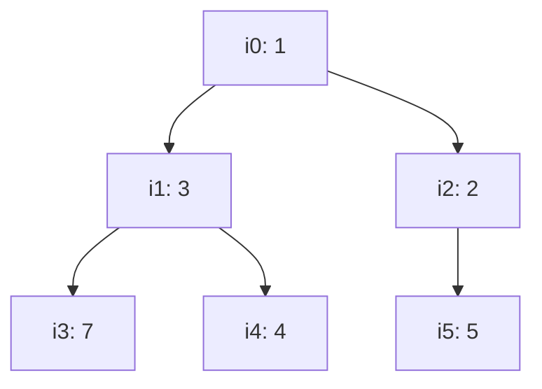

# Heaps & Priority Queues

[⬅ Back to index](../README.md)

Covers: how a binary heap works inside, when a heap beats sorting, and the top-K, merge-K and scheduling problems that use one, with Kotlin's PriorityQueue and a hand-written heap for Swift.

---

## Heap fundamentals

### 1. How does a binary heap work?

**📘 Concept** · ⭐ Product/FAANG favourite

<details>
<summary>Answer</summary>

**In short:** A binary heap is a complete binary tree stored in a plain array, where every parent is ≤ its children (min-heap) or ≥ them (max-heap). Index `i` has children `2i+1` and `2i+2` and parent `(i-1)/2`. Insert appends at the end and **sifts up**; removing the top moves the last element to the root and **sifts down**. Both are O(log n) because the tree height is log n. Peeking at the top is O(1), and building a heap from n items ("heapify") is O(n), not O(n log n).

#### What a heap guarantees (and what it doesn't)

A heap only promises one thing: **the top is the smallest** (or largest). It is *not* sorted. Siblings have no order between them, and iterating a heap gives you elements in a scrambled order. That weak guarantee is exactly why it's cheap: you never pay to keep everything ordered, only to keep the minimum reachable.

| Operation | Binary heap | Sorted array | Unsorted array |
|---|---|---|---|
| Peek min | O(1) | O(1) | O(n) |
| Insert | O(log n) | O(n) (shifting) | O(1) |
| Remove min | O(log n) | O(1) or O(n) depending on end | O(n) |
| Build from n items | O(n) | O(n log n) | O(1) |
| Search for arbitrary value | O(n) | O(log n) | O(n) |

#### Array layout

Because the tree is *complete* (every level full except possibly the last, which fills from the left), there are no gaps, so it fits in an array with no pointers:

- children of `i`: `2*i + 1` and `2*i + 2`
- parent of `i`: `(i - 1) / 2`

The min-heap `[1, 3, 2, 7, 4, 5]` looks like this:



#### Sift up (insert)

Append the new value at the end (the next free slot of the last level), then while it is smaller than its parent, swap it with the parent. It climbs at most the height of the tree: O(log n).

Push `0` into `[1, 3, 2, 7, 4, 5]`:

| step | array | index of 0 | parent value | action |
|---|---|---|---|---|
| 1 | `[1,3,2,7,4,5,0]` | 6 | 2 (i2) | 0 < 2 → swap |
| 2 | `[1,3,0,7,4,5,2]` | 2 | 1 (i0) | 0 < 1 → swap |
| 3 | `[0,3,1,7,4,5,2]` | 0 | — | at root, stop |

#### Sift down (remove the top)

You can't just delete index 0 — that leaves a hole. Instead, swap the root with the **last** element, remove the last slot (now holding the old root), and push the new root down: while it is larger than its smaller child, swap with that smaller child. Again O(log n).

Pop from `[0,3,1,7,4,5,2]`:

| step | array | index | children | action |
|---|---|---|---|---|
| 1 | `[2,3,1,7,4,5]` (0 removed) | 0 | 3, 1 | smaller child 1 → swap |
| 2 | `[1,3,2,7,4,5]` | 2 | 5 (i5) | 2 < 5 → stop |

Always swap with the **smaller** child (min-heap). Swapping with the larger one would put a bigger value above a smaller sibling and break the heap property.

#### Heapify in O(n): the intuition

To turn an arbitrary array into a heap, run sift-down on every non-leaf node from the last one (`n/2 - 1`) back to the root. It looks like n × log n, but most nodes are near the bottom where sift-down is short:

- about n/2 nodes are leaves — 0 work
- about n/4 nodes can move down at most 1 level
- about n/8 nodes at most 2 levels, and so on

Total ≈ n/4·1 + n/8·2 + n/16·3 + … = n · Σ k/2^(k+1) = n · 1 = **O(n)**. The expensive (long) sift-downs only happen for the few nodes near the top. Sift-*up* for each element would be O(n log n) because then the *many* bottom nodes would have the long paths.

```kotlin
fun buildMinHeap(a: IntArray) {
    // Last non-leaf is at size/2 - 1; leaves are already heaps of size 1.
    for (i in a.size / 2 - 1 downTo 0) siftDown(a, i, a.size)
}

fun siftDown(a: IntArray, start: Int, size: Int) {
    var i = start
    while (true) {
        val left = 2 * i + 1
        val right = left + 1
        var smallest = i
        if (left < size && a[left] < a[smallest]) smallest = left
        if (right < size && a[right] < a[smallest]) smallest = right
        if (smallest == i) return            // heap property holds here
        a[i] = a[smallest].also { a[smallest] = a[i] }   // swap
        i = smallest
    }
}
```

Heap sort is just this: build a max-heap, then repeatedly swap the root to the end and sift down within a shrinking prefix — O(n log n), O(1) extra space, not stable.

#### Kotlin: `java.util.PriorityQueue`

```kotlin
val minHeap = PriorityQueue<Int>()                              // smallest on top
val maxHeap = PriorityQueue<Int>(compareByDescending { it })    // largest on top
val byDist = PriorityQueue<IntArray>(compareBy { it[0] })       // custom key
val built = PriorityQueue(listOf(5, 1, 4))                      // heapifies in O(n)

minHeap.add(3)        // offer: O(log n)
minHeap.peek()        // O(1), null if empty
minHeap.poll()        // O(log n), null if empty
minHeap.remove(3)     // remove an arbitrary element: O(n)!
```

- `PriorityQueue` is a **min-heap by default**. For a max-heap pass a reversed comparator (`compareByDescending { it }` or `Collections.reverseOrder()`).
- Iterating it or calling `toString()` shows **heap order, not sorted order**.
- `remove(x)` and `contains(x)` are O(n) — if you need to delete arbitrary items, use a `TreeMap` / `TreeSet` or lazy deletion (mark it and skip it when it reaches the top).
- Never write a comparator as `{ a, b -> a - b }`: it overflows for large values. Use `compareBy`, `compareValues` or `Integer.compare`.

#### Swift: hand-written heap

Swift's standard library has no heap (the `swift-collections` package has one, but interview platforms usually don't allow it). Memorise this generic one; every Swift answer in this file uses it.

```swift
struct Heap<T> {
    private var items: [T] = []
    // Returns true if the first argument should be closer to the top.
    private let higherPriority: (T, T) -> Bool

    init(_ higherPriority: @escaping (T, T) -> Bool) {
        self.higherPriority = higherPriority
    }

    var count: Int { items.count }
    var isEmpty: Bool { items.isEmpty }
    var peek: T? { items.first }

    mutating func push(_ value: T) {
        items.append(value)
        var child = items.count - 1
        while child > 0 {                          // sift up
            let parent = (child - 1) / 2
            if !higherPriority(items[child], items[parent]) { break }
            items.swapAt(child, parent)
            child = parent
        }
    }

    mutating func pop() -> T? {
        guard !items.isEmpty else { return nil }
        items.swapAt(0, items.count - 1)
        let top = items.removeLast()
        var parent = 0
        while true {                               // sift down
            let left = 2 * parent + 1
            let right = left + 1
            var best = parent
            if left < items.count && higherPriority(items[left], items[best]) { best = left }
            if right < items.count && higherPriority(items[right], items[best]) { best = right }
            if best == parent { break }
            items.swapAt(parent, best)
            parent = best
        }
        return top
    }
}

// Usage:
var minHeap = Heap<Int>(<)      // smallest on top
var maxHeap = Heap<Int>(>)      // largest on top
var byFirst = Heap<(Int, Int)> { $0.0 < $1.0 }
```

#### When does a heap beat sorting?

- **You only need the top k of n** → a heap of size k gives O(n log k) and O(k) memory instead of O(n log n). With streaming data you can't sort at all.
- **The data changes while you process it** (items arrive, or processing one item creates new ones, like Dijkstra or "merge k lists") → sorting once doesn't help; you need "give me the current minimum" repeatedly.
- **You only need the k-th element once, from a static array** → quickselect (average O(n)) or simply sorting can beat a heap.

#### Common mistakes

- Assuming the heap is sorted and reading `heap.toList()` as the answer.
- Forgetting that `PriorityQueue` is a min-heap and getting the reverse of what you wanted.
- Using `remove(x)` inside a loop and turning an O(n log n) solution into O(n²).
- Mutating an object's key while it is inside the heap — the heap doesn't notice; remove and re-insert instead.

#### Follow-ups

- *Decrease-key?* Binary heaps don't support it cheaply without an index map; in interviews just push a new entry and skip stale ones when popped (see Dijkstra in [Advanced Graphs](17-advanced-graphs.md)).
- *Median of a stream?* Two heaps — see [Problem-Solving Tricks](06-problem-solving-tricks.md).
- *d-ary heap?* Children `d·i+1 … d·i+d`; shallower tree, faster push, slower pop. Rarely asked beyond the idea.

</details>

## Top-K and k-th element

### 2. Kth Largest Element in an Array

**🟡 Medium** · ⭐ Product/FAANG favourite (commonly reported at Meta, Amazon, Google)

<details>
<summary>Answer</summary>

**In short:** Keep a **min-heap of size k** while scanning: push each number, and if the heap grows past k, pop the smallest. At the end the heap holds the k largest numbers and its top is the k-th largest — O(n log k) time, O(k) space. The alternative is **quickselect** (partition around a pivot like quicksort, but recurse into only one side): average O(n), worst case O(n²), O(1) extra space. Know both and their trade-offs.

#### Problem

Given an integer array `nums` and an integer `k`, return the k-th largest element in sorted order (not the k-th distinct one).

- `nums = [3,2,1,5,6,4], k = 2` → `5`
- `nums = [3,2,3,1,2,4,5,5,6], k = 4` → `4`

#### Clarifying questions & edge cases

- Is `1 ≤ k ≤ n` guaranteed? (Yes on LeetCode.)
- Duplicates count separately: in `[5,5,4]` the 2nd largest is `5`.
- Can I modify the input? Quickselect reorders it in place.
- Is the data static or streaming? Streaming rules out quickselect (see the next question).

#### Brute force

Sort and return `nums[n - k]`. O(n log n) time. It's a fine first answer; the interviewer then asks for better than n log n.

#### Approach 1: min-heap of size k

Why a **min**-heap for the k **largest**? The heap is a "club of the k largest seen so far", and the person you kick out when it's over capacity is the weakest member — the minimum. After the scan, the weakest member of the top-k club is exactly the k-th largest.

1. For each `x`: push `x`; if `size > k`, pop.
2. Return `peek()`.

#### Approach 2: quickselect

Quicksort's partition puts the pivot at its final sorted position `p`, with smaller elements left and larger right. The k-th largest lives at sorted index `target = n - k`. If `target < p`, look only left; if `target > p`, only right; else you found it. Each step discards a part of the array, so the expected work is n + n/2 + n/4 + … = O(n).

Two practical details:

- **Random pivot**, otherwise a sorted input gives O(n²).
- **Three-way partition** (`< pivot | == pivot | > pivot`). With many duplicates (LeetCode has such a test), a two-way Lomuto partition degrades to O(n²) because all equal values pile onto one side.

#### Walkthrough (heap)

`nums = [3,2,1,5,6,4], k = 2`

| x | heap after push | size > k? | heap after |
|---|---|---|---|
| 3 | [3] | no | [3] |
| 2 | [2,3] | no | [2,3] |
| 1 | [1,2,3] | pop 1 | [2,3] |
| 5 | [2,3,5] | pop 2 | [3,5] |
| 6 | [3,5,6] | pop 3 | [5,6] |
| 4 | [4,5,6] | pop 4 | [5,6] |

Top = **5**.

#### Kotlin

```kotlin
// Heap: O(n log k) time, O(k) space.
fun findKthLargest(nums: IntArray, k: Int): Int {
    val heap = PriorityQueue<Int>()          // min-heap of the k largest so far
    for (x in nums) {
        heap.add(x)
        if (heap.size > k) heap.poll()        // drop the smallest
    }
    return heap.peek()
}

// Quickselect: average O(n) time, O(1) extra space. Reorders nums.
fun findKthLargestQuickselect(nums: IntArray, k: Int): Int {
    val target = nums.size - k                // index in ascending order
    var lo = 0
    var hi = nums.size - 1
    while (true) {
        val pivot = nums[(lo..hi).random()]
        // Three-way partition of nums[lo..hi]: [< pivot][== pivot][> pivot]
        var lt = lo
        var i = lo
        var gt = hi
        while (i <= gt) {
            when {
                nums[i] < pivot -> { nums.swap(lt, i); lt++; i++ }
                nums[i] > pivot -> { nums.swap(i, gt); gt-- }
                else -> i++
            }
        }
        when {
            target < lt -> hi = lt - 1        // answer is among the smaller values
            target > gt -> lo = gt + 1        // answer is among the larger values
            else -> return pivot              // target falls in the equal block
        }
    }
}

private fun IntArray.swap(a: Int, b: Int) {
    val t = this[a]; this[a] = this[b]; this[b] = t
}
```

#### Swift

```swift
// Uses the Heap struct from question 1.
func findKthLargest(_ nums: [Int], _ k: Int) -> Int {
    var heap = Heap<Int>(<)                   // min-heap
    for x in nums {
        heap.push(x)
        if heap.count > k { _ = heap.pop() }
    }
    return heap.peek!
}
```

#### Complexity

- **Heap:** O(n log k) time — n pushes/pops on a heap of size ≤ k+1; O(k) space.
- **Quickselect:** O(n) average, O(n²) worst case (vanishingly unlikely with a random pivot); O(1) extra space.
- **Sort:** O(n log n) time.

| | Heap | Quickselect |
|---|---|---|
| Average time | O(n log k) | O(n) |
| Worst time | O(n log k) | O(n²) |
| Streaming data | yes | no |
| Modifies input | no | yes |

#### Common mistakes

- Using a max-heap of all n elements and popping k times — works, but O(n + k log n) and O(n) space; fine to mention, but not the "size-k" idea interviewers want.
- Returning `nums[k]` instead of `nums[n - k]` in quickselect (ascending vs descending index).
- Two-way partition with a fixed pivot — times out on sorted or all-equal input.

#### Follow-ups

- *k is close to n?* Flip it: the k-th largest is the (n−k+1)-th smallest, so keep a max-heap of size n−k+1.
- *Values in a small range?* Counting sort / buckets: O(n + range).
- *Guaranteed O(n) worst case?* Median-of-medians pivot selection — mention it, nobody codes it in an interview.

</details>

### 3. Kth Largest Element in a Stream

**🟢 Easy** · ⭐ Product/FAANG favourite

<details>
<summary>Answer</summary>

**In short:** Keep a **min-heap holding only the k largest values seen so far**. On each `add`, push the value and pop if the size exceeds k; the heap's top is the k-th largest. Each `add` is O(log k) and memory is O(k) no matter how long the stream is. This is the streaming form of the previous question, and it's why "heap" (not quickselect or sorting) is the answer whenever data keeps arriving.

#### Problem

Design a class `KthLargest(k, nums)` with a method `add(val)` that inserts `val` into the stream and returns the current k-th largest element.

```
KthLargest(3, [4,5,8,2])
add(3) → 4     stream: 2 3 4 5 8 → 3rd largest is 4
add(5) → 5     2 3 4 5 5 8
add(10) → 5    2 3 4 5 5 8 10
add(9) → 8
add(4) → 8
```

#### Clarifying questions & edge cases

- Can the initial `nums` have fewer than k elements? On LeetCode, yes — but it's guaranteed there are at least k elements whenever you're asked for the answer.
- Duplicates count separately.
- How many calls? Up to ~10⁴ — anything O(n) per call is too slow at scale.

#### Brute force

Keep every value in a list; on each `add`, sort and index. O(n log n) per call. Slightly better: keep a sorted list and insert with binary search — O(log n) to find the spot but O(n) to shift. Both store the whole stream.

#### Key insight

Values smaller than the current k-th largest can **never** become the k-th largest again: new values only push the threshold up. So you can throw them away forever. That leaves exactly k useful values, and the one you need is the smallest of them — a min-heap's top.

For each `add(val)`:

1. Push `val`.
2. If `size > k`, pop the minimum (it has dropped out of the top k for good).
3. Return `peek()`.

A small optimisation: if the heap already has k items and `val ≤ peek()`, skip it — it would be pushed and immediately popped.

#### Walkthrough

`k = 3`, initial `[4,5,8,2]` → after construction the heap is `{4,5,8}` (2 was popped).

| call | push | heap (min first) | pop? | returns |
|---|---|---|---|---|
| add(3) | 3 | 3,4,5,8 | pop 3 | 4 |
| add(5) | 5 | 4,5,5,8 | pop 4 | 5 |
| add(10) | 10 | 5,5,8,10 | pop 5 | 5 |
| add(9) | 9 | 5,8,9,10 | pop 5 | 8 |
| add(4) | 4 | 4,8,9,10 | pop 4 | 8 |

The code below uses the shortcut: when the heap is full and the new value is ≤ the top (add(3), add(4)), it skips the push-and-pop entirely — same result, less work.

#### Kotlin

```kotlin
class KthLargest(private val k: Int, nums: IntArray) {
    private val heap = PriorityQueue<Int>()   // min-heap of the k largest

    init {
        for (x in nums) add(x)
    }

    fun add(`val`: Int): Int {
        if (heap.size < k) {
            heap.add(`val`)
        } else if (`val` > heap.peek()) {
            heap.poll()                       // current k-th largest drops out
            heap.add(`val`)
        }
        // else: val can never be in the top k, ignore it
        return heap.peek()
    }
}
```

(`val` is a Kotlin keyword, so LeetCode's signature uses backticks; you can rename the parameter in your own code.)

#### Swift

```swift
// Uses the Heap struct from question 1.
class KthLargest {
    private let k: Int
    private var heap = Heap<Int>(<)

    init(_ k: Int, _ nums: [Int]) {
        self.k = k
        for x in nums { _ = add(x) }
    }

    func add(_ val: Int) -> Int {
        if heap.count < k {
            heap.push(val)
        } else if val > heap.peek! {
            _ = heap.pop()
            heap.push(val)
        }
        return heap.peek!
    }
}
```

#### Complexity

- **Time:** O(n log k) to build from n initial values; O(log k) per `add`.
- **Space:** O(k) — everything else is discarded.

#### Common mistakes

- Using a max-heap of everything and popping k−1 times per query (then pushing them back) — O(k log n) per call and O(n) memory.
- Forgetting the case where the heap has fewer than k elements and comparing against `peek()` on an empty heap.
- Keeping all values "just in case" — the whole point is that discarded values are provably irrelevant.

#### Follow-ups

- *Support removals from the stream?* A heap can't delete arbitrary items cheaply; use two balanced structures (e.g. two `TreeMap`s with counts, one for the top k and one for the rest) or lazy deletion.
- *Median instead of k-th largest?* Two heaps balanced around the middle — see [Problem-Solving Tricks](06-problem-solving-tricks.md).
- *k changes per query?* Then you need an order-statistic structure (a BST augmented with subtree sizes, or a Fenwick tree over compressed values).

</details>

### 4. Last Stone Weight

**🟢 Easy**

<details>
<summary>Answer</summary>

**In short:** Put all stones in a **max-heap**. Repeatedly pop the two heaviest, and if they differ push back the difference. When at most one stone remains, return it (or 0). Each round is O(log n) and there are at most n−1 rounds, so O(n log n) total. It's the simplest "repeatedly take the largest, maybe put something back" simulation — the core shape of many heap problems.

#### Problem

Each turn, smash the two heaviest stones `x ≤ y` together: if `x == y` both are destroyed, otherwise `x` is destroyed and `y` becomes `y − x`. Return the weight of the last remaining stone, or 0 if none remain.

- `[2,7,4,1,8,1]` → `1`
- `[1]` → `1`

#### Clarifying questions & edge cases

- One stone → return it.
- Two equal stones → both destroyed → 0.
- Weights are positive (1..1000 on LeetCode), so no overflow concerns.

#### Brute force

Each round, sort the array (or scan for the two largest) — O(n log n) or O(n) per round, O(n² log n) or O(n²) total. Works for LeetCode's tiny limits (n ≤ 30) but misses the point.

#### Key insight

Every round needs "the current two largest", and the set changes each round (two removed, maybe one added). That's a priority queue's exact job: O(log n) to remove the max and O(log n) to insert the remainder. Sorting once isn't enough because the new stone `y − x` has to be placed back into order.

Each round removes at least one stone, so there are at most n−1 rounds.

#### Walkthrough

`[2,7,4,1,8,1]`

| round | heap before (max first) | pop y, x | push | heap after |
|---|---|---|---|---|
| 1 | 8,7,4,2,1,1 | 8, 7 | 1 | 4,2,1,1,1 |
| 2 | 4,2,1,1,1 | 4, 2 | 2 | 2,1,1,1 |
| 3 | 2,1,1,1 | 2, 1 | 1 | 1,1,1 |
| 4 | 1,1,1 | 1, 1 | — | 1 |
| — | 1 | one left | | return **1** |

#### Kotlin

```kotlin
fun lastStoneWeight(stones: IntArray): Int {
    val heap = PriorityQueue<Int>(compareByDescending { it })   // max-heap
    stones.forEach { heap.add(it) }
    while (heap.size > 1) {
        val y = heap.poll()        // heaviest
        val x = heap.poll()        // second heaviest
        if (y != x) heap.add(y - x)
    }
    return heap.peek() ?: 0        // empty heap → 0
}
```

#### Swift

```swift
// Uses the Heap struct from question 1.
func lastStoneWeight(_ stones: [Int]) -> Int {
    var heap = Heap<Int>(>)                 // max-heap
    for s in stones { heap.push(s) }
    while heap.count > 1 {
        let y = heap.pop()!
        let x = heap.pop()!
        if y != x { heap.push(y - x) }
    }
    return heap.peek ?? 0
}
```

#### Complexity

- **Time:** O(n log n) — building is O(n log n) with n pushes (O(n) if you heapify via the constructor), and at most n−1 rounds of O(log n).
- **Space:** O(n) for the heap.

#### Common mistakes

- Using the default `PriorityQueue` (min-heap) and smashing the two *lightest* stones.
- Calling `peek()` on an empty heap without handling null — in Kotlin `peek()` returns `Int?`, so use `?: 0`.
- Pushing back `0` when the stones are equal — harmless in the count but wrong if you later read `size` as "stones left".

#### Follow-ups

- *Last Stone Weight II* (you choose any two stones): it becomes "split stones into two groups with minimal difference" — a 0/1 knapsack, see [Dynamic Programming](19-dynamic-programming.md).
- *Weights bounded and small?* A counting array over weights replaces the heap: O(n + maxWeight).
- *Generalise:* "Minimum cost to connect sticks" is the same loop with a min-heap (pop two smallest, push their sum, add sum to cost) — Huffman coding.

</details>

### 5. Top K Frequent Elements

**🟡 Medium** · ⭐ Product/FAANG favourite (commonly reported at Amazon, Meta)

<details>
<summary>Answer</summary>

**In short:** Count frequencies with a hash map, then run "top k" over the distinct values with a **min-heap of size k keyed by frequency**: push each value, pop when the size exceeds k. What's left are the k most frequent. O(n + m log k) time where m is the number of distinct values, O(m) space. The O(n) bucket-sort version is covered in [Arrays, Strings & Hashing](07-arrays-strings-hashing.md); interviewers often ask for both.

#### Problem

Given an integer array and `k`, return the k most frequent elements, in any order. The answer is guaranteed to be unique.

- `nums = [1,1,1,2,2,3], k = 2` → `[1,2]`
- `nums = [1], k = 1` → `[1]`

#### Clarifying questions & edge cases

- Any output order allowed? (Yes.) If they want most-frequent-first, pop into the result back to front.
- Ties at the boundary? LeetCode guarantees a unique answer; in real life ask how to break ties (e.g. smaller value first).
- `k` equal to the number of distinct values → return all of them.

#### Brute force

Count, then sort the distinct values by frequency descending and take the first k. O(n + m log m). Perfectly acceptable — the follow-up is "better than O(n log n)".

#### Key insight

This is the "k largest" problem from [question 2](#2-kth-largest-element-in-an-array), applied to *frequencies* instead of values. The two steps are independent:

1. **Count** — one pass with a `HashMap`: O(n).
2. **Select the top k of m (value, count) pairs** — a size-k min-heap ordered by count. The heap's top is the least frequent of the current top-k "club"; whenever a newcomer makes the club too big, evict that one.

Because the heap never grows past k+1, each push/pop costs O(log k), which matters when there are many distinct values and k is small.

The **bucket** alternative: frequencies are between 1 and n, so make `buckets[f]` = values with frequency f and walk from f = n down until you've collected k values — O(n), no heap. That's the optimal answer; the heap version generalises better (streams, huge m, weighted scores).

#### Walkthrough

`nums = [1,1,1,2,2,3], k = 2` → counts `{1:3, 2:2, 3:1}`

| value (count) | heap after push (min count first) | size > 2? | heap after |
|---|---|---|---|
| 1 (3) | 1(3) | no | 1(3) |
| 2 (2) | 2(2), 1(3) | no | 2(2), 1(3) |
| 3 (1) | 3(1), 2(2), 1(3) | pop 3 | 2(2), 1(3) |

Result: `[2, 1]` (any order) ✓

#### Kotlin

```kotlin
fun topKFrequent(nums: IntArray, k: Int): IntArray {
    val count = HashMap<Int, Int>()
    for (x in nums) count[x] = (count[x] ?: 0) + 1

    // Min-heap of values, ordered by how often they appear.
    val heap = PriorityQueue<Int>(compareBy { count.getValue(it) })
    for (value in count.keys) {
        heap.add(value)
        if (heap.size > k) heap.poll()        // evict the least frequent
    }
    return IntArray(k) { heap.poll() }        // least frequent first; any order is fine
}
```

The comparator reads `count` — safe here because counts never change after the counting pass. (If keys could change while in the heap, store `(value, count)` pairs instead.)

#### Swift

```swift
// Uses the Heap struct from question 1.
func topKFrequent(_ nums: [Int], _ k: Int) -> [Int] {
    var count: [Int: Int] = [:]
    for x in nums { count[x, default: 0] += 1 }

    var heap = Heap<(value: Int, freq: Int)> { $0.freq < $1.freq }   // min by frequency
    for (value, freq) in count {
        heap.push((value, freq))
        if heap.count > k { _ = heap.pop() }
    }
    var result: [Int] = []
    while let top = heap.pop() { result.append(top.value) }
    return result
}
```

#### Complexity

- **Time:** O(n) counting + O(m log k) selection, where m ≤ n is the number of distinct values.
- **Space:** O(m) for the map, O(k) for the heap.
- Bucket version: O(n) time, O(n) space.

#### Common mistakes

- Using a **max**-heap of all m entries and popping k — fine but O(m log m) worst case, so not better than sorting.
- Ordering the heap by value instead of by count.
- Writing the comparator as `{ a, b -> count[a]!! - count[b]!! }` — works for counts, but get used to `compareBy`; subtraction comparators overflow in other problems.

#### Follow-ups

- **Top K Frequent Words:** order by count descending, then word ascending; the min-heap comparator is the *reverse* of that (lower count first, then lexicographically **larger** first), and you reverse the output at the end.
- *Stream of values, top k at any time?* Keep counts in a map; for exact answers at scale you need a structure like a count-indexed `TreeMap`, or approximate sketches (Count-Min + heap) in system-design contexts.
- *O(n) without a heap?* Bucket sort by frequency, or quickselect on the distinct values.

</details>

### 6. K Closest Points to Origin

**🟡 Medium** · ⭐ Product/FAANG favourite (commonly reported at Meta, Amazon)

<details>
<summary>Answer</summary>

**In short:** It's "k smallest by distance", so keep a **max-heap of size k** keyed by squared distance `x² + y²`: push each point, and when the heap exceeds k, pop the farthest. The survivors are the k closest. O(n log k) time, O(k) space. Compare squared distances — no `sqrt` needed. Quickselect gives average O(n) if the interviewer pushes.

#### Problem

Given points `[x, y]` on a plane and `k`, return the k points closest to `(0, 0)` by Euclidean distance, in any order.

- `[[1,3],[-2,2]], k = 1` → `[[-2,2]]` (distances² 10 vs 8)
- `[[3,3],[5,-1],[-2,4]], k = 2` → `[[3,3],[-2,4]]`

#### Clarifying questions & edge cases

- Any output order? (Yes.)
- Ties at the boundary — any of them is fine on LeetCode.
- Coordinate range: |x|, |y| ≤ 10⁴, so `x² + y² ≤ 2·10⁸` fits in an `Int`. With larger coordinates use `Long`.
- `k == n` → return everything.

#### Brute force

Sort all points by squared distance and take the first k: O(n log n). A good opening answer.

#### Key insight

To keep the k **smallest**, you need quick access to the **largest** of the current candidates — that's who gets evicted when a closer point arrives. So the heap is a max-heap (opposite of the "k largest" case). It mirrors [question 2](#2-kth-largest-element-in-an-array):

| Goal | Heap type | Evict |
|---|---|---|
| k largest | min-heap of size k | the smallest |
| k smallest / closest | max-heap of size k | the largest / farthest |

Squared distance preserves order (`a < b ⇔ a² < b²` for non-negative numbers), so `sqrt` only adds floating-point noise and cost.

#### Walkthrough

`[[3,3],[5,-1],[-2,4]], k = 2` — squared distances 18, 26, 20.

| point (d²) | heap after push (max d² first) | size > 2? | heap after |
|---|---|---|---|
| [3,3] (18) | 18 | no | 18 |
| [5,-1] (26) | 26, 18 | no | 26, 18 |
| [-2,4] (20) | 26, 20, 18 | pop 26 | 20, 18 |

Result: `[[-2,4],[3,3]]` ✓

#### Kotlin

```kotlin
fun kClosest(points: Array<IntArray>, k: Int): Array<IntArray> {
    fun dist(p: IntArray) = p[0] * p[0] + p[1] * p[1]   // squared distance

    // Max-heap: the farthest of the current k candidates sits on top.
    val heap = PriorityQueue<IntArray>(compareByDescending { dist(it) })
    for (p in points) {
        heap.add(p)
        if (heap.size > k) heap.poll()                  // drop the farthest
    }
    return heap.toTypedArray()
}
```

Quickselect version (average O(n)) — partition the points by distance until the first k positions hold the k closest:

```kotlin
fun kClosestQuickselect(points: Array<IntArray>, k: Int): Array<IntArray> {
    fun dist(p: IntArray) = p[0] * p[0] + p[1] * p[1]
    var lo = 0
    var hi = points.size - 1
    while (lo < hi) {
        val pivot = dist(points[(lo..hi).random()])
        var lt = lo; var i = lo; var gt = hi        // three-way partition by distance
        while (i <= gt) {
            val d = dist(points[i])
            when {
                d < pivot -> { points[lt] = points[i].also { points[i] = points[lt] }; lt++; i++ }
                d > pivot -> { points[gt] = points[i].also { points[i] = points[gt] }; gt-- }
                else -> i++
            }
        }
        when {
            k - 1 < lt -> hi = lt - 1     // boundary is inside the "closer" block
            k - 1 > gt -> lo = gt + 1     // boundary is inside the "farther" block
            else -> break                  // boundary falls in the equal block: done
        }
    }
    return points.copyOfRange(0, k)
}
```

#### Swift

```swift
// Uses the Heap struct from question 1.
func kClosest(_ points: [[Int]], _ k: Int) -> [[Int]] {
    func dist(_ p: [Int]) -> Int { p[0] * p[0] + p[1] * p[1] }
    var heap = Heap<[Int]> { dist($0) > dist($1) }     // max-heap by distance
    for p in points {
        heap.push(p)
        if heap.count > k { _ = heap.pop() }
    }
    var result: [[Int]] = []
    while let p = heap.pop() { result.append(p) }
    return result
}
```

#### Complexity

- **Heap:** O(n log k) time, O(k) space.
- **Quickselect:** O(n) average, O(n²) worst; O(1) extra space (it reorders the input).
- **Sort:** O(n log n).

#### Common mistakes

- Using a min-heap and keeping all n points — correct but O(n log n) and O(n) memory, which defeats the purpose.
- Computing `sqrt` and comparing `Double`s — slower and can create equality issues.
- Recomputing an expensive key inside the comparator — here it's cheap; for costly keys, store `(key, item)` pairs.

#### Follow-ups

- *Points arrive as a stream?* The heap version works unchanged; quickselect doesn't.
- *Closest to an arbitrary point `(a, b)`?* Use `(x−a)² + (y−b)²`.
- *Many queries for different origins?* That's a spatial index problem (k-d tree, grid buckets) — mention it rather than code it.

</details>

## Merging sorted sources

### 7. Merge k Sorted Lists

**🔴 Hard** · ⭐ Product/FAANG favourite (commonly reported at Amazon, Meta, Google)

<details>
<summary>Answer</summary>

**In short:** Put the head of every list into a **min-heap keyed by node value**. Repeatedly pop the smallest node, append it to the result, and push that node's `next` (if any). The heap always holds at most one "frontier" node per list, so each of the N total nodes costs O(log k): O(N log k) time, O(k) extra space. The equally good alternative is divide and conquer — merge lists in pairs, log k rounds of O(N) each.

#### Problem

Given an array of k linked lists, each sorted ascending, merge them into one sorted linked list.

- `[[1,4,5],[1,3,4],[2,6]]` → `1→1→2→3→4→4→5→6`
- `[]` → `null`; `[[]]` → `null`

#### Clarifying questions & edge cases

- Empty array, or arrays containing empty (null) lists.
- Can I reuse the existing nodes? (Yes — relink them, O(1) extra per node.)
- Duplicates across lists are fine; stability isn't required.

#### Brute force

- Collect all values, sort, rebuild: O(N log N) time, O(N) space.
- Merge list 1 with list 2, then the result with list 3, and so on: the growing result is re-scanned each time, O(N·k) total. This is the trap to avoid.

#### Key insight

The next node of the merged output is always the smallest among the **current heads** of the k lists — nothing deeper in a list can be smaller than its own head. So you only ever need to compare k candidates, and a min-heap gives you the smallest of k in O(log k). After you take a node from list i, the only new candidate is its successor in list i.

This "heap of frontiers" pattern is everywhere: k-way merge of sorted files (external sort), [Find K Pairs](#8-find-k-pairs-with-smallest-sums), [Smallest Range](#9-smallest-range-covering-elements-from-k-lists), Kth smallest in a sorted matrix.

**Divide and conquer:** merge lists (0,1), (2,3), … then merge the results in pairs again. Each round touches every node once (O(N)), and there are log k rounds → O(N log k), O(1) extra space if done iteratively. It reuses the "merge two sorted lists" routine from [Linked Lists](12-linked-lists.md).

#### Walkthrough

`a = 1→4→5`, `b = 1→3→4`, `c = 2→6`

| step | heap (values) | pop | push | output so far |
|---|---|---|---|---|
| 0 | a1, b1, c2 | — | — | — |
| 1 | a1, b1, c2 | a1 | a4 | 1 |
| 2 | b1, c2, a4 | b1 | b3 | 1 1 |
| 3 | c2, b3, a4 | c2 | c6 | 1 1 2 |
| 4 | b3, a4, c6 | b3 | b4 | 1 1 2 3 |
| 5 | a4, b4, c6 | a4 | a5 | 1 1 2 3 4 |
| 6 | b4, a5, c6 | b4 | — | … 4 4 |
| 7 | a5, c6 | a5 | — | … 5 |
| 8 | c6 | c6 | — | 1 1 2 3 4 4 5 6 |

#### Kotlin

```kotlin
class ListNode(var `val`: Int) {
    var next: ListNode? = null
}

fun mergeKLists(lists: Array<ListNode?>): ListNode? {
    val heap = PriorityQueue<ListNode>(compareBy { it.`val` })
    for (head in lists) if (head != null) heap.add(head)   // skip empty lists

    val dummy = ListNode(0)          // dummy head avoids special-casing the first node
    var tail = dummy
    while (heap.isNotEmpty()) {
        val node = heap.poll()       // smallest current head
        tail.next = node
        tail = node
        node.next?.let { heap.add(it) }   // its successor becomes a candidate
    }
    return dummy.next
}

// Alternative: divide and conquer, O(N log k) time, O(1) extra space.
fun mergeKListsDivide(lists: Array<ListNode?>): ListNode? {
    if (lists.isEmpty()) return null
    var gap = 1                                  // distance between lists merged this round
    while (gap < lists.size) {
        for (i in 0 until (lists.size - gap) step (gap * 2)) {
            lists[i] = mergeTwo(lists[i], lists[i + gap])
        }
        gap *= 2
    }
    return lists[0]
}

fun mergeTwo(a: ListNode?, b: ListNode?): ListNode? {
    val dummy = ListNode(0)
    var tail = dummy
    var x = a
    var y = b
    while (x != null && y != null) {
        if (x.`val` <= y.`val`) { tail.next = x; x = x.next } else { tail.next = y; y = y.next }
        tail = tail.next!!
    }
    tail.next = x ?: y
    return dummy.next
}
```

#### Swift

```swift
public class ListNode {
    public var val: Int
    public var next: ListNode?
    public init(_ val: Int) { self.val = val; self.next = nil }
}

// Uses the Heap struct from question 1.
func mergeKLists(_ lists: [ListNode?]) -> ListNode? {
    var heap = Heap<ListNode> { $0.val < $1.val }
    for case let head? in lists { heap.push(head) }    // skip nil lists

    let dummy = ListNode(0)
    var tail = dummy
    while let node = heap.pop() {
        tail.next = node
        tail = node
        if let next = node.next { heap.push(next) }
    }
    return dummy.next
}
```

#### Complexity

- **Time:** O(N log k) — each of N nodes is pushed and popped once on a heap of size ≤ k.
- **Space:** O(k) for the heap (the output reuses existing nodes). Divide and conquer: O(1) extra.

#### Common mistakes

- Pushing `null` heads into the heap (NPE in the comparator).
- Merging one list at a time into an accumulator — O(N·k), times out with many lists.
- Forgetting to advance: pushing `node` again instead of `node.next`, causing an infinite loop.
- In the D&C loop, iterating `i` up to `lists.size` instead of `lists.size - gap` and reading `lists[i + gap]` past the end.

#### Follow-ups

- *Lists are too large for memory (files on disk)?* Same algorithm — external k-way merge; the heap holds one buffered element per file.
- *Merge k sorted arrays?* Heap entries become `(value, arrayIndex, elementIndex)`.
- *Kth Smallest Element in a Sorted Matrix?* Treat each row as a sorted list, pop k times — O(k log n); or binary search on the value range (see [Binary Search](10-binary-search.md)).

</details>

### 8. Find K Pairs with Smallest Sums

**🟡 Medium** · ⭐ Product/FAANG favourite

<details>
<summary>Answer</summary>

**In short:** Picture all pair sums as a grid where row i is `nums1[i] + nums2[0..]` — every row is sorted, so it's **merge k sorted lists** without building the grid. Seed a min-heap with `(i, 0)` for the first `min(k, n1)` rows, then k times: pop the smallest `(i, j)`, record it, and push `(i, j+1)`. O(k log k) time, O(k) space.

#### Problem

Given two ascending arrays `nums1`, `nums2` and `k`, return the k pairs `(u, v)` (u from `nums1`, v from `nums2`) with the smallest sums.

- `nums1 = [1,7,11], nums2 = [2,4,6], k = 3` → `[[1,2],[1,4],[1,6]]`
- `nums1 = [1,1,2], nums2 = [1,2,3], k = 2` → `[[1,1],[1,1]]`

#### Clarifying questions & edge cases

- Can k exceed `n1 · n2`? Then return all pairs (LeetCode bounds k by `n1·n2`, but handle it anyway — the loop stops when the heap is empty).
- Values can be negative and up to ±10⁹ → sums reach ±2·10⁹, which **overflows `Int`**. Compare sums as `Long`.
- Duplicate values produce duplicate pairs — they count separately.

#### Brute force

Generate all `n1 · n2` pairs, sort by sum, take k: O(n1·n2·log(n1·n2)). With arrays of 10⁵ each that's 10¹⁰ pairs — impossible.

#### Key insight

Lay the sums out as a matrix `S[i][j] = nums1[i] + nums2[j]`. Because both arrays are sorted, every **row is sorted** left to right (and every column top to bottom). So the problem is "merge n1 sorted rows and stop after k outputs" — exactly [Merge k Sorted Lists](#7-merge-k-sorted-lists):

1. The smallest element of row i is `S[i][0]`, so seed the heap with `(i, 0)` for each row. Only the first k rows matter — row i ≥ k has at least k pairs smaller than its head in column 0 (rows 0..k−1), so it can never be needed.
2. Pop the smallest `(i, j)`. The only new candidate it unlocks in its row is `(i, j+1)`.
3. Stop after k pops.

The heap holds at most k entries, so each step is O(log k).

An alternative seeds only `(0, 0)` and pushes both `(i+1, j)` and `(i, j+1)` with a visited set — it works too, but the row-seeding version needs no set and is easier to get right.

#### Walkthrough

`nums1 = [1,7,11], nums2 = [2,4,6], k = 3`. Seeds: `(0,0)=3`, `(1,0)=9`, `(2,0)=13`.

| step | heap (sum: i,j) | pop | push | result |
|---|---|---|---|---|
| 1 | 3:(0,0), 9:(1,0), 13:(2,0) | (0,0) → [1,2] | 5:(0,1) | [1,2] |
| 2 | 5:(0,1), 9:(1,0), 13:(2,0) | (0,1) → [1,4] | 7:(0,2) | + [1,4] |
| 3 | 7:(0,2), 9:(1,0), 13:(2,0) | (0,2) → [1,6] | — (end of row) | + [1,6] |

#### Kotlin

```kotlin
fun kSmallestPairs(nums1: IntArray, nums2: IntArray, k: Int): List<List<Int>> {
    val result = ArrayList<List<Int>>()
    if (nums1.isEmpty() || nums2.isEmpty() || k == 0) return result

    // Entries are [i, j]; order by nums1[i] + nums2[j] as Long to avoid overflow.
    val heap = PriorityQueue<IntArray>(compareBy { nums1[it[0]].toLong() + nums2[it[1]] })
    for (i in 0 until minOf(k, nums1.size)) heap.add(intArrayOf(i, 0))   // head of each row

    while (result.size < k && heap.isNotEmpty()) {
        val (i, j) = heap.poll()
        result.add(listOf(nums1[i], nums2[j]))
        if (j + 1 < nums2.size) heap.add(intArrayOf(i, j + 1))           // next in the same row
    }
    return result
}
```

#### Complexity

- **Time:** O(k log k) — seeding is O(min(k, n1) log k), then k pops and ≤ k pushes on a heap of size ≤ k.
- **Space:** O(k) for the heap (plus the output).

#### Common mistakes

- Seeding all n1 rows when n1 ≫ k — still correct, but O(n1 log n1) instead of O(k log k).
- Pushing both neighbours `(i+1, j)` and `(i, j+1)` without a visited set → the same pair enters the heap twice and appears twice in the output.
- `Int` overflow in the comparator for large values.

#### Follow-ups

- *Kth Smallest Element in a Sorted Matrix:* identical pattern on a given matrix; or binary search on the answer value with a staircase count, see [Binary Search](10-binary-search.md).
- *Find K-th Smallest Pair Distance:* sort, then binary search on the distance with a two-pointer count — the heap is too slow there.
- *Three arrays?* Merge two of them lazily into a sorted stream of sums, then apply the same idea against the third.

</details>

### 9. Smallest Range Covering Elements from K Lists

**🔴 Hard**

<details>
<summary>Answer</summary>

**In short:** Keep one pointer into each list and a min-heap of the k pointed-at values, plus the current maximum among them. The window `[heap min, current max]` always contains one element from every list, so it's a candidate range. To try to shrink it, the only useful move is to advance the list that holds the **minimum**: pop it, push that list's next value, update the max. Stop when some list runs out. O(N log k) time, O(k) space, where N is the total number of elements.

#### Problem

Given k sorted integer lists, find the smallest range `[a, b]` that includes at least one number from each list. A range is smaller if `b − a` is smaller, or if equal and `a` is smaller.

- `[[4,10,15,24,26],[0,9,12,20],[5,18,22,30]]` → `[20,24]` (24 from list 1, 20 from list 2, 22 from list 3)
- `[[1,2,3],[1,2,3],[1,2,3]]` → `[1,1]`

#### Clarifying questions & edge cases

- Are lists non-empty? (Yes on LeetCode.)
- Ties: prefer the smaller start — processing ranges in increasing order of their minimum and updating only on a **strictly** smaller width handles it.
- Values are within ±10⁵, so `b − a` can't overflow.

#### Brute force

Try every pair of values as `[a, b]` and check whether each list has an element in it (binary search per list): O(N² · k log n). Or merge everything into one sorted array of `(value, listId)` and run a sliding window that covers all k list ids — O(N log N); that's a perfectly good alternative answer (see [Two Pointers & Sliding Window](08-two-pointers-sliding-window.md)).

#### Key insight

Suppose the current pointers give values with minimum `lo` (from list i) and maximum `hi`. `[lo, hi]` covers all lists. Now ask: can any better range still use list i's value `lo`? Any range containing `lo` and one element from every other list must reach at least... `hi` — because the other lists' current values are their smallest options that are ≥ their earlier choices, and we've already recorded `[lo, hi]`. So `lo` is "used up": advance list i's pointer. Advancing any other list can only raise the max without raising the min, which never helps.

That's a k-way merge (like [Merge k Sorted Lists](#7-merge-k-sorted-lists)) where each step also checks a range:

1. Push the first element of every list; track `curMax`.
2. Pop the minimum `(value, list, index)`; if `curMax − value` is better than the best so far, record it.
3. If that list has no next element, stop — no range without it can cover all lists anymore.
4. Otherwise push its next element and update `curMax`.

#### Walkthrough

Lists: L0 = `[4,10,15,24,26]`, L1 = `[0,9,12,20]`, L2 = `[5,18,22,30]`

| step | heap values | curMax | pop | range | best |
|---|---|---|---|---|---|
| 1 | 0, 4, 5 | 5 | 0 (L1) → push 9 | [0,5] = 5 | [0,5] |
| 2 | 4, 5, 9 | 9 | 4 (L0) → push 10 | [4,9] = 5 | [0,5] |
| 3 | 5, 9, 10 | 10 | 5 (L2) → push 18 | [5,10] = 5 | [0,5] |
| 4 | 9, 10, 18 | 18 | 9 (L1) → push 12 | [9,18] = 9 | [0,5] |
| 5 | 10, 12, 18 | 18 | 10 (L0) → push 15 | [10,18] = 8 | [0,5] |
| 6 | 12, 15, 18 | 18 | 12 (L1) → push 20 | [12,18] = 6 | [0,5] |
| 7 | 15, 18, 20 | 20 | 15 (L0) → push 24 | [15,20] = 5 | [0,5] |
| 8 | 18, 20, 24 | 24 | 18 (L2) → push 22 | [18,24] = 6 | [0,5] |
| 9 | 20, 22, 24 | 24 | 20 (L1) → L1 exhausted, stop | [20,24] = 4 | **[20,24]** |

(curMax is shown at the moment of the pop, before the push.)

#### Kotlin

```kotlin
fun smallestRange(nums: List<List<Int>>): IntArray {
    // Heap entries: [value, listIndex, elementIndex], smallest value on top.
    val heap = PriorityQueue<IntArray>(compareBy { it[0] })
    var curMax = Int.MIN_VALUE
    for (i in nums.indices) {
        heap.add(intArrayOf(nums[i][0], i, 0))
        curMax = maxOf(curMax, nums[i][0])
    }

    var bestLo = 0
    var bestHi = Int.MAX_VALUE
    while (true) {
        val (value, list, idx) = heap.poll()
        // [value, curMax] holds one element from every list.
        if (curMax - value < bestHi - bestLo) {   // strict: keeps the earlier (smaller) start on ties
            bestLo = value
            bestHi = curMax
        }
        if (idx + 1 == nums[list].size) break     // this list is used up
        val next = nums[list][idx + 1]
        heap.add(intArrayOf(next, list, idx + 1))
        curMax = maxOf(curMax, next)
    }
    return intArrayOf(bestLo, bestHi)
}
```

#### Complexity

- **Time:** O(N log k) — each element is pushed and popped at most once on a heap of size k.
- **Space:** O(k) for the heap.

#### Common mistakes

- Advancing the list that holds the **maximum** — the range can only get wider.
- Recomputing the maximum by scanning the heap each step (O(k) per step); it only ever increases, so a running `curMax` is enough.
- Continuing after a list is exhausted — later "ranges" would no longer include that list.
- Initialising `bestHi − bestLo` with a value that overflows (e.g. `bestLo = Int.MIN_VALUE`).

#### Follow-ups

- *Sliding-window version:* merge into a sorted array of `(value, listId)`, then find the shortest window containing all k ids — the "minimum window" pattern in [Two Pointers & Sliding Window](08-two-pointers-sliding-window.md).
- *Lists unsorted?* Sort each first: O(N log N).
- *IPO* (another Hard heap problem): sort projects by capital, and each round push all affordable projects into a max-heap of profit and take the best — the same "unlock candidates, then pick the best with a heap" idea as [Single-Threaded CPU](#12-single-threaded-cpu).

</details>

## Scheduling and greedy with a heap

### 10. Task Scheduler

**🟡 Medium** · ⭐ Product/FAANG favourite (commonly reported at Meta, Amazon)

<details>
<summary>Answer</summary>

**In short:** Greedy: always run the available task with the **most remaining copies**, because the most frequent task is the one that forces idle time. You can simulate that with a max-heap of counts plus a cooldown queue (O(T log 26) = O(T)), or compute it directly: the answer is `max(T, (maxCount − 1) · (n + 1) + numMax)`, where `maxCount` is the highest frequency and `numMax` is how many tasks have it. Know the formula and be able to explain where it comes from.

#### Problem

Tasks are letters `A`–`Z`; each takes one interval. Identical tasks must be at least `n` intervals apart (other tasks or idle in between). Return the minimum number of intervals to finish all tasks.

- `tasks = [A,A,A,B,B,B], n = 2` → `8` (`A B idle A B idle A B`)
- `tasks = [A,C,A,B,D,B], n = 1` → `6` (no idle needed)
- `tasks = [A,A,A,B,B,B], n = 0` → `6`

#### Clarifying questions & edge cases

- `n = 0` → no cooldown, answer is `T` (the number of tasks).
- Many distinct tasks → there may be no idle time at all; the answer can't be less than `T`.
- Only the **count** is asked, not the schedule (if a schedule is asked, use the simulation).

#### Brute force

Try all orderings — factorial. Not viable; the real question is which greedy is right and why.

#### Key insight

Think of the most frequent task, say `A` with `maxCount = 3` and `n = 2`. Its copies must be at least n+1 apart, which creates a frame:

```
A _ _ | A _ _ | A
```

That's `maxCount − 1` full blocks of width `n + 1`, plus a final partial block. Every other task fits into the gaps; tasks that also have `maxCount` copies (like `B`) need a slot in the last block too, so the last block has width `numMax`:

```
A B _ | A B _ | A B      →  (3 − 1)·(2 + 1) + 2 = 8
```

If there are more tasks than gap slots, you just widen blocks and there's **no idle time at all**, so the answer is `T`. Hence `max(T, (maxCount − 1)·(n + 1) + numMax)`.

The **heap simulation** expresses the same greedy step by step, and it's what you'd write if the interviewer asks for the actual order or adds twists:

- `ready`: max-heap of remaining counts of tasks that can run now.
- `cooling`: FIFO queue of `(remainingCount, timeItBecomesAvailable)`.
- Each tick: if `ready` isn't empty, run the top (decrement, and if copies remain, put it in `cooling` until `time + n`). Then move any task whose cooldown ended back into `ready`. If `ready` was empty, the tick is idle.

Why most-remaining-first? Running a task with few copies early wastes a slot that a high-count task will need later, when the high-count task is alone and forced to idle.

#### Walkthrough (simulation)

`[A,A,A,B,B,B], n = 2`

| time | ready (counts) before | run | cooling after | released at end of tick |
|---|---|---|---|---|
| 1 | A3, B3 | A → 2 left | A2@3 | — |
| 2 | B3 | B → 2 left | A2@3, B2@4 | — |
| 3 | — | idle | A2@3, B2@4 | A2 |
| 4 | A2 | A → 1 left | B2@4, A1@6 | B2 |
| 5 | B2 | B → 1 left | A1@6, B1@7 | — |
| 6 | — | idle | A1@6, B1@7 | A1 |
| 7 | A1 | A → 0 left | B1@7 | B1 |
| 8 | B1 | B → 0 left | — | — |

Total **8**, matching `(3 − 1)·3 + 2`.

#### Kotlin

```kotlin
// Formula: O(T) time, O(1) space.
fun leastInterval(tasks: CharArray, n: Int): Int {
    val count = IntArray(26)
    for (t in tasks) count[t - 'A']++
    val maxCount = count.maxOf { it }
    val numMax = count.count { it == maxCount }          // tasks tied for the max
    return maxOf(tasks.size, (maxCount - 1) * (n + 1) + numMax)
}

// Heap simulation: O(T log 26) time. Use when the schedule itself matters.
fun leastIntervalSimulated(tasks: CharArray, n: Int): Int {
    val count = IntArray(26)
    for (t in tasks) count[t - 'A']++
    val ready = PriorityQueue<Int>(compareByDescending { it })   // remaining counts
    for (c in count) if (c > 0) ready.add(c)
    val cooling = ArrayDeque<IntArray>()                         // [remaining, availableAfter]

    var time = 0
    while (ready.isNotEmpty() || cooling.isNotEmpty()) {
        time++
        if (ready.isNotEmpty()) {
            val left = ready.poll() - 1
            if (left > 0) cooling.addLast(intArrayOf(left, time + n))
        }   // else: idle tick
        if (cooling.isNotEmpty() && cooling.first()[1] == time) {
            ready.add(cooling.removeFirst()[0])              // cooldown over, runnable next tick
        }
    }
    return time
}
```

#### Complexity

- **Formula:** O(T) to count, O(26) for the rest; O(1) space.
- **Simulation:** O(T + idle) ticks, each O(log 26) — effectively O(T · n) in the worst case of idle ticks, O(1) space (heap ≤ 26).

#### Common mistakes

- Forgetting the `max(T, …)` part — with many distinct tasks the formula alone undercounts.
- Forgetting `numMax` (using `+ 1` instead) — wrong when several tasks share the max count.
- In the simulation, releasing a task at `time + n + 1` *and* checking at the start of the tick — off-by-one in the cooldown. Decide exactly when a task becomes runnable and trace one example.

#### Follow-ups

- *Return the actual schedule?* Use the simulation and record what runs each tick.
- *Task Scheduler II (tasks must run in the given order, cooldown per type):* no heap — a hash map of "next allowed day" per task type and jump the clock forward.
- *Rearrange String k Distance Apart:* same heap + cooldown queue, but return the string, or `""` if a tick would be idle.

</details>

### 11. Reorganize String

**🟡 Medium** · ⭐ Product/FAANG favourite (commonly reported at Amazon, Meta)

<details>
<summary>Answer</summary>

**In short:** First check feasibility: if any letter appears more than `(len + 1) / 2` times, return `""`. Otherwise greedily build the string by always appending the **most frequent remaining letter that isn't the one just used**: a max-heap of `(count, letter)`, where the letter you just placed sits out for one step before going back in. O(n log 26) = O(n) time, O(26) heap space. An O(n) heap-free alternative fills even indices first with the most frequent letter.

#### Problem

Rearrange the characters of `s` so no two adjacent characters are equal. Return any valid arrangement, or `""` if none exists.

- `"aab"` → `"aba"`
- `"aaab"` → `""`
- `"aaabbc"` → e.g. `"ababac"`

#### Clarifying questions & edge cases

- Lowercase English letters only? (Yes on LeetCode → counts fit in an `IntArray(26)`.)
- One character → it's already valid.
- Feasibility bound: a letter with count c needs `c − 1` separators, so `c ≤ (n + 1) / 2` (integer division). `"aab"`: 2 ≤ 2 ok; `"aaab"`: 3 > 2 impossible.

#### Brute force

Try permutations until one has no equal neighbours — factorial time.

#### Key insight

The danger is the most frequent letter running out of separators at the end. So use it as early and as often as allowed: at each step pick the letter with the most copies left, except the one you just placed (it would create a duplicate pair). A max-heap gives the most frequent in O(log 26).

The "except the previous letter" rule is implemented by **holding back** the letter you just used: pop the top, append it, decrement, and only *then* push back the letter held from the previous step. The heap therefore never offers the same letter twice in a row.

With the feasibility check passed, this greedy never gets stuck. (If you skip the check, the loop ends early and the output is shorter than `s` — that's the "impossible" signal.)

#### Walkthrough

`s = "aaabbc"` → counts a3, b2, c1

| step | heap before (count letter) | pop & append | held back after | output |
|---|---|---|---|---|
| 1 | 3a, 2b, 1c | a → a2 | a2 | a |
| 2 | 2b, 1c | b → b1, push a2 | b1 | ab |
| 3 | 2a, 1c | a → a1, push b1 | a1 | aba |
| 4 | 1b, 1c | b → b0, push a1 | b0 | abab |
| 5 | 1a, 1c | a → a0 (b0 not pushed) | a0 | ababa |
| 6 | 1c | c → c0 | c0 | ababac |

(Ties like `1b, 1c` can break either way; any result is valid.)

#### Kotlin

```kotlin
fun reorganizeString(s: String): String {
    val count = IntArray(26)
    for (c in s) count[c - 'a']++
    if (count.maxOf { it } > (s.length + 1) / 2) return ""        // impossible

    // Entries are [remainingCount, letterIndex]; most remaining on top.
    val heap = PriorityQueue<IntArray>(compareByDescending { it[0] })
    for (i in 0 until 26) if (count[i] > 0) heap.add(intArrayOf(count[i], i))

    val sb = StringBuilder()
    var held: IntArray? = null        // letter used in the previous step; must sit out once
    while (heap.isNotEmpty()) {
        val cur = heap.poll()
        sb.append('a' + cur[1])
        cur[0]--                      // safe: cur is out of the heap while we change it
        held?.let { if (it[0] > 0) heap.add(it) }
        held = cur
    }
    return if (sb.length == s.length) sb.toString() else ""
}

// Heap-free O(n): place the most frequent letter on even indices first, then the rest.
fun reorganizeStringEvenOdd(s: String): String {
    val count = IntArray(26)
    for (c in s) count[c - 'a']++
    val top = count.indices.maxByOrNull { count[it] }!!
    if (count[top] > (s.length + 1) / 2) return ""
    val out = CharArray(s.length)
    var i = 0
    fun place(letter: Int) {
        while (count[letter] > 0) {
            if (i >= out.size) i = 1      // evens full → continue on odd indices
            out[i] = 'a' + letter
            i += 2
            count[letter]--
        }
    }
    place(top)                            // most frequent fills 0, 2, 4, …
    for (letter in 0 until 26) place(letter)
    return String(out)
}
```

#### Complexity

- **Heap:** O(n log 26) = O(n) time; O(26) space for the heap plus O(n) for the output.
- **Even/odd:** O(n) time, O(n) output.

#### Common mistakes

- Pushing the just-used letter straight back and popping it again — produces `"aa"`.
- Changing a count while the entry is still inside the heap (e.g. a comparator that reads a shared `count` array you keep mutating) — the heap won't reorder itself.
- Skipping the feasibility check and not validating the output length.
- In the even/odd version, not placing the most frequent letter first — it can then collide on wrap-around.

#### Follow-ups

- *Distance at least k apart?* Generalise "held back for one step" to a queue that holds letters for k−1 steps (the cooldown queue from [Task Scheduler](#10-task-scheduler)).
- *Longest Happy String (no three in a row, limited a/b/c):* same max-heap greedy, but you may reuse the top unless the last two characters already equal it.
- *Distant Barcodes:* identical problem on integers.

</details>

### 12. Single-Threaded CPU

**🟡 Medium**

<details>
<summary>Answer</summary>

**In short:** Sort task indices by enqueue time. Simulate the clock: move every task that has arrived (`enqueueTime ≤ time`) into a **min-heap ordered by (processing time, index)**, pop the best one, run it and advance `time` by its processing time. If nothing is available, **jump the clock** to the next arrival instead of ticking. O(n log n) time, O(n) space. Use `Long` for the clock.

#### Problem

`tasks[i] = [enqueueTime, processingTime]`. A single-threaded CPU, when idle, picks the available task with the shortest processing time (ties → smallest index) and runs it to completion without interruption. If no task is available, it stays idle. Return the order in which tasks are processed.

- `[[1,2],[2,4],[3,2],[4,1]]` → `[0,2,3,1]`
- `[[7,10],[7,12],[7,5],[7,4],[7,2]]` → `[4,3,2,0,1]`

#### Clarifying questions & edge cases

- Tasks arriving at exactly the moment the CPU finishes are available (`enqueueTime ≤ time`).
- Gaps where the CPU is idle and nothing has arrived → jump the clock.
- Up to 10⁵ tasks with times up to 10⁹ → the clock can reach ~10¹⁴, so it **overflows `Int`**.

#### Brute force

At each decision, scan all unprocessed tasks for the arrived one with the shortest time: O(n) per decision, O(n²) total — too slow for 10⁵.

#### Key insight

Two orderings are at play, and each gets its own structure:

- **Arrival order** decides *when* a task becomes a candidate → sort once by enqueue time and sweep a pointer forward.
- **Priority** (shortest job, then index) decides *which* candidate runs → min-heap.

This "sorted arrivals + heap of available items" pattern is the standard way to simulate any event-driven scheduler, and it appears in IPO, Meeting Rooms III, Process Tasks Using Servers, and Dijkstra-like simulations.

Steps:

1. `order` = indices sorted by enqueue time.
2. Loop until all tasks are done:
   - If the heap is empty and the next task hasn't arrived, set `time` to its enqueue time (idle jump).
   - Push every task with `enqueueTime ≤ time`.
   - Pop the best task, append its index, `time += processingTime`.

#### Walkthrough

`[[1,2],[2,4],[3,2],[4,1]]` — sorted arrivals: 0@1, 1@2, 2@3, 3@4

| time | action | heap (proc, idx) after pushes | run | time after |
|---|---|---|---|---|
| 0 | heap empty → jump to 1 | (2,0) | 0 | 3 |
| 3 | push tasks 1, 2 | (2,2), (4,1) | 2 | 5 |
| 5 | push task 3 | (1,3), (4,1) | 3 | 6 |
| 6 | nothing new | (4,1) | 1 | 10 |

Order: **[0, 2, 3, 1]**

#### Kotlin

```kotlin
fun getOrder(tasks: Array<IntArray>): IntArray {
    val n = tasks.size
    val order = (0 until n).sortedBy { tasks[it][0] }          // indices by enqueue time
    // Available tasks: shortest processing time first, then smallest index.
    val heap = PriorityQueue<Int>(compareBy<Int>({ tasks[it][1] }, { it }))

    val result = IntArray(n)
    var time = 0L                 // Long: total time can exceed Int range
    var next = 0                  // next task in arrival order not yet pushed
    var done = 0
    while (done < n) {
        if (heap.isEmpty() && time < tasks[order[next]][0]) {
            time = tasks[order[next]][0].toLong()              // CPU idle: jump ahead
        }
        while (next < n && tasks[order[next]][0] <= time) {
            heap.add(order[next++])                           // task has arrived
        }
        val i = heap.poll()
        result[done++] = i
        time += tasks[i][1]
    }
    return result
}
```

When the heap is empty inside the loop, `next < n` is guaranteed (some task is still unprocessed and not in the heap), so `order[next]` is safe.

#### Complexity

- **Time:** O(n log n) — sorting, plus n pushes and n pops.
- **Space:** O(n) for `order`, the heap and the result.

#### Common mistakes

- Ticking the clock one unit at a time while idle — O(max time) iterations, far too slow.
- `Int` clock overflow.
- Forgetting the index tie-break in the comparator.
- Pushing only one arrived task per iteration instead of *all* tasks with `enqueueTime ≤ time`.

#### Follow-ups

- *IPO:* sort projects by required capital; each round push every affordable project into a max-heap of profit, take the top, add its profit to capital. Same "unlock by a sorted key, choose by a heap" shape.
- *Process Tasks Using Servers / Meeting Rooms III:* two heaps — free resources and busy resources keyed by finish time.
- *Meeting Rooms II* (minimum rooms): a min-heap of end times — covered with sweep line in [Prefix Sums, Intervals & Sweep Line](09-prefix-sums-intervals.md).

</details>

---

[⬅ Previous: Linked Lists](12-linked-lists.md) · [⬅ Back to index](../README.md) · [Next: Trees & Binary Search Trees ➡](14-trees-bst.md)
