# Trees & Binary Search Trees

[⬅ Back to index](../README.md)

Covers: binary trees and BSTs: every traversal and when to use it, the 'return information up the tree' recursion style, level-order problems, lowest common ancestor, path sums, building and serialising trees, and BST properties.

---

## Foundations

### 1. How do tree traversals work, and how should you think about tree recursion?

**📘 Concept** · ⭐ Product/FAANG favourite

<details>
<summary>Answer</summary>

**In short:** There are four traversals: **preorder** (node, left, right), **inorder** (left, node, right), **postorder** (left, right, node) and **level order** (breadth-first, one level at a time). The first three are depth-first and are three lines of recursion, or a loop with an explicit stack; level order uses a queue. Almost every tree problem is solved by deciding **what each recursive call should return** (information flowing up) and **what each call should receive** (information flowing down) — then trusting the recursion for the children. All traversals are O(n) time; DFS uses O(h) stack space and BFS uses O(w) queue space, where h is the height and w the widest level.

#### The node definitions used in this file

Kotlin (the LeetCode shape — `val` is a keyword, so it needs backticks):

```kotlin
class TreeNode(var `val`: Int) {
    var left: TreeNode? = null
    var right: TreeNode? = null
}
```

Swift:

```swift
public class TreeNode {
    public var val: Int
    public var left: TreeNode?
    public var right: TreeNode?
    public init(_ val: Int, _ left: TreeNode? = nil, _ right: TreeNode? = nil) {
        self.val = val
        self.left = left
        self.right = right
    }
}
```

Both are reference types, which matters: comparing nodes for identity uses `===` in both languages.

#### The four orders on one tree

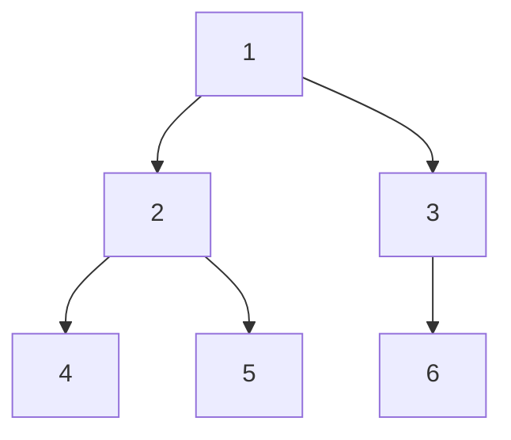

| Traversal | Rule | Output | Typical use |
|---|---|---|---|
| Preorder | node, left, right | 1 2 4 5 3 6 | copying or serialising a tree, passing state *down* (path so far, depth, bounds) |
| Inorder | left, node, right | 4 2 5 1 6 3 | BSTs: visits values in **sorted order** (validate, k-th smallest) |
| Postorder | left, right, node | 4 5 2 6 3 1 | anything that needs the children's answers first (height, diameter, balanced, deleting a tree) |
| Level order | level by level | 1 / 2 3 / 4 5 6 | "per level" questions, shortest depth, views from the side |

A quick way to remember: the name says *where the node goes* relative to its children — pre = before, in = between, post = after.

#### Recursive versions

The three DFS orders differ only in where the `add` line sits:

```kotlin
fun preorder(node: TreeNode?, out: MutableList<Int>) {
    if (node == null) return
    out.add(node.`val`)          // before the children
    preorder(node.left, out)
    preorder(node.right, out)
}

fun inorder(node: TreeNode?, out: MutableList<Int>) {
    if (node == null) return
    inorder(node.left, out)
    out.add(node.`val`)          // between the children
    inorder(node.right, out)
}

fun postorder(node: TreeNode?, out: MutableList<Int>) {
    if (node == null) return
    postorder(node.left, out)
    postorder(node.right, out)
    out.add(node.`val`)          // after the children
}
```

#### Iterative versions (asked as follow-ups, and needed for very deep trees)

Recursion uses the call stack; the iterative versions just make that stack explicit.

**Preorder:** push the root; pop, visit, push the right child then the left (so left is popped first).

```kotlin
fun preorderIterative(root: TreeNode?): List<Int> {
    val out = mutableListOf<Int>()
    val stack = ArrayDeque<TreeNode>()
    root?.let { stack.addLast(it) }
    while (stack.isNotEmpty()) {
        val node = stack.removeLast()
        out.add(node.`val`)
        node.right?.let { stack.addLast(it) }   // pushed first, popped later
        node.left?.let { stack.addLast(it) }
    }
    return out
}
```

**Inorder:** walk left as far as possible pushing nodes; pop one, visit it, then move into its right subtree. This loop is worth memorising — it is the basis of Kth Smallest and the BST iterator.

```kotlin
fun inorderIterative(root: TreeNode?): List<Int> {
    val out = mutableListOf<Int>()
    val stack = ArrayDeque<TreeNode>()
    var cur = root
    while (cur != null || stack.isNotEmpty()) {
        while (cur != null) {          // go as far left as possible
            stack.addLast(cur)
            cur = cur.left
        }
        val node = stack.removeLast()  // leftmost unvisited node
        out.add(node.`val`)
        cur = node.right               // then its right subtree
    }
    return out
}
```

**Postorder:** the simplest trick is to do a "node, right, left" preorder and reverse the result — reversed, that is "left, right, node".

```kotlin
fun postorderIterative(root: TreeNode?): List<Int> {
    val out = mutableListOf<Int>()
    val stack = ArrayDeque<TreeNode>()
    root?.let { stack.addLast(it) }
    while (stack.isNotEmpty()) {
        val node = stack.removeLast()
        out.add(node.`val`)
        node.left?.let { stack.addLast(it) }    // left pushed first, so right is popped first
        node.right?.let { stack.addLast(it) }
    }
    out.reverse()
    return out
}
```

If the interviewer wants a true one-stack postorder (no reversal, e.g. to process nodes in order as you go), use the inorder loop but only pop a node when its right child is null or was the node you visited last.

**Level order:** a queue; see [Binary Tree Level Order Traversal](#8-binary-tree-level-order-traversal).

#### The "what does each call return?" mindset

Don't try to picture the whole recursion. Instead, write a one-sentence **contract** for the function, assume it already works for the children, and use their answers to build the answer for this node. Then handle `null`.

There are two directions information can flow:

- **Bottom-up (return values):** the call returns something about its subtree. Height, "is it balanced", "the best path that ends here". This is postorder thinking.
- **Top-down (parameters):** the call receives something about the path from the root. Current depth, maximum seen so far, the allowed value range, the remaining sum. This is preorder thinking.

| Problem | Passed down | Returned up | Global answer? |
|---|---|---|---|
| [Maximum Depth](#2-maximum-depth-of-binary-tree) | — | height of subtree | no |
| [Diameter](#5-diameter-of-binary-tree) | — | height | yes: best `left + right` |
| [Balanced](#6-balanced-binary-tree) | — | height, or -1 for "unbalanced" | no |
| [Count Good Nodes](#7-count-good-nodes-in-binary-tree) | max value on the path | count in subtree | no |
| [Validate BST](#18-validate-binary-search-tree) | allowed (low, high) range | true/false | no |
| [Maximum Path Sum](#14-binary-tree-maximum-path-sum) | — | best downward path from this node | yes: best path through a node |
| [LCA](#11-lowest-common-ancestor-of-a-binary-tree) | — | p, q, the LCA, or null | no |

The "global answer" column is the important pattern: when the answer for a node **bends** through it (uses both children) but the parent can only use one branch, the function returns one thing and updates a separate best-so-far variable with another.

#### Complexity

- Every traversal visits each node once: **O(n) time**.
- DFS space is the recursion/stack depth, **O(h)**: O(log n) for a balanced tree, O(n) for a skewed one (a linked list shape). BFS space is the widest level, up to about n/2 for a complete tree.
- Morris traversal does inorder in O(1) extra space by temporarily rewiring right pointers; know it by name, it is rarely required.

#### Common mistakes

- Forgetting the `null` base case, or checking `node.left != null` everywhere instead of letting `null` be the base case.
- Recursing on a tree that can be 10^5 nodes deep — on the JVM this can overflow the stack. Mention the iterative version.
- Using `==` on nodes in Kotlin when you mean identity — use `===` (a plain class without `equals` behaves the same, but `===` states the intent).
- Building a new list in every call and concatenating (`left + listOf(v) + right`) — O(n²) in the worst case. Pass one output list down.

#### Follow-ups

- *Which traversal gives a sorted list for a BST?* Inorder. See [Kth Smallest Element in a BST](#19-kth-smallest-element-in-a-bst).
- *Can a tree be rebuilt from one traversal?* Not in general; preorder + inorder (or postorder + inorder) can, and preorder with null markers can. See [question 15](#15-construct-binary-tree-from-preorder-and-inorder-traversal) and [question 16](#16-serialize-and-deserialize-binary-tree).
- *How does this relate to graphs?* A tree is a connected acyclic graph; the same DFS/BFS ideas, plus a visited set, carry over to [Graphs](16-graphs-bfs-dfs-topo.md).

</details>

### 2. Maximum Depth of Binary Tree

**🟢 Easy**

<details>
<summary>Answer</summary>

**In short:** The depth of a tree is 1 (for the root) plus the larger of its two subtrees' depths, and an empty tree has depth 0. That is a three-line postorder recursion. A BFS that counts levels gives the same answer without recursion. O(n) time; O(h) space for DFS, O(w) for BFS.

#### Problem

Return the number of nodes on the longest path from the root down to a leaf.

- `[3, 9, 20, null, null, 15, 7]` → `3` (3 → 20 → 15)
- `[]` → `0`
- `[1, null, 2]` → `2`

#### Clarifying questions & edge cases

- Depth counted in **nodes** (LeetCode) or in **edges**? Edges = nodes - 1. Ask.
- Empty tree → 0.
- A completely skewed tree is a linked list: depth n, and recursion depth n.

#### Brute force

There isn't really a slower sensible approach; one naive idea is to list every root-to-leaf path and take the longest, which is still O(n) visits but wastes O(n·h) memory on path copies.

#### Key insight

Write the contract: `maxDepth(node)` returns the depth of the subtree rooted at `node`. If both children's depths are known, this node's depth is `1 + max(left, right)`. `null` has depth 0. Trust the recursion for the children — you never need to think about grandchildren.

The BFS view: depth = number of levels. Process the queue one level at a time and count how many levels you processed.

#### Walkthrough

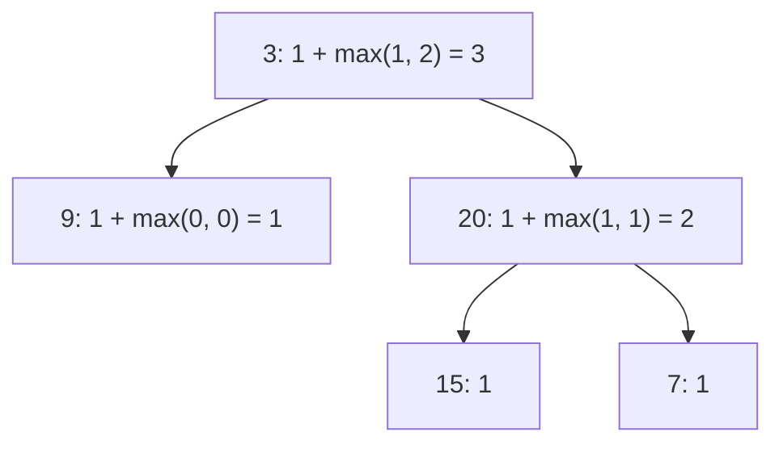

Values flow **up**: leaves return 1, node 20 returns 2, the root returns 3.

#### Kotlin

```kotlin
fun maxDepth(root: TreeNode?): Int {
    if (root == null) return 0
    return 1 + maxOf(maxDepth(root.left), maxDepth(root.right))
}

// BFS alternative: count levels, no recursion.
fun maxDepthBfs(root: TreeNode?): Int {
    if (root == null) return 0
    val queue = ArrayDeque<TreeNode>()
    queue.addLast(root)
    var depth = 0
    while (queue.isNotEmpty()) {
        repeat(queue.size) {             // exactly one level
            val node = queue.removeFirst()
            node.left?.let { queue.addLast(it) }
            node.right?.let { queue.addLast(it) }
        }
        depth++
    }
    return depth
}
```

#### Swift

```swift
func maxDepth(_ root: TreeNode?) -> Int {
    guard let node = root else { return 0 }
    return 1 + max(maxDepth(node.left), maxDepth(node.right))
}

// BFS alternative using an array per level (Swift has no built-in deque).
func maxDepthBfs(_ root: TreeNode?) -> Int {
    guard let root = root else { return 0 }
    var level: [TreeNode] = [root]
    var depth = 0
    while !level.isEmpty {
        depth += 1
        var next: [TreeNode] = []
        for node in level {
            if let l = node.left { next.append(l) }
            if let r = node.right { next.append(r) }
        }
        level = next
    }
    return depth
}
```

#### Complexity

- **Time:** O(n) — every node is visited once.
- **Space:** O(h) for recursion (O(n) worst case for a skewed tree, O(log n) balanced); O(w) for BFS, the widest level.

#### Common mistakes

- Returning 1 for `null` (off by one everywhere).
- Mixing up depth in nodes vs edges.
- Using `removeFirst()` on a Swift `Array` as a queue — it is O(n) per call. Use per-level arrays or a head index.

#### Follow-ups

- **Minimum Depth:** careful — a node with one child is not a leaf, so `1 + min(left, right)` is wrong when one side is null. BFS and stop at the first leaf is cleanest.
- *Depth of an N-ary tree?* `1 + max over all children`.
- *Iterative DFS?* Push `(node, depth)` pairs on a stack and track the maximum depth seen.

</details>

### 3. Invert Binary Tree

**🟢 Easy**

<details>
<summary>Answer</summary>

**In short:** Mirror the tree by swapping every node's left and right children. Recursively: invert both subtrees and swap them; or iteratively, visit every node with a queue or stack and swap its children. Each node is touched once: O(n) time, O(h) space recursive.

#### Problem

Given the root, return the root of its mirror image.

- `[4, 2, 7, 1, 3, 6, 9]` → `[4, 7, 2, 9, 6, 3, 1]`
- `[2, 1, 3]` → `[2, 3, 1]`
- `[]` → `[]`

#### Clarifying questions & edge cases

- In place, or build a new tree? (LeetCode: in place is fine; return the same root.)
- Empty tree → return null.
- Single node → unchanged.

#### Brute force

Building a new mirrored copy works and is also O(n), but uses O(n) extra memory for the copy. In-place swapping is the expected answer.

#### Key insight

Mirroring a tree means: the mirrored left subtree is the original right subtree, mirrored, and vice versa. So for every node, swap the two child pointers, and make sure every subtree also gets swapped. The order does not matter — pre-, post- or level order all work, because each node's swap is independent of the others.

#### Walkthrough

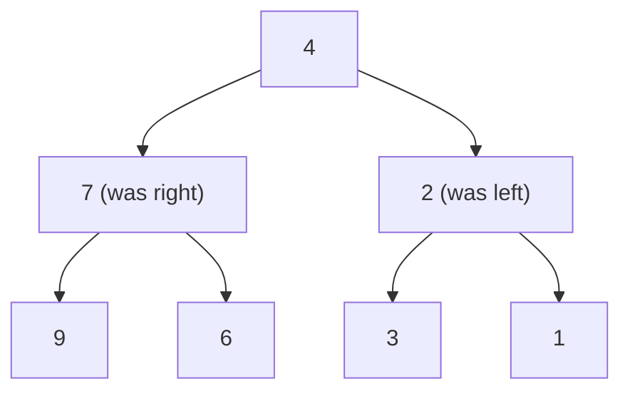

At node 4 the children 2 and 7 swap; at node 2 the children 1 and 3 swap; at node 7, 6 and 9 swap.

#### Kotlin

```kotlin
fun invertTree(root: TreeNode?): TreeNode? {
    if (root == null) return null
    val left = invertTree(root.left)    // invert both subtrees first
    val right = invertTree(root.right)
    root.left = right                   // then swap them
    root.right = left
    return root
}

// Iterative: BFS, swapping at each node.
fun invertTreeIterative(root: TreeNode?): TreeNode? {
    if (root == null) return null
    val queue = ArrayDeque<TreeNode>()
    queue.addLast(root)
    while (queue.isNotEmpty()) {
        val node = queue.removeFirst()
        val tmp = node.left
        node.left = node.right
        node.right = tmp
        node.left?.let { queue.addLast(it) }
        node.right?.let { queue.addLast(it) }
    }
    return root
}
```

#### Complexity

- **Time:** O(n) — one swap per node.
- **Space:** O(h) recursion stack; O(w) for the BFS queue.

#### Common mistakes

- Writing `root.left = invertTree(root.right); root.right = invertTree(root.left)` — the second line reads the **already overwritten** left pointer. Save into locals first, as above.
- Forgetting to return the root.

#### Follow-ups

- **Symmetric Tree:** is the tree a mirror of itself? Compare `left` with `right` using a two-node helper: `mirror(a, b) = a.val == b.val && mirror(a.left, b.right) && mirror(a.right, b.left)`.
- *Is tree B the mirror of tree A?* Same helper on two roots.
- *Very deep tree?* Use the iterative version to avoid stack overflow.

</details>

### 4. Subtree of Another Tree (and Same Tree)

**🟢 Easy**

<details>
<summary>Answer</summary>

**In short:** First write **Same Tree**: two trees are equal if both are null, or both roots have equal values and their left subtrees are equal and their right subtrees are equal. Then **Subtree of Another Tree** is: is `subRoot` the same tree as `root`, or a subtree of `root.left`, or a subtree of `root.right`? That is O(m·n) in the worst case, which is the expected answer; serialising both trees and doing a substring search (or hashing subtrees) brings it to O(m + n).

#### Problem

- **Same Tree:** given `p` and `q`, are they structurally identical with equal values? `[1,2,3]` and `[1,2,3]` → `true`; `[1,2]` and `[1,null,2]` → `false`.
- **Subtree:** does `root` contain a node whose entire subtree equals `subRoot`? `root = [3,4,5,1,2]`, `subRoot = [4,1,2]` → `true`. `root = [3,4,5,1,2,null,null,null,null,0]`, `subRoot = [4,1,2]` → `false` (node 4's subtree has an extra 0).

#### Clarifying questions & edge cases

- A subtree must include **all** descendants of that node — matching only the top part is not enough (the second example).
- Is an empty `subRoot` a subtree of anything? Conventionally yes; LeetCode guarantees non-empty trees.
- Duplicate values are allowed, so you can't just find "the" node with value `subRoot.val` — there may be several candidates.

#### Brute force

The recursive solution below *is* the straightforward approach: for each of the m nodes of `root`, run an O(n) comparison against `subRoot`. In practice the comparison exits early on the first mismatch.

#### Key insight

Break the problem into two recursive contracts:

1. `isSameTree(a, b)`: compares two trees node by node in lock-step. Any mismatch in shape (one null, one not) or value returns false.
2. `isSubtree(root, sub)`: true if the trees match right here, otherwise ask the children.

For the linear-time version, serialise each tree in preorder **with null markers and value separators** (`",4,1,#,#,2,#,#"`). With null markers, the serialisation identifies a tree uniquely, so "sub is a subtree of root" becomes "sub's string is a substring of root's string", solvable with KMP in O(m + n). The leading separator stops `"2"` from matching inside `"12"`.

#### Walkthrough

`root = [3,4,5,1,2]`, `subRoot = [4,1,2]`

| call | isSameTree? | result |
|---|---|---|
| isSubtree(3) | 3 vs 4: values differ → false | ask children |
| isSubtree(4) | 4 = 4, (1,1) same, (2,2) same → true | **true** |

The search stops as soon as one candidate matches.

#### Kotlin

```kotlin
fun isSameTree(p: TreeNode?, q: TreeNode?): Boolean {
    if (p == null && q == null) return true
    if (p == null || q == null) return false        // shapes differ
    return p.`val` == q.`val` &&
        isSameTree(p.left, q.left) &&
        isSameTree(p.right, q.right)
}

fun isSubtree(root: TreeNode?, subRoot: TreeNode?): Boolean {
    if (subRoot == null) return true
    if (root == null) return false
    return isSameTree(root, subRoot) ||
        isSubtree(root.left, subRoot) ||
        isSubtree(root.right, subRoot)
}
```

#### Complexity

- **Same Tree:** O(min(m, n)) time, O(h) space.
- **Subtree:** O(m·n) worst case (e.g. a root full of 1s and a sub of 1s ending in a 2), O(h) space. The serialise + KMP version is O(m + n) time and space.

#### Common mistakes

- Checking only that the **values** of the in-order lists match — different shapes can produce the same inorder sequence. Always include null markers if you serialise.
- Serialising without separators, so `[12]` "contains" `[2]`.
- In `isSubtree`, recursing with `isSameTree(root.left, subRoot)` instead of `isSubtree(root.left, subRoot)` — this only checks one level down.

#### Follow-ups

- *Faster?* Serialise + KMP (see [Tries & String Algorithms](15-tries-string-algorithms.md)), or compute a hash for every subtree in postorder and compare hashes (verify on match to rule out collisions).
- **Find Duplicate Subtrees:** serialise every subtree in postorder into a map of string → count; report those seen twice.
- **Symmetric Tree:** the same lock-step comparison, but mirrored (`a.left` with `b.right`).

</details>

### 5. Diameter of Binary Tree

**🟢 Easy** · ⭐ Product/FAANG favourite (commonly reported at Meta)

<details>
<summary>Answer</summary>

**In short:** The longest path between any two nodes must "bend" at some node, going down into its left subtree and its right subtree. Its length there is `height(left) + height(right)` edges. So compute heights bottom-up, and at every node update a global best with `leftHeight + rightHeight`, while returning `1 + max(leftHeight, rightHeight)` to the parent. O(n) time, O(h) space.

#### Problem

Return the number of **edges** on the longest path between any two nodes. The path does not have to pass through the root.

- `[1, 2, 3, 4, 5]` → `3` (4 → 2 → 1 → 3, or 5 → 2 → 1 → 3)
- `[1, 2]` → `1`

#### Clarifying questions & edge cases

- Edges or nodes? LeetCode counts edges.
- Single node → 0. Empty tree → 0.
- The best path may sit entirely inside one subtree — don't only check the root.

#### Brute force

For every node, compute the heights of its two subtrees from scratch and take `left + right`. Each height call is O(n), so this is O(n²) on a skewed tree.

#### Key insight

Every path has exactly one **highest node** (where it turns). For a fixed highest node, the longest path through it goes as deep as possible on each side: `height(left) + height(right)`, where height counts nodes so that a null child contributes 0 edges.

The height computation already visits every node bottom-up, so update the answer **during** it. This is the classic "return one thing, record another" pattern: the parent can only extend a path that goes down **one** side (height), but the answer considers paths that use **both** sides.

#### Walkthrough

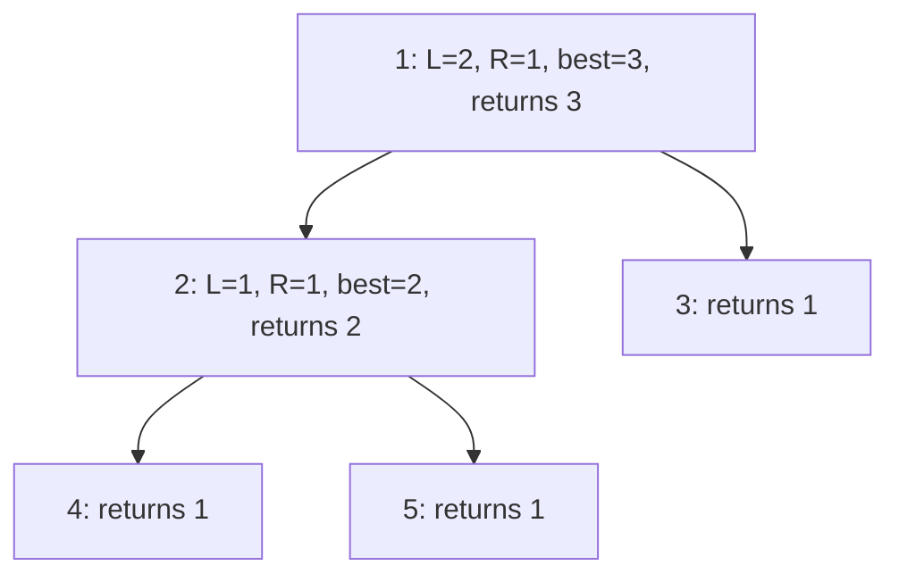

| node (postorder) | left h | right h | left + right | best | returns |
|---|---|---|---|---|---|
| 4 | 0 | 0 | 0 | 0 | 1 |
| 5 | 0 | 0 | 0 | 0 | 1 |
| 2 | 1 | 1 | 2 | 2 | 2 |
| 3 | 0 | 0 | 0 | 2 | 1 |
| 1 | 2 | 1 | 3 | **3** | 3 |

#### Kotlin

```kotlin
fun diameterOfBinaryTree(root: TreeNode?): Int {
    var best = 0
    // Returns the height in nodes of the subtree (null = 0).
    fun height(node: TreeNode?): Int {
        if (node == null) return 0
        val l = height(node.left)
        val r = height(node.right)
        best = maxOf(best, l + r)          // path bending at this node, in edges
        return 1 + maxOf(l, r)             // parent can extend only one side
    }
    height(root)
    return best
}
```

#### Complexity

- **Time:** O(n) — one postorder pass.
- **Space:** O(h) recursion stack.

#### Common mistakes

- Returning `l + r` to the parent instead of `1 + max(l, r)` — a parent cannot use both of a child's branches.
- Assuming the diameter passes through the root — `[1, 2, null, 3, 4, ...]` with a long left side can bend lower down.
- Off-by-one from mixing edges and nodes; with "null height = 0", `l + r` is already in edges.

#### Follow-ups

- **Binary Tree Maximum Path Sum** is the same pattern with values instead of edge counts — see [question 14](#14-binary-tree-maximum-path-sum).
- **Longest Univalue Path:** same skeleton, but a child extends the path only if it has the same value.
- *Diameter of an N-ary tree or general tree?* Keep the two largest child heights at each node; for a general tree you can also BFS twice (farthest node from anywhere, then farthest from that).

</details>

### 6. Balanced Binary Tree

**🟢 Easy**

<details>
<summary>Answer</summary>

**In short:** A tree is height-balanced if, at every node, the two subtree heights differ by at most 1. Compute heights bottom-up and let the function return `-1` as a sentinel meaning "this subtree is already unbalanced", so the answer is found in a single O(n) pass instead of recomputing heights at every node (O(n²)).

#### Problem

Return whether the tree is height-balanced: for **every** node, `|height(left) - height(right)| <= 1`.

- `[3, 9, 20, null, null, 15, 7]` → `true`
- `[1, 2, 2, 3, 3, null, null, 4, 4]` → `false` (at the root, the left subtree has height 3 and the right has height 1)
- `[]` → `true`

#### Clarifying questions & edge cases

- The condition must hold at **every** node, not just the root. A tree can have equal heights at the root and still be unbalanced lower down (two long chains, one going left and one going right).
- Empty tree is balanced.

#### Brute force

`isBalanced(node) = |height(left) - height(right)| <= 1 && isBalanced(left) && isBalanced(right)`, with `height` computed from scratch each time. Each node's height is recomputed once per ancestor: O(n log n) for a balanced tree, O(n²) for a skewed one.

#### Key insight

Postorder already knows both children's heights when it reaches a node, so the balance check is free at that moment. The only problem is that the function must return two things: a height and a yes/no. Pack them into one int: a real height is `>= 0`, and `-1` means "unbalanced somewhere below". Once a child returns -1, propagate -1 straight up without doing more work.

#### Walkthrough

Tree `[1, 2, 2, 3, null, null, null, 4]` (a chain 1 → 2 → 3 → 4 on the left, plus a right child 2):

| node | left result | right result | difference | returns |
|---|---|---|---|---|
| 4 | 0 | 0 | 0 | 1 |
| 3 | 1 | 0 | 1 | 2 |
| left 2 | 2 | 0 | **2** | **-1** |
| right 2 | 0 | 0 | 0 | 1 |
| 1 | -1 | — | — | -1 → `false` |

#### Kotlin

```kotlin
fun isBalanced(root: TreeNode?): Boolean {
    // Returns the subtree height, or -1 if the subtree is unbalanced.
    fun check(node: TreeNode?): Int {
        if (node == null) return 0
        val l = check(node.left)
        if (l == -1) return -1                    // early exit
        val r = check(node.right)
        if (r == -1) return -1
        if (l - r > 1 || r - l > 1) return -1     // unbalanced here
        return 1 + maxOf(l, r)
    }
    return check(root) != -1
}
```

#### Complexity

- **Time:** O(n) — each node is visited once.
- **Space:** O(h) recursion stack.

#### Common mistakes

- Checking only the root's two heights.
- The O(n²) "height inside a recursive check" approach — acceptable as a first answer, but the interviewer will push for O(n).
- Forgetting to check the sentinel before using a child's result in the subtraction.

#### Follow-ups

- *Return the height and the boolean separately?* Use a small data class or a `Pair<Boolean, Int>`; the sentinel is just a compact encoding.
- *Make a BST balanced?* Inorder traversal to a sorted list, then build by always picking the middle element as the root (Balance a Binary Search Tree, Convert Sorted Array to BST).
- *Why do balanced trees matter?* They keep h = O(log n), so BST operations stay O(log n). Self-balancing trees (AVL, red-black — Java's `TreeMap`) enforce it automatically.

</details>

### 7. Count Good Nodes in Binary Tree

**🟡 Medium**

<details>
<summary>Answer</summary>

**In short:** A node is "good" if no node on the path from the root to it has a larger value. Pass the maximum value seen so far **down** the recursion; a node is good if its value is at least that maximum. Return the count of good nodes in the subtree **up**. One pass, O(n) time, O(h) space.

#### Problem

Count the nodes X such that the path root → X contains no value greater than X's value.

- `[3, 1, 4, 3, null, 1, 5]` → `4` (the root 3, the 4, the 5, and the lower-left 3)
- `[3, 3, null, 4, 2]` → `3`
- `[1]` → `1`

#### Clarifying questions & edge cases

- Equal values count as good ("no node with a value **greater** than X").
- The root is always good.
- Negative values are allowed, so start the running maximum at `Int.MIN_VALUE`, not 0.

#### Brute force

For every node, walk the path from the root to it and check the maximum. With parent pointers or path lists this costs O(h) per node: O(n·h) overall.

#### Key insight

The only information a node needs about its ancestors is one number: the largest value on the path above it. That is exactly the kind of state you pass **down** as a parameter (top-down / preorder). Each child receives `max(maxSoFar, node.val)`. The count is then summed back up.

#### Walkthrough

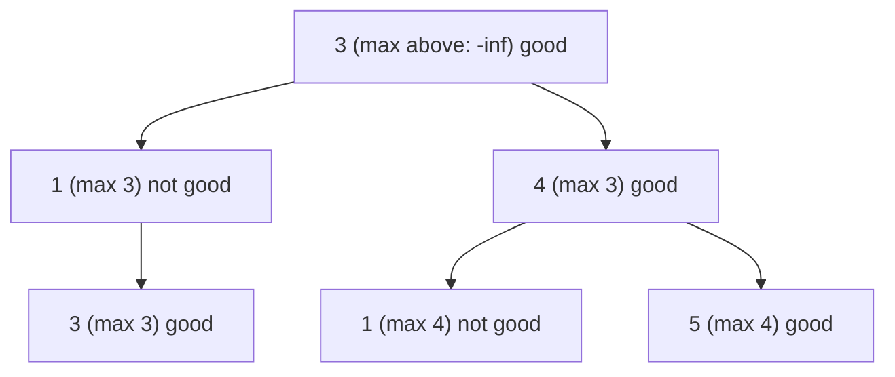

Total good nodes: 3, 4, 3, 5 → **4**.

#### Kotlin

```kotlin
fun goodNodes(root: TreeNode?): Int {
    // maxAbove = largest value on the path from the root down to (not including) node.
    fun dfs(node: TreeNode?, maxAbove: Int): Int {
        if (node == null) return 0
        val good = if (node.`val` >= maxAbove) 1 else 0
        val newMax = maxOf(maxAbove, node.`val`)
        return good + dfs(node.left, newMax) + dfs(node.right, newMax)
    }
    return dfs(root, Int.MIN_VALUE)
}
```

#### Complexity

- **Time:** O(n) — each node visited once.
- **Space:** O(h) recursion stack.

#### Common mistakes

- Starting the maximum at 0 — fails with negative values.
- Using `>` instead of `>=` — equal values are good.
- Using a global "max" variable that isn't restored when the recursion returns from a branch; passing it as a parameter makes backtracking automatic.

#### Follow-ups

- *Iterative?* Stack or queue of `(node, maxAbove)` pairs.
- *Count nodes whose value equals the average of their subtree?* Bottom-up instead: return `(sum, count)` from each subtree.
- The same top-down pattern validates a BST by passing a range — see [Validate Binary Search Tree](#18-validate-binary-search-tree).

</details>

## Level order and views

### 8. Binary Tree Level Order Traversal

**🟡 Medium** · ⭐ Product/FAANG favourite

<details>
<summary>Answer</summary>

**In short:** BFS with a queue, processing the tree **one level at a time**: at the start of each round, the queue holds exactly the nodes of the current level, so record `size = queue.size`, pop that many nodes into this level's list and push their children for the next round. O(n) time, O(w) space for the queue.

#### Problem

Return the node values grouped by level, top to bottom, left to right.

- `[3, 9, 20, null, null, 15, 7]` → `[[3], [9, 20], [15, 7]]`
- `[1]` → `[[1]]`
- `[]` → `[]`

#### Clarifying questions & edge cases

- Empty tree → empty list (not `[[]]`).
- Left to right within a level? (Yes; zigzag and bottom-up are variants.)
- How wide can a level get? Up to about n/2 nodes for a complete tree — that's the memory cost.

#### Brute force

DFS while passing the depth, appending each value to `result[depth]` (creating the list the first time that depth is seen). This is also O(n) and correct, because preorder visits left before right within each depth. It's a fine alternative, but BFS is what the question is testing.

#### Key insight

A queue processes nodes in the order they were discovered. Because all children of level d are discovered while processing level d, and they're added after everything already in the queue, the queue is always "the rest of level d, then the start of level d+1". If you freeze `size` at the start of a round, you know exactly where the level boundary is — no need to store depths.

#### Walkthrough

| round | queue at start | size | level recorded | queue after |
|---|---|---|---|---|
| 1 | [3] | 1 | [3] | [9, 20] |
| 2 | [9, 20] | 2 | [9, 20] | [15, 7] |
| 3 | [15, 7] | 2 | [15, 7] | [] |

#### Kotlin

```kotlin
fun levelOrder(root: TreeNode?): List<List<Int>> {
    val result = mutableListOf<List<Int>>()
    if (root == null) return result
    val queue = ArrayDeque<TreeNode>()
    queue.addLast(root)
    while (queue.isNotEmpty()) {
        val size = queue.size                  // nodes on this level
        val level = ArrayList<Int>(size)
        repeat(size) {
            val node = queue.removeFirst()
            level.add(node.`val`)
            node.left?.let { queue.addLast(it) }
            node.right?.let { queue.addLast(it) }
        }
        result.add(level)
    }
    return result
}
```

#### Swift

Swift has no built-in deque, and `Array.removeFirst()` is O(n). Building each level as its own array sidesteps the problem entirely:

```swift
func levelOrder(_ root: TreeNode?) -> [[Int]] {
    guard let root = root else { return [] }
    var result: [[Int]] = []
    var current: [TreeNode] = [root]
    while !current.isEmpty {
        result.append(current.map { $0.val })
        var next: [TreeNode] = []
        for node in current {
            if let l = node.left { next.append(l) }
            if let r = node.right { next.append(r) }
        }
        current = next
    }
    return result
}
```

#### Complexity

- **Time:** O(n) — each node enters and leaves the queue once.
- **Space:** O(w) for the queue, where w is the widest level (up to ~n/2), plus O(n) for the output.

#### Common mistakes

- Using `queue.size` directly as the loop bound while you add to the queue — the size changes during the loop. Save it first.
- Using Java's `LinkedList` or Swift `removeFirst()` and getting O(n²) in Swift.
- Returning `[[]]` for an empty tree.

#### Follow-ups

- **Level Order Bottom-up:** same, then reverse the result.
- **Average of Levels / Largest Value in Each Row:** same loop, aggregate instead of listing.
- **Zigzag** and **Right Side View:** see the [next question](#9-binary-tree-right-side-view-and-zigzag-level-order).
- **Minimum Depth / shortest path to a leaf:** BFS stops at the first leaf it sees, which is why BFS beats DFS there.

</details>

### 9. Binary Tree Right Side View (and Zigzag Level Order)

**🟡 Medium** · ⭐ Product/FAANG favourite (commonly reported at Meta)

<details>
<summary>Answer</summary>

**In short:** Both are level-order traversal with a small twist. **Right Side View:** the node you see from the right on each level is the **last** node of that level in BFS order — record it. (Or DFS visiting right before left, and record the first node you meet at each new depth.) **Zigzag:** build each level normally, but reverse every other level (or insert at the front of the level's list on odd levels). Both are O(n) time.

#### Problem

- **Right Side View:** imagine standing to the right of the tree; return the values you can see, top to bottom. `[1, 2, 3, null, 5, null, 4]` → `[1, 3, 4]`. `[1, 2, 3, 4]` → `[1, 3, 4]` (the 4 hangs off the left side, but it's the only node on its level, so it's visible).
- **Zigzag:** level order, but alternate direction: left-to-right, then right-to-left, and so on. `[3, 9, 20, null, null, 15, 7]` → `[[3], [20, 9], [15, 7]]`.

#### Clarifying questions & edge cases

- Right side view is **not** "follow right pointers". A deeper left node is visible when nothing is to its right on that level (the second example).
- Empty tree → empty list.

#### Brute force

Do a full level-order traversal into lists, then take the last element of each list (Right Side View) or reverse alternate lists (Zigzag). This is already O(n); the versions below just avoid storing all the levels.

#### Key insight

- The rightmost node on level d is the last one BFS pops on that level — `i == size - 1` in the inner loop.
- DFS alternative: visit `right` before `left` and carry the depth. The first node reached at a new depth (`depth == result.size`) is the rightmost on that level. This uses O(h) space instead of O(w).
- Zigzag: the BFS order itself never changes (always left child then right child), only how each level is **written out**. Changing the order you push children instead is a classic bug source.

#### Walkthrough

Right side view of `[1, 2, 3, null, 5, null, 4]`:

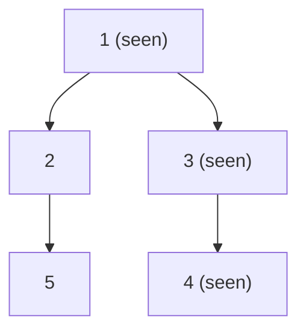

| level | nodes left to right | last node |
|---|---|---|
| 0 | 1 | 1 |
| 1 | 2, 3 | 3 |
| 2 | 5, 4 | 4 |

Result `[1, 3, 4]`.

#### Kotlin

```kotlin
fun rightSideView(root: TreeNode?): List<Int> {
    val result = mutableListOf<Int>()
    if (root == null) return result
    val queue = ArrayDeque<TreeNode>()
    queue.addLast(root)
    while (queue.isNotEmpty()) {
        val size = queue.size
        for (i in 0 until size) {
            val node = queue.removeFirst()
            if (i == size - 1) result.add(node.`val`)   // last on this level
            node.left?.let { queue.addLast(it) }
            node.right?.let { queue.addLast(it) }
        }
    }
    return result
}

// DFS alternative: right child first; the first node at each new depth is visible.
fun rightSideViewDfs(root: TreeNode?): List<Int> {
    val result = mutableListOf<Int>()
    fun dfs(node: TreeNode?, depth: Int) {
        if (node == null) return
        if (depth == result.size) result.add(node.`val`)
        dfs(node.right, depth + 1)
        dfs(node.left, depth + 1)
    }
    dfs(root, 0)
    return result
}

fun zigzagLevelOrder(root: TreeNode?): List<List<Int>> {
    val result = mutableListOf<List<Int>>()
    if (root == null) return result
    val queue = ArrayDeque<TreeNode>()
    queue.addLast(root)
    var leftToRight = true
    while (queue.isNotEmpty()) {
        val level = ArrayDeque<Int>()
        repeat(queue.size) {
            val node = queue.removeFirst()
            // Same BFS order every time; only the write position changes.
            if (leftToRight) level.addLast(node.`val`) else level.addFirst(node.`val`)
            node.left?.let { queue.addLast(it) }
            node.right?.let { queue.addLast(it) }
        }
        result.add(level.toList())
        leftToRight = !leftToRight
    }
    return result
}
```

#### Complexity

- **Time:** O(n) for all three.
- **Space:** O(w) for BFS, O(h) for the DFS version (plus the output).

#### Common mistakes

- Following only right children for the right side view.
- For zigzag, swapping the order you enqueue children on odd levels — that scrambles the **next** level's order. Change only how you record values.
- `repeat(queue.size)` is safe in Kotlin because the argument is evaluated once; a `while (i < queue.size)` loop is not.

#### Follow-ups

- **Left side view:** first node of each level (`i == 0`), or DFS left-first.
- **Boundary of Binary Tree / top and bottom view:** see [Vertical Order Traversal](#10-vertical-order-traversal-of-a-binary-tree).
- **Populating Next Right Pointers:** level-order where each node points to the next one on its level; O(1)-space version walks the already-linked level above.

</details>

### 10. Vertical Order Traversal of a Binary Tree

**🔴 Hard** · ⭐ Product/FAANG favourite (commonly reported at Meta)

<details>
<summary>Answer</summary>

**In short:** Give every node coordinates: the root is at `(row 0, col 0)`, a left child at `(row + 1, col - 1)` and a right child at `(row + 1, col + 1)`. Collect `(col, row, value)` for every node with any traversal, sort by column, then row, then value, and group consecutive entries by column. O(n log n) time for the sort, O(n) space.

#### Problem

Return the values column by column from leftmost to rightmost. Within a column, nodes go top to bottom; nodes in the **same row and column** are ordered by value (this is the LeetCode 987 rule).

- `[3, 9, 20, null, null, 15, 7]` → `[[9], [3, 15], [20], [7]]`
- `[1, 2, 3, 4, 6, 5, 7]` → `[[4], [2], [1, 5, 6], [3], [7]]` (5 and 6 share row 2, column 0, so they're sorted by value)

#### Clarifying questions & edge cases

- **Which tie-break?** This is the important question. LeetCode 987 sorts same-position nodes by value. The older LeetCode 314 (premium, often asked at Meta) orders same-position nodes **left to right as BFS meets them**. The code differs slightly — ask.
- Negative columns are normal (left of the root).
- Empty tree → empty list.

#### Brute force

There isn't a meaningfully slower approach — the core cost is ordering the nodes. One simplification is to use a `TreeMap<col, TreeMap<row, sorted list>>`, which works but is more code than a single sort.

#### Key insight

Vertical order is just **sorting by coordinates**. Once each node has `(col, row)`, the required order is lexicographic on `(col, row, value)`. Any traversal can assign the coordinates, because each child's coordinate depends only on its parent's.

For the 314 variant (no value tie-break), use BFS: BFS visits nodes row by row, left to right, so appending to `map[col]` in BFS order is already correct; track the min and max column to output in order without sorting — O(n).

#### Walkthrough

`[1, 2, 3, 4, 6, 5, 7]`:

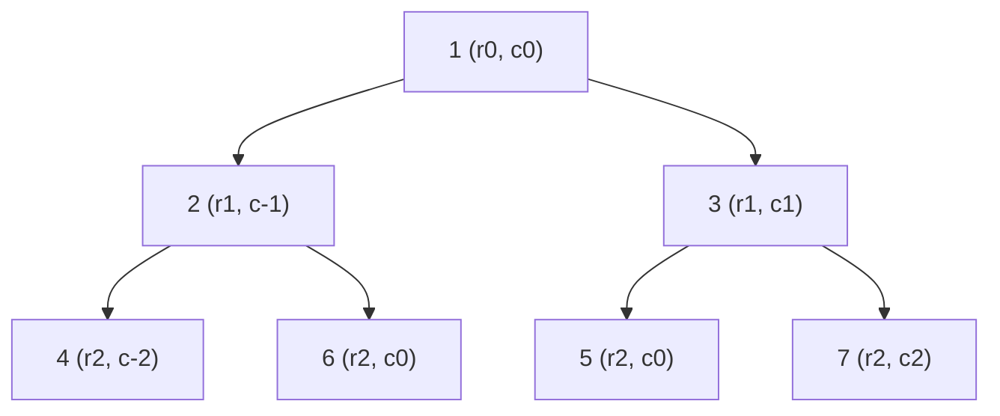

Sorted `(col, row, val)`: `(-2,2,4)`, `(-1,1,2)`, `(0,0,1)`, `(0,2,5)`, `(0,2,6)`, `(1,1,3)`, `(2,2,7)` → grouped: `[[4], [2], [1, 5, 6], [3], [7]]`.

#### Kotlin

```kotlin
fun verticalTraversal(root: TreeNode?): List<List<Int>> {
    val entries = mutableListOf<IntArray>()          // [col, row, value]
    fun dfs(node: TreeNode?, row: Int, col: Int) {
        if (node == null) return
        entries.add(intArrayOf(col, row, node.`val`))
        dfs(node.left, row + 1, col - 1)
        dfs(node.right, row + 1, col + 1)
    }
    dfs(root, 0, 0)

    entries.sortWith(compareBy<IntArray>({ it[0] }, { it[1] }, { it[2] }))

    val result = mutableListOf<MutableList<Int>>()
    var prevCol = Int.MIN_VALUE
    for (e in entries) {
        if (e[0] != prevCol) {                       // new column starts
            result.add(mutableListOf())
            prevCol = e[0]
        }
        result.last().add(e[2])
    }
    return result
}
```

#### Complexity

- **Time:** O(n log n) — dominated by the sort.
- **Space:** O(n) for the entries and output, O(h) recursion.

#### Common mistakes

- Using DFS for the 314 variant without the row — DFS visits a deep left node before a shallow right node in the same column, giving the wrong top-to-bottom order.
- Forgetting the value tie-break for 987.
- Using a `HashMap<col, ...>` and then forgetting columns have to be output sorted.

#### Follow-ups

- **Boundary of Binary Tree:** root, then the left boundary top-down (excluding leaves), then all leaves left to right (a DFS), then the right boundary bottom-up (excluding leaves). The trick is not printing a node twice.
- **Top view / bottom view:** the first / last node per column in BFS order (keep a map col → value).
- *Avoid the sort?* For the 314 ordering, BFS with min/max column tracking is O(n).

</details>

## Ancestors and paths

### 11. Lowest Common Ancestor of a Binary Tree

**🟡 Medium** · ⭐ Product/FAANG favourite (commonly reported at Meta, Amazon)

<details>
<summary>Answer</summary>

**In short:** Recurse with the contract "return p or q if found in this subtree, or their LCA if both are here, otherwise null". A node returns itself if it is p or q. Otherwise, if the left and right recursive calls both return non-null, p and q are on different sides, so **this node** is the LCA; if only one side is non-null, pass that result up. O(n) time, O(h) space.

#### Problem

Given a binary tree (not a BST) and two nodes p and q that are both in it, return their lowest common ancestor: the deepest node that has both as descendants. A node counts as a descendant of itself.

- Tree `[3, 5, 1, 6, 2, 0, 8, null, null, 7, 4]`, p = 5, q = 1 → `3`
- Same tree, p = 5, q = 4 → `5` (5 is an ancestor of 4)

#### Clarifying questions & edge cases

- Are p and q guaranteed to be in the tree? (LeetCode 236: yes. If not, the short solution can return p even when q is missing — see follow-ups.)
- Can p be an ancestor of q? Yes — then p is the answer.
- Do nodes have parent pointers? If yes, it's a different and easier problem (LCA III).
- Compare nodes by identity, not value (values may repeat in other variants).

#### Brute force

Find the root-to-p path and the root-to-q path (two DFS searches storing paths), then walk both paths from the root while they agree; the last common node is the LCA. O(n) time, O(n) extra space for the paths — a fine first answer.

#### Key insight

Consider what a subtree "knows" after recursion:

- If it contains **neither** p nor q → return null.
- If it contains **exactly one** → return that node (a signal "I found one").
- If it contains **both** → return their LCA (which bubbles up unchanged).

At a node, if the left call and the right call **both** return something, p is on one side and q on the other, so this node is the lowest point where they meet. If the current node itself is p (or q), return it immediately: either the other one is below it (so this node is the LCA), or it's elsewhere and a higher node will see two non-null sides.

#### Walkthrough

p = 6, q = 4:

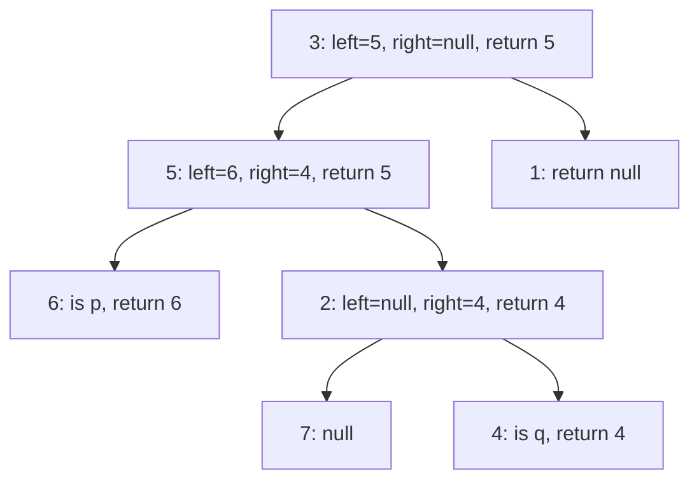

Node 5 sees both sides non-null and returns itself; the root passes it up. Answer: **5**.

#### Kotlin

```kotlin
fun lowestCommonAncestor(root: TreeNode?, p: TreeNode?, q: TreeNode?): TreeNode? {
    if (root == null || root === p || root === q) return root
    val left = lowestCommonAncestor(root.left, p, q)
    val right = lowestCommonAncestor(root.right, p, q)
    return when {
        left != null && right != null -> root   // p and q split here
        left != null -> left                    // both (or the one found) are on the left
        else -> right
    }
}
```

#### Swift

```swift
func lowestCommonAncestor(_ root: TreeNode?, _ p: TreeNode?, _ q: TreeNode?) -> TreeNode? {
    guard let node = root else { return nil }
    if node === p || node === q { return node }
    let left = lowestCommonAncestor(node.left, p, q)
    let right = lowestCommonAncestor(node.right, p, q)
    if left != nil && right != nil { return node }
    return left ?? right
}
```

#### Complexity

- **Time:** O(n) — each node visited at most once.
- **Space:** O(h) recursion stack.

#### Common mistakes

- Using the BST approach (comparing values) on a general binary tree.
- Comparing `root.val == p.val` instead of identity — breaks when values repeat.
- Assuming both nodes exist when the problem doesn't guarantee it: the short code returns p if only p exists.

#### Follow-ups

- **p or q might be missing (LCA II):** do a full traversal (don't return early at p/q) and count how many of the two you found; return the LCA only if the count is 2.
- **With parent pointers (LCA III, a Meta favourite):** walk up from p and q like finding the intersection of two linked lists — two pointers that switch to the other start when they reach the top meet at the LCA. O(h) time, O(1) space. See [Linked Lists](12-linked-lists.md).
- **Many queries on a static tree:** binary lifting gives O(log n) per query after O(n log n) preprocessing.
- **BST:** much simpler — see the [next question](#12-lowest-common-ancestor-of-a-binary-search-tree).

</details>

### 12. Lowest Common Ancestor of a Binary Search Tree

**🟡 Medium**

<details>
<summary>Answer</summary>

**In short:** Use the BST ordering: start at the root; if both p and q are smaller than the current node, the LCA is in the left subtree; if both are larger, go right; otherwise they split here (or one of them **is** this node), so the current node is the LCA. One walk down the tree: O(h) time and O(1) space iteratively.

#### Problem

Same as the general LCA, but the tree is a binary search tree. p and q are guaranteed to be in the tree.

- BST `[6, 2, 8, 0, 4, 7, 9, null, null, 3, 5]`, p = 2, q = 8 → `6`
- Same tree, p = 2, q = 4 → `2`

#### Clarifying questions & edge cases

- Values are unique in a standard BST (LeetCode guarantees it here).
- p could be an ancestor of q.
- Is it really a BST? If not, use the [general solution](#11-lowest-common-ancestor-of-a-binary-tree).

#### Brute force

The general binary-tree LCA works on a BST too in O(n) — it just ignores the ordering, which is the point of the question.

#### Key insight

In a BST, every value in the left subtree of a node is smaller and every value in the right is larger. Walking from the root:

- If `p < node` and `q < node`, both are in the left subtree, so their LCA is too.
- If `p > node` and `q > node`, both are in the right subtree.
- Otherwise `min(p, q) <= node <= max(p, q)`: they are on different sides, or one of them is the node itself. Any lower node would lose one of them. This node is the LCA.

#### Walkthrough

p = 3, q = 5:

| current | compare | move |
|---|---|---|
| 6 | 3 < 6 and 5 < 6 | left |
| 2 | 3 > 2 and 5 > 2 | right |
| 4 | 3 < 4 < 5 | **answer 4** |

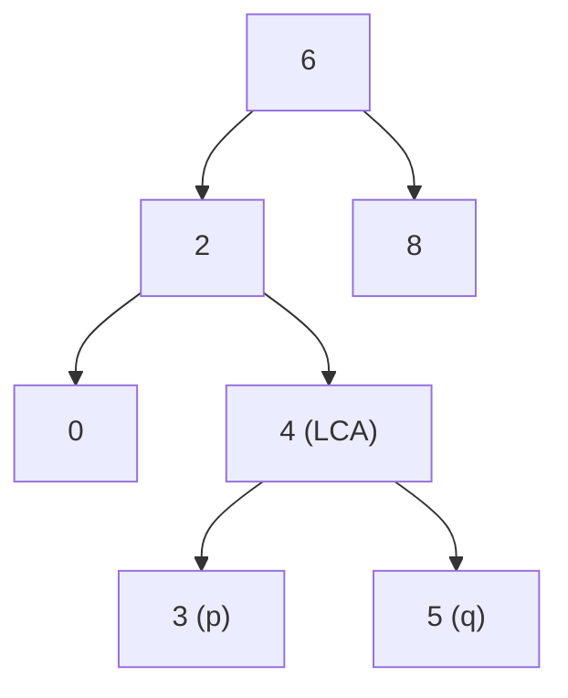

#### Kotlin

```kotlin
fun lowestCommonAncestorBst(root: TreeNode?, p: TreeNode, q: TreeNode): TreeNode? {
    var node = root
    while (node != null) {
        val v = node.`val`
        node = when {
            p.`val` < v && q.`val` < v -> node.left     // both on the left
            p.`val` > v && q.`val` > v -> node.right    // both on the right
            else -> return node                         // split point
        }
    }
    return null
}
```

#### Swift

```swift
func lowestCommonAncestorBst(_ root: TreeNode?, _ p: TreeNode, _ q: TreeNode) -> TreeNode? {
    var node = root
    while let current = node {
        if p.val < current.val && q.val < current.val {
            node = current.left
        } else if p.val > current.val && q.val > current.val {
            node = current.right
        } else {
            return current
        }
    }
    return nil
}
```

#### Complexity

- **Time:** O(h) — one root-to-node walk; O(log n) balanced, O(n) skewed.
- **Space:** O(1) iterative (O(h) if written recursively).

#### Common mistakes

- Using `<=` / `>=` in the move conditions — if p equals the current node, you must stop, not keep moving.
- Ignoring the BST property and writing the O(n) general version (correct, but misses the point).

#### Follow-ups

- *What if p or q might not be in the tree?* After finding the split node, verify both exist with two BST searches (O(h) each).
- *Distance between two nodes in a BST?* Find the LCA, then `depth(p) + depth(q) - 2 * depth(lca)`; in a BST each depth is a simple search.
- *Kth smallest / range queries?* See the [BST section](#19-kth-smallest-element-in-a-bst).

</details>

### 13. Path Sum II and Path Sum III (prefix sums on a tree)

**🟡 Medium**

<details>
<summary>Answer</summary>

**In short:** **Path Sum II** (root-to-leaf paths summing to a target) is DFS with backtracking: keep the current path in one list, add the node on the way down, record a copy at a matching leaf, and remove the node on the way back up. **Path Sum III** (count downward paths that start anywhere) is the array trick "subarray sum equals K" applied to the root-to-node path: keep a hash map of prefix sums on the current path; at each node, the number of valid paths ending here is `count[currentSum - target]`. Undo the map entry when leaving the node. Path Sum III runs in O(n) time.

#### Problem

- **Path Sum II:** return every root-to-**leaf** path whose values add to `targetSum`. Tree `[5, 4, 8, 11, null, 13, 4, 7, 2, null, null, 5, 1]`, target 22 → `[[5, 4, 11, 2], [5, 8, 4, 5]]`.
- **Path Sum III:** count the paths whose values add to `targetSum`, where a path goes **downwards** (parent to child) but may start and end at any node. Tree `[10, 5, -3, 3, 2, null, 11, 3, -2, null, 1]`, target 8 → `3` (5→3, 5→2→1, -3→11).

#### Clarifying questions & edge cases

- Negative values? Yes in both — so you cannot stop early when the running sum exceeds the target.
- For II: must the path end at a **leaf**? Yes; a node with one child is not a leaf.
- For III: sums can overflow 32-bit (values up to 10^9 along 1000 nodes) — use `Long`.
- Empty tree → no paths / 0.

#### Brute force

- **II:** copying the path list into every recursive call works but costs O(n·h) extra copying even where no path matches; one shared list with backtracking only copies at matches.
- **III:** for every node, start a fresh DFS downward counting paths that start at it: O(n·h), O(n²) for a skewed tree.

#### Key insight

**Path Sum II** is a backtracking search over root-to-leaf paths: *choose* (add the node), *explore* (recurse into children), *undo* (remove it). The shared list always holds exactly the path from the root to the current node.

**Path Sum III:** look at the root-to-current path as an array `a[0..k]`. A downward path ending at the current node is a suffix `a[i..k]`, and its sum is `prefix[k] - prefix[i - 1]`. We want that to equal `target`, i.e. we need earlier prefix sums equal to `prefix[k] - target`. So keep a count map of the prefix sums **on the current path only** (with `0 → 1` for "start at the root"). When the DFS leaves a node, decrement its prefix sum, because that node is no longer on the path to whatever we visit next. This is exactly "Subarray Sum Equals K" (see [Prefix Sums, Intervals & Sweep Line](09-prefix-sums-intervals.md)) with backtracking.

#### Walkthrough

Path Sum III on a small chain `10 → 5 → 3 → -2`, target 8 (a slice of the example):

| node | running sum | look up `sum - 8` | found | map after adding |
|---|---|---|---|---|
| start | 0 | — | — | {0:1} |
| 10 | 10 | 2 | 0 | {0:1, 10:1} |
| 5 | 15 | 7 | 0 | {.., 15:1} |
| 3 | 18 | 10 | **1** (5→3) | {.., 18:1} |
| -2 | 16 | 8 | 0 | {.., 16:1} |

On the way back up, 16, 18, 15 and 10 are removed in turn, so a different branch never "sees" prefix sums that aren't its ancestors.

#### Kotlin

Path Sum II:

```kotlin
fun pathSum(root: TreeNode?, targetSum: Int): List<List<Int>> {
    val result = mutableListOf<List<Int>>()
    val path = mutableListOf<Int>()
    fun dfs(node: TreeNode?, remaining: Int) {
        if (node == null) return
        path.add(node.`val`)                                 // choose
        val rest = remaining - node.`val`
        if (node.left == null && node.right == null) {
            if (rest == 0) result.add(path.toList())         // copy the path
        } else {
            dfs(node.left, rest)                             // explore
            dfs(node.right, rest)
        }
        path.removeAt(path.size - 1)                         // undo
    }
    dfs(root, targetSum)
    return result
}
```

Path Sum III:

```kotlin
fun pathSumCount(root: TreeNode?, targetSum: Int): Int {
    val prefixCount = HashMap<Long, Int>()
    prefixCount[0L] = 1                          // a path that starts at the root
    fun dfs(node: TreeNode?, sumAbove: Long): Int {
        if (node == null) return 0
        val sum = sumAbove + node.`val`
        // Paths ending here = earlier prefixes equal to sum - target.
        var count = prefixCount.getOrDefault(sum - targetSum, 0)
        prefixCount[sum] = prefixCount.getOrDefault(sum, 0) + 1
        count += dfs(node.left, sum) + dfs(node.right, sum)
        prefixCount[sum] = prefixCount.getValue(sum) - 1     // leave this node's path
        return count
    }
    return dfs(root, 0L)
}
```

#### Complexity

- **Path Sum II:** O(n) for the traversal plus O(h) to copy each matching path — O(n·h) in the worst case, since there can be up to O(n) leaves that match; O(h) space beyond the output.
- **Path Sum III:** O(n) time (one visit per node, O(1) map work); O(h) space for the map and recursion.

#### Common mistakes

- II: adding `path` itself instead of a copy — every result ends up as the same (eventually empty) list.
- II: forgetting to remove the node after recursion, or returning before removing.
- III: forgetting the `0 → 1` seed, which misses paths starting at the root.
- III: not decrementing the map on the way out, so sibling branches count paths that don't exist.
- III: looking up `sum - target` **after** inserting `sum`, which wrongly counts an empty path when target is 0.
- `MutableList.removeLast()` can clash with JDK 21's `List.removeLast()` on Android; `removeAt(size - 1)` is always safe.

#### Follow-ups

- **Path Sum (I):** just return whether any root-to-leaf path matches.
- **Sum Root to Leaf Numbers:** pass `current * 10 + val` down; add it at each leaf.
- **Paths that can go up and down (bend):** that becomes the [Maximum Path Sum](#14-binary-tree-maximum-path-sum) pattern.

</details>

### 14. Binary Tree Maximum Path Sum

**🔴 Hard** · ⭐ Product/FAANG favourite

<details>
<summary>Answer</summary>

**In short:** Same shape as [Diameter](#5-diameter-of-binary-tree): every path bends at one highest node. Define `gain(node)` = the best sum of a path that **starts at node and goes down one side**, ignoring negative branches (`max(0, gain(child))`). At each node, the best path bending there is `node.val + leftGain + rightGain` — update a global maximum with it — and return `node.val + max(leftGain, rightGain)` to the parent. O(n) time, O(h) space.

#### Problem

A path is any sequence of connected nodes (each node used at most once, at least one node). Return the maximum sum over all paths.

- `[1, 2, 3]` → `6` (2 → 1 → 3)
- `[-10, 9, 20, null, null, 15, 7]` → `42` (15 → 20 → 7)
- `[-3]` → `-3` (a path must contain at least one node)

#### Clarifying questions & edge cases

- All negative values? The answer is the single largest value — make sure the global maximum starts at `Int.MIN_VALUE`, not 0.
- The path need not include the root or a leaf.
- Overflow: LeetCode limits (3·10^4 nodes, |val| ≤ 1000) fit in `Int`; mention `Long` if limits grow.

#### Brute force

For every node as the bending point, compute the best downward path into each subtree from scratch — O(n) per node, O(n²) total.

#### Key insight

Two different quantities live at each node, and mixing them up is the whole difficulty:

1. **What the parent can use:** a path coming up from below can only arrive through **one** child, so the function returns `val + max(leftGain, rightGain)` (a "single-branch" path).
2. **The best path that peaks here:** it can use **both** children: `val + leftGain + rightGain`. This can never be extended upward, so it goes into a global answer instead of being returned.

And a negative branch only hurts, so clamp each child's gain at 0 ("don't take that branch").

#### Walkthrough

`[-10, 9, 20, null, null, 15, 7]`:

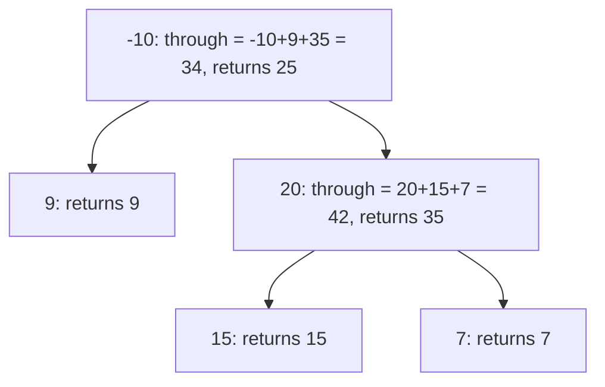

| node | leftGain | rightGain | through node | best | returns |
|---|---|---|---|---|---|
| 9 | 0 | 0 | 9 | 9 | 9 |
| 15 | 0 | 0 | 15 | 15 | 15 |
| 7 | 0 | 0 | 7 | 15 | 7 |
| 20 | 15 | 7 | 42 | **42** | 35 |
| -10 | 9 | 35 | 34 | 42 | 25 |

#### Kotlin

```kotlin
fun maxPathSum(root: TreeNode?): Int {
    var best = Int.MIN_VALUE
    // Best sum of a path starting at node and going down at most one side.
    fun gain(node: TreeNode?): Int {
        if (node == null) return 0
        val left = maxOf(0, gain(node.left))      // drop negative branches
        val right = maxOf(0, gain(node.right))
        best = maxOf(best, node.`val` + left + right)   // path peaking here
        return node.`val` + maxOf(left, right)          // parent may use one side
    }
    gain(root)
    return best
}
```

#### Complexity

- **Time:** O(n) — one postorder pass.
- **Space:** O(h) recursion stack.

#### Common mistakes

- Returning `val + left + right` to the parent — that would let a path fork, which isn't a path.
- Initialising `best` to 0 — wrong for all-negative trees.
- Clamping the **node's own** value at 0 — the node must be included; only the branches are optional.

#### Follow-ups

- *Return the path itself?* Store, along with the best sum, which node it peaked at and which sides were used, then walk down following the larger gains.
- **Longest path with the same value / diameter:** same skeleton, different "gain".
- *Path must go from leaf to leaf?* Only update the global answer at nodes that have both children, and don't clamp at 0.

</details>

## Building and serialising trees

### 15. Construct Binary Tree from Preorder and Inorder Traversal

**🟡 Medium** · ⭐ Product/FAANG favourite

<details>
<summary>Answer</summary>

**In short:** The first value in preorder is the root. Find it in inorder: everything to its left is the left subtree, everything to its right the right subtree. Recurse on those ranges, consuming preorder values left to right with a single moving index (root, then the whole left subtree, then the right subtree). A hash map from value to inorder index makes each lookup O(1), so the whole build is O(n).

#### Problem

Given the preorder and inorder traversals of a tree with **unique** values, rebuild the tree.

- `preorder = [3, 9, 20, 15, 7]`, `inorder = [9, 3, 15, 20, 7]` → `[3, 9, 20, null, null, 15, 7]`
- `preorder = [-1]`, `inorder = [-1]` → `[-1]`

#### Clarifying questions & edge cases

- **Values must be unique** — with duplicates, you can't tell which occurrence in inorder is the root, and the tree may not be unique.
- Are the arrays guaranteed consistent? (Yes on LeetCode.)
- Empty arrays → null.

#### Brute force

Same recursion, but find the root in inorder with a linear scan and slice new arrays for each call. Scanning costs O(n) per node: O(n²) for a skewed tree, plus the array copies.

#### Key insight

- Preorder is `root, [left subtree], [right subtree]`.
- Inorder is `[left subtree], root, [right subtree]`.

The root's position `mid` in the inorder range `[lo, hi]` tells you the left subtree has `mid - lo` nodes. Because preorder lists the entire left subtree before the right subtree, if you build the left subtree **first**, a single global preorder index naturally walks through it and lands on the right subtree's root. So you only need to pass the inorder bounds down.

#### Walkthrough

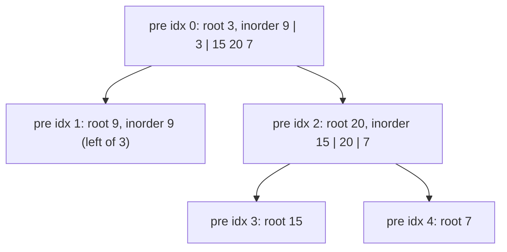

| call (inorder range) | preorder index | root | mid in inorder | left range | right range |
|---|---|---|---|---|---|
| [0, 4] | 0 | 3 | 1 | [0, 0] | [2, 4] |
| [0, 0] | 1 | 9 | 0 | empty | empty |
| [2, 4] | 2 | 20 | 3 | [2, 2] | [4, 4] |
| [2, 2] | 3 | 15 | 2 | empty | empty |
| [4, 4] | 4 | 7 | 4 | empty | empty |

#### Kotlin

```kotlin
fun buildTree(preorder: IntArray, inorder: IntArray): TreeNode? {
    val inorderIndex = HashMap<Int, Int>()
    for (i in inorder.indices) inorderIndex[inorder[i]] = i
    var preIdx = 0                                 // next root to take from preorder

    fun build(lo: Int, hi: Int): TreeNode? {       // inorder range [lo, hi]
        if (lo > hi) return null
        val rootVal = preorder[preIdx++]
        val root = TreeNode(rootVal)
        val mid = inorderIndex.getValue(rootVal)
        root.left = build(lo, mid - 1)             // must build left first
        root.right = build(mid + 1, hi)
        return root
    }
    return build(0, inorder.size - 1)
}
```

#### Complexity

- **Time:** O(n) — each node is created once with an O(1) map lookup.
- **Space:** O(n) for the map, O(h) recursion.

#### Common mistakes

- Building the right subtree before the left with a forward-moving preorder index — the index then picks left-subtree values as right-subtree roots.
- Slicing arrays (`copyOfRange`) in every call — correct but O(n²) worst case.
- Off-by-one in ranges; using inclusive `[lo, hi]` with `lo > hi` as "empty" keeps it simple.

#### Follow-ups

- **Inorder + Postorder:** postorder ends with the root; walk postorder **backwards** and build the **right** subtree first.
- **Preorder + Postorder:** not unique in general (a single child could be left or right); LeetCode 889 accepts any valid answer.
- **Construct BST from Preorder alone:** the BST ordering replaces inorder — pass an upper bound down and consume preorder while values fit. O(n).

</details>

### 16. Serialize and Deserialize Binary Tree

**🔴 Hard** · ⭐ Product/FAANG favourite

<details>
<summary>Answer</summary>

**In short:** Write the tree in **preorder with an explicit marker for null children** (e.g. `"1,2,#,#,3,4,#,#,5,#,#,"`). The null markers make the encoding unambiguous, so deserialising is the same preorder recursion: read a token; if it's `#` return null, otherwise create the node and read its left subtree and then its right subtree from the same stream. Both directions are O(n) time and space. A BFS (level order) format, like LeetCode's, also works.

#### Problem

Design `serialize(root): String` and `deserialize(data): TreeNode?` so that `deserialize(serialize(t))` rebuilds the same tree. The format is up to you.

- `[1, 2, 3, null, null, 4, 5]` → some string → back to `[1, 2, 3, null, null, 4, 5]`
- `[]` → some string → `[]`

#### Clarifying questions & edge cases

- Negative and multi-digit values — so use a separator, not one character per value.
- Empty tree must round-trip.
- Are we optimising for size? (A BST can be serialised without null markers, because the ordering tells you the shape.)
- Very deep trees: recursive deserialisation can overflow the stack; mention the BFS version.

#### Brute force

Serialise both preorder and inorder (no null markers) and rebuild with [question 15](#15-construct-binary-tree-from-preorder-and-inorder-traversal). This works only for **unique** values and doubles the output size. The null-marker approach works for duplicates too.

#### Key insight

Why do null markers fix everything? A preorder list without them (`1, 2, 3`) fits many shapes. With them, every node is followed by exactly the encoding of its left subtree and then its right subtree, and every subtree encoding is self-delimiting (it ends when all its nulls have been read). So a reader that mirrors the writer — same order, same recursion — consumes exactly the right tokens for each subtree.

#### Walkthrough

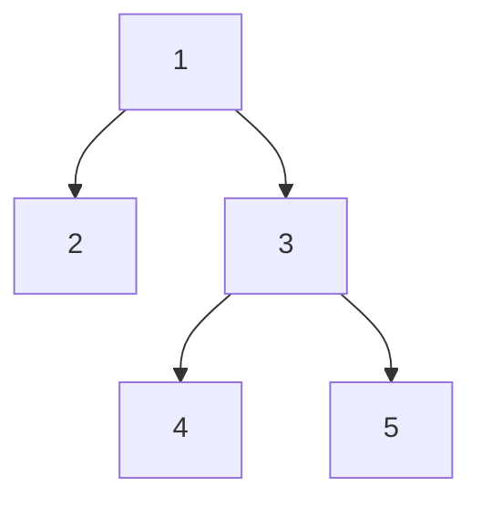

Serialise (preorder, `#` for null): `1,2,#,#,3,4,#,#,5,#,#,`

| token | action | stack of "currently building" |
|---|---|---|
| 1 | new node 1, read its left | 1 |
| 2 | new node 2 (left of 1), read its left | 1, 2 |
| # | 2.left = null, read 2.right | 1, 2 |
| # | 2.right = null, 2 done; read 1.right | 1 |
| 3 | new node 3 (right of 1) | 1, 3 |
| 4, #, # | 3.left = 4 with no children | 1, 3 |
| 5, #, # | 3.right = 5 with no children | done |

#### Kotlin

```kotlin
class Codec {
    fun serialize(root: TreeNode?): String {
        val sb = StringBuilder()
        fun write(node: TreeNode?) {
            if (node == null) {
                sb.append("#,")
                return
            }
            sb.append(node.`val`).append(',')
            write(node.left)
            write(node.right)
        }
        write(root)
        return sb.toString()
    }

    fun deserialize(data: String): TreeNode? {
        val tokens = data.split(',').filter { it.isNotEmpty() }   // drop the trailing empty token
        var i = 0
        fun read(): TreeNode? {
            val token = tokens[i++]
            if (token == "#") return null
            val node = TreeNode(token.toInt())
            node.left = read()            // same order as write()
            node.right = read()
            return node
        }
        return read()
    }
}
```

#### Complexity

- **Time:** O(n) for both — every node and every null marker is written and read once (there are n + 1 null markers).
- **Space:** O(n) for the string and token list; O(h) recursion.

#### Common mistakes

- Omitting null markers — the shape is lost.
- No separator between values, so `12` and `1,2` are confused.
- Building the string with `+=` in a loop — O(n²). Use `StringBuilder`.
- Reading tokens with a fresh index per call instead of one shared index.

#### Follow-ups

- **BFS format:** write level by level with `#` for missing children; read back with a queue, assigning the next two tokens as the children of each dequeued node. Iterative, so no stack-overflow risk.
- **Serialize and Deserialize BST:** preorder without null markers is enough; rebuild with bounds (each value goes to the left while it's below the current upper bound). Smaller output.
- *N-ary tree?* Write each node's value and its child count, then its children.

</details>

### 17. Flatten Binary Tree to Linked List

**🟡 Medium**

<details>
<summary>Answer</summary>

**In short:** The result must be the preorder sequence linked through `right` pointers with every `left` null. The O(1)-space way: walk down the right spine; at each node with a left child, find the **rightmost node of the left subtree** (the last node in that subtree's preorder), hang the current right subtree off it, move the left subtree to the right, and clear `left`. A recursive alternative processes nodes in reverse preorder (right, left, node) and links each to the previously processed node. O(n) time.

#### Problem

Flatten the tree **in place** into a "linked list" that uses `right` as `next`, in preorder order.

- `[1, 2, 5, 3, 4, null, 6]` → `1 → 2 → 3 → 4 → 5 → 6` (all `left` pointers null)
- `[]` → `[]`

#### Clarifying questions & edge cases

- In place, and in **preorder** order.
- Every `left` must end up null — a common bug is leaving old left pointers.
- Empty tree or single node → nothing to do.

#### Brute force

Collect the nodes in a preorder list, then relink: `list[i].left = null; list[i].right = list[i + 1]`. O(n) time but O(n) extra space — a correct and reasonable first answer.

#### Key insight

In preorder, a node is followed by its whole left subtree, and then its right subtree. The last node of the left subtree's preorder is its **rightmost** node (keep going right). So the right subtree must be attached after that rightmost node. Do this at the current node, move the left subtree into the right slot, and continue to the next node on the right. Each edge is walked a constant number of times overall, so it is O(n) total even with the inner "find rightmost" loop.

The recursive alternative: if you visit nodes in the reverse of preorder (right subtree, left subtree, node), then when you reach a node, `prev` is exactly the node that should follow it. Set `node.right = prev`, `node.left = null`, `prev = node`.

#### Walkthrough

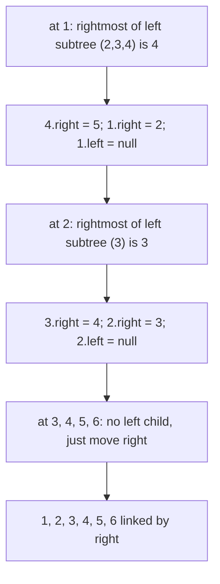

#### Kotlin

```kotlin
// O(1) extra space.
fun flatten(root: TreeNode?) {
    var cur = root
    while (cur != null) {
        val left = cur.left
        if (left != null) {
            var rightmost: TreeNode = left
            while (true) rightmost = rightmost.right ?: break   // last node of left subtree in preorder
            rightmost.right = cur.right       // right subtree goes after it
            cur.right = left                  // left subtree moves to the right
            cur.left = null
        }
        cur = cur.right
    }
}

// Recursive: reverse preorder (right, left, node), linking to the previous node.
fun flattenRecursive(root: TreeNode?) {
    var prev: TreeNode? = null
    fun go(node: TreeNode?) {
        if (node == null) return
        go(node.right)
        go(node.left)
        node.right = prev
        node.left = null
        prev = node
    }
    go(root)
}
```

#### Complexity

- **Iterative:** O(n) time — each node is passed by the "find rightmost" walk at most once more; O(1) extra space.
- **Recursive:** O(n) time, O(h) stack.

#### Common mistakes

- Forgetting `cur.left = null`.
- Attaching the right subtree to the left child instead of the **rightmost** node of the left subtree.
- In the recursive version, visiting left before right — then `prev` is wrong.

#### Follow-ups

- *Flatten into inorder order / a doubly linked list?* **Convert BST to Sorted Doubly Linked List:** inorder traversal with a `prev` pointer, linking `prev.right = node` and `node.left = prev`, then close the circle.
- *Why is the iterative version O(n)?* The rightmost-walks cover disjoint right chains of left subtrees; each node is on at most one such walk.
- This rewiring idea is the core of **Morris traversal** (O(1)-space inorder/preorder).

</details>

## Binary search trees

### 18. Validate Binary Search Tree

**🟡 Medium** · ⭐ Product/FAANG favourite

<details>
<summary>Answer</summary>

**In short:** Checking each node only against its two children is not enough — every node must lie within a **range** set by all of its ancestors. Pass `(low, high)` down: the left child gets `(low, node.val)` and the right child gets `(node.val, high)`; fail if any value is outside its open range. Equivalent alternative: an inorder traversal of a valid BST is strictly increasing, so compare each value with the previous one. O(n) time, O(h) space.

#### Problem

Decide whether the tree is a valid BST: for every node, all values in its left subtree are **strictly less** than it and all values in its right subtree are **strictly greater**, and both subtrees are BSTs.

- `[2, 1, 3]` → `true`
- `[5, 1, 4, null, null, 3, 6]` → `false` (4 is in 5's right subtree but is less than 5)
- `[5, 4, 6, null, null, 3, 7]` → `false` (3 is in 5's right subtree — each parent-child pair looks fine, but the range is broken)

#### Clarifying questions & edge cases

- Are duplicates allowed, and on which side? LeetCode: no duplicates (strict inequalities). Some definitions allow equal values on one side — ask.
- Values can be `Int.MIN_VALUE` / `Int.MAX_VALUE`, so using those as "no bound" sentinels is a bug. Use `Long` bounds or nullable bounds.
- Empty tree → `true`.

#### Brute force

For every node, check that the maximum of its left subtree is less than it and the minimum of its right subtree is greater, computing min/max from scratch: O(n²) worst case. (Computing min/max bottom-up in one pass also works in O(n) — it's the postorder version of the same idea.)

#### Key insight

The BST rule is about **all** descendants, not just children. Walking down from the root, every step narrows the window of legal values: going left sets a new upper bound (the parent), going right sets a new lower bound. A node is valid if it is inside its window; the tree is valid if every node is. This is top-down: state (the window) flows down as parameters.

The inorder view: a binary tree is a BST exactly when its inorder sequence is strictly increasing, so you only need to remember the previous value.

#### Walkthrough

`[5, 4, 6, null, null, 3, 7]`:

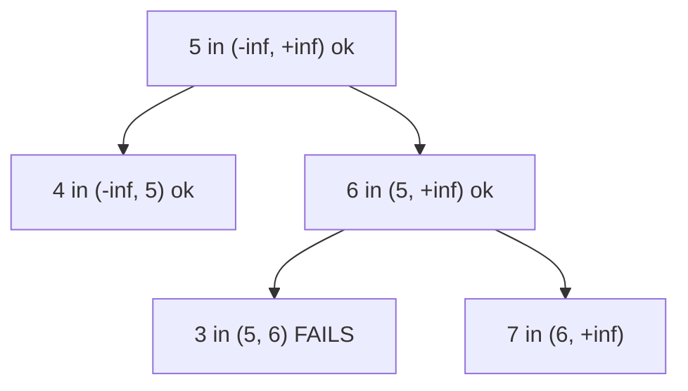

Node 3 is a fine left child of 6 locally, but its window `(5, 6)` excludes it → `false`.

#### Kotlin

```kotlin
fun isValidBST(root: TreeNode?): Boolean {
    // Long bounds so that Int.MIN_VALUE / Int.MAX_VALUE node values are handled.
    fun valid(node: TreeNode?, low: Long, high: Long): Boolean {
        if (node == null) return true
        val v = node.`val`.toLong()
        if (v <= low || v >= high) return false          // strict BST
        return valid(node.left, low, v) && valid(node.right, v, high)
    }
    return valid(root, Long.MIN_VALUE, Long.MAX_VALUE)
}

// Alternative: iterative inorder must be strictly increasing.
fun isValidBSTInorder(root: TreeNode?): Boolean {
    val stack = ArrayDeque<TreeNode>()
    var cur = root
    var prev: Int? = null
    while (cur != null || stack.isNotEmpty()) {
        while (cur != null) { stack.addLast(cur); cur = cur.left }
        val node = stack.removeLast()
        if (prev != null && node.`val` <= prev) return false
        prev = node.`val`
        cur = node.right
    }
    return true
}
```

#### Swift

Optional bounds avoid sentinel values entirely:

```swift
func isValidBST(_ root: TreeNode?) -> Bool {
    func valid(_ node: TreeNode?, _ low: Int?, _ high: Int?) -> Bool {
        guard let node = node else { return true }
        if let low = low, node.val <= low { return false }
        if let high = high, node.val >= high { return false }
        return valid(node.left, low, node.val) && valid(node.right, node.val, high)
    }
    return valid(root, nil, nil)
}
```

#### Complexity

- **Time:** O(n) — each node checked once (early exit on the first violation).
- **Space:** O(h) for recursion or the explicit stack.

#### Common mistakes

- Only comparing a node with its direct children (fails the third example).
- Using `Int.MIN_VALUE` / `Int.MAX_VALUE` as the initial bounds — a tree `[2147483647]` is then reported invalid.
- Using `<` instead of `<=` (or vice versa) — decide how duplicates are handled.
- Collecting the whole inorder list just to check it's sorted: correct but O(n) extra space; a `prev` variable is enough.

#### Follow-ups

- **Recover Binary Search Tree** (two nodes swapped): inorder traversal, find the one or two places where `prev > current`, swap the first `prev` and the last `current`.
- **Largest BST Subtree:** bottom-up — return `(isBst, size, min, max)` from each subtree.
- *Duplicates allowed on the left?* Change the left check to `v <= high` (i.e. `low < v <= high`).

</details>

### 19. Kth Smallest Element in a BST

**🟡 Medium** · ⭐ Product/FAANG favourite

<details>
<summary>Answer</summary>

**In short:** Inorder traversal of a BST visits values in sorted order, so the k-th node visited is the answer. Use the iterative inorder loop and stop as soon as you've popped k nodes: O(h + k) time and O(h) space. If the tree is modified often and queried often, store each node's subtree size so you can find the k-th element in O(h) by choosing left or right at each step.

#### Problem

Return the k-th smallest value (1-indexed) in a BST.

- `[3, 1, 4, null, 2]`, k = 1 → `1`
- `[5, 3, 6, 2, 4, null, null, 1]`, k = 3 → `3`

#### Clarifying questions & edge cases

- Is k always valid (`1 <= k <= n`)? LeetCode says yes; otherwise return an error value or throw.
- 1-indexed, not 0-indexed.
- Will we query many times with inserts/deletes in between? That changes the best design (follow-up).

#### Brute force

Do a full inorder traversal into a list and return `list[k - 1]`. O(n) time and O(n) space. Or ignore the BST property, collect all values and sort: O(n log n). Both work; the early-stopping traversal is the expected improvement.

#### Key insight

The inorder order of a BST is sorted order, because each node comes after everything in its left subtree (all smaller) and before everything in its right subtree (all larger). So we don't need to sort or store anything — just count nodes in inorder and stop at k. The iterative version makes stopping trivial: return from inside the loop.

Cost: the first pop needs a walk down to the minimum (O(h)), then each further pop is amortised O(1), giving O(h + k).

#### Walkthrough

`[5, 3, 6, 2, 4, null, null, 1]`, k = 3:

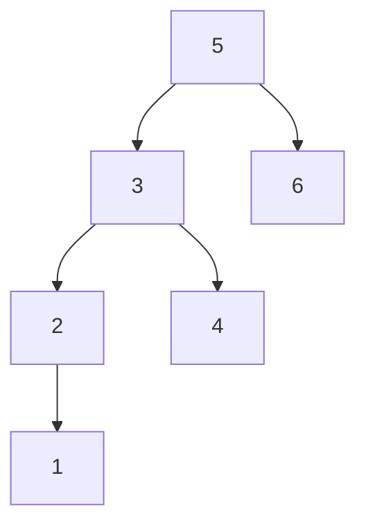

| step | stack after pushing lefts | popped | count |
|---|---|---|---|
| 1 | 5, 3, 2, 1 | 1 | 1 |
| 2 | 5, 3, 2 | 2 | 2 |
| 3 | 5, 3 | **3** | 3 → return 3 |

#### Kotlin

```kotlin
fun kthSmallest(root: TreeNode?, k: Int): Int {
    val stack = ArrayDeque<TreeNode>()
    var cur = root
    var count = 0
    while (cur != null || stack.isNotEmpty()) {
        while (cur != null) {             // walk to the smallest unvisited node
            stack.addLast(cur)
            cur = cur.left
        }
        val node = stack.removeLast()
        count++
        if (count == k) return node.`val` // k-th node in sorted order
        cur = node.right
    }
    throw IllegalArgumentException("k is larger than the number of nodes")
}
```

#### Complexity

- **Time:** O(h + k) — reach the minimum in O(h), then k pops.
- **Space:** O(h) for the stack.

#### Common mistakes

- Off-by-one: returning on the (k+1)-th pop or treating k as 0-indexed.
- Recursive version that keeps traversing after finding the answer — correct but wasteful; use a found flag or the iterative loop.
- Forgetting that `cur = node.right` is needed even when the right child is null (it lets the loop pop the next ancestor).

#### Follow-ups

- **Frequent inserts/deletes plus queries:** augment each node with `size` (nodes in its subtree). At a node, let `L = size(left)`: if `k == L + 1` it's this node; if `k <= L` go left; else go right with `k - L - 1`. O(h) per query; keep the tree balanced for O(log n). This is an "order-statistic tree".
- **BST Iterator** (`next()` / `hasNext()` in O(1) amortised, O(h) memory): the same stack, paused between calls.
- **Kth largest:** reverse inorder (right, node, left).
- **Two Sum IV in a BST:** inorder into a sorted list and two pointers, or two iterators (ascending and descending) for O(h) space.

</details>

### 20. Delete Node in a BST (and Insert into a BST)

**🟡 Medium**

<details>
<summary>Answer</summary>

**In short:** **Insert:** walk down as in a search and attach the new node where you fall off the tree. **Delete:** find the node, then handle three cases — no children (remove it), one child (replace it with that child), two children (copy in the value of its **inorder successor**, the smallest node in its right subtree, then delete that successor from the right subtree, where it has at most one child). Both are O(h).

#### Problem

- **Insert into a BST:** insert a value that's not already present; return the root. `[4, 2, 7, 1, 3]`, insert 5 → `[4, 2, 7, 1, 3, 5]` (5 becomes 7's left child).
- **Delete Node in a BST:** remove the node with the given key (if present) and return the possibly new root, keeping it a valid BST. `[5, 3, 6, 2, 4, null, 7]`, delete 3 → `[5, 4, 6, 2, null, null, 7]` (one valid answer).

#### Clarifying questions & edge cases

- Key not in the tree → return the tree unchanged.
- Deleting the root, including when it is the only node → return the new root (or null).
- Successor or predecessor? Either gives a valid BST; answers may differ in shape, and any valid answer is accepted.
- Duplicates? Assume unique keys.

#### Brute force

Collect all values in inorder, remove the key, and rebuild a (balanced) BST from the sorted list. O(n) time and space — correct, but it rebuilds the entire tree to change one node.

#### Key insight

Deleting a node with two children is the only hard case. The node needs a replacement value that is greater than everything on its left and smaller than everything on its right. Exactly two values qualify: the largest value on the left (predecessor) and the smallest value on the right (successor). The successor is found by going right once, then left as far as possible; it has **no left child** (otherwise it wouldn't be the minimum), so deleting it is one of the easy cases.

Writing the functions recursively as "return the new root of this subtree" makes the pointer updates automatic: the parent just assigns `root.left = deleteNode(root.left, key)`.

#### Walkthrough

Delete 3 from `[5, 3, 6, 2, 4, null, 7]`:

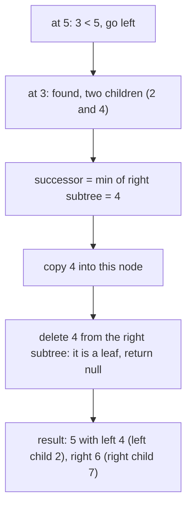

| case | example | action |
|---|---|---|
| leaf | delete 7 | return null to the parent |
| one child | delete 6 (child 7) | return 7 to the parent |
| two children | delete 3 | copy successor 4, delete 4 from right subtree |

#### Kotlin

```kotlin
fun insertIntoBST(root: TreeNode?, value: Int): TreeNode {
    if (root == null) return TreeNode(value)        // fell off the tree: attach here
    if (value < root.`val`) root.left = insertIntoBST(root.left, value)
    else root.right = insertIntoBST(root.right, value)
    return root
}

fun deleteNode(root: TreeNode?, key: Int): TreeNode? {
    if (root == null) return null                   // key not found
    when {
        key < root.`val` -> root.left = deleteNode(root.left, key)
        key > root.`val` -> root.right = deleteNode(root.right, key)
        else -> {
            val left = root.left ?: return root.right   // zero or one child
            val right = root.right ?: return left
            // Two children: find the inorder successor (min of right subtree).
            var successor: TreeNode = right
            while (true) successor = successor.left ?: break
            root.`val` = successor.`val`
            root.right = deleteNode(right, successor.`val`)
        }
    }
    return root
}
```

#### Complexity

- **Time:** O(h) for both — one walk down (the successor search continues the same downward walk). O(log n) balanced, O(n) skewed.
- **Space:** O(h) recursion; both can be written iteratively in O(1).

#### Common mistakes

- Forgetting to return the new subtree root, so the parent still points at the deleted node.
- In the two-children case, deleting the successor from the **whole** tree or from the wrong subtree.
- Copying the successor's value and then deleting by the **old** key — the key now appears nowhere, or the search goes the wrong way.
- Assuming insert/delete keep the tree balanced — a sorted sequence of inserts creates a linked list (O(n) operations). Production code uses self-balancing trees (Java/Kotlin `TreeMap` is a red-black tree).

#### Follow-ups

- *Swap pointers instead of copying values?* Needed when nodes carry other data; splice the successor out and put it in the deleted node's place.
- **Trim a BST** to `[low, high]`: if `node < low` return `trim(node.right)`; if `node > high` return `trim(node.left)`; otherwise trim both children.
- *Iterative insert?* Walk down keeping the parent, then attach to the correct side — O(1) extra space.
- Ordered-map operations (floor, ceiling, range) come for free from the same walk-down logic — see [Binary Search](10-binary-search.md) for the analogous array version.

</details>

---

[⬅ Previous: Heaps & Priority Queues](13-heaps-priority-queues.md) · [⬅ Back to index](../README.md) · [Next: Tries & String Algorithms ➡](15-tries-string-algorithms.md)
