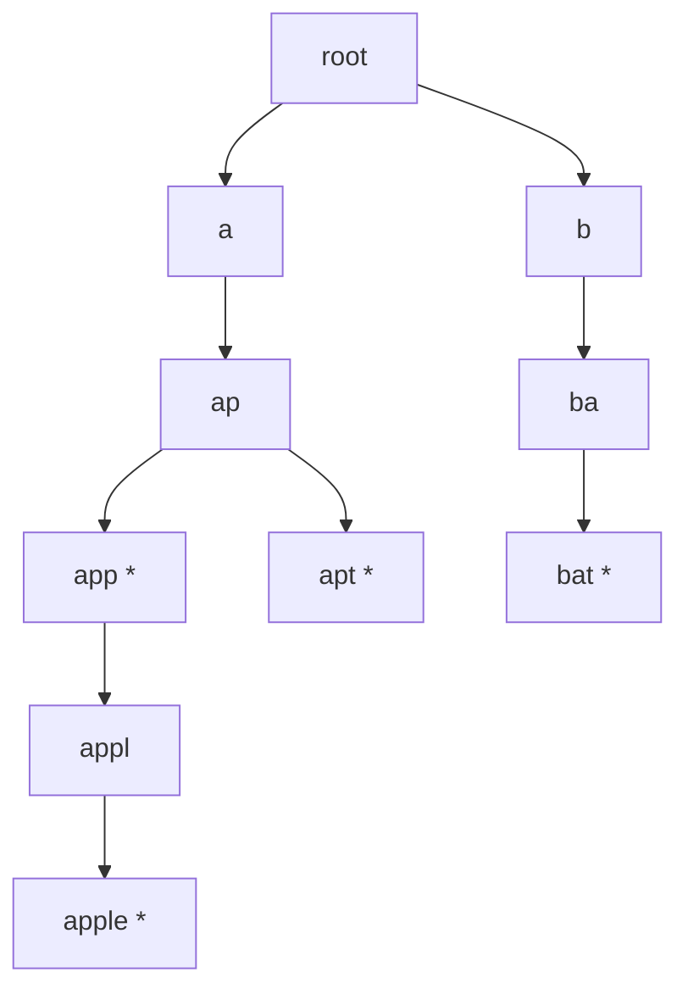
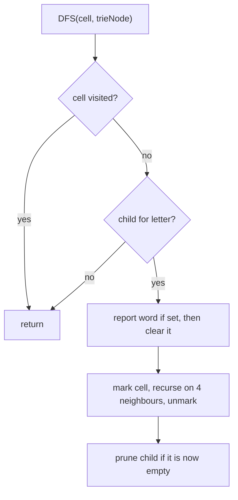
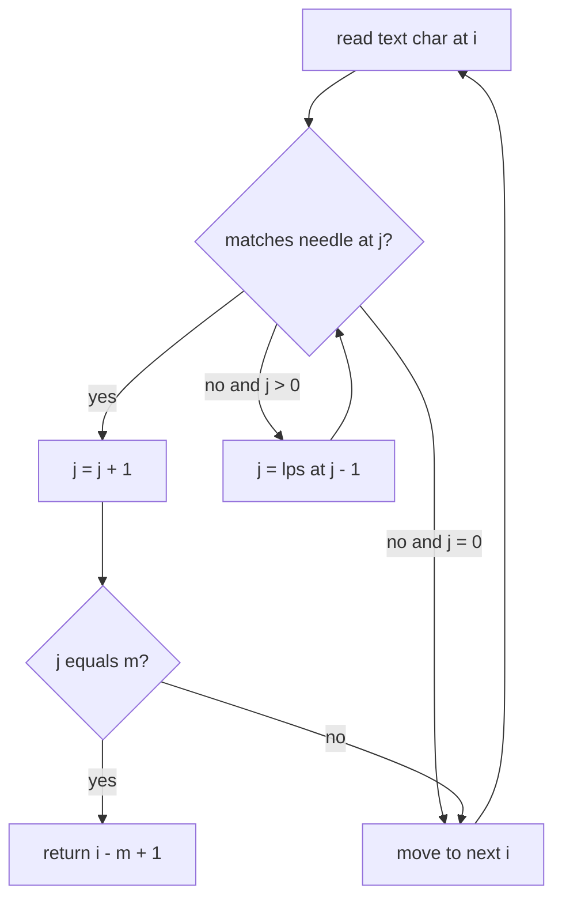

# Tries & String Algorithms

[⬅ Back to index](../README.md)

Covers: tries for prefix problems and a practical set of string algorithms — palindrome expansion, KMP and rolling hashes — at the depth interviews actually need.

---

## Tries

### 1. Implement Trie (Prefix Tree)

**🟡 Medium** · ⭐ Product/FAANG favourite

<details>
<summary>Answer</summary>

**In short:** A trie is a tree where each edge is a character and each node represents the prefix spelled by the path from the root. Every node has up to 26 children (an array or a map) and an `isWord` flag. `insert`, `search` and `startsWith` all walk one node per character, so each costs O(L) for a word of length L — independent of how many words are stored.

#### Problem

Build a class with three operations on lowercase words:

- `insert("apple")` stores the word.
- `search("apple")` → `true`; `search("app")` → `false` (only a prefix so far).
- `startsWith("app")` → `true`. After `insert("app")`, `search("app")` → `true`.

#### Clarifying questions & edge cases

- Alphabet: only `'a'..'z'`? Then a fixed `Array(26)` per node is fastest. For Unicode or mixed case, use a `HashMap<Char, Node>`.
- Inserting the same word twice is harmless (just sets the flag again).
- Empty string: inserting `""` marks the root as a word; `startsWith("")` is always `true`.
- Do we need `delete` or counts? That changes the node (add a `prefixCount`) — ask.

#### Brute force

Keep the words in a `HashSet`. `search` is O(L) (hashing), but `startsWith` must scan every word: O(N · L). A sorted list plus binary search gets `startsWith` to O(L log N), but inserts become O(N). The trie gives O(L) for all three.

#### Key insight

Words that share a prefix share the path for that prefix. So "does any word start with `app`?" is just "does the path `a → p → p` exist?" — you never look at the words themselves. The difference between `search` and `startsWith` is only the last check: `search` needs the final node to be marked as the end of a word; `startsWith` only needs the node to exist.

Both lookups share one helper, `find(s)`, which walks the path and returns the node it ends on (or `null` if an edge is missing).

#### Walkthrough

After inserting `app`, `apple`, `apt` and `bat` (nodes marked `*` end a word):



| call | path walked | final node | result |
|---|---|---|---|
| `search("app")` | a → p → p | `app`, isWord = true | `true` |
| `search("appl")` | a → p → p → l | `appl`, isWord = false | `false` |
| `startsWith("appl")` | a → p → p → l | exists | `true` |
| `search("bad")` | b → a → (no `d`) | null | `false` |

#### Kotlin

```kotlin
class Trie {
    private class Node {
        val children = arrayOfNulls<Node>(26) // one slot per letter
        var isWord = false                    // true if a word ends exactly here
    }

    private val root = Node()

    fun insert(word: String) {
        var node = root
        for (c in word) {
            val i = c - 'a'
            if (node.children[i] == null) node.children[i] = Node()
            node = node.children[i]!!
        }
        node.isWord = true
    }

    fun search(word: String): Boolean = find(word)?.isWord == true

    fun startsWith(prefix: String): Boolean = find(prefix) != null

    // Walk the path for s; null if some character has no edge.
    private fun find(s: String): Node? {
        var node = root
        for (c in s) node = node.children[c - 'a'] ?: return null
        return node
    }
}
```

#### Swift

Swift `String` iterates as `Character`s, so a dictionary of children is the natural fit (and handles any alphabet). Nodes must be a `class` — a trie is a graph of shared, mutable nodes, which structs can't express.

```swift
final class Trie {
    private final class Node {
        var children: [Character: Node] = [:]
        var isWord = false
    }

    private let root = Node()

    func insert(_ word: String) {
        var node = root
        for c in word {
            if let next = node.children[c] {
                node = next
            } else {
                let next = Node()
                node.children[c] = next
                node = next
            }
        }
        node.isWord = true
    }

    func search(_ word: String) -> Bool {
        find(word)?.isWord ?? false
    }

    func startsWith(_ prefix: String) -> Bool {
        find(prefix) != nil
    }

    private func find(_ s: String) -> Node? {
        var node = root
        for c in s {
            guard let next = node.children[c] else { return nil }
            node = next
        }
        return node
    }
}
```

#### Complexity

- **Time:** O(L) per operation — one step per character, each step O(1) (array index or hash lookup).
- **Space:** O(total characters inserted × alphabet) in the worst case with arrays (each node holds 26 slots); O(total characters) with maps. Shared prefixes are stored once.

#### Common mistakes

- Returning `true` from `search` just because the path exists — you must check `isWord` (`"app"` vs `"apple"`).
- Putting `isWord` on the edge/child instead of the node where the word ends.
- Using `node.children[i]!!` without creating the node first (NPE).
- Making the node a `data class` or Swift `struct` — copies break the shared structure.

#### Follow-ups

- *Count words with a given prefix?* Keep a `prefixCount` on each node, increment along the path on insert; the answer is the count at the end of the prefix path.
- *Delete a word?* Unset `isWord`, then on the way back up remove children that have no word and no children (recursive, or with `prefixCount`).
- *Wildcards?* See [Design Add and Search Words](#2-design-add-and-search-words-data-structure). *Array vs map children?* Arrays are faster and simpler for a small fixed alphabet; maps save memory for sparse or large alphabets.

</details>

### 2. Design Add and Search Words Data Structure

**🟡 Medium**

<details>
<summary>Answer</summary>

**In short:** Store words in a trie. `addWord` is the normal insert. `search` walks the trie recursively: a normal letter follows its one child, and `.` tries **every** child, returning `true` as soon as one branch matches the rest of the pattern. Plain lookups are O(L); each dot multiplies the branches explored by up to 26.

#### Problem

Support `addWord(word)` and `search(pattern)`, where the pattern may contain `.` meaning "any one letter".

- add `bad`, `dad`, `mad`
- `search("pad")` → `false`, `search("bad")` → `true`, `search(".ad")` → `true`, `search("b..")` → `true`

#### Clarifying questions & edge cases

- Does `.` match exactly one character (yes) or any run like `*` (no — that's regex, see [Dynamic Programming](19-dynamic-programming.md))?
- Pattern length must equal word length; a word that is only a prefix of the pattern doesn't match.
- How many dots? The LeetCode constraints keep it small, which is what makes the DFS fast in practice.

#### Brute force

Keep a list of words and, for each query, compare the pattern against every word of the same length character by character. O(N · L) per search. Bucketing words by length helps but is still linear in the bucket.

#### Key insight

A trie turns "compare against every word" into "follow a path". A letter has exactly one edge to follow, so it costs O(1). A dot is the only place the search branches, and it only branches into children that **exist** — so the cost is bounded by the size of the trie, not by 26^L. The recursion is "does the rest of the pattern, starting at index `i`, match some word in the subtree of `node`?"

#### Walkthrough

Words: `bad`, `dad`, `mad`. Query `".ad"`:

| step | index | char | node | action |
|---|---|---|---|---|
| 1 | 0 | `.` | root | try children `b`, `d`, `m` in order |
| 2 | 1 | `a` | `b` | follow `a` → `ba` |
| 3 | 2 | `d` | `ba` | follow `d` → `bad` |
| 4 | 3 | — | `bad` | end of pattern, isWord = true → return `true` (no need to try `d`, `m`) |

Query `"b.e"`: root → `b` → dot tries `ba` → needs `e`, none → `false`; no other children of `b` → `false`.

#### Kotlin

```kotlin
class WordDictionary {
    private class Node {
        val children = arrayOfNulls<Node>(26)
        var isWord = false
    }

    private val root = Node()

    fun addWord(word: String) {
        var node = root
        for (c in word) {
            val i = c - 'a'
            if (node.children[i] == null) node.children[i] = Node()
            node = node.children[i]!!
        }
        node.isWord = true
    }

    fun search(word: String): Boolean = matches(word, 0, root)

    // Can word[i..] be matched by some path starting at node?
    private fun matches(word: String, i: Int, node: Node): Boolean {
        if (i == word.length) return node.isWord
        val c = word[i]
        if (c == '.') {
            for (child in node.children) {
                if (child != null && matches(word, i + 1, child)) return true
            }
            return false
        }
        val next = node.children[c - 'a'] ?: return false
        return matches(word, i + 1, next)
    }
}
```

#### Complexity

- **Time:** `addWord` O(L). `search` O(L) with no dots; with `d` dots, worst case O(26^d · L), but never more than the number of trie nodes reachable at that depth.
- **Space:** O(total characters) nodes (×26 slots with arrays); recursion depth O(L).

#### Common mistakes

- Returning the result of the **first** child for `.` instead of trying the next one when it fails.
- Returning `true` at the end of the pattern without checking `isWord`.
- Iterating only over non-null children is required — calling `matches` on `null` crashes.

#### Follow-ups

- *Many dots, few words?* Bucket words by length and compare directly; for patterns that are mostly dots, that beats the trie.
- *Support `*` (any sequence)?* That's wildcard/regex matching — DP, see [Dynamic Programming](19-dynamic-programming.md).
- *Iterative version?* BFS level by level over the set of current nodes: a letter maps each node to one child, a dot to all children.

</details>

### 3. Word Search II

**🔴 Hard** · ⭐ Product/FAANG favourite

<details>
<summary>Answer</summary>

**In short:** Put all the words into a trie, then DFS from every cell of the board while walking the trie at the same time. If the current path is not a prefix of any word, the trie has no child for it and you stop immediately — that pruning is the whole point. Store the full word at its end node so you can report it, then clear it to avoid duplicates. Worst case O(R · C · 4 · 3^(L−1)), but in practice far less than searching each word separately.

#### Problem

Given an `m × n` grid of letters and a list of words, return every word that can be formed by a path of horizontally/vertically adjacent cells, using each cell at most once per word.

```
board = o a a n      words = [oath, pea, eat, rain]
        e t a e
        i h k r      → [oath, eat]
        i f l v
```

#### Clarifying questions & edge cases

- Can a cell be reused within one word? No. Across different words? Yes.
- Return order? Any. Duplicates in `words`? Report each word once.
- Up to ~3·10^4 words and a 12×12 board on LeetCode — running [Word Search](18-recursion-backtracking.md) once per word is too slow.

#### Brute force

Run the single-word Word Search backtracking for every word: O(W · R · C · 3^L). With thousands of words that share prefixes (`oath`, `oat`, `oak`), you redo the same exploration over and over.

#### Key insight

Flip the loops: instead of "for each word, search the board", do "for each board path, check whether it's a prefix of some word". A trie answers "is this a prefix of any word?" in O(1) per extra character, because you keep a pointer to the current trie node as you go deeper. So one DFS explores all words at once, and any path that leaves the trie is cut off right away.

Three details make it fast and correct:

1. **Store the word at its end node** (`node.word = "oath"`) instead of rebuilding the string from the path.
2. **Clear `node.word` after reporting** — no duplicates, no `Set` needed.
3. **Prune finished branches**: after the DFS returns, if a node has no word and no children, unlink it from its parent so later searches don't walk into a dead end.

Mark cells visited by overwriting them with `'#'` and restore them on the way back (standard backtracking, see [Recursion & Backtracking](18-recursion-backtracking.md)).

#### Walkthrough

Trie of `oath`, `pea`, `eat`, `rain`. Start at `(0,0) = 'o'`:

| path | trie node | action |
|---|---|---|
| o | `o` | exists, go deeper |
| o → a (0,1) | `oa` | exists |
| o → a → t (1,1) | `oat` | exists |
| o → a → t → h (2,1) | `oath`, word = "oath" | report `oath`, clear word |
| any neighbour of h | no child | stop; `oath` now has no children and no word → prune |

Start at `(1,0) = 'e'`: `e` exists, `(1,1) = 't'` — `et` not in trie → stop at once. Later `(1,3) = 'e'` → `(1,2) = 'a'` → `(1,1) = 't'` reports `eat`. `pea` and `rain` are never completed.



#### Kotlin

```kotlin
fun findWords(board: Array<CharArray>, words: Array<String>): List<String> {
    class Node {
        val children = arrayOfNulls<Node>(26)
        var word: String? = null // set at the node where a word ends
    }

    val root = Node()
    for (w in words) {
        var node = root
        for (c in w) {
            val i = c - 'a'
            node = node.children[i] ?: Node().also { node.children[i] = it }
        }
        node.word = w
    }

    val rows = board.size
    val cols = board[0].size
    val result = mutableListOf<String>()

    fun dfs(r: Int, c: Int, parent: Node) {
        val ch = board[r][c]
        if (ch == '#') return                              // already on the path
        val node = parent.children[ch - 'a'] ?: return     // path is not a prefix of any word
        node.word?.let {
            result.add(it)
            node.word = null                               // report each word once
        }
        board[r][c] = '#'
        if (r > 0) dfs(r - 1, c, node)
        if (r < rows - 1) dfs(r + 1, c, node)
        if (c > 0) dfs(r, c - 1, node)
        if (c < cols - 1) dfs(r, c + 1, node)
        board[r][c] = ch                                   // undo the mark
        // Prune: a node with no word and no children can never produce a result again.
        if (node.word == null && node.children.all { it == null }) {
            parent.children[ch - 'a'] = null
        }
    }

    for (r in 0 until rows) for (c in 0 until cols) dfs(r, c, root)
    return result
}
```

#### Complexity

- **Time:** building the trie is O(total characters in `words`). The search is O(R · C · 4 · 3^(L−1)) in the worst case (L = longest word): 4 directions from the start, then at most 3 (you can't go back). Pruning makes typical runs much faster.
- **Space:** O(total characters) for the trie, plus O(L) recursion depth.

#### Common mistakes

- Stopping the DFS when a word is found — `oat` and `oath` can both be on the same path; keep going.
- Building the current string with `+` at each step (allocations); storing the word on the node avoids it.
- Forgetting to restore the cell after backtracking.
- Not de-duplicating: the same word can be found from several start cells.

#### Follow-ups

- *Why not a `HashSet` of all prefixes?* It works but costs O(total characters²) to build and loses the "current node" pointer, so each step rehashes the whole path.
- *Single word?* Plain backtracking — [Recursion & Backtracking](18-recursion-backtracking.md).
- *Board changes, words fixed?* Keep the trie, re-run the search; the trie build is the reusable part.

</details>

### 4. Search Suggestions System

**🟡 Medium** · ⭐ Product/FAANG favourite (commonly reported at Amazon)

<details>
<summary>Answer</summary>

**In short:** This is autocomplete: after each typed character, return up to three lexicographically smallest products with that prefix. Either (a) sort the products and insert them into a trie where every node keeps the first three words that pass through it, or (b) sort and binary-search for the first product ≥ the prefix and take the next three that match. Both are O(n log n) to sort plus fast per-keystroke queries.

#### Problem

Given `products` and a `searchWord`, return a list where entry `i` holds at most 3 products (smallest first) that start with `searchWord[0..i]`.

```
products = [mobile, mouse, moneypot, monitor, mousepad], searchWord = "mouse"
→ [[mobile, moneypot, monitor], [mobile, moneypot, monitor],
   [mouse, mousepad], [mouse, mousepad], [mouse, mousepad]]
```

#### Clarifying questions & edge cases

- Lowercase only? Products unique? (Yes on LeetCode.)
- Once a prefix has no matches, every longer prefix also has none — return empty lists from then on.
- "Top 3" by what? Here lexicographic. In a real autocomplete it's by popularity — see the follow-ups.

#### Brute force

For each of the `m` prefixes, filter all `n` products by `startsWith`, sort the matches, take 3. O(m · n · L) plus sorting — fine for tiny inputs, wasteful because every prefix redoes the work of the previous one.

#### Key insight

Two observations:

1. **Sorted order makes prefixes contiguous.** In a sorted list, all words starting with `mou` sit next to each other, and the first one is exactly the lower bound of `"mou"`. So "3 smallest with this prefix" = "the 3 words starting at the lower bound, if they still match".
2. **A trie can precompute the answer per prefix.** If you insert products in sorted order and each node keeps a list of at most 3 words that passed through it, then each node's list *is* the answer for that prefix — the first three to arrive are the three smallest.

Then a query just walks one node per typed character and reads the list: O(1) per keystroke after the build. That's how a real autocomplete stays fast.

#### Walkthrough

Sorted: `mobile, moneypot, monitor, mouse, mousepad`.

| typed | trie node | stored top 3 |
|---|---|---|
| m | `m` | mobile, moneypot, monitor (mouse and mousepad arrived too late) |
| mo | `mo` | mobile, moneypot, monitor |
| mou | `mou` | mouse, mousepad |
| mous | `mous` | mouse, mousepad |
| mouse | `mouse` | mouse, mousepad |

#### Kotlin

Trie version:

```kotlin
fun suggestedProducts(products: Array<String>, searchWord: String): List<List<String>> {
    class Node {
        val children = arrayOfNulls<Node>(26)
        val top = mutableListOf<String>() // up to 3 smallest words with this prefix
    }

    val root = Node()
    for (p in products.sorted()) {            // sorted, so the first 3 to arrive are the smallest
        var node = root
        for (c in p) {
            val i = c - 'a'
            node = node.children[i] ?: Node().also { node.children[i] = it }
            if (node.top.size < 3) node.top.add(p)
        }
    }

    val result = mutableListOf<List<String>>()
    var node: Node? = root
    for (c in searchWord) {
        node = node?.children?.get(c - 'a')   // null once the prefix has no matches
        result.add(node?.top ?: emptyList())
    }
    return result
}
```

Sort + binary search version (less memory, often what interviewers expect as the "simple optimal"):

```kotlin
fun suggestedProductsBinarySearch(products: Array<String>, searchWord: String): List<List<String>> {
    val sorted = products.sorted()
    val result = mutableListOf<List<String>>()
    val prefix = StringBuilder()
    var lo = 0
    for (c in searchWord) {
        prefix.append(c)
        val p = prefix.toString()
        // Lower bound: first index with sorted[i] >= p. Prefixes only grow, so start from lo.
        var l = lo
        var r = sorted.size
        while (l < r) {
            val mid = (l + r) ushr 1
            if (sorted[mid] < p) l = mid + 1 else r = mid
        }
        lo = l
        result.add((lo until minOf(lo + 3, sorted.size)).map { sorted[it] }.filter { it.startsWith(p) })
    }
    return result
}
```

#### Complexity

- **Trie:** O(n log n · L) to sort (string comparisons), O(total characters) to build, O(m) to answer all prefixes. Space O(total characters) nodes plus up to 3 references per node.
- **Binary search:** same sort, then O(m · L · log n) for the searches. Space O(n) for the sorted copy.

#### Common mistakes

- Inserting unsorted products and then sorting each node's list — works, but you must keep all matches, not just 3.
- Continuing to walk after the prefix dies and crashing on `null` — once there are no matches, every remaining answer is empty.
- Taking 3 words from the lower bound without checking they actually start with the prefix.

#### Follow-ups

- *Rank by popularity instead of alphabetically?* Store `(word, score)` and keep the top k per node with a small min-heap during the build — see [Heaps & Priority Queues](13-heaps-priority-queues.md). Updates must fix every node on the word's path.
- *Huge dictionary, memory tight?* Sorted array + binary search, or a compressed trie (radix tree) that merges single-child chains.
- *Typos?* Fuzzy matching (edit distance on the trie) — mention only; it's beyond a coding round.

</details>

### 5. Longest Common Prefix (trie vs sort)

**🟢 Easy**

<details>
<summary>Answer</summary>

**In short:** Three ways, all fine for an Easy: (1) **vertical scan** — compare column by column across all strings until a mismatch, O(S) where S is the total characters; (2) **sort** — after sorting, the common prefix of the whole list equals the common prefix of just the first and last strings; (3) **trie** — insert everything and walk down from the root while there is exactly one child and no word ends. The trie pays off only when you'll answer many such queries.

#### Problem

Return the longest string that is a prefix of every string in the array.

- `["flower", "flow", "flight"]` → `"fl"`
- `["dog", "racecar", "car"]` → `""`

#### Clarifying questions & edge cases

- Empty array → `""`. Any empty string in the array → `""`.
- One string → that string.

#### Optimal approach

**Vertical scan:** take the first string as reference; for each index `i`, check that every other string has the same character at `i`. Stop at the first mismatch or when any string runs out. This touches each character at most once: O(S), O(1) extra space. It is the answer to give first.

**Sort trick:** sorting puts strings with shared prefixes together, and the first and last strings are the "most different" pair. Any prefix shared by those two is shared by everything between them (they all sort between them). So compare only `first` and `last`. O(n log n · L) because of the sort — slower than the scan, but a nice observation interviewers like.

**Trie:** insert every string, then from the root follow the single child while the node has exactly one child and is not the end of a word (a word ending there means a shorter string stops the prefix). O(S) to build, but O(S) extra memory. Worth it only if the set changes and you need the LCP repeatedly.

#### Walkthrough

Sort trick on `["flower", "flow", "flight"]`: sorted → `flight, flow, flower`; compare `flight` vs `flower`: `f`=`f`, `l`=`l`, `i`≠`o` → `"fl"`.

Trie walk: root has one child `f` → node `f` has one child `l` → node `fl` has two children (`i` and `o`) → stop. Prefix = `"fl"`.

#### Kotlin

```kotlin
// Vertical scan: O(S) time, O(1) space.
fun longestCommonPrefix(strs: Array<String>): String {
    if (strs.isEmpty()) return ""
    val first = strs[0]
    for (i in first.indices) {
        for (s in strs) {
            if (i >= s.length || s[i] != first[i]) return first.substring(0, i)
        }
    }
    return first
}

// Sort trick: only the first and last strings matter after sorting.
fun longestCommonPrefixSorted(strs: Array<String>): String {
    if (strs.isEmpty()) return ""
    val sorted = strs.sorted()
    val a = sorted.first()
    val b = sorted.last()
    var i = 0
    while (i < a.length && i < b.length && a[i] == b[i]) i++
    return a.substring(0, i)
}

// Trie: walk while the path is forced (one child, no word ends here).
fun longestCommonPrefixTrie(strs: Array<String>): String {
    if (strs.isEmpty()) return ""
    class Node {
        val children = HashMap<Char, Node>()
        var isWord = false
    }
    val root = Node()
    for (s in strs) {
        var node = root
        for (c in s) node = node.children.getOrPut(c) { Node() }
        node.isWord = true
    }
    val sb = StringBuilder()
    var node = root
    while (node.children.size == 1 && !node.isWord) {
        val (c, next) = node.children.entries.first()
        sb.append(c)
        node = next
    }
    return sb.toString()
}
```

#### Complexity

- **Vertical scan:** O(S) time, O(1) space.
- **Sort:** O(n log n · L) time (each comparison can be O(L)), O(n) for the sorted copy.
- **Trie:** O(S) time and O(S) space.

#### Common mistakes

- Forgetting a shorter string can end the prefix (`["ab", "a"]` → `"a"`): check `i >= s.length` / `isWord`.
- In the trie walk, ignoring `isWord` — with `["a", "ab"]` the root→`a` node has one child, but `"a"` ends there, so the answer is `"a"`, not `"ab"`.

#### Follow-ups

- *Many queries "LCP of this subset"?* Build the trie once; or sort once and use the first/last trick per query range.
- *Divide and conquer?* LCP(left half) with LCP(right half) — same O(S), shows recursion but no real gain.
- *Binary search on the prefix length?* Also O(S log L); rarely worth it.

</details>

### 6. Word Break (trie vs DP)

**🟡 Medium** · ⭐ Product/FAANG favourite

<details>
<summary>Answer</summary>

**In short:** `canEnd[i]` = "the first `i` characters can be split into dictionary words". The standard DP checks every split point with a hash set (O(n²) split points, each paying for a substring and a hash). The trie version flips it: from every reachable start `i`, walk the trie along `s[i..]` and mark `canEnd[j+1]` each time a word ends — no substrings are built, and the walk stops as soon as no word continues. O(n · maxLen) time.

#### Problem

Given a string `s` and a dictionary of words, can `s` be split into a sequence of dictionary words (words may be reused)?

- `s = "leetcode"`, dict = `[leet, code]` → `true`
- `s = "applepenapple"`, dict = `[apple, pen]` → `true`
- `s = "catsandog"`, dict = `[cats, dog, sand, and, cat]` → `false`

#### Clarifying questions & edge cases

- Can words be reused? Yes. Is the empty string breakable? Yes (zero words).
- Lowercase only? Dictionary size and max word length matter for the complexity.

#### Brute force

Recursively try every prefix that is a word and recurse on the rest. Without memoisation this is exponential (`"aaaa…ab"` with dict `[a, aa, aaa]`), because the same suffix is solved again and again. That repeated suffix is the signal for DP — the DP version is covered in [Dynamic Programming](19-dynamic-programming.md).

#### Key insight

DP version: `canEnd[0] = true`; `canEnd[i] = true` if some `j < i` has `canEnd[j]` and `s[j until i]` is a word. Each check builds and hashes a substring — O(length) each.

Trie version (forward "push" DP): if `canEnd[i]` is true, the words that can start at `i` are exactly the paths in the trie that match `s[i], s[i+1], …`. Walk the trie character by character from `i`:

- each node marked `isWord` at position `j` means `s[i..j]` is a word → set `canEnd[j + 1] = true`;
- as soon as the trie has no child for `s[j]`, **no** dictionary word continues — stop.

All words starting at `i` are found in a single walk of at most `maxLen` steps, with no substring allocation.

#### Walkthrough

`s = "catsandog"`, dict `[cats, dog, sand, and, cat]`:

| start i | canEnd[i] | trie walk from i | marks |
|---|---|---|---|
| 0 | T | c-a-t (word), c-a-t-s (word), then no `a` child | canEnd[3], canEnd[4] |
| 3 | T | s-a-n-d (word), no further | canEnd[7] |
| 4 | T | a-n-d (word), no further | canEnd[7] |
| 7 | T | `o`: no word starts with o | — |
| 1, 2, 5, 6, 8 | F | skipped | — |

`canEnd[9]` was never set → `false`. (Would need `dog` starting at 6, but `canEnd[6]` is false.)

#### Kotlin

```kotlin
fun wordBreak(s: String, wordDict: List<String>): Boolean {
    class Node {
        val children = arrayOfNulls<Node>(26)
        var isWord = false
    }
    val root = Node()
    for (w in wordDict) {
        var node = root
        for (c in w) {
            val i = c - 'a'
            node = node.children[i] ?: Node().also { node.children[i] = it }
        }
        node.isWord = true
    }

    val n = s.length
    val canEnd = BooleanArray(n + 1)   // canEnd[i]: s[0 until i] can be segmented
    canEnd[0] = true
    for (start in 0 until n) {
        if (!canEnd[start]) continue
        var node = root
        for (j in start until n) {
            node = node.children[s[j] - 'a'] ?: break   // no word continues this way
            if (node.isWord) canEnd[j + 1] = true
        }
        if (canEnd[n]) return true                      // early exit
    }
    return canEnd[n]
}
```

For comparison, the hash-set DP:

```kotlin
fun wordBreakSet(s: String, wordDict: List<String>): Boolean {
    val words = wordDict.toHashSet()
    val maxLen = wordDict.maxOfOrNull { it.length } ?: 0
    val dp = BooleanArray(s.length + 1)
    dp[0] = true
    for (i in 1..s.length) {
        for (j in maxOf(0, i - maxLen) until i) {
            if (dp[j] && s.substring(j, i) in words) { dp[i] = true; break }
        }
    }
    return dp[s.length]
}
```

#### Complexity

- **Trie:** build O(total dictionary characters); main loop O(n · maxLen) because each walk is at most `maxLen` steps. Space O(dictionary characters + n).
- **Hash-set DP:** O(n · maxLen²) — `maxLen` split points per `i`, each substring + hash costs O(maxLen). Without the `maxLen` cap it is O(n³) in the worst case.

#### Common mistakes

- Forgetting `canEnd[0] = true` (the empty prefix).
- Walking the trie from every `start`, including unreachable ones — correct but wasteful; skip when `canEnd[start]` is false.
- Breaking out of the trie walk when you find the first word — longer words from the same start (`cat` vs `cats`) also matter.

#### Follow-ups

- *Return all sentences (Word Break II)?* Memoised DFS from each start using the same trie walk; output can be exponential, so complexity is output-bound.
- *Why the trie helps most?* When the dictionary has many long words sharing prefixes; for short dictionaries the hash-set DP is simpler to write in an interview.
- *Concatenated Words* (words made of other words in the list): run this check for each word against a trie of the others.

</details>

## Palindromes

### 7. Longest Palindromic Substring

**🟡 Medium** · ⭐ Product/FAANG favourite (commonly reported at Amazon, Microsoft)

<details>
<summary>Answer</summary>

**In short:** Every palindrome is symmetric around a centre, and there are only 2n − 1 centres: each character (odd length) and each gap between two characters (even length). From each centre, expand outwards while the two ends match, and keep the longest. O(n²) time, O(1) extra space. Manacher's algorithm does it in O(n), but interviews almost never expect it — name it and move on.

#### Problem

Return the longest contiguous substring that reads the same both ways.

- `"babad"` → `"bab"` (`"aba"` is also accepted)
- `"cbbd"` → `"bb"`
- `"a"` → `"a"`

#### Clarifying questions & edge cases

- Substring (contiguous), not subsequence — the subsequence version is DP, see [Dynamic Programming](19-dynamic-programming.md).
- Several answers of the same length — any is fine.
- Length 0 or 1 → return the string itself.

#### Brute force

Check every substring (O(n²) of them) with a two-pointer palindrome check (O(n)): O(n³). The DP table `isPal[i][j] = s[i] == s[j] && isPal[i+1][j-1]` brings it to O(n²) time but O(n²) memory.

#### Key insight

If `s[l..r]` is a palindrome, then so is `s[l+1..r-1]` — palindromes grow outwards from their centre. So instead of testing substrings, **grow** them: start at a centre, and while `s[l] == s[r]`, step `l--`, `r++`. When the ends differ, the last matching window is the longest palindrome with that centre.

Why both kinds of centre? `"aba"` has a character at its centre; `"abba"` has a gap. Calling `expand(i, i)` handles odd lengths and `expand(i, i + 1)` handles even lengths.

When the loop stops, `l` and `r` are one step past the palindrome, so its length is `r − l − 1` and it starts at `l + 1`.

#### Walkthrough

`s = "babad"`:

| centre | expansion | palindrome | best so far |
|---|---|---|---|
| i=0 odd | b | `b` | `b` (len 1) |
| i=0 even | b≠a | — | `b` |
| i=1 odd | a → b=b → out of bounds | `bab` | `bab` (len 3) |
| i=1 even | a≠b | — | `bab` |
| i=2 odd | b → a=a → b≠d | `aba` | `bab` (3 is not > 3) |
| i=3 odd | a → b≠d | `a` | `bab` |
| others | no growth | — | `bab` |

#### Kotlin

```kotlin
fun longestPalindrome(s: String): String {
    if (s.length < 2) return s
    var bestStart = 0
    var bestLen = 1

    // Grow from (left, right) while the ends match; record the result.
    fun expand(left: Int, right: Int) {
        var l = left
        var r = right
        while (l >= 0 && r < s.length && s[l] == s[r]) {
            l--
            r++
        }
        val len = r - l - 1              // l and r are one step outside the palindrome
        if (len > bestLen) {
            bestLen = len
            bestStart = l + 1
        }
    }

    for (i in s.indices) {
        expand(i, i)       // odd length, centred on s[i]
        expand(i, i + 1)   // even length, centred between s[i] and s[i+1]
    }
    return s.substring(bestStart, bestStart + bestLen)
}
```

#### Swift

Swift strings can't be indexed by `Int` (`s[i]` doesn't compile, and `String.Index` arithmetic is O(n)), so convert to `Array(s)` once and work on `[Character]`.

```swift
func longestPalindrome(_ s: String) -> String {
    let chars = Array(s)
    let n = chars.count
    if n < 2 { return s }
    var bestStart = 0
    var bestLen = 1

    func expand(_ left: Int, _ right: Int) {
        var l = left
        var r = right
        while l >= 0 && r < n && chars[l] == chars[r] {
            l -= 1
            r += 1
        }
        let len = r - l - 1
        if len > bestLen {
            bestLen = len
            bestStart = l + 1
        }
    }

    for i in 0..<n {
        expand(i, i)
        expand(i, i + 1)
    }
    return String(chars[bestStart..<bestStart + bestLen])
}
```

#### Complexity

- **Time:** O(n²) — 2n − 1 centres, each expansion up to O(n). (A string like `"aaaa…"` hits the worst case.)
- **Space:** O(1) extra in Kotlin (just indices; the result substring aside). O(n) in Swift for the `[Character]` copy.

#### Common mistakes

- Only handling odd centres — `"cbbd"` returns `"c"` instead of `"bb"`.
- Off-by-one in the length: after the loop the window is `(l, r)` exclusive, so length is `r − l − 1`, not `r − l + 1`.
- Building substrings inside the loop for every candidate — store start and length, cut once at the end.
- In Swift, indexing with `s.index(s.startIndex, offsetBy: i)` inside the loop, turning O(n²) into O(n³).

#### Follow-ups

- *O(n)?* Manacher's algorithm reuses mirror information inside a known palindrome to skip expansions. Know the name and the idea; implementing it is rarely expected.
- *Count all palindromic substrings?* Same expansion, count instead of max — [Palindromic Substrings](#8-palindromic-substrings).
- *Longest palindromic subsequence?* Not contiguous → interval DP, see [Dynamic Programming](19-dynamic-programming.md).

</details>

### 8. Palindromic Substrings

**🟡 Medium**

<details>
<summary>Answer</summary>

**In short:** Use the same expand-around-centre idea as the longest palindrome, but count: every successful expansion step from a centre is one more palindromic substring. Sum over all 2n − 1 centres. O(n²) time, O(1) space.

#### Problem

Count the substrings of `s` that are palindromes. Substrings at different positions count separately even if they're equal.

- `"abc"` → 3 (`a`, `b`, `c`)
- `"aaa"` → 6 (`a`, `a`, `a`, `aa`, `aa`, `aaa`)

#### Clarifying questions & edge cases

- Count by position, not distinct strings (the distinct version needs hashing or a palindromic tree).
- Single characters always count, so the answer is at least `n`.

#### Brute force

Check all O(n²) substrings with an O(n) palindrome check: O(n³).

#### Key insight

Each palindromic substring has exactly one centre. Expanding from a centre visits its palindromes in order of length: `s[i]`, then `s[i-1..i+1]`, then `s[i-2..i+2]`, … and stops at the first mismatch — after which no longer palindrome with that centre can exist (its inner part would have to be a palindrome). So the number of successful steps from a centre is exactly the number of palindromes with that centre. Nothing is counted twice and nothing is missed.

#### Walkthrough

`s = "aaa"`:

| centre | palindromes found | running total |
|---|---|---|
| i=0 odd | `a` | 1 |
| gap 0-1 | `aa` | 2 |
| i=1 odd | `a`, `aaa` | 4 |
| gap 1-2 | `aa` | 5 |
| i=2 odd | `a` | 6 |

#### Kotlin

```kotlin
fun countSubstrings(s: String): Int {
    var count = 0

    fun expand(left: Int, right: Int) {
        var l = left
        var r = right
        while (l >= 0 && r < s.length && s[l] == s[r]) {
            count++        // s[l..r] is a palindrome
            l--
            r++
        }
    }

    for (i in s.indices) {
        expand(i, i)       // odd lengths
        expand(i, i + 1)   // even lengths
    }
    return count
}
```

#### Complexity

- **Time:** O(n²) — 2n − 1 centres, each expansion O(n) in the worst case (all equal characters).
- **Space:** O(1).

#### Common mistakes

- Forgetting even-length centres (`"aa"` would give 2 instead of 3).
- Counting distinct strings by mistake (using a `Set`) when the question counts positions.
- Using the O(n²) DP table — correct, but uses O(n²) memory for no gain here.

#### Follow-ups

- *DP version?* `isPal[i][j] = s[i] == s[j] && (j - i < 2 || isPal[i+1][j-1])`, filled by increasing length; count the `true` cells. Same time, O(n²) space.
- *Palindrome Partitioning (min cuts)?* Precompute `isPal` (or use the expansion), then 1D DP on cuts — see [Dynamic Programming](19-dynamic-programming.md); listing all partitions is [Recursion & Backtracking](18-recursion-backtracking.md).
- *O(n)?* Manacher's algorithm computes the longest palindrome radius at every centre in O(n), and the count follows from summing those radii. Name only.

</details>

## Pattern matching

### 9. Find the Index of the First Occurrence in a String (KMP)

**🟢 Easy**

<details>
<summary>Answer</summary>

**In short:** The naive scan restarts from scratch after a mismatch and can be O(n · m). KMP precomputes, for the pattern, the **LPS array** — `lps[i]` = length of the longest proper prefix of `pattern[0..i]` that is also a suffix of it. On a mismatch, instead of moving back in the text, KMP jumps the pattern pointer to `lps[j − 1]`, reusing the characters it already knows match. The text pointer never moves backwards, so it is O(n + m) time, O(m) space.

#### Problem

Return the index of the first occurrence of `needle` in `haystack`, or `-1`.

- `haystack = "sadbutsad"`, `needle = "sad"` → `0`
- `haystack = "leetcode"`, `needle = "leeto"` → `-1`

The problem is rated Easy because the naive O(n · m) scan passes; interviewers use it to ask for KMP (or Rabin-Karp) as the follow-up.

#### Clarifying questions & edge cases

- Empty needle → `0` by convention (same as `indexOf`).
- Needle longer than haystack → `-1`.
- Can I just call `haystack.indexOf(needle)`? Usually the point is to implement it — ask.

#### Brute force

For every start `i`, compare `needle` character by character. O(n · m) in the worst case: `haystack = "aaaa…ab"`, `needle = "aaab"` — each start matches almost the whole needle, then fails, then the next start re-reads the same characters.

#### Key insight

After matching `j` characters and failing on the next one, we already **know** the last `j` text characters: they're `needle[0 until j]`. The question is "what is the longest prefix of the needle that could still be in progress?" That's the longest prefix of `needle[0 until j]` that is also its suffix — `lps[j − 1]`. So we set `j = lps[j − 1]` and compare again with the same text character. No text character is ever re-read from the left.

**Building the LPS array** is the same algorithm run on the pattern against itself. `len` = length of the current matched prefix:

- if `pattern[i] == pattern[len]`: the border grows → `len++`, `lps[i] = len`;
- else if `len > 0`: fall back to the next shorter border, `len = lps[len − 1]`, and retry;
- else `lps[i] = 0`.

LPS for `"ababaca"`:

| i | 0 | 1 | 2 | 3 | 4 | 5 | 6 |
|---|---|---|---|---|---|---|---|
| char | a | b | a | b | a | c | a |
| lps | 0 | 0 | 1 | 2 | 3 | 0 | 1 |

At `i = 4` the prefix `aba` equals the suffix `aba` → 3. At `i = 5` (`c`): `len = 3`, `pattern[3] = b ≠ c` → `len = lps[2] = 1`, `pattern[1] = b ≠ c` → `len = lps[0] = 0`, `pattern[0] = a ≠ c` → 0.

**Why O(n)?** `j` goes up by at most 1 per text character (n times total), and every fallback lowers it by at least 1, so there can't be more than n fallbacks overall.

#### Walkthrough

`haystack = "abababc"`, `needle = "ababc"`, `lps = [0, 0, 1, 2, 0]`:

| i | text char | j before | action | j after |
|---|---|---|---|---|
| 0 | a | 0 | match | 1 |
| 1 | b | 1 | match | 2 |
| 2 | a | 2 | match | 3 |
| 3 | b | 3 | match | 4 |
| 4 | a | 4 | `needle[4] = c` ≠ a → j = lps[3] = 2; `needle[2] = a` = a → match | 3 |
| 5 | b | 3 | match | 4 |
| 6 | c | 4 | match → j = 5 = m | found at 6 − 5 + 1 = **2** |

The naive scan would have restarted at index 1 and re-read `bab`; KMP kept the `ab` it already knew.



#### Kotlin

```kotlin
fun strStr(haystack: String, needle: String): Int {
    val m = needle.length
    if (m == 0) return 0

    // lps[i] = longest proper prefix of needle[0..i] that is also a suffix of it.
    val lps = IntArray(m)
    var len = 0
    for (i in 1 until m) {
        while (len > 0 && needle[i] != needle[len]) len = lps[len - 1]
        if (needle[i] == needle[len]) len++
        lps[i] = len
    }

    var j = 0 // characters of needle matched so far
    for (i in haystack.indices) {
        while (j > 0 && haystack[i] != needle[j]) j = lps[j - 1] // fall back, keep i
        if (haystack[i] == needle[j]) j++
        if (j == m) return i - m + 1
    }
    return -1
}
```

#### Complexity

- **Time:** O(n + m) — O(m) for the LPS array and O(n) for the scan, both by the "j rises at most once per step" argument.
- **Space:** O(m) for the LPS array.

#### Common mistakes

- Defining LPS with the *whole* string as its own prefix — it must be a **proper** prefix, or `lps[i] = i + 1` and nothing works.
- Starting the LPS loop at `i = 0` (it must start at 1; `lps[0] = 0`).
- Using `if` instead of `while` for the fallback — one fallback may not be enough.
- Advancing `i` after a fallback without re-comparing the same text character.

#### Follow-ups

- *All occurrences?* On a match, record `i − m + 1` and set `j = lps[j − 1]` to keep going (overlaps are found too).
- *Other uses of LPS?* Shortest Palindrome (LPS of `s + "#" + reverse(s)`), Repeated Substring Pattern (`n % (n − lps[n−1]) == 0`).
- *Alternatives?* The Z-algorithm (same O(n + m), different array), and [Rabin-Karp](#10-repeated-dna-sequences-rabin-karp-rolling-hash), which generalises to many patterns or 2D.

</details>

### 10. Repeated DNA Sequences (Rabin-Karp rolling hash)

**🟡 Medium**

<details>
<summary>Answer</summary>

**In short:** Slide a window of length 10 over the string and keep a set of windows seen; anything seen twice is an answer. The rolling-hash idea makes each window O(1) instead of O(10): treat the window as a number, and to slide it, drop the leftmost digit and append the new one. With only four letters, each letter fits in 2 bits, so a 10-letter window fits exactly in a 20-bit integer — a perfect hash, no collisions. General Rabin-Karp uses the same rolling idea with a large modulus and verifies on hash matches.

#### Problem

DNA is a string over `A`, `C`, `G`, `T`. Return all 10-letter substrings that occur more than once (each reported once, any order).

```
s = "AAAAACCCCCAAAAACCCCCCAAAAAGGGTTT"
→ ["AAAAACCCCC", "CCCCCAAAAA"]
```

#### Clarifying questions & edge cases

- `s.length ≤ 10` → nothing can repeat → empty list.
- Overlapping occurrences count (`"AAAAAAAAAAA"`, 11 A's → `["AAAAAAAAAA"]`).
- Report a repeated sequence once, even if it appears 3+ times.

#### Brute force

Put every `s.substring(i, i + 10)` into a `HashSet`. That is O(n · 10) time and O(n · 10) memory for the strings — completely fine here because the window is tiny, and a good first answer. The rolling hash matters when the window length `k` is large: O(n · k) → O(n).

#### Key insight

**Rolling hash.** Read a window as a number in base `B`: `"314"` = 3·100 + 1·10 + 4. To slide one step right: subtract the leading digit's contribution, multiply by `B`, add the new digit: `314 → (314 − 3·100)·10 + 1 = 141`. One update per step, O(1).

**For DNA,** map `A=0, C=1, G=2, T=3` and use base 4 = 2 bits per letter. Sliding becomes bit operations:

- `window = (window shl 2) or code(newChar)` appends the new letter;
- `and mask` (mask = 2^20 − 1) drops the letter that fell off the left.

Different windows get different integers, so a `HashSet<Int>` of windows is exact.

**General Rabin-Karp** (any alphabet, any pattern length): hash = Σ `char · B^power` mod a large prime. Equal strings always have equal hashes, but different strings *can* collide, so on a hash match you compare the actual characters. Expected O(n + m); worst case O(n · m) only with many collisions.

#### Walkthrough

Window length 3 on `"ACGAC"` (mask = 2^6 − 1 = 63), codes `A=00, C=01, G=10`:

| new char | window (binary) | value | window string |
|---|---|---|---|
| A | 00 | 0 | (filling) |
| C | 00 01 | 1 | (filling) |
| G | 00 01 10 | 6 | `ACG` |
| A | 01 10 00 | 24 | `CGA` (the leading A was masked off) |
| C | 10 00 01 | 33 | `GAC` |

Generic rolling hash with base 10 on digits, looking for `"14"` in `"31415"`: window `31`, slide → `(31 − 3·10)·10 + 4 = 14` = pattern hash → verify characters → match at index 1.

#### Kotlin

```kotlin
fun findRepeatedDnaSequences(s: String): List<String> {
    val k = 10
    if (s.length <= k) return emptyList()
    fun code(c: Char) = when (c) {
        'A' -> 0
        'C' -> 1
        'G' -> 2
        else -> 3 // 'T'
    }
    val mask = (1 shl (2 * k)) - 1    // keep only the last k letters (20 bits)
    val seen = HashSet<Int>()
    val reported = HashSet<Int>()
    val result = mutableListOf<String>()
    var window = 0
    for (i in s.indices) {
        window = ((window shl 2) or code(s[i])) and mask
        if (i >= k - 1) {                                   // window is full
            if (!seen.add(window) && reported.add(window)) {
                result.add(s.substring(i - k + 1, i + 1))  // second time seen: report once
            }
        }
    }
    return result
}
```

General Rabin-Karp substring search (same answer as [KMP](#9-find-the-index-of-the-first-occurrence-in-a-string-kmp)):

```kotlin
fun rabinKarp(text: String, pattern: String): Int {
    val n = text.length
    val m = pattern.length
    if (m == 0) return 0
    if (m > n) return -1
    val base = 256L
    val mod = 1_000_000_007L

    var highPow = 1L                       // base^(m-1) % mod: weight of the leftmost char
    repeat(m - 1) { highPow = highPow * base % mod }

    var patternHash = 0L
    var windowHash = 0L
    for (i in 0 until m) {
        patternHash = (patternHash * base + pattern[i].code) % mod
        windowHash = (windowHash * base + text[i].code) % mod
    }

    for (start in 0..n - m) {
        // Equal hashes may be a collision, so confirm with a real comparison.
        if (patternHash == windowHash && text.regionMatches(start, pattern, 0, m)) return start
        if (start + m < n) {
            windowHash = (windowHash - text[start].code * highPow % mod + mod) % mod // drop left char
            windowHash = (windowHash * base + text[start + m].code) % mod            // add right char
        }
    }
    return -1
}
```

#### Complexity

- **DNA (bitmask):** O(n) time — O(1) per step plus O(10) to build each reported string. O(n) space for the sets of integers (much smaller than storing strings).
- **Rabin-Karp:** O(n + m) expected; O(n · m) worst case if many hash matches need verifying. O(1) extra space.

#### Common mistakes

- Forgetting `+ mod` before the final `% mod` when subtracting — Kotlin's `%` can return a negative number.
- Overflow: keep every intermediate below ~9·10^18. With `mod ≈ 10^9` and `base = 256`, `hash · base` fits in a `Long`; with a bigger modulus it may not.
- Trusting a hash match without verifying (general case) — collisions happen.
- Reporting a sequence every time it repeats instead of once (that's why there's a second set).

#### Follow-ups

- *Why is the DNA hash collision-free?* 4 letters × 10 positions = 4^10 = 2^20 possible windows, and the 20-bit encoding is a bijection.
- *Longest Duplicate Substring (Hard)?* Binary search on the length + Rabin-Karp to check "is there a repeated substring of length L" — see [Binary Search](10-binary-search.md) for "binary search on the answer".
- *Reduce collisions?* Double hashing — two different (base, mod) pairs, compare both.

</details>

---

[⬅ Previous: Trees & Binary Search Trees](14-trees-bst.md) · [⬅ Back to index](../README.md) · [Next: Graphs: BFS, DFS & Topological Sort ➡](16-graphs-bfs-dfs-topo.md)
