# Graphs: BFS, DFS & Topological Sort

[⬅ Back to index](../README.md)

Covers: graph fundamentals: representing graphs, BFS and DFS (and when to pick each), grids as graphs, connected components, cycle detection in directed and undirected graphs, bipartite checks and topological sort.

---

## Fundamentals

### 1. How do you represent a graph, and why is traversal O(V + E)?

**📘 Concept** · ⭐ Product/FAANG favourite

<details>
<summary>Answer</summary>

**In short:** A graph is a set of vertices V and edges E. You store it as an **adjacency list** (for each vertex, the list of its neighbours — the default for interviews), an **adjacency matrix** (a V×V boolean/weight table — good only for dense graphs or O(1) "is there an edge?" checks), or an **edge list** (just the pairs — the usual *input* format, and what union-find and Kruskal consume). A BFS or DFS over an adjacency list visits each vertex once and looks at each edge once (twice for undirected), so it costs **O(V + E)** time and O(V) extra space.

#### The three representations

Take this undirected graph with 4 vertices and edges `0-1, 0-2, 1-2, 2-3`:

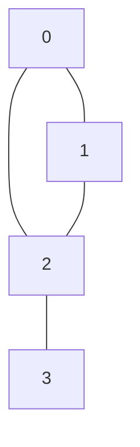

| Representation | What it looks like here | Space | "Neighbours of v" | "Edge u-v?" |
|---|---|---|---|---|
| Edge list | `[[0,1],[0,2],[1,2],[2,3]]` | O(E) | O(E) — scan everything | O(E) |
| Adjacency list | `0:[1,2] 1:[0,2] 2:[0,1,3] 3:[2]` | O(V + E) | O(deg v) | O(deg v) (O(1) with sets) |
| Adjacency matrix | 4×4 grid, `m[0][1] = m[1][0] = 1`, ... | O(V²) | O(V) — scan a row | O(1) |

Interview problems almost always hand you an **edge list** (`prerequisites`, `edges`, `tickets`) or an **implicit graph** (a grid, a word list, lock states). Your first line of code is usually turning that edge list into an adjacency list.

#### Building an adjacency list in Kotlin

```kotlin
fun buildGraph(n: Int, edges: Array<IntArray>, directed: Boolean): List<MutableList<Int>> {
    val graph = List(n) { mutableListOf<Int>() }
    for ((u, v) in edges) {            // IntArray supports destructuring of its first elements
        graph[u].add(v)
        if (!directed) graph[v].add(u) // undirected: store the edge in both directions
    }
    return graph
}
```

If vertices are not `0..n-1` (strings, characters, coordinates), use a `HashMap<String, MutableList<String>>` instead — same idea, slightly slower constants.

#### Why traversal is O(V + E), not O(V · E) or O(V²)

A traversal does two kinds of work:

1. **Per vertex:** it is added to the queue/stack once and marked visited once — O(V) in total, thanks to the visited set.
2. **Per edge:** when a vertex is processed, its neighbour list is scanned. Summed over all vertices, the lengths of all neighbour lists are E (directed) or 2E (undirected).

So the total is O(V + E). The **visited set is what makes this true** — without it, a vertex can be pushed again through every edge that reaches it, and on graphs with cycles the traversal never ends.

With an adjacency **matrix**, step 2 costs O(V) per vertex regardless of how many edges exist, so traversal becomes O(V²). That's fine when E is close to V² (dense graphs), wasteful when the graph is sparse — and interview graphs are usually sparse.

#### Grids are graphs too

An `m × n` grid is a graph where each cell is a vertex and edges go to the 4 (or 8) neighbours. You never build the adjacency list — you generate neighbours on the fly with a direction array:

```kotlin
val dirs = arrayOf(intArrayOf(1, 0), intArrayOf(-1, 0), intArrayOf(0, 1), intArrayOf(0, -1))
for ((dr, dc) in dirs) {
    val nr = r + dr
    val nc = c + dc
    if (nr in 0 until rows && nc in 0 until cols) { /* visit (nr, nc) */ }
}
```

Here V = m·n and E ≤ 4·m·n, so a full traversal is O(m·n). The same "implicit graph" idea covers word ladders (words are vertices, one-letter changes are edges) and lock combinations (states are vertices, single turns are edges) — see [Word Ladder](#10-word-ladder) and [Open the Lock](#11-open-the-lock).

#### Which to choose

- **Adjacency list:** default. Sparse graphs, BFS/DFS, topological sort, Dijkstra.
- **Adjacency matrix:** small V (a few hundred) with dense edges, or Floyd-Warshall (see [Advanced Graphs](17-advanced-graphs.md)).
- **Edge list:** keep as-is for union-find, Kruskal's MST, Bellman-Ford — algorithms that loop over all edges rather than walking from a vertex.

#### Common mistakes

- Forgetting to add the reverse edge for undirected graphs — half the graph becomes unreachable.
- Vertices labelled 1..n while the list is sized n — off-by-one crash. Check whether labels start at 0 or 1.
- Isolated vertices: if you build an adjacency *map* only from edges, vertices with no edges are missing. Iterate `0 until n`, not over the map keys, when counting components.
- Saying "O(V²)" for BFS on an adjacency list, or "O(E)" while forgetting the vertices that have no edges.

#### Follow-ups

- *Weighted edges?* Store pairs `(neighbour, weight)` in the list; see [Advanced Graphs](17-advanced-graphs.md) for Dijkstra.
- *Why is E at most V²?* Each ordered pair of vertices can have at most one edge in a simple graph: V(V−1) directed, V(V−1)/2 undirected.
- *Is a tree a graph?* Yes: a connected graph with V−1 edges and no cycles — see [Graph Valid Tree](#13-graph-valid-tree) and [Trees & BST](14-trees-bst.md).

</details>

### 2. BFS vs DFS: how do you choose?

**📘 Concept** · ⭐ Product/FAANG favourite

<details>
<summary>Answer</summary>

**In short:** **BFS** explores in layers (all vertices 1 step away, then 2, ...) using a queue, so the first time it reaches a vertex it has found the **shortest path in an unweighted graph** — use it for "minimum steps/moves/distance". **DFS** goes as deep as possible before backtracking, using recursion or a stack — use it when you need to **visit everything** (components, flood fill), or need the **path/recursion structure** itself (cycle detection, topological order, backtracking). Both are O(V + E); for pure "visit everything" problems either works and you pick the one you can write fastest without bugs.

#### How each one moves

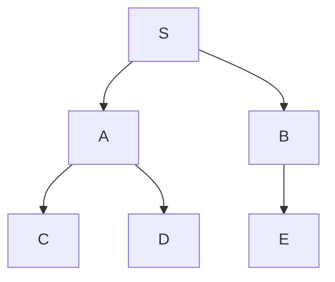

- BFS from S: `S, A, B, C, D, E` — level by level. A queue holds the frontier.
- DFS from S: `S, A, C, D, B, E` — down one branch fully, then back up. The call stack (or an explicit stack) holds the current path.

#### Decision table

| The problem asks for... | Use | Why |
|---|---|---|
| Minimum number of steps / moves / transformations | **BFS** | Layers = distance; first arrival is optimal when every edge costs 1 |
| Distance from *many* sources at once (nearest 0, rotting oranges) | **Multi-source BFS** | Put all sources in the queue at distance 0 |
| Count / size / mark connected regions | Either (DFS is shortest code) | Every cell is visited once either way |
| Cycle detection in a **directed** graph | **DFS** with 3 colours (or Kahn's BFS) | You need to know which vertices are on the current path |
| Topological order | Kahn's (BFS on in-degrees) or DFS post-order | Both work; Kahn's also detects cycles cleanly |
| All paths / combinations / "does any path satisfy X" | **DFS / backtracking** | Need to build and undo a path |
| Very deep graph (long chain, huge grid) | BFS or iterative DFS | Recursive DFS can overflow the stack |
| Weighted shortest path | Neither — **Dijkstra** | See [Advanced Graphs](17-advanced-graphs.md) |

#### Why BFS gives shortest paths (unweighted)

The queue always contains vertices at distance d followed by vertices at distance d+1 — never anything else. Vertices are dequeued in non-decreasing distance order, so when a vertex is discovered for the first time, it is discovered from a vertex at the smallest possible distance. Any other path would be found later and be at least as long. This argument fails as soon as edges have different weights: a path with more edges could be cheaper.

DFS gives **no** shortest-path guarantee: it might reach the target down a long winding branch first.

#### Templates

BFS — mark visited **when you enqueue**, not when you dequeue:

```kotlin
fun bfs(graph: List<List<Int>>, start: Int): IntArray {
    val dist = IntArray(graph.size) { -1 }   // -1 also means "not visited"
    val queue = ArrayDeque<Int>()
    dist[start] = 0
    queue.addLast(start)
    while (queue.isNotEmpty()) {
        val u = queue.removeFirst()
        for (v in graph[u]) {
            if (dist[v] == -1) {
                dist[v] = dist[u] + 1        // mark at enqueue time: no duplicates in the queue
                queue.addLast(v)
            }
        }
    }
    return dist
}
```

DFS — recursive (short) and iterative (safe for deep graphs):

```kotlin
fun dfs(graph: List<List<Int>>, u: Int, visited: BooleanArray) {
    visited[u] = true
    for (v in graph[u]) if (!visited[v]) dfs(graph, v, visited)
}

fun dfsIterative(graph: List<List<Int>>, start: Int, visited: BooleanArray) {
    val stack = ArrayDeque<Int>()
    stack.addLast(start)
    visited[start] = true
    while (stack.isNotEmpty()) {
        val u = stack.removeLast()
        for (v in graph[u]) if (!visited[v]) { visited[v] = true; stack.addLast(v) }
    }
}
```

The iterative version visits every reachable vertex exactly once, but not in the same order as the recursive one — fine for counting and flood fill, **not** fine for topological sort or colour-based cycle detection, which rely on the moment a vertex is *finished*.

#### Memory

- BFS holds a whole frontier: worst case O(V) (for a wide tree, the widest level).
- DFS holds the current path: worst case O(V) for a long chain. On a 1000×1000 grid that can be a million nested calls — very likely a `StackOverflowError` on the JVM's default stack. Mention this in interviews; it shows maturity.

#### Common mistakes

- Marking visited when **dequeuing** in BFS: the same vertex enters the queue many times, and in grids this can blow up time and memory.
- Using DFS for "minimum moves" — it finds *a* path, not the shortest one.
- Using plain BFS on weighted edges.
- Counting BFS levels wrongly: either store distance per vertex, or process the queue level by level with `repeat(queue.size)`.

#### Follow-ups

- *Bidirectional BFS?* Search from both ends and stop when the frontiers meet; roughly b^d work becomes 2·b^(d/2) — see [Word Ladder](#10-word-ladder).
- *Edges with weights 0 and 1 only?* 0-1 BFS with a deque — see [Advanced Graphs](17-advanced-graphs.md).
- *Iterative deepening (IDDFS)?* DFS with a growing depth limit: BFS's shortest-path guarantee with DFS's memory. Rare in interviews, good to name.

</details>

## Grids as graphs

### 3. Number of Islands

**🟡 Medium** · ⭐ Product/FAANG favourite (commonly reported at Amazon, Google, Meta)

<details>
<summary>Answer</summary>

**In short:** Treat each land cell as a vertex connected to its 4 neighbouring land cells. Scan the grid; every time you hit an unvisited `'1'`, you've found a new island — count it and flood-fill (DFS or BFS) the whole island so it's never counted again. Each cell is visited a constant number of times: O(m·n) time, O(m·n) worst-case space for the recursion stack or queue.

#### Problem

Given an `m × n` grid of `'1'` (land) and `'0'` (water), count the islands. An island is a group of land cells connected horizontally or vertically (not diagonally).

```
1 1 0 0
1 0 0 1
0 0 1 1
1 0 0 1
```

→ `3` (top-left group, right-hand group, and the lone cell at the bottom-left).

#### Clarifying questions & edge cases

- Is the grid `Char` (`'1'`/`'0'`) or `Int`? LeetCode uses `Char` — comparing with `1` instead of `'1'` is a classic bug.
- Can I modify the input? If yes, "sink" land to `'0'` instead of keeping a visited array. If not, use a `BooleanArray`.
- 4-directional or 8-directional connectivity? Usually 4.
- Empty grid → 0. All water → 0. All land → 1.

#### Brute force

There isn't really a slower "natural" approach — the question is about recognising a connected-components count. A wrong shortcut some people try is counting `'1'` cells that have no land above or to the left; it fails on U-shaped islands whose arms join further down.

#### Key insight

The number of islands is the number of **connected components** of land cells. A component is discovered the first time the scan touches any of its cells. If at that moment we visit *all* of its cells (flood fill) and mark them, the scan will never "discover" that component again. So:

1. For each cell in row-major order:
2. If it's `'1'`: `count++`, then flood-fill from it, turning every reachable `'1'` into `'0'`.
3. Return `count`.

#### Walkthrough

```
r\c 0 1 2 3
0   1 1 0 0
1   1 0 0 1
2   0 0 1 1
3   1 0 0 1
```

| scan hits | count | flood fill sinks |
|---|---|---|
| (0,0) | 1 | (0,0), (1,0), (0,1) |
| (1,3) | 2 | (1,3), (2,3), (3,3), (2,2) |
| (3,0) | 3 | (3,0) |
| every other `'1'` | — | already sunk to `'0'`, skipped |

Answer: 3.

#### Kotlin

```kotlin
fun numIslands(grid: Array<CharArray>): Int {
    if (grid.isEmpty()) return 0
    val rows = grid.size
    val cols = grid[0].size
    var count = 0

    fun sink(r: Int, c: Int) {
        // Stop at the border, at water, or at land we already sank.
        if (r < 0 || r >= rows || c < 0 || c >= cols || grid[r][c] != '1') return
        grid[r][c] = '0'          // mark visited by sinking, BEFORE recursing
        sink(r + 1, c)
        sink(r - 1, c)
        sink(r, c + 1)
        sink(r, c - 1)
    }

    for (r in 0 until rows) {
        for (c in 0 until cols) {
            if (grid[r][c] == '1') {
                count++           // first time we touch this island
                sink(r, c)        // erase the whole island
            }
        }
    }
    return count
}
```

**BFS version** (no recursion-depth risk — prefer it if the grid can be huge):

```kotlin
fun numIslandsBfs(grid: Array<CharArray>): Int {
    if (grid.isEmpty()) return 0
    val rows = grid.size
    val cols = grid[0].size
    val dirs = arrayOf(intArrayOf(1, 0), intArrayOf(-1, 0), intArrayOf(0, 1), intArrayOf(0, -1))
    var count = 0
    for (r in 0 until rows) for (c in 0 until cols) {
        if (grid[r][c] != '1') continue
        count++
        grid[r][c] = '0'
        val queue = ArrayDeque<Int>()
        queue.addLast(r * cols + c)   // encode (r, c) as one Int
        while (queue.isNotEmpty()) {
            val cell = queue.removeFirst()
            val cr = cell / cols
            val cc = cell % cols
            for ((dr, dc) in dirs) {
                val nr = cr + dr
                val nc = cc + dc
                if (nr in 0 until rows && nc in 0 until cols && grid[nr][nc] == '1') {
                    grid[nr][nc] = '0'   // mark when enqueuing
                    queue.addLast(nr * cols + nc)
                }
            }
        }
    }
    return count
}
```

#### Swift

```swift
func numIslands(_ grid: [[Character]]) -> Int {
    guard !grid.isEmpty else { return 0 }
    var grid = grid                       // local mutable copy
    let rows = grid.count, cols = grid[0].count
    var count = 0

    func sink(_ r: Int, _ c: Int) {
        if r < 0 || r >= rows || c < 0 || c >= cols || grid[r][c] != "1" { return }
        grid[r][c] = "0"
        sink(r + 1, c); sink(r - 1, c); sink(r, c + 1); sink(r, c - 1)
    }

    for r in 0..<rows {
        for c in 0..<cols where grid[r][c] == "1" {
            count += 1
            sink(r, c)
        }
    }
    return count
}
```

Swift arrays are value types, so `var grid = grid` gives a copy you can mutate (copy-on-write) without touching the caller's data. The nested function captures that local variable. The `where` clause is evaluated per iteration, so cells sunk earlier in the scan are correctly skipped.

#### Complexity

- **Time:** O(m·n) — every cell is scanned once and sunk at most once; each sink looks at 4 neighbours.
- **Space:** O(m·n) worst case — the recursion depth (or queue size) when the whole grid is one snake-shaped island. Nothing else, since the grid itself is the visited set.

#### Common mistakes

- Comparing `grid[r][c] == 1` (Int) with a `Char` — doesn't even compile in Kotlin; in other languages it silently fails.
- Checking bounds **after** indexing — crash on the border.
- Marking visited after the recursive calls instead of before — infinite recursion between two neighbours.
- Recursive DFS on a 1000×1000 all-land grid → stack overflow. Mention BFS or iterative DFS.

#### Follow-ups

- *Can't modify the input?* Keep `visited = Array(rows) { BooleanArray(cols) }`.
- *Land is added one cell at a time (Number of Islands II)?* Union-find, near O(1) per addition — see [Advanced Graphs](17-advanced-graphs.md).
- *Size of the biggest island?* Make the flood fill return a count — see [Max Area of Island](#4-max-area-of-island).
- *Distinct island shapes?* Record the DFS path relative to the start cell (e.g. a direction string, including "back" markers) and put it in a set.

</details>

### 4. Max Area of Island

**🟡 Medium**

<details>
<summary>Answer</summary>

**In short:** Same as Number of Islands, but the flood fill **returns the number of cells it sank**: `area(r, c) = 1 + area of the 4 neighbours`, with 0 for water, visited or out-of-bounds cells. Track the maximum over all starting cells. O(m·n) time and O(m·n) worst-case space.

#### Problem

Given a grid of `0`s and `1`s (ints this time), return the area (number of cells) of the largest island, connected 4-directionally. Return 0 if there is no land.

```
0 1 1 0
0 1 0 0
0 0 0 1
1 0 1 1
```

→ islands of size 3 (top), 3 (bottom-right) and 1 (bottom-left) → answer `3`.

#### Clarifying questions & edge cases

- Grid of `Int` here, not `Char`.
- No land at all → 0.
- Can I mutate the grid? Usually yes; otherwise a visited array.
- Diagonal cells don't connect — `(2,3)` and `(3,2)` are joined only through `(3,3)`.

#### Brute force

Run a separate BFS from every land cell with a fresh visited set and measure its component: O((m·n)²). Wasteful, because every cell of an island recomputes the same island's area. Marking cells *globally* visited fixes it — each island is measured exactly once.

#### Key insight

The area of an island is the size of a connected component, and a DFS naturally returns sizes: the size of the component reachable from `(r, c)` through not-yet-visited land is `1` for this cell plus whatever each neighbour's DFS discovers. Because each cell is marked before recursing, no cell is counted twice, even though islands contain cycles (a 2×2 block of land is a 4-cycle).

#### Walkthrough

Top island `(0,1), (0,2), (1,1)`, scan reaches `(0,1)` first:

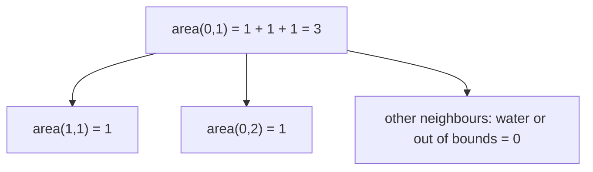

When `area(1,1)` looks back up at `(0,1)`, that cell is already `0`, so it contributes nothing — no double counting. The scan continues; `(2,3)` starts the bottom-right island: `1 + area(3,3)` where `area(3,3) = 1 + area(3,2) = 2`, total 3. Then `(3,0)` gives 1. Max = 3.

#### Kotlin

```kotlin
fun maxAreaOfIsland(grid: Array<IntArray>): Int {
    val rows = grid.size
    val cols = grid[0].size

    fun area(r: Int, c: Int): Int {
        if (r < 0 || r >= rows || c < 0 || c >= cols || grid[r][c] != 1) return 0
        grid[r][c] = 0            // mark before recursing so we never count it twice
        return 1 + area(r + 1, c) + area(r - 1, c) + area(r, c + 1) + area(r, c - 1)
    }

    var best = 0
    for (r in 0 until rows) {
        for (c in 0 until cols) {
            if (grid[r][c] == 1) best = maxOf(best, area(r, c))
        }
    }
    return best
}
```

Iterative alternative: the BFS from [Number of Islands](#3-number-of-islands) with a `size++` every time a cell is dequeued.

#### Complexity

- **Time:** O(m·n) — every cell is zeroed at most once, and each call does O(1) work besides recursion.
- **Space:** O(m·n) worst case for the recursion stack (one huge winding island).

#### Common mistakes

- Returning the number of islands instead of the max area (copy-paste from the previous problem).
- Adding 1 for a cell before checking whether it's land.
- Starting `best` at `Int.MIN_VALUE` — the "no land" case must return 0.

#### Follow-ups

- *Making a Large Island (flip at most one 0 to 1, LeetCode Hard)?* Label each island with an id and store its area; for every `0`, sum the areas of the **distinct** neighbouring island ids + 1.
- *Island Perimeter?* `4 × land cells − 2 × adjacent land pairs`; no traversal needed.
- *Grid too big for memory, streamed row by row?* Union-find across consecutive rows — see [Advanced Graphs](17-advanced-graphs.md).

</details>

### 5. Surrounded Regions

**🟡 Medium**

<details>
<summary>Answer</summary>

**In short:** Flip the question around. Instead of asking "is this `'O'` region surrounded?", find the regions that are **not** surrounded: any `'O'` connected to the border is safe. Flood-fill from every border `'O'` and mark those cells as safe (e.g. `'S'`); then one pass turns every remaining `'O'` into `'X'` and every `'S'` back into `'O'`. O(m·n) time, O(m·n) worst-case recursion space.

#### Problem

Given a board of `'X'` and `'O'`, capture every region of `'O'`s that is completely surrounded by `'X'` (4-directionally) by flipping it to `'X'`, in place. A region touching the border can never be surrounded.

```
X X X X          X X X X
X O O X    →     X X X X
X X O X          X X X X
X O X X          X O X X
```

The bottom `'O'` sits on the border, so it survives.

#### Clarifying questions & edge cases

- Modify in place (LeetCode returns `Unit`).
- Empty board, or boards with 1–2 rows/columns: every cell is a border cell, nothing changes.
- Diagonal adjacency doesn't count.

#### Brute force

For each `'O'` region, flood-fill it and remember whether the fill touched the border; if not, flip it. This is actually O(m·n) too if you mark regions visited, but the code is fiddlier: you must collect the region's cells first, because you don't know whether to flip until the fill is finished. The naive version that re-runs a search from every `'O'` is O((m·n)²).

#### Key insight

"Surrounded" is a property of a whole region and hard to test locally. Its complement is easy: a region is **not** surrounded exactly when it contains a border cell. So start from the border — every `'O'` reachable from a border `'O'` is safe; every other `'O'` is surrounded by definition. This "start the search from the boundary" trick appears again in [Pacific Atlantic Water Flow](#6-pacific-atlantic-water-flow).

Steps:

1. DFS from every `'O'` on the four borders, marking reachable `'O'` cells as `'S'`.
2. Sweep the board: `'O'` → `'X'` (captured), `'S'` → `'O'` (restore).

#### Walkthrough

Board above. Border `'O'` cells: only `(3,1)`.

| phase | action | board effect |
|---|---|---|
| border DFS | from (3,1): mark `'S'`; its neighbours (2,1) is `'X'` | only (3,1) becomes `'S'` |
| sweep | (1,1), (1,2), (2,2) are `'O'` | flipped to `'X'` |
| sweep | (3,1) is `'S'` | restored to `'O'` |

#### Kotlin

```kotlin
fun solve(board: Array<CharArray>) {
    if (board.isEmpty() || board[0].isEmpty()) return
    val rows = board.size
    val cols = board[0].size

    fun markSafe(r: Int, c: Int) {
        if (r < 0 || r >= rows || c < 0 || c >= cols || board[r][c] != 'O') return
        board[r][c] = 'S'             // safe: connected to the border
        markSafe(r + 1, c)
        markSafe(r - 1, c)
        markSafe(r, c + 1)
        markSafe(r, c - 1)
    }

    // 1. Flood-fill from every border cell (the check inside handles 'X').
    for (r in 0 until rows) {
        markSafe(r, 0)
        markSafe(r, cols - 1)
    }
    for (c in 0 until cols) {
        markSafe(0, c)
        markSafe(rows - 1, c)
    }

    // 2. Capture what's left, restore what's safe.
    for (r in 0 until rows) {
        for (c in 0 until cols) {
            when (board[r][c]) {
                'O' -> board[r][c] = 'X'
                'S' -> board[r][c] = 'O'
            }
        }
    }
}
```

#### Complexity

- **Time:** O(m·n) — each cell is marked at most once, and the sweep is one pass.
- **Space:** O(m·n) worst case for the recursion stack (a huge snake-shaped safe region); switch to BFS to make it O(min(m, n))-ish in practice, O(m·n) worst case.

#### Common mistakes

- Flipping a region as soon as the DFS finds it, before knowing whether it touches the border.
- Using `'X'` as the temporary marker — then you can't tell safe cells from walls.
- Forgetting to restore `'S'` back to `'O'`.
- Only starting from the top and left borders.

#### Follow-ups

- *Number of Enclaves?* Same border fill, then **count** the land cells left instead of flipping them.
- *Number of Closed Islands?* Border fill to sink edge islands, then count islands as in [Number of Islands](#3-number-of-islands).
- *Union-find version?* Union every border `'O'` with a virtual "border" node, union adjacent `'O'`s, then flip every `'O'` not connected to it — see [Advanced Graphs](17-advanced-graphs.md).

</details>

### 6. Pacific Atlantic Water Flow

**🟡 Medium** · ⭐ Product/FAANG favourite

<details>
<summary>Answer</summary>

**In short:** Run the flow **backwards**. Water flows downhill from a cell to an equal-or-lower neighbour; in reverse, "which cells can reach the Pacific?" becomes "which cells can be reached **climbing up** (to equal-or-higher neighbours) from the Pacific border?". Do one DFS/BFS from all Pacific border cells and one from all Atlantic border cells; the answer is the cells reached by both. O(m·n) time and space.

#### Problem

An `m × n` matrix of heights. The Pacific touches the top and left edges, the Atlantic the bottom and right edges. Rain flows from a cell to a 4-neighbour whose height is **less than or equal**. Return all cells from which water can reach both oceans.

```
1 2 3
8 9 4
7 6 5
```

→ every cell except `(0,0)` and `(0,1)`: those two can only flow towards the Pacific, because every path towards the Atlantic would have to climb.

#### Clarifying questions & edge cases

- Equal heights allow flow (≤, not <).
- Border cells touch their ocean directly; corner cells `(0, n-1)` and `(m-1, 0)` touch both.
- Single cell → it reaches both.
- Output order usually doesn't matter.

#### Brute force

From every cell, run a DFS downhill and check whether it reaches both oceans: O((m·n)²) for a grid that's mostly flat. Repeated work everywhere, because neighbouring cells explore nearly the same paths.

#### Key insight

Many sources, two destinations → **reverse the edges** and search from the destinations. If water can go `A → B` (B lower or equal), then in reverse we move `B → A` only when A is higher or equal. All cells reachable in reverse from the Pacific border are exactly the cells that can drain into the Pacific. Two searches (one per ocean) each visit every cell at most once, so the whole thing is O(m·n) instead of O((m·n)²).

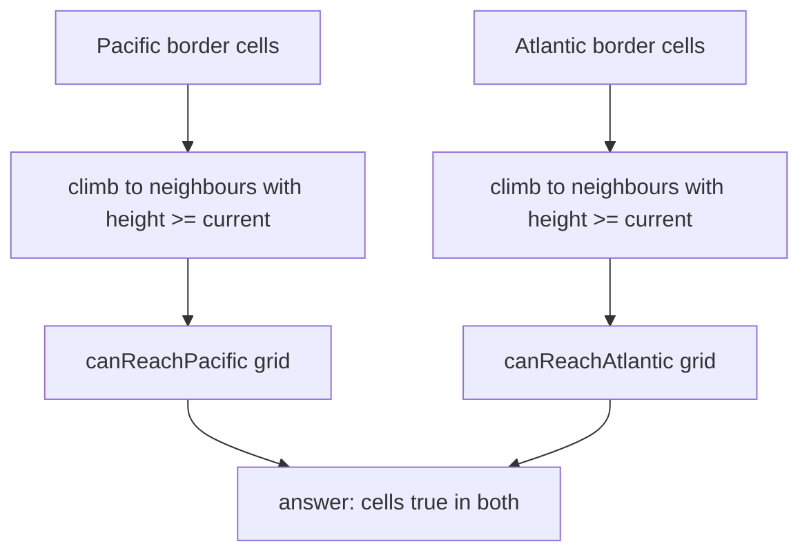

#### Walkthrough

Grid above.

| search | starts from | climbs to | reached set |
|---|---|---|---|
| Pacific | top row 1,2,3 and left column 1,8,7 | 3→4→5→6, 4→9 | all 9 cells |
| Atlantic | bottom row 7,6,5 and right column 3,4,5 | 7→8, 8→9 (1 and 2 are lower, blocked) | all except (0,0), (0,1) |

Intersection: the 7 cells other than `(0,0)` and `(0,1)`.

#### Kotlin

```kotlin
fun pacificAtlantic(heights: Array<IntArray>): List<List<Int>> {
    val rows = heights.size
    val cols = heights[0].size
    val pacific = Array(rows) { BooleanArray(cols) }
    val atlantic = Array(rows) { BooleanArray(cols) }

    // Reverse flow: move only to cells at least as high as where we came from.
    fun climb(r: Int, c: Int, seen: Array<BooleanArray>, fromHeight: Int) {
        if (r < 0 || r >= rows || c < 0 || c >= cols) return
        if (seen[r][c] || heights[r][c] < fromHeight) return
        seen[r][c] = true
        val h = heights[r][c]
        climb(r + 1, c, seen, h)
        climb(r - 1, c, seen, h)
        climb(r, c + 1, seen, h)
        climb(r, c - 1, seen, h)
    }

    for (r in 0 until rows) {
        climb(r, 0, pacific, Int.MIN_VALUE)          // left edge
        climb(r, cols - 1, atlantic, Int.MIN_VALUE)  // right edge
    }
    for (c in 0 until cols) {
        climb(0, c, pacific, Int.MIN_VALUE)          // top edge
        climb(rows - 1, c, atlantic, Int.MIN_VALUE)  // bottom edge
    }

    val result = mutableListOf<List<Int>>()
    for (r in 0 until rows) {
        for (c in 0 until cols) {
            if (pacific[r][c] && atlantic[r][c]) result.add(listOf(r, c))
        }
    }
    return result
}
```

#### Complexity

- **Time:** O(m·n) — each of the two searches marks a cell at most once and checks 4 neighbours.
- **Space:** O(m·n) — two boolean grids plus the recursion stack.

#### Common mistakes

- Searching forward from every cell (the O((m·n)²) version) — usually times out.
- Getting the reverse comparison wrong: in reverse you go to **higher-or-equal** neighbours, not lower.
- Using a single shared visited grid for both oceans.
- Treating strict `<` as the flow rule — equal heights do flow.

#### Follow-ups

- *Only one ocean, or many ocean edges?* Same multi-source reverse search from all of that ocean's border cells.
- *BFS instead of DFS?* Put all border cells of one ocean in the queue at once (multi-source BFS) — identical result, no recursion depth risk.
- *Similar "start from the target" trick?* [Surrounded Regions](#5-surrounded-regions), and Rotting Oranges in [Problem-Solving Tricks](06-problem-solving-tricks.md).

</details>

### 7. 01 Matrix

**🟡 Medium** · ⭐ Product/FAANG favourite

<details>
<summary>Answer</summary>

**In short:** Run a **multi-source BFS**: put every `0` cell in the queue at distance 0, then expand layer by layer; the first time a `1` cell is reached, its distance is final and equals the distance to the **nearest** 0. One BFS instead of one per cell — O(m·n) time and space.

#### Problem

Given a binary matrix, return a matrix of the same size where each cell holds the distance (number of 4-directional steps) to the nearest `0`. There is at least one `0`.

```
0 0 0          0 0 0
0 1 0    →     0 1 0
1 1 1          1 2 1
```

#### Clarifying questions & edge cases

- Guaranteed at least one 0? (LeetCode: yes. Otherwise unreachable cells need a sentinel.)
- Distance is Manhattan steps through any cells (both 0s and 1s are walkable).
- Can I overwrite the input, or must I return a new matrix?

#### Brute force

BFS from every `1` until it hits a `0`: O((m·n)²) in the worst case (a grid of 1s with one 0 in a corner). The repeated work is obvious — neighbouring cells run almost identical searches.

#### Key insight

"Nearest X from every cell" is the reverse of "from X, reach every cell". Imagine one **super-source** connected to every 0 with an edge of length 0. A single BFS from that super-source gives every cell its distance to the nearest 0. In code, the super-source is simply "enqueue all 0s at distance 0 before the loop starts". Because BFS processes layers in order — all distance-0 cells, then all distance-1 cells, and so on — the first visit to a cell is from its nearest 0.

This is exactly the pattern used in **Rotting Oranges** (all rotten oranges start in the queue) — that problem is covered in [Problem-Solving Tricks](06-problem-solving-tricks.md). Walls and Gates is the same problem with walls added (see Follow-ups).

#### Walkthrough

Start: queue = all five 0s, `dist` = 0 for them, -1 for the 1s.

| layer | cells finalised | distance |
|---|---|---|
| 0 | (0,0), (0,1), (0,2), (1,0), (1,2) — the five 0s | 0 |
| 1 | (1,1), (2,0), (2,2) — each touches a 0 | 1 |
| 2 | (2,1) — its neighbours (1,1), (2,0), (2,2) are at 1 | 2 |

Result matches the expected matrix.

#### Kotlin

```kotlin
fun updateMatrix(mat: Array<IntArray>): Array<IntArray> {
    val rows = mat.size
    val cols = mat[0].size
    val dist = Array(rows) { IntArray(cols) { -1 } }   // -1 = not reached yet
    val queue = ArrayDeque<Int>()

    // All zeros are sources at distance 0.
    for (r in 0 until rows) for (c in 0 until cols) {
        if (mat[r][c] == 0) {
            dist[r][c] = 0
            queue.addLast(r * cols + c)
        }
    }

    val dirs = arrayOf(intArrayOf(1, 0), intArrayOf(-1, 0), intArrayOf(0, 1), intArrayOf(0, -1))
    while (queue.isNotEmpty()) {
        val cell = queue.removeFirst()
        val r = cell / cols
        val c = cell % cols
        for ((dr, dc) in dirs) {
            val nr = r + dr
            val nc = c + dc
            if (nr in 0 until rows && nc in 0 until cols && dist[nr][nc] == -1) {
                dist[nr][nc] = dist[r][c] + 1   // first visit = nearest zero
                queue.addLast(nr * cols + nc)
            }
        }
    }
    return dist
}
```

#### Complexity

- **Time:** O(m·n) — every cell enters the queue once.
- **Space:** O(m·n) — the distance grid and the queue.

#### Common mistakes

- Running a BFS from every 1 (too slow) or from every 0 *separately* (also too slow).
- Using DFS — it gives *a* distance, not the shortest one.
- Initialising unknown distances to 0, which makes them look already visited.
- Forgetting to mark cells when they're enqueued, so cells are added multiple times.

#### Follow-ups

- *DP alternative?* Two passes: top-left to bottom-right using up/left neighbours, then bottom-right to top-left using down/right. O(m·n) time, O(1) extra space — see [Dynamic Programming](19-dynamic-programming.md).
- *Walls and Gates?* Gates (0) are sources, walls (-1) are never enqueued, rooms (INF) get filled with the distance — same code with one extra check.
- *Distance to the farthest land / "As Far from Land as Possible"?* Multi-source BFS from all land; the answer is the last layer number.

</details>

### 8. Shortest Path in Binary Matrix

**🟡 Medium** · ⭐ Product/FAANG favourite (commonly reported at Meta)

<details>
<summary>Answer</summary>

**In short:** Plain BFS on a grid with **8 directions**, starting from the top-left cell. Every move costs 1, so the first time BFS reaches the bottom-right cell, its distance is the shortest path. Return `-1` if the start or end cell is blocked or the end is unreachable. O(n²) time and space for an n×n grid.

#### Problem

Given an `n × n` grid of `0` (open) and `1` (blocked), return the length of the shortest clear path from `(0,0)` to `(n-1,n-1)`, moving in any of 8 directions. Length counts **cells visited**, including both ends. Return `-1` if there's no such path.

```
0 0 0
1 1 0     →  4   (0,0) → (0,1) → (1,2) → (2,2)
1 1 0
```

#### Clarifying questions & edge cases

- Start or end cell blocked → `-1` immediately.
- `n == 1` and the only cell is open → `1` (the path is one cell).
- 8-directional moves — diagonals count as one step.
- Length counts cells, not edges — start the distance at 1.

#### Brute force

DFS over all paths, tracking the minimum length: exponential, because the number of simple paths in a grid explodes. Even DFS with memoisation doesn't work cleanly, since the "best from here" depends on which cells are already on the path.

#### Key insight

All moves cost the same, so this is a shortest path in an **unweighted** graph — BFS. Cells are vertices, the 8 neighbours are edges. BFS visits cells in order of distance from the start, so the first time `(n-1, n-1)` is dequeued (or discovered), we have the answer. Marking cells as visited when they are enqueued keeps each cell in the queue at most once, giving O(n²).

#### Walkthrough

Grid above, storing `(row, col, pathLength)`:

| dequeue | newly enqueued | note |
|---|---|---|
| (0,0,1) | (0,1,2) | (1,0) and (1,1) are blocked |
| (0,1,2) | (0,2,3), (1,2,3) | diagonal down-right is (1,2) |
| (0,2,3) | — | (1,2) already visited |
| (1,2,3) | (2,2,4) | |
| (2,2,4) | — | target reached, return 4 |

#### Kotlin

```kotlin
fun shortestPathBinaryMatrix(grid: Array<IntArray>): Int {
    val n = grid.size
    if (grid[0][0] != 0 || grid[n - 1][n - 1] != 0) return -1

    val queue = ArrayDeque<IntArray>()
    queue.addLast(intArrayOf(0, 0, 1))   // row, col, path length in cells
    grid[0][0] = 1                       // mark visited (reuse the grid)

    while (queue.isNotEmpty()) {
        val (r, c, length) = queue.removeFirst()
        if (r == n - 1 && c == n - 1) return length
        for (dr in -1..1) {
            for (dc in -1..1) {
                if (dr == 0 && dc == 0) continue
                val nr = r + dr
                val nc = c + dc
                if (nr in 0 until n && nc in 0 until n && grid[nr][nc] == 0) {
                    grid[nr][nc] = 1             // mark when enqueuing
                    queue.addLast(intArrayOf(nr, nc, length + 1))
                }
            }
        }
    }
    return -1
}
```

If you must not modify the input, use a separate `visited` array.

#### Complexity

- **Time:** O(n²) — each cell is enqueued at most once and checks 8 neighbours.
- **Space:** O(n²) — the queue can hold a large fraction of the cells.

#### Common mistakes

- Using 4 directions — the problem allows diagonals.
- Starting the length at 0 (counts edges instead of cells).
- Forgetting the blocked-start / blocked-end check, or returning 0 for the 1×1 open grid instead of 1.
- Using DFS and taking the first path found.

#### Follow-ups

- *Speed it up?* A\* search with the Chebyshev distance `max(|dr|, |dc|)` to the target as the heuristic (admissible for 8-way moves), or bidirectional BFS.
- *Cells have different costs?* Dijkstra — see [Advanced Graphs](17-advanced-graphs.md).
- *Can remove up to k obstacles (Shortest Path in a Grid with Obstacles Elimination)?* BFS over states `(r, c, removalsLeft)` — the same idea as [Open the Lock](#11-open-the-lock).

</details>

## Graph traversal & BFS over states

### 9. Clone Graph

**🟡 Medium** · ⭐ Product/FAANG favourite (commonly reported at Meta, Google)

<details>
<summary>Answer</summary>

**In short:** Traverse the graph (DFS or BFS) while keeping a hash map **original node → its copy**. When you meet a node, return its copy if it already exists; otherwise create the copy, **put it in the map before visiting neighbours**, then clone each neighbour and attach it. The map is both the visited set and the thing that makes cycles safe. O(V + E) time, O(V) space.

#### Problem

Given a reference to one node of a connected undirected graph, return a deep copy of the graph. Each node has an integer `val` and a list of `neighbors`.

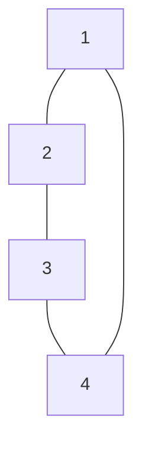

Input adjacency list `[[2,4],[1,3],[2,4],[1,3]]` → a brand-new set of 4 nodes with the same structure; no node in the result may be one of the original objects.

#### Clarifying questions & edge cases

- `null` input → `null`.
- Single node with no neighbours → a single new node.
- Cycles (every undirected edge is a 2-cycle: 1 lists 2 and 2 lists 1) — the main trap.
- Are node values unique? (LeetCode: yes, 1..n.) If not, key the map by node identity, which is what a `HashMap<Node, Node>` does by default when `Node` doesn't override `equals`.

#### Brute force

Recursively copy a node and then copy each neighbour, with no memory of what's been copied. On any cycle this recurses forever; even without cycles it duplicates shared nodes, so the copy has the wrong structure.

#### Key insight

A deep copy of a graph needs **exactly one copy per original node**, and every edge must point at those copies. The map `original → copy` gives both:

1. **Identity:** whenever any path reaches node X, we use `map[X]`, so all edges to X point to the same copy.
2. **Termination:** registering the copy *before* recursing into neighbours means that when the recursion comes back around a cycle to X, it finds the copy and stops.

#### Walkthrough

DFS from node 1 on the 4-cycle:

| call | map after | action |
|---|---|---|
| clone(1) | {1→1'} | visit neighbours 2, 4 |
| clone(2) | {1, 2} | neighbour 1 is in the map → attach 1'; visit 3 |
| clone(3) | {1, 2, 3} | neighbour 2 in map → attach 2'; visit 4 |
| clone(4) | {1, 2, 3, 4} | neighbours 1, 3 in map → attach 1', 3' |
| back in clone(1) | | neighbour 4 already copied → attach 4' |

Every copy ends up with the right neighbour copies, and each node was created once.

#### Kotlin

```kotlin
// LeetCode's definition:
class Node(var `val`: Int) {
    var neighbors: ArrayList<Node?> = ArrayList()
}

fun cloneGraph(node: Node?): Node? {
    if (node == null) return null
    val copies = HashMap<Node, Node>()        // original -> copy (identity-based keys)

    fun clone(original: Node): Node {
        copies[original]?.let { return it }   // already copied: reuse it
        val copy = Node(original.`val`)
        copies[original] = copy               // register BEFORE recursing: breaks cycles
        for (neighbour in original.neighbors) {
            if (neighbour != null) copy.neighbors.add(clone(neighbour))
        }
        return copy
    }

    return clone(node)
}
```

**BFS version** (avoids deep recursion on long chains):

```kotlin
fun cloneGraphBfs(node: Node?): Node? {
    if (node == null) return null
    val copies = HashMap<Node, Node>()
    copies[node] = Node(node.`val`)
    val queue = ArrayDeque<Node>()
    queue.addLast(node)
    while (queue.isNotEmpty()) {
        val current = queue.removeFirst()
        for (neighbour in current.neighbors) {
            if (neighbour == null) continue
            if (neighbour !in copies) {
                copies[neighbour] = Node(neighbour.`val`)
                queue.addLast(neighbour)          // first time seen: explore later
            }
            copies.getValue(current).neighbors.add(copies.getValue(neighbour))
        }
    }
    return copies.getValue(node)
}
```

#### Complexity

- **Time:** O(V + E) — each node is created once, and each adjacency entry is copied once.
- **Space:** O(V) — the map, plus the recursion stack or queue.

#### Common mistakes

- Putting the copy in the map **after** cloning the neighbours — infinite recursion on the first cycle.
- Returning the original neighbour instead of its copy (a shallow copy that shares nodes).
- Keying the map by `val` when values can repeat.
- In BFS, adding the edge only when the neighbour is new — edges to already-seen nodes go missing.

#### Follow-ups

- *Copy List with Random Pointer?* Same "old → new" map idea on a linked list (or the interleaving O(1)-space trick) — see [Linked Lists](12-linked-lists.md).
- *Clone a directed graph or a graph that may be disconnected?* Directed works unchanged; for disconnected input you'd be given all nodes and run the clone from each one not yet in the map.
- *Clone a binary tree with random pointers?* Same map, tree traversal — see [Trees & BST](14-trees-bst.md).

</details>

### 10. Word Ladder

**🔴 Hard** · ⭐ Product/FAANG favourite (commonly reported at Amazon, Google)

<details>
<summary>Answer</summary>

**In short:** Each word is a vertex; two words are connected if they differ by exactly one letter. The answer is the shortest path length from `beginWord` to `endWord`, so use **BFS**. Generate neighbours by changing each position to each of 26 letters and checking membership in a hash set; remove a word from the set when you enqueue it (that's the visited set). O(N · L² · 26) time with N words of length L, O(N · L) space.

#### Problem

Given `beginWord`, `endWord` and a dictionary `wordList`, return the number of words in the shortest transformation sequence from `beginWord` to `endWord`, where each step changes exactly one letter and every intermediate word (and `endWord`) must be in the dictionary. Return `0` if impossible.

`beginWord = "hit"`, `endWord = "cog"`, `wordList = ["hot","dot","dog","lot","log","cog"]` → `5` (`hit → hot → dot → dog → cog`).

#### Clarifying questions & edge cases

- `endWord` not in the list → `0`.
- `beginWord` doesn't need to be in the list.
- All words are the same length and lowercase? (LeetCode: yes.)
- The answer counts **words**, not edges — so a one-step change returns 2.

#### Brute force

Build the full graph by comparing every pair of words: O(N² · L) just to build it, then BFS. With N = 5000 that's 25 million comparisons × L — too slow in the worst case, and most pairs aren't neighbours anyway.

#### Key insight

"Fewest transformations" = shortest path where every step costs 1 → BFS. The trick is **not** to build the graph. For a word of length L there are only `26 · L` possible one-letter changes, so generate them and keep only those in the dictionary set. That's O(26 · L) candidates per word, each costing O(L) to build and hash — much cheaper than scanning all N words when N is large.

Removing a word from the set as soon as it's enqueued guarantees each word is processed once and keeps the BFS correct: the first time a word is reached is via a shortest path, so later (longer) routes to it are useless.

#### Walkthrough

BFS layers for the example:

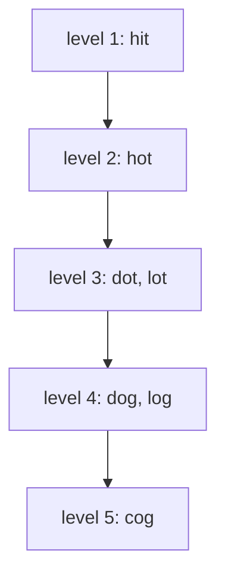

| level | queue | words removed from set |
|---|---|---|
| 1 | hit | — |
| 2 | hot | hot |
| 3 | dot, lot | dot, lot |
| 4 | dog, log | dog, log |
| 5 | cog | cog → it's `endWord`, return 5 |

#### Kotlin

```kotlin
fun ladderLength(beginWord: String, endWord: String, wordList: List<String>): Int {
    val unvisited = HashSet(wordList)
    if (endWord !in unvisited) return 0
    unvisited.remove(beginWord)

    val queue = ArrayDeque<String>()
    queue.addLast(beginWord)
    var level = 1                                   // number of words in the path so far

    while (queue.isNotEmpty()) {
        repeat(queue.size) {                        // process exactly one BFS layer
            val word = queue.removeFirst()
            if (word == endWord) return level
            val chars = word.toCharArray()
            for (i in chars.indices) {
                val original = chars[i]
                for (ch in 'a'..'z') {
                    if (ch == original) continue
                    chars[i] = ch
                    val next = String(chars)
                    if (unvisited.remove(next)) queue.addLast(next)   // remove = mark visited
                }
                chars[i] = original                 // restore before moving to the next position
            }
        }
        level++
    }
    return 0
}
```

`HashSet.remove` returns `true` only if the word was present, so it doubles as "is it in the dictionary and unvisited?".

#### Swift

```swift
func ladderLength(_ beginWord: String, _ endWord: String, _ wordList: [String]) -> Int {
    var unvisited = Set(wordList)
    guard unvisited.contains(endWord) else { return 0 }
    unvisited.remove(beginWord)

    let letters = Array("abcdefghijklmnopqrstuvwxyz")
    var layer = [beginWord]
    var level = 1

    while !layer.isEmpty {
        var nextLayer: [String] = []
        for word in layer {
            if word == endWord { return level }
            var chars = Array(word)                 // Swift strings aren't integer-indexable
            for i in chars.indices {
                let original = chars[i]
                for ch in letters where ch != original {
                    chars[i] = ch
                    let candidate = String(chars)
                    if unvisited.remove(candidate) != nil { nextLayer.append(candidate) }
                }
                chars[i] = original
            }
        }
        layer = nextLayer
        level += 1
    }
    return 0
}
```

Using one array per layer avoids `removeFirst()` on an `Array`, which is O(n) in Swift.

#### Complexity

- **Time:** O(N · 26 · L · L) = O(N · L²) — each of N words is dequeued once; it generates 26·L candidates, each taking O(L) to build and hash.
- **Space:** O(N · L) — the set and the queue of words.

#### Common mistakes

- Returning the number of **edges** (4) instead of words (5).
- Marking visited when dequeuing instead of when enqueuing — many duplicates in the queue.
- Forgetting to restore `chars[i]` after trying all 26 letters.
- Not checking that `endWord` is in the list first.

#### Follow-ups

- *Faster in practice?* **Bidirectional BFS**: expand the smaller of two frontiers (one from each end) and stop when they meet. Same worst case, far fewer nodes on typical inputs.
- *Pattern buckets instead of 26 letters?* Map `"h*t" → [hot, hit, ...]`; neighbours are all words sharing a pattern. Better when the alphabet is large.
- *Return all shortest sequences (Word Ladder II, Hard)?* BFS that records parents per layer, then DFS/backtrack from `endWord` to rebuild every shortest path — see [Recursion & Backtracking](18-recursion-backtracking.md).

</details>

### 11. Open the Lock

**🟡 Medium**

<details>
<summary>Answer</summary>

**In short:** The lock's 10,000 combinations `"0000".."9999"` are vertices; turning one wheel one notch (up or down) is an edge, so each state has 8 neighbours. Deadends are removed vertices. The minimum number of turns is a shortest path in an unweighted graph → **BFS from "0000"**. At most 10⁴ states × 8 neighbours, so it's fast. This is the general "BFS over states" pattern.

#### Problem

A lock has 4 wheels with digits 0–9 that wrap around (9 → 0, 0 → 9). It starts at `"0000"`. Some combinations are `deadends` — reaching one jams the lock. Return the minimum number of single-notch turns to reach `target`, or `-1` if impossible.

`deadends = ["0201","0101","0102","1212","2002"]`, `target = "0202"` → `6` (e.g. `0000 → 1000 → 1100 → 1200 → 1201 → 1202 → 0202`).

#### Clarifying questions & edge cases

- `"0000"` itself is a deadend → `-1`.
- `target == "0000"` → `0`.
- Target is a deadend → `-1` (you can never stand on it).
- All 8 neighbours of the target are deadends → `-1`.

#### Brute force

DFS trying every sequence of turns up to some depth: exponential in the depth and doesn't naturally give the minimum. Not viable.

#### Key insight

Whenever a problem says "minimum number of moves" and the moves all cost the same, ask: **what is a state, and what are the moves?** Then BFS over states.

- **State:** the 4-character string.
- **Moves:** for each of the 4 wheels, `+1` or `-1` mod 10 → 8 neighbours.
- **Forbidden states:** the deadends (never enqueue them).
- **Visited set:** so each of the 10,000 states is processed once.

The state space is tiny and explicit, so BFS's O(states × moves) is just 80,000 neighbour checks.

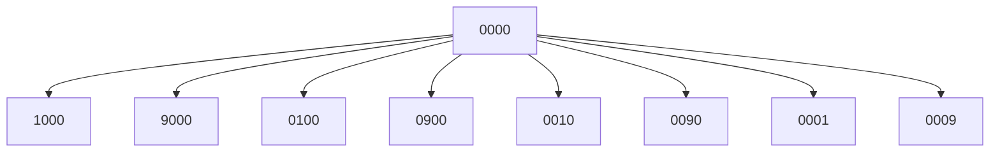

#### Walkthrough

For the example, BFS levels grow outward from `"0000"`. Paths through `0101`/`0201` (changing wheels 2 and 4 to reach `0202` directly) are blocked by deadends, so the shortest path has to take a detour through wheel 1: `1000 → 1100 → 1200 → 1201 → 1202 → 0202`.

| level | example states first reached |
|---|---|
| 0 | 0000 |
| 1 | 1000, 9000, 0100, 0900, 0010, 0090, 0001, 0009 |
| 2 | 1100, 0200, 0110, ... (0101 and 0201 are skipped — deadends) |
| ... | ... |
| 6 | 0202 → return 6 |

#### Kotlin

```kotlin
fun openLock(deadends: Array<String>, target: String): Int {
    val dead = deadends.toHashSet()
    if ("0000" in dead) return -1
    if (target == "0000") return 0

    val visited = hashSetOf("0000")
    val queue = ArrayDeque<String>()
    queue.addLast("0000")
    var steps = 0

    while (queue.isNotEmpty()) {
        steps++                                         // every state enqueued now is one turn further
        repeat(queue.size) {
            val chars = queue.removeFirst().toCharArray()
            for (i in 0 until 4) {
                val original = chars[i]
                for (delta in intArrayOf(1, 9)) {       // +1 and -1 (as +9) modulo 10
                    chars[i] = '0' + (original - '0' + delta) % 10
                    val next = String(chars)
                    if (next in dead || !visited.add(next)) continue
                    if (next == target) return steps
                    queue.addLast(next)
                }
                chars[i] = original
            }
        }
    }
    return -1
}
```

Checking `dead` before `target` handles the "target is a deadend" case for free.

#### Complexity

- **Time:** O(10⁴ · 8 · 4) — at most 10,000 states, 8 neighbours each, O(4) to build each string. In general O(Bᵈ · moves · cost) where B = digits, d = wheels.
- **Space:** O(10⁴) — the visited set and queue.

#### Common mistakes

- `(digit - 1) % 10` for turning down — gives `-1` for 0 in Kotlin/Java. Add 9 instead (or add 10 before the modulo).
- Forgetting to reset `chars[i]` after trying both directions.
- Enqueueing deadends and only checking them when dequeuing (works but wastes time), or forgetting the `"0000"` deadend case entirely.

#### Follow-ups

- *Bidirectional BFS?* Start from both `"0000"` and `target`; stop when frontiers meet. Big win on larger state spaces.
- *Keys and Rooms?* Rooms are vertices, keys are edges; DFS/BFS from room 0 and check every room was visited — O(rooms + keys).
- *Sliding Puzzle (Hard)?* Same pattern: the board as a string is the state, swapping the 0 with a neighbour is a move.

</details>

## Components, cycles & bipartite graphs

### 12. Number of Connected Components in an Undirected Graph

**🟡 Medium**

<details>
<summary>Answer</summary>

**In short:** Build an adjacency list, then loop over every vertex `0..n-1`; each time you find an unvisited vertex, it's the start of a new component — `count++` and DFS/BFS from it to mark its whole component. O(V + E) time and space. (The union-find version is in [Advanced Graphs](17-advanced-graphs.md).)

#### Problem

Given `n` vertices labelled `0..n-1` and a list of undirected edges, return the number of connected components.

`n = 5`, `edges = [[0,1],[1,2],[3,4]]` → `2` (components `{0,1,2}` and `{3,4}`).

#### Clarifying questions & edge cases

- Isolated vertices (no edges) each count as their own component — `n = 3, edges = []` → `3`.
- Duplicate edges or self-loops? Harmless with a visited array.
- Vertex labels 0-based? Yes in LeetCode 323.

#### Brute force

For every pair of vertices, check whether a path exists, then group them: O(V · (V + E)) or worse. Unnecessary — one traversal per component already labels everything.

#### Key insight

This is the general version of [Number of Islands](#3-number-of-islands): the scan over vertices finds each component the first time it touches one of its vertices, and the DFS marks all of the component so it isn't counted again. Every vertex and edge is processed once in total, not once per component, which is why it's O(V + E).

#### Walkthrough

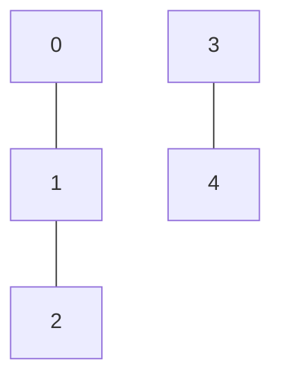

| vertex | visited already? | action | count |
|---|---|---|---|
| 0 | no | DFS marks 0, 1, 2 | 1 |
| 1, 2 | yes | skip | 1 |
| 3 | no | DFS marks 3, 4 | 2 |
| 4 | yes | skip | 2 |

#### Kotlin

```kotlin
fun countComponents(n: Int, edges: Array<IntArray>): Int {
    val graph = List(n) { mutableListOf<Int>() }
    for ((u, v) in edges) {
        graph[u].add(v)
        graph[v].add(u)
    }

    val visited = BooleanArray(n)
    var components = 0

    for (start in 0 until n) {                // iterate ALL vertices, not just ones in edges
        if (visited[start]) continue
        components++
        // Iterative DFS: no recursion-depth risk on long chains.
        val stack = ArrayDeque<Int>()
        stack.addLast(start)
        visited[start] = true
        while (stack.isNotEmpty()) {
            val u = stack.removeLast()
            for (v in graph[u]) {
                if (!visited[v]) {
                    visited[v] = true
                    stack.addLast(v)
                }
            }
        }
    }
    return components
}
```

#### Complexity

- **Time:** O(V + E) — building the list is O(V + E), and the traversals together touch each vertex and edge a constant number of times.
- **Space:** O(V + E) — adjacency list, visited array and stack.

#### Common mistakes

- Counting components by looping over edges — isolated vertices are missed.
- Adding only one direction of each edge.
- Recursive DFS on a 10⁵-vertex path graph → stack overflow; use the iterative version.

#### Follow-ups

- *Edges arrive one at a time and you need the count after each?* Union-find: start with `n` components and decrement on every successful union — see [Advanced Graphs](17-advanced-graphs.md).
- *Number of Provinces?* Same problem with an adjacency matrix input; DFS over rows, O(n²).
- *Minimum edges to connect everything (Number of Operations to Make Network Connected)?* Need at least `n − 1` edges; the answer is `components − 1`.

</details>

### 13. Graph Valid Tree

**🟡 Medium** · ⭐ Product/FAANG favourite

<details>
<summary>Answer</summary>

**In short:** An undirected graph on `n` vertices is a tree **iff it has exactly `n − 1` edges and is connected**. Check the edge count in O(1), then run one BFS/DFS from vertex 0 and confirm it reaches all `n` vertices. (With exactly n − 1 edges, "connected" and "acyclic" imply each other, so you only need to test one.) O(V + E) time and space.

#### Problem

Given `n` vertices labelled `0..n-1` and a list of undirected edges, decide whether they form a valid tree.

- `n = 5`, `edges = [[0,1],[0,2],[0,3],[1,4]]` → `true`
- `n = 5`, `edges = [[0,1],[1,2],[2,3],[1,3],[1,4]]` → `false` (cycle 1-2-3)

#### Clarifying questions & edge cases

- `n = 1, edges = []` → `true` (a single vertex is a tree).
- `n = 2, edges = []` → `false` (disconnected).
- Duplicate edges `[0,1],[1,0]` → that's a cycle of length 2, not a tree; the edge-count check catches it when n − 1 is exceeded, the traversal catches it otherwise (the graph won't be connected).

#### Brute force

Detect cycles with DFS (tracking the parent) and separately check connectivity. That's already O(V + E) — it's just more code and more places for bugs than the counting argument.

#### Key insight

Three properties of a graph on `n` vertices: (a) connected, (b) acyclic, (c) exactly `n − 1` edges. **Any two imply the third.**

Why: start with `n` isolated vertices — `n` components. Adding an edge either joins two components (count drops by 1) or lands inside one component (creates a cycle, count unchanged). To reach 1 component without any cycle you need exactly `n − 1` joining edges. So with exactly `n − 1` edges, the graph is connected if and only if no edge was "wasted" on a cycle.

So: check `edges.size == n − 1`, then check connectivity.

#### Walkthrough

Example 2: `n = 5`, 5 edges ≠ 4 → `false` immediately, no traversal needed.

A sneakier case: `n = 4`, `edges = [[0,1],[1,2],[2,0]]` — 3 edges = n − 1, so the count passes. BFS from 0 reaches {0, 1, 2} only; vertex 3 is missing → not connected → `false`. (The cycle 0-1-2 "used up" the edge that should have connected 3.)

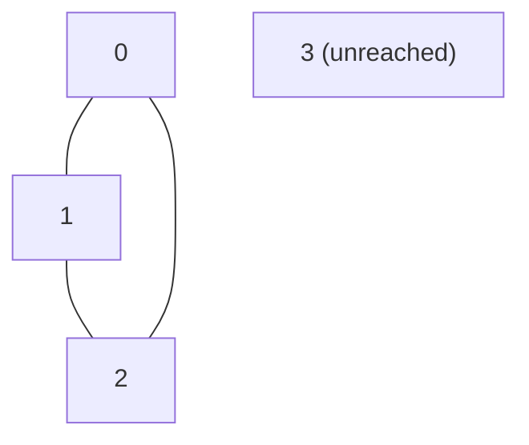

#### Kotlin

```kotlin
fun validTree(n: Int, edges: Array<IntArray>): Boolean {
    if (edges.size != n - 1) return false        // too many -> cycle, too few -> disconnected

    val graph = List(n) { mutableListOf<Int>() }
    for ((u, v) in edges) {
        graph[u].add(v)
        graph[v].add(u)
    }

    val visited = BooleanArray(n)
    val queue = ArrayDeque<Int>()
    queue.addLast(0)
    visited[0] = true
    var reached = 1
    while (queue.isNotEmpty()) {
        val u = queue.removeFirst()
        for (v in graph[u]) {
            if (!visited[v]) {
                visited[v] = true
                reached++
                queue.addLast(v)
            }
        }
    }
    return reached == n                           // connected + n-1 edges => tree
}
```

**Without the counting argument** (if the interviewer wants explicit cycle detection): DFS passing the parent; reaching an already-visited vertex that isn't the parent means a cycle — see [cycle detection](#15-how-do-you-detect-a-cycle-in-an-undirected-vs-a-directed-graph).

#### Complexity

- **Time:** O(V + E) — and since E = V − 1 after the check, O(V).
- **Space:** O(V) — adjacency list, visited array, queue.

#### Common mistakes

- Checking only acyclicity (a forest of two trees passes) or only connectivity (a connected graph with a cycle passes).
- Explicit cycle detection that forgets the parent — every undirected edge looks like a cycle `u → v → u`.
- Forgetting the `n = 1, edges = []` case (the code above handles it: 0 == 1 − 1, and BFS reaches 1 vertex).

#### Follow-ups

- *Union-find version?* Union each edge; if both ends are already in the same set, there's a cycle → `false`. At the end, require exactly one set — see [Advanced Graphs](17-advanced-graphs.md).
- *Which edge to remove to make it a tree (Redundant Connection)?* The first edge whose endpoints are already connected — union-find, in [Advanced Graphs](17-advanced-graphs.md).
- *Minimum Height Trees?* Peel leaves layer by layer (topological-sort style on degrees); the last 1–2 vertices are the centres.

</details>

### 14. Is Graph Bipartite?

**🟡 Medium** · ⭐ Product/FAANG favourite

<details>
<summary>Answer</summary>

**In short:** Try to **2-colour** the graph: BFS (or DFS) from each uncoloured vertex, give it colour 0, and give every neighbour the opposite colour. If you ever find an edge whose two ends already have the **same** colour, the graph is not bipartite. Run it from every vertex because the graph may be disconnected. O(V + E) time, O(V) space.

#### Problem

Given an undirected graph as an adjacency list (`graph[i]` = neighbours of `i`), return `true` if the vertices can be split into two sets so that every edge goes between the sets.

- `[[1,3],[0,2],[1,3],[0,2]]` → `true` (sets `{0,2}` and `{1,3}` — a 4-cycle)
- `[[1,2,3],[0,2],[0,1,3],[0,2]]` → `false` (0-1-2 is a triangle)

#### Clarifying questions & edge cases

- The graph may be **disconnected** — each component must be bipartite.
- Isolated vertices are fine (put them in either set).
- No self-loops in LeetCode 785; a self-loop would make it non-bipartite immediately.

#### Brute force

Try all 2^V assignments of vertices to two sets and check every edge — exponential. 2-colouring is one of the few colouring problems that's easy: with only two colours, the colour of a vertex **forces** the colour of all its neighbours, so there's never a choice to backtrack over.

#### Key insight

A graph is bipartite **iff it has no odd-length cycle**. Walking around a cycle, colours must alternate 0, 1, 0, 1, ...; an odd cycle would end on the same colour it started with, next to itself.

BFS colouring finds this directly: within one component, the first vertex's colour fixes everything else (colour = BFS depth parity). If an edge connects two vertices of the same colour, there's an odd cycle and no valid split exists. If no such edge appears, the colouring itself is the split.

#### Walkthrough

Second example (triangle 0-1-2 plus vertex 3):

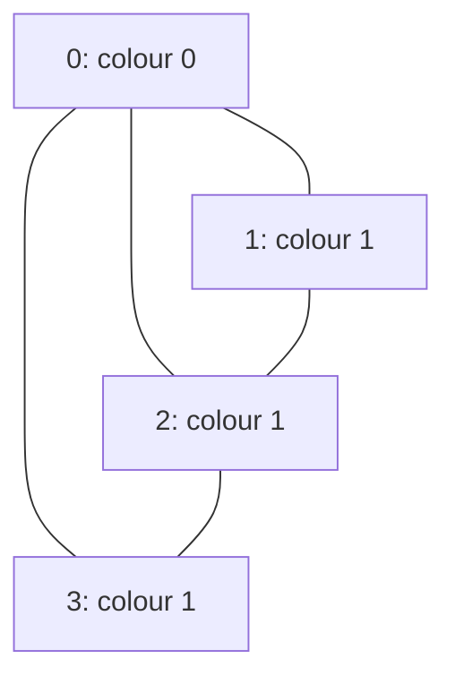

| dequeue | neighbour | its colour | action |
|---|---|---|---|
| 0 (c0) | 1, 2, 3 | none | colour all 1, enqueue |
| 1 (c1) | 0 | 0 | ok |
| 1 (c1) | 2 | 1 | **same colour → return false** |

#### Kotlin

```kotlin
fun isBipartite(graph: Array<IntArray>): Boolean {
    val n = graph.size
    val colour = IntArray(n) { -1 }            // -1 = uncoloured, else 0 or 1

    for (start in 0 until n) {                 // the graph may be disconnected
        if (colour[start] != -1) continue
        colour[start] = 0
        val queue = ArrayDeque<Int>()
        queue.addLast(start)
        while (queue.isNotEmpty()) {
            val u = queue.removeFirst()
            for (v in graph[u]) {
                when (colour[v]) {
                    -1 -> {
                        colour[v] = 1 - colour[u]   // opposite colour
                        queue.addLast(v)
                    }
                    colour[u] -> return false       // edge inside one set: odd cycle
                }
            }
        }
    }
    return true
}
```

#### Complexity

- **Time:** O(V + E) — each vertex is coloured and dequeued once, each adjacency entry checked once.
- **Space:** O(V) — colour array and queue.

#### Common mistakes

- Starting BFS only from vertex 0 — misses conflicts in other components.
- Using a plain `visited` boolean and forgetting to compare colours.
- Thinking "has a cycle → not bipartite": **even** cycles are fine; only odd cycles break it.

#### Follow-ups

- *Possible Bipartition (people who dislike each other)?* Build the graph from the dislike pairs and run exactly this check.
- *Union-find version?* For each vertex `u`, union all its neighbours together; if `u` ends up in the same set as any neighbour → not bipartite — see [Advanced Graphs](17-advanced-graphs.md).
- *3-colouring?* NP-complete in general — no polynomial algorithm is known; backtracking only.

</details>

### 15. How do you detect a cycle in an undirected vs a directed graph?

**📘 Concept** · ⭐ Product/FAANG favourite

<details>
<summary>Answer</summary>

**In short:** **Undirected:** DFS/BFS and remember each vertex's parent; reaching an already-visited vertex that is **not the parent** means a cycle (or use union-find: an edge whose ends are already connected closes a cycle). **Directed:** "already visited" is not enough — you need to know whether the visited vertex is **on the current DFS path**. Use three colours: white (unvisited), grey (on the stack), black (finished). An edge to a **grey** vertex is a back edge → cycle. Alternatively, Kahn's topological sort: if it can't output all vertices, there's a cycle. All are O(V + E).

#### Why the two cases differ

In an **undirected** graph every edge `u - v` is stored both ways, so from `v` you always "see" `u` again. That's not a cycle — it's the edge you came in on. Skip the parent and any other visited neighbour really is a second route, i.e. a cycle.

In a **directed** graph, reaching a visited vertex can be completely harmless:

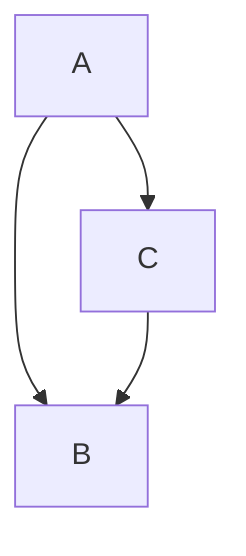

DFS from A visits B (finishes it), then C, then sees B again. B is visited, but there's no cycle — B was finished on a different branch (a *cross edge*). A cycle exists only if we get back to a vertex that is still **in progress** on the current path, like `X → Y → Z → X`. Hence the three colours.

| | Undirected | Directed |
|---|---|---|
| "Cycle" means | a second route between two vertices | a path that comes back to its start following edge directions |
| DFS test | visited neighbour that isn't the parent | neighbour that is grey (on the current stack) |
| BFS / other test | union-find, or BFS with parent | Kahn's: processed count < V |
| Trap | treating the parent edge as a cycle | treating any visited vertex as a cycle |

#### Undirected: DFS with parent

```kotlin
fun hasCycleUndirected(n: Int, edges: Array<IntArray>): Boolean {
    val graph = List(n) { mutableListOf<Int>() }
    for ((u, v) in edges) { graph[u].add(v); graph[v].add(u) }
    val visited = BooleanArray(n)

    fun dfs(u: Int, parent: Int): Boolean {
        visited[u] = true
        for (v in graph[u]) {
            if (v == parent) continue          // the edge we arrived on
            if (visited[v]) return true        // second route to v: cycle
            if (dfs(v, u)) return true
        }
        return false
    }

    for (s in 0 until n) if (!visited[s] && dfs(s, -1)) return true
    return false
}
```

Caveat: with **parallel edges** (two separate `0-1` edges), skipping by parent *vertex* hides a real 2-cycle. If multi-edges are possible, skip by edge index instead, or use union-find.

#### Directed: three colours

```kotlin
fun hasCycleDirected(n: Int, edges: Array<IntArray>): Boolean {
    val graph = List(n) { mutableListOf<Int>() }
    for ((u, v) in edges) graph[u].add(v)
    val state = IntArray(n)                    // 0 = white, 1 = grey (on stack), 2 = black (done)

    fun dfs(u: Int): Boolean {
        state[u] = 1
        for (v in graph[u]) {
            if (state[v] == 1) return true     // back edge to the current path: cycle
            if (state[v] == 0 && dfs(v)) return true
            // state 2: already fully explored, no cycle through it
        }
        state[u] = 2
        return false
    }

    for (s in 0 until n) if (state[s] == 0 && dfs(s)) return true
    return false
}
```

Black vertices are also a **memo**: once a vertex is finished, we know no cycle is reachable through it, so we never explore it again. That's what keeps this O(V + E) — without black, you'd re-explore shared subgraphs from every path.

#### Directed: Kahn's algorithm (BFS)

Repeatedly remove vertices with in-degree 0. Vertices on a cycle never reach in-degree 0 (each waits on another cycle member), so if fewer than V vertices get removed, there's a cycle. This is the version used in [Course Schedule](#16-course-schedule).

#### Walkthrough (directed, colours)

Edges `0 → 1, 1 → 2, 2 → 0`:

| step | call | states (0,1,2) | event |
|---|---|---|---|
| 1 | dfs(0) | G W W | |
| 2 | dfs(1) | G G W | |
| 3 | dfs(2) | G G G | edge 2 → 0, and 0 is grey → **cycle** |

#### Common mistakes

- Using the undirected "visited and not parent" test on a directed graph — reports false cycles on cross edges like A→B, A→C→B.
- Using a single `visited` boolean in directed DFS — same problem.
- Using a separate "on stack" set but forgetting to remove the vertex when it finishes.
- Forgetting to start DFS from every vertex (disconnected graphs).

#### Follow-ups

- *Return the cycle itself?* Keep a parent array; when you hit a grey vertex `v` from `u`, walk parents from `u` back to `v`.
- *Find Eventual Safe States?* Safe vertices are the ones that finish black with no cycle reachable from them; or run Kahn's on the reversed graph.
- *Undirected with union-find?* For each edge, if `find(u) == find(v)` it closes a cycle — see [Advanced Graphs](17-advanced-graphs.md).

</details>

## Topological sort

### 16. Course Schedule

**🟡 Medium** · ⭐ Product/FAANG favourite (commonly reported at Amazon, Google)

<details>
<summary>Answer</summary>

**In short:** Courses are vertices and each prerequisite `[a, b]` is an edge `b → a`. All courses can be finished **iff the graph has no directed cycle**. Use **Kahn's algorithm**: count in-degrees, start a queue with every course that has no prerequisites, repeatedly "take" a course and decrement its dependents' in-degrees, enqueuing any that drop to 0. If you take all `numCourses`, return `true`. O(V + E) time and space.

#### Problem

There are `numCourses` courses `0..n-1` and a list of pairs `[a, b]` meaning "to take `a` you must first take `b`". Can you finish all courses?

- `numCourses = 2`, `[[1,0]]` → `true` (take 0, then 1)
- `numCourses = 2`, `[[1,0],[0,1]]` → `false` (each needs the other)

#### Clarifying questions & edge cases

- Direction of the pair: `[a, b]` means `b` before `a` → edge `b → a`. Getting this backwards still gives the right yes/no answer here (reversing every edge doesn't change whether a cycle exists), but it breaks [Course Schedule II](#17-course-schedule-ii).
- No prerequisites → `true`.
- Duplicate pairs → harmless with Kahn's, as each copy adds one edge and one in-degree.
- Self-dependency `[0, 0]` → a cycle → `false`.

#### Brute force

For each course, DFS through its prerequisites and check whether you come back to it: O(V · (V + E)). Works, but repeats exploration; one global pass suffices.

#### Key insight

A course with in-degree 0 has no unmet prerequisites, so it can be taken **now**. Taking it removes its outgoing edges, which may free up other courses. If the graph is acyclic, this always makes progress until everything is taken (every DAG has at least one in-degree-0 vertex). If there's a cycle, the courses on it each wait for another course on it — none ever reaches in-degree 0 — so the process stalls before taking all of them.

So "can finish" ⟺ "Kahn's processes all `n` vertices". The colour-based DFS from [cycle detection](#15-how-do-you-detect-a-cycle-in-an-undirected-vs-a-directed-graph) works equally well.

#### Walkthrough

`numCourses = 4`, prerequisites `[[1,0],[2,0],[3,1],[3,2]]` (edges `0→1, 0→2, 1→3, 2→3`):

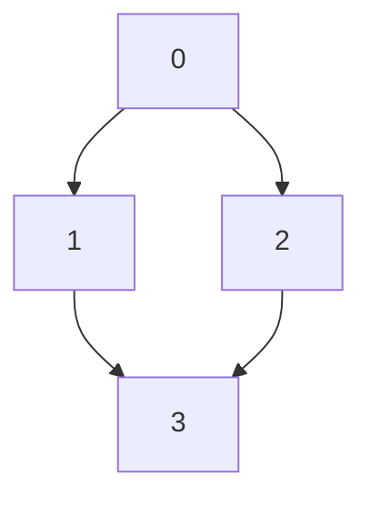

| step | take | in-degrees after (0,1,2,3) | queue after | taken |
|---|---|---|---|---|
| start | — | 0, 1, 1, 2 | [0] | 0 |
| 1 | 0 | 0, 0, 0, 2 | [1, 2] | 1 |
| 2 | 1 | 0, 0, 0, 1 | [2] | 2 |
| 3 | 2 | 0, 0, 0, 0 | [3] | 3 |
| 4 | 3 | — | [] | 4 = numCourses → `true` |

#### Kotlin

```kotlin
fun canFinish(numCourses: Int, prerequisites: Array<IntArray>): Boolean {
    val dependents = List(numCourses) { mutableListOf<Int>() }
    val inDegree = IntArray(numCourses)
    for ((course, pre) in prerequisites) {
        dependents[pre].add(course)          // edge pre -> course
        inDegree[course]++
    }

    val queue = ArrayDeque<Int>()
    for (c in 0 until numCourses) if (inDegree[c] == 0) queue.addLast(c)

    var taken = 0
    while (queue.isNotEmpty()) {
        val c = queue.removeFirst()
        taken++
        for (next in dependents[c]) {
            inDegree[next]--
            if (inDegree[next] == 0) queue.addLast(next)   // all its prerequisites are done
        }
    }
    return taken == numCourses               // fewer means some courses sit on a cycle
}
```

#### Swift

```swift
func canFinish(_ numCourses: Int, _ prerequisites: [[Int]]) -> Bool {
    var dependents = [[Int]](repeating: [], count: numCourses)
    var inDegree = [Int](repeating: 0, count: numCourses)
    for pair in prerequisites {
        let course = pair[0], pre = pair[1]
        dependents[pre].append(course)
        inDegree[course] += 1
    }

    // Array + head index as a queue: removeFirst() on Array is O(n).
    var queue = (0..<numCourses).filter { inDegree[$0] == 0 }
    var head = 0
    while head < queue.count {
        let c = queue[head]
        head += 1
        for next in dependents[c] {
            inDegree[next] -= 1
            if inDegree[next] == 0 { queue.append(next) }
        }
    }
    return head == numCourses                // head = number of courses taken
}
```

#### Complexity

- **Time:** O(V + E) — each course is enqueued once, each prerequisite edge decremented once.
- **Space:** O(V + E) — adjacency list, in-degree array, queue.

#### Common mistakes

- Using undirected-graph cycle detection, or a single visited flag in DFS (see [cycle detection](#15-how-do-you-detect-a-cycle-in-an-undirected-vs-a-directed-graph)).
- Enqueueing a course whenever its in-degree is decremented rather than when it **reaches 0**.
- Forgetting courses that appear in no pair — they have in-degree 0 and must be counted.
- Recursive DFS on 10⁵ courses in a chain — risk of stack overflow; Kahn's is iterative.

#### Follow-ups

- *Return an order?* Record the dequeue order — [Course Schedule II](#17-course-schedule-ii).
- *Minimum number of semesters (Parallel Courses)?* Kahn's level by level; the number of BFS layers is the answer.
- *Course Schedule IV (is `u` a prerequisite of `v`)?* Propagate reachability sets along the topological order, or a Floyd-Warshall-style transitive closure for small n.

</details>

### 17. Course Schedule II

**🟡 Medium** · ⭐ Product/FAANG favourite (commonly reported at Amazon, Google)

<details>
<summary>Answer</summary>

**In short:** Same graph as [Course Schedule](#16-course-schedule), but return a valid order: run Kahn's algorithm and **append each course as it's dequeued** — that sequence is a topological order. If fewer than `numCourses` courses come out, there's a cycle and you return an empty array. The DFS alternative is "add each vertex to a list when it **finishes**, then reverse". O(V + E) time and space.

#### Problem

Same input as Course Schedule; return any order in which all courses can be taken, or `[]` if impossible.

- `numCourses = 4`, `[[1,0],[2,0],[3,1],[3,2]]` → `[0,1,2,3]` or `[0,2,1,3]`
- `numCourses = 2`, `[[1,0],[0,1]]` → `[]`

#### Clarifying questions & edge cases

- Any valid order is accepted — don't chase a specific one unless asked (lexicographically smallest needs a min-heap instead of a queue).
- No prerequisites → any permutation, e.g. `[0, 1, ..., n-1]`.
- Cycle → empty array, not a partial order.

#### Brute force

Try permutations and check each against all prerequisites: O(n! · E). Hopeless beyond tiny n.

#### Key insight

A **topological order** lists every vertex before all vertices it points to. Kahn's produces one by construction: a course is only dequeued when its in-degree is 0, i.e. after every prerequisite has already been dequeued (and so already appears earlier in the output).

The DFS version works for a different reason: in a DAG, a vertex **finishes** only after everything reachable from it has finished. So in finish order, every vertex comes *after* its dependents; reversing that puts prerequisites first.

| | Kahn's (BFS) | DFS post-order |
|---|---|---|
| Builds order | as vertices reach in-degree 0 | as vertices finish, then reverse |
| Cycle detection | output size < V | an edge to a grey vertex |
| Recursion | none | yes (stack-depth risk) |
| Easy to adapt for | levels/semesters, lexicographic order (heap) | already-written DFS code |

#### Walkthrough

Kahn's on the 4-course example (edges `0→1, 0→2, 1→3, 2→3`):

| dequeue | order so far | newly in-degree 0 |
|---|---|---|
| 0 | [0] | 1, 2 |
| 1 | [0, 1] | — (3 still waits for 2) |
| 2 | [0, 1, 2] | 3 |
| 3 | [0, 1, 2, 3] | — |

4 courses output → return `[0, 1, 2, 3]`.

#### Kotlin

```kotlin
fun findOrder(numCourses: Int, prerequisites: Array<IntArray>): IntArray {
    val dependents = List(numCourses) { mutableListOf<Int>() }
    val inDegree = IntArray(numCourses)
    for ((course, pre) in prerequisites) {
        dependents[pre].add(course)
        inDegree[course]++
    }

    val queue = ArrayDeque<Int>()
    for (c in 0 until numCourses) if (inDegree[c] == 0) queue.addLast(c)

    val order = IntArray(numCourses)
    var size = 0
    while (queue.isNotEmpty()) {
        val c = queue.removeFirst()
        order[size++] = c                     // all of c's prerequisites are already in `order`
        for (next in dependents[c]) {
            if (--inDegree[next] == 0) queue.addLast(next)
        }
    }
    return if (size == numCourses) order else IntArray(0)   // cycle -> impossible
}
```

**DFS version** (three colours + post-order):

```kotlin
fun findOrderDfs(numCourses: Int, prerequisites: Array<IntArray>): IntArray {
    val dependents = List(numCourses) { mutableListOf<Int>() }
    for ((course, pre) in prerequisites) dependents[pre].add(course)
    val state = IntArray(numCourses)          // 0 white, 1 grey, 2 black
    val finished = ArrayList<Int>()

    fun dfs(u: Int): Boolean {                // returns false if a cycle is found
        state[u] = 1
        for (v in dependents[u]) {
            if (state[v] == 1) return false
            if (state[v] == 0 && !dfs(v)) return false
        }
        state[u] = 2
        finished.add(u)                       // u finishes after everything that depends on it
        return true
    }

    for (c in 0 until numCourses) if (state[c] == 0 && !dfs(c)) return IntArray(0)
    finished.reverse()
    return finished.toIntArray()
}
```

#### Complexity

- **Time:** O(V + E) for both versions.
- **Space:** O(V + E) — graph, in-degrees or colours, queue or recursion stack.

#### Common mistakes

- Reversing the edge direction: you get an order with dependents first. (In the DFS version, *not* reversing at the end makes the same mistake.)
- Returning the partial order when there's a cycle instead of `[]`.
- In the DFS version, adding the vertex to the list when it's **entered** (pre-order) — that's not a topological order.

#### Follow-ups

- *Lexicographically smallest order?* Replace the queue with a min-heap: O((V + E) log V) — see [Heaps & Priority Queues](13-heaps-priority-queues.md).
- *Is the order unique?* Only if the queue never holds more than one vertex at a time.
- *Build systems / dependency resolution (Gradle tasks, module init order)?* The same algorithm — a good mobile-flavoured talking point.

</details>

### 18. Alien Dictionary

**🔴 Hard** · ⭐ Product/FAANG favourite (commonly reported at Meta, Google, Airbnb)

<details>
<summary>Answer</summary>

**In short:** The sorted word list tells you letter-order facts: for each pair of **adjacent** words, the first position where they differ gives one edge `a → b` ("a comes before b"). Add every letter that appears as a vertex, then topologically sort with Kahn's algorithm. Return `""` if there's a cycle **or** if a word is followed by its own strict prefix (`"abc"` before `"ab"` is impossible). O(C) time where C is the total number of characters, since the letter graph has at most 26 vertices.

#### Problem

You're given words from an alien language, sorted lexicographically by that language's (unknown) alphabet. Return any letter order consistent with the list, or `""` if none exists.

- `["wrt","wrf","er","ett","rftt"]` → `"wertf"`
- `["z","x","z"]` → `""` (z < x and x < z — a cycle)
- `["abc","ab"]` → `""` (a longer word can't come before its prefix)

#### Clarifying questions & edge cases

- Letters are lowercase English (26 at most)?
- Letters that appear but have no ordering constraint must still be in the output, anywhere.
- Single word → its distinct letters in any order.
- Prefix case: `["abc","ab"]` is invalid; `["ab","abc"]` is fine and gives no edge.

#### Brute force

Try all permutations of the letters and check each against the list: O(k! · C) for k distinct letters. With up to 26 letters that's absurd.

#### Key insight

Lexicographic order compares words at the **first differing position**; everything after it is irrelevant. So two adjacent words `w1 < w2` that first differ at index `i` give exactly one fact: `w1[i]` comes before `w2[i]`. Only adjacent pairs are needed — facts from non-adjacent pairs follow by transitivity.

Those facts are edges of a directed graph on letters, and "an alphabet consistent with all facts" is exactly a **topological order**. A cycle means the facts contradict each other.

The prefix rule is the subtle part: if `w2` is a strict prefix of `w1` and `w1` comes first, there is no differing position, yet the order is invalid under *any* alphabet — return `""`.

#### Walkthrough

`["wrt","wrf","er","ett","rftt"]`:

| adjacent pair | first difference | edge |
|---|---|---|
| wrt / wrf | t vs f | t → f |
| wrf / er | w vs e | w → e |
| er / ett | r vs t | r → t |
| ett / rftt | e vs r | e → r |

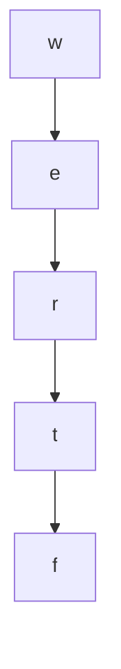

In-degrees: w 0, e 1, r 1, t 1, f 1. Kahn's: queue [w] → take w (e drops to 0) → e → r → t → f. Output `"wertf"`.

#### Kotlin

```kotlin
fun alienOrder(words: Array<String>): String {
    val present = BooleanArray(26)
    for (w in words) for (ch in w) present[ch - 'a'] = true

    val edges = Array(26) { HashSet<Int>() }       // set: don't count a repeated fact twice
    val inDegree = IntArray(26)

    for (i in 0 until words.size - 1) {
        val a = words[i]
        val b = words[i + 1]
        val len = minOf(a.length, b.length)
        var j = 0
        while (j < len && a[j] == b[j]) j++
        if (j == len) {
            if (a.length > b.length) return ""     // "abc" before "ab": impossible
            continue                               // a is a prefix of b: no information
        }
        val from = a[j] - 'a'
        val to = b[j] - 'a'
        if (edges[from].add(to)) inDegree[to]++    // only the first difference matters
    }

    // Kahn's algorithm over the letters that actually appear.
    val queue = ArrayDeque<Int>()
    for (c in 0 until 26) if (present[c] && inDegree[c] == 0) queue.addLast(c)

    val result = StringBuilder()
    while (queue.isNotEmpty()) {
        val c = queue.removeFirst()
        result.append('a' + c)
        for (next in edges[c]) {
            if (--inDegree[next] == 0) queue.addLast(next)
        }
    }

    val letterCount = present.count { it }
    return if (result.length == letterCount) result.toString() else ""   // shorter -> cycle
}
```

#### Complexity

- **Time:** O(C) — building `present` and comparing adjacent pairs reads each character at most twice; the letter graph has at most 26 vertices and 26·25 edges, a constant.
- **Space:** O(1) beyond the input — fixed-size arrays for 26 letters (O(U + E) for a general alphabet of U letters).

#### Common mistakes

- Comparing beyond the first differing character and adding extra (wrong) edges.
- Missing the prefix case and returning an order for `["abc","ab"]`.
- Only adding letters that appear in edges — a letter with no constraints disappears from the output.
- Incrementing in-degree for a duplicate edge without adding it to the set (or vice versa) — the counts no longer match, and valid inputs look cyclic.
- Comparing every pair of words instead of adjacent ones (O(n²·L), and no extra information).

#### Follow-ups

- *Verifying an Alien Dictionary (Easy)?* Given the order, map each letter to its rank and check adjacent pairs — no graph needed.
- *Is the order unique?* Only if Kahn's queue never holds more than one letter at a time.
- *DFS instead of Kahn's?* Three-colour DFS with post-order, then reverse — see [Course Schedule II](#17-course-schedule-ii).

</details>

---

[⬅ Previous: Tries & String Algorithms](15-tries-string-algorithms.md) · [⬅ Back to index](../README.md) · [Next: Advanced Graphs: Shortest Paths, Union-Find & MST ➡](17-advanced-graphs.md)
