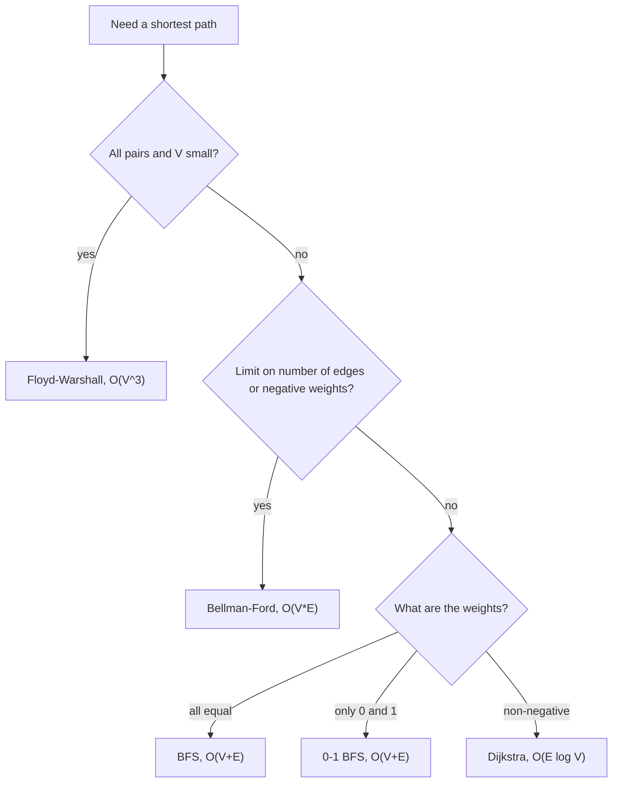
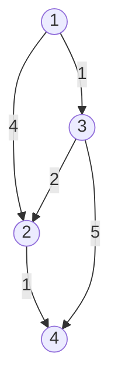
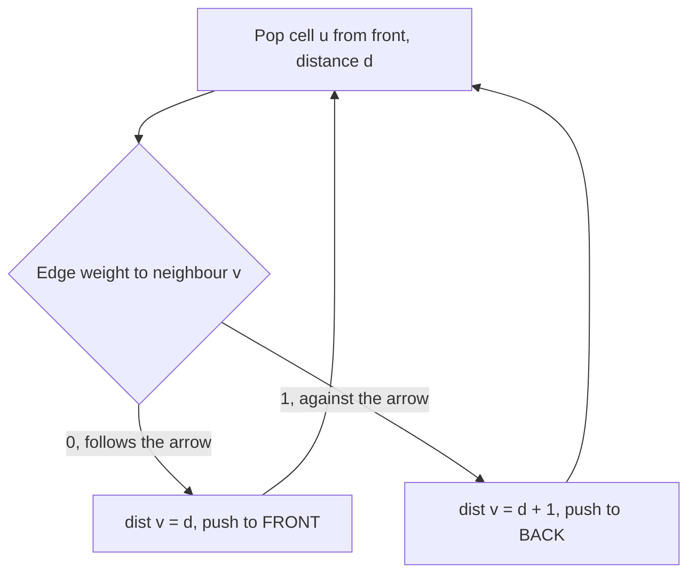
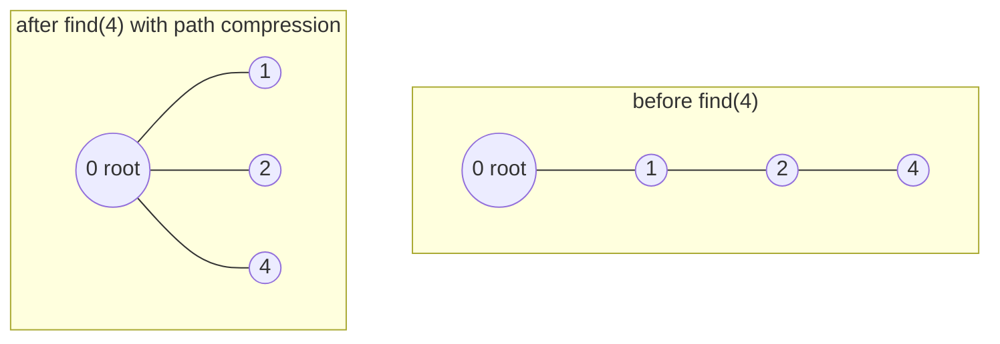
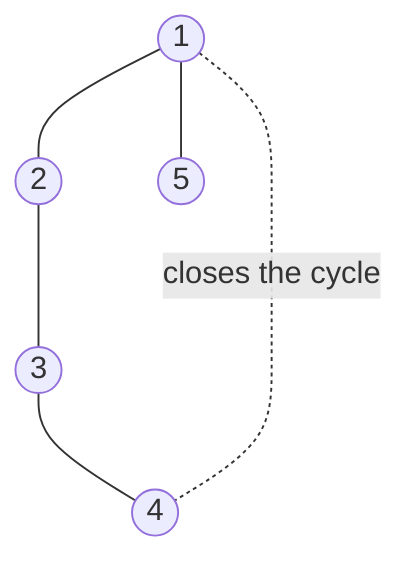
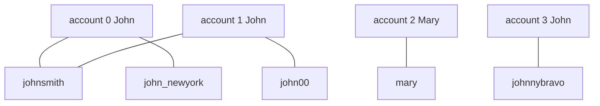
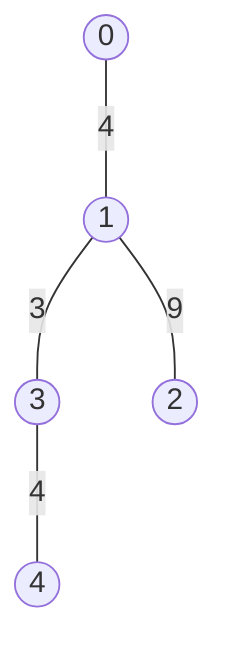
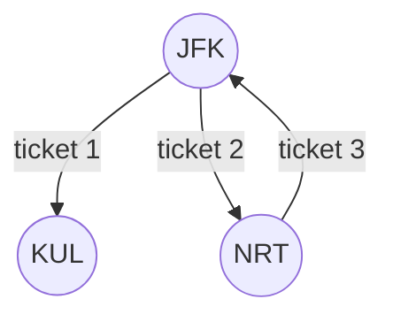
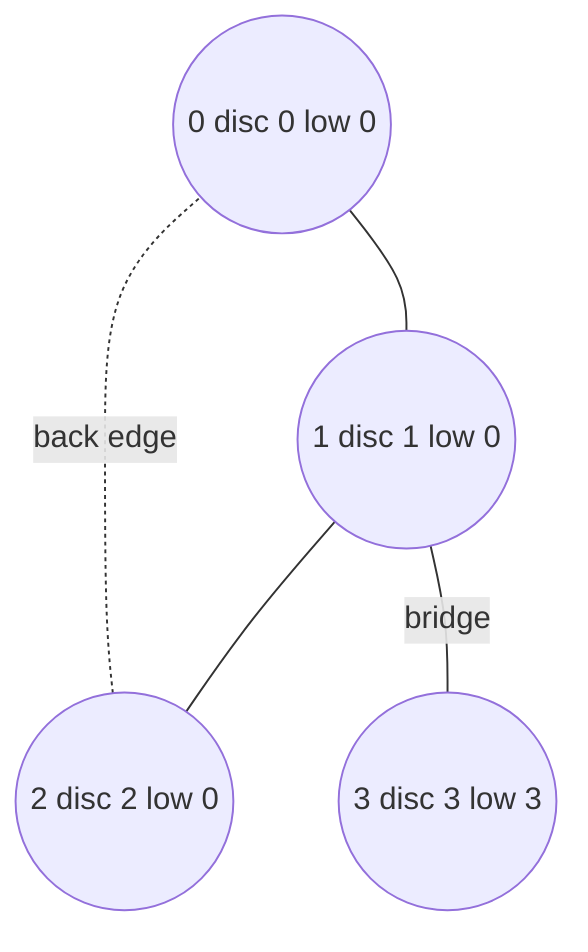

# Advanced Graphs: Shortest Paths, Union-Find & MST

[⬅ Back to index](../README.md)

Covers: weighted shortest paths (Dijkstra, Bellman-Ford, 0-1 BFS), union-find, and minimum spanning trees — with how to choose between them and the classic problems that test each.

---

## Shortest paths

### 1. How do you choose a shortest-path algorithm?

**📘 Concept** · ⭐ Product/FAANG favourite

<details>
<summary>Answer</summary>

**In short:** Pick by the **edge weights** and by **how many sources** you need. All weights equal → plain BFS, O(V + E). Weights only 0 or 1 → 0-1 BFS with a deque, O(V + E). Non-negative weights → Dijkstra with a min-heap, O((V + E) log V). Negative weights, or a cap on the number of edges → Bellman-Ford, O(V · E). Distances between **all** pairs on a small graph (V up to a few hundred) → Floyd-Warshall, O(V³). The question to ask yourself first is always "what does one step cost, and can it ever be negative?"

#### The decision table

| Algorithm | Weights it handles | Sources | Time | Space | Typical signal in the problem |
|---|---|---|---|---|---|
| BFS | all edges cost the same (unweighted) | one (or many at once, multi-source) | O(V + E) | O(V) | "minimum number of moves/steps", grid mazes |
| 0-1 BFS | only 0 or 1 | one | O(V + E) | O(V) | "free move vs. paid move", "minimum number of changes/removals" |
| Dijkstra | non-negative | one | O((V + E) log V) with a binary heap | O(V + E) | "minimum time/cost", weighted roads, "max of edges along the path" (bottleneck variants) |
| Bellman-Ford | any, including negative; detects negative cycles | one | O(V · E) | O(V) | negative weights, "at most K edges/stops" |
| Floyd-Warshall | any (no negative cycles) | all pairs | O(V³) | O(V²) | n ≤ ~400, many distance queries between arbitrary pairs |
| Topological order + relax | any, but graph must be a DAG | one | O(V + E) | O(V) | "longest/shortest path in a DAG", course schedules with durations |



#### Why each one works (the one-sentence version)

- **BFS** explores in rings of equal distance. When every edge costs 1, the first time you reach a node is via the fewest edges, so it is the shortest path. See [Graphs: BFS, DFS & Topological Sort](16-graphs-bfs-dfs-topo.md).
- **Dijkstra** is BFS where the "ring" is replaced by a priority queue keyed on distance. It always finalises the closest unfinished node. That is safe only because a later path can never get *cheaper* by adding more edges, and that holds only when no edge is negative.
- **0-1 BFS** is Dijkstra on a graph where distances in the queue only ever take two values, `d` and `d + 1`. A deque keeps them sorted for free: 0-edges go to the front, 1-edges go to the back. No heap and no log factor.
- **Bellman-Ford** relaxes *every* edge, V − 1 times. After round `i`, every shortest path that uses at most `i` edges is correct. A simple path has at most V − 1 edges, so V − 1 rounds are enough. If a V-th round still improves something, there is a negative cycle. Because it is organised by "number of edges used", it is also the natural fit for "at most K stops".
- **Floyd-Warshall** is a DP: `dist[i][j]` using only intermediate nodes `0..k`. Three nested loops with `k` outermost:

```kotlin
for (k in 0 until n) for (i in 0 until n) for (j in 0 until n)
    if (dist[i][k] != INF && dist[k][j] != INF && dist[i][k] + dist[k][j] < dist[i][j])
        dist[i][j] = dist[i][k] + dist[k][j]
```

#### Why Dijkstra breaks with negative edges

Graph: `A→B` cost 2, `A→C` cost 3, `C→B` cost −2. Dijkstra pops A, then B (distance 2) and declares it final. Later it finds `A→C→B` = 1, but B is already done, so nodes reached through B now have wrong distances. With non-negative weights, any path that goes through a farther node C cannot come back cheaper, so popping B first was safe.

#### Reading the constraints

| Constraint | Likely intended algorithm |
|---|---|
| V, E up to 10⁵, non-negative weights | Dijkstra |
| V ≤ 100, E ≤ 10⁴, "at most K stops" | Bellman-Ford (K + 1 rounds) or BFS on (node, stops) |
| grid up to 10⁶ cells, moves cost 0 or 1 | 0-1 BFS |
| n ≤ 100-400 and many queries | Floyd-Warshall |
| "minimise the maximum edge on the path" | Dijkstra with `max` instead of `+`, or sort edges + union-find, or binary search + BFS |

#### Common mistakes

- Using Dijkstra with negative edges "because it passed the samples".
- Using BFS on a weighted graph — it minimises the number of edges, not the cost.
- Marking a node visited when it is **pushed** in Dijkstra instead of when it is **popped** (or skipping stale entries). Either keep a `dist` check on pop or a `visited` set filled on pop.
- Adding to `Int.MAX_VALUE` as "infinity" and overflowing to a negative number. Check for infinity before adding, or use a large value such as `1e9.toInt()`, or use `Long`.

#### Follow-ups

- *How do you get the actual path, not just the cost?* Keep `parent[v] = u` whenever you relax `u → v`, then walk back from the target.
- *Can Dijkstra stop early?* Yes. For a single target, return as soon as the target is **popped**, not when it is first pushed.
- *Fibonacci heap?* Gives O(E + V log V) in theory. In interviews a binary heap with "lazy deletion" (skip stale entries) is the expected answer. See [Heaps & Priority Queues](13-heaps-priority-queues.md).

</details>

### 2. Network Delay Time

**🟡 Medium** · ⭐ Product/FAANG favourite

<details>
<summary>Answer</summary>

**In short:** This is textbook single-source Dijkstra. Build an adjacency list, run Dijkstra from `k` with a min-heap of `(distance, node)`, skip stale heap entries, and the answer is the **largest** final distance, or −1 if some node is never reached. O((V + E) log V) time, O(V + E) space.

#### Problem

There are `n` nodes labelled `1..n` and directed, weighted edges `times[i] = [u, v, w]` (a signal takes `w` time to go from `u` to `v`). A signal is sent from node `k`. Return how long it takes for **all** nodes to receive it, or −1 if some node never does.

- `times = [[2,1,1],[2,3,1],[3,4,1]], n = 4, k = 2` → `2`
- `times = [[1,2,1]], n = 2, k = 2` → `-1` (node 1 is unreachable from 2)

#### Clarifying questions & edge cases

- Directed edges? (Yes.) Are weights non-negative? (Yes, `0 ≤ w ≤ 100`, so Dijkstra is safe.)
- Nodes are 1-indexed, so size arrays `n + 1`.
- Parallel edges between the same pair are possible. The adjacency list handles them naturally.
- `n = 1` → `0`.

#### Brute force

Bellman-Ford: relax all E edges V − 1 times, O(V · E). It is correct and fine for LeetCode's limits (n ≤ 100, E ≤ 6000), but the interviewer is asking for Dijkstra. Another naive version is DFS that tries every path and keeps the best time per node, which is exponential in the worst case.

#### Key insight

"Time for all nodes to receive the signal" = the time the **last** node receives it = `max over v of shortest(k, v)`. Each node gets the signal along its own shortest path, all at the same time. So we need every single-source shortest distance, and with non-negative weights that is Dijkstra:

1. `dist[k] = 0`, everything else ∞. Push `(0, k)`.
2. Pop the smallest `(d, u)`. If `d > dist[u]`, it is a stale entry (we already found a better path), so skip it.
3. For every edge `u → v` with weight `w`: if `d + w < dist[v]`, update it and push `(d + w, v)`.
4. When the heap is empty, `dist` holds the shortest distances.

The heap guarantees we finalise nodes in increasing order of distance. With non-negative weights, nothing popped later can improve a node already popped.

#### Walkthrough

Edges: `1→2 (4)`, `1→3 (1)`, `3→2 (2)`, `2→4 (1)`, `3→4 (5)`; `k = 1`, `n = 4`.



| pop | stale? | relaxations | dist[1..4] | heap after |
|---|---|---|---|---|
| (0, 1) | no | 2 → 4, 3 → 1 | 0, 4, 1, ∞ | (1,3), (4,2) |
| (1, 3) | no | 2 → 3 (better than 4), 4 → 6 | 0, 3, 1, 6 | (3,2), (4,2), (6,4) |
| (3, 2) | no | 4 → 4 (better than 6) | 0, 3, 1, 4 | (4,2), (4,4), (6,4) |
| (4, 2) | yes, 4 > 3 | — | same | (4,4), (6,4) |
| (4, 4) | no | none | same | (6,4) |
| (6, 4) | yes | — | 0, 3, 1, 4 | empty |

Answer = max(0, 3, 1, 4) = **4**.

#### Kotlin

```kotlin
import java.util.PriorityQueue

fun networkDelayTime(times: Array<IntArray>, n: Int, k: Int): Int {
    val graph = Array(n + 1) { mutableListOf<IntArray>() }      // graph[u] = list of [v, w]
    for ((u, v, w) in times) graph[u].add(intArrayOf(v, w))

    val dist = IntArray(n + 1) { Int.MAX_VALUE }
    dist[k] = 0
    val heap = PriorityQueue<IntArray>(compareBy { it[0] })      // [distance, node]
    heap.add(intArrayOf(0, k))

    while (heap.isNotEmpty()) {
        val (d, u) = heap.poll()
        if (d > dist[u]) continue                                // stale entry, skip
        for ((v, w) in graph[u]) {
            val candidate = d + w
            if (candidate < dist[v]) {
                dist[v] = candidate
                heap.add(intArrayOf(candidate, v))
            }
        }
    }

    var answer = 0
    for (node in 1..n) {
        if (dist[node] == Int.MAX_VALUE) return -1               // unreachable node
        answer = maxOf(answer, dist[node])
    }
    return answer
}
```

#### Swift

Swift has no built-in priority queue, so write a small binary heap. It is about 30 lines and worth memorising (see [Heaps & Priority Queues](13-heaps-priority-queues.md)).

```swift
struct Heap<T> {
    private var items: [T] = []
    private let less: (T, T) -> Bool          // true if the first should come out first
    init(_ less: @escaping (T, T) -> Bool) { self.less = less }

    var isEmpty: Bool { items.isEmpty }

    mutating func push(_ x: T) {
        items.append(x)
        var i = items.count - 1
        while i > 0 {                          // sift up
            let p = (i - 1) / 2
            if !less(items[i], items[p]) { break }
            items.swapAt(i, p)
            i = p
        }
    }

    mutating func pop() -> T? {
        guard !items.isEmpty else { return nil }
        items.swapAt(0, items.count - 1)
        let top = items.removeLast()
        var i = 0
        while true {                           // sift down
            let l = 2 * i + 1, r = l + 1
            var m = i
            if l < items.count && less(items[l], items[m]) { m = l }
            if r < items.count && less(items[r], items[m]) { m = r }
            if m == i { break }
            items.swapAt(i, m)
            i = m
        }
        return top
    }
}

func networkDelayTime(_ times: [[Int]], _ n: Int, _ k: Int) -> Int {
    var graph = [[(Int, Int)]](repeating: [], count: n + 1)    // graph[u] = [(v, w)]
    for t in times { graph[t[0]].append((t[1], t[2])) }

    var dist = [Int](repeating: Int.max, count: n + 1)
    dist[k] = 0
    var heap = Heap<(Int, Int)> { $0.0 < $1.0 }                // (distance, node)
    heap.push((0, k))

    while let top = heap.pop() {
        let (d, u) = top
        if d > dist[u] { continue }                            // stale entry
        for (v, w) in graph[u] where d + w < dist[v] {
            dist[v] = d + w
            heap.push((d + w, v))
        }
    }

    let reached = dist[1...]
    if reached.contains(Int.max) { return -1 }
    return reached.max()!
}
```

#### Complexity

- **Time:** O((V + E) log V). Each successful relaxation pushes one entry, so there are at most E pushes and pops, each O(log E) = O(log V).
- **Space:** O(V + E) for the adjacency list, the distance array and the heap.

#### Common mistakes

- Returning `dist[n]` or the sum of distances. The question asks for the **maximum** distance.
- Forgetting the stale-entry check. The answer stays correct, but the algorithm does extra work. With a `visited` set it is fine too, as long as you mark nodes on **pop**.
- 0-indexed arrays with 1-indexed nodes, which causes an off-by-one or an out-of-bounds error.
- `d + w` overflowing when `d` is `Int.MAX_VALUE`. This can't happen here because only finite distances are pushed, but watch for it in other variants.

#### Follow-ups

- *Negative weights?* Switch to Bellman-Ford, see [question 4](#4-cheapest-flights-within-k-stops).
- *Graph is a dense matrix (E ≈ V²)?* The O(V²) array version of Dijkstra without a heap is better. It is the same idea as Prim's in [question 10](#10-min-cost-to-connect-all-points).
- *All nodes as possible sources?* Run Dijkstra V times, or use Floyd-Warshall for small V.

</details>

### 3. Path With Minimum Effort

**🟡 Medium**

<details>
<summary>Answer</summary>

**In short:** Treat each cell as a node. The cost of a path is the **maximum** height difference along it, not the sum. Dijkstra still works when you combine with `max` instead of `+`, because extending a path can never make its cost smaller. Pop the cell with the smallest effort so far, relax neighbours with `max(effort, |h1 − h2|)`, and return as soon as you pop the bottom-right cell. O(R·C·log(R·C)).

#### Problem

`heights` is an R×C grid. You start at the top-left and want to reach the bottom-right, moving up, down, left or right. The **effort** of a route is the largest absolute height difference between two consecutive cells on it. Return the minimum effort.

- `[[1,2,2],[3,8,2],[5,3,5]]` → `2` (route 1 → 3 → 5 → 3 → 5, all steps differ by 2)
- `[[1,2,3],[3,8,4],[5,3,5]]` → `1`
- `[[5]]` → `0`

#### Clarifying questions & edge cases

- Single cell → 0.
- Heights up to 10⁶, so no overflow concerns with `Int`.
- Revisiting cells is allowed, but a shortest-path search never needs to.

#### Brute force

DFS over all simple paths, tracking the max difference. Exponential, so it's hopeless beyond tiny grids.

#### Key insight

Dijkstra needs one property: **the cost of a path never decreases when you extend it**. With `+` and non-negative weights that is true. With `max` it is also true, since `max(e, x) ≥ e`. So the greedy step "the cell with the smallest effort in the heap is final" is still valid. The only change is the relaxation formula:

`newEffort = max(effort[u], |height[v] − height[u]|)`

Two other approaches are worth naming:

- **Binary search on the answer + BFS**: "can I get there using only steps with difference ≤ X?" is monotonic in X. That gives O(R·C·log(maxHeight)). See [Binary Search](10-binary-search.md).
- **Union-find**: sort all adjacent-cell edges by difference, union them in order, and stop when the start and end connect. The last edge added is the answer. This is Kruskal's idea (see [question 10](#10-min-cost-to-connect-all-points)).

#### Walkthrough

`[[1,2,2],[3,8,2],[5,3,5]]`. Cells are written `(row,col)`.

| pop (effort, cell) | relaxations (new effort) |
|---|---|
| (0, (0,0)) | (0,1) → 1, (1,0) → 2 |
| (1, (0,1)) | (0,2) → 1, (1,1) → 6 |
| (1, (0,2)) | (1,2) → 1 |
| (1, (1,2)) | (2,2) → 3; (1,1) stays 6 |
| (2, (1,0)) | (2,0) → 2, (1,1) → 5 |
| (2, (2,0)) | (2,1) → 2 |
| (2, (2,1)) | (2,2) → 2 (better than 3) |
| (2, (2,2)) | target popped → **return 2** |

Note that the target was first reached with effort 3 through the top-right route. It was not final until it came out of the heap with 2.

#### Kotlin

```kotlin
import java.util.PriorityQueue
import kotlin.math.abs

fun minimumEffortPath(heights: Array<IntArray>): Int {
    val rows = heights.size
    val cols = heights[0].size
    val effort = Array(rows) { IntArray(cols) { Int.MAX_VALUE } }
    effort[0][0] = 0
    val heap = PriorityQueue<IntArray>(compareBy { it[0] })     // [effort, row, col]
    heap.add(intArrayOf(0, 0, 0))
    val dirs = arrayOf(intArrayOf(1, 0), intArrayOf(-1, 0), intArrayOf(0, 1), intArrayOf(0, -1))

    while (heap.isNotEmpty()) {
        val (e, r, c) = heap.poll()
        if (r == rows - 1 && c == cols - 1) return e            // final when popped
        if (e > effort[r][c]) continue                          // stale
        for ((dr, dc) in dirs) {
            val nr = r + dr
            val nc = c + dc
            if (nr !in 0 until rows || nc !in 0 until cols) continue
            val next = maxOf(e, abs(heights[nr][nc] - heights[r][c]))  // max, not sum
            if (next < effort[nr][nc]) {
                effort[nr][nc] = next
                heap.add(intArrayOf(next, nr, nc))
            }
        }
    }
    return 0                                                    // unreachable for valid input
}
```

#### Complexity

- **Time:** O(R·C·log(R·C)). There are R·C nodes and about 4·R·C edges, and each heap operation is a log.
- **Space:** O(R·C) for the effort grid and the heap.

#### Common mistakes

- Summing differences instead of taking the max.
- Returning when the target is first **pushed**. A better route may still be in the heap, as the walkthrough shows.
- Using plain BFS with a visited set. The first arrival is not the best one.

#### Follow-ups

- **Swim in Rising Water** (Hard): the same idea where the cost of a path is the max **cell value** on it. Use Dijkstra with `max(t, grid[nr][nc])`, or binary search + BFS, or union-find by cell value.
- *Which approach is simplest to code under pressure?* Binary search + BFS has no heap, which is nice in Swift.
- *Diagonal moves?* Just add four more directions. The algorithm doesn't change.

</details>

### 4. Cheapest Flights Within K Stops

**🟡 Medium** · ⭐ Product/FAANG favourite

<details>
<summary>Answer</summary>

**In short:** "At most K stops" means "at most K + 1 edges", and Bellman-Ford is organised by number of edges. Run **K + 1 rounds** of relaxing every flight, and in each round read only from the **previous round's** costs (a copy), so one round can't chain two flights. The answer is `cost[dst]`, or −1. O(K · E) time, O(V) space. Plain Dijkstra on cost alone is wrong here, because the cheapest way into a city might use too many stops.

#### Problem

There are `n` cities and `flights[i] = [from, to, price]` (directed). Return the cheapest price from `src` to `dst` using **at most `k` stops** (intermediate cities), or −1 if there is no such route.

- `n = 4, flights = [[0,1,100],[1,2,100],[2,0,100],[1,3,600],[2,3,200]], src = 0, dst = 3, k = 1` → `700` (0 → 1 → 3). The route 0 → 1 → 2 → 3 costs only 400, but it needs 2 stops.
- `n = 3, flights = [[0,1,100],[1,2,100],[0,2,500]], src = 0, dst = 2, k = 0` → `500`.

#### Clarifying questions & edge cases

- Stops are intermediate cities: k stops = k + 1 flights.
- `src == dst` → 0 (not possible on LeetCode, but worth asking).
- Prices are positive. There are no duplicate flights between the same pair.
- Cycles exist (0 → 1 → 2 → 0), but they never help with positive prices.

#### Brute force

DFS/BFS over every route with depth ≤ k + 1, keeping the minimum. That is up to O(n^(k+1)) routes, which is exponential.

#### Key insight

Define `cost_i[v]` = cheapest price to reach `v` using **at most `i` flights**. Then

`cost_{i+1}[v] = min(cost_i[v], min over flights (u → v, p) of cost_i[u] + p)`

That is exactly one Bellman-Ford round, as long as the right-hand side reads `cost_i` and not values updated earlier in the same round. If you update in place, a round processing `0→1` and then `1→2` would use two flights in "one" round and break the stop limit. So copy the array at the start of each round.

Why not plain Dijkstra? It keeps only the cheapest cost per city. A city might be reached cheaply with many stops and expensively with few, and the few-stops path may be the only one that can still reach `dst` in time. Dijkstra throws that path away. Dijkstra can work if the state is `(city, stopsUsed)`, but Bellman-Ford is simpler.

#### Walkthrough

First example, `k = 1`, so 2 rounds. `∞` = unreached.

| round | read from (previous) | relaxations that improve | cost after round |
|---|---|---|---|
| start | — | — | [0, ∞, ∞, ∞] |
| 1 | [0, ∞, ∞, ∞] | 0→1: 100 | [0, 100, ∞, ∞] |
| 2 | [0, 100, ∞, ∞] | 1→2: 200, 1→3: 700 | [0, 100, 200, 700] |

Answer: **700**. If round 1 had updated in place in the input order, it would have done 0→1 = 100, then 1→2 = 200, then 2→3 = 400, which uses 3 flights in round 1 and gives the wrong answer 400.

#### Kotlin

```kotlin
fun findCheapestPrice(n: Int, flights: Array<IntArray>, src: Int, dst: Int, k: Int): Int {
    val inf = Int.MAX_VALUE
    var cost = IntArray(n) { inf }
    cost[src] = 0

    repeat(k + 1) {                                  // k stops = at most k + 1 flights
        val next = cost.copyOf()                     // write here, read from last round
        for ((from, to, price) in flights) {
            if (cost[from] == inf) continue          // not reachable yet, and avoids overflow
            if (cost[from] + price < next[to]) next[to] = cost[from] + price
        }
        cost = next
    }
    return if (cost[dst] == inf) -1 else cost[dst]
}
```

#### Alternative: BFS by levels

Process the graph level by level (level = number of flights so far), with the queue holding `(city, costSoFar)`. Only push a neighbour if the new cost beats the best known cost for that city. Stop after k + 1 levels. It is the same idea as Bellman-Ford, layered by edges. It works because the level count is the stop count.

#### Complexity

- **Time:** O((k + 1) · E). Each round scans every flight once.
- **Space:** O(n) for two cost arrays.

#### Common mistakes

- Updating `cost` in place, which lets one round use several flights.
- Running k rounds instead of k + 1.
- Using Dijkstra with a single `dist` per city and pruning a path that had fewer stops.
- Adding `price` to `Int.MAX_VALUE`.

#### Follow-ups

- *Dijkstra version?* Heap of `(cost, city, stops)`. Keep `bestStops[city]` and skip a state only if it is both more expensive **and** uses more stops than one already popped.
- *Negative cycle detection?* Run a V-th Bellman-Ford round. If anything still improves, a negative cycle is reachable.
- *Return the route?* Keep a parent per round, or a parent per `(city, stops)` state.

</details>

### 5. Minimum Cost to Make at Least One Valid Path in a Grid

**🔴 Hard**

<details>
<summary>Answer</summary>

**In short:** This is the classic **0-1 BFS** problem. Each cell points in one direction. Moving the way the arrow points costs 0, and moving any other way costs 1 (you change that sign). With only 0 and 1 weights, use a deque instead of a heap: push 0-cost moves to the **front** and 1-cost moves to the **back**. The deque then always pops cells in order of distance, just like Dijkstra, but in O(R·C) time.

#### Problem

Every cell of an R×C grid holds a sign: 1 = right, 2 = left, 3 = down, 4 = up. Starting at the top-left, you follow the signs. You may change the sign of any cell for a cost of 1 (each cell at most once). Return the minimum cost so that following the signs leads from the top-left to the bottom-right.

- `[[1,2],[4,3]]` → `1`
- `[[1,1,3],[3,2,2],[1,1,4]]` → `0` (the arrows already lead there)
- `[[1,1,1,1],[2,2,2,2],[1,1,1,1],[2,2,2,2]]` → `3`

#### Clarifying questions & edge cases

- A sign pointing outside the grid is allowed. That move just isn't usable, so you pay 1 to go elsewhere.
- A 1×1 grid → 0.
- "Change each sign at most once" never matters: an optimal path never visits a cell twice.

#### Brute force

Try every combination of sign changes: 4^(R·C). Or run Dijkstra on the cell graph with weights 0/1, which is correct and O(R·C·log(R·C)). Dijkstra is a fine first answer. 0-1 BFS removes the log.

#### Key insight

Rewrite it as a shortest-path problem. Each cell is a node with 4 outgoing edges. The edge in the arrow's direction has weight 0, and the other three have weight 1. The answer is the shortest distance from `(0,0)` to `(R−1, C−1)`.

Why a deque works: Dijkstra's heap only needs to return the smallest distance. When all edges are 0 or 1, the deque always holds distances `d` (front part) and `d + 1` (back part) and nothing else. Popping from the front gives the smallest. A 0-edge produces another `d`, so it goes to the front. A 1-edge produces `d + 1`, so it goes to the back. The order is kept with O(1) operations.



#### Walkthrough

`[[1,2],[4,3]]`: (0,0) points right, (0,1) points left, (1,0) points up, (1,1) points down.

| pop (cell, d) | moves considered | deque after |
|---|---|---|
| ((0,0), 0) | right to (0,1) cost 0 → front; down to (1,0) cost 1 → back | (0,1)=0, (1,0)=1 |
| ((0,1), 0) | left to (0,0) no gain; down to (1,1) cost 1 → back | (1,0)=1, (1,1)=1 |
| ((1,0), 1) | up to (0,0) no gain; right to (1,1) = 2, no gain | (1,1)=1 |
| ((1,1), 1) | nothing improves | empty |

`dist[1][1]` = **1**: change (0,1)'s arrow to point down.

#### Kotlin

```kotlin
fun minCost(grid: Array<IntArray>): Int {
    val rows = grid.size
    val cols = grid[0].size
    // Index = sign value: 1 right, 2 left, 3 down, 4 up (index 0 unused).
    val dRow = intArrayOf(0, 0, 0, 1, -1)
    val dCol = intArrayOf(0, 1, -1, 0, 0)

    val dist = Array(rows) { IntArray(cols) { Int.MAX_VALUE } }
    val deque = ArrayDeque<IntArray>()                 // kotlin.collections.ArrayDeque
    dist[0][0] = 0
    deque.addFirst(intArrayOf(0, 0))

    while (deque.isNotEmpty()) {
        val (r, c) = deque.removeFirst()
        val d = dist[r][c]
        for (sign in 1..4) {
            val nr = r + dRow[sign]
            val nc = c + dCol[sign]
            if (nr !in 0 until rows || nc !in 0 until cols) continue
            val weight = if (grid[r][c] == sign) 0 else 1   // free if we follow the arrow
            if (d + weight < dist[nr][nc]) {
                dist[nr][nc] = d + weight
                if (weight == 0) deque.addFirst(intArrayOf(nr, nc))
                else deque.addLast(intArrayOf(nr, nc))
            }
        }
    }
    return dist[rows - 1][cols - 1]
}
```

A cell can be pushed twice (first at `d + 1` to the back, later at `d` to the front). That is harmless: when the older copy is popped, we read the current `dist`, and its neighbours don't improve.

#### Complexity

- **Time:** O(R·C). Each cell is pushed at most a small constant number of times, and each pop looks at 4 neighbours.
- **Space:** O(R·C) for `dist` and the deque.

#### Common mistakes

- Using a plain queue (BFS) and adding 0- and 1-cost moves to the same end. The distances come out of order and the answer is wrong.
- Marking cells visited when pushed. A later 0-cost route can improve them, so relax with `dist` instead.
- Mixing up the sign → direction mapping.

#### Follow-ups

- **Minimum Obstacle Removal to Reach Corner** (Hard): moving into an empty cell costs 0 and moving into an obstacle costs 1. It is the same 0-1 BFS.
- *Weights 0..k for small k?* Use "Dial's algorithm": an array of k + 1 buckets instead of a heap.
- *Why not DP?* Moves go in all four directions, so there's no acyclic order to fill a table in. Shortest path is the right model.

</details>

## Union-Find (Disjoint Set Union)

### 6. How does union-find work, and why is it nearly O(1)?

**📘 Concept** · ⭐ Product/FAANG favourite

<details>
<summary>Answer</summary>

**In short:** Union-find keeps a forest where each set is a tree and its **root** is the set's ID. `find(x)` walks up to the root, and `union(a, b)` links one root under the other. Two tricks make it fast. **Path compression** points every node on a `find` path straight at the root. **Union by rank (or size)** hangs the shorter tree under the taller one. Together, each operation costs O(α(n)) amortised, where α is the inverse Ackermann function, which is at most 4 for any realistic n. In practice it is constant time.

#### What problem it solves

"Are `a` and `b` in the same group?" while groups keep **merging**. Examples: connected components, detecting a cycle when adding edges, Kruskal's MST, merging accounts, "number of islands" with cells added over time. BFS/DFS can answer connectivity once. Union-find answers it **incrementally**, after each new edge, without re-traversing anything.

It can't **split** groups (no "delete edge"). If edges are removed, think about processing in reverse (add edges backwards) or a different structure.

#### The structure

`parent[i]` is the parent of `i`, and a root has `parent[i] == i`. Initially everyone is their own root, so there are n sets.



#### The two optimisations

| Version | Worst-case tree height | Cost per operation |
|---|---|---|
| Naive (link any root under any other) | O(n), a chain | O(n) |
| Union by rank/size only | O(log n) | O(log n) |
| Path compression only | — | O(log n) amortised |
| Both | — | O(α(n)) amortised, effectively O(1) |

- **Union by rank**: `rank` is an upper bound on tree height. Always attach the lower-rank root under the higher-rank one. Rank grows only when two equal ranks merge, so a tree of rank r has at least 2^r nodes, and height is at most log n. **Union by size** (attach the smaller set under the larger) gives the same bound and also tells you set sizes, which problems often need.
- **Path compression**: during `find`, set each visited node's parent to the root. Future finds on any of those nodes become one step.

You don't need to prove the α(n) bound in an interview. Say "inverse Ackermann, amortised, effectively constant", and mention that union by rank alone already gives O(log n).

#### Kotlin template

```kotlin
class UnionFind(n: Int) {
    private val parent = IntArray(n) { it }
    private val rank = IntArray(n)
    var components = n
        private set

    fun find(x: Int): Int {
        if (parent[x] != x) parent[x] = find(parent[x])    // path compression
        return parent[x]
    }

    // Returns false if a and b were already connected (useful for cycle detection).
    fun union(a: Int, b: Int): Boolean {
        var ra = find(a)
        var rb = find(b)
        if (ra == rb) return false
        if (rank[ra] < rank[rb]) { val t = ra; ra = rb; rb = t }   // ra is the taller tree
        parent[rb] = ra
        if (rank[ra] == rank[rb]) rank[ra]++
        components--
        return true
    }

    fun connected(a: Int, b: Int) = find(a) == find(b)
}
```

The recursion in `find` is safe: with union by rank, trees are at most log n deep (about 17 for 10⁵ nodes). If you want it iterative, use **path halving**: `while (parent[x] != x) { parent[x] = parent[parent[x]]; x = parent[x] }`.

#### Swift template

`find` changes `parent`, so on a struct it must be `mutating`, and the variable holding it must be `var`.

```swift
struct UnionFind {
    private var parent: [Int]
    private var rank: [Int]
    private(set) var components: Int

    init(_ n: Int) {
        parent = Array(0..<n)
        rank = [Int](repeating: 0, count: n)
        components = n
    }

    mutating func find(_ x: Int) -> Int {
        if parent[x] != x {
            let root = find(parent[x])
            parent[x] = root                               // path compression
        }
        return parent[x]
    }

    @discardableResult
    mutating func union(_ a: Int, _ b: Int) -> Bool {
        var ra = find(a), rb = find(b)
        if ra == rb { return false }
        if rank[ra] < rank[rb] { swap(&ra, &rb) }
        parent[rb] = ra
        if rank[ra] == rank[rb] { rank[ra] += 1 }
        components -= 1
        return true
    }
}
```

#### Walkthrough

n = 5, then `union(0,1)`, `union(2,3)`, `union(1,3)`, `union(0,2)`.

| operation | roots found | action | parent array | components |
|---|---|---|---|---|
| start | — | — | [0,1,2,3,4] | 5 |
| union(0,1) | 0, 1 (rank 0, 0) | 1 under 0, rank[0] = 1 | [0,0,2,3,4] | 4 |
| union(2,3) | 2, 3 | 3 under 2, rank[2] = 1 | [0,0,2,2,4] | 3 |
| union(1,3) | 0, 2 (rank 1, 1) | 2 under 0, rank[0] = 2 | [0,0,0,2,4] | 2 |
| union(0,2) | find(2): 0, find(0): 0 | same root → **false** (this edge closes a cycle) | [0,0,0,2,4] | 2 |

#### Common mistakes

- Comparing `parent[a] == parent[b]` instead of `find(a) == find(b)`. Parents are not roots.
- Linking `parent[a] = b` (the nodes) instead of `parent[rootA] = rootB` (the roots).
- Forgetting to decrement the component count only when a real merge happens.
- Using union-find when you need to delete edges.

#### Follow-ups

- *Union by size vs rank?* Same complexity. Size is handy when the problem asks for the largest group.
- *Elements aren't 0..n−1 (strings, coordinates)?* Map them to indices with a hash map first, or use a `HashMap<T, T>` as the parent map. See [Accounts Merge](#9-accounts-merge).
- *Weighted union-find?* Store a ratio or offset to the parent (Evaluate Division). Same structure, with extra data updated during compression.

</details>

### 7. Number of Provinces (union-find version)

**🟡 Medium** · ⭐ Product/FAANG favourite

<details>
<summary>Answer</summary>

**In short:** Start with n singleton sets (one per city). For every pair `i < j` with `isConnected[i][j] == 1`, union them, and each successful union removes one set. The number of sets left is the number of provinces. O(n² · α(n)) time, because reading the matrix is already n². DFS/BFS gives the same answer. Union-find is the version to know when connections arrive one at a time.

#### Problem

`isConnected` is an n×n symmetric matrix where `isConnected[i][j] = 1` means cities `i` and `j` are directly connected. A province is a group of cities that are connected directly or indirectly. Return the number of provinces.

- `[[1,1,0],[1,1,0],[0,0,1]]` → `2` ({0,1} and {2})
- `[[1,0,0],[0,1,0],[0,0,1]]` → `3`

#### Clarifying questions & edge cases

- The matrix is symmetric and the diagonal is 1. Only the upper triangle `j > i` needs to be read.
- n = 1 → 1.
- Is the input an adjacency **matrix** or an edge **list**? It changes the cost of reading the input (n² vs E), not the idea.

#### Brute force

There isn't a slow version worth discussing. The real choice is **DFS/BFS vs union-find**:

- DFS: for each unvisited city, start a DFS that marks its whole province, and count the starts. O(n²) with a matrix. See [Graphs: BFS, DFS & Topological Sort](16-graphs-bfs-dfs-topo.md).
- Union-find: no recursion and no adjacency list. It also keeps working if edges are added over time ("how many provinces after each new road?"), where DFS would have to start again.

#### Key insight

Each province is one set. A union between two cities that are already in the same set changes nothing. A union between different sets merges two provinces into one, so `components` drops by exactly 1. Start at n and count down.

#### Walkthrough

`isConnected` for 4 cities with edges 0–1, 1–2 (and nothing touching 3):

| pair (i, j) | find(i), find(j) | merged? | components |
|---|---|---|---|
| start | — | — | 4 |
| (0, 1) | 0, 1 | yes | 3 |
| (0, 2), (0, 3) | — | value is 0, skipped | 3 |
| (1, 2) | 0, 2 | yes | 2 |
| (1, 3), (2, 3) | — | value is 0, skipped | 2 |

Answer: **2** ({0,1,2} and {3}).

#### Kotlin

Uses the `UnionFind` class from [question 6](#6-how-does-union-find-work-and-why-is-it-nearly-o1).

```kotlin
fun findCircleNum(isConnected: Array<IntArray>): Int {
    val n = isConnected.size
    val uf = UnionFind(n)
    for (i in 0 until n) {
        for (j in i + 1 until n) {                 // the matrix is symmetric: upper triangle only
            if (isConnected[i][j] == 1) uf.union(i, j)
        }
    }
    return uf.components
}
```

#### Swift

Uses the `UnionFind` struct from [question 6](#6-how-does-union-find-work-and-why-is-it-nearly-o1).

```swift
func findCircleNum(_ isConnected: [[Int]]) -> Int {
    let n = isConnected.count
    var uf = UnionFind(n)                          // var: find/union are mutating
    for i in 0..<n {
        for j in (i + 1)..<n where isConnected[i][j] == 1 {
            uf.union(i, j)
        }
    }
    return uf.components
}
```

`(i + 1)..<n` is an empty range when `i + 1 == n`, which is fine. Swift only traps when the lower bound is **greater** than the upper bound, and `i + 1` never exceeds `n` here.

#### Complexity

- **Time:** O(n² · α(n)) ≈ O(n²). We read every matrix cell in the upper triangle.
- **Space:** O(n) for `parent` and `rank`.

#### Common mistakes

- Counting distinct values of `parent[i]` at the end without calling `find`. Some parents may not be roots. Use `find(i)` for every `i`, or keep the `components` counter.
- Decrementing the counter on every `union` call, even when the two cities were already connected.
- Looping over the full matrix and unioning `(i, i)`. That's harmless with the "already connected" check, but it is wasted work.

#### Follow-ups

- **Number of Connected Components in an Undirected Graph** (edge list): identical, just loop over the edges.
- **Number of Islands II** (cells become land over time): add a cell, union it with its land neighbours, and report the count after each step. This is where union-find beats re-running BFS.
- *Largest province?* Use union by size and track the maximum size during unions.

</details>

### 8. Redundant Connection

**🟡 Medium** · ⭐ Product/FAANG favourite

<details>
<summary>Answer</summary>

**In short:** Add the edges one by one with union-find. The first edge whose two endpoints are **already connected** closes the cycle, so it is the redundant one. Return it. O(n · α(n)) time, O(n) space. This "union fails ⇒ cycle" check is the main way union-find detects cycles in undirected graphs.

#### Problem

A tree with nodes `1..n` had one extra edge added, so there are n edges and exactly one cycle. Return an edge that can be removed so the graph becomes a tree again. If several answers exist, return the one that appears **last** in the input.

- `[[1,2],[1,3],[2,3]]` → `[2,3]`
- `[[1,2],[2,3],[3,4],[1,4],[1,5]]` → `[1,4]`

#### Clarifying questions & edge cases

- Undirected edges. (The directed version, Redundant Connection II, is much harder.)
- Nodes are 1-indexed, so size the structure `n + 1`.
- There is exactly one extra edge, so exactly one cycle and a guaranteed answer.

#### Brute force

For each edge, from last to first: remove it and check with DFS whether the remaining graph is connected and acyclic. That is n checks of O(n) each, so O(n²). Another option: for each new edge `(u, v)`, DFS to see if `u` already reaches `v` before adding it, which is also O(n²).

#### Key insight

Process edges in input order. Before adding edge `(u, v)`, ask: "are `u` and `v` already in the same component?" If yes, a path between them already exists, so this edge would close a cycle. All earlier edges were cycle-free (otherwise we would have stopped sooner), so the cycle has exactly one "closing" edge, and it is the **last cycle edge in the input**. That is exactly the tie-break the problem asks for. Removing any cycle edge would produce a tree, and the one appearing last is the one we find.

#### Walkthrough

`[[1,2],[2,3],[3,4],[1,4],[1,5]]`



| edge | find(u) | find(v) | result | sets after |
|---|---|---|---|---|
| (1,2) | 1 | 2 | merge | {1,2} |
| (2,3) | 1 | 3 | merge | {1,2,3} |
| (3,4) | 1 | 4 | merge | {1,2,3,4} |
| (1,4) | 1 | 1 | **same root → return [1,4]** | — |

#### Kotlin

Self-contained, with a compact union-find inline. Union by rank is skipped to keep it short. Path compression alone gives O(log n) amortised per operation.

```kotlin
fun findRedundantConnection(edges: Array<IntArray>): IntArray {
    val parent = IntArray(edges.size + 1) { it }        // nodes are 1..n, n = edges.size

    fun find(x: Int): Int {
        var node = x
        while (parent[node] != node) {
            parent[node] = parent[parent[node]]          // path halving
            node = parent[node]
        }
        return node
    }

    for (edge in edges) {
        val rootU = find(edge[0])
        val rootV = find(edge[1])
        if (rootU == rootV) return edge                  // already connected: cycle
        parent[rootU] = rootV
    }
    return intArrayOf()                                  // unreachable for valid input
}
```

#### Swift

```swift
func findRedundantConnection(_ edges: [[Int]]) -> [Int] {
    var parent = Array(0...edges.count)

    func find(_ x: Int) -> Int {
        var node = x
        while parent[node] != node {
            parent[node] = parent[parent[node]]          // path halving
            node = parent[node]
        }
        return node
    }

    for edge in edges {
        let rootU = find(edge[0]), rootV = find(edge[1])
        if rootU == rootV { return edge }
        parent[rootU] = rootV
    }
    return []
}
```

#### Complexity

- **Time:** O(n · α(n)) with both optimisations, or O(n log n) amortised with path compression or halving alone. Either way it is effectively linear.
- **Space:** O(n) for `parent`.

#### Common mistakes

- Sizing `parent` as `n` and crashing on node `n` (1-indexed).
- Writing `parent[u] = v` instead of linking the roots.
- Scanning edges in reverse "because the answer is the last one". Forward order already returns the last cycle edge, and reverse order returns the wrong one.

#### Follow-ups

- **Redundant Connection II** (directed, Hard): the extra edge can create a node with two parents, a cycle, or both. Handle the two-parent candidate edges first, then use union-find for the cycle.
- **Graph Valid Tree**: exactly n − 1 edges **and** no union fails.
- *Find the whole cycle, not just one edge?* Use DFS with parent pointers, or after finding the closing edge `(u, v)`, find the tree path between `u` and `v`.

</details>

### 9. Accounts Merge

**🟡 Medium** · ⭐ Product/FAANG favourite (commonly reported at Meta, Google)

<details>
<summary>Answer</summary>

**In short:** Two accounts belong to the same person if they share **any** email, and that relation is transitive, so this is connected components. Map each email to the first account that listed it. When another account lists the same email, union the two accounts. Finally group every email under its account's root, sort each group, and put the name in front. O(N log N) where N is the total number of emails (the sorting dominates).

#### Problem

Each account is `[name, email1, email2, ...]`. Two accounts belong to the same person if they have at least one email in common. The same name doesn't mean the same person. Merge accounts and return each person as `[name, sorted unique emails...]` in any order.

```
[["John","johnsmith@mail.com","john_newyork@mail.com"],
 ["John","johnsmith@mail.com","john00@mail.com"],
 ["Mary","mary@mail.com"],
 ["John","johnnybravo@mail.com"]]
→
[["John","john00@mail.com","john_newyork@mail.com","johnsmith@mail.com"],
 ["Mary","mary@mail.com"],
 ["John","johnnybravo@mail.com"]]
```

#### Clarifying questions & edge cases

- Same name, different people: only shared emails merge accounts, never names.
- An email can repeat inside one account. Dedupe it.
- Merges are transitive: A shares with B, B shares with C ⇒ A, B, C are one person, even if A and C share nothing directly.
- Sorting is by plain string order (ASCII), so `"john00"` < `"john_"` < `"johns"`.

#### Brute force

Compare every pair of accounts for a shared email and merge repeatedly until nothing changes. That is O(A² · L) per pass and several passes, which is far too slow.

#### Key insight

Use **accounts as nodes** (indices 0..A−1) and an `owner` map from email → the first account index that had it. Seeing an email again means "this account and the owner are the same person", so union them. Union-find makes transitivity automatic. After all unions, every account in one person's group has the same root.

The DFS alternative: build a graph with emails as nodes, linking each account's first email to its other emails, then DFS each component. It has the same complexity. Union-find is shorter and avoids recursion depth issues.

#### Walkthrough

Accounts: 0 = John{smith, newyork}, 1 = John{smith, 00}, 2 = Mary{mary}, 3 = John{bravo}.

| account | email | owner before | action |
|---|---|---|---|
| 0 | smith | — | owner[smith] = 0 |
| 0 | newyork | — | owner[newyork] = 0 |
| 1 | smith | 0 | **union(0, 1)** |
| 1 | 00 | — | owner[00] = 1 |
| 2 | mary | — | owner[mary] = 2 |
| 3 | bravo | — | owner[bravo] = 3 |

Group by `find(owner[email])`: root 0 → {smith, newyork, 00}, root 2 → {mary}, root 3 → {bravo}. Sort each group and put `accounts[root][0]` (the name) in front.



#### Kotlin

Uses the `UnionFind` class from [question 6](#6-how-does-union-find-work-and-why-is-it-nearly-o1).

```kotlin
fun accountsMerge(accounts: List<List<String>>): List<List<String>> {
    val uf = UnionFind(accounts.size)
    val owner = HashMap<String, Int>()                     // email -> first account that had it

    for ((i, account) in accounts.withIndex()) {
        for (j in 1 until account.size) {                  // index 0 is the name
            val previous = owner.putIfAbsent(account[j], i)
            if (previous != null) uf.union(previous, i)    // shared email: same person
        }
    }

    val groups = HashMap<Int, MutableList<String>>()       // root account -> its emails
    for ((email, accountIndex) in owner) {
        groups.getOrPut(uf.find(accountIndex)) { mutableListOf() }.add(email)
    }

    return groups.map { (root, emails) -> listOf(accounts[root][0]) + emails.sorted() }
}
```

Because `owner` holds each email once, duplicates inside an account are removed automatically.

#### Complexity

Let A = number of accounts and N = total emails.

- **Time:** O(N · α(A)) for the unions plus O(N log N) for sorting, so O(N log N) overall (string comparisons add a factor of email length).
- **Space:** O(N) for the map and the groups, plus O(A) for union-find.

#### Common mistakes

- Merging by name. Two different Johns must stay separate.
- Forgetting transitivity, i.e. only merging accounts that share an email directly. Union-find handles it, but a single pass of pairwise checks doesn't.
- Grouping by `parent[i]` instead of `find(i)`.
- Not deduplicating emails, or forgetting to sort them.

#### Follow-ups

- *Union-find over emails instead of accounts?* It works too: union each email with the account's first email, then group by root email. You need a map from email to name.
- *Streaming accounts?* Union-find handles arrivals incrementally. Re-sort a group only when it is asked for.
- **Similar problems**: Sentence Similarity II, Most Stones Removed with Same Row or Column (union rows and columns), Smallest String With Swaps (union indices, sort each group).

</details>

## Spanning trees, Eulerian paths & bridges

### 10. Min Cost to Connect All Points

**🟡 Medium** · ⭐ Product/FAANG favourite

<details>
<summary>Answer</summary>

**In short:** "Connect everything as cheaply as possible" is a **minimum spanning tree** (MST) problem. The graph is complete (every pair of points is an edge, weighted by Manhattan distance), so it is dense. **Prim's with plain arrays** fits best: grow the tree from one point, and each step add the outside point that is closest to the tree, in O(n²) time and O(n) space. **Kruskal's** (sort all edges, add each one that joins two different union-find sets) also works, in O(n² log n) time and O(n²) space for the edge list.

#### Problem

Given `n` points on a 2D plane, the cost of connecting two points is their Manhattan distance `|x1 − x2| + |y1 − y2|`. Return the minimum total cost to connect all points, so that there is exactly one path between any two points.

- `[[0,0],[2,2],[3,10],[5,2],[7,0]]` → `20`
- `[[3,12],[-2,5],[-4,1]]` → `18`
- A single point → `0`

#### Clarifying questions & edge cases

- n up to 1000, so n² ≈ 10⁶ edge weights. Any O(n²) approach is fine, but storing and sorting 5·10⁵ edges is noticeably heavier.
- Distinct points, coordinates up to 10⁶, so the total fits comfortably in `Int` (at most 999 edges × 4·10⁶).
- "Exactly one path between any two" just means a tree, i.e. n − 1 edges.

#### Brute force

Try every spanning tree. There are n^(n−2) of them (Cayley's formula), which is hopeless. Both MST algorithms rest on one fact, the **cut property**: for any split of the points into two groups, the cheapest edge crossing the split belongs to some MST. Prim and Kruskal are two different ways of applying it greedily (see [Greedy Algorithms](20-greedy.md) for the exchange argument).

#### Key insight: two ways to grow an MST

| | Prim's | Kruskal's |
|---|---|---|
| Idea | grow **one tree**; always add the cheapest edge leaving it | consider edges **cheapest first**; add one if it joins two different components |
| Data structure | `best[v]` array (dense) or a min-heap (sparse) | sorted edge list + union-find |
| Time | O(n²) with arrays, O(E log V) with a heap | O(E log E) for the sort |
| Best for | dense graphs, complete graphs like this one | sparse graphs, edges given as a list |

Prim's array version: `best[v]` = cheapest edge from the current tree to `v`. Each of the n steps picks the outside point with the smallest `best` (O(n) scan), adds it, and updates `best` for every other outside point using distances from the new point (O(n)). That is n × O(n) = O(n²), with no heap and no edge list.

#### Walkthrough (Prim's from point 0)

Points: 0 = (0,0), 1 = (2,2), 2 = (3,10), 3 = (5,2), 4 = (7,0).

| step | picked (cost) | total | best[] for points still outside, after updating from the picked point |
|---|---|---|---|
| 1 | 0 (0) | 0 | 1: 4, 2: 13, 3: 7, 4: 7 |
| 2 | 1 (4) | 4 | 2: 9, 3: 3, 4: 7 |
| 3 | 3 (3) | 7 | 2: 9, 4: 4 |
| 4 | 4 (4) | 11 | 2: 9 |
| 5 | 2 (9) | **20** | — |



#### Kotlin (Prim's, O(n²))

```kotlin
import kotlin.math.abs

fun minCostConnectPoints(points: Array<IntArray>): Int {
    val n = points.size
    val inTree = BooleanArray(n)
    val best = IntArray(n) { Int.MAX_VALUE }       // cheapest edge from the tree to each point
    best[0] = 0
    var total = 0

    repeat(n) {
        var u = -1                                  // closest point not yet in the tree
        for (i in 0 until n) {
            if (!inTree[i] && (u == -1 || best[i] < best[u])) u = i
        }
        inTree[u] = true
        total += best[u]
        for (v in 0 until n) {                      // can v be reached more cheaply via u?
            if (inTree[v]) continue
            val d = abs(points[u][0] - points[v][0]) + abs(points[u][1] - points[v][1])
            if (d < best[v]) best[v] = d
        }
    }
    return total
}
```

#### Kotlin (Kruskal's)

Uses the `UnionFind` class from [question 6](#6-how-does-union-find-work-and-why-is-it-nearly-o1).

```kotlin
import kotlin.math.abs

fun minCostConnectPointsKruskal(points: Array<IntArray>): Int {
    val n = points.size
    val edges = ArrayList<IntArray>()               // [cost, i, j]
    for (i in 0 until n) for (j in i + 1 until n) {
        val d = abs(points[i][0] - points[j][0]) + abs(points[i][1] - points[j][1])
        edges.add(intArrayOf(d, i, j))
    }
    edges.sortBy { it[0] }

    val uf = UnionFind(n)
    var total = 0
    var used = 0
    for ((cost, i, j) in edges) {
        if (uf.union(i, j)) {                       // joins two components: keep it
            total += cost
            if (++used == n - 1) break              // a tree has n - 1 edges
        }
    }
    return total
}
```

#### Complexity

- **Prim's (arrays):** O(n²) time, O(n) space. This is optimal here, since the graph has about n² edges anyway.
- **Kruskal's:** O(n² log n) time for sorting about n²/2 edges, and O(n²) space for the edge list.
- **Prim's with a heap:** O(E log V) = O(n² log n) on this complete graph. It is no better than arrays here and only pays off when the graph is sparse.

#### Common mistakes

- Running Dijkstra instead. Dijkstra minimises distance **from a source**, while an MST minimises the **total** edge weight. They give different trees.
- In Prim's, adding the edge weight `d(u, v)` to the total when updating `best[v]`, instead of adding `best[u]` when `u` is picked.
- In Kruskal's, forgetting to stop after n − 1 edges. It is still correct, just slower.
- Using Euclidean distance when the problem says Manhattan.

#### Follow-ups

- *Are MSTs unique?* Only guaranteed when all edge weights are distinct. The total cost is always the same.
- **Connecting Cities With Minimum Cost** / **Optimize Water Distribution in a Village** (sparse, edges given): Kruskal is the natural fit. For the water problem, add a virtual node 0 with an edge of cost `well[i]` to every house.
- *Maximum spanning tree?* Sort descending, or negate the weights.

</details>

### 11. Reconstruct Itinerary

**🔴 Hard** · ⭐ Product/FAANG favourite

<details>
<summary>Answer</summary>

**In short:** You must use **every ticket exactly once**, which is an **Eulerian path** (a walk that uses every edge once). Use **Hierholzer's algorithm**: DFS from `"JFK"`, always taking the lexically smallest unused ticket (a min-heap per airport). Remove each ticket as you use it, and add an airport to the route only **after** all its outgoing tickets are used (post-order). Reverse the route at the end. O(E log E) time.

#### Problem

Given airline `tickets[i] = [from, to]`, build the itinerary that starts at `"JFK"` and uses all tickets exactly once. If several valid itineraries exist, return the one that is lexically smallest when read as a single list. At least one valid itinerary is guaranteed.

- `[["MUC","LHR"],["JFK","MUC"],["SFO","SJC"],["LHR","SFO"]]` → `["JFK","MUC","LHR","SFO","SJC"]`
- `[["JFK","KUL"],["JFK","NRT"],["NRT","JFK"]]` → `["JFK","NRT","JFK","KUL"]`

#### Clarifying questions & edge cases

- Duplicate tickets (the same route twice) are possible, so use a heap or a sorted list, not a set.
- An airport may be visited many times.
- A valid itinerary always exists, so we don't need to detect failure.

#### Brute force

Backtracking: at each airport try tickets in sorted order, recurse, and undo if you get stuck before using all tickets. The first complete route found is the answer. It is correct and passes LeetCode's limits, but it is exponential in the worst case. It's a reasonable first answer before Hierholzer.

#### Key insight

The naive greedy "always take the smallest ticket" can get stuck. In the second example, JFK → KUL is smaller than JFK → NRT, but KUL is a dead end with tickets still unused. Hierholzer's fix: **getting stuck is fine, as long as the dead end goes at the end of the route.**

- DFS greedily, consuming tickets.
- When an airport has no tickets left, it is finished: append it to `route`.
- The first airport to get stuck must be the **final destination** of the Euler path (it is the only node where a walk can end with tickets elsewhere still unused). Every detour we explore later gets spliced in **before** it.
- So `route` is built from back to front. Reverse it at the end.

Because each airport tries destinations smallest-first, the reversed route is the lexically smallest valid one.

#### Walkthrough

Tickets: JFK → {KUL, NRT}, NRT → {JFK}.

| call | action | route (built backwards) |
|---|---|---|
| visit(JFK) | take smallest ticket KUL | [] |
| visit(KUL) | no tickets, stuck → append KUL | [KUL] |
| back in JFK | take next ticket NRT | [KUL] |
| visit(NRT) | take ticket JFK | [KUL] |
| visit(JFK) | no tickets left → append JFK | [KUL, JFK] |
| NRT finishes | append NRT | [KUL, JFK, NRT] |
| JFK finishes | append JFK | [KUL, JFK, NRT, JFK] |

Reversed: **JFK, NRT, JFK, KUL**. The dead end KUL ended up last, where it belongs.



#### Kotlin

```kotlin
import java.util.PriorityQueue

fun findItinerary(tickets: List<List<String>>): List<String> {
    val graph = HashMap<String, PriorityQueue<String>>()      // airport -> destinations, smallest first
    for ((from, to) in tickets) graph.getOrPut(from) { PriorityQueue() }.add(to)

    val route = ArrayList<String>()
    fun visit(airport: String) {
        val destinations = graph[airport]
        while (destinations != null && destinations.isNotEmpty()) {
            visit(destinations.poll())                        // use (remove) the ticket
        }
        route.add(airport)                                    // post-order: all tickets used
    }

    visit("JFK")
    return route.asReversed()
}
```

Recursion depth is at most E + 1 (300 tickets on LeetCode). For very large inputs, use an explicit stack: push JFK; while the stack is not empty, if the top has tickets, push `poll()`; otherwise pop it into `route`.

#### Complexity

- **Time:** O(E log E). Each ticket is pushed into and polled from a heap once.
- **Space:** O(E) for the graph, the route and the recursion stack.

#### Common mistakes

- Appending the airport **before** exploring (pre-order). That is exactly the greedy approach that gets stuck.
- Using a `TreeSet`, which silently drops duplicate tickets.
- Forgetting to reverse at the end.
- Assuming you can start anywhere. An Euler path starts at the node with out-degree − in-degree = 1 if one exists. Here the start is fixed at JFK.

#### Follow-ups

- *When does an Eulerian path exist?* Directed graph: every node has in-degree = out-degree, except possibly one start node (out − in = 1) and one end node (in − out = 1), and all edges are in one connected piece. Undirected: zero or two odd-degree vertices.
- **Valid Arrangement of Pairs** (Hard): the same Hierholzer algorithm, but you must find the start node from the degree counts.
- *Euler vs Hamiltonian?* Euler uses every **edge** once and is solvable in linear time. Hamiltonian visits every **vertex** once and is NP-hard (bitmask DP for small n, see [Dynamic Programming](19-dynamic-programming.md)).

</details>

### 12. Critical Connections in a Network

**🔴 Hard** · ⭐ Product/FAANG favourite (commonly reported at Amazon)

<details>
<summary>Answer</summary>

**In short:** A critical connection is a **bridge**: an edge whose removal disconnects the graph. Tarjan's algorithm finds all bridges with one DFS. Record `disc[u]` (when u was first visited) and `low[u]` (the earliest discovery time reachable from u's subtree using at most one back edge). A tree edge `u → v` is a bridge exactly when `low[v] > disc[u]`, meaning nothing under `v` can get back to `u` or above except through that edge. O(V + E).

#### Problem

There are `n` servers `0..n−1` and undirected `connections[i] = [a, b]`. The network is connected. Return every connection whose removal would make some server unreachable from another. Any order is fine.

- `n = 4, connections = [[0,1],[1,2],[2,0],[1,3]]` → `[[1,3]]`
- `n = 2, connections = [[0,1]]` → `[[0,1]]`

#### Clarifying questions & edge cases

- No duplicate connections (LeetCode guarantees this). With parallel edges, skip the parent **edge** by its index, not the parent node, because a doubled edge is never a bridge.
- Edges on a cycle are never bridges. Edges into a "dangling" subtree always are.
- n up to 10⁵: recursion depth can reach n on a long chain. Mention stack size (see Common mistakes).

#### Brute force

For each edge: remove it, run BFS/DFS, and check whether the graph is still connected. That is E × O(V + E) = O(E · (V + E)), which is too slow at 10⁵.

#### Key insight (intuition level)

Run a DFS and number nodes in visiting order (`disc`). The DFS tree edges plus the **back edges** (edges to an already-visited ancestor) are the whole graph. A back edge creates a cycle, and cycle edges are safe.

`low[u]` = the smallest `disc` value that `u` or any node in its DFS subtree can reach with one back edge. It is computed bottom-up:

- start with `low[u] = disc[u]`
- for a visited neighbour `v` that isn't the parent (a back edge): `low[u] = min(low[u], disc[v])`
- after finishing a child `v`: `low[u] = min(low[u], low[v])`

Now look at a tree edge `u → v`. If `low[v] ≤ disc[u]`, something in `v`'s subtree has a back edge to `u` or an ancestor of `u`, so there is a second route and the edge isn't a bridge. If `low[v] > disc[u]`, the subtree's only link upward is this edge, so it is a **bridge**.



#### Walkthrough

Adjacency: 0: [1, 2], 1: [0, 2, 3], 2: [1, 0], 3: [1].

| event | disc / low updates | bridge check |
|---|---|---|
| visit 0 | disc0 = low0 = 0 | |
| visit 1 (from 0) | disc1 = low1 = 1 | |
| visit 2 (from 1) | disc2 = low2 = 2; neighbour 0 is visited and not the parent → low2 = min(2, 0) = 0 | |
| back to 1 | low1 = min(1, low2 = 0) = 0 | low2 = 0 > disc1 = 1? no |
| visit 3 (from 1) | disc3 = low3 = 3; only neighbour is the parent | |
| back to 1 | low1 stays 0 | low3 = 3 > disc1 = 1? **yes → [1, 3]** |
| back to 0 | low0 = 0 | low1 = 0 > disc0 = 0? no |

#### Kotlin

```kotlin
fun criticalConnections(n: Int, connections: List<List<Int>>): List<List<Int>> {
    val graph = Array(n) { mutableListOf<Int>() }
    for ((a, b) in connections) {
        graph[a].add(b)
        graph[b].add(a)
    }
    val disc = IntArray(n) { -1 }                  // -1 = not visited yet
    val low = IntArray(n)
    var time = 0
    val bridges = mutableListOf<List<Int>>()

    fun dfs(u: Int, parent: Int) {
        disc[u] = time
        low[u] = time
        time++
        for (v in graph[u]) {
            if (v == parent) continue              // don't use the edge we came in on
            if (disc[v] == -1) {                   // tree edge
                dfs(v, u)
                low[u] = minOf(low[u], low[v])
                if (low[v] > disc[u]) bridges.add(listOf(u, v))
            } else {                               // back edge to an ancestor
                low[u] = minOf(low[u], disc[v])
            }
        }
    }

    for (i in 0 until n) if (disc[i] == -1) dfs(i, -1)   // loop also covers disconnected input
    return bridges
}
```

#### Complexity

- **Time:** O(V + E). One DFS, and each edge is looked at twice.
- **Space:** O(V + E) for the graph, plus O(V) for `disc`, `low` and the recursion stack.

#### Common mistakes

- Using `low[v] >= disc[u]`. That is the test for **articulation points** (cut vertices), not bridges. Bridges need strict `>`.
- Updating `low[u]` with `low[v]` for a back edge instead of `disc[v]`. It happens to work for bridges, but it's the wrong definition and breaks the articulation-point variant.
- Treating the parent as a back edge, which makes every edge look like part of a cycle, so no bridges are found.
- Deep recursion: a chain of 10⁵ nodes can overflow the default JVM thread stack. Run the DFS in a `Thread(null, runnable, "dfs", 1 shl 26)` with a bigger stack, or convert it to an iterative DFS with an explicit stack.

#### Follow-ups

- *Articulation points (critical servers instead of cables)?* The same DFS. A non-root `u` is a cut vertex if some child has `low[v] >= disc[u]`. The root is one if it has two or more DFS children.
- *Strongly connected components in a directed graph?* Tarjan's SCC uses the same `disc`/`low` idea plus a stack, or use Kosaraju's two-pass DFS.
- *Edges are added over time?* Bridges can be maintained incrementally, but that is beyond most interviews. Say so and offer the offline solution.

</details>

---

[⬅ Previous: Graphs: BFS, DFS & Topological Sort](16-graphs-bfs-dfs-topo.md) · [⬅ Back to index](../README.md) · [Next: Recursion & Backtracking ➡](18-recursion-backtracking.md)
