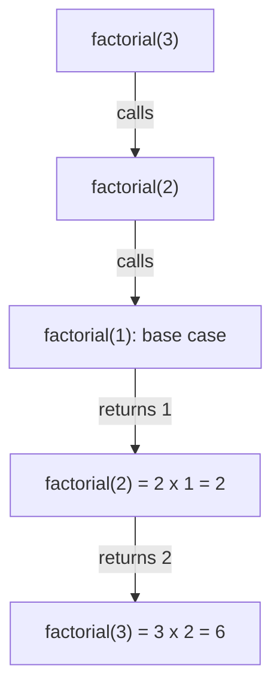
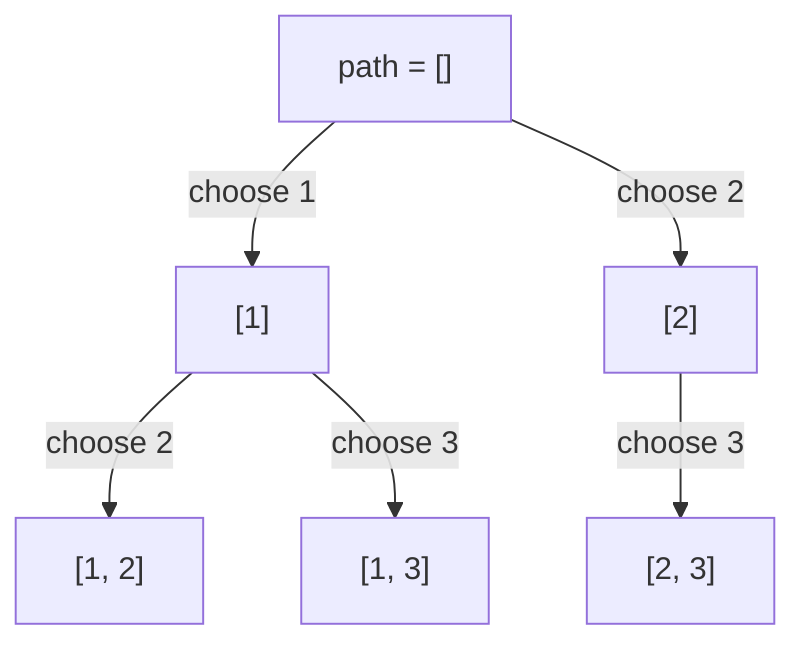
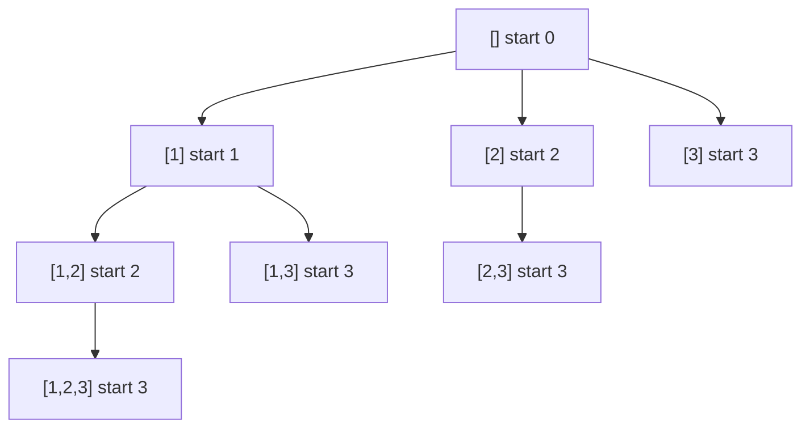
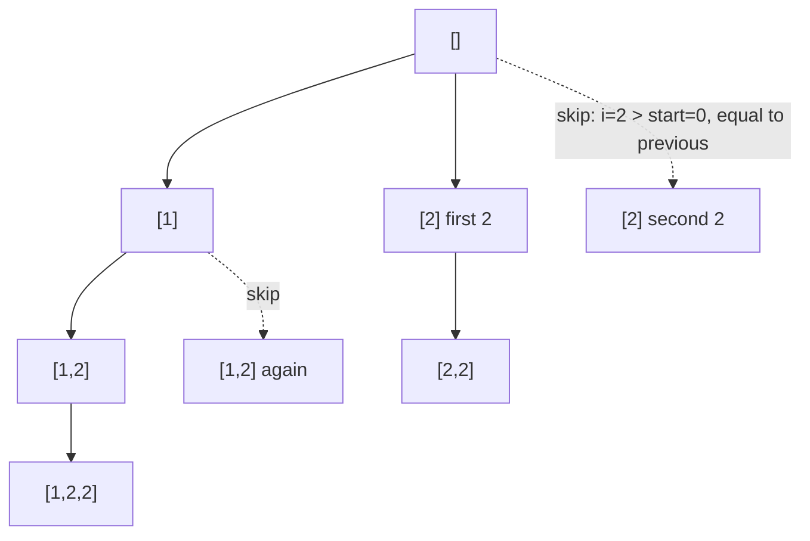
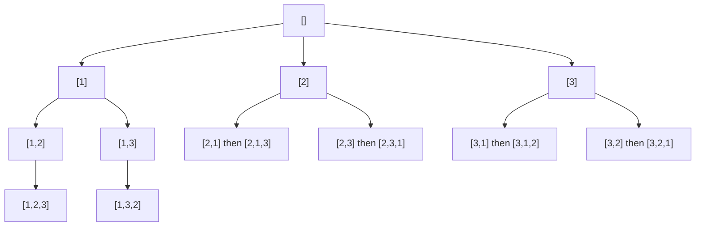
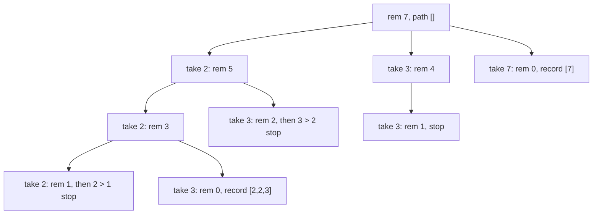
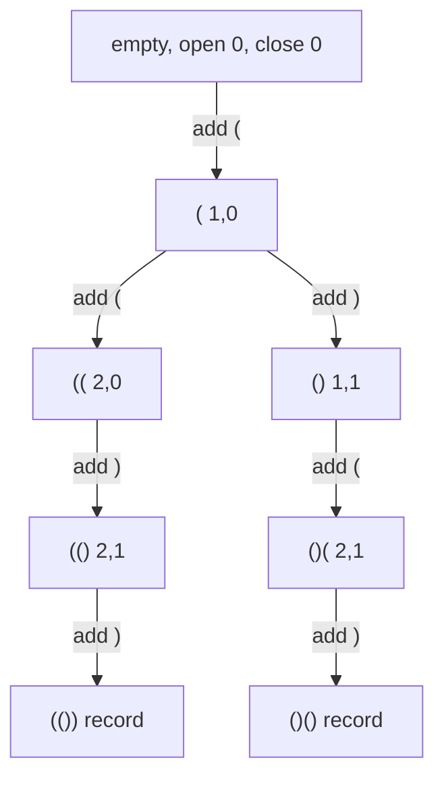
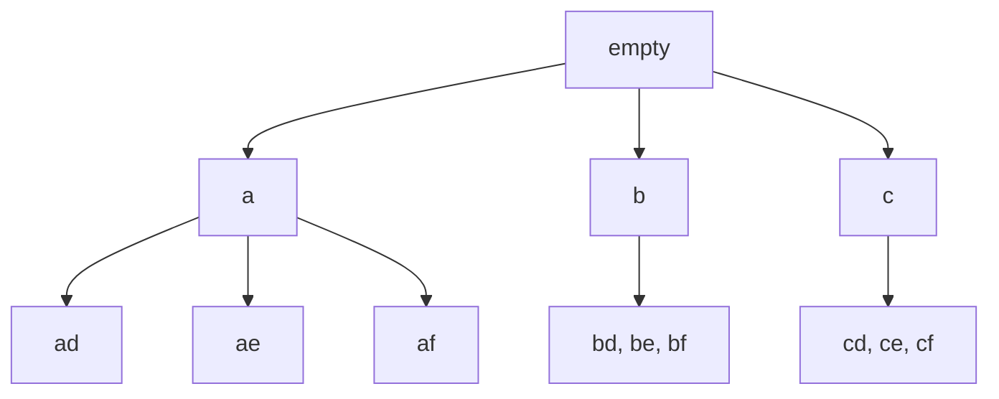
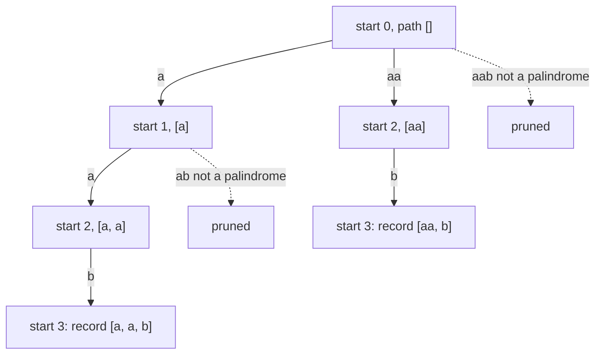

# Recursion & Backtracking

[⬅ Back to index](../README.md)

Covers: how to think recursively and the backtracking pattern (choose, explore, undo), handling duplicates, pruning to cut the search space, and the classic subset, permutation, combination and board problems.

---

## Thinking recursively

### 1. How do you think recursively, and what is the backtracking pattern?

**📘 Concept** · ⭐ Product/FAANG favourite

<details>
<summary>Answer</summary>

**In short:** To write a recursive function, decide exactly what `f(input)` returns, handle the smallest inputs directly (the **base case**), and for bigger inputs **trust** that `f` already works on a smaller input and only write the step that turns the smaller answer into the bigger one. Every call gets its own stack frame, so recursion depth is stack space. **Backtracking** is recursion over a tree of decisions: at each level you **choose** an option, **explore** the rest recursively, then **undo** the choice so the next option starts from a clean state.

#### The three questions

Before writing any code, answer these out loud:

1. **What does the function mean?** Write the contract in one sentence: "`sumFrom(a, i)` returns the sum of `a[i..]`." Most recursion bugs come from a vague contract.
2. **What is the smallest input, and its answer?** "`i == a.size` → 0." This is the base case. Every path must reach it.
3. **How does a smaller answer build this one?** "`a[i] + sumFrom(a, i + 1)`." Here you **don't** trace the inner call — you assume it obeys the contract. This is the "leap of faith", and it is just induction: if the base case is right and each step is right given a correct smaller answer, the whole thing is right.

```kotlin
fun sumFrom(a: IntArray, i: Int): Int {
    if (i == a.size) return 0            // base case: empty suffix
    return a[i] + sumFrom(a, i + 1)      // trust the smaller call
}
```

Each call must make the input **strictly smaller** (here `i` grows towards `a.size`), or it never stops.

#### What actually happens: the call stack

Each call pushes a frame holding its parameters and local variables. A frame waits until the call it made returns. For `factorial(3)`:

| time | stack (top on the right) | event |
|---|---|---|
| 1 | f(3) | needs f(2) |
| 2 | f(3), f(2) | needs f(1) |
| 3 | f(3), f(2), f(1) | base case, returns 1 |
| 4 | f(3), f(2) | returns 2 × 1 = 2 |
| 5 | f(3) | returns 3 × 2 = 6 |



Two consequences matter in interviews:

- **Space:** the deepest chain of frames is your extra space — O(depth). A recursion that goes n levels deep is O(n) space even with no data structures.
- **Stack overflow:** on the JVM the default thread stack is small (commonly around 512 KB–1 MB), so depths in the tens of thousands can throw `StackOverflowError`. Swift on iOS behaves similarly (the main thread has a fixed stack). For a linked list or path of 10⁵ nodes, prefer an iterative version. Kotlin's `tailrec` only helps when the recursive call is the very last operation, and Swift doesn't guarantee tail-call optimisation.

#### Recursion that branches: the call tree

When a function calls itself more than once, the calls form a **tree**. The total work is roughly *(number of nodes in the tree) × (work per node)*. A function that makes 2 calls and goes n deep has about 2ⁿ nodes — that is where exponential complexity comes from (see [question 14](#14-how-do-pruning-and-complexity-work-in-backtracking)).

#### Backtracking: recursion over choices

Many problems ask for **all** (or any) valid arrangements: subsets, permutations, board placements. You build the answer one decision at a time. Picture the decisions as a tree: the root is "nothing chosen", each edge is one choice, each leaf is a complete candidate.



You walk this tree depth-first with a **single shared** `path`. Going down an edge = add to `path`. Coming back up = remove from `path`. That "remove" is the *back* in backtracking.

```kotlin
// Generic shape — every problem in this topic is a variation of it.
fun backtrack(path: MutableList<Int>, /* state describing what's left */) {
    if (/* path is a complete answer */) {
        result.add(path.toList())        // COPY — path keeps changing
        return
    }
    for (choice in /* choices available now */) {
        if (/* choice breaks a rule */) continue   // prune
        path.add(choice)                  // choose
        backtrack(path /* , smaller state */)      // explore
        path.removeAt(path.size - 1)      // undo
    }
}
```

The questions to settle for each problem:

| Question | Example answers |
|---|---|
| What is one decision? | "include `nums[i]` or not", "which number goes next", "where does the queen in this row go" |
| When is a path complete? | every leaf (subsets), length n (permutations), sum hits target (combination sum) |
| What can't be chosen? | already used, would exceed target, attacked square |
| How do I avoid duplicates? | a `start` index (order doesn't matter), sort + skip equal neighbours |

#### Why undo instead of copying?

You could pass a fresh copy of the path to each call (`path + x`). That works and is sometimes clearer, but it costs O(n) per call. Mutating one list and undoing costs O(1) per step. The only copy you need is when you **record** an answer.

#### Common mistakes

- Adding `path` itself to the result instead of a copy — every saved entry ends up as the same (eventually empty) list.
- Forgetting to undo on **every** path out of the loop body, e.g. returning early after `add`.
- A base case that some inputs never reach (off-by-one), causing infinite recursion.
- Using `path.removeLast()` in Kotlin: with JDK 21+ it can resolve to the new Java `List.removeLast()` and fail on older Android runtimes. `removeAt(path.size - 1)` is always safe.

#### Follow-ups

- *Recursion vs iteration?* Anything recursive can be made iterative with an explicit stack; do it when depth can be large.
- *When does recursion become DP?* When the same sub-call repeats with the same arguments — cache it. See [Dynamic Programming](19-dynamic-programming.md).
- *Recursion on trees?* Same three questions with "left and right subtrees" as the smaller inputs — see [Trees & Binary Search Trees](14-trees-bst.md).

</details>

## Subsets, permutations and combinations

### 2. Subsets

**🟡 Medium** · ⭐ Product/FAANG favourite

<details>
<summary>Answer</summary>

**In short:** Every element is either in or out of a subset, so there are 2ⁿ subsets. Backtrack with a `start` index: record the current path (every node of the tree is a valid subset), then for each `i` from `start` onward add `nums[i]`, recurse with `i + 1`, and remove it. The `start` index guarantees each set is built in only one order, so there are no duplicates. O(n · 2ⁿ) time, O(n) extra space besides the output.

#### Problem

Given an array of **distinct** integers, return all possible subsets (the power set), in any order.

- `[1, 2, 3]` → `[[], [1], [1,2], [1,2,3], [1,3], [2], [2,3], [3]]`
- `[0]` → `[[], [0]]`

#### Clarifying questions & edge cases

- Are elements distinct? (Yes here; with duplicates see [Subsets II](#3-subsets-ii).)
- Does the empty subset count? Yes.
- Does output order matter? No.
- n is small (≤ 10 on LeetCode) — exponential output is expected.

#### Brute force

There isn't really a cheaper way — the output itself has 2ⁿ lists. The question is how to generate them cleanly without duplicates. An iterative alternative: start with `[[]]`, and for each number append it to a copy of every existing subset. Same complexity. A bitmask version (each number 0..2ⁿ−1 is a subset) is covered in [Bit Manipulation & Math](21-bit-manipulation-math.md).

#### Key insight

Two equivalent ways to draw the decision tree:

1. **Include / exclude:** at index `i`, branch "take `nums[i]`" or "skip it". Leaves at depth n are the subsets.
2. **Pick the next element:** from the current path, choose any element **after** the last one chosen. Every node (not just leaves) is a subset.

The second form is the template used for combinations too, so it's worth learning. Choosing only elements with index ≥ `start` means a set like `{1, 3}` can only be built as "1 then 3", never "3 then 1" — that is what stops duplicates.

#### Walkthrough

`nums = [1, 2, 3]` — each node is recorded when it is entered:



Order of recording: `[]`, `[1]`, `[1,2]`, `[1,2,3]`, `[1,3]`, `[2]`, `[2,3]`, `[3]` — 8 = 2³ subsets.

#### Kotlin

```kotlin
fun subsets(nums: IntArray): List<List<Int>> {
    val result = mutableListOf<List<Int>>()
    val path = mutableListOf<Int>()

    fun backtrack(start: Int) {
        result.add(path.toList())            // every node is a subset; store a copy
        for (i in start until nums.size) {
            path.add(nums[i])                // choose
            backtrack(i + 1)                 // explore: only later elements
            path.removeAt(path.size - 1)     // undo
        }
    }

    backtrack(0)
    return result
}
```

Include/exclude version, for comparison:

```kotlin
fun subsetsIncludeExclude(nums: IntArray): List<List<Int>> {
    val result = mutableListOf<List<Int>>()
    val path = mutableListOf<Int>()
    fun go(i: Int) {
        if (i == nums.size) { result.add(path.toList()); return }
        path.add(nums[i]); go(i + 1); path.removeAt(path.size - 1)  // take
        go(i + 1)                                                   // skip
    }
    go(0)
    return result
}
```

#### Swift

```swift
func subsets(_ nums: [Int]) -> [[Int]] {
    var result: [[Int]] = []
    var path: [Int] = []

    func backtrack(_ start: Int) {
        result.append(path)                  // arrays are values: this is already a copy
        for i in start..<nums.count {        // empty range when start == count
            path.append(nums[i])
            backtrack(i + 1)
            path.removeLast()
        }
    }

    backtrack(0)
    return result
}
```

In Swift, `result.append(path)` copies automatically because `Array` is a value type (copy-on-write), so the "forgot to copy" bug can't happen.

#### Complexity

- **Time:** O(n · 2ⁿ) — 2ⁿ subsets, and copying each costs up to O(n).
- **Space:** O(n) for the recursion depth and `path`; the output itself is O(n · 2ⁿ).

#### Common mistakes

- `result.add(path)` in Kotlin without `toList()` — all entries alias the same list.
- Recursing with `start + 1` instead of `i + 1` — produces duplicates and wrong subsets.
- Only recording at leaves in the "pick next" form — you lose every subset shorter than n.

#### Follow-ups

- **Duplicates in input?** Sort and skip equal neighbours — [Subsets II](#3-subsets-ii).
- **Only subsets of size k?** Record only when `path.size == k` — that's [Combinations](#6-combinations).
- **Count subsets with sum = target?** Exponential by backtracking; with small sums it becomes knapsack DP — see [Dynamic Programming](19-dynamic-programming.md).

</details>

### 3. Subsets II

**🟡 Medium**

<details>
<summary>Answer</summary>

**In short:** Same as Subsets, but the input may contain duplicates and the output must not. Sort the array so equal values sit together, then in the loop skip `nums[i]` when `i > start && nums[i] == nums[i - 1]`: at one level of the tree, an equal value would start exactly the same branch again. O(n · 2ⁿ) time, O(n) extra space.

#### Problem

Given an integer array that may contain duplicates, return all **distinct** subsets.

- `[1, 2, 2]` → `[[], [1], [1,2], [1,2,2], [2], [2,2]]`
- `[0]` → `[[], [0]]`

#### Clarifying questions & edge cases

- Are `[1, 2]` and `[2, 1]` the same subset? Yes — order inside a subset doesn't matter.
- All elements equal, e.g. `[2, 2, 2]` → `[[], [2], [2,2], [2,2,2]]` — only n + 1 subsets.
- Negative numbers are fine; sorting handles them.

#### Brute force

Generate all 2ⁿ subsets, sort each one, and put them in a `HashSet<List<Int>>`. Correct, but it still explores every duplicate branch and pays for hashing lists. Interviewers expect you to avoid generating duplicates in the first place.

#### Key insight

After sorting, duplicates appear only when, **at the same level of the tree**, you pick two equal values as "the next element". With `[1, 2, 2]` at the root, choosing the first `2` or the second `2` leads to identical subtrees.

So the rule is: in one loop (one level), use each distinct value only once — take the **first** copy, skip the rest. Using equal values at **different** levels (`[2, 2]`) is fine and necessary; that's why the check is `i > start`, not `i > 0`.

- `i > start`: this is not the first option tried at this level.
- `nums[i] == nums[i - 1]`: we just tried the same value at this level.

#### Walkthrough

`nums = [1, 2, 2]` (sorted). The crossed branch is skipped:



Recorded: `[]`, `[1]`, `[1,2]`, `[1,2,2]`, `[2]`, `[2,2]` — 6 distinct subsets.

#### Kotlin

```kotlin
fun subsetsWithDup(nums: IntArray): List<List<Int>> {
    val sorted = nums.sortedArray()          // equal values become neighbours
    val result = mutableListOf<List<Int>>()
    val path = mutableListOf<Int>()

    fun backtrack(start: Int) {
        result.add(path.toList())
        for (i in start until sorted.size) {
            // Same value already tried as the next element at this level → same subtree.
            if (i > start && sorted[i] == sorted[i - 1]) continue
            path.add(sorted[i])
            backtrack(i + 1)
            path.removeAt(path.size - 1)
        }
    }

    backtrack(0)
    return result
}
```

#### Complexity

- **Time:** O(n · 2ⁿ) in the worst case (all distinct); fewer when there are duplicates. Sorting is O(n log n), negligible.
- **Space:** O(n) recursion and path, plus the output.

#### Common mistakes

- Forgetting to sort — the neighbour check only works when equal values are adjacent.
- Using `i > 0` instead of `i > start` — this also blocks `[2, 2]` and `[1, 2, 2]`, because it skips equal values chosen at **deeper** levels.
- Deduplicating with a set of lists and calling it done — works, but loses points.

#### Follow-ups

- *Include/exclude version?* After deciding to **skip** a value, skip all its copies too (jump `i` past the run of equal values), otherwise "skip first 2, take second 2" duplicates "take first 2, skip second 2".
- **Combination Sum II** uses exactly the same skip rule — see [question 8](#8-combination-sum-ii).
- **Permutations II** needs a different rule because order matters — see [question 5](#5-permutations-ii).

</details>

### 4. Permutations

**🟡 Medium** · ⭐ Product/FAANG favourite

<details>
<summary>Answer</summary>

**In short:** Build the permutation one position at a time; at each position try every element not used yet, tracked with a `used` boolean array. Mark, recurse, unmark. When the path has n elements, record a copy. There are n! permutations of length n, so it's O(n · n!) time and O(n) extra space.

#### Problem

Given an array of **distinct** integers, return all permutations in any order.

- `[1, 2, 3]` → `[[1,2,3], [1,3,2], [2,1,3], [2,3,1], [3,1,2], [3,2,1]]`
- `[0, 1]` → `[[0,1], [1,0]]`

#### Clarifying questions & edge cases

- Distinct values? (Yes; duplicates → [Permutations II](#5-permutations-ii).)
- Single element → one permutation.
- n ≤ 6 on LeetCode — n! grows fast (10! ≈ 3.6 million), so this is only feasible for small n.

#### Brute force

Generate all nⁿ sequences of length n and keep those with no repeated element. Valid but wasteful: for n = 6 that's 46,656 sequences for 720 permutations. Backtracking with `used` never builds the invalid ones.

#### Key insight

The difference from subsets: **order matters**, so there's no `start` index. At every level, any unused element may go next. The decision tree has n choices at the first level, n − 1 at the second, and so on — n! leaves.

Why the `used` array rather than `path.contains(x)`? `contains` is O(n) per check; a boolean array is O(1).

An alternative is the **swap** approach: for position `k`, swap each `nums[i]` (i ≥ k) into position k, recurse on `k + 1`, swap back. It avoids the `used` array, but the output order is less intuitive and it's easier to get wrong under pressure.

#### Walkthrough

`nums = [1, 2, 3]`:



| step | path | used | event |
|---|---|---|---|
| 1 | [1] | T F F | choose 1 |
| 2 | [1,2] | T T F | choose 2 |
| 3 | [1,2,3] | T T T | full → record |
| 4 | [1] | T F F | undo 3, undo 2 |
| 5 | [1,3] | T F T | choose 3 |
| 6 | [1,3,2] | T T T | full → record |

#### Kotlin

```kotlin
fun permute(nums: IntArray): List<List<Int>> {
    val result = mutableListOf<List<Int>>()
    val path = mutableListOf<Int>()
    val used = BooleanArray(nums.size)

    fun backtrack() {
        if (path.size == nums.size) {
            result.add(path.toList())
            return
        }
        for (i in nums.indices) {
            if (used[i]) continue            // each element once per permutation
            used[i] = true
            path.add(nums[i])
            backtrack()
            path.removeAt(path.size - 1)     // undo both pieces of state
            used[i] = false
        }
    }

    backtrack()
    return result
}
```

#### Swift

```swift
func permute(_ nums: [Int]) -> [[Int]] {
    var result: [[Int]] = []
    var path: [Int] = []
    var used = [Bool](repeating: false, count: nums.count)

    func backtrack() {
        if path.count == nums.count {
            result.append(path)
            return
        }
        for i in 0..<nums.count where !used[i] {
            used[i] = true
            path.append(nums[i])
            backtrack()
            path.removeLast()
            used[i] = false
        }
    }

    backtrack()
    return result
}
```

#### Complexity

- **Time:** O(n · n!) — n! leaves, each copied in O(n). The internal nodes add at most a constant factor (about e · n! nodes in total).
- **Space:** O(n) for `path`, `used` and the recursion depth; output is O(n · n!).

#### Common mistakes

- Undoing `path` but forgetting to reset `used[i]` (or vice versa) — later branches see stale state and you get too few permutations.
- Using a `start` index as in subsets — you'd only generate the original order.
- Recording copies at internal nodes — you'd output partial permutations.

#### Follow-ups

- **Duplicates in input?** Sort and add a skip rule — [Permutations II](#5-permutations-ii).
- **Next Permutation** (in place, O(n)): find the rightmost `i` with `a[i] < a[i+1]`, swap with the rightmost larger element to its right, reverse the suffix.
- **k-th permutation** (LeetCode 60): don't enumerate — use factorials to pick each digit directly in O(n²).

</details>

### 5. Permutations II

**🟡 Medium**

<details>
<summary>Answer</summary>

**In short:** Permutations with a `used` array, plus sorting and one extra skip: don't pick `nums[i]` if it equals `nums[i - 1]` and `nums[i - 1]` is **not** currently used. That forces equal values to be placed in their original left-to-right order, so each distinct permutation is built exactly once. O(n · n!) time in the worst case, O(n) extra space.

#### Problem

Given an array that may contain duplicates, return all **unique** permutations.

- `[1, 1, 2]` → `[[1,1,2], [1,2,1], [2,1,1]]`
- `[1, 2, 3]` → all 6 permutations

#### Clarifying questions & edge cases

- All values equal, e.g. `[2, 2, 2]` → exactly one permutation.
- Output order doesn't matter.
- The number of distinct permutations is n! / (c₁! · c₂! · …) where cᵢ are the counts of each value.

#### Brute force

Generate all n! permutations (treating copies as different) and dedupe with a `HashSet<List<Int>>`. It works but does all the redundant work, e.g. 720 permutations of `[1,1,1,1,1,2]` to keep just 6.

#### Key insight

Duplicates come from swapping two equal values: `[1a, 1b, 2]` and `[1b, 1a, 2]` look the same. If we only ever allow the copies of a value to be used **in order** — `1a` before `1b` — then each distinct permutation has exactly one valid way to be built.

The rule "skip `nums[i]` if `nums[i] == nums[i-1]` and `!used[i-1]`" enforces exactly that:

- If `used[i-1]` is **true**, the earlier copy is already in the path (deeper in this branch), so placing this copy now keeps the order — allowed.
- If `used[i-1]` is **false**, the earlier copy was tried at this same position and has been undone. Placing the later copy here would start an identical subtree — skip.

Sorting is required so equal values are neighbours.

#### Walkthrough

`nums = [1, 1, 2]` (sorted; call the ones `1a`, `1b`):

| path | trying | used before check | decision |
|---|---|---|---|
| [] | 1a (i=0) | F F F | take → path [1a] |
| [1a] | 1b (i=1) | T F F | `used[0]` is true → allowed → [1a,1b] → [1a,1b,2] ✔ |
| [1a] | 2 | T F F | take → [1a,2] → [1a,2,1b] ✔ |
| [] | 1b (i=1) | F F F | equal to `nums[0]` and `used[0]` false → **skip** |
| [] | 2 | F F F | take → [2] → [2,1a] → [2,1a,1b] ✔; [2,1b] skipped |

Result: `[1,1,2]`, `[1,2,1]`, `[2,1,1]`.

#### Kotlin

```kotlin
fun permuteUnique(nums: IntArray): List<List<Int>> {
    val sorted = nums.sortedArray()
    val result = mutableListOf<List<Int>>()
    val path = mutableListOf<Int>()
    val used = BooleanArray(sorted.size)

    fun backtrack() {
        if (path.size == sorted.size) {
            result.add(path.toList())
            return
        }
        for (i in sorted.indices) {
            if (used[i]) continue
            // An equal earlier copy that is NOT in the path was already tried at this
            // position, so this copy would repeat the same subtree.
            if (i > 0 && sorted[i] == sorted[i - 1] && !used[i - 1]) continue
            used[i] = true
            path.add(sorted[i])
            backtrack()
            path.removeAt(path.size - 1)
            used[i] = false
        }
    }

    backtrack()
    return result
}
```

#### Complexity

- **Time:** O(n · n!) worst case (all distinct); with duplicates the number of leaves drops to the number of distinct permutations, though skipped branches still cost a loop check.
- **Space:** O(n) for `used`, `path` and recursion, plus the output.

#### Common mistakes

- Forgetting to sort.
- Writing `used[i-1]` (true) instead of `!used[i-1]`. Surprisingly, that version **also** produces correct output — it forces copies in reverse order instead — but it prunes much later and explores far more dead branches. `!used[i-1]` is the standard, efficient choice; be ready to explain why.
- Copying the Subsets II rule (`i > start`) — there is no `start` in permutations.

#### Follow-ups

- *Alternative without sorting?* Use a count map `value → remaining count` and loop over distinct keys; each level tries each distinct value once. Clean and easy to prove.
- *Swap-based version?* At each position, keep a small `HashSet` of values already swapped into that position and skip repeats.
- *Count only?* Use the multinomial formula n! / ∏ cᵢ! — no enumeration needed.

</details>

### 6. Combinations

**🟡 Medium**

<details>
<summary>Answer</summary>

**In short:** Choose k numbers from 1..n where order doesn't matter: the Subsets template with a `start` index, recording only when the path has k numbers. Prune by never starting a number when there aren't enough numbers left after it to reach k — the loop runs only up to `n - (k - path.size) + 1`. O(k · C(n, k)) time, O(k) extra space.

#### Problem

Given `n` and `k`, return all combinations of k distinct numbers chosen from `1..n`.

- `n = 4, k = 2` → `[[1,2], [1,3], [1,4], [2,3], [2,4], [3,4]]`
- `n = 1, k = 1` → `[[1]]`

#### Clarifying questions & edge cases

- `k == n` → one combination; `k == 0` → `[[]]` (one empty combination).
- `[1,2]` and `[2,1]` are the same combination — output each once.
- Output size is C(n, k), which peaks at k = n/2.

#### Brute force

Generate all 2ⁿ subsets and keep those of size k. Correct, but for n = 20, k = 2 it builds about a million subsets to keep 190.

#### Key insight

Use the "pick the next element after the last one" tree from [Subsets](#2-subsets), with a depth limit of k. Increasing order means each combination is built in exactly one way.

**Pruning:** if the path has `size` numbers, we still need `need = k - size`. Starting at `i`, the numbers `i..n` give `n - i + 1` candidates. If that's less than `need`, this branch can never complete. So the last useful start is `i = n - need + 1`. This prunes whole subtrees that would only produce partial paths, and it makes the tree contain (almost) only nodes that lead to answers.

#### Walkthrough

`n = 4, k = 2`:

| path | need | loop range for next | children |
|---|---|---|---|
| [] | 2 | 1..3 (4 can't be first: nothing after it) | [1], [2], [3] |
| [1] | 1 | 2..4 | [1,2] ✔ [1,3] ✔ [1,4] ✔ |
| [2] | 1 | 3..4 | [2,3] ✔ [2,4] ✔ |
| [3] | 1 | 4..4 | [3,4] ✔ |

Without pruning, the root would also try `[4]`, a dead end.

#### Kotlin

```kotlin
fun combine(n: Int, k: Int): List<List<Int>> {
    val result = mutableListOf<List<Int>>()
    val path = mutableListOf<Int>()

    fun backtrack(start: Int) {
        if (path.size == k) {
            result.add(path.toList())
            return
        }
        val need = k - path.size
        // Last start that still leaves enough numbers to fill the path.
        for (i in start..(n - need + 1)) {
            path.add(i)
            backtrack(i + 1)
            path.removeAt(path.size - 1)
        }
    }

    backtrack(1)
    return result
}
```

#### Complexity

- **Time:** O(k · C(n, k)) — C(n, k) results, each copied in O(k); pruning keeps internal nodes within a small factor of that.
- **Space:** O(k) for path and recursion, plus the output.

#### Common mistakes

- Recording at every node (like Subsets) instead of only at size k.
- Off-by-one in the pruning bound — test with `n = 4, k = 4`: the root loop must be `1..1`.
- Using 0-based numbers when the problem asks for `1..n`.

#### Follow-ups

- **Combination Sum III** (k numbers from 1..9 that sum to n, each once): same template with a running sum and an extra prune when the sum exceeds n.
- *Iterative / lexicographic next combination?* Find the rightmost element that can be incremented, increment it, reset everything after it to consecutive values.
- *Just the count?* C(n, k) via Pascal's triangle, `C(n,k) = C(n-1,k-1) + C(n-1,k)` — see [Dynamic Programming](19-dynamic-programming.md).

</details>

### 7. Combination Sum

**🟡 Medium** · ⭐ Product/FAANG favourite

<details>
<summary>Answer</summary>

**In short:** Backtrack over the sorted candidates with a `start` index and a remaining target. Because each number may be reused, recurse with the **same** index `i` (not `i + 1`); because order doesn't matter, never go back to earlier indices. Sorting lets you `break` as soon as a candidate exceeds the remaining target. Exponential time, roughly O(n^(T/m)) where T is the target and m the smallest candidate; O(T/m) recursion depth.

#### Problem

Given **distinct** positive integers `candidates` and a `target`, return all unique combinations whose sum is `target`. Each number may be used any number of times.

- `candidates = [2, 3, 6, 7], target = 7` → `[[2,2,3], [7]]`
- `candidates = [2, 3, 5], target = 8` → `[[2,2,2,2], [2,3,3], [3,5]]`
- `candidates = [2], target = 1` → `[]`

#### Clarifying questions & edge cases

- Are all candidates positive? (Yes — essential. A zero or negative number would allow infinite combinations.)
- Distinct candidates? (Yes; with duplicates and single use see [Combination Sum II](#8-combination-sum-ii).)
- Is `[2,2,3]` the same as `[3,2,2]`? Yes — output once.

#### Brute force

Try every sequence of candidates (order included) that sums to target, then sort each and dedupe with a set. Ordered sequences explode much faster than combinations, and the dedupe is extra work.

#### Key insight

Two decisions shape the tree:

1. **Non-decreasing index order** removes order duplicates: once you move past candidate `i`, you never come back to it. `[2,2,3]` can only be built as 2 → 2 → 3.
2. **Recurse with `i`, not `i + 1`**: staying on the same index is what allows reuse.

The remaining target shrinks by at least the smallest candidate per level, so the recursion always ends. With the candidates sorted, once `candidates[i] > remaining`, every later candidate is larger too — `break` the loop rather than `continue`.

#### Walkthrough

`candidates = [2, 3, 6, 7]`, `target = 7`:



The `6` branch at the root leaves remaining 1, which no candidate ≥ 6 can fill, and `7` hits zero exactly.

#### Kotlin

```kotlin
fun combinationSum(candidates: IntArray, target: Int): List<List<Int>> {
    val sorted = candidates.sortedArray()
    val result = mutableListOf<List<Int>>()
    val path = mutableListOf<Int>()

    fun backtrack(start: Int, remaining: Int) {
        if (remaining == 0) {
            result.add(path.toList())
            return
        }
        for (i in start until sorted.size) {
            if (sorted[i] > remaining) break   // sorted: all later candidates are too big
            path.add(sorted[i])
            backtrack(i, remaining - sorted[i]) // i, not i + 1: reuse allowed
            path.removeAt(path.size - 1)
        }
    }

    backtrack(0, target)
    return result
}
```

#### Complexity

- **Time:** exponential. A loose bound is O(n^(T/m + 1)): the depth is at most T/m (each level subtracts at least m) and each node has up to n children. Copying results adds O(T/m) per answer.
- **Space:** O(T/m) for recursion depth and path, plus the output.

#### Common mistakes

- Recursing with `i + 1` — then each number can only be used once (that's Combination Sum II).
- Recursing with `0` instead of `i` — produces `[2,2,3]`, `[2,3,2]`, `[3,2,2]`.
- `continue` instead of `break` on an unsorted array — `break` is only correct after sorting.
- Dropping the sort-and-break without adding `if (remaining < 0) return` — the remaining target keeps falling below zero, the recursion never stops, and you get a stack overflow.

#### Follow-ups

- *Only the number of combinations?* That's **Coin Change II** — an unbounded-knapsack DP in O(n · T). See [Dynamic Programming](19-dynamic-programming.md).
- *Order matters (count sequences)?* **Combination Sum IV** — a DP where the loop order is swapped.
- *Each number used once, with duplicates?* [Combination Sum II](#8-combination-sum-ii).

</details>

### 8. Combination Sum II

**🟡 Medium**

<details>
<summary>Answer</summary>

**In short:** Like Combination Sum, but each element can be used at most once and the input has duplicates. Sort, recurse with `i + 1` (single use), skip `candidates[i]` when `i > start` and it equals `candidates[i - 1]` (same value already tried at this level — the Subsets II rule), and `break` when a candidate exceeds the remaining target. O(n · 2ⁿ) worst case, O(n) extra space.

#### Problem

Given `candidates` (may contain duplicates, all positive) and `target`, return all unique combinations that sum to `target`, using each element at most once.

- `candidates = [10, 1, 2, 7, 6, 1, 5], target = 8` → `[[1,1,6], [1,2,5], [1,7], [2,6]]`
- `candidates = [2, 5, 2, 1, 2], target = 5` → `[[1,2,2], [5]]`

#### Clarifying questions & edge cases

- "Unique" means unique as a multiset of values: `[1,7]` once, even though there are two 1s.
- Two equal values may both appear in one combination (`[1,1,6]`) — they are different elements.
- No combination → empty list.

#### Brute force

Enumerate all 2ⁿ subsets, keep those summing to target, sort each and dedupe with a set. Correct but slow and clumsy.

#### Key insight

This is [Subsets II](#3-subsets-ii) with a sum constraint:

- **`i + 1`** in the recursive call — each element used at most once.
- **`i > start && c[i] == c[i-1]` → skip** — at one level, two equal values would grow identical subtrees. Deeper levels can still use the next copy, which is how `[1,1,6]` is found.
- **`c[i] > remaining` → break** — sorted order means everything after is bigger too.

#### Walkthrough

Sorted: `[1, 1, 2, 5, 6, 7, 10]`, `target = 8`:

| level | path | remaining | loop decisions |
|---|---|---|---|
| 0 | [] | 8 | take first 1; later **skip** second 1 (same level) |
| 1 | [1] | 7 | take second 1 (i == start, allowed) |
| 2 | [1,1] | 6 | 2 → rem 4 (dead end), 5 → rem 1 (dead end), **6 → record [1,1,6]**, 7 > 6 break |
| 1 | [1] | 7 | 2 → [1,2] rem 5 → **5 → record [1,2,5]**; 5 → rem 2 (dead); 6 → rem 1 (dead); **7 → record [1,7]**; 10 break |
| 0 | [] | 8 | 2 → [2] rem 6 → **6 → record [2,6]**; 5 → rem 3 dead; 6 → rem 2 dead; 7 → rem 1 dead; 10 break |

#### Kotlin

```kotlin
fun combinationSum2(candidates: IntArray, target: Int): List<List<Int>> {
    val sorted = candidates.sortedArray()
    val result = mutableListOf<List<Int>>()
    val path = mutableListOf<Int>()

    fun backtrack(start: Int, remaining: Int) {
        if (remaining == 0) {
            result.add(path.toList())
            return
        }
        for (i in start until sorted.size) {
            if (i > start && sorted[i] == sorted[i - 1]) continue // same value, same level
            if (sorted[i] > remaining) break                     // too big, and so is the rest
            path.add(sorted[i])
            backtrack(i + 1, remaining - sorted[i])              // each element once
            path.removeAt(path.size - 1)
        }
    }

    backtrack(0, target)
    return result
}
```

#### Complexity

- **Time:** O(n · 2ⁿ) worst case — at most 2ⁿ subsets, copying each up to O(n). Pruning usually cuts this sharply.
- **Space:** O(n) recursion and path, plus the output.

#### Common mistakes

- Skipping with `i > 0` — loses `[1,1,6]`.
- Recursing with `i` — reuses the same element, giving `[1,1,1,...]` from one `1`.
- Putting the `break` before the duplicate check is fine; putting `continue` instead of `break` is only slower, not wrong.

#### Follow-ups

- *Contrast with Combination Sum:* the only differences are `i` vs `i + 1` and the duplicate skip — a good thing to say out loud.
- *Is there a subset that sums to target (yes/no)?* **Subset Sum** — 0/1 knapsack DP in O(n · target). See [Dynamic Programming](19-dynamic-programming.md).
- *Large n, small target?* DP over sums, then backtrack through the DP table to list combinations.

</details>

## Building strings

### 9. Generate Parentheses

**🟡 Medium** · ⭐ Product/FAANG favourite

<details>
<summary>Answer</summary>

**In short:** Build the string one character at a time, tracking how many `(` and `)` you've placed. You may add `(` while `open < n`, and `)` only while `close < open` — so the string is valid at every prefix and never needs checking at the end. Record when the length is 2n. The number of results is the n-th Catalan number, giving O(4ⁿ / √n) time overall; O(n) extra space.

#### Problem

Given `n` pairs of parentheses, generate every well-formed combination.

- `n = 3` → `["((()))", "(()())", "(())()", "()(())", "()()()"]`
- `n = 1` → `["()"]`

#### Clarifying questions & edge cases

- n = 0 → `[""]` (one empty string) — confirm what the interviewer expects.
- Only one bracket type here; with several types the rules change.
- Output order doesn't matter.

#### Brute force

Generate all 2²ⁿ strings of `(` and `)` and keep the valid ones (check with a balance counter). For n = 3 that's 64 strings for 5 answers; the ratio gets much worse as n grows. Cost O(2²ⁿ · n).

#### Key insight

A string of brackets is valid if and only if:

1. at every prefix, the number of `)` never exceeds the number of `(`, and
2. at the end, both counts equal n.

So instead of generating and filtering, only make choices that keep rule 1 true and never exceed n opens:

- add `(` if `open < n`
- add `)` if `close < open`

Every leaf at length 2n is then automatically valid, and every branch leads to at least one answer — no dead ends at all. That's pruning at its best: the tree contains only useful nodes.

#### Walkthrough

`n = 2`:



At the root, `)` isn't allowed (`close < open` is false). At `((`, `(` isn't allowed (`open == n`).

#### Kotlin

```kotlin
fun generateParenthesis(n: Int): List<String> {
    val result = mutableListOf<String>()
    val sb = StringBuilder()

    fun backtrack(open: Int, close: Int) {
        if (sb.length == 2 * n) {
            result.add(sb.toString())
            return
        }
        if (open < n) {                       // can still open a new pair
            sb.append('(')
            backtrack(open + 1, close)
            sb.deleteCharAt(sb.length - 1)
        }
        if (close < open) {                   // only close what is open
            sb.append(')')
            backtrack(open, close + 1)
            sb.deleteCharAt(sb.length - 1)
        }
    }

    backtrack(0, 0)
    return result
}
```

Using a shared `StringBuilder` with undo avoids creating a new string at every node; passing `current + "("` is also acceptable and simpler to read.

#### Complexity

- **Time:** O(4ⁿ / √n) — the number of valid strings is the Catalan number Cₙ ≈ 4ⁿ / (n^1.5 √π), and each costs O(n) to build into a string.
- **Space:** O(n) for the builder and recursion depth (2n levels), plus the output.

#### Common mistakes

- Allowing `)` when `close < n` instead of `close < open` → invalid strings like `)(`.
- Checking validity only at the end — correct but slow (that's the brute force).
- Forgetting to undo the append when using a shared `StringBuilder`.

#### Follow-ups

- *How many are there?* The Catalan number Cₙ = C(2n, n) / (n + 1); also computable by DP: Cₙ = Σ Cᵢ · Cₙ₋₁₋ᵢ.
- **Valid Parentheses** (check a string) — stack, see [Stacks, Queues & Monotonic Stack](11-stacks-queues-monotonic.md).
- **Remove Invalid Parentheses** (Hard) — BFS or backtracking that removes the minimum number of brackets.

</details>

### 10. Letter Combinations of a Phone Number

**🟡 Medium** · ⭐ Product/FAANG favourite

<details>
<summary>Answer</summary>

**In short:** Each digit maps to 3 or 4 letters; build the string one digit at a time, trying every letter for the current digit, and record when you've used every digit. It's a Cartesian product, so there's no pruning — the work is O(4ⁿ · n) for n digits, with O(n) extra space.

#### Problem

Given a string of digits `2-9`, return every letter string they could represent on a phone keypad (2 → abc, 3 → def, …, 7 → pqrs, 9 → wxyz).

- `"23"` → `["ad","ae","af","bd","be","bf","cd","ce","cf"]`
- `""` → `[]`
- `"2"` → `["a","b","c"]`

#### Clarifying questions & edge cases

- Empty input → **empty list**, not `[""]` (LeetCode's expectation — a common trap).
- Can the input contain `0`, `1`, `*` or `#`? Not on LeetCode; ask, and decide whether to skip them or fail.
- n ≤ 4 on LeetCode, so at most 4⁴ = 256 results.

#### Brute force

Nested loops — one per digit — work only when you know n in advance. Recursion is how you write "n nested loops" for unknown n. An iterative alternative is BFS-style: start with `[""]` and for each digit replace every partial string with its extensions.

#### Key insight

Level `i` of the tree corresponds to digit `i`; its children are that digit's letters. Every leaf at depth n is an answer, so there is nothing to prune — the point of the question is writing the recursion cleanly. The total output size is the product of the letter counts (3 or 4 per digit).

#### Walkthrough

`digits = "23"`:



#### Kotlin

```kotlin
fun letterCombinations(digits: String): List<String> {
    if (digits.isEmpty()) return emptyList()
    val keypad = arrayOf("", "", "abc", "def", "ghi", "jkl", "mno", "pqrs", "tuv", "wxyz")
    val result = mutableListOf<String>()
    val sb = StringBuilder()

    fun backtrack(index: Int) {
        if (index == digits.length) {
            result.add(sb.toString())
            return
        }
        for (letter in keypad[digits[index] - '0']) {  // Char - Char gives Int
            sb.append(letter)
            backtrack(index + 1)
            sb.deleteCharAt(sb.length - 1)
        }
    }

    backtrack(0)
    return result
}
```

#### Complexity

- **Time:** O(4ⁿ · n) — up to 4ⁿ strings (when every digit is 7 or 9), each O(n) to build.
- **Space:** O(n) for the builder and recursion depth, plus the output.

#### Common mistakes

- Returning `[""]` for empty input.
- `keypad[digits[index].code]` — that's the ASCII code (50 for `'2'`), out of bounds. Use `digits[index] - '0'` or `digitToInt()`.
- Forgetting that 7 and 9 have four letters (hard-coding 3).

#### Follow-ups

- *Iterative version?* Queue of partial strings: for each digit, pop every current string and push it with each letter appended.
- *Only return combinations that are real words?* Walk a trie of the dictionary alongside the digits and prune branches with no trie child — see [Tries & String Algorithms](15-tries-string-algorithms.md).
- *T9 lookup (digits → words)?* Precompute each dictionary word's digit string and use a hash map from digits to words.

</details>

## Boards and partitions

### 11. Word Search

**🟡 Medium** · ⭐ Product/FAANG favourite

<details>
<summary>Answer</summary>

**In short:** Try every cell as a starting point and run a DFS that matches the word one character at a time, moving up/down/left/right. Mark the current cell as visited (temporarily overwrite it) so a path can't reuse it, and restore it when the DFS returns — that restore is the backtracking step. O(m · n · 3ᴸ) time for an m×n board and word length L; O(L) recursion depth.

#### Problem

Given an m×n grid of letters and a word, return whether the word can be traced through adjacent cells (horizontally or vertically), using each cell at most once.

```
A B C E
S F C S
A D E E
```

- `"ABCCED"` → `true`
- `"SEE"` → `true`
- `"ABCB"` → `false` (the `B` would have to be reused)

#### Clarifying questions & edge cases

- Adjacency: 4 directions, not diagonals (ask).
- Can a cell be reused? No — this is what makes it backtracking rather than plain DFS.
- Word longer than m · n → `false` immediately.
- Case sensitivity? Usually exact match.

#### Brute force

Enumerate every simple path of length L from every cell and compare it with the word at the end. The backtracking DFS is that same search, but it stops a path the moment a letter doesn't match, which removes almost all of the work in practice. The further improvements are all about pruning.

#### Key insight

`dfs(r, c, k)` answers: "can `word[k..]` be matched starting at cell `(r, c)`?"

1. If `k == word.length` → `true` (everything matched).
2. If `(r, c)` is off the board, already visited, or `board[r][c] != word[k]` → `false`.
3. Mark `(r, c)` visited, try the 4 neighbours with `k + 1`, unmark, return whether any succeeded.

The visited mark must be **undone** because a cell blocked on one path may be needed by a different path. Overwriting the cell with `'#'` is a common O(1)-space visited marker — it can never equal a letter of the word.

**Pruning that matters in practice:**

- Count letters: if the board has fewer of some letter than the word needs, return `false` before any DFS.
- If the word's last letter is rarer on the board than its first letter, search for the reversed word — fewer starting points.

#### Walkthrough

`word = "ABCCED"`:

| k | cell | letter | next move |
|---|---|---|---|
| 0 | (0,0) | A | right |
| 1 | (0,1) | B | right |
| 2 | (0,2) | C | down (right is E ≠ C) |
| 3 | (1,2) | C | down |
| 4 | (2,2) | E | left |
| 5 | (2,1) | D | k becomes 6 = length → **true** |

For `"ABCB"`: after A → B → C at (0,2), the only neighbouring `B` is (0,1), which is marked `'#'`, so every branch fails.

#### Kotlin

```kotlin
fun exist(board: Array<CharArray>, word: String): Boolean {
    val rows = board.size
    val cols = board[0].size
    if (word.length > rows * cols) return false

    fun dfs(r: Int, c: Int, k: Int): Boolean {
        if (k == word.length) return true
        if (r !in 0 until rows || c !in 0 until cols) return false
        if (board[r][c] != word[k]) return false     // also rejects visited '#'

        val saved = board[r][c]
        board[r][c] = '#'                            // mark visited
        val found = dfs(r + 1, c, k + 1) || dfs(r - 1, c, k + 1) ||
            dfs(r, c + 1, k + 1) || dfs(r, c - 1, k + 1)
        board[r][c] = saved                          // undo, even on success
        return found
    }

    for (r in 0 until rows) {
        for (c in 0 until cols) {
            if (dfs(r, c, 0)) return true
        }
    }
    return false
}
```

`||` short-circuits, so the search stops as soon as one direction succeeds.

#### Complexity

- **Time:** O(m · n · 3ᴸ) — m·n starts; from each, the first step has 4 directions and every later step at most 3 (you can't go back to the cell you came from).
- **Space:** O(L) recursion depth; the visited marking reuses the board.

#### Common mistakes

- Forgetting to restore the cell → later starting points see a corrupted board and miss valid paths.
- Using a separate `visited` set but never removing from it.
- Reading `board[r][c]` before the bounds check → `ArrayIndexOutOfBoundsException` at the edges.
- Modifying an input the caller still needs — say that you restore it, or use a `visited` array if mutation isn't allowed.

#### Follow-ups

- **Word Search II** (many words) — build a trie of the words and run one DFS over the board — see [Tries & String Algorithms](15-tries-string-algorithms.md).
- *Count all occurrences / all paths?* Don't stop at the first `true`; sum the results instead.
- *Diagonals allowed?* 8 directions, so the bound becomes O(m · n · 7ᴸ).

</details>

### 12. Palindrome Partitioning

**🟡 Medium**

<details>
<summary>Answer</summary>

**In short:** Cut the string from left to right: at position `start`, try every end `end` such that `s[start..end]` is a palindrome, add that piece to the path, and recurse from `end + 1`. When `start` reaches the end of the string, the path is a full partition. Precompute a palindrome table `isPal[i][j]` so each check is O(1). O(n · 2ⁿ) time, O(n²) space for the table.

#### Problem

Split a string into pieces so that every piece is a palindrome; return all such splits.

- `"aab"` → `[["a","a","b"], ["aa","b"]]`
- `"a"` → `[["a"]]`

#### Clarifying questions & edge cases

- Every single character is a palindrome, so at least one partition always exists (all single letters).
- All same letters, e.g. `"aaaa"` → every one of the 2ⁿ⁻¹ ways to cut is valid — the worst case.
- Empty string → `[[]]` (one empty partition); n ≤ 16 on LeetCode.

#### Brute force

There are n − 1 gaps between characters, each cut or not — 2ⁿ⁻¹ partitions. Generate them all and check every piece. Backtracking does better by abandoning a partition the moment a piece isn't a palindrome.

#### Key insight

The decision at each level is "where does the next piece end?". Only palindromic pieces are allowed — that is the pruning. So the tree is:

- root: `start = 0`
- children: one per `end` with `s[start..end]` a palindrome
- leaf: `start == n` → record

Checking a substring with two pointers costs O(n) each time; the same substrings are checked again and again in different branches. A DP table fixes that:

`isPal[i][j] = s[i] == s[j] && (j - i < 2 || isPal[i + 1][j - 1])`

Fill `i` from right to left so `isPal[i + 1][...]` is ready when needed. Building it is O(n²).

#### Walkthrough

`s = "aab"`:



#### Kotlin

```kotlin
fun partition(s: String): List<List<String>> {
    val n = s.length
    // isPal[i][j] == true when s[i..j] is a palindrome.
    val isPal = Array(n) { BooleanArray(n) }
    for (i in n - 1 downTo 0) {
        for (j in i until n) {
            isPal[i][j] = s[i] == s[j] && (j - i < 2 || isPal[i + 1][j - 1])
        }
    }

    val result = mutableListOf<List<String>>()
    val path = mutableListOf<String>()

    fun backtrack(start: Int) {
        if (start == n) {
            result.add(path.toList())
            return
        }
        for (end in start until n) {
            if (!isPal[start][end]) continue        // prune: piece must be a palindrome
            path.add(s.substring(start, end + 1))
            backtrack(end + 1)
            path.removeAt(path.size - 1)
        }
    }

    backtrack(0)
    return result
}
```

#### Complexity

- **Time:** O(n · 2ⁿ) — up to 2ⁿ⁻¹ partitions (all same letters), each costing O(n) to build and copy. The table adds O(n²).
- **Space:** O(n²) for the table, O(n) for recursion and path, plus the output.

#### Common mistakes

- Filling the DP table top-down (`i` increasing) — `isPal[i + 1][j - 1]` isn't computed yet.
- `substring(start, end)` instead of `end + 1` — Kotlin's end index is exclusive.
- Recording at every node instead of only when `start == n`.

#### Follow-ups

- **Palindrome Partitioning II** (minimum cuts) — don't enumerate: DP `cuts[i] = min(cuts[j - 1] + 1)` over palindromic `s[j..i]`, O(n²). See [Dynamic Programming](19-dynamic-programming.md).
- **Word Break II** (split into dictionary words) — same "where does the next piece end" backtracking, with memoisation on `start`.
- *Count palindromic substrings?* Expand around centres — see [Tries & String Algorithms](15-tries-string-algorithms.md).

</details>

### 13. N-Queens

**🔴 Hard**

<details>
<summary>Answer</summary>

**In short:** Place one queen per row, top to bottom. For each row, try every column that isn't attacked, using three boolean arrays — columns, "\" diagonals (`row - col` is constant) and "/" diagonals (`row + col` is constant) — so each safety check is O(1). Mark, recurse to the next row, unmark. When all n rows have a queen, record the board. Roughly O(n!) time, O(n) extra space.

#### Problem

Place n queens on an n×n chessboard so no two attack each other (same row, column or diagonal). Return every solution as a list of strings, with `Q` for a queen and `.` for empty.

- `n = 4` → `[[".Q..","...Q","Q...","..Q."], ["..Q.","Q...","...Q",".Q.."]]`
- `n = 1` → `[["Q"]]`
- `n = 2` or `n = 3` → `[]` (no solution)

#### Clarifying questions & edge cases

- Return boards or just the count? (Count → N-Queens II, same search.)
- n ≤ 9 on LeetCode — exponential search is expected.
- n = 2 and n = 3 have no solutions; the code should return an empty list naturally.

#### Brute force

Try every way to put n queens on n² squares — C(n², n) placements (about 1.8 × 10³ for n = 4, 4.4 × 10⁹ for n = 8) — and check each. Putting one queen per row cuts that to nⁿ; one per row **and** column cuts it to n! (permutations). Checking attacks as you go, rather than at the end, prunes far more.

#### Key insight

- Since two queens can't share a row, **row = level of recursion**. That removes the row constraint for free.
- On a "\" diagonal, `row - col` is the same for every square; on a "/" diagonal, `row + col` is the same. So each diagonal has an integer id, and "is this diagonal taken?" is an array lookup.
- `row - col` ranges from −(n−1) to n−1, so shift it by `n - 1` to index an array of size `2n - 1`.

| square | row − col + 3 (n = 4) | row + col |
|---|---|---|
| (0, 1) | 2 | 1 |
| (1, 3) | 1 | 4 |
| (2, 0) | 5 | 2 |
| (3, 2) | 4 | 5 |

All values in each column are distinct → that's a valid solution (the first one below).

#### Walkthrough

`n = 4`, columns chosen per row:

| row | tried columns | outcome |
|---|---|---|
| 0 | 0 | place (0,0) |
| 1 | 0 col ✗, 1 diag ✗, 2 ✓ | place (1,2) |
| 2 | 0 col ✗, 1 "/" ✗, 2 col ✗, 3 "\" ✗ | dead end → back to row 1 |
| 1 | 3 ✓ | place (1,3) |
| 2 | 1 ✓ | place (2,1) |
| 3 | all attacked | dead end → back up… row 0 moves on |
| 0 | 1 | place (0,1) |
| 1 | 3 ✓ | place (1,3) |
| 2 | 0 ✓ | place (2,0) |
| 3 | 2 ✓ | **solution** `.Q..`, `...Q`, `Q...`, `..Q.` |

#### Kotlin

```kotlin
fun solveNQueens(n: Int): List<List<String>> {
    val result = mutableListOf<List<String>>()
    val queenCol = IntArray(n)                    // queenCol[row] = column of the queen
    val cols = BooleanArray(n)
    val diag = BooleanArray(2 * n - 1)            // "\" diagonals: row - col + n - 1
    val anti = BooleanArray(2 * n - 1)            // "/" diagonals: row + col

    fun place(row: Int) {
        if (row == n) {
            result.add(queenCol.map { c -> ".".repeat(c) + "Q" + ".".repeat(n - c - 1) })
            return
        }
        for (c in 0 until n) {
            val d = row - c + n - 1
            val a = row + c
            if (cols[c] || diag[d] || anti[a]) continue   // attacked: prune
            queenCol[row] = c
            cols[c] = true; diag[d] = true; anti[a] = true
            place(row + 1)
            cols[c] = false; diag[d] = false; anti[a] = false  // undo
        }
    }

    place(0)
    return result
}
```

#### Swift

```swift
func solveNQueens(_ n: Int) -> [[String]] {
    guard n > 0 else { return [] }                // 2 * n - 1 must not be negative
    var result: [[String]] = []
    var queenCol = [Int](repeating: 0, count: n)
    var cols = [Bool](repeating: false, count: n)
    var diag = [Bool](repeating: false, count: 2 * n - 1)
    var anti = [Bool](repeating: false, count: 2 * n - 1)

    func place(_ row: Int) {
        if row == n {
            result.append(queenCol.map { c in
                String(repeating: ".", count: c) + "Q" + String(repeating: ".", count: n - c - 1)
            })
            return
        }
        for c in 0..<n {
            let d = row - c + n - 1
            let a = row + c
            if cols[c] || diag[d] || anti[a] { continue }
            queenCol[row] = c
            cols[c] = true; diag[d] = true; anti[a] = true
            place(row + 1)
            cols[c] = false; diag[d] = false; anti[a] = false
        }
    }

    place(0)
    return result
}
```

#### Complexity

- **Time:** O(n!) as a common upper bound — row 0 has n options, row 1 at most n − 1 safe columns, and so on; diagonal pruning makes the real count much smaller. Building each solution's strings costs O(n²).
- **Space:** O(n) for the arrays and recursion depth, plus the output.

#### Common mistakes

- Mixing up the diagonals: `row - col` for one direction, `row + col` for the other — and forgetting the `+ n - 1` offset (negative index).
- Undoing only some of the three markers.
- Scanning the whole board to check safety — O(n) per check instead of O(1); fine for n ≤ 9, but say you know the faster version.

#### Follow-ups

- **N-Queens II** (count only): same search, increment a counter instead of building strings. With bitmasks (`cols`, `diag`, `anti` as Int masks and `available = ~(cols | diag | anti) & full`) it's a very fast, standard approach — see [Bit Manipulation & Math](21-bit-manipulation-math.md).
- *Why place by row?* Every solution has exactly one queen per row, so this loses nothing and removes a whole constraint.
- **Sudoku Solver** — the same "constraint arrays + backtrack" idea on a grid; see [question 14](#14-how-do-pruning-and-complexity-work-in-backtracking).

</details>

## Complexity and pruning

### 14. How do pruning and complexity work in backtracking?

**📘 Concept**

<details>
<summary>Answer</summary>

**In short:** Backtracking cost is *number of nodes in the decision tree × work per node*. With branching factor b and depth d that's up to bᵈ nodes — 2ⁿ for in/out decisions (subsets), n! for orderings (permutations). You usually can't beat the size of the output, but **pruning** — refusing to enter branches that can't lead to an answer — often shrinks the tree by orders of magnitude. Main tools: check constraints before recursing, sort and `break`, count what's still possible, skip duplicate choices, choose the most constrained decision first, and memoise repeated states (which turns it into DP).

#### Counting the tree

Draw the tree, then ask "how many leaves, how deep, how much work per node?"

| Problem | Tree shape | Nodes / results | Typical bound |
|---|---|---|---|
| [Subsets](#2-subsets) | 2 choices per element, depth n | 2ⁿ subsets | O(n · 2ⁿ) |
| [Permutations](#4-permutations) | n, n−1, …, 1 choices | n! leaves (≈ e · n! nodes) | O(n · n!) |
| [Combinations](#6-combinations) | pick k of n in order | C(n, k) | O(k · C(n, k)) |
| [Combination Sum](#7-combination-sum) | ≤ n choices, depth ≤ T/m | exponential in T/m | O(n^(T/m + 1)) |
| [Generate Parentheses](#9-generate-parentheses) | 2 choices, depth 2n, heavily pruned | Catalan Cₙ | O(4ⁿ / √n) |
| [Letter Combinations](#10-letter-combinations-of-a-phone-number) | 3–4 choices, depth n | ≤ 4ⁿ | O(n · 4ⁿ) |
| [Word Search](#11-word-search) | 4 then 3 choices, depth L, from m·n starts | — | O(m · n · 3ᴸ) |
| [N-Queens](#13-n-queens) | ≤ n, n−1, … safe columns | ≤ n! | O(n!) |
| Sudoku | ≤ 9 digits per empty cell | ≤ 9^(empty cells) | exponential, small in practice |

The "× n" factor usually comes from **copying** each answer into the result. If the output itself is that big, no algorithm can be faster — say so: "this is output-sensitive; we can't do better than the size of the answer."

#### Why these numbers grow so fast

| n | 2ⁿ | n! |
|---|---|---|
| 10 | 1,024 | 3,628,800 |
| 15 | 32,768 | ≈ 1.3 × 10¹² |
| 20 | ≈ 10⁶ | ≈ 2.4 × 10¹⁸ |

Rule of thumb from constraints: n ≤ ~20 suggests 2ⁿ is fine; n ≤ ~10 suggests n! is fine. Larger n means the intended solution is probably DP, greedy or something polynomial.

#### Kinds of pruning

1. **Feasibility check before recursing.** Don't place a piece that's already invalid — N-Queens checks attacks, Generate Parentheses only adds `)` when `close < open`. Checking at the leaf instead means exploring every invalid branch to the bottom.
2. **Bounds with sorted input.** In Combination Sum, sorted candidates let you `break` the loop when a candidate exceeds the remaining target — every later one is bigger.
3. **"Not enough left" checks.** In Combinations, stop when fewer than `k - path.size` numbers remain. In Word Search, compare letter counts of the board and the word before searching.
4. **Duplicate / symmetry skipping.** Sort and skip equal values at the same level (Subsets II, Combination Sum II, Permutations II), so identical subtrees are explored once. In N-Queens you can even search only the left half of the first row and mirror the results.
5. **Choice ordering.** Decide the most constrained thing first. In Sudoku, filling the empty cell with the **fewest** legal digits first (the "minimum remaining values" heuristic) makes wrong guesses fail early. In Word Search, start from the rarer end of the word.
6. **Branch and bound** (optimisation problems). Keep the best answer so far; abandon a branch when even its most optimistic outcome can't beat it.
7. **Memoisation.** If the same state (`index`, `remaining`, …) is reached through different paths and the answer depends only on that state, cache it. That's when backtracking becomes [Dynamic Programming](19-dynamic-programming.md) — e.g. "how many combinations sum to T" instead of "list them".

Pruning rarely changes the worst-case big-O you quote, but it changes the real running time enormously — mention both.

#### Example: Sudoku Solver

Sudoku shows constraint arrays (like N-Queens) plus early failure. Track which digits are used in each row, column and 3×3 box; try only digits that are free in all three; return `true` up the stack as soon as the board is full.

```kotlin
fun solveSudoku(board: Array<CharArray>) {
    val rows = Array(9) { BooleanArray(10) }
    val cols = Array(9) { BooleanArray(10) }
    val boxes = Array(9) { BooleanArray(10) }
    val empty = mutableListOf<Int>()                  // cells to fill, as r * 9 + c
    for (r in 0 until 9) for (c in 0 until 9) {
        val ch = board[r][c]
        if (ch == '.') { empty.add(r * 9 + c); continue }
        val d = ch - '0'
        rows[r][d] = true; cols[c][d] = true; boxes[(r / 3) * 3 + c / 3][d] = true
    }

    fun solve(k: Int): Boolean {
        if (k == empty.size) return true              // every cell filled
        val r = empty[k] / 9
        val c = empty[k] % 9
        val b = (r / 3) * 3 + c / 3
        for (d in 1..9) {
            if (rows[r][d] || cols[c][d] || boxes[b][d]) continue   // prune
            rows[r][d] = true; cols[c][d] = true; boxes[b][d] = true
            board[r][c] = '0' + d
            if (solve(k + 1)) return true             // stop at the first solution
            rows[r][d] = false; cols[c][d] = false; boxes[b][d] = false
        }
        board[r][c] = '.'                             // undo before reporting failure
        return false
    }

    solve(0)
}
```

Improvement to mention: instead of filling cells in fixed order, pick the empty cell with the fewest candidates each time (bitmasks make counting candidates cheap).

#### "Find one" vs "find all"

- **Find all** (subsets, permutations): you must visit every valid leaf; the function returns `Unit` and appends to a result.
- **Find one / decide yes-no** (Word Search, Sudoku): return `Boolean` and stop as soon as a branch returns `true` — `if (solve(next)) return true`. This early exit is a form of pruning too.

#### How to state complexity in an interview

1. Describe the tree: "each level picks one of the remaining n elements, depth n."
2. Count leaves and nodes: "n! leaves."
3. Multiply by per-node or per-leaf work: "copying each permutation is O(n), so O(n · n!)."
4. Space: recursion depth + path (+ output if asked).
5. Mention the pruning you used and that it improves practice, not necessarily the bound.

#### Common mistakes

- Quoting O(2ⁿ) for permutations or O(n!) for subsets — check the tree shape.
- Forgetting the O(n) copy per result.
- Pruning that's actually wrong: `break` on an unsorted array, or skipping duplicates with the wrong condition, silently loses answers. Test pruning on a small case with duplicates.
- Missing that overlapping states exist — enumerating when the question only wants a count or a min/max is a sign DP is expected.

#### Follow-ups

- *When is backtracking the intended answer?* When you must list all solutions, or constraints are tiny (n ≤ 10–20), or the problem is NP-hard (exact cover, graph colouring).
- *Backtracking vs DFS?* Backtracking is DFS on an implicit tree of partial solutions, with state that's modified and restored; graph DFS keeps a permanent `visited` set — see [Graphs: BFS, DFS & Topological Sort](16-graphs-bfs-dfs-topo.md).
- *Can bitmasks speed it up?* Yes — N-Queens and Sudoku with integer masks avoid array lookups and let you count candidates with `bitCount` — see [Bit Manipulation & Math](21-bit-manipulation-math.md).

</details>

---

[⬅ Previous: Advanced Graphs: Shortest Paths, Union-Find & MST](17-advanced-graphs.md) · [⬅ Back to index](../README.md) · [Next: Dynamic Programming ➡](19-dynamic-programming.md)
