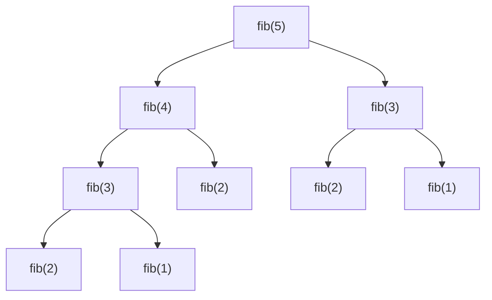
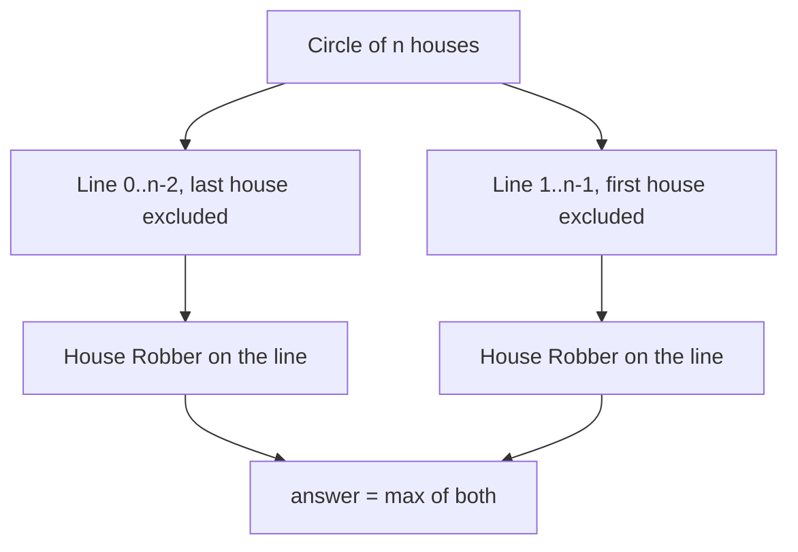
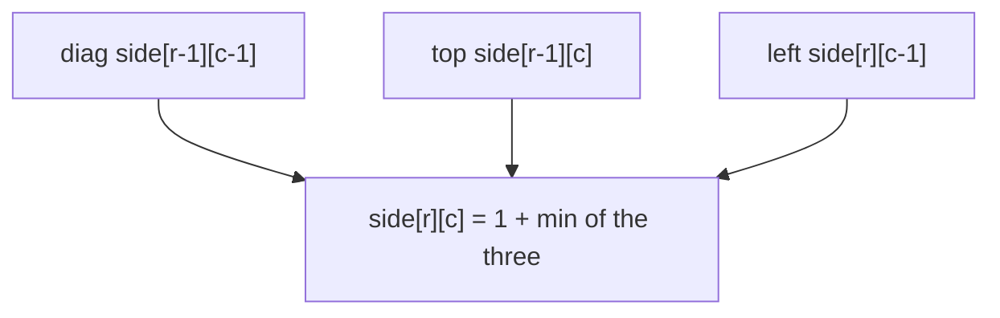
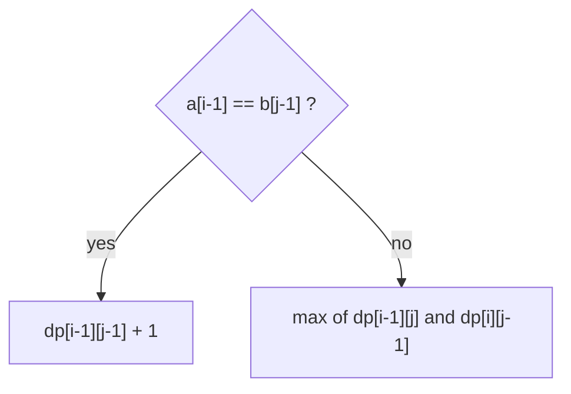
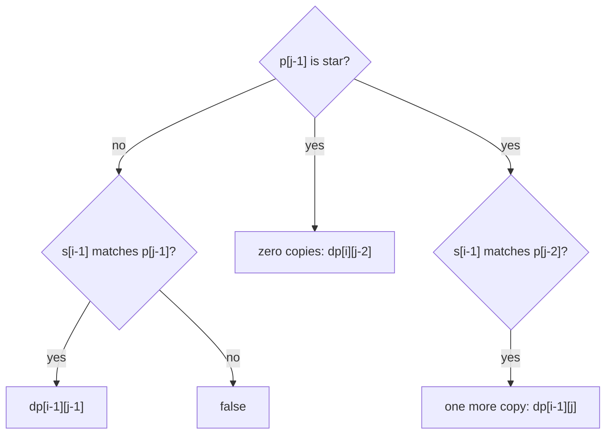
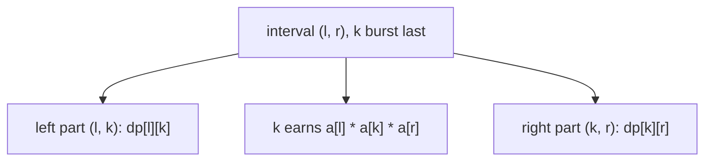
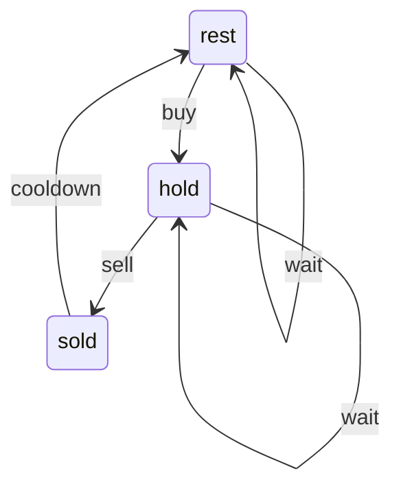
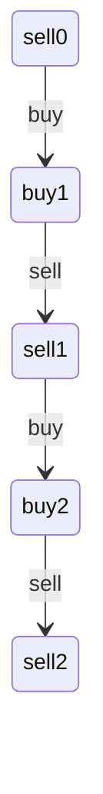

# Dynamic Programming

[⬅ Back to index](../README.md)

Covers: dynamic programming as a repeatable process: spotting overlapping subproblems, defining the state, writing the recurrence, going from recursion to memoisation to a table, and shrinking space — across the main DP families interviewers use.

---

## Thinking in DP

### 1. What is dynamic programming, and how do you recognise a DP problem?

**📘 Concept** · ⭐ Product/FAANG favourite

<details>
<summary>Answer</summary>

**In short:** Dynamic programming is "recursion that remembers". You break a problem into smaller versions of itself, notice that the **same smaller versions are asked for again and again** (overlapping subproblems), and that the best answer to the big problem is built from the best answers to the small ones (optimal substructure). Solve each subproblem once, store the result, and an exponential search becomes polynomial. You can usually smell DP when the question asks for a **count of ways, a minimum/maximum, or a yes/no "is it possible"**, and each step is a **choice** whose consequences depend only on a small amount of state.

#### The two properties

| Property | What it means | Example |
|---|---|---|
| **Optimal substructure** | The best answer for the whole is made of best answers for parts. | The cheapest path to cell `(r, c)` must come through the cheapest path to `(r-1, c)` or `(r, c-1)`. |
| **Overlapping subproblems** | A plain recursion solves the same subproblem many times. | `fib(5)` calls `fib(3)` twice and `fib(2)` three times. |

If you only have the first property, the problem is often **divide and conquer** (merge sort: halves never overlap) or **greedy** (one local choice is always safe — see [Greedy Algorithms](20-greedy.md)). If you only have the second, caching helps but there may be no clean recurrence. DP needs both.

#### Why remembering helps so much

Naive Fibonacci makes a call tree that doubles at every level:



There are only 6 distinct subproblems (`fib(0)..fib(5)`) but the tree has O(2ⁿ) nodes. Storing each answer the first time collapses the tree to a line: O(n). That gap — **distinct states vs. calls made** — is exactly what DP exploits. The cost of any DP is roughly:

> **number of states × work per state**

So `dp[i][j]` over two strings of length m and n with O(1) work each is O(m·n).

#### Signals in the problem statement

- "**How many ways** …" (Climbing Stairs, Decode Ways, Coin Change II, Unique Paths).
- "**Minimum / maximum** cost, length, profit …" (Coin Change, House Robber, Edit Distance, stock problems).
- "**Can you** … / is it possible …" (Word Break, Partition Equal Subset Sum, Regular Expression Matching).
- "**Longest / shortest** subsequence" — subsequences (not substrings) are almost always DP (LIS, LCS).
- Two strings and a comparison between them → a 2D table `dp[i][j]` over prefixes.
- An array where you pick or skip elements under a constraint → knapsack.
- Constraints: `n ≤ 20` hints at bitmask DP (2ⁿ states); `n ≤ 500` hints at O(n³) interval DP; `n ≤ 5000` hints at O(n²); `n ≤ 10⁵` needs O(n) or O(n log n).

#### Signals that it is probably NOT DP

- You must **list all** solutions (all subsets, all permutations) — the output itself is exponential, so use [Recursion & Backtracking](18-recursion-backtracking.md).
- A simple local rule is provably safe (interval scheduling by end time) — greedy.
- Contiguous subarray with a monotonic condition — [sliding window](08-two-pointers-sliding-window.md) is simpler.
- Maximum subarray sum looks like DP and technically is, but the interview answer is Kadane's algorithm — see [Problem-Solving Tricks](06-problem-solving-tricks.md).

#### A quick test you can run in your head

1. Can I write the answer as a recursive function of a **few integers** (an index, a remaining amount, a pair of indices, a mask)?
2. Would that recursion call the same arguments more than once?
3. Is the number of distinct argument combinations small enough (≤ ~10⁷)?

Three yeses means DP. The next question turns this into a step-by-step recipe.

#### DP families in this file

| Family | State shape | Problems here |
|---|---|---|
| 1D / linear | `dp[i]` = answer for prefix `i` | Climbing Stairs, House Robber, Decode Ways, Word Break, LIS |
| Knapsack | `dp[amount]` or `dp[i][amount]` | Coin Change, Coin Change II, Partition Equal Subset Sum, Target Sum |
| Grid | `dp[r][c]` | Unique Paths, Minimum Path Sum, Maximal Square |
| Two sequences | `dp[i][j]` over two prefixes | LCS, Edit Distance, Interleaving String, Regex Matching |
| Interval | `dp[l][r]` over a substring/subarray | Longest Palindromic Subsequence, Burst Balloons |
| State machine | a few named states per day | Stock with Cooldown, Stock III/IV |
| Bitmask | `dp[mask]` over subsets | Partition to K Equal Sum Subsets, TSP |

#### Common mistakes

- Jumping to a table before you can say in one sentence what `dp[i]` **means**. Every bug in DP traces back to a fuzzy state definition.
- Using DP when greedy works (wasted time) or greedy when it doesn't (wrong answer). Coin Change with coins `[1, 3, 4]` and amount 6 breaks greedy: 4+1+1 vs 3+3.
- Forgetting that a state must capture **everything** the future depends on. If two different histories reach "the same" state but have different futures, the state is missing a dimension (e.g. the cooldown flag in the stock problems).

#### Follow-ups

- *Is DP just memoised recursion?* Top-down DP is; bottom-up DP is the same idea filled in an explicit order. See [question 2](#2-the-dp-recipe-from-recursion-to-memo-to-table-to-o1-space).
- *How do you get the complexity of a DP?* States × transitions per state, as above. See [Complexity Analysis](02-complexity-analysis.md).

</details>

### 2. The DP recipe: from recursion to memo to table to O(1) space

**📘 Concept** · ⭐ Product/FAANG favourite

<details>
<summary>Answer</summary>

**In short:** Every DP answer can be built with the same five steps — **(1) define the state, (2) write the transition (the choices), (3) set base cases, (4) pick an evaluation order, (5) say where the answer lives** — and then written in four increasingly efficient forms: plain recursion → recursion with a memo (top-down) → an iterative table (bottom-up) → a table shrunk to the few values the recurrence actually reads. Top-down is easier to get right and only visits needed states; bottom-up has no recursion depth limit, lower constant factors, and is the form that lets you cut space.

We will run the whole recipe on **Min Cost Climbing Stairs**: `cost[i]` is the price of standing on step `i`; you start on step 0 or 1, climb 1 or 2 steps at a time, and want the cheapest way to reach the top (one past the last step). `cost = [10, 15, 20]` → `15` (start on step 1, pay 15, jump two to the top).

#### Step 1 — State: what does one number mean?

`dp[i]` = the minimum cost to **arrive at** step `i` (not yet paying for step `i`). The top is step `n`, so the answer is `dp[n]`.

Write this sentence down before any code. "Minimum cost to arrive at `i`" and "minimum cost to leave from `i`" give different recurrences; mixing them is the classic bug.

#### Step 2 — Transition: what was the last choice?

You arrive at `i` either from `i-1` (paying `cost[i-1]`) or from `i-2` (paying `cost[i-2]`):

`dp[i] = min(dp[i-1] + cost[i-1], dp[i-2] + cost[i-2])`

The trick that makes most recurrences easy: **look at the last decision**, not the first.

#### Step 3 — Base cases

You may start on step 0 or 1 for free: `dp[0] = 0`, `dp[1] = 0`.

#### Step 4 — Order

`dp[i]` reads `dp[i-1]` and `dp[i-2]`, so fill `i` from small to large. In 2D problems, the order is whatever guarantees every cell you read is already filled (row by row, or by increasing interval length).

#### Step 5 — Answer

`dp[n]`.

#### Form 1: plain recursion — O(2ⁿ)

```kotlin
fun minCostRecursive(cost: IntArray): Int {
    fun arrive(i: Int): Int =
        if (i <= 1) 0
        else minOf(arrive(i - 1) + cost[i - 1], arrive(i - 2) + cost[i - 2])
    return arrive(cost.size)
}
```

Correct, but `arrive(i - 2)` is recomputed inside `arrive(i - 1)`, so the work doubles each level.

#### Form 2: top-down memoisation — O(n) time, O(n) space

```kotlin
fun minCostMemo(cost: IntArray): Int {
    val memo = IntArray(cost.size + 1) { -1 }   // -1 = not computed yet
    fun arrive(i: Int): Int {
        if (i <= 1) return 0
        if (memo[i] != -1) return memo[i]
        memo[i] = minOf(arrive(i - 1) + cost[i - 1], arrive(i - 2) + cost[i - 2])
        return memo[i]
    }
    return arrive(cost.size)
}
```

The only change: check the memo before working, store after. Pick a sentinel that can't be a real answer (`-1` here; for problems where `-1` is a legal answer use `Int.MIN_VALUE` or a nullable array).

#### Form 3: bottom-up table — O(n) time, O(n) space

```kotlin
fun minCostTable(cost: IntArray): Int {
    val n = cost.size
    val dp = IntArray(n + 1)          // dp[0] = dp[1] = 0 already
    for (i in 2..n) {
        dp[i] = minOf(dp[i - 1] + cost[i - 1], dp[i - 2] + cost[i - 2])
    }
    return dp[n]
}
```

#### Walkthrough of the table

`cost = [10, 15, 20]`, `n = 3`

| i | from i-1 | from i-2 | dp[i] |
|---|---|---|---|
| 0 | — | — | 0 |
| 1 | — | — | 0 |
| 2 | dp[1] + 15 = 15 | dp[0] + 10 = 10 | **10** |
| 3 | dp[2] + 20 = 30 | dp[1] + 15 = 15 | **15** |

#### Form 4: space-optimised — O(n) time, O(1) space

The recurrence reads only the previous two values, so keep two variables:

```kotlin
fun minCostClimbingStairs(cost: IntArray): Int {
    var twoBack = 0   // dp[i-2]
    var oneBack = 0   // dp[i-1]
    for (i in 2..cost.size) {
        val cur = minOf(oneBack + cost[i - 1], twoBack + cost[i - 2])
        twoBack = oneBack
        oneBack = cur
    }
    return oneBack
}
```

The general rule: **look at which earlier cells the recurrence reads.** If `dp[i]` reads only row `i-1`, keep one or two rows. If it reads `dp[i-1][j-1]` as well, you need one extra variable to save the diagonal before it is overwritten (see [LCS](#16-longest-common-subsequence)). In 1D knapsack the loop direction decides whether an item can be reused (see [Partition Equal Subset Sum](#11-partition-equal-subset-sum)).

#### Top-down vs bottom-up: trade-offs

| | Top-down (memo) | Bottom-up (table) |
|---|---|---|
| How you write it | Recursion + cache; mirrors the recurrence directly | Loops in a dependency-safe order |
| States computed | Only the ones reachable from the start | All of them, even unused |
| Recursion depth | O(depth) stack — can overflow around 10⁴–10⁵ frames on the JVM or in Swift | No stack risk |
| Constant factor | Function call + cache lookup per state | Tight loops, cache-friendly arrays |
| Space optimisation | Hard — the memo must keep everything | Natural — drop rows you no longer read |
| Ordering effort | None: recursion finds the order for you | You must work out the order (tricky for interval DP) |
| Good when | State space is sparse or awkward (tuples, masks with pruning), or you're unsure of the order | n is large, you need O(1)/O(n) space, or the interviewer asks for iterative |

**Interview strategy:** say the recurrence, write top-down first if it's faster for you to get correct, then convert to bottom-up and shrink space if asked. Converting is mechanical: base cases become initial cells, the recursive calls become array reads, and the order is "everything a cell reads must come first".

#### Space-optimisation patterns

| Recurrence reads | Keep | Example |
|---|---|---|
| `dp[i-1]`, `dp[i-2]` | two variables | Climbing Stairs, House Robber |
| previous row only | one 1D array | Unique Paths, Minimum Path Sum |
| previous row + diagonal | one 1D array + one saved variable | LCS, Edit Distance, Maximal Square |
| 0/1 knapsack `dp[i-1][s - w]` | one 1D array, loop `s` **downwards** | Partition Equal Subset Sum |
| unbounded knapsack `dp[i][s - w]` | one 1D array, loop `s` **upwards** | Coin Change, Coin Change II |
| a few named states per step | a few variables | stock state machines |

Space optimisation has a cost: you lose the full table, so you can no longer **reconstruct** the actual path/subsequence by walking back through it. If the interviewer asks for the items, not just the value, keep the table.

#### Common mistakes

- Memo sentinel collides with a real answer (e.g. using `0` as "not computed" when 0 is a valid result) — the memo silently does nothing.
- Off-by-one in state meaning: `dp[i]` for "first i elements" (size n+1) vs "ending at index i" (size n). Pick one and say it out loud.
- Space-optimising before the solution is correct. Get the table right, then shrink.
- Forgetting that Kotlin local recursive functions still use the thread stack — deep top-down recursion can throw `StackOverflowError`.

#### Follow-ups

- *Can every recursion be memoised?* Only if the result depends solely on the arguments (no hidden mutable state). Backtracking that mutates a shared path is not memoisable as-is.
- *What if the state is a string or a list?* Encode it as integers (indices, a bitmask) or use a `HashMap` keyed by a small data class — slower but fine for sparse states.
- *How do you print the actual solution?* Keep the full table (or a parent array) and walk backwards from the answer cell choosing the transition that produced each value.

</details>

## 1D DP

### 3. Climbing Stairs

**🟢 Easy** · ⭐ Product/FAANG favourite (commonly reported at Amazon, Google)

<details>
<summary>Answer</summary>

**In short:** To reach step `n` your last move was either 1 step (from `n-1`) or 2 steps (from `n-2`), so `ways(n) = ways(n-1) + ways(n-2)` — the Fibonacci recurrence. Fill it bottom-up with two variables: O(n) time, O(1) space.

#### Problem

You climb a staircase of `n` steps, taking 1 or 2 steps at a time. How many distinct sequences of moves reach the top?

- `n = 2` → `2` (1+1, 2)
- `n = 3` → `3` (1+1+1, 1+2, 2+1)
- `n = 5` → `8`

#### Clarifying questions & edge cases

- Range of `n`? LeetCode uses `1 ≤ n ≤ 45`, which fits in `Int` (`ways(45) = 1,836,311,903`). Larger `n` needs `Long`, `BigInteger` or a modulus.
- Do order differences count? Yes — 1+2 and 2+1 are different.
- `n = 1` → `1`. What about `n = 0`? Conventionally 1 (the empty climb), which is also what makes the recurrence work.

#### Brute force

Recursively try both moves: `count(n) = count(n-1) + count(n-2)`. Correct but the call tree has O(φⁿ) ≈ O(1.6ⁿ) nodes because `count(n-2)` is recomputed inside `count(n-1)`. `n = 45` is over a billion calls.

#### Key insight

Apply the recipe from [question 2](#2-the-dp-recipe-from-recursion-to-memo-to-table-to-o1-space):

1. **State:** `ways[i]` = number of distinct ways to stand on step `i`.
2. **Transition:** the last move into `i` came from `i-1` or `i-2`, and those two groups don't overlap (they end with different moves), so `ways[i] = ways[i-1] + ways[i-2]`.
3. **Base:** `ways[0] = 1`, `ways[1] = 1`.
4. **Order:** increasing `i`.
5. **Answer:** `ways[n]`.

Because only the previous two values are read, two variables are enough.

#### Walkthrough

`n = 5`

| i | ways[i-2] | ways[i-1] | ways[i] |
|---|---|---|---|
| 0 | — | — | 1 |
| 1 | — | — | 1 |
| 2 | 1 | 1 | 2 |
| 3 | 1 | 2 | 3 |
| 4 | 2 | 3 | 5 |
| 5 | 3 | 5 | **8** |

#### Kotlin

```kotlin
fun climbStairs(n: Int): Int {
    var twoBack = 1   // ways[i-2], starts as ways[0]
    var oneBack = 1   // ways[i-1], starts as ways[1]
    for (i in 2..n) {
        val cur = oneBack + twoBack
        twoBack = oneBack
        oneBack = cur
    }
    return oneBack    // n = 1 skips the loop and returns 1
}
```

#### Swift

```swift
func climbStairs(_ n: Int) -> Int {
    var twoBack = 1, oneBack = 1
    if n < 2 { return 1 }
    for _ in 2...n {               // 2...n traps if n < 2, hence the guard above
        (twoBack, oneBack) = (oneBack, oneBack + twoBack)
    }
    return oneBack
}
```

Swift's closed range `2...n` crashes when `n < 2`, unlike Kotlin's `2..n`, which is simply empty. Swift's `Int` is 64-bit on all modern devices, so it doesn't overflow at `n = 45`.

#### Complexity

- **Time:** O(n) — one pass with constant work per step.
- **Space:** O(1) — two variables. (A table version is O(n).)

#### Common mistakes

- Plain recursion without memo — times out.
- Base cases `ways[1] = 1, ways[2] = 2` and then indexing `ways[2]` when `n = 1` → out of bounds.
- Building `2...n` in Swift without guarding small `n`.

#### Follow-ups

- *Steps of size 1, 2 or 3, or any set `steps`?* `ways[i] = Σ ways[i - s]` for `s` in steps — O(n·|steps|). This is exactly the "permutations" loop order discussed in [Coin Change II](#7-coin-change-ii).
- *Huge n (10¹⁸) mod 1e9+7?* Matrix exponentiation of `[[1,1],[1,0]]` in O(log n) — see [Bit Manipulation & Math](21-bit-manipulation-math.md) for fast power.
- *Each step has a cost?* That's Min Cost Climbing Stairs — worked in [question 2](#2-the-dp-recipe-from-recursion-to-memo-to-table-to-o1-space).

</details>

### 4. House Robber

**🟡 Medium** · ⭐ Product/FAANG favourite (commonly reported at Amazon, Microsoft)

<details>
<summary>Answer</summary>

**In short:** At each house you either **skip it** (keep the best so far) or **rob it** (its money plus the best up to two houses back). `best[i] = max(best[i-1], best[i-2] + nums[i])`. Two rolling variables give O(n) time and O(1) space.

#### Problem

Houses in a row hold `nums[i]` money. You can't rob two adjacent houses. Return the maximum you can steal.

- `[1, 2, 3, 1]` → `4` (houses 0 and 2)
- `[2, 7, 9, 3, 1]` → `12` (2 + 9 + 1)

#### Clarifying questions & edge cases

- Empty array → 0. Single house → its value.
- Values non-negative? (Yes on LeetCode. With negatives you'd simply never rob a negative house — the `max` with "skip" already handles it.)
- Return the amount only, or which houses? Only the amount; reconstructing needs the full table.

#### Brute force

Try every subset with no two adjacent — still exponential (the count of such subsets grows like Fibonacci). A recursion `rob(i) = max(rob(i+1), nums[i] + rob(i+2))` has the same overlapping-subproblem tree as Climbing Stairs.

#### Key insight

Ask "what happens at the **last** house `i`?" Only two cases:

- You don't rob `i`: the best is whatever was best for houses `0..i-1`.
- You rob `i`: you can't rob `i-1`, so it's `nums[i]` + best for `0..i-2`.

**State:** `best[i]` = max money from houses `0..i`. **Transition:** `best[i] = max(best[i-1], best[i-2] + nums[i])`. **Base:** `best[-1] = best[-2] = 0` (no houses). This is safe because the best for a prefix doesn't depend on anything after it — optimal substructure.

Greedy alternatives fail: "take every other house" misses `[2, 1, 1, 2]` (best is 2 + 2 = 4, using houses 0 and 3, which are not every-other).

#### Walkthrough

`nums = [2, 7, 9, 3, 1]`. `prev2` = best up to i-2, `prev1` = best up to i-1.

| i | nums[i] | skip = prev1 | rob = prev2 + nums[i] | best[i] |
|---|---|---|---|---|
| 0 | 2 | 0 | 0 + 2 = 2 | 2 |
| 1 | 7 | 2 | 0 + 7 = 7 | 7 |
| 2 | 9 | 7 | 2 + 9 = 11 | 11 |
| 3 | 3 | 11 | 7 + 3 = 10 | 11 |
| 4 | 1 | 11 | 11 + 1 = 12 | **12** |

#### Kotlin

```kotlin
fun rob(nums: IntArray): Int {
    var prev2 = 0   // best up to house i-2
    var prev1 = 0   // best up to house i-1
    for (money in nums) {
        val cur = maxOf(prev1, prev2 + money)   // skip vs rob
        prev2 = prev1
        prev1 = cur
    }
    return prev1
}
```

Starting both at 0 means "zero houses" — so empty input returns 0 and a single house returns its value with no special cases.

#### Complexity

- **Time:** O(n) — one pass.
- **Space:** O(1) — two variables.

#### Common mistakes

- Special-casing `n == 1` and `n == 2` with array indexing, then getting an index error on empty input. The zero-initialised variables avoid all of that.
- Updating `prev2 = prev1` **after** `prev1 = cur` — you lose the old `prev1`.
- Assuming you must alternate houses.

#### Follow-ups

- *Houses in a circle?* [House Robber II](#5-house-robber-ii).
- *Houses on a binary tree (House Robber III)?* Post-order DFS returning a pair `(robThis, skipThis)`: `robThis = node.val + left.skip + right.skip`, `skipThis = max(left) + max(right)`. See [Trees & BSTs](14-trees-bst.md).
- *Delete and Earn?* Bucket the values by number, then it's House Robber over the values (taking `x` forbids `x-1` and `x+1`).

</details>

### 5. House Robber II

**🟡 Medium**

<details>
<summary>Answer</summary>

**In short:** In a circle, the first and last houses are neighbours, so at most one of them is robbed. Split into two linear problems — houses `0..n-2` (exclude the last) and `1..n-1` (exclude the first) — solve each with House Robber, and take the max. O(n) time, O(1) space.

#### Problem

Same as [House Robber](#4-house-robber), but the houses form a circle: house `0` and house `n-1` are adjacent.

- `[2, 3, 2]` → `3` (can't take both 2s — they are neighbours)
- `[1, 2, 3, 1]` → `4`
- `[1, 2, 3]` → `3`

#### Clarifying questions & edge cases

- `n = 1`: the single house is not adjacent to itself — answer is `nums[0]`. Both sub-ranges would be empty, so this needs a special case.
- `n = 2`: answer is `max(nums[0], nums[1])` — the general split already gives this.
- Values non-negative.

#### Brute force

Enumerate valid subsets on the circle — exponential. Or run a DP that tracks "did I rob house 0?" as an extra state, which works but is fiddlier than the split.

#### Key insight

The circle adds exactly one constraint: **not both house 0 and house n-1**. Every valid plan falls into at least one of two cases:

- House `n-1` is not robbed → the plan is a valid plan on the line `0..n-2`.
- House `0` is not robbed → the plan is a valid plan on the line `1..n-1`.

(A plan that robs neither belongs to both — that's fine, we're taking a max.) Conversely, any plan on either line is valid on the circle because it can't contain both ends. So the answer is the max of two linear House Robber runs.



#### Walkthrough

`nums = [2, 7, 9, 3, 1]`

| Range | Values | House Robber result |
|---|---|---|
| 0..3 | 2, 7, 9, 3 | 2 + 9 = 11 |
| 1..4 | 7, 9, 3, 1 | 7 + 3 = 10, or 9 + 1 = 10 → 10 |
| answer | | **11** |

On the line, the answer was 12 (2 + 9 + 1), but in a circle 2 and 1 are neighbours, so 11 is the best.

#### Kotlin

```kotlin
fun robCircle(nums: IntArray): Int {
    if (nums.size == 1) return nums[0]
    return maxOf(robRange(nums, 0, nums.size - 2), robRange(nums, 1, nums.size - 1))
}

// Linear House Robber on nums[from..to] inclusive.
private fun robRange(nums: IntArray, from: Int, to: Int): Int {
    var prev2 = 0
    var prev1 = 0
    for (i in from..to) {
        val cur = maxOf(prev1, prev2 + nums[i])
        prev2 = prev1
        prev1 = cur
    }
    return prev1
}
```

Passing index bounds instead of `copyOfRange` avoids allocating two new arrays.

#### Complexity

- **Time:** O(n) — two linear passes.
- **Space:** O(1).

#### Common mistakes

- Forgetting the `n == 1` case: both ranges are empty and you return 0 instead of `nums[0]`.
- Trying to "fix up" the linear answer afterwards (e.g. subtract the smaller end) — that isn't correct in general.
- Running on `0..n-1` and `1..n-1` (only one end excluded) — the first range still allows both ends.

#### Follow-ups

- *Can you do it in one pass?* Yes — run two state machines side by side (one that has robbed house 0 is forbidden from robbing the last), but the split is clearer and has the same complexity.
- *General lesson?* "Circular" constraints on a linear DP are usually broken by fixing what happens at one end and solving 2 linear cases. The same trick appears in circular maximum subarray — see [Problem-Solving Tricks](06-problem-solving-tricks.md).

</details>

### 6. Coin Change

**🟡 Medium** · ⭐ Product/FAANG favourite (commonly reported at Amazon, Google)

<details>
<summary>Answer</summary>

**In short:** Unbounded knapsack for a minimum. `dp[a]` = fewest coins that make amount `a`; the last coin used was some `c`, so `dp[a] = 1 + min(dp[a - c])` over all coins. Start with `dp[0] = 0` and "infinity" elsewhere; answer `dp[amount]` or `-1`. O(amount × coins) time, O(amount) space.

#### Problem

Given coin denominations (unlimited supply of each) and a target `amount`, return the minimum number of coins that sum to `amount`, or `-1` if impossible.

- `coins = [1, 2, 5], amount = 11` → `3` (5 + 5 + 1)
- `coins = [2], amount = 3` → `-1`
- `coins = [1], amount = 0` → `0`

#### Clarifying questions & edge cases

- `amount = 0` → 0 coins.
- Unreachable amounts → `-1` (make sure "infinity" doesn't leak out).
- Coins larger than `amount` are simply never usable.
- Are coin values distinct and positive? Assume positive; duplicates don't hurt.

#### Brute force

Greedy "take the largest coin that fits" is **wrong** for non-canonical coin systems: `coins = [1, 3, 4], amount = 6` → greedy gives 4 + 1 + 1 = 3 coins, but 3 + 3 = 2 coins. Exhaustive recursion `minCoins(a) = 1 + min(minCoins(a - c))` is correct but exponential, because `minCoins(a)` for each smaller `a` is reached through many different coin orders.

#### Key insight

The recursion only ever asks about amounts `0..amount`, so there are just `amount + 1` distinct subproblems.

1. **State:** `dp[a]` = minimum coins to make exactly `a`.
2. **Transition:** the last coin is some `c ≤ a`; the rest must be an optimal way to make `a - c`. `dp[a] = min over c of dp[a - c] + 1`.
3. **Base:** `dp[0] = 0`; everything else starts as "infinity" (`amount + 1` works because you can never need more than `amount` coins of value ≥ 1).
4. **Order:** increasing `a`, since `dp[a]` reads smaller amounts.
5. **Answer:** `dp[amount]`, or `-1` if it's still infinity.

Using `amount + 1` instead of `Int.MAX_VALUE` as infinity avoids overflow when you add 1.

#### Walkthrough

`coins = [1, 3, 4]`, `amount = 6` (the case that breaks greedy)

| a | via 1: dp[a-1]+1 | via 3: dp[a-3]+1 | via 4: dp[a-4]+1 | dp[a] |
|---|---|---|---|---|
| 0 | — | — | — | 0 |
| 1 | 1 | — | — | 1 |
| 2 | 2 | — | — | 2 |
| 3 | 3 | 1 | — | 1 |
| 4 | 2 | 2 | 1 | 1 |
| 5 | 2 | 3 | 2 | 2 |
| 6 | 3 | **2** | 3 | **2** |

`dp[6] = 2` comes from `dp[3] + 1` → 3 + 3.

#### Kotlin

```kotlin
fun coinChange(coins: IntArray, amount: Int): Int {
    val inf = amount + 1                    // larger than any real answer
    val dp = IntArray(amount + 1) { inf }
    dp[0] = 0
    for (a in 1..amount) {
        for (c in coins) {
            if (c <= a && dp[a - c] + 1 < dp[a]) {
                dp[a] = dp[a - c] + 1
            }
        }
    }
    return if (dp[amount] == inf) -1 else dp[amount]
}
```

#### Swift

```swift
func coinChange(_ coins: [Int], _ amount: Int) -> Int {
    let inf = amount + 1
    var dp = [Int](repeating: inf, count: amount + 1)
    dp[0] = 0
    if amount == 0 { return 0 }             // 1...0 would trap
    for a in 1...amount {
        for c in coins where c <= a {
            dp[a] = min(dp[a], dp[a - c] + 1)
        }
    }
    return dp[amount] == inf ? -1 : dp[amount]
}
```

#### Complexity

- **Time:** O(amount × k) for k coins — every amount tries every coin.
- **Space:** O(amount) — one array.

#### Common mistakes

- Greedy by largest coin (see the counter-example above — also covered in [Greedy Algorithms](20-greedy.md)).
- Using `Int.MAX_VALUE` as infinity and computing `dp[a - c] + 1` → overflow to a negative number that then wins every `min`.
- Returning `dp[amount]` without mapping infinity back to `-1`.
- BFS is also valid (amounts as nodes, coins as edges, shortest path = fewest coins), but if you use it, mark amounts visited or it explodes.

#### Follow-ups

- *Count the ways instead of the minimum?* [Coin Change II](#7-coin-change-ii) — same table, `+` instead of `min`, and loop order starts to matter.
- *Return the coins used?* Keep `lastCoin[a]` = the coin that improved `dp[a]`, then walk `a -= lastCoin[a]` from `amount`.
- *Each coin usable once?* That's 0/1 knapsack — loop amounts downwards per coin (see [Partition Equal Subset Sum](#11-partition-equal-subset-sum)).

</details>

### 7. Coin Change II

**🟡 Medium** · ⭐ Product/FAANG favourite

<details>
<summary>Answer</summary>

**In short:** Count combinations (order doesn't matter) that sum to `amount` with unlimited coins. `dp[a]` = number of ways to make `a`; for **each coin in the outer loop**, sweep amounts upward and do `dp[a] += dp[a - coin]`. Putting coins outside means each combination is counted once, in a fixed coin order. Swapping the loops counts **permutations** instead. O(amount × coins) time, O(amount) space.

#### Problem

Given coin denominations (unlimited supply) and `amount`, return the number of **combinations** that make `amount`.

- `amount = 5, coins = [1, 2, 5]` → `4` (5; 2+2+1; 2+1+1+1; 1+1+1+1+1)
- `amount = 3, coins = [2]` → `0`
- `amount = 0` → `1` (the empty combination)

#### Clarifying questions & edge cases

- Is `1+2` the same as `2+1`? Yes — combinations. (If not, see the follow-up.)
- `amount = 0` → 1 way.
- Overflow: LeetCode guarantees the answer fits in a signed 32-bit int. Interview variants often say "mod 1e9+7".

#### Brute force

Recursion `count(i, a)` = ways using coins `i..k-1` for amount `a` = `count(i, a - coins[i])` (use coin i again) + `count(i + 1, a)` (move past coin i). Without memo it's exponential; with a memo it's already O(k × amount) — that's the 2D DP. The 1D version below is the same thing with the coin dimension rolled away.

#### Key insight: why loop order matters

Think of a combination as a **multiset** of coins written in sorted coin order: 1s first, then 2s, then 5s. If we process coins one at a time (outer loop), then after finishing coin `c`, `dp[a]` = number of ways to make `a` using only coins processed so far. When we add coin `c`, the transition `dp[a] += dp[a - c]` means "a way to make `a` that uses at least one `c`, where the rest uses coins up to and including `c`". A combination can only be built in one order, so it's counted exactly once.

If instead the **amount** is the outer loop and coins the inner loop, `dp[a] = Σ dp[a - c]` asks "what was the last coin?" over all coins — so `1+2` and `2+1` are counted separately. That's the permutation count (LeetCode 377, Combination Sum IV).

| Loop order | Counts | amount = 3, coins = [1, 2] |
|---|---|---|
| coins outer, amounts inner | combinations | 2 → {1,1,1}, {1,2} |
| amounts outer, coins inner | permutations (ordered) | 3 → 1+1+1, 1+2, 2+1 |

Why ascending amounts? Inside one coin's pass, ascending order lets `dp[a - c]` already include uses of `c` — that's what makes the coin **unlimited**. Descending would allow each coin at most once (0/1 knapsack).

#### Walkthrough

`amount = 5`, `coins = [1, 2, 5]`. Each row is `dp[0..5]` after processing that coin.

| after coin | dp[0] | dp[1] | dp[2] | dp[3] | dp[4] | dp[5] |
|---|---|---|---|---|---|---|
| start | 1 | 0 | 0 | 0 | 0 | 0 |
| 1 | 1 | 1 | 1 | 1 | 1 | 1 |
| 2 | 1 | 1 | 2 | 2 | 3 | 3 |
| 5 | 1 | 1 | 2 | 2 | 3 | **4** |

Row "2": `dp[4] = 1 + dp[2] = 1 + 2 = 3` ({1,1,1,1}, {1,1,2}, {2,2}). Row "5": `dp[5] = 3 + dp[0] = 4`.

#### Kotlin

```kotlin
fun change(amount: Int, coins: IntArray): Int {
    val dp = IntArray(amount + 1)
    dp[0] = 1                       // one way to make 0: take nothing
    for (coin in coins) {           // coins OUTER -> combinations
        for (a in coin..amount) {   // ascending -> each coin unlimited
            dp[a] += dp[a - coin]
        }
    }
    return dp[amount]
}
```

Permutation version (for contrast — this is Combination Sum IV):

```kotlin
fun countOrderedWays(amount: Int, coins: IntArray): Int {
    val dp = IntArray(amount + 1)
    dp[0] = 1
    for (a in 1..amount) {          // amounts OUTER -> ordered sequences
        for (coin in coins) if (coin <= a) dp[a] += dp[a - coin]
    }
    return dp[amount]
}
```

#### Complexity

- **Time:** O(amount × k).
- **Space:** O(amount).

#### Common mistakes

- Swapping the loops and getting permutations (the walkthrough example would give 9 instead of 4).
- `dp[0] = 0` — then nothing is ever counted. The empty combination is the seed.
- In the permutation variant, intermediate values can overflow `Int` even when the final answer fits; use `Long` or the problem's modulus.

#### Follow-ups

- *Each coin at most once?* Loop amounts **descending** inside the coin loop.
- *Minimum coins instead of count?* [Coin Change](#6-coin-change).
- *Explain the 2D version?* `dp[i][a] = dp[i-1][a] + dp[i][a - coins[i-1]]` — "don't use coin i at all" plus "use it at least once". The 1D array is this table with row `i-1` overwritten in place.

</details>

### 8. Decode Ways

**🟡 Medium** · ⭐ Product/FAANG favourite (commonly reported at Meta)

<details>
<summary>Answer</summary>

**In short:** `dp[i]` = number of ways to decode the first `i` characters. The last chunk is either one digit (valid if it isn't `'0'`) or two digits (valid if `10..26`), so `dp[i] = (one-digit ok ? dp[i-1] : 0) + (two-digit ok ? dp[i-2] : 0)`. It's Climbing Stairs with validity checks. O(n) time, O(1) space.

#### Problem

Letters map `A=1 … Z=26`. Given a digit string, count how many ways it can be decoded.

- `"12"` → `2` ("AB" or "L")
- `"226"` → `3` (2-2-6, 22-6, 2-26)
- `"06"` → `0` ("06" isn't valid and "0" alone isn't a letter)

#### Clarifying questions & edge cases

- Zeros: `'0'` can only appear as the second digit of `10` or `20`. `"100"` → 0, `"30"` → 0.
- Leading zero → 0 immediately.
- Answer fits in 32-bit for LeetCode's constraints (length ≤ 100).
- Is `*` a wildcard? That's Decode Ways II — mention it as a follow-up.

#### Brute force

Recursively peel one or two digits from the front. Correct, but `decode("…")` on the same suffix is reached via different splits — exponential, exactly like Climbing Stairs.

#### Key insight

Look at the **last** chunk of a decoding of `s[0 until i]`:

- One digit `s[i-1]`: allowed if it's `'1'..'9'`. The rest is any decoding of the first `i-1` chars → `dp[i-1]` ways.
- Two digits `s[i-2..i-1]`: allowed if the number is `10..26` (this excludes leading zeros like `"05"`). The rest → `dp[i-2]` ways.

The two groups don't overlap (they end with different chunks), so add them. **Base:** `dp[0] = 1` (empty string has one decoding — the empty one). `dp[1] = 1` if `s[0] != '0'`, else 0.

#### Walkthrough

`s = "226"`

| i | prefix | one digit | two digits | dp[i] |
|---|---|---|---|---|
| 0 | "" | — | — | 1 |
| 1 | "2" | '2' ok → dp[0] = 1 | — | 1 |
| 2 | "22" | '2' ok → dp[1] = 1 | "22" ok → dp[0] = 1 | 2 |
| 3 | "226" | '6' ok → dp[2] = 2 | "26" ok → dp[1] = 1 | **3** |

And `s = "106"`: dp = 1, 1, ("0" invalid → 0) + ("10" ok → 1) = 1, ('6' → 1) + ("06" invalid → 0) = **1** ("J F").

#### Kotlin

```kotlin
fun numDecodings(s: String): Int {
    if (s.isEmpty() || s[0] == '0') return 0
    var twoBack = 1   // dp[i-2], starts as dp[0]
    var oneBack = 1   // dp[i-1], starts as dp[1]
    for (i in 2..s.length) {
        var cur = 0
        if (s[i - 1] != '0') cur += oneBack                          // single digit
        val two = (s[i - 2] - '0') * 10 + (s[i - 1] - '0')
        if (two in 10..26) cur += twoBack                            // two digits
        twoBack = oneBack
        oneBack = cur
    }
    return oneBack
}
```

If `oneBack` becomes 0 at some point (e.g. `"100"`), the answer stays 0 for the rest — correct, as no decoding can recover.

#### Complexity

- **Time:** O(n).
- **Space:** O(1).

#### Common mistakes

- Checking `two <= 26` but not `two >= 10` — counts `"06"` as a letter.
- `dp[0] = 0` instead of 1 — every count collapses to 0.
- Forgetting the leading-zero check, so `"0"` returns 1.
- Top-down recursion on substrings (`s.substring(1)`) — O(n²) copying on top of the recursion; pass an index instead.

#### Follow-ups

- *Decode Ways II with `*` (any 1-9)?* Same DP, but each case contributes a multiplier: `*` alone gives 9×, `1*` gives 9×, `2*` gives 6×, `**` gives 15×; take the answer mod 1e9+7.
- *Return all decodings?* That's output-exponential — [Recursion & Backtracking](18-recursion-backtracking.md).
- *Why is this like Climbing Stairs?* Same shape: 1- or 2-sized steps, but each step is only allowed if the chunk is valid.

</details>

### 9. Word Break

**🟡 Medium** · ⭐ Product/FAANG favourite (commonly reported at Amazon, Google, Meta)

<details>
<summary>Answer</summary>

**In short:** `dp[i]` = "the first `i` characters can be split into dictionary words". `dp[i]` is true if some earlier cut `j` has `dp[j]` true and `s[j until i]` is in the dictionary. Put the words in a `HashSet` and only try cuts within the longest word length. O(n · L²) time with L = max word length (O(n³) if you don't bound it), O(n) space.

#### Problem

Given a string `s` and a list of words, can `s` be segmented into a sequence of one or more dictionary words (words may be reused)?

- `s = "leetcode", dict = ["leet", "code"]` → `true`
- `s = "applepenapple", dict = ["apple", "pen"]` → `true`
- `s = "catsandog", dict = ["cats", "dog", "sand", "and", "cat"]` → `false`

#### Clarifying questions & edge cases

- Can a word be used more than once? Yes.
- Empty string → `true` by convention (`dp[0]`).
- Case sensitivity, dictionary size, max word length — the max length bounds the inner loop.

#### Brute force

Try every prefix that is a word and recurse on the rest. On inputs like `s = "aaaa…ab"`, `dict = ["a", "aa", "aaa", …]` this explores an exponential number of splits, all failing at the end. The fix is noticing the recursion only depends on the **start index** of the remaining suffix — n + 1 distinct states.

#### Key insight

1. **State:** `dp[i]` = `s[0 until i]` can be fully segmented.
2. **Transition:** consider the last word `s[j until i]`. `dp[i] = OR over j of (dp[j] && s[j until i] in dict)`.
3. **Base:** `dp[0] = true`.
4. **Order:** increasing `i`.
5. **Answer:** `dp[n]`.

Optimisation: the last word is at most `maxLen` long, so only `j ≥ i - maxLen` matter. Break as soon as one `j` works.

#### Walkthrough

`s = "leetcode"`, dict = {leet, code}. Only the true entries and their witness are shown.

| i | s[0 until i] | witness j | s[j until i] | dp[i] |
|---|---|---|---|---|
| 0 | "" | — | — | T |
| 1–3 | "l", "le", "lee" | none | — | F |
| 4 | "leet" | 0 | "leet" ∈ dict | **T** |
| 5–7 | "leetc" … "leetcod" | none (dp[4] true but "c", "co", "cod" not words) | — | F |
| 8 | "leetcode" | 4 | "code" ∈ dict | **T** |

#### Kotlin

```kotlin
fun wordBreak(s: String, wordDict: List<String>): Boolean {
    val words = wordDict.toHashSet()
    val maxLen = wordDict.maxOfOrNull { it.length } ?: 0
    val n = s.length
    val dp = BooleanArray(n + 1)
    dp[0] = true
    for (i in 1..n) {
        // Try the last word s[j until i], at most maxLen long.
        for (j in i - 1 downTo maxOf(0, i - maxLen)) {
            if (dp[j] && s.substring(j, i) in words) {
                dp[i] = true
                break
            }
        }
    }
    return dp[n]
}
```

#### Complexity

- **Time:** O(n · L · L): n end positions × up to L cut points × O(L) to build and hash each substring. Without the `maxLen` bound it's O(n³).
- **Space:** O(n) for `dp` plus the dictionary set.

#### Common mistakes

- Greedy "take the longest matching word" — `"cars"` with `["car", "ca", "rs"]` fails greedily ("car" leaves "s"), while "ca" + "rs" works.
- Checking `words.contains` on a `List` — O(dict size) per lookup.
- Top-down recursion without a memo — the exponential case above times out.

#### Follow-ups

- *Return all sentences (Word Break II)?* Backtracking with a memo from index → list of sentences; output can be exponential. See [Recursion & Backtracking](18-recursion-backtracking.md).
- *Huge dictionary, many queries?* Put words in a trie and walk forward from each true `dp[j]` — stops as soon as no word continues. See [Tries & String Algorithms](15-tries-string-algorithms.md).
- *BFS alternative?* Indices are nodes, a word from `j` to `i` is an edge; reachability of `n` from `0`. Same complexity.

</details>

### 10. Longest Increasing Subsequence

**🟡 Medium** · ⭐ Product/FAANG favourite (commonly reported at Google, Amazon, Microsoft)

<details>
<summary>Answer</summary>

**In short:** O(n²) DP: `dp[i]` = length of the longest strictly increasing subsequence **ending at** `i` = `1 + max(dp[j])` over `j < i` with `nums[j] < nums[i]`. O(n log n) "patience sorting": keep `tails[k]` = the smallest possible last value of an increasing subsequence of length `k + 1`; for each number, binary-search the first tail `≥ x` and replace it (or append). The answer is `tails.size`.

#### Problem

Return the length of the longest strictly increasing subsequence (not necessarily contiguous).

- `[10, 9, 2, 5, 3, 7, 101, 18]` → `4` (e.g. 2, 3, 7, 18)
- `[0, 1, 0, 3, 2, 3]` → `4`
- `[7, 7, 7, 7]` → `1`

#### Clarifying questions & edge cases

- Strictly increasing or non-decreasing? Strict here — it decides `lower bound` vs `upper bound` in the fast version.
- Empty → 0. All equal → 1.
- Length only, or the subsequence itself? Reconstructing needs parent pointers.

#### Brute force

Try all 2ⁿ subsequences and check each — O(2ⁿ · n).

#### Approach 1: O(n²) DP

Why "ending at `i`"? Because to extend a subsequence with `nums[i]` you need to know its **last** value. "LIS of the prefix" alone doesn't tell you whether `nums[i]` can be appended.

- **State:** `dp[i]` = LIS length ending exactly at index `i`.
- **Transition:** `dp[i] = 1 + max(dp[j] for j < i with nums[j] < nums[i])`, or 1 if none.
- **Answer:** `max(dp)` — the LIS can end anywhere.

`nums = [10, 9, 2, 5, 3, 7, 101, 18]`

| i | 0 | 1 | 2 | 3 | 4 | 5 | 6 | 7 |
|---|---|---|---|---|---|---|---|---|
| nums[i] | 10 | 9 | 2 | 5 | 3 | 7 | 101 | 18 |
| dp[i] | 1 | 1 | 1 | 2 | 2 | 3 | 4 | 4 |

`dp[5] = 3`: 7 can follow 2 (dp 1), 5 (dp 2) or 3 (dp 2) → 1 + 2.

#### Approach 2: O(n log n) with tails

**Invariant:** `tails[k]` is the smallest tail value among all increasing subsequences of length `k + 1` seen so far. `tails` is always strictly increasing (a length-3 subsequence's tail is bigger than some length-2 tail, so the smallest length-2 tail is smaller still).

For each `x`:

- If `x` is bigger than every tail, it extends the longest subsequence → append.
- Otherwise find the first `tails[k] ≥ x` and set `tails[k] = x`: we found a length-`k+1` subsequence ending in a smaller value, which is strictly better for future extensions.

Keeping tails small never hurts: any number that could extend a subsequence ending in a big value can also extend one ending in a smaller value. Note `tails` is **not** an actual LIS — only its length is meaningful.

#### Walkthrough (tails)

| x | first tail ≥ x | tails after |
|---|---|---|
| 10 | none → append | [10] |
| 9 | 10 (k=0) | [9] |
| 2 | 9 (k=0) | [2] |
| 5 | none → append | [2, 5] |
| 3 | 5 (k=1) | [2, 3] |
| 7 | none → append | [2, 3, 7] |
| 101 | none → append | [2, 3, 7, 101] |
| 18 | 101 (k=3) | [2, 3, 7, 18] |

Answer: `tails.size = 4`.

#### Kotlin

```kotlin
// O(n^2) DP
fun lengthOfLISQuadratic(nums: IntArray): Int {
    val dp = IntArray(nums.size) { 1 }
    for (i in nums.indices) {
        for (j in 0 until i) {
            if (nums[j] < nums[i]) dp[i] = maxOf(dp[i], dp[j] + 1)
        }
    }
    return dp.maxOrNull() ?: 0
}

// O(n log n) patience sorting
fun lengthOfLIS(nums: IntArray): Int {
    val tails = IntArray(nums.size)
    var size = 0
    for (x in nums) {
        // Lower bound: first index in tails[0 until size] with tails[idx] >= x.
        var lo = 0
        var hi = size
        while (lo < hi) {
            val mid = (lo + hi) ushr 1
            if (tails[mid] < x) lo = mid + 1 else hi = mid
        }
        tails[lo] = x
        if (lo == size) size++     // x extended the longest subsequence
    }
    return size
}
```

#### Swift

```swift
func lengthOfLIS(_ nums: [Int]) -> Int {
    var tails: [Int] = []
    for x in nums {
        var lo = 0, hi = tails.count
        while lo < hi {                     // first tail >= x
            let mid = (lo + hi) / 2
            if tails[mid] < x { lo = mid + 1 } else { hi = mid }
        }
        if lo == tails.count { tails.append(x) } else { tails[lo] = x }
    }
    return tails.count
}
```

#### Complexity

- **O(n²) DP:** O(n²) time, O(n) space.
- **Tails:** O(n log n) time (a binary search per element), O(n) space.

#### Common mistakes

- Returning `dp[n-1]` instead of `max(dp)` in the quadratic version.
- Using upper bound (`tails[mid] <= x`) for a strictly increasing LIS — that computes the longest non-decreasing subsequence instead.
- Presenting `tails` as the actual subsequence — it usually isn't (e.g. `[2, 5, 3]` gives tails `[2, 3]`, which happens to be valid, but `[3, 4, 1]` gives `[1, 4]`, which is not a subsequence).

#### Follow-ups

- *Print an actual LIS?* In the quadratic version keep `parent[i] = j` that gave the max; in the fast version store the index at each tail position plus a parent array.
- *Russian Doll Envelopes?* Sort by width ascending and height **descending** for equal widths, then LIS on heights. The descending tie-break stops two envelopes of the same width from nesting.
- *Number of LIS?* Keep `count[i]` alongside `dp[i]` in the O(n²) version. More on binary search in [Binary Search](10-binary-search.md).

</details>

## Knapsack

### 11. Partition Equal Subset Sum

**🟡 Medium** · ⭐ Product/FAANG favourite (commonly reported at Amazon, Meta)

<details>
<summary>Answer</summary>

**In short:** Two equal halves exist exactly when some subset sums to `total / 2`. That's a 0/1 knapsack feasibility question: `can[s]` = "some subset of the numbers seen so far sums to `s`". For each number `x`, update `can[s] = can[s] || can[s - x]` with `s` going **downwards** so each number is used at most once. O(n × total/2) time, O(total/2) space.

#### Problem

Can the array be split into two subsets with equal sums?

- `[1, 5, 11, 5]` → `true` (`[1, 5, 5]` and `[11]`)
- `[1, 2, 3, 5]` → `false` (total 11 is odd)
- `[2, 2, 3, 5]` → `false` (total 12, but no subset sums to 6)

#### Clarifying questions & edge cases

- All numbers positive? Yes on LeetCode (1..100, n ≤ 200) — so `total/2 ≤ 10,000` and a boolean array is cheap.
- Odd total → `false` immediately.
- Any single number greater than `total / 2` → `false`.
- Does each element need to be in exactly one subset? Yes — and if one subset sums to half, the rest automatically sums to the other half.

#### Brute force

Try all 2ⁿ subsets — hopeless at n = 200. Recursion `canMake(i, s)` = `canMake(i+1, s) || canMake(i+1, s - nums[i])` has only `n × (target + 1)` distinct states, which is the DP.

#### Key insight

Reduce: "two equal halves" ⇔ "a subset summing to `target = total / 2`". Now it's the classic **0/1 knapsack**: each item is either in the bag or not.

2D version: `dp[i][s]` = can the first `i` numbers make `s`. `dp[i][s] = dp[i-1][s] (skip x) || dp[i-1][s - x] (take x)`.

Row `i` reads only row `i-1`, so one 1D array suffices **if we don't overwrite a cell before it's read**. When updating `can[s]` we read `can[s - x]`, a smaller index. If we sweep `s` upward, `can[s - x]` may already have been updated in this same pass — meaning `x` was already used — so `x` could be used twice. Sweeping **downward** reads `can[s - x]` before it's touched, i.e. from the previous row. This direction rule is the single most important thing to remember about knapsack:

| Loop over `s` | Meaning | Use for |
|---|---|---|
| downward | each item at most once (0/1) | Partition, Target Sum, subset sum |
| upward | each item unlimited times | Coin Change, Coin Change II |

#### Walkthrough

`nums = [1, 5, 11, 5]`, total 22, target 11. Reachable sums (≤ 11) after each number:

| after x | reachable sums | can[11]? |
|---|---|---|
| start | {0} | F |
| 1 | {0, 1} | F |
| 5 | {0, 1, 5, 6} | F |
| 11 | {0, 1, 5, 6, 11} | **T** |
| 5 | {0, 1, 5, 6, 10, 11} | T |

You can stop early as soon as `can[target]` becomes true.

#### Kotlin

```kotlin
fun canPartition(nums: IntArray): Boolean {
    val total = nums.sum()
    if (total % 2 != 0) return false
    val target = total / 2
    val can = BooleanArray(target + 1)
    can[0] = true                              // the empty subset
    for (x in nums) {
        for (s in target downTo x) {           // DOWNWARD: use x at most once
            if (can[s - x]) can[s] = true
        }
        if (can[target]) return true
    }
    return can[target]
}
```

#### Complexity

- **Time:** O(n × target) where target = total/2 — pseudo-polynomial (depends on the values, not just n).
- **Space:** O(target).

#### Common mistakes

- Looping `s` upward — the 3 that just set `can[3]` then sets `can[6]` in the same pass, so `[3, 5, 4]` (target 6, correct answer false) wrongly reports true via 3 + 3.
- Forgetting the odd-total check.
- Calling this O(n): it depends on the magnitude of the sum. With huge values (10⁹) the table is impossible and you'd need meet-in-the-middle for small n.

#### Follow-ups

- *Faster in practice?* A bitset: `bits = bits or (bits shl x)` using `java.util.BitSet` or a `LongArray` — same complexity, ~64× fewer operations.
- *Split into k equal subsets?* That needs which elements are used — [Partition to K Equal Sum Subsets](#24-partition-to-k-equal-sum-subsets-bitmask-dp).
- *Minimise the difference between the two halves?* Same reachable-sums table; answer is `total - 2 × (largest reachable s ≤ total/2)`. This is also the core of [Target Sum](#12-target-sum) and "Last Stone Weight II".

</details>

### 12. Target Sum

**🟡 Medium**

<details>
<summary>Answer</summary>

**In short:** Assigning `+` or `-` to each number splits it into a positive group `P` and a negative group `N` with `P - N = target` and `P + N = total`, so `P = (total + target) / 2`. The question becomes "**how many subsets sum to P**" — a 0/1 knapsack count: `ways[s] += ways[s - x]`, looping `s` downwards. O(n × P) time, O(P) space.

#### Problem

Put `+` or `-` in front of every number so the expression equals `target`. Count the ways.

- `nums = [1, 1, 1, 1, 1], target = 3` → `5` (choose which one gets the minus)
- `nums = [1], target = 1` → `1`
- `nums = [1], target = 2` → `0`

#### Clarifying questions & edge cases

- Can numbers be 0? Yes (LeetCode allows 0..1000). Each zero doubles the count (`+0` and `-0` are different expressions).
- Negative `target`? Allowed. The formula still works; just check `|target| ≤ total`.
- `(total + target)` odd → 0 ways (P must be an integer).

#### Brute force

Try both signs for each number: O(2ⁿ). With n ≤ 20 this actually passes, and an interviewer may accept it as a first answer. A memo keyed by `(index, runningSum)` brings it to O(n × total), with the sum offset by `total` to keep indices non-negative.

#### Key insight

Let `P` = sum of numbers with `+`, `N` = sum with `-`.

- `P - N = target`
- `P + N = total`

Add them: `2P = total + target` → `P = (total + target) / 2`. Every sign assignment corresponds to exactly one subset (the `+` ones), so the answer is the number of subsets summing to `P`. Invalid cases: `total + target` odd, or `|target| > total` → 0.

Then it's 0/1 knapsack counting, same downward loop as [Partition Equal Subset Sum](#11-partition-equal-subset-sum) but with `+=` instead of `||`.

#### Walkthrough

`nums = [1, 1, 1, 1, 1]`, `target = 3`: total 5, `P = (5 + 3) / 2 = 4`. `ways[0..4]` after each number:

| after # | ways[0] | ways[1] | ways[2] | ways[3] | ways[4] |
|---|---|---|---|---|---|
| start | 1 | 0 | 0 | 0 | 0 |
| 1 | 1 | 1 | 0 | 0 | 0 |
| 2 | 1 | 2 | 1 | 0 | 0 |
| 3 | 1 | 3 | 3 | 1 | 0 |
| 4 | 1 | 4 | 6 | 4 | 1 |
| 5 | 1 | 5 | 10 | 10 | **5** |

The rows are Pascal's triangle — choosing 4 of 5 ones to be positive is C(5, 4) = 5.

#### Kotlin

```kotlin
fun findTargetSumWays(nums: IntArray, target: Int): Int {
    val total = nums.sum()
    if (kotlin.math.abs(target) > total || (total + target) % 2 != 0) return 0
    val p = (total + target) / 2
    val ways = IntArray(p + 1)
    ways[0] = 1
    for (x in nums) {
        for (s in p downTo x) {        // downward: each number used once
            ways[s] += ways[s - x]     // x = 0 doubles ways[s], as it should
        }
    }
    return ways[p]
}
```

The `abs` check also guards against a negative `p` (which would make `IntArray(p + 1)` throw).

#### Complexity

- **Time:** O(n × P), P ≤ total.
- **Space:** O(P).

#### Common mistakes

- Skipping the parity / range checks → negative array size or wrong answers.
- Special-casing zeros by hand and double-counting — the loop `p downTo 0` for `x = 0` already doubles every entry.
- Using a memo with negative running sums as array indices without an offset.

#### Follow-ups

- *Why not just memoise (index, sum)?* You can — O(n × 2·total) states. The subset-sum reduction halves the work and gives a 1D array.
- *Return the expressions?* Backtracking; output is exponential.
- *Related:* "Last Stone Weight II" — minimise `|P - N|`, same reachable-sums idea.

</details>

## Grid DP

### 13. Unique Paths and Unique Paths II

**🟡 Medium** · ⭐ Product/FAANG favourite (commonly reported at Google, Amazon)

<details>
<summary>Answer</summary>

**In short:** A robot moving only right or down reaches cell `(r, c)` from the cell above or the cell to the left, so `paths[r][c] = paths[r-1][c] + paths[r][c-1]`, with the first row and column all 1. With obstacles (II), a blocked cell has 0 paths. Roll it into one row: `dp[c] += dp[c-1]`. O(m·n) time, O(n) space. Unique Paths I also has a closed form: C(m+n-2, m-1).

#### Problem

**I:** An `m × n` grid; start top-left, finish bottom-right, moves are right or down. Count distinct paths.

- `m = 3, n = 7` → `28`; `m = 3, n = 2` → `3`

**II:** Same, but `grid[r][c] == 1` is an obstacle.

- `[[0,0,0],[0,1,0],[0,0,0]]` → `2`

#### Clarifying questions & edge cases

- Start or end cell blocked (II) → 0.
- `1 × n` or `m × 1` grid → 1 path (if unblocked).
- Overflow: LeetCode guarantees the answer ≤ 2·10⁹, so `Int` is fine; general grids need `Long` or a modulus.

#### Brute force

DFS every path: the number of paths itself is C(m+n-2, m-1), exponential in the grid size. But `count(r, c)` depends only on `(r, c)` — m·n states.

#### Key insight

The last move into `(r, c)` was either **down** (from `(r-1, c)`) or **right** (from `(r, c-1)`). Those path sets are disjoint, so add them.

- **State:** `paths[r][c]` = number of ways to reach `(r, c)`.
- **Transition:** `paths[r][c] = paths[r-1][c] + paths[r][c-1]`, or 0 if `(r, c)` is an obstacle.
- **Base:** `paths[0][0] = 1` (if open). Cells outside the grid contribute 0.
- **Order:** row by row, left to right.

**Space trick:** keep one array `dp` of width n. Before updating row r, `dp[c]` still holds `paths[r-1][c]` (above), and `dp[c-1]` already holds `paths[r][c-1]` (left). So `dp[c] += dp[c-1]` is the whole recurrence.

#### Walkthrough

Unique Paths, 3 × 3:

| | c0 | c1 | c2 |
|---|---|---|---|
| r0 | 1 | 1 | 1 |
| r1 | 1 | 2 | 3 |
| r2 | 1 | 3 | **6** |

Unique Paths II, obstacle at `(1, 1)` (shown as ✖ = 0):

| | c0 | c1 | c2 |
|---|---|---|---|
| r0 | 1 | 1 | 1 |
| r1 | 1 | ✖ 0 | 1 |
| r2 | 1 | 1 | **2** |

#### Kotlin

```kotlin
fun uniquePaths(m: Int, n: Int): Int {
    val dp = IntArray(n) { 1 }              // first row: one way to each cell
    for (r in 1 until m) {
        for (c in 1 until n) {
            dp[c] += dp[c - 1]              // above (old dp[c]) + left (new dp[c-1])
        }
    }
    return dp[n - 1]
}

fun uniquePathsWithObstacles(grid: Array<IntArray>): Int {
    val n = grid[0].size
    val dp = IntArray(n)
    dp[0] = if (grid[0][0] == 0) 1 else 0
    for (row in grid) {
        for (c in 0 until n) {
            if (row[c] == 1) dp[c] = 0                  // blocked: no paths through here
            else if (c > 0) dp[c] += dp[c - 1]
        }
    }
    return dp[n - 1]
}
```

In version II the first column is handled by the same loop: `dp[0]` stays 1 until an obstacle sets it to 0, and then stays 0 for every row below — exactly right.

Closed form for version I (choose which of the `m+n-2` moves are "down"):

```kotlin
fun uniquePathsMath(m: Int, n: Int): Int {
    var result = 1L
    for (i in 1 until m) {
        result = result * (n - 1 + i) / i   // exact at every step: it's C(n-1+i, i)
    }
    return result.toInt()
}
```

#### Complexity

- **DP:** O(m·n) time, O(n) space.
- **Formula:** O(min(m, n)) time if you loop over the smaller one, O(1) space.

#### Common mistakes

- In II, initialising the whole first row/column to 1 — cells after an obstacle on the edge are unreachable.
- Forgetting a blocked start cell.
- In the formula, multiplying everything first and dividing at the end — overflows. Interleave as above.

#### Follow-ups

- *Unique Paths III (visit every empty cell once)?* Not DP over cells — it's backtracking, see [Recursion & Backtracking](18-recursion-backtracking.md).
- *Cheapest path instead of count?* [Minimum Path Sum](#14-minimum-path-sum).
- *Moves in four directions?* Paths can loop, so there's no DP order — use BFS/Dijkstra ([Advanced Graphs](17-advanced-graphs.md)).

</details>

### 14. Minimum Path Sum

**🟡 Medium**

<details>
<summary>Answer</summary>

**In short:** Same shape as Unique Paths but with `min` and a cost: `cost[r][c] = grid[r][c] + min(cost[r-1][c], cost[r][c-1])`. The first row and column only have one way in, so they're prefix sums. One rolling row gives O(m·n) time and O(n) space (or O(1) if you may overwrite the input).

#### Problem

Each cell holds a non-negative number. Moving only right or down from top-left to bottom-right, minimise the sum of the cells on the path.

- `[[1,3,1],[1,5,1],[4,2,1]]` → `7` (1 → 3 → 1 → 1 → 1)
- `[[1,2,3],[4,5,6]]` → `12` (1 → 2 → 3 → 6)

#### Clarifying questions & edge cases

- Non-negative values (yes) — with negatives the DP still works here because moves only go right/down (no cycles).
- Single row or column → sum of all cells.
- May I modify the input grid? Ask — it allows O(1) extra space.

#### Brute force

Enumerate all C(m+n-2, m-1) paths — exponential. Greedy "step to the cheaper neighbour" fails: it can walk into an expensive region later.

#### Key insight

Any optimal path to `(r, c)` ends with a step from above or from the left, and the part before that step must itself be optimal (otherwise swap in a cheaper prefix). That's optimal substructure.

- **State:** `cost[r][c]` = minimum sum of a path from `(0, 0)` to `(r, c)`, including both ends.
- **Transition:** `grid[r][c] + min(above, left)`; on the edges only one neighbour exists.
- **Order:** row by row.

Treating out-of-grid neighbours as `+∞` removes the edge special cases; the code below does it with a `Int.MAX_VALUE` row, careful never to add to it.

#### Walkthrough

`grid = [[1,3,1],[1,5,1],[4,2,1]]` → table of `cost[r][c]`:

| | c0 | c1 | c2 |
|---|---|---|---|
| r0 | 1 | 4 | 5 |
| r1 | 2 | 7 | 6 |
| r2 | 6 | 8 | **7** |

E.g. `cost[1][2] = 1 + min(5, 7) = 6` and `cost[2][2] = 1 + min(6, 8) = 7`.

#### Kotlin

```kotlin
fun minPathSum(grid: Array<IntArray>): Int {
    val n = grid[0].size
    val dp = IntArray(n) { Int.MAX_VALUE }   // "row -1" is unreachable
    dp[0] = 0                                // so cell (0,0) costs just grid[0][0]
    for (row in grid) {
        for (c in 0 until n) {
            val above = dp[c]                // previous row, same column
            val left = if (c > 0) dp[c - 1] else Int.MAX_VALUE
            dp[c] = row[c] + minOf(above, left)
        }
    }
    return dp[n - 1]
}
```

`minOf(above, left)` is never `Int.MAX_VALUE` for a real cell: in row 0 `dp[0]` is 0 and each later column has a finite `left`; in later rows `above` is finite. So no overflow.

#### Complexity

- **Time:** O(m·n).
- **Space:** O(n) — one row (O(1) extra if you write into `grid`).

#### Common mistakes

- Adding to `Int.MAX_VALUE` → overflow; guard it or initialise edges explicitly.
- Using BFS/Dijkstra — works, but O(mn log mn) for a problem DP solves in O(mn).
- Forgetting to include the start cell's value.

#### Follow-ups

- *Print the path?* Keep the full table and walk back from the end, stepping to whichever of above/left has the smaller cost.
- *Triangle (LeetCode 120)?* Same idea bottom-up: `dp[j] = tri[i][j] + min(dp[j], dp[j+1])` from the last row upward.
- *Dungeon Game?* Fill from the **bottom-right** backwards — the minimum health needed depends on the future, not the past.

</details>

### 15. Maximal Square

**🟡 Medium** · ⭐ Product/FAANG favourite (commonly reported at Google, Amazon)

<details>
<summary>Answer</summary>

**In short:** Let `side[r][c]` be the side of the largest all-`'1'` square whose **bottom-right corner** is `(r, c)`. If the cell is `'1'`, `side[r][c] = 1 + min(top, left, top-left diagonal)` — the square can only grow as far as its weakest neighbour allows. The answer is `max(side)²`. O(m·n) time, O(n) space with one row and a saved diagonal.

#### Problem

In a binary matrix of `'0'`/`'1'` characters, find the area of the largest square containing only `'1'`s.

```
1 0 1 0 0
1 0 1 1 1
1 1 1 1 1
1 0 0 1 0
```

→ `4` (the 2×2 block at rows 1–2, columns 3–4, or 2–3).

#### Clarifying questions & edge cases

- Characters or ints? LeetCode gives `Array<CharArray>` of `'0'`/`'1'`.
- No `'1'` at all → 0. Single `'1'` → 1.
- Area (side²) vs side — read carefully.

#### Brute force

For each cell as top-left corner, try growing the square while the new row and column are all 1s: O((mn)·min(m,n)²) in the worst case.

#### Key insight

Why `min` of three neighbours plus one? A square of side `k` ending at `(r, c)` needs:

- a square of side `k-1` ending at `(r-1, c)` (above),
- one ending at `(r, c-1)` (left),
- one ending at `(r-1, c-1)` (diagonal),

because those three overlapping `(k-1)`-squares plus cell `(r, c)` cover the `k`-square exactly. If any of them is shorter, the big square breaks there. So `side = 1 + min(top, left, diag)`.



#### Walkthrough

The `side` table for the matrix above:

| | c0 | c1 | c2 | c3 | c4 |
|---|---|---|---|---|---|
| r0 | 1 | 0 | 1 | 0 | 0 |
| r1 | 1 | 0 | 1 | 1 | 1 |
| r2 | 1 | 1 | 1 | **2** | **2** |
| r3 | 1 | 0 | 0 | 1 | 0 |

`side[2][3] = 1 + min(top 1, left 1, diag 1) = 2`. `side[2][4] = 1 + min(top 1, left 2, diag 1) = 2`. Max side 2 → area 4.

#### Kotlin

```kotlin
fun maximalSquare(matrix: Array<CharArray>): Int {
    val n = matrix[0].size
    val dp = IntArray(n + 1)        // dp[c+1] = side ending at (row, c); dp[0] = padding
    var best = 0
    for (row in matrix) {
        var diag = 0                // side[r-1][c-1], saved before it is overwritten
        for (c in 0 until n) {
            val above = dp[c + 1]   // still holds the previous row's value
            dp[c + 1] = if (row[c] == '1') 1 + minOf(above, dp[c], diag) else 0
            diag = above
            best = maxOf(best, dp[c + 1])
        }
    }
    return best * best
}
```

The padding column `dp[0] = 0` and `diag = 0` at the start of each row play the role of an all-zero border, so no edge checks are needed.

#### Complexity

- **Time:** O(m·n).
- **Space:** O(n) — one row plus the diagonal variable.

#### Common mistakes

- Returning the side instead of the area.
- In the 1D version, forgetting to save the diagonal before overwriting `dp[c+1]` — you'd read the current row's value.
- Comparing `row[c] == 1` (an Int) against a `Char` — Kotlin won't compile it, but in other languages it silently fails.

#### Follow-ups

- *Count all squares (LeetCode 1277)?* Sum `side[r][c]` over all cells — a cell with side k ends k squares.
- *Largest rectangle of 1s (Maximal Rectangle)?* Build a histogram of heights per row and run Largest Rectangle in Histogram with a monotonic stack — see [Stacks, Queues & Monotonic Stack](11-stacks-queues-monotonic.md).
- *Why not just use 2D?* Fine in an interview; mention the 1D refinement.

</details>

## Two-sequence DP

### 16. Longest Common Subsequence

**🟡 Medium** · ⭐ Product/FAANG favourite (commonly reported at Google, Amazon)

<details>
<summary>Answer</summary>

**In short:** `dp[i][j]` = LCS length of the prefixes `a[0 until i]` and `b[0 until j]`. If the last characters match, they can both be used: `dp[i-1][j-1] + 1`; otherwise drop one of them: `max(dp[i-1][j], dp[i][j-1])`. Fill row by row; the answer is `dp[m][n]`. O(m·n) time, O(min(m, n)) space with one row and a saved diagonal. This table is the template for every "two strings" DP.

#### Problem

Return the length of the longest sequence of characters that appears in both strings in the same order (not necessarily contiguous).

- `"abcde"`, `"ace"` → `3` ("ace")
- `"abc"`, `"abc"` → `3`
- `"abc"`, `"def"` → `0`

#### Clarifying questions & edge cases

- Subsequence (gaps allowed) vs substring (contiguous)? Subsequence. Longest common **substring** has a different recurrence (reset to 0 on mismatch).
- Empty string → 0.
- Length only, or the subsequence itself? Reconstruction needs the full table.

#### Brute force

Enumerate all 2ᵐ subsequences of `a` and check each against `b` — O(2ᵐ · n).

#### Key insight

Look at the **last characters** of the two prefixes, `a[i-1]` and `b[j-1]`:

- **Equal:** some LCS uses both as its last character (if an LCS didn't, you could append them and get longer — or swap them in for the last char). So `dp[i][j] = dp[i-1][j-1] + 1`.
- **Different:** they can't both be the last character of a common subsequence, so at least one is unused. Try dropping each: `dp[i][j] = max(dp[i-1][j], dp[i][j-1])`.

Base: `dp[0][j] = dp[i][0] = 0` (empty prefix). Each cell reads up, left and up-left, so row-by-row order works.



#### Walkthrough

`a = "abcde"` (rows), `b = "ace"` (columns). Matches are in bold.

| | "" | a | c | e |
|---|---|---|---|---|
| "" | 0 | 0 | 0 | 0 |
| a | 0 | **1** | 1 | 1 |
| b | 0 | 1 | 1 | 1 |
| c | 0 | 1 | **2** | 2 |
| d | 0 | 1 | 2 | 2 |
| e | 0 | 1 | 2 | **3** |

To recover "ace", start at the bottom-right: on a match step diagonally and record the char; otherwise move toward the larger of up/left.

#### Kotlin

```kotlin
fun longestCommonSubsequence(text1: String, text2: String): Int {
    // Make b the shorter string so the row is as small as possible.
    val (a, b) = if (text1.length >= text2.length) text1 to text2 else text2 to text1
    val dp = IntArray(b.length + 1)          // dp[j] = current row's value for b[0 until j]
    for (i in 1..a.length) {
        var diag = 0                         // dp[i-1][j-1]
        for (j in 1..b.length) {
            val above = dp[j]                // dp[i-1][j], about to be overwritten
            dp[j] = if (a[i - 1] == b[j - 1]) diag + 1 else maxOf(above, dp[j - 1])
            diag = above
        }
    }
    return dp[b.length]
}
```

#### Swift

```swift
func longestCommonSubsequence(_ text1: String, _ text2: String) -> Int {
    let a = Array(text1), b = Array(text2)      // Swift strings aren't Int-indexable
    var prev = [Int](repeating: 0, count: b.count + 1)
    for i in 0..<a.count {
        var cur = [Int](repeating: 0, count: b.count + 1)
        for j in 0..<b.count {
            cur[j + 1] = a[i] == b[j] ? prev[j] + 1 : max(prev[j + 1], cur[j])
        }
        prev = cur
    }
    return prev[b.count]
}
```

The Swift version keeps two rows (`prev`, `cur`) instead of one row plus a diagonal — same complexity, easier to read; both are fine in an interview.

#### Complexity

- **Time:** O(m·n) — each cell is O(1).
- **Space:** O(min(m, n)) for the rolling row (O(m·n) if you keep the table to reconstruct).

#### Common mistakes

- Off-by-one between string indices (`i-1`) and table indices (`i`). Using an `(m+1) × (n+1)` table with an empty-prefix row/column makes the base cases free.
- On a match, taking `max(up, left, diag + 1)` — not wrong, but unnecessary; `diag + 1` is always at least as good.
- In the 1D version, reading `dp[j-1]` thinking it's the diagonal — it's the **current** row's left value.

#### Follow-ups

- *Longest common substring?* `dp[i][j] = dp[i-1][j-1] + 1` on match, **0** on mismatch; answer is the max cell.
- *Shortest common supersequence?* Length `m + n - LCS`; build it by walking the table.
- *How do list-diff tools use this?* An LCS of two lists gives the items to keep; everything else is an insert or delete. See [Mobile-Flavoured Coding Problems](23-mobile-flavoured-coding.md) for the RecyclerView diff framing. Edit distance is the next question.

</details>

### 17. Edit Distance

**🟡 Medium** · ⭐ Product/FAANG favourite (commonly reported at Google, Amazon, Microsoft)

<details>
<summary>Answer</summary>

**In short:** `dp[i][j]` = minimum edits to turn `word1[0 until i]` into `word2[0 until j]`. If the last characters match, no edit: `dp[i-1][j-1]`. Otherwise one edit plus the best of **replace** (`dp[i-1][j-1]`), **delete** (`dp[i-1][j]`) or **insert** (`dp[i][j-1]`). The first row/column are `j` and `i` (insert or delete everything). O(m·n) time, O(n) space.

#### Problem

Return the minimum number of single-character inserts, deletes and replacements to convert `word1` into `word2` (Levenshtein distance).

- `"horse"` → `"ros"` = `3` (horse → rorse → rose → ros)
- `"intention"` → `"execution"` = `5`

#### Clarifying questions & edge cases

- All three operations cost 1? (Yes. Weighted variants change only the `+1`s.)
- One string empty → the other's length.
- Case sensitivity, Unicode — usually plain lowercase ASCII.

#### Brute force

Recursively try all three operations at each mismatch — O(3^(m+n)). The recursion only ever depends on how many characters of each word remain, so there are (m+1)(n+1) states.

#### Key insight

Focus on the last characters `word1[i-1]` and `word2[j-1]`:

- **Same:** leave them; the cost is converting the shorter prefixes: `dp[i-1][j-1]`.
- **Different:** the last operation that fixes the end must be one of:
  - **Replace** `word1[i-1]` with `word2[j-1]` → `1 + dp[i-1][j-1]`
  - **Delete** `word1[i-1]` → `1 + dp[i-1][j]`
  - **Insert** `word2[j-1]` at the end → `1 + dp[i][j-1]`

Base cases: `dp[i][0] = i` (delete all), `dp[0][j] = j` (insert all).

| Move in table | Operation |
|---|---|
| diagonal ↖ | match (free) or replace (+1) |
| up ↑ | delete from word1 (+1) |
| left ← | insert into word1 (+1) |

#### Walkthrough

`word1 = "horse"` (rows), `word2 = "ros"` (columns):

| | "" | r | o | s |
|---|---|---|---|---|
| "" | 0 | 1 | 2 | 3 |
| h | 1 | 1 | 2 | 3 |
| o | 2 | 2 | **1** | 2 |
| r | 3 | **2** | 2 | 2 |
| s | 4 | 3 | 3 | **2** |
| e | 5 | 4 | 4 | **3** |

- `dp[1][1]` (h→r): replace → `1 + dp[0][0] = 1`.
- `dp[2][2]` (ho→ro): 'o' matches → `dp[1][1] = 1`.
- `dp[4][3]` (hors→ros): 's' matches → `dp[3][2] = 2`.
- `dp[5][3]` (horse→ros): 'e' vs 's' → delete: `1 + dp[4][3] = 3`. Answer **3**.

#### Kotlin

```kotlin
fun minDistance(word1: String, word2: String): Int {
    val m = word1.length
    val n = word2.length
    val dp = IntArray(n + 1) { it }          // row 0: dp[0][j] = j
    for (i in 1..m) {
        var diag = dp[0]                     // dp[i-1][0]
        dp[0] = i                            // dp[i][0] = i
        for (j in 1..n) {
            val above = dp[j]                // dp[i-1][j]
            dp[j] = if (word1[i - 1] == word2[j - 1]) {
                diag
            } else {
                1 + minOf(diag, above, dp[j - 1])   // replace, delete, insert
            }
            diag = above
        }
    }
    return dp[n]
}
```

#### Complexity

- **Time:** O(m·n).
- **Space:** O(n) — one row and a diagonal variable.

#### Common mistakes

- Base row/column set to 0 instead of `j` / `i` — then converting "abc" to "" costs 0.
- Mixing up which neighbour is insert vs delete — harmless for the number (all cost 1), but wrong if asked to print operations or if costs differ.
- Forgetting to update `diag` before moving on, or setting `dp[0] = i` before saving the old `dp[0]`.

#### Follow-ups

- *One Edit Distance (are they exactly one edit apart)?* No table needed: two pointers in O(n) — skip one char in the longer string at the first mismatch.
- *Different costs per operation?* Replace the `1 +` with each operation's cost.
- *Which strings are "close" for autocomplete/spell-check?* Edit distance against a trie, pruning rows whose minimum already exceeds the limit — see [Tries & String Algorithms](15-tries-string-algorithms.md).

</details>

### 18. Interleaving String

**🟡 Medium**

<details>
<summary>Answer</summary>

**In short:** `dp[i][j]` = can the first `i + j` characters of `s3` be formed by interleaving `s1[0 until i]` and `s2[0 until j]`? The last character of that prefix, `s3[i+j-1]`, must come from either `s1[i-1]` (then check `dp[i-1][j]`) or `s2[j-1]` (then check `dp[i][j-1]`). O(m·n) time, O(n) space.

#### Problem

Is `s3` formed by interleaving `s1` and `s2` — that is, merging them while keeping each one's characters in their original order?

- `s1 = "aabcc", s2 = "dbbca", s3 = "aadbbcbcac"` → `true`
- `s1 = "aabcc", s2 = "dbbca", s3 = "aadbbbaccc"` → `false`
- `s1 = "", s2 = "", s3 = ""` → `true`

#### Clarifying questions & edge cases

- If `s1.length + s2.length != s3.length` → `false` immediately.
- Empty strings are fine.
- Characters may repeat across `s1` and `s2` — that's what makes greedy fail.

#### Brute force

Two pointers that greedily take from whichever string matches fails when both match (e.g. both `s1[i]` and `s2[j]` equal `s3[k]`) — you need to try both. Trying both recursively is exponential, but the state is just `(i, j)` (the position in `s3` is `i + j`), giving (m+1)(n+1) states.

#### Key insight

- **State:** `dp[i][j]` = `s3[0 until i+j]` is an interleaving of `s1[0 until i]` and `s2[0 until j]`.
- **Transition:** `dp[i][j] = (dp[i-1][j] && s1[i-1] == s3[i+j-1]) || (dp[i][j-1] && s2[j-1] == s3[i+j-1])`.
- **Base:** `dp[0][0] = true`. First row/column: only one string contributes, so it's a prefix match.
- **Answer:** `dp[m][n]`.

You can picture it as a grid path: moving down consumes a char of `s1`, moving right consumes a char of `s2`, and every step must match the next char of `s3`. The question is whether a path from top-left to bottom-right exists.

#### Walkthrough

Small example: `s1 = "ab"` (rows), `s2 = "cd"` (columns), `s3 = "acbd"`.

| | "" | c | d |
|---|---|---|---|
| "" | T | F | F |
| a | T | T | F |
| b | F | T | **T** |

- `dp[1][0]`: 'a' == s3[0] → T. `dp[0][1]`: 'c' ≠ 'a' → F.
- `dp[1][1]`: from the left `dp[1][0]` with s2 'c' == s3[1] 'c' → T.
- `dp[2][1]`: from above `dp[1][1]` with s1 'b' == s3[2] 'b' → T.
- `dp[2][2]`: from the left `dp[2][1]` with s2 'd' == s3[3] 'd' → **T**.

The path is a → c → b → d.

#### Kotlin

```kotlin
fun isInterleave(s1: String, s2: String, s3: String): Boolean {
    val m = s1.length
    val n = s2.length
    if (m + n != s3.length) return false
    val dp = BooleanArray(n + 1)
    for (i in 0..m) {
        for (j in 0..n) {
            dp[j] = when {
                i == 0 && j == 0 -> true
                else -> {
                    val fromS1 = i > 0 && dp[j] && s1[i - 1] == s3[i + j - 1]       // dp[j] is still row i-1
                    val fromS2 = j > 0 && dp[j - 1] && s2[j - 1] == s3[i + j - 1]   // dp[j-1] is row i
                    fromS1 || fromS2
                }
            }
        }
    }
    return dp[n]
}
```

#### Complexity

- **Time:** O(m·n).
- **Space:** O(n) — one row (choose the shorter string as `s2` to minimise it).

#### Common mistakes

- Skipping the length check — you either index past the end of `s3` or report true for an `s3` with extra characters left over.
- Greedy two pointers (fails when both strings offer the same next character).
- Using a separate index `k` for `s3` in the state — it's always `i + j`, so it's redundant.

#### Follow-ups

- *Distinct Subsequences (LeetCode 115, Hard):* count ways `t` appears as a subsequence of `s`. Same two-prefix table: `dp[i][j] = dp[i-1][j] + (s[i-1] == t[j-1] ? dp[i-1][j-1] : 0)`, base `dp[i][0] = 1`. Use `Long` or check the constraints — intermediate counts can be large.
- *Top-down instead?* Memoise `(i, j)` → Boolean; often faster in practice because it stops early along failing branches.

</details>

### 19. Regular Expression Matching

**🔴 Hard** · ⭐ Product/FAANG favourite (commonly reported at Google, Meta)

<details>
<summary>Answer</summary>

**In short:** `dp[i][j]` = does `s[0 until i]` match pattern `p[0 until j]`? A normal char or `.` must match `s[i-1]` and then `dp[i-1][j-1]`. For `x*` (the `*` at `p[j-1]`), either use it **zero times** (`dp[i][j-2]`) or, if `x` matches `s[i-1]`, use it **one more time** (`dp[i-1][j]` — the star stays available). O(m·n) time and space (O(n) with rolling rows).

#### Problem

Implement matching with `.` (any single character) and `*` (zero or more of the **preceding** element). The match must cover the **whole** string.

- `s = "aa", p = "a"` → `false`
- `s = "aa", p = "a*"` → `true`
- `s = "ab", p = ".*"` → `true`
- `s = "aab", p = "c*a*b"` → `true` (c zero times, a twice, b)

#### Clarifying questions & edge cases

- Is `*` always preceded by a valid character? Yes on LeetCode.
- Empty `s` can still match patterns like `a*b*`.
- Full match, not "contains".
- Differs from **Wildcard Matching** (LeetCode 44), where `*` matches any sequence on its own.

#### Brute force

Recursion: if `p[1] == '*'`, try skipping `x*` or consuming one char of `s`; else match one char and recurse. Without a memo this branches on every star and becomes exponential on inputs like `s = "aaaaaaaaab"`, `p = "a*a*a*a*c"`. With a memo on `(i, j)` it's the DP.

#### Key insight

Process the pattern by its **last token**:

1. `p[j-1]` is a letter or `.`: it must match `s[i-1]` exactly (`.` matches anything), and the rest must match: `dp[i][j] = matches(s[i-1], p[j-1]) && dp[i-1][j-1]`.
2. `p[j-1] == '*'`, with `x = p[j-2]`:
   - **zero copies of x:** drop `x*` → `dp[i][j-2]`.
   - **at least one copy:** if `x` matches `s[i-1]`, consume that character but **keep** `x*` in the pattern (it may match more) → `dp[i-1][j]`.
   - `dp[i][j] = dp[i][j-2] || (matches(s[i-1], x) && dp[i-1][j])`.

Base: `dp[0][0] = true`. For an empty string, `dp[0][j]` is true only if the pattern is all `x*` pairs: `dp[0][j] = p[j-1] == '*' && dp[0][j-2]`. `dp[i][0] = false` for `i > 0`.



#### Walkthrough

`s = "aab"` (rows), `p = "c*a*b"` (columns):

| | "" | c | * | a | * | b |
|---|---|---|---|---|---|---|
| "" | T | F | T | F | T | F |
| a | F | F | F | T | T | F |
| a | F | F | F | F | T | F |
| b | F | F | F | F | F | **T** |

- Row "": `c*` can be empty (col 2 = T), `c*a*` too (col 4 = T).
- `dp[1][4]` (a vs c\*a\*): zero copies `dp[1][2]` = F; one more copy: 'a' matches 'a' and `dp[0][4]` = T → **T**.
- `dp[2][4]` (aa vs c\*a\*): 'a' matches and `dp[1][4]` = T → T.
- `dp[3][5]` (aab vs c\*a\*b): 'b' == 'b' and `dp[2][4]` = T → **T**.

#### Kotlin

```kotlin
fun isMatch(s: String, p: String): Boolean {
    val m = s.length
    val n = p.length
    val dp = Array(m + 1) { BooleanArray(n + 1) }
    dp[0][0] = true
    for (j in 2..n) {                                   // empty s vs patterns like a*b*
        if (p[j - 1] == '*') dp[0][j] = dp[0][j - 2]
    }
    fun matches(c: Char, pc: Char) = pc == '.' || pc == c
    for (i in 1..m) {
        for (j in 1..n) {
            dp[i][j] = if (p[j - 1] == '*') {
                dp[i][j - 2] ||                                       // zero copies
                    (matches(s[i - 1], p[j - 2]) && dp[i - 1][j])     // one more copy
            } else {
                matches(s[i - 1], p[j - 1]) && dp[i - 1][j - 1]
            }
        }
    }
    return dp[m][n]
}
```

`j - 2` is safe for a `*` at `j - 1` because a valid pattern never starts with `*`, so `j ≥ 2` there.

#### Complexity

- **Time:** O(m·n) — every cell O(1).
- **Space:** O(m·n); can be cut to O(n) with two rows, since row `i` reads only rows `i` and `i-1`.

#### Common mistakes

- Treating `*` like a wildcard on its own (that's problem 44).
- For the "one more copy" case, using `dp[i-1][j-2]` — that consumes the char but also throws away the star, so `a*` could match only one `a`.
- Forgetting the empty-string row: `s = ""`, `p = "a*"` must be true.
- Using Kotlin's `Regex(p).matches(s)` — technically correct but not what the interviewer is asking.

#### Follow-ups

- *Wildcard Matching (`?` and `*` that matches any sequence)?* Same table: `*` → `dp[i][j-1] || dp[i-1][j]`; `?` → `dp[i-1][j-1]`. There's also an O(1)-space greedy with backtracking to the last star.
- *Top-down version?* Memoise `(i, j)`; arguably easier to write correctly under pressure and the same complexity.
- *Add `+` (one or more)?* Rewrite `x+` as `xx*` and reuse the same logic.

</details>

## Palindrome and interval DP

### 20. Longest Palindromic Subsequence

**🟡 Medium**

<details>
<summary>Answer</summary>

**In short:** Interval DP: `dp[i][j]` = length of the longest palindromic subsequence inside `s[i..j]`. If the two ends match, they wrap a palindrome from the inside: `dp[i+1][j-1] + 2`; otherwise drop one end: `max(dp[i+1][j], dp[i][j-1])`. Fill `i` from right to left so shorter intervals are ready first. O(n²) time, O(n²) space (O(n) with one row). Equivalent to LCS of `s` and `reverse(s)`.

#### Problem

Return the length of the longest subsequence of `s` that reads the same both ways.

- `"bbbab"` → `4` ("bbbb")
- `"cbbd"` → `2` ("bb")
- `"a"` → `1`

#### Clarifying questions & edge cases

- Subsequence, not substring — gaps allowed. (Longest palindromic **substring** is expand-around-centre; see [Tries & String Algorithms](15-tries-string-algorithms.md).)
- Single char → 1; all distinct → 1.
- n ≤ 1000 on LeetCode, so O(n²) = 10⁶ cells is fine.

#### Brute force

Check all 2ⁿ subsequences for being palindromes — exponential.

#### Key insight

A palindrome is defined by its **two ends**, so the natural state is an interval.

- **State:** `dp[i][j]` = LPS length within `s[i..j]` (inclusive).
- **Transition:**
  - `s[i] == s[j]`: both ends can be the outer pair → `dp[i+1][j-1] + 2`.
  - otherwise: at least one end isn't used → `max(dp[i+1][j], dp[i][j-1])`.
- **Base:** `dp[i][i] = 1`; empty intervals (`i > j`) are 0.
- **Order:** `dp[i][j]` reads rows `i+1` (below) and column `j-1` (left), so loop `i` from `n-1` down to 0 and `j` from `i+1` up. This "shorter intervals first" order is the hallmark of interval DP.
- **Answer:** `dp[0][n-1]`.

Why it equals `LCS(s, reverse(s))`: any palindromic subsequence appears in both, and the LCS of a string with its reverse can always be chosen to be a palindrome. Mentioning this shows you see the connection to [LCS](#16-longest-common-subsequence).

#### Walkthrough

`s = "bbbab"` (indices 0..4). Cells below the diagonal are unused.

| i \ j | 0 (b) | 1 (b) | 2 (b) | 3 (a) | 4 (b) |
|---|---|---|---|---|---|
| 0 | 1 | 2 | 3 | 3 | **4** |
| 1 | | 1 | 2 | 2 | 3 |
| 2 | | | 1 | 1 | 3 |
| 3 | | | | 1 | 1 |
| 4 | | | | | 1 |

- `dp[2][4]`: b == b → `dp[3][3] + 2 = 3` ("bab").
- `dp[1][3]`: b ≠ a → `max(dp[2][3], dp[1][2]) = 2`.
- `dp[0][4]`: b == b → `dp[1][3] + 2 = 4` ("bbbb").

#### Kotlin

```kotlin
fun longestPalindromeSubseq(s: String): Int {
    val n = s.length
    val dp = Array(n) { IntArray(n) }
    for (i in n - 1 downTo 0) {
        dp[i][i] = 1
        for (j in i + 1 until n) {
            dp[i][j] = if (s[i] == s[j]) {
                dp[i + 1][j - 1] + 2            // when j == i+1 this reads dp[i+1][i] = 0 (empty)
            } else {
                maxOf(dp[i + 1][j], dp[i][j - 1])
            }
        }
    }
    return dp[0][n - 1]
}
```

O(n) space version: keep `next` (row `i+1`) and `cur` (row `i`) arrays — `dp[i+1][j-1]` is `next[j-1]`, `dp[i+1][j]` is `next[j]`, `dp[i][j-1]` is `cur[j-1]`.

#### Complexity

- **Time:** O(n²) — n²/2 cells, O(1) each.
- **Space:** O(n²) table, or O(n) with two rows.

#### Common mistakes

- Iterating `i` upward — `dp[i+1][…]` isn't filled yet.
- Forgetting `dp[i][i] = 1`, or reading `dp[i+1][j-1]` out of bounds without relying on the zero below the diagonal.
- Confusing it with longest palindromic **substring** (contiguous) — different problem, different recurrence.

#### Follow-ups

- *Minimum insertions to make s a palindrome (LeetCode 1312)?* `n - LPS(s)`.
- *Count palindromic substrings?* Expand around centres in O(n²) time, O(1) space.
- *Palindrome Partitioning II (min cuts)?* 1D DP over prefixes plus an `isPal[i][j]` table.

</details>

### 21. Burst Balloons

**🔴 Hard** · ⭐ Product/FAANG favourite (commonly reported at Google)

<details>
<summary>Answer</summary>

**In short:** Pad the array with a 1 on each side. Let `dp[l][r]` = max coins from bursting every balloon **strictly between** `l` and `r`. Choose `k` as the **last** balloon burst in that range: at that moment its neighbours are exactly `l` and `r`, so `dp[l][r] = max over k of dp[l][k] + a[l]·a[k]·a[r] + dp[k][r]`. Fill by increasing interval length. O(n³) time, O(n²) space.

#### Problem

Bursting balloon `i` earns `nums[left] × nums[i] × nums[right]`, where left/right are its current (unburst) neighbours, or 1 past the edges. Burst all balloons; maximise the total.

- `[3, 1, 5, 8]` → `167` (burst 1, 5, 3, 8: 3·1·5 + 3·5·8 + 1·3·8 + 1·8·1 = 15 + 120 + 24 + 8)
- `[1, 5]` → `10`

#### Clarifying questions & edge cases

- n ≤ 300 on LeetCode → O(n³) ≈ 2.7·10⁷, fine.
- Zero-valued balloons are allowed; they just contribute 0.
- Empty → 0.

#### Brute force

Try every burst order: n! permutations. Choosing the **first** balloon to burst as the split doesn't decompose: after bursting it, its left and right neighbours become adjacent, so the two sides still interact.

#### Key insight: think about the last balloon

Fix an open interval `(l, r)`, where `l` and `r` are not burst yet (initially the padding 1s). Suppose `k` is the **last** balloon burst inside it. Then:

- Before `k` goes, everything in `(l, k)` and `(k, r)` is burst. Those two groups never interact, because `k` sits between them the whole time — they are independent subproblems `dp[l][k]` and `dp[k][r]`.
- When `k` finally bursts, its neighbours are `l` and `r`: it earns `a[l]·a[k]·a[r]`.

So `dp[l][r] = max over l < k < r of dp[l][k] + a[l]·a[k]·a[r] + dp[k][r]`, with `dp[l][l+1] = 0` (nothing between). The answer is `dp[0][n+1]` on the padded array. Choosing "last" instead of "first" is what makes the subproblems independent — the key trick of interval DP.



#### Walkthrough

`nums = [3, 1, 5, 8]` → padded `a = [1, 3, 1, 5, 8, 1]` (indices 0..5). `dp[l][r]` by interval length:

| interval (l, r) | best k (last burst) | value |
|---|---|---|
| (0,2) (1,3) (2,4) (3,5) | only one choice | 3, 15, 40, 40 |
| (0,3) | k=1: 0 + 1·3·5 + 15 = 30 | 30 |
| (1,4) | k=3: 15 + 3·5·8 + 0 = 135 | 135 |
| (2,5) | k=4: 40 + 1·8·1 + 0 = 48 | 48 |
| (0,4) | k=1: 0 + 1·3·8 + 135 = 159 | 159 |
| (1,5) | k=4: 135 + 3·8·1 + 0 = 159 | 159 |
| (0,5) | k=4: 159 + 1·8·1 + 0 = 167 | **167** |

E.g. for (0,5) the other choices give k=1: 3 + 159 = 162, k=2: 3 + 1 + 48 = 52, k=3: 30 + 5 + 40 = 75. Balloon 8 burst last wins.

#### Kotlin

```kotlin
fun maxCoins(nums: IntArray): Int {
    val n = nums.size
    val a = IntArray(n + 2)
    a[0] = 1
    a[n + 1] = 1
    for (i in nums.indices) a[i + 1] = nums[i]
    val dp = Array(n + 2) { IntArray(n + 2) }
    for (len in 2..n + 1) {                      // len = r - l; shorter intervals first
        for (l in 0..n + 1 - len) {
            val r = l + len
            for (k in l + 1 until r) {           // k = last balloon burst in (l, r)
                val coins = dp[l][k] + a[l] * a[k] * a[r] + dp[k][r]
                if (coins > dp[l][r]) dp[l][r] = coins
            }
        }
    }
    return dp[0][n + 1]
}
```

#### Complexity

- **Time:** O(n³) — O(n²) intervals × O(n) choices of k.
- **Space:** O(n²).

#### Common mistakes

- Splitting on the **first** balloon burst — the sub-intervals aren't independent.
- Closed intervals `[l, r]` with neighbours computed ad hoc — open intervals with padding make the neighbours trivially `a[l]` and `a[r]`.
- Looping `l` and `r` in plain row order without making sure `dp[l][k]` and `dp[k][r]` are already filled — loop by length (or `l` downward, `r` upward).

#### Follow-ups

- *Other interval DPs with the same shape?* Matrix Chain Multiplication, Minimum Cost to Cut a Stick (sort the cuts, pad with 0 and n), Minimum Score Triangulation of Polygon.
- *Top-down version?* Memoise `best(l, r)`; often easier to get the order right.
- *Why not greedy (burst the smallest first)?* Counter-examples exist; the interaction between neighbours needs the full search.

</details>

## State machine DP

### 22. Best Time to Buy and Sell Stock with Cooldown

**🟡 Medium** · ⭐ Product/FAANG favourite

<details>
<summary>Answer</summary>

**In short:** Model each day as being in one of three states — **hold** (own a share), **sold** (sold today, so tomorrow is a cooldown) and **rest** (no share, free to buy). Each state's best profit comes from yesterday's states via allowed moves: `hold = max(hold, rest - p)`, `sold = hold + p`, `rest = max(rest, sold)`. Answer `max(sold, rest)`. O(n) time, O(1) space.

#### Problem

Buy and sell as many times as you like, holding at most one share, but after selling you must wait one day before buying again. Maximise profit.

- `[1, 2, 3, 0, 2]` → `3` (buy 1, sell 2, cooldown, buy 0, sell 2)
- `[1]` → `0`

#### Clarifying questions & edge cases

- Can I buy and sell on the same day? It earns nothing, so it doesn't matter.
- Empty or single price → 0.
- Must end with no stock? Holding at the end is never better than not buying, so the answer is the best non-holding state.

#### Brute force

At every day choose buy / sell / wait subject to the rules — O(3ⁿ). The future only depends on **today's index and your current situation** (holding or not, cooling down or not), so the state is small.

#### Key insight: draw the state machine



Each state stores "the best profit so far if I'm in this state at the end of today":

- `hold[i] = max(hold[i-1], rest[i-1] - p)` — kept holding, or bought today (only allowed from **rest**, not from **sold** — that's the cooldown).
- `sold[i] = hold[i-1] + p` — sold today.
- `rest[i] = max(rest[i-1], sold[i-1])` — kept resting, or yesterday's sale finished its cooldown.

Base: before day 0 you have no share: `rest = 0`, and `hold`, `sold` are impossible (`-∞`).

#### Walkthrough

`prices = [1, 2, 3, 0, 2]` (−∞ shown as −):

| day | p | hold | sold | rest |
|---|---|---|---|---|
| start | | − | − | 0 |
| 0 | 1 | −1 | − | 0 |
| 1 | 2 | −1 | 1 | 0 |
| 2 | 3 | −1 | 2 | 1 |
| 3 | 0 | 1 | −1 | 2 |
| 4 | 2 | 1 | **3** | 2 |

Day 3: `hold = max(-1, rest 1 - 0) = 1` — buying at 0 after the cooldown that followed the day-1 sale. Answer `max(3, 2) = 3`.

#### Kotlin

```kotlin
fun maxProfitCooldown(prices: IntArray): Int {
    val impossible = Int.MIN_VALUE / 2       // "-infinity" that won't overflow when we add p
    var hold = impossible
    var sold = impossible
    var rest = 0
    for (p in prices) {
        val prevHold = hold
        val prevSold = sold
        hold = maxOf(hold, rest - p)         // rest is still yesterday's value here
        sold = prevHold + p
        rest = maxOf(rest, prevSold)
    }
    return maxOf(sold, rest)
}
```

All three updates must use **yesterday's** values; saving `prevHold` and `prevSold` (and updating `rest` last) guarantees that.

#### Complexity

- **Time:** O(n).
- **Space:** O(1) — three numbers per day, rolling.

#### Common mistakes

- Allowing a buy from `sold` (ignores the cooldown).
- Updating in place so `sold` uses today's `hold` — that lets you buy and sell on the same step and breaks the cooldown logic.
- Using `Int.MIN_VALUE` as −∞ and adding a price — overflows to a large positive number.

#### Follow-ups

- *With a transaction fee instead of a cooldown (LeetCode 714)?* Two states: `cash = max(cash, hold + p - fee)`, `hold = max(hold, cash - p)`. No cooldown, so buying right after selling is allowed.
- *At most k transactions?* [Stock III / IV](#23-best-time-to-buy-and-sell-stock-iii-and-iv) — one hold/sell state pair per transaction.
- *Why model it this way?* Any "rules about what you can do next" problem (cooldowns, limited actions, parity) becomes a small graph of states; the DP is just the best value per state per step.

</details>

### 23. Best Time to Buy and Sell Stock III and IV

**🔴 Hard** · ⭐ Product/FAANG favourite (commonly reported at Amazon, Google)

<details>
<summary>Answer</summary>

**In short:** With at most `k` transactions, keep two states per transaction number `t`: `buy[t]` = best profit while holding the share bought in the t-th transaction, and `sell[t]` = best profit after completing t transactions. Each day: `buy[t] = max(buy[t], sell[t-1] - p)` and `sell[t] = max(sell[t], buy[t] + p)`. Stock III is `k = 2`. If `k ≥ n/2`, the limit never binds — sum all positive day-to-day gains. O(n·k) time, O(k) space.

#### Problem

Given daily prices, make at most `k` transactions (a buy followed later by a sell; one share at a time). Maximise profit. **III** fixes `k = 2`; **IV** gives `k` as input.

- III: `[3, 3, 5, 0, 0, 3, 1, 4]` → `6` (buy 0 sell 3, buy 1 sell 4)
- IV: `k = 2, [3, 2, 6, 5, 0, 3]` → `7` (2→6, 0→3)

#### Clarifying questions & edge cases

- `k = 0` or fewer than 2 prices → 0.
- Huge `k` → reduces to unlimited transactions.
- Does a transaction count at buy or at sell? Either convention works as long as it's consistent; here it's counted at the buy (`buy[t]` comes from `sell[t-1]`).

#### Brute force

Choose up to `2k` days as buy/sell points in order: O(n^(2k)). Or the 2D DP `dp[t][i] = max(dp[t][i-1], max over j < i of prices[i] - prices[j] + dp[t-1][j])`, which is O(k·n²) without the running-max trick.

#### Key insight: generalise the state machine

The cooldown problem had a few states per day. Here the states are "how many transactions started, and am I holding": `rest₀ → buy₁ → sell₁ → buy₂ → sell₂ → …`.



- `buy[t] = max(buy[t], sell[t-1] - p)`: keep holding, or start transaction t today using the profit from t-1 finished transactions.
- `sell[t] = max(sell[t], buy[t] + p)`: keep the finished state, or sell the t-th share today.
- Base: `sell[0..k] = 0` (doing nothing is allowed), `buy[1..k] = -∞`.
- Answer: `sell[k]` (sell is non-decreasing in t because fewer transactions are always allowed).

Updating `buy[t]` and then `sell[t]` with **today's** values is safe here: it corresponds to buying and selling on the same day, which earns 0 and never creates false profit.

**Big k shortcut:** a useful transaction needs at least 2 days, so you can't use more than `n/2`. If `k ≥ n/2`, it's Stock II: sum of `max(0, p[i] - p[i-1])`. This also avoids allocating a huge array when `k = 10⁹`.

#### Walkthrough

Stock III, `[3, 3, 5, 0, 0, 3, 1, 4]`, `k = 2` (−∞ shown as −):

| day | p | buy1 | sell1 | buy2 | sell2 |
|---|---|---|---|---|---|
| start | | − | 0 | − | 0 |
| 0 | 3 | −3 | 0 | −3 | 0 |
| 1 | 3 | −3 | 0 | −3 | 0 |
| 2 | 5 | −3 | 2 | −3 | 2 |
| 3 | 0 | 0 | 2 | 2 | 2 |
| 4 | 0 | 0 | 2 | 2 | 2 |
| 5 | 3 | 0 | 3 | 2 | 5 |
| 6 | 1 | 0 | 3 | 2 | 5 |
| 7 | 4 | 0 | 4 | 2 | **6** |

Day 3: `buy2 = sell1 (2) - 0 = 2` — "sold once for +2, now holding a share bought at 0". Day 7: `sell2 = buy2 + 4 = 6`. (Another optimal plan: buy 0 sell 3, buy 1 sell 4 — also 6.)

#### Kotlin

```kotlin
fun maxProfit(k: Int, prices: IntArray): Int {
    val n = prices.size
    if (n < 2 || k == 0) return 0
    if (k >= n / 2) {                                   // limit can't bind: take every rise
        var total = 0
        for (i in 1 until n) total += maxOf(0, prices[i] - prices[i - 1])
        return total
    }
    val buy = IntArray(k + 1) { Int.MIN_VALUE / 2 }     // buy[0] unused
    val sell = IntArray(k + 1)                          // sell[0] = 0: no transactions
    for (p in prices) {
        for (t in 1..k) {
            buy[t] = maxOf(buy[t], sell[t - 1] - p)
            sell[t] = maxOf(sell[t], buy[t] + p)
        }
    }
    return sell[k]
}

fun maxProfitIII(prices: IntArray): Int = maxProfit(2, prices)
```

Stock III is often written with four named variables (`buy1, sell1, buy2, sell2`) — exactly this loop unrolled for k = 2.

#### Complexity

- **Time:** O(n·k), or O(n) when the shortcut applies.
- **Space:** O(k).

#### Common mistakes

- Missing the `k ≥ n/2` shortcut on IV — huge `k` allocates huge arrays or times out.
- Initialising `buy` to 0 — that pretends you bought a share for free.
- Initialising `sell[t]` to −∞ instead of 0 — then "fewer than k transactions" is wrongly forbidden, and a falling price series returns a negative number instead of 0.

#### Follow-ups

- *With a fee per transaction?* Subtract the fee in `sell[t]` (or use the two-state version from [question 22](#22-best-time-to-buy-and-sell-stock-with-cooldown) when k is unlimited).
- *Single transaction (Stock I)?* Track the minimum price so far — a one-pass greedy, see [Arrays, Strings & Hashing](07-arrays-strings-hashing.md).
- *Another way to do Stock III?* Prefix/suffix split: `left[i]` = best single trade in `0..i`, `right[i]` = best single trade in `i..n-1`; answer `max(left[i] + right[i])`. O(n) time, O(n) space.
- *Unlimited transactions (Stock II)?* Sum of positive differences — a greedy, see [Greedy Algorithms](20-greedy.md).

</details>

## Bitmask DP

### 24. Partition to K Equal Sum Subsets (Bitmask DP)

**🟡 Medium**

<details>
<summary>Answer</summary>

**In short:** With `n ≤ 16`, the set of used elements fits in a bitmask, and there are only 2ⁿ masks. Let `fill[mask]` = how full the **current** bucket is after using exactly the elements in `mask` (sum of mask mod target), or −1 if that set can't be placed validly. From each reachable mask, add any unused element that fits in the current bucket. The answer is `fill[full] == 0`. O(n · 2ⁿ) time, O(2ⁿ) space. The same "set of visited things as a mask" idea powers the Travelling Salesman DP.

#### Problem

Can `nums` be divided into `k` non-empty subsets with equal sums?

- `nums = [4, 3, 2, 3, 5, 2, 1], k = 4` → `true` (5, 1+4, 2+3, 2+3)
- `nums = [1, 2, 3, 4], k = 3` → `false`

#### Clarifying questions & edge cases

- `total % k != 0` → false. Any element `> total / k` → false.
- Constraints: LeetCode has `1 ≤ k ≤ n ≤ 16` and positive values — the `n ≤ 16` is the hint for 2ⁿ states.
- `k = 1` → true.

#### Brute force

Backtracking: place each number into one of k buckets — O(kⁿ), saved in practice by sorting descending and skipping identical empty buckets. It's an acceptable answer (see [Recursion & Backtracking](18-recursion-backtracking.md)), but its worst case is bad. Bitmask DP gives a guaranteed bound.

#### Key insight

Fill buckets **one at a time, in order**. Once you know which elements are used (`mask`), you know their sum, so you know how many buckets are full (`sum / target`) and how full the current one is (`sum % target`). The order in which those elements were placed doesn't matter for the future — only the set does. That's the overlapping-subproblem property: many orders lead to the same mask.

- **State:** `fill[mask]` = `sum(mask) % target` if the elements of `mask` can fill complete buckets plus a partial one without overflowing; −1 if impossible.
- **Transition:** for an unused `i`, if `fill[mask] + nums[i] ≤ target`, then `mask | (1 shl i)` is reachable, with fill `(fill[mask] + nums[i]) % target`.
- **Base:** `fill[0] = 0`.
- **Order:** increasing mask (adding a bit always makes the number bigger).
- **Answer:** `fill[(1 shl n) - 1] == 0`.

Rule of thumb: bitmask DP fits **n ≤ ~20** (2²⁰ ≈ 10⁶ masks).

#### Walkthrough

`nums = [1, 1, 2]`, `k = 2`, target 2. Bit `i` = `nums[i]`; masks written as bits `b2 b1 b0`.

| mask | elements | fill | transitions |
|---|---|---|---|
| 000 | {} | 0 | add 0 → 001 (1), add 1 → 010 (1), add 2 → 100 (2 % 2 = 0) |
| 001 | {1} | 1 | add 1 → 011 (0); add 2: 1 + 2 > 2, skip |
| 010 | {1} | 1 | add 0 → 011 (0); add 2 skip |
| 011 | {1, 1} | 0 | add 2 → 111 (0) |
| 100 | {2} | 0 | add 0 → 101 (1), add 1 → 110 (1) |
| 101 | {1, 2} | 1 | add 1 → 111 (0) |
| 110 | {1, 2} | 1 | add 0 → 111 (0) |
| 111 | all | **0** | full mask with an empty current bucket → true |

#### Kotlin

```kotlin
fun canPartitionKSubsets(nums: IntArray, k: Int): Boolean {
    val total = nums.sum()
    if (total % k != 0) return false
    val target = total / k
    if (nums.any { it > target }) return false
    val n = nums.size
    val fill = IntArray(1 shl n) { -1 }        // -1 = unreachable
    fill[0] = 0
    for (mask in 0 until (1 shl n)) {
        if (fill[mask] == -1) continue
        for (i in 0 until n) {
            val bit = 1 shl i
            if ((mask and bit) != 0) continue  // element i already used
            val next = mask or bit
            if (fill[next] != -1) continue     // reached already; fill is the same value
            if (fill[mask] + nums[i] <= target) {
                fill[next] = (fill[mask] + nums[i]) % target
            }
        }
    }
    return fill[(1 shl n) - 1] == 0
}
```

`fill[next]` can be set by whichever predecessor reaches it first, because for a fixed set the sum — and therefore the fill level — is always the same.

#### The Travelling Salesman intuition

TSP asks for the cheapest tour visiting every city once. Brute force is (n−1)! orders. Bitmask DP (Held–Karp) notices the future only depends on **which cities are visited** and **where you are now**:

`best[mask][v]` = cheapest path starting at city 0, visiting exactly `mask`, ending at `v`.
`best[mask | (1 shl u)][u] = min(best[mask][v] + dist[v][u])` for unvisited `u`.

```kotlin
fun tsp(dist: Array<IntArray>): Int {
    val n = dist.size
    val inf = Int.MAX_VALUE / 2
    val best = Array(1 shl n) { IntArray(n) { inf } }
    best[1][0] = 0                                       // at city 0, visited {0}
    for (mask in 1 until (1 shl n)) {
        for (v in 0 until n) {
            if (best[mask][v] == inf) continue
            for (u in 0 until n) {
                if ((mask and (1 shl u)) != 0) continue
                val next = mask or (1 shl u)
                best[next][u] = minOf(best[next][u], best[mask][v] + dist[v][u])
            }
        }
    }
    val full = (1 shl n) - 1
    return (0 until n).minOf { best[full][it] + dist[it][0] }   // return to the start
}
```

That's O(n² · 2ⁿ) instead of O(n!) — feasible for n ≈ 15–20. (For `n = 1` the tour cost is `dist[0][0]`, usually 0.)

#### Complexity

- **Partition:** O(n · 2ⁿ) time, O(2ⁿ) space.
- **TSP:** O(n² · 2ⁿ) time, O(n · 2ⁿ) space.

#### Common mistakes

- Precedence when testing bits: in Java or C++, `mask & bit != 0` parses as `mask & (bit != 0)`. Kotlin's infix `and` and Swift's `&` bind tighter than `!=`, so it happens to work there, but parenthesise anyway — it's clearer and survives translation.
- Using bitmask DP for n = 30 — 2³⁰ states ≈ 10⁹ is too many.
- Forgetting the early checks (divisibility, element > target).

#### Follow-ups

- *Matchsticks to Square?* The same problem with k = 4.
- *Other bitmask DPs?* Minimum cost to assign n workers to n jobs (`dp[mask]` over assigned jobs, worker = popcount), Shortest Path Visiting All Nodes (BFS over `(node, mask)`).
- *Bit tricks used here?* Setting, testing and counting bits — see [Bit Manipulation & Math](21-bit-manipulation-math.md).

</details>

---

[⬅ Previous: Recursion & Backtracking](18-recursion-backtracking.md) · [⬅ Back to index](../README.md) · [Next: Greedy Algorithms ➡](20-greedy.md)
