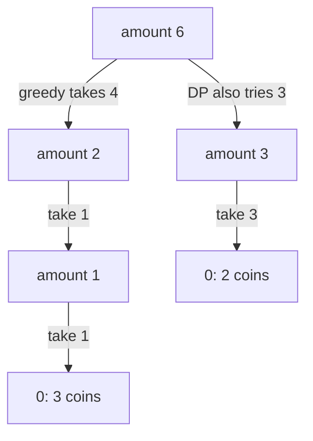
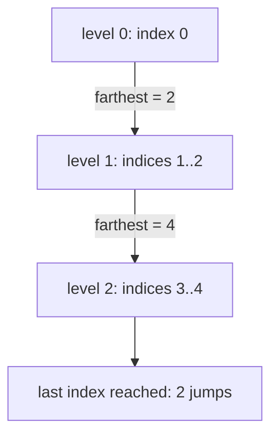

# Greedy Algorithms

[⬅ Back to index](../README.md)

Covers: greedy algorithms: when a local choice is safe, how to argue it (exchange argument), and how to tell a greedy problem from a DP one, through the classic greedy questions.

---

## Foundations

### 1. When does greedy work, and how do you tell it apart from DP?

**📘 Concept** · ⭐ Product/FAANG favourite

<details>
<summary>Answer</summary>

**In short:** A greedy algorithm builds the answer one step at a time, always taking the choice that looks best *right now* and never undoing it. It is correct only when that local choice is **safe**: some optimal solution starts with the same choice, and what remains is a smaller copy of the same problem. You show safety with an **exchange argument** ("take any optimal solution, swap in my greedy choice, and it gets no worse"). If you can't make that argument — or you can find a small counter-example — the problem needs DP. Classic counter-example: coin change with coins `{1, 3, 4}` and amount 6 — greedy takes `4 + 1 + 1` (3 coins), the optimum is `3 + 3` (2 coins).

#### The two properties a greedy solution needs

| Property | Meaning | DP needs it too? |
|---|---|---|
| **Greedy-choice property** | There is an optimal solution that contains the locally best choice. | No — this is what lets greedy skip trying all options. |
| **Optimal substructure** | After making the choice, the rest of the optimal solution is an optimal solution to the leftover subproblem. | Yes |

DP and greedy both need optimal substructure. The difference: DP **tries every choice** and keeps the best (that's why it needs a table), while greedy **commits to one choice** without looking back. Greedy is a DP where you have proved that only one branch can ever win.

#### The exchange argument, step by step

This is the standard way to prove a greedy choice is safe, and interviewers love hearing it in one or two sentences.

1. Let `G` be the choice greedy makes first (e.g. "the interval that ends earliest").
2. Take **any** optimal solution `OPT`. If it already contains `G`, done.
3. Otherwise, find the element `X` in `OPT` that plays the same role (e.g. the first interval in `OPT`).
4. Show that replacing `X` with `G` keeps the solution **valid** and **no worse**.
5. So an optimal solution starting with `G` exists. Repeat the argument on the remaining subproblem (induction).

Example — maximum number of non-overlapping meetings (activity selection): greedy picks the meeting that **ends first**. In any optimal schedule, swap its first meeting for the greedy one. The greedy meeting ends no later, so it can't clash with anything after it — the schedule stays valid and has the same size. (The interval problems themselves live in [Prefix Sums, Intervals & Sweep Line](09-prefix-sums-intervals.md).)

A second flavour is the **"stays ahead"** argument: show that after every step, greedy's partial solution is at least as good as any other algorithm's partial solution (e.g. Jump Game II: after k jumps, greedy can reach at least as far as anyone else).

#### Greedy vs DP: the coin change counter-example

Problem: minimum number of coins to make `amount`.

Greedy idea: always take the biggest coin that fits.

- Coins `{1, 5, 10, 25}` (US coins), amount 30 → `25 + 5` = 2 coins. Correct. US coins are a **canonical** coin system, where greedy happens to be optimal.
- Coins `{1, 3, 4}`, amount 6 → greedy: `4 + 1 + 1` = 3 coins. Optimal: `3 + 3` = 2 coins. **Greedy fails.**



Taking the 4 *looks* best but locks you out of the better `3 + 3` path. DP fixes this by trying every coin at every amount:

```kotlin
// Greedy: fast but only correct for canonical coin systems.
fun coinChangeGreedy(coins: IntArray, amount: Int): Int {
    var left = amount
    var count = 0
    for (c in coins.sortedDescending()) {
        count += left / c
        left %= c
    }
    return if (left == 0) count else -1
}

// DP: always correct. dp[a] = fewest coins to make a.
fun coinChange(coins: IntArray, amount: Int): Int {
    val inf = amount + 1
    val dp = IntArray(amount + 1) { inf }
    dp[0] = 0
    for (a in 1..amount) {
        for (c in coins) if (c <= a) dp[a] = minOf(dp[a], dp[a - c] + 1)
    }
    return if (dp[amount] == inf) -1 else dp[amount]
}
```

The same pattern appears with knapsack: **fractional** knapsack (you may take part of an item) is greedy by value/weight ratio; **0/1** knapsack is not — taking the best-ratio item can waste capacity — so it needs DP (see [Dynamic Programming](19-dynamic-programming.md)).

#### How to decide in an interview

1. **Spot the shape.** Greedy problems usually say "minimum number of …", "maximum number of …", "can you reach …", and the input can be sorted or scanned once. Typical greedy moves: sort by end time, sort by a difference or ratio, always extend the farthest reach, always pair the extremes.
2. **State the greedy rule in one sentence** ("always take the meeting that ends first").
3. **Try to break it** on 2-4 tiny inputs, especially ones where the "obvious" choice blocks a later better one. Coin values that aren't multiples of each other, items whose weights don't fit evenly — those are the usual traps.
4. **If you can't break it, give the exchange argument** out loud. If you can break it, say so and switch to DP — that is a strong signal, not a failure.
5. **When unsure,** write the DP first (it's correct), then see whether the DP's `max`/`min` always picks the same branch — if so, collapse it into greedy.

| Clue | Leans greedy | Leans DP |
|---|---|---|
| Choices interact only through one number (reach, fuel, end time) | ✓ | |
| Local choice can block a better combination later | | ✓ |
| Input size up to 10^5 or more, answer must be O(n log n) | ✓ | |
| "Count the number of ways" | | ✓ (greedy can't count) |
| Sorting by one key makes the decision obvious | ✓ | |

#### Common mistakes

- Trusting a greedy rule because it works on the examples in the prompt. The examples are usually chosen so greedy *does* work; test your own.
- Assuming coin change is greedy. It is only for canonical systems — the interview version is DP.
- Sorting by the wrong key (start time instead of end time for activity selection — a long early meeting blocks many short ones).
- Being unable to justify the choice. "It seems right" is a weak answer; one sentence of exchange argument is enough.

#### Follow-ups

- *Is Dijkstra greedy?* Yes — it always finalises the closest unvisited node, which is safe only with non-negative weights. Kruskal and Prim for MST are greedy too. See [Advanced Graphs](17-advanced-graphs.md).
- *Is Huffman coding greedy?* Yes — repeatedly merge the two least frequent symbols, proven by an exchange argument. It uses a heap; see [Heaps & Priority Queues](13-heaps-priority-queues.md).
- *Which coin systems are canonical?* Ones where greedy matches DP for every amount; you can test a system by comparing greedy and DP for all amounts up to the sum of the two largest coins.

</details>

## Reachability and circuits

### 2. Jump Game

**🟡 Medium** · ⭐ Product/FAANG favourite (commonly reported at Amazon)

<details>
<summary>Answer</summary>

**In short:** Scan left to right keeping `farthest`, the furthest index reachable so far. At index `i`, if `i > farthest` you're stuck — return `false`; otherwise update `farthest = max(farthest, i + nums[i])`. If `farthest` ever reaches the last index, return `true`. One pass, O(n) time, O(1) space.

#### Problem

`nums[i]` is the maximum jump length from index `i`. Starting at index 0, can you reach the last index?

- `[2, 3, 1, 1, 4]` → `true` (0 → 1 → 4)
- `[3, 2, 1, 0, 4]` → `false` (every path lands on index 3, which has jump 0)

#### Clarifying questions & edge cases

- Single element → `true` (you're already at the end).
- Zeros are the only obstacle: a `0` is a trap only if nothing before it can jump over it.
- Values are non-negative; jump length is *up to* `nums[i]`, not exactly.

#### Brute force

DFS/backtracking from index 0 trying every jump length: exponential. Memoising "can index i reach the end?" gives O(n²) DP: `good[i] = any(good[j] for j in i+1..i+nums[i])`.

#### Key insight

The reachable indices always form a **contiguous prefix** `[0, farthest]`. Why: if you can reach index `j` and `j` can jump up to `j + nums[j]`, every index between is reachable too (jumps are "up to" a length). So you don't need to know *how* you reach things — only how far the prefix extends. That one number replaces the whole DP table.

This is a "stays ahead" greedy: no strategy can reach beyond `max(i + nums[i])` over the reachable `i`, and greedy tracks exactly that maximum.

#### Walkthrough

`nums = [3, 2, 1, 0, 4]`

| i | nums[i] | i ≤ farthest? | farthest after |
|---|---|---|---|
| 0 | 3 | yes (0 ≤ 0) | 3 |
| 1 | 2 | yes | max(3, 3) = 3 |
| 2 | 1 | yes | max(3, 3) = 3 |
| 3 | 0 | yes | 3 |
| 4 | 4 | **no** (4 > 3) | → return `false` |

#### Kotlin

```kotlin
fun canJump(nums: IntArray): Boolean {
    var farthest = 0                       // furthest index reachable so far
    for (i in nums.indices) {
        if (i > farthest) return false     // i is beyond the reachable prefix
        farthest = maxOf(farthest, i + nums[i])
        if (farthest >= nums.size - 1) return true
    }
    return true
}
```

#### Swift

```swift
func canJump(_ nums: [Int]) -> Bool {
    var farthest = 0
    for i in 0..<nums.count {
        if i > farthest { return false }   // can't even stand on i
        farthest = max(farthest, i + nums[i])
        if farthest >= nums.count - 1 { return true }
    }
    return true
}
```

An equally neat alternative scans **backwards**: keep `goal = n - 1`; whenever `i + nums[i] >= goal`, move `goal = i`. Answer is `goal == 0`.

#### Complexity

- **Time:** O(n) — one pass.
- **Space:** O(1) — one integer.

#### Common mistakes

- Checking `i > farthest` *after* updating `farthest` — then a stuck index can "rescue" itself.
- Writing the DP version and stopping there; the interviewer expects the O(n) greedy.
- Forgetting the single-element case (`[0]` → `true`).

#### Follow-ups

- *Minimum number of jumps?* [Jump Game II](#3-jump-game-ii) — same idea, counted in BFS levels.
- **Jump Game III** (jump exactly `±arr[i]`, reach a zero): reachable set is no longer a prefix → BFS/DFS, see [Graphs](16-graphs-bfs-dfs-topo.md).
- **Jump Game VII** (jumps within `[minJump, maxJump]` onto `'0'` cells): sliding window / prefix count of reachable cells.

</details>

### 3. Jump Game II

**🟡 Medium** · ⭐ Product/FAANG favourite (commonly reported at Amazon)

<details>
<summary>Answer</summary>

**In short:** Think of it as BFS where "level k" is the range of indices reachable with exactly k jumps — and each level is a contiguous range. Scan once, tracking `currentEnd` (the end of the current level) and `farthest` (the furthest reach from anything in this level). When `i` hits `currentEnd`, you must jump: `jumps++`, `currentEnd = farthest`. O(n) time, O(1) space.

#### Problem

Same jump array as [Jump Game](#2-jump-game), but the last index is guaranteed reachable. Return the minimum number of jumps.

- `[2, 3, 1, 1, 4]` → `2` (0 → 1 → 4)
- `[2, 3, 0, 1, 4]` → `2`

#### Clarifying questions & edge cases

- Single element → `0` jumps.
- Is reaching guaranteed? (Yes on LeetCode. Otherwise, return -1 when `farthest` stops growing before the end.)
- You don't need the path, just the count (ask; the path is an easy extension).

#### Brute force

DP: `dp[i]` = min jumps to reach `i`; for each `i`, relax all `j` in `i+1..i+nums[i]`. O(n²) time, O(n) space. Or a plain BFS over indices with a queue — O(n²) edges in the worst case.

#### Key insight

The indices reachable in **exactly k jumps (and not fewer)** form a contiguous block, because reachability is a prefix (from Jump Game). So BFS levels are just intervals:

- Level 0: `[0, 0]`
- Level k+1: `[end of level k + 1, max over level k of i + nums[i]]`

You never need a queue — two numbers describe each level. Proof ("stays ahead"): after k jumps greedy's reach is the maximum possible reach with k jumps, because it considered every index any k-jump path could stand on.



#### Walkthrough

`nums = [2, 3, 1, 1, 4]` — loop runs `i` from 0 to `n - 2` (once you stand on the last index, no more jumps).

| i | i + nums[i] | farthest | i == currentEnd? | jumps | currentEnd |
|---|---|---|---|---|---|
| start | | 0 | | 0 | 0 |
| 0 | 2 | 2 | yes → jump | 1 | 2 |
| 1 | 4 | 4 | no | 1 | 2 |
| 2 | 3 | 4 | yes → jump | 2 | 4 |

`currentEnd = 4` is the last index, so the loop breaks. Answer: `2`. (Without the early `break` the loop would just visit `i = 3`, see `i != currentEnd`, and return the same 2.)

#### Kotlin

```kotlin
fun jump(nums: IntArray): Int {
    var jumps = 0
    var currentEnd = 0      // last index of the current BFS level
    var farthest = 0        // furthest index reachable from this level
    // Stop before the last index: standing on it needs no further jump.
    for (i in 0 until nums.size - 1) {
        farthest = maxOf(farthest, i + nums[i])
        if (i == currentEnd) {          // finished scanning this level
            jumps++
            currentEnd = farthest
            if (currentEnd >= nums.size - 1) break
        }
    }
    return jumps
}
```

#### Complexity

- **Time:** O(n) — each index scanned once.
- **Space:** O(1).

#### Common mistakes

- Looping to `n - 1` inclusive — when `currentEnd` lands exactly on the last index you'd count an extra jump.
- "Jump to the index with the biggest `nums[i]`" — wrong rule. You must pick the index that maximises `i + nums[i]` (position plus range), which the level scan does implicitly.
- Forgetting the single-element case (loop doesn't run, returns 0 — correct).

#### Follow-ups

- *Return the path?* For each level, remember which index produced `farthest`; follow those choices.
- *Not guaranteed reachable?* If at `i == currentEnd` we have `farthest == currentEnd`, return -1.
- *Similar problem:* **Minimum Number of Taps to Open to Water a Garden** / **Video Stitching** — convert to "jump" ranges and run the same level scan.

</details>

### 4. Gas Station

**🟡 Medium** · ⭐ Product/FAANG favourite (commonly reported at Amazon)

<details>
<summary>Answer</summary>

**In short:** Two facts solve it in one pass. (1) If total gas ≥ total cost, a valid start exists; otherwise return -1. (2) If you start at `s` and first run dry before reaching station `i + 1`, then **no** station between `s` and `i` can be the start either — so jump the candidate start to `i + 1` and reset the tank. The last candidate standing is the answer. O(n) time, O(1) space.

#### Problem

`n` stations in a circle. Station `i` gives `gas[i]`; driving from `i` to `i + 1` costs `cost[i]`. Starting with an empty tank, return the station index from which you can drive the full circle, or -1. The answer is unique if it exists.

- `gas = [1, 2, 3, 4, 5], cost = [3, 4, 5, 1, 2]` → `3`
- `gas = [2, 3, 4], cost = [3, 4, 3]` → `-1` (total gas 9 < total cost 10)

#### Clarifying questions & edge cases

- Is the answer unique? (Yes, guaranteed.)
- Tank exactly 0 on arrival is fine — only negative fails.
- Single station: `gas[0] >= cost[0]` → `0`.

#### Brute force

Try every start and simulate the full loop: O(n²).

#### Key insight

Let `diff[i] = gas[i] - cost[i]` (net fuel gained by leaving station i).

**Claim 1 — skip the whole failed stretch.** Start at `s` and say the tank first goes negative after station `i`. For any `k` between `s` and `i`: when the trip from `s` arrived at `k`, the tank was **≥ 0** (it hadn't failed yet). Starting fresh at `k` means arriving with **0** — no more fuel than before — so you would also fail by `i`. Therefore every start in `[s, i]` fails; the next candidate is `i + 1`.

**Claim 2 — total ≥ 0 guarantees success.** The scan splits the circle into failed stretches (each with negative sum) plus the final stretch from the last candidate `start` to `n - 1`, which never went negative. If the total is ≥ 0, the negative stretches are outweighed by the final one, so starting at `start` you finish the array with enough fuel to cover all the earlier stretches as well.

So: one pass, keep `tank` (since the current candidate) and `total` (overall).

#### Walkthrough

`gas = [1, 2, 3, 4, 5]`, `cost = [3, 4, 5, 1, 2]` → `diff = [-2, -2, -2, 3, 3]`

| i | diff | tank (after) | total | action |
|---|---|---|---|---|
| 0 | -2 | -2 | -2 | tank < 0 → start = 1, tank = 0 |
| 1 | -2 | -2 | -4 | start = 2, tank = 0 |
| 2 | -2 | -2 | -6 | start = 3, tank = 0 |
| 3 | 3 | 3 | -3 | keep |
| 4 | 3 | 6 | 0 | keep |

`total = 0 ≥ 0` → answer `3`. Check: from 3 the tank goes 3, 6, 4, 2, 0 — never negative.

#### Kotlin

```kotlin
fun canCompleteCircuit(gas: IntArray, cost: IntArray): Int {
    var total = 0    // net fuel over the whole circle
    var tank = 0     // net fuel since the current candidate start
    var start = 0
    for (i in gas.indices) {
        val diff = gas[i] - cost[i]
        total += diff
        tank += diff
        if (tank < 0) {          // can't get from start to i + 1
            start = i + 1        // nothing in [start, i] works either
            tank = 0
        }
    }
    return if (total >= 0) start else -1
}
```

#### Swift

```swift
func canCompleteCircuit(_ gas: [Int], _ cost: [Int]) -> Int {
    var total = 0, tank = 0, start = 0
    for i in 0..<gas.count {
        let diff = gas[i] - cost[i]
        total += diff
        tank += diff
        if tank < 0 {        // every start in [start, i] fails
            start = i + 1
            tank = 0
        }
    }
    return total >= 0 ? start : -1
}
```

Note: when `total >= 0`, `start` is always `< n` — the final stretch can't end negative, because then the total would be negative too.

#### Complexity

- **Time:** O(n) — one pass.
- **Space:** O(1).

#### Common mistakes

- Resetting `start = i` instead of `i + 1` — station `i` is part of the failed stretch.
- Forgetting the `total` check and returning `start` even when no answer exists.
- Simulating the wrap-around explicitly (doubling the array) — works but is unnecessary given Claim 2.

#### Follow-ups

- *Is the answer always unique?* Not in general — if every `diff` is 0, every station works. LeetCode guarantees uniqueness; without it, the scan still returns *a* valid start.
- *Prefix-sum view:* the answer is the index right after the **minimum prefix sum** of `diff` — the lowest point of the fuel curve. Same O(n).
- *Minimum refuelling stops (variable stations, fuel capacity)?* Different problem: greedy with a max-heap of passed stations — see [Heaps & Priority Queues](13-heaps-priority-queues.md).

</details>

## Grouping and range-tracking

### 5. Partition Labels

**🟡 Medium** · ⭐ Product/FAANG favourite (commonly reported at Amazon)

<details>
<summary>Answer</summary>

**In short:** First record the last index of every letter. Then scan, extending the current part's `end` to the last occurrence of every letter you see. When `i == end`, every letter inside the part has finished — cut there. Cutting as early as possible gives the maximum number of parts. O(n) time, O(1) space (26 letters).

#### Problem

Split a string into as many parts as possible so that each letter appears in **at most one** part. Return the part sizes.

- `"ababcbacadefegdehijhklij"` → `[9, 7, 8]` (`"ababcbaca"`, `"defegde"`, `"hijhklij"`)
- `"eccbbbbdec"` → `[10]`

#### Clarifying questions & edge cases

- Lowercase letters only? (Yes — so a 26-slot array works; otherwise a map.)
- Single character → `[1]`.
- All letters distinct → every part has size 1.

#### Brute force

For each candidate cut point, check whether any letter appears on both sides: O(n) cut points × O(n) check = O(n²) (or O(26·n) with prefix counts). Works, but misses the clean idea.

#### Key insight

If letter `c` appears in a part, the part must stretch at least to `last[c]`. So a part starting at `start` must end at or after `max(last[c])` over every letter in it — and that bound keeps growing as new letters join. The moment the scan index **catches up** with that bound, the part is self-contained, and cutting immediately is safe: cutting later would only merge this part with the next, reducing the count. This is the same "farthest reach" idea as [Jump Game](#2-jump-game) — and it's interval merging in disguise (each letter is the interval `[first, last]`; parts are the merged intervals).

#### Walkthrough

`s = "abaccbdd"` → `last: a=2, b=5, c=4, d=7`

| i | char | end = max(end, last[char]) | i == end? | parts |
|---|---|---|---|---|
| 0 | a | 2 | no | |
| 1 | b | 5 | no | |
| 2 | a | 5 | no | |
| 3 | c | 5 | no | |
| 4 | c | 5 | no | |
| 5 | b | 5 | **yes** → size 5 - 0 + 1 = 6 | [6] |
| 6 | d | 7 | no | |
| 7 | d | 7 | **yes** → size 7 - 6 + 1 = 2 | [6, 2] |

#### Kotlin

```kotlin
fun partitionLabels(s: String): List<Int> {
    val last = IntArray(26)
    for (i in s.indices) last[s[i] - 'a'] = i      // last occurrence of each letter

    val sizes = mutableListOf<Int>()
    var start = 0
    var end = 0
    for (i in s.indices) {
        end = maxOf(end, last[s[i] - 'a'])          // part must reach this letter's end
        if (i == end) {                             // every letter so far is closed
            sizes.add(end - start + 1)
            start = i + 1
        }
    }
    return sizes
}
```

#### Complexity

- **Time:** O(n) — two passes.
- **Space:** O(1) — a 26-int array (the output list aside).

#### Common mistakes

- Using the **first** occurrence instead of the last.
- Computing the size as `end - start` (off by one).
- Forgetting to move `start` to `i + 1` after a cut.

#### Follow-ups

- *Return the substrings instead of sizes?* `s.substring(start, end + 1)` at each cut.
- *Arbitrary characters?* Use a `HashMap<Char, Int>` for `last`.
- *Related:* **Merge Intervals** — the same structure, explicit intervals; see [Prefix Sums, Intervals & Sweep Line](09-prefix-sums-intervals.md).

</details>

### 6. Hand of Straights

**🟡 Medium**

<details>
<summary>Answer</summary>

**In short:** The smallest card left in the hand **must** be the start of some group — nothing smaller exists to put before it. So repeatedly take the smallest remaining card `x` and try to remove `x, x+1, …, x+groupSize-1`; if any is missing, return `false`. With a sorted map (`TreeMap`) of counts this is O(n log n).

#### Problem

Can the cards in `hand` be rearranged into groups of `groupSize` **consecutive** values?

- `hand = [1, 2, 3, 6, 2, 3, 4, 7, 8], groupSize = 3` → `true` (`[1,2,3]`, `[2,3,4]`, `[6,7,8]`)
- `hand = [1, 2, 3, 4, 5], groupSize = 4` → `false` (5 cards can't form groups of 4)

(LeetCode 1296 "Divide Array in Sets of K Consecutive Numbers" is the same problem.)

#### Clarifying questions & edge cases

- `hand.size % groupSize != 0` → immediately `false`.
- `groupSize == 1` → always `true`.
- Duplicates are allowed and common — counts matter, not just presence.

#### Brute force

Backtracking: try to assign each card to some open group — exponential.

#### Key insight

Look at the smallest card `x`. Any group containing `x` must start at `x` (there's no `x - 1` left to start it). So the choice "start a group at the smallest card" is **forced**, not just safe — there's no alternative to compare. After removing that group, the remaining hand is a smaller instance of the same problem. Repeat.

You need: quick access to the smallest remaining value, and counts per value. A `TreeMap<value, count>` gives both.

#### Walkthrough

`hand = [1, 2, 3, 6, 2, 3, 4, 7, 8]`, `groupSize = 3` → counts `{1:1, 2:2, 3:2, 4:1, 6:1, 7:1, 8:1}`

| smallest | remove | counts after |
|---|---|---|
| 1 | 1, 2, 3 | {2:1, 3:1, 4:1, 6:1, 7:1, 8:1} |
| 2 | 2, 3, 4 | {6:1, 7:1, 8:1} |
| 6 | 6, 7, 8 | {} → `true` |

#### Kotlin

```kotlin
import java.util.TreeMap

fun isNStraightHand(hand: IntArray, groupSize: Int): Boolean {
    if (hand.size % groupSize != 0) return false
    val count = TreeMap<Int, Int>()
    for (card in hand) count[card] = (count[card] ?: 0) + 1

    while (count.isNotEmpty()) {
        val first = count.firstKey()                // smallest card must start a group
        for (card in first until first + groupSize) {
            val c = count[card] ?: return false     // a gap in the run
            if (c == 1) count.remove(card) else count[card] = c - 1
        }
    }
    return true
}
```

A faster variant avoids removing one group at a time: sort the distinct values; for each value `x` with `need = count[x] > 0`, subtract `need` from `x+1 … x+groupSize-1` (fail if any has fewer). Same O(n log n) for the sort but fewer map operations.

#### Complexity

- **Time:** O(n log n) — each card is removed once from the `TreeMap`, each removal O(log n).
- **Space:** O(n) — the map.

#### Common mistakes

- Starting groups from an arbitrary card (e.g. iterating the original unsorted array) — the forced-choice argument only holds for the **smallest** card.
- Ignoring duplicates (using a set).
- Forgetting the divisibility check — not a correctness bug in the loop above, but an easy early exit.

#### Follow-ups

- *Can it be done without sorting?* Yes, in O(n) expected time with a hash map: for a card `x`, walk left while `x - 1` still has copies to find the start of its run, then consume groups from that start. It's fiddly; sorting is the answer interviewers expect.
- **Split Array into Consecutive Subsequences** (LC 659, runs of length ≥ 3, any length): greedy — prefer extending an existing run ending at `x - 1` over starting a new one.
- *Swift?* No `TreeMap`; sort the distinct keys and use a dictionary of counts with the faster variant above.

</details>

### 7. Valid Parenthesis String

**🟡 Medium** · ⭐ Product/FAANG favourite

<details>
<summary>Answer</summary>

**In short:** Track the **range** of possible open-bracket counts, `[lo, hi]`. `(` adds 1 to both; `)` subtracts 1 from both; `*` can be `(`, `)` or empty, so `lo - 1` and `hi + 1`. If `hi < 0`, even treating every `*` as `(` can't save you → `false`. Clamp `lo` at 0 (a negative count is never a real option). At the end the string is valid iff `lo == 0`. O(n) time, O(1) space.

#### Problem

A string of `(`, `)` and `*`. Each `*` can be `(`, `)` or the empty string. Can it be a valid parenthesis string?

- `"()"` → `true`
- `"(*)"` → `true` (`*` = empty)
- `"(*))"` → `true` (`*` = `(`)
- `")*("` → `false`

#### Clarifying questions & edge cases

- Empty string → `true`.
- A leading `)` with no `*` before it → `false` immediately.
- Only `*` → `true` (all empty).

#### Brute force

Try all 3^k assignments of the `*`s and check each with a counter — exponential. A DP over `(index, openCount)` is O(n²) and correct, and is a good stepping stone.

#### Key insight

For a plain parenthesis string you track one number: open brackets so far, which must never go negative and must end at 0. With `*`, each prefix allows a **set** of possible open counts. That set is always a **contiguous range** (each `*` widens it by one on each side, and brackets shift it), so two numbers describe it:

- `hi` = most opens possible (every `*` as `(`). If `hi < 0`, there are too many `)` no matter what → invalid.
- `lo` = fewest opens possible (every `*` as `)`), but counts below 0 are invalid states, so clamp to 0 — that means "in the paths we keep, that `*` became empty instead".

At the end we need 0 to be in the range; since `lo ≥ 0`, that means `lo == 0`.

The greedy part: we never decide *which* `*` is which — we only keep the extremes, and every value in between is achievable.

#### Walkthrough

`s = "(*))"`

| char | lo | hi | notes |
|---|---|---|---|
| ( | 1 | 1 | |
| * | 0 | 2 | `*` as `)`, empty, or `(` |
| ) | -1 → 0 | 1 | clamp lo |
| ) | -1 → 0 | 0 | hi ≥ 0, still fine |

End: `lo == 0` → `true` (assignment: `*` = `(` gives `(())`).

`s = ")*("`: first `)` makes `hi = -1` → `false`.

#### Kotlin

```kotlin
fun checkValidString(s: String): Boolean {
    var lo = 0   // fewest possible open brackets
    var hi = 0   // most possible open brackets
    for (ch in s) {
        when (ch) {
            '(' -> { lo++; hi++ }
            ')' -> { lo--; hi-- }
            else -> { lo--; hi++ }   // '*'
        }
        if (hi < 0) return false     // too many ')' even with every '*' as '('
        if (lo < 0) lo = 0           // negative counts aren't real options
    }
    return lo == 0
}
```

#### Complexity

- **Time:** O(n) — one pass.
- **Space:** O(1).

#### Common mistakes

- Returning `false` when `lo < 0` instead of clamping — `"(*)"` would fail.
- Checking `hi == 0` at the end instead of `lo == 0`.
- The "two stacks" alternative (indices of `(` and `*`, match leftover `(` with a **later** `*`) is also O(n) — forgetting the "later" index check accepts `"*("`.

#### Follow-ups

- *Two-pass version?* Left-to-right treating `*` as `(` must never go negative; right-to-left treating `*` as `)` must never go negative. Both pass → valid.
- **Merge Triplets to Form Target Triplet** (LC 1899) is the other classic "keep only what can't hurt" greedy: drop every triplet with any value above the target, then check that the survivors cover each target value in some position.
- *Plain bracket problems?* See [Stacks, Queues & Monotonic Stack](11-stacks-queues-monotonic.md).

</details>

## Sorting, pairing and ordering

### 8. Candy

**🔴 Hard** · ⭐ Product/FAANG favourite

<details>
<summary>Answer</summary>

**In short:** Split the rule into two one-sided rules and satisfy each with a pass. Left-to-right: if `ratings[i] > ratings[i-1]`, give `candies[i-1] + 1`. Right-to-left: if `ratings[i] > ratings[i+1]`, raise `candies[i]` to at least `candies[i+1] + 1`. Taking the max of both requirements satisfies both neighbours with the fewest candies. O(n) time, O(n) space.

#### Problem

Children stand in a line with ratings. Every child gets at least 1 candy, and a child with a higher rating than a **neighbour** gets more candy than that neighbour. Return the minimum total.

- `[1, 0, 2]` → `5` (`2, 1, 2`)
- `[1, 2, 2]` → `4` (`1, 2, 1` — equal ratings carry no constraint)

#### Clarifying questions & edge cases

- Equal neighbours: no constraint between them (common trap).
- Single child → 1.
- Strictly decreasing ratings → `n + (n-1) + … + 1`; fits in `Int` for LeetCode limits (n ≤ 2·10^4).

#### Brute force

Start everyone at 1 and repeatedly sweep, fixing any violated pair, until nothing changes. Each sweep is O(n) and you may need O(n) sweeps — O(n²).

#### Key insight

The condition "more than a higher-rated neighbour" is really two separate constraints:

- **Left rule:** if `ratings[i] > ratings[i-1]` then `c[i] > c[i-1]`.
- **Right rule:** if `ratings[i] > ratings[i+1]` then `c[i] > c[i+1]`.

A single left-to-right pass gives the minimum `left[i]` satisfying only the left rule (each child gets exactly what the increasing run before them forces). A right-to-left pass gives the minimum `right[i]` for the right rule. Each child needs **both**, so the least they can get is `max(left[i], right[i])` — and that assignment satisfies both rules simultaneously. Since every child is at their individual lower bound, the total is minimal.

#### Walkthrough

`ratings = [1, 3, 2, 2, 1]`

| i | rating | after left pass | right pass check | final |
|---|---|---|---|---|
| 0 | 1 | 1 | 1 > 3? no | 1 |
| 1 | 3 | 2 (3 > 1) | 3 > 2 → max(2, 1 + 1) | 2 |
| 2 | 2 | 1 (2 < 3) | 2 > 2? no | 1 |
| 3 | 2 | 1 (equal) | 2 > 1 → max(1, 1 + 1) | 2 |
| 4 | 1 | 1 | (last) | 1 |

Total `1 + 2 + 1 + 2 + 1 = 7`.

#### Kotlin

```kotlin
fun candy(ratings: IntArray): Int {
    val n = ratings.size
    val candies = IntArray(n) { 1 }
    // Left rule: higher than left neighbour -> one more than them.
    for (i in 1 until n) {
        if (ratings[i] > ratings[i - 1]) candies[i] = candies[i - 1] + 1
    }
    // Right rule: higher than right neighbour -> keep the larger requirement.
    for (i in n - 2 downTo 0) {
        if (ratings[i] > ratings[i + 1]) candies[i] = maxOf(candies[i], candies[i + 1] + 1)
    }
    return candies.sum()
}
```

#### Complexity

- **Time:** O(n) — two passes.
- **Space:** O(n) — the candies array.

#### Common mistakes

- Overwriting in the second pass (`candies[i] = candies[i+1] + 1`) instead of taking the max — breaks the left rule at peaks.
- Giving equal-rated neighbours equal candy — not required, and costs extra.
- Trying to do both rules in one pass — a long decreasing run needs information from the right.

#### Follow-ups

- *O(1) space?* Count up-slopes and down-slopes in one pass; a peak gets `max(up, down) + 1`. Trickier to get right — mention it, code it only if asked.
- *Another correct greedy?* Hand out candy in increasing rating order: each child gets `1 + max(candy of lower-rated neighbours)`. Correct because neighbours with lower ratings are already final — but the sort makes it O(n log n).
- *Same two-pass idea:* **Trapping Rain Water** (left max and right max) — see [Two Pointers & Sliding Window](08-two-pointers-sliding-window.md); **Product of Array Except Self** — see [Arrays, Strings & Hashing](07-arrays-strings-hashing.md).

</details>

### 9. Two City Scheduling

**🟡 Medium**

<details>
<summary>Answer</summary>

**In short:** Pretend everyone flies to city B first, then decide who to "switch" to A. Switching person `i` changes the total by `aCost - bCost`. Exactly `n` people must switch, so pick the `n` with the **smallest** `aCost - bCost`. In code: sort by `a - b`, send the first half to A and the second half to B. O(n log n) time.

#### Problem

`2n` people; `costs[i] = [aCost, bCost]` is the cost to fly person `i` to city A or B. Send exactly `n` to each city at minimum total cost.

- `[[10, 20], [30, 200], [400, 50], [30, 20]]` → `110` (A: 10, 30; B: 50, 20)

#### Clarifying questions & edge cases

- Exactly half to each city? (Yes — that's the constraint that makes it interesting.)
- Ties in `a - b` don't matter — either order gives the same total.
- Costs are positive and small, so `Int` is fine.

#### Brute force

Try every way to choose `n` of `2n` people for A: C(2n, n) — exponential. A DP over (person, number sent to A) is O(n²) and correct.

#### Key insight

Rewrite the total:

`total = Σ bCost (everyone) + Σ over people sent to A of (aCost - bCost)`

The first sum is fixed. So minimising the total means choosing the `n` people with the smallest `aCost - bCost` — the people who **save the most** (or lose the least) by going to A. That's a direct proof, but it's also an exchange argument: if someone with a larger difference is in A while someone with a smaller one is in B, swapping them changes the total by `(smaller diff) - (larger diff) ≤ 0`, so it never hurts.

Note what does **not** work: sending each person to their cheaper city. If every person is cheaper in A, that rule sends everyone to A, but only `n` may go. The differences tell you who should give way: the people for whom A is the smallest bargain.

#### Walkthrough

| person | a | b | a - b |
|---|---|---|---|
| P0 | 10 | 20 | -10 |
| P1 | 30 | 200 | -170 |
| P2 | 400 | 50 | 350 |
| P3 | 30 | 20 | 10 |

Sorted by `a - b`: P1 (-170), P0 (-10), P3 (10), P2 (350).
First two → A: 30 + 10 = 40. Last two → B: 20 + 50 = 70. Total **110**.

#### Kotlin

```kotlin
fun twoCitySchedCost(costs: Array<IntArray>): Int {
    // Smallest (a - b) first: these people gain the most by going to A.
    val sorted = costs.sortedBy { it[0] - it[1] }
    val n = costs.size / 2
    var total = 0
    for (i in sorted.indices) {
        total += if (i < n) sorted[i][0] else sorted[i][1]
    }
    return total
}
```

#### Complexity

- **Time:** O(n log n) — the sort.
- **Space:** O(n) — `sortedBy` returns a new list (sort in place with `costs.sortBy { … }` for O(1) extra besides the sort itself).

#### Common mistakes

- Sending each person to their cheaper city and then "fixing" the imbalance ad hoc.
- Sorting by `aCost` alone — ignores what the person would cost in B.
- Sorting by `|a - b|` — loses the direction of the saving.

#### Follow-ups

- *O(n) time?* Use quickselect to find the `n` smallest differences — average O(n). See [Heaps & Priority Queues](13-heaps-priority-queues.md) for the selection idea.
- *Three cities, or unequal quotas?* The difference trick no longer works; use DP or min-cost flow.
- *Same "fix everything, then pay the delta" trick:* useful whenever every item must go to one of two buckets with a quota.

</details>

### 10. Boats to Save People (and Assign Cookies)

**🟡 Medium**

<details>
<summary>Answer</summary>

**In short:** Sort the weights and use two pointers. The heaviest person always needs a boat; give them the lightest person as a partner if the pair fits under `limit`, otherwise they go alone. Move the pointers and count boats. O(n log n) for the sort, O(1) extra. Assign Cookies uses the same "sort both sides and match greedily" idea.

#### Problem

`people[i]` is a weight; each boat carries **at most two** people with total weight ≤ `limit` (every person weighs ≤ `limit`). Return the minimum number of boats.

- `people = [1, 2], limit = 3` → `1`
- `people = [3, 2, 2, 1], limit = 3` → `3` (`(1, 2)`, `(2)`, `(3)`)
- `people = [3, 5, 3, 4], limit = 5` → `4`

#### Clarifying questions & edge cases

- At most two per boat? (Yes — with more, it becomes bin packing, which is NP-hard.)
- Everyone fits alone (`people[i] ≤ limit`), so the answer is at most `n`.
- Is it okay to sort the input in place? If not, copy first.

#### Brute force

Try all pairings — exponential. Or for each heaviest person, search for the heaviest partner that fits — O(n²), and no better than the simple rule below.

#### Key insight

Consider the heaviest person `H`.

- If `H` can't pair with the **lightest** person `L`, `H` can't pair with anyone → `H` goes alone.
- If `H` *can* pair with `L`, pairing them is safe (exchange argument). Take any optimal plan:
  - `H` alone there → move `L` into `H`'s boat. Boat count doesn't go up.
  - `H` paired with some `X ≠ L` → swap `X` and `L`. `H`'s boat holds `H + L ≤ limit` (given). `X` moves to `L`'s old boat, next to `L`'s old partner `Y` (if any): `X + Y ≤ X + H ≤ limit`, because `Y ≤ H` (H is the heaviest) and `X + H` fitted before. Still valid, same number of boats.

Either way the heaviest person is settled and the problem shrinks: two pointers.

#### Walkthrough

`people = [3, 2, 2, 1]`, `limit = 3` → sorted `[1, 2, 2, 3]`

| l | r | people[l] + people[r] | action | boats |
|---|---|---|---|---|
| 0 | 3 | 1 + 3 = 4 > 3 | 3 alone, r-- | 1 |
| 0 | 2 | 1 + 2 = 3 ≤ 3 | pair, l++, r-- | 2 |
| 1 | 1 | same person | alone, r-- | 3 |

Answer: **3**.

#### Kotlin

```kotlin
fun numRescueBoats(people: IntArray, limit: Int): Int {
    val w = people.sortedArray()          // don't mutate the caller's array
    var l = 0
    var r = w.size - 1
    var boats = 0
    while (l <= r) {
        if (w[l] + w[r] <= limit) l++     // lightest rides with the heaviest
        r--                               // heaviest always leaves on this boat
        boats++
    }
    return boats
}
```

#### Assign Cookies (🟢 Easy, same idea)

Children have greed `g[i]`, cookies have size `s[j]`; a child is content if given one cookie with `s[j] ≥ g[i]`. Maximise content children. Sort both; give each cookie, smallest first, to the least greedy child still waiting if it satisfies them. Using the smallest cookie that works never wastes a bigger cookie someone greedier needs.

```kotlin
fun findContentChildren(g: IntArray, s: IntArray): Int {
    val greed = g.sortedArray()
    val sizes = s.sortedArray()
    var child = 0
    for (cookie in sizes) {
        if (child < greed.size && cookie >= greed[child]) child++  // feed this child
    }
    return child
}
```

#### Complexity

- **Time:** O(n log n) — sorting; the scan is O(n).
- **Space:** O(n) for the sorted copy (O(1) extra if sorting in place is allowed).

#### Common mistakes

- Pairing the heaviest with the heaviest partner that fits ("best fit") — also correct here but needs a search; the lightest-partner rule is simpler and provably optimal.
- Using `l < r` — the last single person in the middle would never get a boat.
- Trying to pack more than two per boat with this rule — the two-per-boat limit is what makes greedy work.

#### Follow-ups

- *Up to k people per boat?* Bin packing — NP-hard in general; heuristics (first-fit decreasing) or DP for small n.
- *Two Sum on sorted arrays?* Same pointer movement — see [Two Pointers & Sliding Window](08-two-pointers-sliding-window.md).
- *Counting instead of sorting?* Weights are bounded (≤ limit ≤ 3·10^4), so counting sort makes it O(n + limit).

</details>

### 11. Queue Reconstruction by Height

**🟡 Medium**

<details>
<summary>Answer</summary>

**In short:** Sort people by height **descending**, and by `k` **ascending** for equal heights. Then insert each person into a list at index `k`. When a person is inserted, everyone already in the list is at least as tall, so exactly `k` taller-or-equal people end up in front — and shorter people inserted later can't change that count. O(n²) time because of list insertions (n ≤ 2000 on LeetCode).

#### Problem

`people[i] = [h, k]`: height `h`, and `k` people in front who are **at least as tall**. The array is shuffled; rebuild the queue.

- `[[7,0],[4,4],[7,1],[5,0],[6,1],[5,2]]` → `[[5,0],[7,0],[5,2],[6,1],[4,4],[7,1]]`

#### Clarifying questions & edge cases

- Is the input guaranteed to describe a valid queue? (Yes.)
- Equal heights count as "at least as tall" — so the order among equals matters.
- Single person → itself.

#### Brute force

Try permutations and check each — O(n!·n). Or fill slots from the shortest person: the shortest person goes to the `(k+1)`-th empty slot (everyone else is taller, so empty slots in front will hold taller people). That second idea is also correct — O(n²) naive, O(n log n) with a Fenwick tree.

#### Key insight

Shorter people are "invisible" to taller people's `k` counts. So place tall people first:

1. Sort by height descending. When we insert person `[h, k]`, every person already in the list has height ≥ `h`. Putting them at index `k` gives them exactly `k` people in front who are at least as tall.
2. Everyone inserted later is **shorter** (or equal height with a larger `k` — see next point), so they don't affect `k` for anyone already placed — inserting a shorter person in front of you doesn't change *your* count.
3. Ties: among equal heights, insert the smaller `k` first. `[5,0]` then `[5,2]`: when `[5,2]` arrives, `[5,0]` is already counted among its 2. The other order would put `[5,0]` in front of `[5,2]` afterwards and break `[5,2]`'s count.

#### Walkthrough

Sorted: `[7,0], [7,1], [6,1], [5,0], [5,2], [4,4]`

| insert | at index | queue after |
|---|---|---|
| [7,0] | 0 | [7,0] |
| [7,1] | 1 | [7,0], [7,1] |
| [6,1] | 1 | [7,0], [6,1], [7,1] |
| [5,0] | 0 | [5,0], [7,0], [6,1], [7,1] |
| [5,2] | 2 | [5,0], [7,0], [5,2], [6,1], [7,1] |
| [4,4] | 4 | [5,0], [7,0], [5,2], [6,1], [4,4], [7,1] |

#### Kotlin

```kotlin
fun reconstructQueue(people: Array<IntArray>): Array<IntArray> {
    // Tallest first; among equal heights, smaller k first.
    val sorted = people.sortedWith(
        compareByDescending<IntArray> { it[0] }.thenBy { it[1] }
    )
    val queue = ArrayList<IntArray>(people.size)
    for (p in sorted) queue.add(p[1], p)   // exactly k taller-or-equal people in front
    return queue.toTypedArray()
}
```

#### Complexity

- **Time:** O(n²) — each `ArrayList.add(index, …)` shifts up to n elements; the sort is O(n log n).
- **Space:** O(n) — the output list.

#### Common mistakes

- Sorting equal heights by `k` descending — breaks the tie argument.
- Sorting by height ascending and inserting at `k` — shorter people placed first would be miscounted.
- Using a `LinkedList` and thinking insertion is O(1) — finding index `k` is still O(k).

#### Follow-ups

- *O(n log n)?* Process from shortest to tallest; each person takes the `(k+1)`-th still-empty slot (counting only slots not taken by shorter people; equal heights need care — process larger `k` first). Find that slot with a Fenwick tree / segment tree and binary search.
- *Minimum Number of Platforms (trains)?* A different classic greedy: sort arrivals and departures separately and sweep, counting trains present — the same as Meeting Rooms II; see [Prefix Sums, Intervals & Sweep Line](09-prefix-sums-intervals.md).
- *Why is this greedy?* Each placement is final: once a taller person is placed relative to other tall people, nothing later can invalidate it.

</details>

### 12. Largest Number

**🟡 Medium** · ⭐ Product/FAANG favourite

<details>
<summary>Answer</summary>

**In short:** Convert the numbers to strings and sort with a custom comparator: `a` goes before `b` if `a + b > b + a` (as strings). Join them. If the first string is `"0"`, everything is zero → return `"0"`. O(n log n · L) time, where L is the digit count (≤ 10).

#### Problem

Arrange non-negative integers so that their concatenation forms the largest number; return it as a string.

- `[10, 2]` → `"210"`
- `[3, 30, 34, 5, 9]` → `"9534330"`
- `[0, 0]` → `"0"` (not `"00"`)

#### Clarifying questions & edge cases

- All zeros → `"0"`.
- Result can exceed `Long` — that's why it's a string.
- Numbers with a common prefix: `3` vs `30` vs `34` — the core difficulty.

#### Brute force

Try all n! orders and keep the largest string — hopeless beyond n ≈ 10.

#### Key insight

Plain lexicographic sort fails: `"30" > "3"` lexicographically, but `"330" > "303"`, so `3` should come first. The right question for any two neighbours is simply: **which order of the pair makes the bigger concatenation?** Compare `a + b` with `b + a`.

Why sorting by this pairwise rule gives the global optimum (exchange argument): in any arrangement, if two **adjacent** items `a, b` have `b + a > a + b`, swapping them makes the whole number bigger (the prefix and suffix are unchanged, and the middle got bigger with the same length). So the optimum has no such adjacent pair — i.e. it's sorted by this comparator.

Why it's a valid sort comparator (transitive): with `len(a) = p`, `a + b` as a number is `a·10^q + b` (where `q = len(b)`), and `a + b > b + a` ⇔ `a·(10^q - 1) > b·(10^p - 1)` ⇔ `a / (10^p - 1) > b / (10^q - 1)`. So the comparator is ordering by a single real number per string, which is transitive.

#### Walkthrough

`[3, 30, 34, 5, 9]`

| pair | a + b | b + a | order |
|---|---|---|---|
| 3, 30 | 330 | 303 | 3 before 30 |
| 3, 34 | 334 | 343 | 34 before 3 |
| 5, 34 | 534 | 345 | 5 before 34 |
| 9, 5 | 95 | 59 | 9 before 5 |

Sorted: `9, 5, 34, 3, 30` → `"9534330"`.

#### Kotlin

```kotlin
fun largestNumber(nums: IntArray): String {
    val strs = nums.map { it.toString() }
        .sortedWith { a, b -> (b + a).compareTo(a + b) }  // a first if a+b is bigger
    if (strs[0] == "0") return "0"                         // all zeros
    return strs.joinToString("")
}
```

`(b + a).compareTo(a + b)` returns negative when `a + b > b + a`, which puts `a` first. Comparing the strings lexicographically works because `a + b` and `b + a` always have the same length.

#### Complexity

- **Time:** O(n log n · L) — O(n log n) comparisons, each building strings of length ≤ 2L (L ≤ 10 digits).
- **Space:** O(n · L) — the strings.

#### Common mistakes

- Plain string sort descending — fails on `[3, 30]` (gives `"303"`).
- Plain numeric sort descending — fails on `[10, 2]` (gives `"102"`).
- Forgetting the all-zeros case (`"00"`).
- Comparing `(a + b).toInt()` — overflows for two 10-digit numbers; compare the strings.

#### Follow-ups

- *Smallest number instead?* Flip the comparator (`a + b < b + a` first) and strip leading zeros (keep one `"0"` if everything is zero).
- *Swift?* `nums.map { String($0) }.sorted { $0 + $1 > $1 + $0 }` — Swift's `sorted(by:)` takes an "is before" predicate directly.
- *Other custom-comparator classics:* **Reorder Data in Log Files** and [Queue Reconstruction by Height](#11-queue-reconstruction-by-height). Comparator syntax in both languages: [Kotlin & Swift for Coding Interviews](03-kotlin-swift-for-interviews.md).

</details>

---

[⬅ Previous: Dynamic Programming](19-dynamic-programming.md) · [⬅ Back to index](../README.md) · [Next: Bit Manipulation & Math ➡](21-bit-manipulation-math.md)
