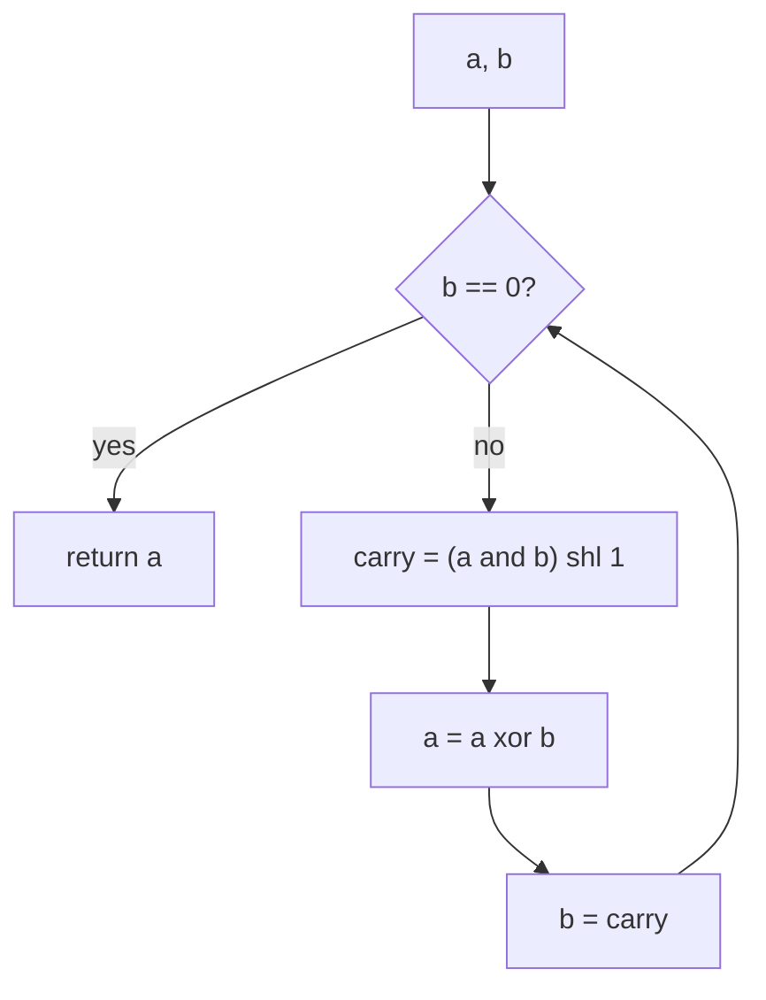
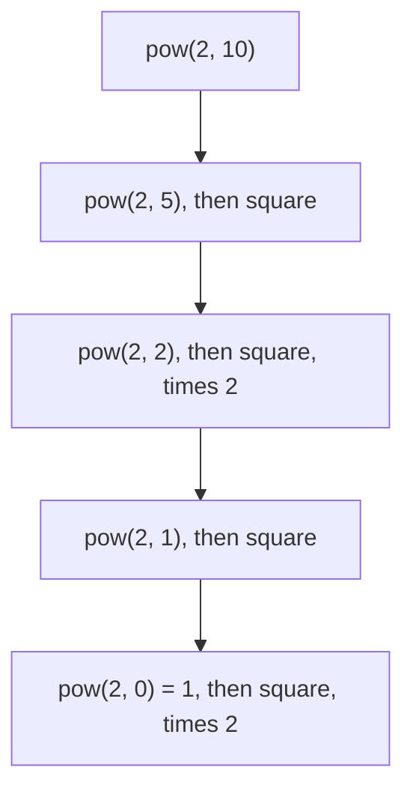
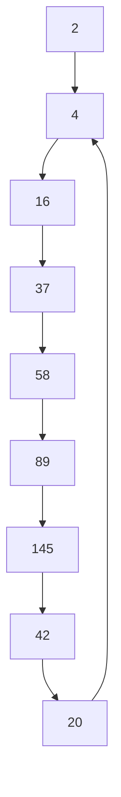

# Bit Manipulation & Math

[⬅ Back to index](../README.md)

Covers: the bit tricks and number theory that show up in coding rounds: bit operations and masks, counting bits, GCD and primes, fast exponentiation, modular arithmetic and overflow-safe integer handling.

---

## Bit manipulation

### 1. Which bit operations do you need to know? (incl. Power of Two and Power of Four)

**📘 Concept** · ⭐ Product/FAANG favourite

<details>
<summary>Answer</summary>

**In short:** Six operators (AND, OR, XOR, NOT, left shift, right shift) plus a handful of idioms cover almost every bit question: test/set/clear/toggle bit `i` with a mask `1 shl i`, `x and (x - 1)` drops the lowest set bit, `x and -x` keeps only the lowest set bit, and XOR cancels equal values. In Kotlin these are **infix functions** (`and`, `or`, `xor`, `inv()`, `shl`, `shr`, `ushr`); in Swift they are symbols (`&`, `|`, `^`, `~`, `<<`, `>>`). Power of Two is the textbook one-liner: `n > 0 && (n and (n - 1)) == 0`.

#### The operators, side by side

| Operation | Meaning | Kotlin | Swift | Example (4-bit) |
|---|---|---|---|---|
| AND | 1 only where both are 1 | `a and b` | `a & b` | `1100 and 1010 = 1000` |
| OR | 1 where either is 1 | `a or b` | `a \| b` | `1100 or 1010 = 1110` |
| XOR | 1 where they differ | `a xor b` | `a ^ b` | `1100 xor 1010 = 0110` |
| NOT | flip every bit | `a.inv()` | `~a` | `inv(1100) = 0011` |
| Left shift | move bits up, fill with 0 (× 2ᵏ) | `a shl k` | `a << k` | `0011 shl 2 = 1100` |
| Arithmetic right shift | move bits down, copy the sign bit (÷ 2ᵏ, rounding down) | `a shr k` | `a >> k` on signed types | `-8 shr 1 = -4` |
| Logical right shift | move bits down, fill with 0 | `a ushr k` | `a >> k` on unsigned types (`UInt32`) | `-8 ushr 1 = 2147483644` |

Swift has no `>>>`: whether `>>` is arithmetic or logical depends on the type. To get a logical shift of a signed value, convert it: `UInt32(bitPattern: x) >> 1`.

#### Two's complement in one paragraph

Integers are stored in **two's complement**: the top bit has weight −2³¹ (for a 32-bit Int), so `-1` is all ones and `Int.MIN_VALUE` is `1000…0`. The key identity is **`-x == x.inv() + 1`**. If `x` ends in `…1000`, then `x.inv()` ends in `…0111`, and adding 1 makes the carry ripple back to `…1000`. So `-x` agrees with `x` on the lowest set bit and the zeros below it, and is the exact opposite of `x` everywhere above. Every trick below follows from that.

#### The idioms

| Idiom | Kotlin | What it does | Why |
|---|---|---|---|
| Test bit i | `((x shr i) and 1) == 1` | is bit i set? | shift bit i to position 0, mask everything else |
| Set bit i | `x or (1 shl i)` | force bit i to 1 | OR with 1 sets, OR with 0 keeps |
| Clear bit i | `x and (1 shl i).inv()` | force bit i to 0 | mask has a 0 only at i |
| Toggle bit i | `x xor (1 shl i)` | flip bit i | XOR with 1 flips, with 0 keeps |
| Drop lowest set bit | `x and (x - 1)` | `1100 → 1000` | `x - 1` turns the lowest 1 into 0 and the zeros below it into 1s; AND keeps only the higher bits |
| Isolate lowest set bit | `x and -x` | `1100 → 0100` | `-x` matches `x` only from the lowest set bit down |
| All ones in low k bits | `(1 shl k) - 1` | mask `0…0111` | `1000 - 1 = 0111` |
| Same sign? | `(a xor b) >= 0` | top bits equal | XOR of the sign bits is 0 |
| XOR cancels | `a xor a == 0`, `a xor 0 == a` | find the odd one out | see XOR tricks in [Problem-Solving Tricks](06-problem-solving-tricks.md) |

Trace of the two lowest-bit tricks for `x = 12`:

| value | binary (8 bits) |
|---|---|
| x | `00001100` |
| x - 1 | `00001011` |
| x and (x - 1) | `00001000` |
| -x | `11110100` |
| x and -x | `00000100` |

Library helpers worth knowing: Kotlin `x.countOneBits()`, `x.countTrailingZeroBits()`, `x.takeLowestOneBit()`, `Integer.bitCount(x)`, `Integer.reverse(x)`; Swift `x.nonzeroBitCount`, `x.trailingZeroBitCount`, `x.leadingZeroBitCount`. Use them in real code, but expect the interviewer to ask you to implement them by hand.

#### Kotlin vs Swift gotchas

- **Kotlin precedence.** Infix functions bind *tighter* than `==` and `<` but *looser* than `+` and `-`. So `x and 1 == 0` happens to mean `(x and 1) == 0`, but `1 shl i - 1` means `1 shl (i - 1)`. Always parenthesise: `(1 shl i) - 1`.
- **Shift distance is masked in Kotlin/Java.** For `Int`, only the low 5 bits of the distance are used: `1 shl 32 == 1`, not 0. Use `1L shl i` for masks above bit 30, and remember `1 shl 31 == Int.MIN_VALUE`.
- **Hex literals above `Int.MAX_VALUE` are `Long` in Kotlin.** `0xAAAAAAAA` doesn't fit an Int, so write `0xAAAAAAAA.toInt()` (or use the complementary `0x55555555`, which fits).
- **Swift shifts are "smart".** `x << 64` is 0 and a negative distance shifts the other way; `&<<` masks the distance like Kotlin. Swift arithmetic `+ - *` **traps** on overflow (use `&+`, `&-`, `&*` to wrap), but shifts never trap.
- **Swift `Int` is 64-bit.** A LeetCode problem about "32-bit integers" needs `Int32`/`UInt32` in Swift, or explicit range checks.

#### Kotlin helpers

```kotlin
fun isBitSet(x: Int, i: Int): Boolean = ((x shr i) and 1) == 1
fun setBit(x: Int, i: Int): Int = x or (1 shl i)
fun clearBit(x: Int, i: Int): Int = x and (1 shl i).inv()
fun toggleBit(x: Int, i: Int): Int = x xor (1 shl i)
fun dropLowestSetBit(x: Int): Int = x and (x - 1)
fun lowestSetBit(x: Int): Int = x and -x
```

#### Swift helpers

```swift
func isBitSet(_ x: Int, _ i: Int) -> Bool { (x >> i) & 1 == 1 }
func setBit(_ x: Int, _ i: Int) -> Int { x | (1 << i) }
func clearBit(_ x: Int, _ i: Int) -> Int { x & ~(1 << i) }
func toggleBit(_ x: Int, _ i: Int) -> Int { x ^ (1 << i) }
func dropLowestSetBit(_ x: Int) -> Int { x & (x - 1) }
func lowestSetBit(_ x: Int) -> Int { x & -x }
```

(In Swift, `&` has multiplication precedence and `|`, `^` have addition precedence, all above `==`, so `(x >> i) & 1 == 1` parses as expected.)

#### Worked example: Power of Two (🟢 Easy) and Power of Four (🟢 Easy)

**Power of Two:** a power of two has exactly one set bit (`1, 10, 100, …`). Dropping the lowest set bit of such a number leaves 0, and for any other positive number something remains. Zero and negatives are never powers of two, so check `n > 0` first (`Int.MIN_VALUE` has one set bit too!).

**Power of Four:** a power of four is a power of two whose single bit sits at an **even** position (`4⁰ = bit 0`, `4¹ = bit 2`, `4² = bit 4`, …). The mask `0x55555555 = 0101…0101` has ones exactly at even positions, so AND it with `n`. An equivalent arithmetic check: a power of two is a power of four iff `n % 3 == 1` (because `4ᵏ = (3 + 1)ᵏ ≡ 1 mod 3`, while `2 · 4ᵏ ≡ 2 mod 3`).

```kotlin
fun isPowerOfTwo(n: Int): Boolean = n > 0 && (n and (n - 1)) == 0

fun isPowerOfFour(n: Int): Boolean =
    n > 0 && (n and (n - 1)) == 0 && (n and 0x55555555) != 0
```

| n | binary | n and (n-1) | n and 0x55555555 | power of 2? | power of 4? |
|---|---|---|---|---|---|
| 16 | `10000` | 0 | 16 | yes | yes |
| 8 | `1000` | 0 | 0 | yes | no |
| 12 | `1100` | 8 | — | no | no |
| 0 | `0` | — | — | no (n > 0 fails) | no |

Both run in O(1) time and space. Power of Three has no bit trick: use `n > 0 && 1162261467 % n == 0` (3¹⁹ is the largest power of three in an Int, and its only divisors are powers of three).

#### Common mistakes

- Forgetting `n > 0` in Power of Two: `0 and -1 == 0` would wrongly return `true`, and `Int.MIN_VALUE` also passes the bit test.
- `1 shl i - 1` instead of `(1 shl i) - 1` in Kotlin.
- Using `shr` where a logical shift is needed (counting bits of a negative number with `shr` never reaches 0, so the loop runs forever). Use `ushr`.
- Writing `0xFFFFFFFF` in Kotlin and getting a `Long`.

#### Follow-ups

- *How do you count set bits?* See [Number of 1 Bits](#2-number-of-1-bits) (Kernighan's `x and (x - 1)` loop).
- *How do you store a set of up to ~20 items in one Int?* Bitmasks — see [question 6](#6-how-do-you-generate-all-subsets-with-a-bitmask) and bitmask DP in [Dynamic Programming](19-dynamic-programming.md).
- *Swap two numbers without a temp?* `a = a xor b; b = a xor b; a = a xor b` — covered with other XOR tricks in [Problem-Solving Tricks](06-problem-solving-tricks.md).

</details>

### 2. Number of 1 Bits

**🟢 Easy** · ⭐ Product/FAANG favourite

<details>
<summary>Answer</summary>

**In short:** Count the set bits (the "Hamming weight"). The clean way is **Brian Kernighan's trick**: `x = x and (x - 1)` removes exactly one set bit, so loop until `x == 0` and count iterations. It runs once per set bit (at most 32), O(1) space.

#### Problem

Given an integer, return how many `1` bits its binary representation has.

- `11` (`1011`) → `3`
- `128` (`10000000`) → `1`
- `2147483645` (`0111…1101`) → `30`

#### Clarifying questions & edge cases

- Signed or unsigned? The current LeetCode version gives a positive Int; older versions passed an unsigned 32-bit value, which arrives in Kotlin/Java as a possibly **negative** Int. Your solution should handle negatives (count the two's-complement bits).
- `0` → `0`.
- Will it be called many times? (Leads to the lookup-table follow-up.)

#### Brute force

Check all 32 positions: `count += (x ushr i) and 1` for `i` in `0 until 32`. Always 32 iterations — O(1) anyway, and a perfectly good first answer. The trap is looping `while (x != 0) { count += x and 1; x = x shr 1 }` with an arithmetic shift: for a negative `x`, `shr` keeps copying the sign bit and the loop never ends. Use `ushr`.

#### Key insight

`x - 1` flips the lowest set bit to 0 and every zero below it to 1; the higher bits are unchanged. ANDing with `x` keeps the higher bits and wipes out the rest — so exactly **one** set bit disappears per step. The loop runs as many times as there are ones, which is faster than 32 when the number is sparse.

#### Walkthrough

`n = 44` (`101100`)

| step | x (binary) | x - 1 | x and (x - 1) | count |
|---|---|---|---|---|
| 1 | `101100` | `101011` | `101000` | 1 |
| 2 | `101000` | `100111` | `100000` | 2 |
| 3 | `100000` | `011111` | `000000` | 3 |
| — | `0` | | stop | **3** |

#### Kotlin

```kotlin
fun hammingWeight(n: Int): Int {
    var x = n
    var count = 0
    while (x != 0) {
        x = x and (x - 1)   // remove the lowest set bit
        count++
    }
    return count
}
```

This also works for negative numbers: `Int.MIN_VALUE - 1` wraps to `Int.MAX_VALUE`, and `MIN and MAX == 0`, so the loop still ends after at most 32 steps.

#### Swift

```swift
func hammingWeight(_ n: Int) -> Int {
    var x = UInt32(truncatingIfNeeded: n)   // treat as 32 bits, unsigned
    var count = 0
    while x != 0 {
        x &= x - 1
        count += 1
    }
    return count
}
```

In Swift, `n.nonzeroBitCount` is the built-in answer, but on a negative 64-bit `Int` it counts 64 bits — converting to `UInt32` first keeps the 32-bit meaning.

#### Complexity

- **Time:** O(k) where k is the number of set bits, at most 32 — O(1).
- **Space:** O(1).

#### Common mistakes

- `shr` instead of `ushr` in the shift-and-count version → infinite loop on negatives.
- In Swift, `x - 1` when `x == 0` on an unsigned type would trap — the loop condition `x != 0` prevents it.
- Forgetting that the input may represent an unsigned value bigger than `Int.MAX_VALUE`.

#### Follow-ups

- *Called millions of times?* Precompute a 256-entry table of bit counts per byte and sum four lookups; or use the SWAR (parallel) count with masks `0x55555555`, `0x33333333`, `0x0F0F0F0F`.
- *Count bits for every number 0..n?* That's [Counting Bits](#3-counting-bits) — reuse earlier answers instead of recounting.
- *Hamming Distance between two numbers?* `hammingWeight(x xor y)` — XOR marks the positions that differ.

</details>

### 3. Counting Bits

**🟢 Easy** · ⭐ Product/FAANG favourite

<details>
<summary>Answer</summary>

**In short:** Return the number of set bits for every `i` in `0..n`. Instead of counting each number from scratch (O(n log n)), build the answers with DP on bits: `bits[i] = bits[i shr 1] + (i and 1)` — `i` has the same bits as `i / 2`, plus its last bit. One pass, O(n) time, O(1) extra space besides the output.

#### Problem

Given `n`, return an array `ans` of length `n + 1` where `ans[i]` is the number of `1` bits in `i`.

- `n = 2` → `[0, 1, 1]`
- `n = 5` → `[0, 1, 1, 2, 1, 2]`

#### Clarifying questions & edge cases

- `n = 0` → `[0]`.
- `n` is non-negative (up to 10⁵ on LeetCode), so no sign issues.
- Is a built-in popcount allowed? The question explicitly asks for O(n) without one.

#### Brute force

Call [Number of 1 Bits](#2-number-of-1-bits) for each `i`: O(n · log n) time (each count costs up to the number of bits). Acceptable as a first step, but the follow-up asks for linear time.

#### Key insight

Every number is a smaller number with one bit appended. Shifting `i` right by one drops its last bit, giving `i / 2`, which is smaller than `i` and therefore **already computed**. So:

- `bits[i] = bits[i shr 1] + (i and 1)` — "the bits of i/2, plus whether i is odd".

An equally good recurrence uses Kernighan's trick: `i and (i - 1)` is `i` with its lowest set bit removed, also smaller than `i`, so `bits[i] = bits[i and (i - 1)] + 1`.

Both are DP: each state depends on a smaller, already-solved state (see [Dynamic Programming](19-dynamic-programming.md)).

#### Walkthrough

`n = 7` using `bits[i] = bits[i shr 1] + (i and 1)`

| i | binary | i shr 1 | bits[i shr 1] | i and 1 | bits[i] |
|---|---|---|---|---|---|
| 0 | `000` | — | — | — | 0 |
| 1 | `001` | 0 | 0 | 1 | 1 |
| 2 | `010` | 1 | 1 | 0 | 1 |
| 3 | `011` | 1 | 1 | 1 | 2 |
| 4 | `100` | 2 | 1 | 0 | 1 |
| 5 | `101` | 2 | 1 | 1 | 2 |
| 6 | `110` | 3 | 2 | 0 | 2 |
| 7 | `111` | 3 | 2 | 1 | 3 |

#### Kotlin

```kotlin
fun countBits(n: Int): IntArray {
    val bits = IntArray(n + 1)          // bits[0] = 0
    for (i in 1..n) {
        // i has the bits of i/2, plus its own last bit.
        bits[i] = bits[i shr 1] + (i and 1)
    }
    return bits
}
```

#### Swift

```swift
func countBits(_ n: Int) -> [Int] {
    var bits = [Int](repeating: 0, count: n + 1)
    if n == 0 { return bits }
    for i in 1...n {
        bits[i] = bits[i >> 1] + (i & 1)
    }
    return bits
}
```

(The `n == 0` guard matters: `1...0` is an invalid range in Swift and crashes.)

#### Complexity

- **Time:** O(n) — one O(1) step per number.
- **Space:** O(1) beyond the output array.

#### Common mistakes

- Allocating `IntArray(n)` instead of `n + 1`.
- Writing `bits[i shr 1] + i and 1` in Kotlin — that parses as `(bits[i shr 1] + i) and 1`. Parenthesise `(i and 1)`.
- In Swift, iterating `1...n` when `n == 0`.

#### Follow-ups

- *Another recurrence?* `bits[i] = bits[i and (i - 1)] + 1`, or use the highest power of two: `bits[i] = 1 + bits[i - offset]` where `offset` is the largest power of two ≤ i.
- *Why is this "DP"?* Optimal substructure is trivial here, but the pattern — define a state, express it through smaller states, fill in order — is exactly tabulation.
- *Sum of all set bits from 1 to n for n up to 10¹⁸?* Count per bit position: bit k is set in `(n + 1) / 2^(k+1) * 2^k` full blocks plus a remainder — O(log n).

</details>

### 4. Reverse Bits

**🟢 Easy**

<details>
<summary>Answer</summary>

**In short:** Build the answer one bit at a time: 32 times, shift the result left, copy in the lowest bit of the input, and shift the input right **logically** (`ushr`). The input's bit 0 ends up at position 31, bit 1 at 30, and so on. O(1) time (32 steps), O(1) space.

#### Problem

Reverse the 32 bits of an unsigned 32-bit integer: bit 0 swaps with bit 31, bit 1 with bit 30, etc.

- `43261596` (`00000010100101000001111010011100`) → `964176192` (`00111001011110000010100101000000`)
- `1` → `2147483648` (only the top bit set; as a signed Kotlin Int that is `Int.MIN_VALUE`)

#### Clarifying questions & edge cases

- The value is unsigned, but Kotlin has no unsigned type in the LeetCode signature, so inputs/outputs above `Int.MAX_VALUE` show up as **negative** Ints. The bit pattern is what matters.
- All 32 bits must be processed, including leading zeros — they become trailing zeros of the answer.
- Will it be called many times? (Optimisation follow-up.)

#### Brute force

Convert to a 32-character binary string padded with zeros, reverse it, parse it back as unsigned. Works, O(1) in theory, but slow, allocation-heavy, and not what the question is testing.

#### Key insight

Reversal is like reading digits off the end of a number and appending them to another number — exactly what you do to [reverse an integer](#7-reverse-integer), but in base 2:

1. `result = (result shl 1) or (x and 1)` — make room, then append x's lowest bit.
2. `x = x ushr 1` — move to the next bit. `ushr` fills with zeros; `shr` would copy the sign bit, which is harmless here because we run exactly 32 steps, but `ushr` is the honest choice.

After 32 steps, the bit that was first appended has been shifted left 31 times — it sits at bit 31.

#### Walkthrough

Same idea on 8 bits for readability: `x = 00001011` (11) → expected `11010000` (208).

| step | x and 1 | result after | x after `ushr 1` |
|---|---|---|---|
| 1 | 1 | `1` | `0000101` |
| 2 | 1 | `11` | `000010` |
| 3 | 0 | `110` | `00001` |
| 4 | 1 | `1101` | `0000` |
| 5 | 0 | `11010` | `0` |
| 6 | 0 | `110100` | `0` |
| 7 | 0 | `1101000` | `0` |
| 8 | 0 | `11010000` | `0` |

Note steps 5-8: even though `x` is already 0, we must keep shifting so the bits land in the right positions.

#### Kotlin

```kotlin
fun reverseBits(n: Int): Int {
    var x = n
    var result = 0
    repeat(32) {
        result = (result shl 1) or (x and 1)   // append x's lowest bit
        x = x ushr 1                           // logical shift: fill with 0
    }
    return result
}
```

#### Swift

```swift
func reverseBits(_ n: Int) -> Int {
    var x = UInt32(truncatingIfNeeded: n)   // work in exactly 32 unsigned bits
    var result: UInt32 = 0
    for _ in 0..<32 {
        result = (result << 1) | (x & 1)
        x >>= 1                              // logical, because x is unsigned
    }
    return Int(result)
}
```

Swift's `Int` is 64 bits, so doing this on `Int` directly would reverse 64 bits. `UInt32` makes the width explicit and makes `>>` logical.

#### Complexity

- **Time:** O(1) — always 32 iterations.
- **Space:** O(1).

#### Common mistakes

- Stopping when `x == 0` — loses the trailing zeros of the result (you'd return 13 instead of 208 above).
- Shifting the result *after* OR-ing on the last step, which pushes everything one place too far (and drops the top bit).
- Kotlin: writing masks like `0xff00ff00` without `.toInt()` — they are `Long` literals.

#### Follow-ups

- *Called many times?* Precompute the reversal of every byte (256 entries) and combine four lookups: `rev[b0] shl 24 or rev[b1] shl 16 or …`.
- *Without a loop?* Divide and conquer: swap the 16-bit halves, then bytes within halves, then nibbles, pairs and single bits — five mask-and-shift steps, e.g. `x = ((x and 0x55555555) shl 1) or ((x ushr 1) and 0x55555555)` for the last one. This is what `Integer.reverse` does.
- *Reverse only the meaningful bits (e.g. `6 = 110 → 011 = 3`)?* Loop while `x != 0` instead of 32 times — the opposite of the first mistake above.

</details>

### 5. Sum of Two Integers

**🟡 Medium** · ⭐ Product/FAANG favourite

<details>
<summary>Answer</summary>

**In short:** Add without `+` by doing what an adder circuit does: `a xor b` is the sum **ignoring carries**, and `(a and b) shl 1` is the carries. Repeat with those two numbers until there is no carry left. In Kotlin's fixed 32-bit Int this works for negatives too, because two's-complement addition is the same bit operation for signed and unsigned values. At most 32 iterations — O(1).

#### Problem

Return `a + b` without using the `+` or `-` operators.

- `a = 1, b = 2` → `3`
- `a = 2, b = 3` → `5`
- `a = -1, b = 1` → `0`

#### Clarifying questions & edge cases

- Can inputs be negative? Yes (LeetCode range is −1000..1000). Two's complement handles it for free in fixed-width types.
- Overflow? Behave like normal Int addition (wrap around).
- Which language? This matters: Python ints are unbounded and need a 32-bit mask; Kotlin and Swift have fixed widths.

#### Brute force

There isn't a sensible "brute force" without `+` — something like incrementing in a loop still needs `+`. The honest starting point is to think about how you add binary numbers by hand.

#### Key insight

Add two bits: `0+0 = 0`, `0+1 = 1`, `1+0 = 1`, `1+1 = 10` (0, carry 1). So, per bit:

- the **sum bit without carry** is `a xor b` (1 when exactly one is 1),
- the **carry** happens where both are 1, i.e. `a and b`, and it goes into the *next* position: `(a and b) shl 1`.

So `a + b == (a xor b) + ((a and b) shl 1)`. That's another addition — but the carry has moved one position left. Repeat. Each round the lowest set bit of the carry moves at least one position higher, so after at most 32 rounds (the width of the type) the carry is shifted out and becomes 0. Then the "sum without carry" is the full sum.

#### Walkthrough

`a = 5 (0101)`, `b = 3 (0011)`, expected 8.

| round | a | b (carry) | a xor b | (a and b) shl 1 |
|---|---|---|---|---|
| 1 | `0101` | `0011` | `0110` | `0010` |
| 2 | `0110` | `0010` | `0100` | `0100` |
| 3 | `0100` | `0100` | `0000` | `1000` |
| 4 | `0000` | `1000` | `1000` | `0000` |
| — | **`1000` = 8** | 0 | stop | |



#### Kotlin

```kotlin
fun getSum(a: Int, b: Int): Int {
    var x = a
    var y = b
    while (y != 0) {
        val carry = (x and y) shl 1  // positions that produce a carry, moved left
        x = x xor y                  // sum ignoring carries
        y = carry
    }
    return x
}
```

Why negatives work: `-1 + 1` → `x = 111…1`, `y = 1`. Each round the carry moves one place left while `x` gains a zero at the bottom; after 32 rounds the carry is shifted past bit 31 and disappears, leaving `x = 0`. The CPU's adder does the same thing — it doesn't know about signs.

#### Swift

```swift
func getSum(_ a: Int, _ b: Int) -> Int {
    var x = a, y = b
    while y != 0 {
        let carry = (x & y) << 1   // shifts never trap in Swift, bits just fall off
        x ^= y
        y = carry
    }
    return x
}
```

Swift `Int` is 64-bit, so negative cases take up to 64 rounds instead of 32 — still O(1). Swift's `<<` discards bits shifted past the top without trapping, so the carry does vanish.

#### Complexity

- **Time:** O(1) — at most the bit width (32 or 64) iterations.
- **Space:** O(1).

#### Common mistakes

- Computing `carry` *after* overwriting `x` with `x xor y` — then the carry is wrong. Compute both from the old values.
- In Python (if the interviewer switches language): without masking with `0xFFFFFFFF` the loop never ends for negative numbers, because Python ints are unbounded.
- Thinking it fails for negatives in Kotlin — it doesn't; two's-complement addition is sign-agnostic.

#### Follow-ups

- *Subtraction without `-`?* `a - b == a + (b.inv() + 1)` — negate with two's complement, using `getSum` for the `+ 1` and the final add.
- *Multiplication with only shifts and adds?* Russian-peasant multiplication: for each set bit `i` of `b`, add `a shl i` — the same shape as [fast power](#8-powx-n).
- *Recursive version?* `getSum(a, b) = if (b == 0) a else getSum(a xor b, (a and b) shl 1)`.

</details>

### 6. How do you generate all subsets with a bitmask?

**📘 Concept** · ⭐ Product/FAANG favourite

<details>
<summary>Answer</summary>

**In short:** With n items, every subset corresponds to an n-bit number: bit `i` is 1 if item `i` is in the subset. Counting `mask` from `0` to `2ⁿ - 1` therefore visits every subset exactly once, and `(mask shr i) and 1` tells you whether to include item `i`. O(n · 2ⁿ) time, no recursion. The same "set as an Int" idea powers bitmask DP and submask enumeration.

#### The idea

For `nums = [a, b, c]` there are 2³ = 8 subsets, and 8 numbers from `000` to `111`:

| mask | binary (c b a) | subset |
|---|---|---|
| 0 | `000` | [] |
| 1 | `001` | [a] |
| 2 | `010` | [b] |
| 3 | `011` | [a, b] |
| 4 | `100` | [c] |
| 5 | `101` | [a, c] |
| 6 | `110` | [b, c] |
| 7 | `111` | [a, b, c] |

It's a bijection: each subset has exactly one mask and each mask in range is exactly one subset, so nothing is missed or duplicated.

#### Kotlin: Subsets (LeetCode 78, 🟡 Medium) with a bitmask

```kotlin
fun subsets(nums: IntArray): List<List<Int>> {
    val n = nums.size
    val result = ArrayList<List<Int>>(1 shl n)
    for (mask in 0 until (1 shl n)) {          // 2^n masks
        val subset = ArrayList<Int>()
        for (i in 0 until n) {
            if (((mask shr i) and 1) == 1) subset.add(nums[i])  // is item i chosen?
        }
        result.add(subset)
    }
    return result
}
```

#### Swift

```swift
func subsets(_ nums: [Int]) -> [[Int]] {
    let n = nums.count
    var result: [[Int]] = []
    for mask in 0..<(1 << n) {
        var subset: [Int] = []
        for i in 0..<n where (mask >> i) & 1 == 1 {
            subset.append(nums[i])
        }
        result.append(subset)
    }
    return result
}
```

**Complexity:** 2ⁿ masks × n bit checks = O(n · 2ⁿ) time, and the output itself is O(n · 2ⁿ). That's the same as backtracking; neither can beat the output size.

#### Bitmask vs backtracking

| | Bitmask loop | Backtracking ([Recursion & Backtracking](18-recursion-backtracking.md)) |
|---|---|---|
| Code | two flat loops, no recursion | choose / explore / undo |
| Duplicates in input (Subsets II) | awkward — need a set of results or sorting tricks | natural: skip equal siblings |
| Pruning (e.g. sum must stay ≤ K) | can't prune — visits every mask | prunes whole branches |
| Size limit | n ≤ ~20 (2²⁰ ≈ 10⁶), n ≤ 30 for an Int | same exponential limit |

Use the bitmask version when you need *all* subsets with no pruning, or when the subset itself is a **state** you want to store (as an array index or map key).

#### Useful mask operations

| Want | Kotlin |
|---|---|
| Add item i to set | `mask or (1 shl i)` |
| Remove item i | `mask and (1 shl i).inv()` |
| Is item i in set? | `((mask shr i) and 1) == 1` |
| Size of set | `mask.countOneBits()` |
| Full set of n items | `(1 shl n) - 1` |
| Union / intersection | `a or b` / `a and b` |
| Is A a subset of B? | `(a and b) == a` |

#### Iterating all submasks of a mask

```kotlin
var sub = mask
while (sub > 0) {
    // process sub (every non-empty subset of mask)
    sub = (sub - 1) and mask   // next smaller submask
}
// the empty set (0) is also a submask; handle it separately if needed
```

`sub - 1` flips the lowest set bit and sets everything below; `and mask` throws away bits not in `mask`. That steps through the submasks in decreasing order. Doing this for every mask costs O(3ⁿ) in total (each item is either outside the mask, in the mask but not the submask, or in both) — the standard trick in bitmask DP over subsets.

#### Where it shows up

- **Bitmask DP:** Travelling Salesman (`dp[mask][last]`), Partition to K Equal Sum Subsets, Shortest Path Visiting All Nodes (BFS over `(node, mask)` states) — see [Dynamic Programming](19-dynamic-programming.md) and [Graphs](16-graphs-bfs-dfs-topo.md).
- **Set of letters as an Int:** `mask = mask or (1 shl (c - 'a'))` — Maximum Product of Word Lengths checks "no common letters" with `(m1 and m2) == 0` in O(1).
- **Meet in the middle** when n ≈ 40: enumerate 2²⁰ masks per half — see [Problem-Solving Tricks](06-problem-solving-tricks.md).

#### Common mistakes

- `1 shl n` with `n ≥ 31` overflows an Int (and `1 shl 32 == 1` in Kotlin). Use `1L shl n` or rethink the approach — 2³¹ subsets is far too many anyway.
- Writing `0 until 1 shl n` in Kotlin: `until` and `shl` are both infix functions with the same precedence, evaluated left to right, so it parses as `(0 until 1) shl n` and doesn't compile. Write `0 until (1 shl n)`.
- Forgetting the empty subset (mask 0) when the problem wants it, or including it when it doesn't.

#### Follow-ups

- *Subsets of size exactly k in mask order?* Gosper's hack gives the next mask with the same popcount: `c = x and -x; r = x + c; next = (((r xor x) ushr 2) / c) or r`.
- *Gray code (LeetCode 89)?* The i-th Gray code is `i xor (i shr 1)` — consecutive values differ in one bit.
- *Duplicates in the input?* Prefer backtracking with sorting — see [Recursion & Backtracking](18-recursion-backtracking.md).

</details>

## Math

### 7. Reverse Integer

**🟡 Medium** · ⭐ Product/FAANG favourite

<details>
<summary>Answer</summary>

**In short:** Pop the last digit with `% 10`, push it onto the result with `rev * 10 + digit`, and — the real point of the question — check **before** multiplying that `rev * 10 + digit` won't leave the 32-bit range: if `rev > Int.MAX_VALUE / 10` (or equal and `digit > 7`), it would overflow. Same on the negative side with `MIN_VALUE`. O(log |x|) time (number of digits), O(1) space.

#### Problem

Given a signed 32-bit integer, return it with its digits reversed. If the reversed value doesn't fit in a signed 32-bit integer, return 0. Assume you can't store 64-bit integers.

- `123` → `321`
- `-123` → `-321`
- `120` → `21`
- `1534236469` → `0` (9646324351 doesn't fit)

#### Clarifying questions & edge cases

- Negative numbers keep their sign.
- Trailing zeros vanish (`120 → 21`), and `0 → 0`.
- Overflow → return 0. And the "no 64-bit" rule means the check must be done with Int arithmetic, not by computing in Long and comparing (mention that the Long version is what you'd write in real code).
- `Int.MIN_VALUE` itself: reversed is `-8463847412`, overflow → 0.

#### Brute force

Convert to a string, reverse it, parse it, and catch the overflow (`toIntOrNull()` returns null). Easy and correct, but it dodges what's being tested, and string work is slower. Computing in `Long` and checking the range is also correct but breaks the stated constraint.

#### Key insight

The reversal is the standard digit loop: `digit = x % 10`, `x /= 10`, `rev = rev * 10 + digit`. The only dangerous step is `rev * 10 + digit`. Check it **before** doing it:

- `Int.MAX_VALUE = 2147483647`, so `MAX / 10 = 214748364` and `MAX % 10 = 7`.
  - If `rev > 214748364`, then `rev * 10 ≥ 2147483650` — overflow regardless of digit.
  - If `rev == 214748364`, it fits only when `digit ≤ 7`.
- `Int.MIN_VALUE = -2147483648`, so `MIN / 10 = -214748364` and `MIN % 10 = -8`. Mirror the checks.

Kotlin's (and Swift's) `%` keeps the sign of the dividend, so for negative `x` every `digit` is negative (`-123 % 10 == -3`). That means one loop handles both signs: no `abs()` needed — and `abs(Int.MIN_VALUE)` would overflow anyway.

#### Walkthrough

`x = -123`

| step | x before | digit = x % 10 | x after (x / 10) | rev |
|---|---|---|---|---|
| 1 | -123 | -3 | -12 | -3 |
| 2 | -12 | -2 | -1 | -32 |
| 3 | -1 | -1 | 0 | -321 |

`x = 1534236469`: after nine digits `rev = 964632435`. The last digit is 1, but `964632435 > 214748364`, so `rev * 10` would overflow → return 0.

#### Kotlin

```kotlin
fun reverse(x: Int): Int {
    var n = x
    var rev = 0
    while (n != 0) {
        val digit = n % 10      // negative when n is negative
        n /= 10
        // Would rev * 10 + digit leave the Int range? Check before doing it.
        if (rev > Int.MAX_VALUE / 10 || (rev == Int.MAX_VALUE / 10 && digit > 7)) return 0
        if (rev < Int.MIN_VALUE / 10 || (rev == Int.MIN_VALUE / 10 && digit < -8)) return 0
        rev = rev * 10 + digit
    }
    return rev
}
```

A subtle point worth mentioning: since the input itself fits in an Int, a 10-digit input starts with 1 or 2, so when `rev == MAX / 10` the last digit is at most 2 and the `digit > 7` branch can never fire. Keeping it costs nothing and makes the check obviously correct.

#### Swift

```swift
func reverse(_ x: Int) -> Int {
    var n = Int32(x)          // input is guaranteed to fit in 32 bits
    var rev: Int32 = 0
    while n != 0 {
        let digit = n % 10
        n /= 10
        if rev > Int32.max / 10 || (rev == Int32.max / 10 && digit > 7) { return 0 }
        if rev < Int32.min / 10 || (rev == Int32.min / 10 && digit < -8) { return 0 }
        rev = rev * 10 + digit   // safe: checked above (would trap otherwise)
    }
    return Int(rev)
}
```

In Swift an overflowing `rev * 10` on `Int32` **crashes** instead of wrapping, so the pre-check isn't just about correctness — without it the program traps. With 64-bit `Int` you'd never overflow, but you'd also silently return a value outside the 32-bit range, which is wrong for this problem.

#### Complexity

- **Time:** O(log₁₀ |x|) — one iteration per digit, at most 10.
- **Space:** O(1).

#### Common mistakes

- Checking for overflow *after* `rev * 10 + digit` (e.g. "did it become negative?") — in Kotlin the wrap may or may not flip the sign, so that test is unreliable; in Swift it has already crashed.
- `abs(x)` first — `abs(Int.MIN_VALUE)` is still `Int.MIN_VALUE` in Kotlin.
- Assuming `%` returns a non-negative digit for negatives (true in Python, false in Kotlin/Swift/Java).

#### Follow-ups

- *Palindrome Number without converting to a string?* Reverse only the second half of the digits and compare with the first half — that avoids overflow entirely.
- *String to Integer (atoi)?* The same pre-multiplication overflow check, plus parsing whitespace and sign — see [Arrays, Strings & Hashing](07-arrays-strings-hashing.md).
- *Overflow-safe midpoint in binary search?* `lo + (hi - lo) / 2` — see [Binary Search](10-binary-search.md).

</details>

### 8. Pow(x, n)

**🟡 Medium** · ⭐ Product/FAANG favourite (commonly reported at Meta)

<details>
<summary>Answer</summary>

**In short:** Fast (binary) exponentiation: `xⁿ = (x²)^(n/2)`, times one extra `x` when `n` is odd. Walk the bits of `n`: square the base every step and multiply it into the result when the current bit is 1. That takes O(log n) multiplications instead of n. Handle negative `n` with `1 / x` — and convert `n` to `Long` first, because `-Int.MIN_VALUE` overflows.

#### Problem

Implement `pow(x, n)`: `x` raised to the integer power `n`, where `x` is a double and `n` is a 32-bit int (may be negative).

- `x = 2.0, n = 10` → `1024.0`
- `x = 2.1, n = 3` → `9.261`
- `x = 2.0, n = -2` → `0.25`

#### Clarifying questions & edge cases

- `n = 0` → `1.0` (even for `x = 0`, by convention).
- Negative `n` → `1 / x^|n|`. Is `x = 0` with negative `n` possible? (LeetCode guarantees not; otherwise it's infinity / an error.)
- `n = Int.MIN_VALUE` → `-n` doesn't fit in an Int. The classic trap.
- Precision: answers are compared with a tolerance; results under/overflow to 0 or infinity naturally.

#### Brute force

Multiply `x` by itself `|n|` times: O(n). With `|n|` up to 2³¹ that's two billion multiplications — too slow.

#### Key insight

Halve the problem every step:

- `xⁿ = (x^(n/2))²` when `n` is even,
- `xⁿ = (x^(n/2))² · x` when `n` is odd (integer division).

Computing `x^(n/2)` once and squaring it means each level does O(1) work and there are log₂ n levels.

The **iterative** version reads the bits of `n` from lowest to highest. Write `n = 10 = 1010₂`, so `x¹⁰ = x⁸ · x²`. Keep `base` = `x¹, x², x⁴, x⁸, …` (square it each step) and multiply it into `result` whenever the current bit of `n` is 1.



#### Walkthrough

`x = 2, n = 10` (`1010₂`), iterative:

| step | exp (binary) | lowest bit | result | base after squaring |
|---|---|---|---|---|
| start | `1010` | | 1 | 2 |
| 1 | `1010` | 0 | 1 | 4 |
| 2 | `101` | 1 | 1 · 4 = 4 | 16 |
| 3 | `10` | 0 | 4 | 256 |
| 4 | `1` | 1 | 4 · 256 = **1024** | 65536 |

Four steps for n = 10; about 31 for any 32-bit `n`.

#### Kotlin

```kotlin
fun myPow(x: Double, n: Int): Double {
    var exp = n.toLong()              // -Int.MIN_VALUE overflows an Int, not a Long
    var base = x
    if (exp < 0) {
        base = 1 / base
        exp = -exp
    }
    var result = 1.0
    while (exp > 0) {
        if ((exp and 1L) == 1L) result *= base   // this bit contributes base
        base *= base                             // x, x^2, x^4, x^8, ...
        exp = exp shr 1
    }
    return result
}
```

Recursive version (same complexity, O(log n) stack):

```kotlin
fun myPowRec(x: Double, n: Long): Double {
    if (n == 0L) return 1.0
    if (n < 0) return 1 / myPowRec(x, -n)
    val half = myPowRec(x, n / 2)     // compute once, not twice!
    return if (n % 2 == 0L) half * half else half * half * x
}
```

#### Swift

```swift
func myPow(_ x: Double, _ n: Int) -> Double {
    var base = n < 0 ? 1 / x : x
    var exp = n.magnitude            // UInt, safe even for Int.min
    var result = 1.0
    while exp > 0 {
        if exp & 1 == 1 { result *= base }
        base *= base
        exp >>= 1
    }
    return result
}
```

#### Complexity

- **Time:** O(log |n|) — one step per bit of `n`.
- **Space:** O(1) iterative; O(log |n|) recursion stack for the recursive version.

#### Common mistakes

- `n = -n` on an Int when `n == Int.MIN_VALUE` — stays negative, wrong answer or infinite recursion.
- Recursing twice: `pow(x, n/2) * pow(x, n/2)` is back to O(n) work. Store `half`.
- Using `n / 2` with negative `n` in the recursion and getting the odd case wrong — normalise the sign first.

#### Follow-ups

- *Modular power `aᵇ mod m` for huge b?* Same loop with `% m` after every multiply, using `Long` — see the modular arithmetic question right below (question 9).
- *Matrix power?* Replace multiplication with matrix multiplication: Fibonacci in O(log n) via `[[1,1],[1,0]]ⁿ`.
- *Super Pow (aᵇ mod 1337 where b is a digit array)?* `a^(10·k + d) = (aᵏ)¹⁰ · aᵈ`, processed digit by digit with modular power.

</details>

### 9. Why do problems say "return the answer modulo 10^9 + 7", and how do you do modular arithmetic safely?

**📘 Concept** · ⭐ Product/FAANG favourite

<details>
<summary>Answer</summary>

**In short:** The true answer (a count of paths, ways, arrangements) is astronomically large, so the problem asks for it mod `M = 1_000_000_007` — a prime that fits in an Int, where the sum of two residues still fits in an Int and the product of two fits in a Long. You apply `% M` **after every** addition and multiplication (never only at the end), multiply in `Long`, fix negatives after subtraction, and divide only via a modular inverse.

#### Why take a modulus at all?

Counting problems grow exponentially: the number of ways to climb 1000 stairs is a Fibonacci number with ~209 digits. Returning it exactly would need big-integer arithmetic, which is slow and makes every language behave differently. Taking the answer mod M keeps every intermediate value small, while still letting the judge check that your algorithm is right (a wrong algorithm would almost never produce the same residue).

#### Why 10⁹ + 7 specifically?

| Property | Why it matters |
|---|---|
| `M < 2³¹ - 1` (≈ 2.147 × 10⁹) | every residue `0..M-1` fits in a 32-bit Int |
| `2 · (M - 1) < 2³¹ - 1` | `a + b` of two residues fits in an Int without overflow |
| `(M - 1)² ≈ 10¹⁸ < 2⁶³ - 1` (≈ 9.22 × 10¹⁸) | `a * b` of two residues fits in a 64-bit Long |
| M is **prime** | every non-zero value has a modular inverse, so division works (Fermat's little theorem) |
| easy to type | `1_000_000_007` |

(998244353 is the other common prime, chosen for number-theoretic transforms.)

#### The rules

Modulo distributes over `+`, `-` and `*`, so you can reduce at every step and get the same final residue:

- `(a + b) mod M = ((a mod M) + (b mod M)) mod M`
- `(a · b) mod M = ((a mod M) · (b mod M)) mod M`
- `(a - b) mod M = ((a mod M) - (b mod M) + M) mod M` — add M so the result isn't negative
- **Division does not distribute.** `(a / b) mod M ≠ (a mod M) / (b mod M)`. Instead multiply by the inverse: `a · b^(M-2) mod M` (Fermat: `b^(M-1) ≡ 1` when M is prime and `b` isn't a multiple of M).

#### Doing it safely in Kotlin

```kotlin
private const val MOD = 1_000_000_007L

fun addMod(a: Long, b: Long): Long = (a + b) % MOD
fun subMod(a: Long, b: Long): Long = ((a - b) % MOD + MOD) % MOD   // never negative
fun mulMod(a: Long, b: Long): Long = (a % MOD) * (b % MOD) % MOD   // product < 10^18, fits

// Fast exponentiation (see Pow(x, n)) with a modulus after every multiply.
fun modPow(base: Long, exp: Long): Long {
    var b = ((base % MOD) + MOD) % MOD
    var e = exp
    var result = 1L
    while (e > 0) {
        if ((e and 1L) == 1L) result = result * b % MOD
        b = b * b % MOD
        e = e shr 1
    }
    return result
}

fun modInverse(a: Long): Long = modPow(a, MOD - 2)   // valid because MOD is prime
```

**The most common bug** is multiplying two Ints:

```kotlin
val a = 999_999_999
val b = 999_999_999
val wrong = (a * b % MOD.toInt())          // a * b overflows Int before the %
val alsoWrong = (a * b).toLong() % MOD      // converted too late, already overflowed
val right = (a.toLong() * b % MOD).toInt()  // widen first, then multiply
```

Kotlin won't warn you; the Int product silently wraps.

**Negative remainders:** Kotlin's `%` keeps the sign of the left operand (`-3 % 5 == -3`). After a subtraction, add `MOD` before taking `%` again, or use `x.mod(MOD)` (Kotlin 1.5+), which always returns a value in `0 until MOD` for a positive modulus.

#### In Swift

`Int` is 64-bit on every current Apple platform, so `a * b % mod` for two residues is safe. But Swift **traps** on overflow instead of wrapping — if you forget a `% mod` and a product exceeds `Int.max`, the program crashes rather than giving a wrong answer. Swift's `%` is also sign-preserving, so the same `(x % m + m) % m` fix applies.

```swift
let mod = 1_000_000_007

func modPow(_ base: Int, _ exp: Int) -> Int {
    var b = ((base % mod) + mod) % mod, e = exp, result = 1
    while e > 0 {
        if e & 1 == 1 { result = result * b % mod }
        b = b * b % mod
        e >>= 1
    }
    return result
}
```

#### A worked use: Count Good Numbers (LeetCode 1922, 🟡 Medium)

A digit string of length n is "good" if digits at even indices are even (5 choices: 0, 2, 4, 6, 8) and digits at odd indices are prime (4 choices: 2, 3, 5, 7). Count good strings mod M for n up to 10¹⁵.

There are `(n + 1) / 2` even indices and `n / 2` odd ones, so the answer is `5^((n+1)/2) · 4^(n/2) mod M`. With n = 10¹⁵ you can't loop n times — fast modular power does it in ~50 steps per factor.

```kotlin
fun countGoodNumbers(n: Long): Int {
    val evenSlots = (n + 1) / 2
    val oddSlots = n / 2
    return (modPow(5, evenSlots) * modPow(4, oddSlots) % MOD).toInt()
}
```

Check: n = 1 → 5; n = 4 → 5² · 4² = 400. Both match LeetCode's examples.

#### Where else it appears

- DP counting problems (Unique Paths variants, Decode Ways II, Number of Dice Rolls With Target Sum) — `dp[i] = (dp[i] + dp[j]) % MOD` in every transition. See [Dynamic Programming](19-dynamic-programming.md).
- Combinatorics: `nCr mod M` via precomputed factorials and inverse factorials (`inv[n] = modPow(fact[n], M - 2)`).
- Rolling hashes (Rabin-Karp) — see [Tries & String Algorithms](15-tries-string-algorithms.md).

#### Common mistakes

- Taking `% MOD` only at the end — the intermediate values already overflowed.
- Multiplying two Int residues without widening to Long first.
- Comparing values after reducing (`a % M > b % M` says nothing about `a > b`) — once you take a modulus, only equality and arithmetic remain meaningful. "Max answer mod M" problems need you to compare *before* reducing (often with logs or exact values).
- Dividing directly, e.g. `(n * (n - 1) / 2) % M` after `n` was already reduced — use the inverse of 2 or divide before reducing.

#### Follow-ups

- *What if M isn't prime?* Inverses exist only when `gcd(b, M) == 1`; find them with the extended Euclidean algorithm (see [question 11](#11-how-do-gcd-and-lcm-work-euclids-algorithm)).
- *Product of two Longs mod a 64-bit modulus?* Use `Math.multiplyHigh`/128-bit arithmetic, or "multiply by doubling" (Russian-peasant multiplication mod M).
- *Why does fast power make inverses cheap?* `b^(M-2)` takes about 30 squarings — O(log M).

</details>

### 10. Count Primes

**🟡 Medium**

<details>
<summary>Answer</summary>

**In short:** Sieve of Eratosthenes: assume every number from 2 up is prime, then for each prime `p` with `p * p < n`, cross off `p², p² + p, p² + 2p, …`. Whatever is never crossed off is prime. Start at `p²` because smaller multiples were already crossed off by smaller primes, and stop at `√n` because every composite below n has a factor ≤ √n. O(n log log n) time, O(n) space.

#### Problem

Count the prime numbers **strictly less than** n.

- `n = 10` → `4` (2, 3, 5, 7)
- `n = 0` or `n = 1` → `0`
- `n = 20` → `8` (2, 3, 5, 7, 11, 13, 17, 19)

#### Clarifying questions & edge cases

- Strictly less than n — `n = 2` → 0, `n = 3` → 1.
- Range of n? (LeetCode: up to 5 × 10⁶, so an O(n) boolean array of 5 MB is fine.)
- 0 and 1 are not prime.

#### Brute force

For every `k < n`, trial-divide by `2..√k`. That's O(n √n) — about 10¹⁰ operations for n = 5 × 10⁶. Too slow. (Trial division by `2..√k` is still the right way to test **one** number: O(√k).)

#### Key insight

Instead of asking "is k prime?" for every k, let each prime **announce its multiples**:

1. Make `composite = BooleanArray(n)`, all false.
2. For `p = 2, 3, …` while `p * p < n`: if `p` isn't crossed off, it's prime, so cross off `p * p, p * p + p, …` up to n.
3. Count the numbers from 2 to n - 1 that are not crossed off.

Two optimisations, both with a reason:

- **Start at p²:** any multiple `k · p` with `k < p` has a smaller prime factor (a factor of k) and was already crossed off.
- **Stop when p² ≥ n:** a composite number `c < n` has a factor `≤ √c < √n`, so it is crossed off by the time p passes √n.

Why O(n log log n): prime p does about n/p work, and the sum of 1/p over primes up to n grows like log log n.

#### Walkthrough

`n = 20` (numbers 2..19)

| p | p² < 20? | p prime? | crossed off now |
|---|---|---|---|
| 2 | 4 yes | yes | 4, 6, 8, 10, 12, 14, 16, 18 |
| 3 | 9 yes | yes | 9, 12, 15, 18 (12, 18 already crossed) |
| 4 | 16 yes | no (crossed by 2) | — skip |
| 5 | 25 no | — | stop |

Not crossed off: 2, 3, 5, 7, 11, 13, 17, 19 → **8**.

#### Kotlin

```kotlin
fun countPrimes(n: Int): Int {
    if (n < 3) return 0                       // no primes below 2
    val composite = BooleanArray(n)           // false = still possibly prime
    var p = 2
    while (p.toLong() * p < n) {              // Long avoids overflow of p * p
        if (!composite[p]) {
            var multiple = p * p              // smaller multiples already handled
            while (multiple < n) {
                composite[multiple] = true
                multiple += p
            }
        }
        p++
    }
    var count = 0
    for (k in 2 until n) if (!composite[k]) count++
    return count
}
```

#### Complexity

- **Time:** O(n log log n) — practically linear.
- **Space:** O(n) for the boolean array.

#### Common mistakes

- Counting primes `≤ n` instead of `< n` (array of size n + 1, off by one at the boundary).
- Starting the inner loop at `2 * p` — still correct, just slower.
- Running the outer loop all the way to n with `p * p` computed in Int — for large n, `p * p` overflows and goes negative, and the loop misbehaves.
- Forgetting the `n < 3` guard (or `n <= 2`).

#### Follow-ups

- *Memory too large (n = 10⁹)?* Segmented sieve: sieve blocks of size √n using the base primes up to √n. Or a bitset (`LongArray`), using 1 bit per number and skipping evens to cut memory 16×.
- *Smallest prime factor of every number?* Store `spf[k]` instead of a boolean during the sieve; then factorise any k ≤ n in O(log k) by repeatedly dividing by `spf[k]`.
- *Is one big number prime?* Trial division up to √k is O(√k); for 64-bit numbers use deterministic Miller–Rabin (rarely expected in interviews).

</details>

### 11. How do GCD and LCM work (Euclid's algorithm)?

**📘 Concept**

<details>
<summary>Answer</summary>

**In short:** `gcd(a, b) = gcd(b, a mod b)`, and `gcd(a, 0) = a`. It works because any number that divides both `a` and `b` also divides `a - k·b`, so the pair `(b, a mod b)` has exactly the same common divisors — but it's smaller. The numbers shrink at least by half every two steps, so it's O(log min(a, b)). Then `lcm(a, b) = a / gcd(a, b) * b` (divide first to avoid overflow). Classic use: **Greatest Common Divisor of Strings**.

#### Why Euclid's step is correct

Let `d` divide both `a` and `b`. Write `a = q·b + r` where `r = a mod b`. Then `r = a - q·b`, and `d` divides both terms, so `d` divides `r`. Conversely, anything that divides `b` and `r` divides `q·b + r = a`. So `{common divisors of a, b} = {common divisors of b, r}` — the greatest one is the same. Since `r < b`, the pair keeps shrinking until the second number is 0, and `gcd(g, 0) = g`.

**Why it's fast:** after two steps the larger number at least halves (if `b ≤ a/2`, then `r < b ≤ a/2`; otherwise `r = a - b < a/2`). So the number of steps is O(log min(a, b)) — the worst case is consecutive Fibonacci numbers (Lamé's theorem).

#### Walkthrough

`gcd(48, 18)`

| a | b | a mod b |
|---|---|---|
| 48 | 18 | 12 |
| 18 | 12 | 6 |
| 12 | 6 | 0 |
| 6 | 0 | — → **6** |

`lcm(48, 18) = 48 / 6 * 18 = 144`.

#### Kotlin

```kotlin
tailrec fun gcd(a: Int, b: Int): Int = if (b == 0) a else gcd(b, a % b)

// Divide before multiplying: a * b can overflow even when the LCM fits.
fun lcm(a: Int, b: Int): Long = a.toLong() / gcd(a, b) * b
```

`tailrec` makes Kotlin compile the recursion into a loop. For negative inputs, use `gcd(abs(a), abs(b))`. By convention `gcd(0, 0) = 0` and `lcm` with a 0 is 0 (guard the division).

#### Swift

```swift
func gcd(_ a: Int, _ b: Int) -> Int {
    var a = abs(a), b = abs(b)
    while b != 0 { (a, b) = (b, a % b) }
    return a
}

func lcm(_ a: Int, _ b: Int) -> Int { a / gcd(a, b) * b }
```

#### Use case: Greatest Common Divisor of Strings (LeetCode 1071, 🟢 Easy)

"String `t` divides `s`" means `s` is `t` repeated some number of times. Return the largest string that divides both `str1` and `str2`.

- `"ABCABC", "ABC"` → `"ABC"`
- `"ABABAB", "ABAB"` → `"AB"`
- `"LEET", "CODE"` → `""`

**Insight:** if both strings are repetitions of some common block, then gluing them in either order gives the same string: `str1 + str2 == str2 + str1`. If that's false, there is no common divisor. If it's true, both are built from the same block, and the largest common divisor has length `gcd(len1, len2)` — just like numbers: a block length must divide both lengths, and the longest such length is their GCD.

```kotlin
fun gcdOfStrings(str1: String, str2: String): String {
    if (str1 + str2 != str2 + str1) return ""   // no common building block
    return str1.substring(0, gcd(str1.length, str2.length))
}
```

`"ABABAB" + "ABAB" == "ABAB" + "ABABAB"` ✓, `gcd(6, 4) = 2`, answer `"AB"`. O(m + n) time for the concatenation check.

#### Other places GCD/LCM show up

| Problem | How GCD/LCM is used |
|---|---|
| Max Points on a Line | normalise a slope `(dy, dx)` by dividing both by `gcd(dy, dx)` so equal slopes hash equally |
| X of a Kind in a Deck of Cards | possible iff the gcd of all card counts is ≥ 2 |
| Rotate Array (cyclic replacements) | the rotation splits into `gcd(n, k)` independent cycles |
| Water and Jug Problem | target is reachable iff it's a multiple of `gcd(x, y)` (Bézout) and ≤ x + y |
| Fraction Addition and Subtraction | add fractions with the LCM of denominators, then reduce by the GCD |
| Nth Magical Number | binary search on the answer, counting `x/a + x/b - x/lcm(a, b)` (inclusion-exclusion) |

#### Extended Euclid (when you need more)

Extended Euclid also returns `x, y` with `a·x + b·y = gcd(a, b)`. When `gcd(a, m) = 1`, that `x` is the modular inverse of `a` mod m — the tool for division when the modulus isn't prime (see [question 9](#9-why-do-problems-say-return-the-answer-modulo-109--7-and-how-do-you-do-modular-arithmetic-safely)).

```kotlin
// Returns Triple(g, x, y) with a*x + b*y == g == gcd(a, b).
fun extendedGcd(a: Long, b: Long): Triple<Long, Long, Long> {
    if (b == 0L) return Triple(a, 1L, 0L)
    val (g, x1, y1) = extendedGcd(b, a % b)
    return Triple(g, y1, x1 - (a / b) * y1)
}
```

#### Common mistakes

- `a * b / gcd(a, b)` in Int — overflows long before the LCM does. Divide first, or use Long.
- Forgetting that `gcd(a, 0) = a` — the base case.
- Looping `for d in min(a, b) downTo 1` to find the GCD — O(min(a, b)), exponentially slower than Euclid in the number of digits.

#### Follow-ups

- *GCD of an array?* Fold: `nums.reduce { acc, x -> gcd(acc, x) }` — stop early if it hits 1.
- *Binary GCD (Stein's algorithm)?* Uses shifts and subtraction instead of `%`; same O(log) complexity, occasionally asked as a bit-manipulation twist.
- *Count pairs with gcd = 1 up to n?* Euler's totient / Möbius inversion — rare outside competitive programming.

</details>

### 12. Happy Number

**🟢 Easy** · ⭐ Product/FAANG favourite

<details>
<summary>Answer</summary>

**In short:** Repeatedly replace n by the sum of the squares of its digits. The sequence either reaches 1 (happy) or falls into a cycle that never contains 1. Detect the cycle with a hash set of seen values, or with **Floyd's fast/slow pointers** for O(1) space — the same trick as detecting a cycle in a linked list. O(log n) time per step and a bounded number of steps.

#### Problem

A number is happy if repeatedly replacing it with the sum of the squares of its digits eventually gives 1. Return whether n is happy.

- `19` → `1² + 9² = 82` → `68` → `100` → `1` → **true**
- `2` → `4` → `16` → `37` → `58` → `89` → `145` → `42` → `20` → `4` → … cycle → **false**

#### Clarifying questions & edge cases

- n is positive (LeetCode: 1 ≤ n ≤ 2³¹ - 1).
- `n = 1` → true immediately.
- Could the sequence grow forever instead of cycling? No — see below. That's the question behind the question.

#### Why it must either reach 1 or cycle

For a number with d digits, the next value is at most `81 · d`. For d ≥ 4, `81 · d` is much smaller than the number itself (a 4-digit number is ≥ 1000 but maps to ≤ 324). So large numbers drop quickly, and once the value is ≤ 999 it stays ≤ 243 (`3 · 81`). The sequence lives in a finite set of values, so it must eventually repeat — and once a value repeats, it loops forever. Either the loop is `1 → 1`, or it's a cycle without 1 (for base 10, every unhappy number ends in the cycle `4 → 16 → 37 → 58 → 89 → 145 → 42 → 20 → 4`).



#### Brute force / first approach

Store every value in a `HashSet`; stop when you hit 1 (happy) or a value you've seen (cycle). O(log n) per step and O(number of steps) space — a perfectly acceptable answer.

#### Key insight (O(1) space)

The sequence is a linked list where `next(x)` is the digit-square sum. "Does it reach 1 or loop?" is cycle detection. Run a slow pointer one step at a time and a fast pointer two steps at a time: if there's a cycle, fast eventually laps slow and they meet; if fast reaches 1, it stays there (`next(1) = 1`). See [Linked Lists](12-linked-lists.md) for why Floyd's algorithm always meets.

#### Walkthrough

`n = 19`, Floyd:

| round | slow | fast |
|---|---|---|
| start | 19 | 82 |
| 1 | 82 | 100 (82 → 68 → 100) |
| 2 | 68 | 1 (100 → 1 → 1) |
| — | | fast == 1 → **true** |

#### Kotlin

```kotlin
fun isHappy(n: Int): Boolean {
    fun next(x: Int): Int {
        var v = x
        var sum = 0
        while (v > 0) {
            val d = v % 10
            sum += d * d
            v /= 10
        }
        return sum
    }
    var slow = n
    var fast = next(n)
    while (fast != 1 && slow != fast) {
        slow = next(slow)          // one step
        fast = next(next(fast))    // two steps
    }
    return fast == 1
}
```

HashSet version, if you prefer clarity:

```kotlin
fun isHappySet(n: Int): Boolean {
    val seen = HashSet<Int>()
    var x = n
    while (x != 1 && seen.add(x)) {   // add returns false if x was already seen
        x = x.toString().sumOf { (it - '0') * (it - '0') }
    }
    return x == 1
}
```

#### Complexity

- **Time:** O(log n) per step (digits of the current value). After the first step, values are ≤ 810 (`81 · 10` for a 10-digit Int), so the number of steps is bounded by a constant — overall O(log n).
- **Space:** O(1) with Floyd; O(number of distinct values seen) with the HashSet, which is also bounded by a constant here.

#### Common mistakes

- Looping until 1 without cycle detection → infinite loop for unhappy numbers.
- Starting `slow` and `fast` at the same value and checking `slow != fast` before moving — the loop never runs. Start fast one step ahead (as above) or use a do-while.
- Hard-coding "return false when you see 4" without explaining why — fine as an observation, but interviewers want the general argument.

#### Follow-ups

- *Excel Sheet Column Number (LeetCode 171, 🟢 Easy)?* Another digit-manipulation classic: the title is a base-26 number with digits A=1 … Z=26, so `result = result * 26 + (c - 'A' + 1)` for each char (`"AB"` → 1·26 + 2 = 28).

  ```kotlin
  fun titleToNumber(columnTitle: String): Int {
      var result = 0
      for (c in columnTitle) result = result * 26 + (c - 'A' + 1)
      return result
  }
  ```

  The reverse (Excel Sheet Column Title) is the tricky one: there's no zero digit, so subtract 1 before each `% 26` and `/ 26`.
- *Add Digits (repeat digit sum until one digit)?* Closed form: `if (n == 0) 0 else 1 + (n - 1) % 9` — the digital root, because `10 ≡ 1 mod 9`.
- *Other "sequence that must cycle" problems?* Find the Duplicate Number treats `i → nums[i]` as a linked list and uses Floyd — see [Linked Lists](12-linked-lists.md).

</details>

---

[⬅ Previous: Greedy Algorithms](20-greedy.md) · [⬅ Back to index](../README.md) · [Next: Design-Style Coding Problems ➡](22-design-style-coding.md)
