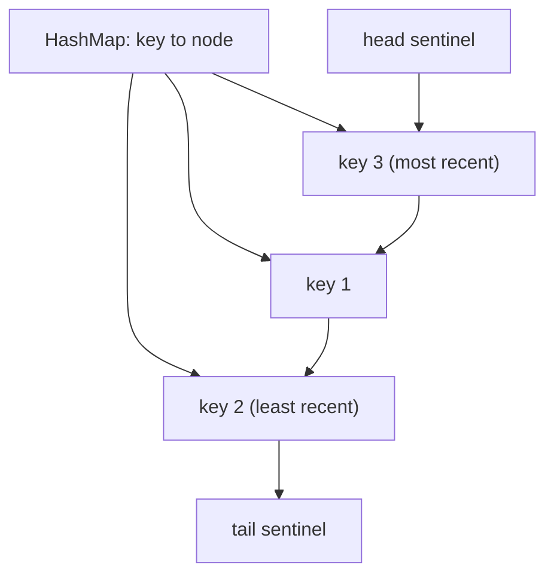
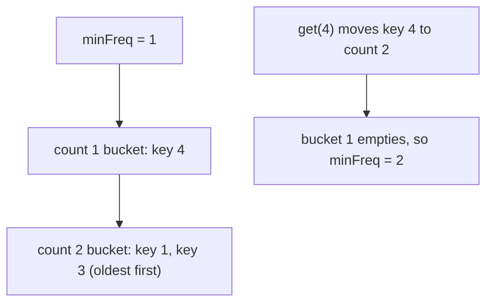
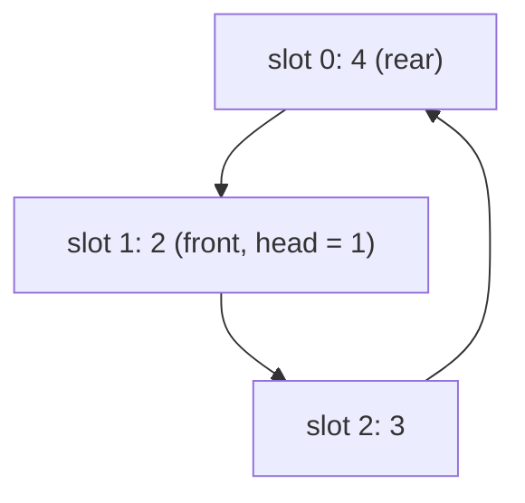
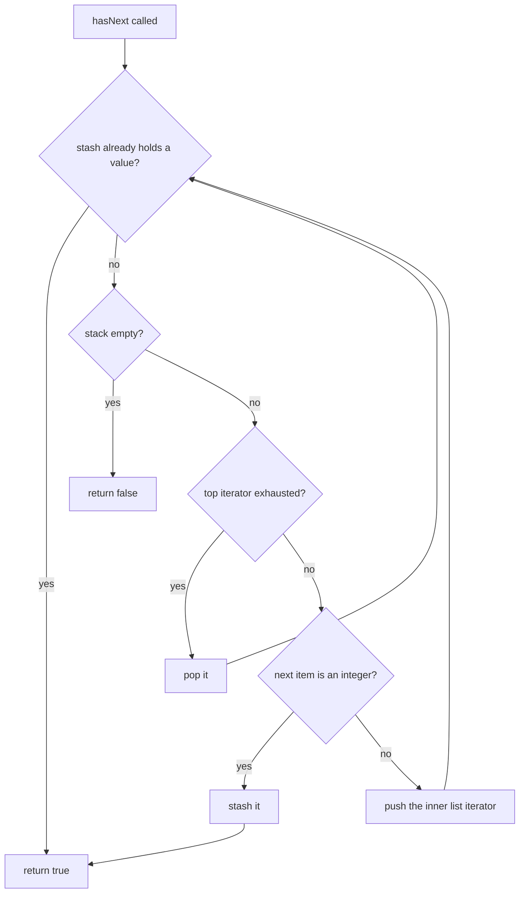
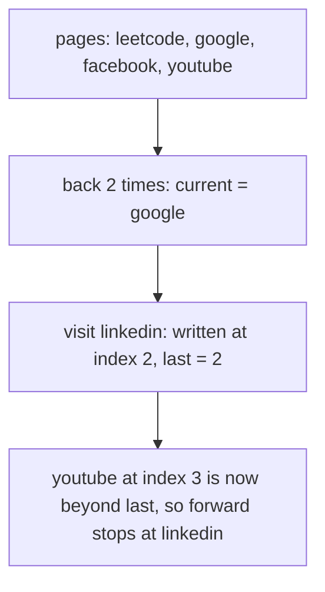
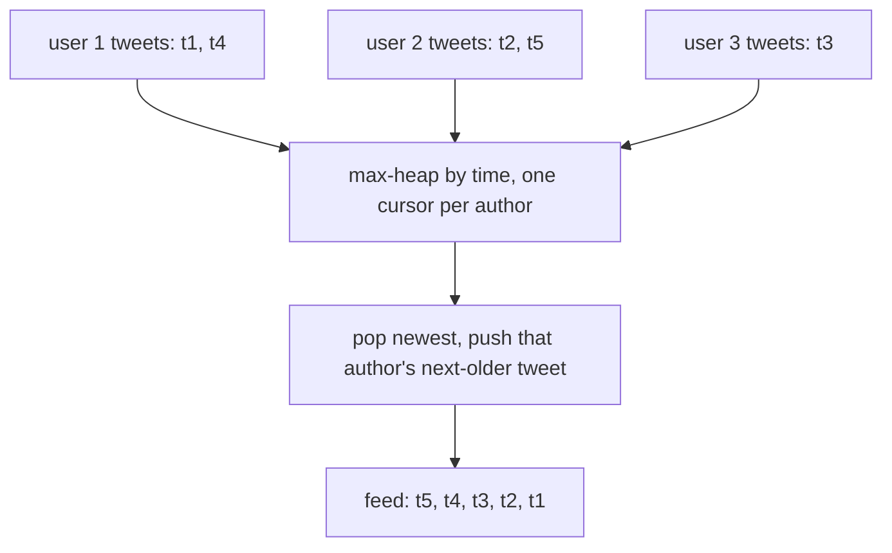
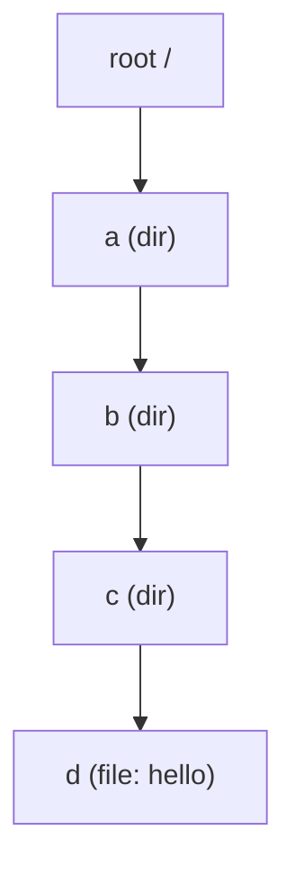

# Design-Style Coding Problems

[⬅ Back to index](../README.md)

Covers: 'design a data structure' coding problems: choosing the right combination of structures so every operation hits the required complexity, then writing clean, testable classes — LRU and LFU caches, iterators, rate limiters and more.

---

## Caches

### 1. LRU Cache

**🟡 Medium** · ⭐ Product/FAANG favourite (commonly reported at Amazon, Google, Meta, Microsoft)

<details>
<summary>Answer</summary>

**In short:** Combine a **hash map** (key → node) for O(1) lookup with a **doubly linked list** ordered by recency (most recent at the front, least recent at the back). `get` finds the node through the map and moves it to the front; `put` inserts or updates at the front and, if over capacity, removes the node at the back and its map entry. Every operation is O(1) time; space is O(capacity). In Kotlin, `LinkedHashMap` with access order does all of this for you, but many interviewers want the hand-written version because that is what the question is testing.

#### Problem

Build a cache with a fixed `capacity` and two operations, both O(1) on average:

- `get(key)` → the value, or `-1` if absent. A successful get counts as a "use".
- `put(key, value)` → insert or update. If this pushes the size over capacity, evict the **least recently used** key first.

Capacity 2: `put(1,1)`, `put(2,2)`, `get(1)` → 1, `put(3,3)` evicts 2, `get(2)` → -1.

#### Clarifying questions & edge cases

- Does `put` on an existing key count as a use? Yes — it updates the value **and** makes it most recent.
- Capacity 0 or negative? LeetCode guarantees ≥ 1; in real code, make `put` a no-op for capacity 0.
- Thread safety? Not in the base problem; mention a lock as a follow-up.
- Can a stored value be `-1`? If so, `-1` as "missing" is ambiguous — real APIs return `null`.

#### The general recipe for design problems

Every "design a data structure" question in this file is solved the same way:

1. **List the operations and their required complexity.** Here: lookup by key O(1), "mark as most recent" O(1), "find and remove the least recent" O(1).
2. **Pick one structure per need.** O(1) lookup by key → hash map. O(1) reorder and remove-from-the-middle → doubly linked list. O(1) "oldest" → keep the list ordered by the thing you evict on.
3. **Glue them with references.** The map stores pointers *into* the other structure, so you never search it.
4. **Write small private helpers** (`unlink`, `addAfterHead`) so each public method is 3-5 readable lines. Interviewers grade the class design as much as the algorithm.

#### Brute force

Keep a list of keys in recency order plus a map of values. `get` must find the key in the list to move it — O(n). Or store a timestamp per key and scan for the smallest on eviction — also O(n). Both work; neither meets the O(1) requirement.

#### Key insight

The bottleneck is "move this key to the front" and "remove the oldest". A **doubly** linked list can remove any node in O(1) *if you already hold a reference to it* — it just rewires `prev.next` and `next.prev`. The hash map gives you that reference in O(1). A singly linked list doesn't work: removing a node needs its predecessor, which you'd have to search for.

Two **sentinel** nodes (`head` and `tail`, never holding real data) remove every null check: the real list always lives between them, so insert and remove have no special cases for "first node" or "empty list".



Each node also stores its **key**, because when you evict `tail.prev` you must remove it from the map too, and the map needs the key.

#### Walkthrough

Capacity 2. The list is shown front (most recent) to back.

| op | list after | map keys | note |
|---|---|---|---|
| put(1,1) | [1] | {1} | |
| put(2,2) | [2, 1] | {1, 2} | |
| get(1) → 1 | [1, 2] | {1, 2} | 1 moves to front |
| put(3,3) | [3, 1] | {1, 3} | full: evict back (2) first |
| get(2) → -1 | [3, 1] | {1, 3} | |
| put(1,10) | [1, 3] | {1, 3} | update + move to front, no eviction |
| put(4,4) | [4, 1] | {1, 4} | evict 3 |

#### Kotlin

```kotlin
class LRUCache(private val capacity: Int) {
    private class Node(val key: Int, var value: Int) {
        var prev: Node? = null
        var next: Node? = null
    }

    private val map = HashMap<Int, Node>()
    private val head = Node(0, 0) // head.next = most recently used
    private val tail = Node(0, 0) // tail.prev = least recently used

    init {
        head.next = tail
        tail.prev = head
    }

    fun get(key: Int): Int {
        val node = map[key] ?: return -1
        moveToFront(node)
        return node.value
    }

    fun put(key: Int, value: Int) {
        if (capacity <= 0) return
        val existing = map[key]
        if (existing != null) {
            existing.value = value
            moveToFront(existing)
            return
        }
        if (map.size == capacity) {
            val lru = tail.prev!!          // a real node, because size > 0
            unlink(lru)
            map.remove(lru.key)            // this is why the node stores its key
        }
        val node = Node(key, value)
        map[key] = node
        addAfterHead(node)
    }

    private fun unlink(node: Node) {
        node.prev!!.next = node.next
        node.next!!.prev = node.prev
    }

    private fun addAfterHead(node: Node) {
        node.prev = head
        node.next = head.next
        head.next!!.prev = node
        head.next = node
    }

    private fun moveToFront(node: Node) {
        unlink(node)
        addAfterHead(node)
    }
}
```

#### The LinkedHashMap shortcut (and why it may not be accepted)

`java.util.LinkedHashMap` *is* a hash map threaded through a doubly linked list. Constructed with `accessOrder = true`, every `get`/`put` moves the entry to the end, and overriding `removeEldestEntry` evicts automatically:

```kotlin
class LRUCacheShort(private val capacity: Int) {
    private val map = object : LinkedHashMap<Int, Int>(16, 0.75f, true) {
        override fun removeEldestEntry(eldest: MutableMap.MutableEntry<Int, Int>?): Boolean =
            size > capacity
    }

    fun get(key: Int): Int = map[key] ?: -1
    fun put(key: Int, value: Int) { map[key] = value }
}
```

It's correct and is roughly what you'd ship in production (Android's `android.util.LruCache` is built on an access-ordered `LinkedHashMap`). But the interviewer is usually asking *"can you build the structure that LinkedHashMap is?"* — so the short answer can count as skipping the question. Good practice: mention it first ("in production I'd use LinkedHashMap with access order"), then ask whether they want it hand-written. Usually they do. Note that `LinkedHashMap()` and `linkedMapOf()` default to **insertion** order — you need the three-argument constructor, or you've built a FIFO cache.

#### Swift

Swift has no linked hash map, so you must hand-write it. Make `prev` **weak** so the two-way links don't form retain cycles (each node is owned by its predecessor's `next` and by the dictionary).

```swift
final class LRUCache {
    private final class Node {
        let key: Int
        var value: Int
        weak var prev: Node?
        var next: Node?
        init(_ key: Int, _ value: Int) { self.key = key; self.value = value }
    }

    private let capacity: Int
    private var map: [Int: Node] = [:]
    private let head = Node(0, 0)
    private let tail = Node(0, 0)

    init(_ capacity: Int) {
        self.capacity = capacity
        head.next = tail
        tail.prev = head
    }

    func get(_ key: Int) -> Int {
        guard let node = map[key] else { return -1 }
        moveToFront(node)
        return node.value
    }

    func put(_ key: Int, _ value: Int) {
        if let node = map[key] {
            node.value = value
            moveToFront(node)
            return
        }
        guard capacity > 0 else { return }
        if map.count == capacity, let lru = tail.prev {
            unlink(lru)
            map[lru.key] = nil
        }
        let node = Node(key, value)
        map[key] = node
        addAfterHead(node)
    }

    private func unlink(_ node: Node) {
        node.prev?.next = node.next
        node.next?.prev = node.prev
    }

    private func addAfterHead(_ node: Node) {
        node.prev = head
        node.next = head.next
        head.next?.prev = node
        head.next = node
    }

    private func moveToFront(_ node: Node) {
        unlink(node)
        addAfterHead(node)
    }
}
```

#### Complexity

- **Time:** O(1) average for `get` and `put` — one hash lookup plus a constant number of pointer changes.
- **Space:** O(capacity) — one map entry and one node per cached key.

#### Common mistakes

- Forgetting to move the node to the front on `get`, or on `put` of an existing key.
- Evicting before checking whether the key already exists — updating a key in a full cache must not evict anything.
- Not storing the key in the node, then being unable to remove the evicted entry from the map.
- Using `LinkedHashMap` without `accessOrder = true` — you get FIFO, not LRU.
- In Swift, strong `prev` and `next` together → nodes keep each other alive and leak.

#### Follow-ups

- *Thread-safe?* Wrap `get`/`put` in a lock; a read-write lock doesn't help much because `get` also mutates the order. For high concurrency, shard into several caches by key hash.
- *Limit by bytes instead of count?* Track a running total size and evict from the back while over the limit — see the image cache in [Mobile-Flavoured Coding Problems](23-mobile-flavoured-coding.md).
- *Evict by frequency instead?* That's [LFU Cache](#2-lfu-cache).
- *Expiry (TTL)?* Store an expiry time per node; treat expired entries as missing on `get`, and sweep lazily.

</details>

### 2. LFU Cache

**🔴 Hard**

<details>
<summary>Answer</summary>

**In short:** Evict the key with the **lowest use count**, breaking ties by **least recently used**. Keep `key → value`, `key → count`, and `count → keys with that count in recency order` (a linked hash set, or a doubly linked list per count), plus a `minFreq` variable. A use moves the key from bucket `f` to bucket `f + 1`; if bucket `f` empties and was the minimum, `minFreq` becomes `f + 1`. A new key always resets `minFreq` to 1. All operations O(1) average.

#### Problem

Like [LRU Cache](#1-lru-cache), with `get(key)` and `put(key, value)` in O(1) average, but on overflow evict the **least frequently used** key; among keys with the same count, evict the least recently used. A `get` or a `put` to an existing key increments its count. A new key starts at count 1.

Capacity 2: `put(1,1)`, `put(2,2)`, `get(1)` → 1, `put(3,3)` (evicts 2: count 1 vs key 1's count 2), `get(2)` → -1, `get(3)` → 3, `put(4,4)` (1 and 3 both have count 2; 1 was used less recently → evict 1), `get(1)` → -1.

#### Clarifying questions & edge cases

- Capacity 0 → every `put` is a no-op (LeetCode includes this case).
- Does `put` on an existing key increase the count? Yes.
- Tie-break on equal count → LRU among those keys.

#### Brute force

Store a count and a last-used time per key; on eviction scan all keys for (min count, oldest time). O(n) eviction. A `TreeMap` or heap keyed by (count, time) gives O(log n) — a reasonable intermediate answer before the O(1) one.

#### Key insight

Two observations make O(1) possible:

1. **Counts only go up by 1.** A key moves from bucket `f` to bucket `f + 1`, never further. So you never need to search for the next bucket.
2. **The minimum count changes in only two predictable ways.** When a new key is inserted, the minimum becomes 1. When a key leaves bucket `f`, that bucket becomes empty and `f == minFreq`, the minimum becomes `f + 1` (the key just went there). Nothing else changes it — eviction only happens right before an insert, which resets it to 1 anyway.

Within each bucket, keys must be in recency order so you can evict the oldest. A `LinkedHashSet` gives O(1) add-to-end, O(1) remove-by-key and O(1) "first" — a mini LRU list per count.



#### Walkthrough

Capacity 2.

| op | buckets (count: keys oldest→newest) | minFreq | result |
|---|---|---|---|
| put(1,1) | 1: [1] | 1 | |
| put(2,2) | 1: [1, 2] | 1 | |
| get(1) | 1: [2], 2: [1] | 1 | 1 |
| put(3,3) | full → evict first of bucket 1 (key 2); then 1: [3], 2: [1] | 1 | |
| get(2) | unchanged | 1 | -1 |
| get(3) | bucket 1 empties → 2: [1, 3] | 2 | 3 |
| put(4,4) | full → evict first of bucket 2 (key 1); then 1: [4], 2: [3] | 1 | |
| get(1) | unchanged | 1 | -1 |

#### Kotlin

```kotlin
class LFUCache(private val capacity: Int) {
    private val values = HashMap<Int, Int>()
    private val counts = HashMap<Int, Int>()
    private val buckets = HashMap<Int, LinkedHashSet<Int>>() // count -> keys, oldest first
    private var minFreq = 0

    fun get(key: Int): Int {
        val value = values[key] ?: return -1
        touch(key)
        return value
    }

    fun put(key: Int, value: Int) {
        if (capacity <= 0) return
        if (key in values) {
            values[key] = value
            touch(key)
            return
        }
        if (values.size == capacity) {
            val bucket = buckets[minFreq]!!
            val victim = bucket.first()      // least recently used among the least frequent
            bucket.remove(victim)
            if (bucket.isEmpty()) buckets.remove(minFreq)
            values.remove(victim)
            counts.remove(victim)
        }
        values[key] = value
        counts[key] = 1
        buckets.getOrPut(1) { LinkedHashSet() }.add(key)
        minFreq = 1                          // a brand-new key is always the least frequent
    }

    // Move key from bucket f to bucket f + 1.
    private fun touch(key: Int) {
        val f = counts[key]!!
        val bucket = buckets[f]!!
        bucket.remove(key)
        if (bucket.isEmpty()) {
            buckets.remove(f)
            if (minFreq == f) minFreq = f + 1
        }
        counts[key] = f + 1
        buckets.getOrPut(f + 1) { LinkedHashSet() }.add(key)
    }
}
```

If the interviewer rejects `LinkedHashSet` for the same reason as `LinkedHashMap` in LRU, replace each bucket with the hand-written doubly linked list from [LRU Cache](#1-lru-cache): nodes carry key, value and count, with a `key → node` map and a `count → list` map. The logic is identical; there's just more code.

#### Complexity

- **Time:** O(1) average for both operations — a fixed number of hash and linked-set operations.
- **Space:** O(capacity) — each key appears in the two maps and in exactly one bucket.

#### Common mistakes

- Forgetting to set `minFreq = 1` when inserting a new key.
- Updating `minFreq` when the bucket that emptied *wasn't* the minimum.
- Evicting after inserting the new key — the new key (count 1) gets evicted immediately.
- Not handling capacity 0: `buckets[minFreq]!!` crashes.
- Breaking ties by insertion time instead of last-use time. Moving the key to the end of a new bucket on every use is what keeps recency correct.

#### Follow-ups

- *Why not a heap?* A heap gives O(log n) and needs lazy deletion or decrease-key; the bucket trick is O(1) because counts change by exactly 1.
- *Counts that should fade over time?* Real caches age counts periodically (e.g. halve them all); mention it, don't implement it.
- *LRU or LFU in practice?* LRU adapts quickly to changing access patterns; LFU protects "always popular" items from a burst of one-off reads but can hold on to items that were popular long ago.

</details>

## Constant-time building blocks

### 3. Insert Delete GetRandom O(1)

**🟡 Medium** · ⭐ Product/FAANG favourite

<details>
<summary>Answer</summary>

**In short:** Store the values in a **dynamic array** (so a random index gives a uniformly random element in O(1)) and a **hash map value → index** (so you can find any value's position in O(1)). To delete from the middle of the array without shifting, **swap the doomed element with the last one**, fix the moved element's index in the map, then pop the last slot. Every operation is O(1) average; space O(n).

#### Problem

Implement a set of integers with:

- `insert(x)` → `true` if `x` was not present (and add it), else `false`.
- `remove(x)` → `true` if `x` was present (and remove it), else `false`.
- `getRandom()` → a uniformly random present element (called only when the set is non-empty).

All in O(1) average time. `insert(1)` → true, `remove(2)` → false, `insert(2)` → true, `getRandom()` → 1 or 2 with equal chance, `remove(1)` → true, `getRandom()` → 2.

#### Clarifying questions & edge cases

- Duplicates? Not in this version (it's a set). The duplicate-allowed version is LeetCode 381 (Hard) — see follow-ups.
- `getRandom` on an empty set? Guaranteed not to happen; real code should throw.
- Removing the element that is already last — the swap must still work (it swaps with itself).

#### Brute force

A `HashSet` alone gives O(1) insert/remove, but `getRandom` needs the k-th element, and a hash set has no index — you'd iterate, O(n). An array alone gives O(1) `getRandom`, but `remove` must find the value (O(n)) and shift everything after it (O(n)).

#### Key insight

Each structure fixes the other's weakness:

| need | array | hash map | together |
|---|---|---|---|
| contains / find position | O(n) | O(1) | map gives the index |
| random element | O(1) | O(n) | array gives it |
| remove | O(n) shift | O(1) | swap with last, then pop: O(1) |

The swap trick works because **order doesn't matter in a set**. Removing from the *end* of an array is O(1), so we move the problem to the end: overwrite the removed slot with the last element and shrink by one. The only extra bookkeeping is updating the moved element's index in the map.

#### Walkthrough

Start with values `[5, 7, 9]`, map `{5:0, 7:1, 9:2}`. Call `remove(5)`:

| step | array | map | note |
|---|---|---|---|
| look up 5 | [5, 7, 9] | {5:0, 7:1, 9:2} | i = 0, last = 9 |
| write last into slot i | [9, 7, 9] | {5:0, 7:1, 9:0} | 9's index is now 0 |
| pop last slot | [9, 7] | {5:0, 7:1, 9:0} | |
| delete 5 from map | [9, 7] | {7:1, 9:0} | done |

If you remove the last element itself (say `remove(7)` with `i = 1 = last index`), "write last into slot i" writes 7 over itself and sets `map[7] = 1`; then deleting 7 from the map *after* that update removes it correctly. That's why the map delete comes last.

#### Kotlin

```kotlin
class RandomizedSet {
    private val values = ArrayList<Int>()
    private val indexOf = HashMap<Int, Int>()

    fun insert(x: Int): Boolean {
        if (x in indexOf) return false
        indexOf[x] = values.size
        values.add(x)
        return true
    }

    fun remove(x: Int): Boolean {
        val i = indexOf[x] ?: return false
        val last = values[values.size - 1]
        values[i] = last              // move the last element into the hole
        indexOf[last] = i
        values.removeAt(values.size - 1) // O(1): removing from the end
        indexOf.remove(x)             // must come after indexOf[last] = i
        return true
    }

    fun getRandom(): Int = values.random() // List.random() picks a random index: O(1)
}
```

#### Swift

```swift
final class RandomizedSet {
    private var values: [Int] = []
    private var indexOf: [Int: Int] = [:]

    func insert(_ x: Int) -> Bool {
        if indexOf[x] != nil { return false }
        indexOf[x] = values.count
        values.append(x)
        return true
    }

    func remove(_ x: Int) -> Bool {
        guard let i = indexOf[x] else { return false }
        let last = values[values.count - 1]
        values[i] = last
        indexOf[last] = i
        values.removeLast()
        indexOf[x] = nil
        return true
    }

    func getRandom() -> Int {
        values[Int.random(in: 0..<values.count)]
    }
}
```

(`values.randomElement()!` also works and is O(1) for arrays.)

#### Complexity

- **Time:** O(1) average for all three — hash operations are O(1) average, array append/pop at the end are amortised O(1), and indexing is O(1).
- **Space:** O(n) — each value is stored once in the array and once in the map.

#### Common mistakes

- Calling `values.remove(x)` in Kotlin — on an `ArrayList<Int>` that is ambiguous with remove-by-index and is O(n) anyway. Always remove at the last index.
- Deleting `x` from the map *before* updating `indexOf[last]` — when `x` is the last element, it gets re-added.
- Using `values.removeAt(i)` (shifts the tail, O(n)) instead of the swap.
- Picking a random key from the hash map by iterating — O(n).

#### Follow-ups

- *Duplicates allowed (LeetCode 381)?* Map each value to a **set of indices**. On remove, take any index `i` from x's set, move the last element into `i`, and update the last element's index set (remove `lastIndex`, add `i`). Still O(1) average.
- *Weighted random?* Prefix sums of weights + binary search — O(log n) per pick; see [Binary Search](10-binary-search.md).
- *Random element from a stream you can't store?* Reservoir sampling — see [Problem-Solving Tricks](06-problem-solving-tricks.md).

</details>

### 4. Design Circular Queue

**🟡 Medium**

<details>
<summary>Answer</summary>

**In short:** Use a fixed-size array as a **ring**: keep the index of the front element (`head`) and the number of elements (`count`). The rear is at `(head + count - 1) % k`, and the next free slot is at `(head + count) % k`. Enqueue writes there and increments `count`; dequeue advances `head` with `% k` and decrements `count`. Storing `count` (instead of only head and tail) makes "empty" and "full" trivially different. Every operation O(1), space O(k).

#### Problem

Implement a bounded FIFO queue of capacity `k` on a fixed buffer: `enQueue(v)` and `deQueue()` return whether they succeeded; `Front()` and `Rear()` return the element or `-1` if empty; `isEmpty()`, `isFull()`.

`k = 3`: enQueue 1, 2, 3 → true; enQueue 4 → false (full); `Rear()` → 3; `deQueue()` → true; enQueue 4 → true (reuses slot 0); `Rear()` → 4; `Front()` → 2.

#### Clarifying questions & edge cases

- What should a failed operation do — return false, throw, or block? LeetCode: return false / -1. In real code a bounded *blocking* queue waits instead.
- `k = 1` — head and rear are the same slot; the formulas still work.
- Thread safety — not required here; mention it as a follow-up.

#### Brute force

An `ArrayList` where dequeue does `removeAt(0)` — O(n) per dequeue because everything shifts left. Or keep advancing a `head` index without wrapping — the array "walks" forward and wastes the freed slots at the front.

#### Key insight

Wrapping indices with `% k` lets the queue reuse the slots freed at the front, so nothing ever shifts. The classic difficulty with a ring is that `head == tail` can mean both "empty" and "full". Three standard fixes:

1. **Track `count`** (used here) — clearest.
2. Leave one slot always empty (allocate `k + 1`); full means `(tail + 1) % size == head`.
3. Keep a separate `isFull` flag.



#### Walkthrough

`k = 3`.

| op | data | head | count | Front / Rear | result |
|---|---|---|---|---|---|
| enQueue(1) | [1, _, _] | 0 | 1 | 1 / 1 | true |
| enQueue(2) | [1, 2, _] | 0 | 2 | 1 / 2 | true |
| enQueue(3) | [1, 2, 3] | 0 | 3 | 1 / 3 | true |
| enQueue(4) | [1, 2, 3] | 0 | 3 | | false (full) |
| deQueue() | [1, 2, 3] | 1 | 2 | 2 / 3 | true (slot 0 is now free) |
| enQueue(4) | [4, 2, 3] | 1 | 3 | 2 / 4 | true, written at (1 + 2) % 3 = 0 |

Note dequeue doesn't clear the slot — the value is simply outside the live range `head .. head + count - 1`.

#### Kotlin

```kotlin
class MyCircularQueue(k: Int) {
    private val data = IntArray(k)
    private var head = 0  // index of the front element
    private var count = 0 // number of stored elements

    fun enQueue(value: Int): Boolean {
        if (isFull()) return false
        data[(head + count) % data.size] = value // next free slot after the rear
        count++
        return true
    }

    fun deQueue(): Boolean {
        if (isEmpty()) return false
        head = (head + 1) % data.size
        count--
        return true
    }

    fun Front(): Int = if (isEmpty()) -1 else data[head]

    fun Rear(): Int = if (isEmpty()) -1 else data[(head + count - 1) % data.size]

    fun isEmpty(): Boolean = count == 0

    fun isFull(): Boolean = count == data.size
}
```

(The capitalised `Front`/`Rear` names match LeetCode's required API; in your own code use lowercase.)

#### Complexity

- **Time:** O(1) per operation — a modulo and an array access.
- **Space:** O(k) — the fixed buffer.

#### Common mistakes

- Computing the rear as `tail - 1` without wrapping — when the tail is at 0, the rear is at `k - 1`, not `-1`. With `count`, `(head + count - 1) % k` is always non-negative.
- Confusing "empty" and "full" when only `head` and `tail` are stored.
- Checking `isFull` after writing instead of before.

#### Follow-ups

- *Circular deque (LeetCode 641)?* Same ring; inserting at the front moves `head` to `(head - 1 + k) % k` — add `k` before the modulo so it never goes negative.
- *Thread-safe bounded buffer?* The producer-consumer problem: a lock plus two conditions ("not full", "not empty") — in Kotlin, a `Channel` with a capacity does this for you.
- *Where is this used?* Audio/video frame buffers, log tails, [Moving Average from Data Stream](#5-moving-average-from-data-stream), and `ArrayDeque` itself is a growable ring buffer.

</details>

### 5. Moving Average from Data Stream

**🟢 Easy**

<details>
<summary>Answer</summary>

**In short:** Keep the last `size` values in a **ring buffer** and a **running sum**. On each new value, if the window is full subtract the value that's about to be overwritten, write the new value in its place, add it to the sum, and return `sum / count`. O(1) per call instead of re-summing the window, O(size) space.

#### Problem

Given a window size, `next(v)` adds `v` to the stream and returns the average of the last `size` values (or of all values so far if fewer than `size` have arrived).

`size = 3`: `next(1)` → 1.0, `next(10)` → 5.5, `next(3)` → 4.667, `next(5)` → 6.0 (average of 10, 3, 5).

#### Clarifying questions & edge cases

- Fewer than `size` values so far → divide by the actual count, not by `size`.
- Overflow: the sum of many large ints can overflow `Int` → keep the sum in a `Long` (or `Double`).
- Integer or floating-point result? Floating (`Double`).

#### Brute force

Store every value in a list and average the last `size` each time: O(size) per call, and memory grows forever.

#### Key insight

When the window slides by one, only two values change: one enters, one leaves. So the new sum is `oldSum + entering - leaving`, O(1). The ring buffer is where the leaving value lives: the slot you're about to overwrite holds exactly the value that fell out of the window (the oldest one). This is the fixed-size sliding window from [Two Pointers & Sliding Window](08-two-pointers-sliding-window.md), turned into a class that receives values one at a time.

#### Walkthrough

`size = 3`.

| next(v) | buffer before | slot written | leaving | sum | count | average |
|---|---|---|---|---|---|---|
| 1 | [_, _, _] | 0 | — | 1 | 1 | 1.0 |
| 10 | [1, _, _] | 1 | — | 11 | 2 | 5.5 |
| 3 | [1, 10, _] | 2 | — | 14 | 3 | 4.667 |
| 5 | [1, 10, 3] | 0 | 1 | 18 | 3 | 6.0 |

#### Kotlin

```kotlin
class MovingAverage(size: Int) {
    private val window = IntArray(size)
    private var nextSlot = 0 // where the next value goes (also the oldest value once full)
    private var count = 0
    private var sum = 0L     // Long avoids overflow

    fun next(v: Int): Double {
        if (count == window.size) sum -= window[nextSlot] // oldest value leaves
        else count++
        window[nextSlot] = v
        sum += v
        nextSlot = (nextSlot + 1) % window.size
        return sum.toDouble() / count
    }
}
```

An `ArrayDeque<Int>` version (add last, remove first when `size` exceeded) is equally fine and maybe more readable; the ring array just avoids boxing.

#### Complexity

- **Time:** O(1) per `next`.
- **Space:** O(size).

#### Common mistakes

- Dividing by `size` before the window is full.
- Integer division: `sum / count` with two integers truncates — convert to `Double` first.
- Recomputing the sum over the window each call — correct but O(size).
- Floating-point drift: if you keep the sum as a `Double` over billions of values, rounding errors accumulate. An integer `Long` sum is exact.

#### Follow-ups

- *Time-based window ("average over the last 5 minutes")?* Store `(timestamp, value)` in a deque and pop from the front while too old — the same pattern as [Design Hit Counter](#6-design-hit-counter).
- *Moving median?* Two heaps (low half and high half) with lazy deletion of values that leave the window — see [Heaps & Priority Queues](13-heaps-priority-queues.md).
- *Exponential moving average?* `avg = alpha * v + (1 - alpha) * avg` — O(1) space, no buffer, recent values weigh more.

</details>

## Time windows and rate limiting

### 6. Design Hit Counter

**🟡 Medium** · ⭐ Product/FAANG favourite

<details>
<summary>Answer</summary>

**In short:** Because timestamps arrive in non-decreasing order, keep the hits in a **queue**: `hit(t)` appends `t`; `getHits(t)` first pops everything at or before `t - 300` from the front, then returns the queue size. That's amortised O(1) but uses memory per hit. The follow-up answer is **300 buckets** indexed by `t % 300`, each holding `(timestamp, count)`: a bucket whose stored timestamp is stale is reset on reuse, and `getHits` sums the buckets that are still inside the window — O(300) = O(1) time and O(300) space no matter how many hits arrive.

#### Problem

Count hits in the past 5 minutes (300 seconds). `hit(timestamp)` records a hit; `getHits(timestamp)` returns hits with `timestamp - 300 < t ≤ timestamp`. Timestamps are in seconds and calls arrive in chronological order; several hits can share a timestamp.

`hit(1)`, `hit(2)`, `hit(3)`, `getHits(4)` → 3, `hit(300)`, `getHits(300)` → 4, `getHits(301)` → 3 (the hit at 1 has expired).

#### Clarifying questions & edge cases

- Is the window inclusive? A hit at `t` is counted at `t + 299` but not at `t + 300`.
- Are timestamps ordered? Yes in the LeetCode version — this is what makes the queue work. If not, you'd need a sorted structure.
- Many hits per second (millions)? → the queue grows huge; buckets fix that.
- Concurrent callers? Follow-up.

#### Brute force

Store every timestamp in a list and count those inside the window on each `getHits` — O(total hits) per query, and memory never shrinks.

#### Key insight

Ordered timestamps mean the expired hits are always the **oldest**, i.e. at the front. A queue lets you drop them from the front in O(1) each; each hit is added once and removed once, so the cost is amortised O(1).

For the bucket version, notice that only 300 distinct seconds can ever be inside the window. Second `t` and second `t + 300` can't both be in the same window, so they can safely **share** bucket `t % 300` — when the newer one arrives, the older one is already expired, and the stored timestamp tells you that.

#### Walkthrough

Queue version:

| call | cutoff (pop if ≤) | queue after | result |
|---|---|---|---|
| hit(1), hit(2), hit(3) | — | [1, 2, 3] | |
| getHits(4) | -296 | [1, 2, 3] | 3 |
| hit(300) | — | [1, 2, 3, 300] | |
| getHits(300) | 0 | [1, 2, 3, 300] | 4 |
| getHits(301) | 1 → pop 1 | [2, 3, 300] | 3 |

Bucket version, same calls: `hit(300)` lands in bucket 0 (`300 % 300`), buckets 1-3 hold timestamps 1-3. At `getHits(301)` the bucket for second 1 has `301 - 1 = 300`, not `< 300`, so it's skipped → 3.

#### Kotlin

```kotlin
// Simple version: amortised O(1), memory proportional to hits in the window.
class HitCounter {
    private val hits = ArrayDeque<Int>()

    fun hit(timestamp: Int) {
        hits.addLast(timestamp)
    }

    fun getHits(timestamp: Int): Int {
        while (hits.isNotEmpty() && hits.first() <= timestamp - 300) hits.removeFirst()
        return hits.size
    }
}

// Scalable version: fixed memory, handles any number of hits per second.
class HitCounterBuckets {
    private val times = IntArray(300) // which second each bucket currently represents
    private val counts = IntArray(300)

    fun hit(timestamp: Int) {
        val i = timestamp % 300
        if (times[i] != timestamp) { // stale bucket from 300+ seconds ago: reuse it
            times[i] = timestamp
            counts[i] = 1
        } else {
            counts[i]++
        }
    }

    fun getHits(timestamp: Int): Int {
        var total = 0
        for (i in 0 until 300) {
            if (timestamp - times[i] < 300) total += counts[i]
        }
        return total
    }
}
```

#### Complexity

- **Queue:** `hit` O(1); `getHits` amortised O(1) (each hit is popped once); space O(hits in the last 300 s).
- **Buckets:** `hit` O(1); `getHits` O(300) = O(1); space O(300) — independent of traffic.

#### Common mistakes

- Off-by-one on the window: pop `≤ t - 300`, not `< t - 300`.
- In the bucket version, adding to a bucket without checking whether its timestamp is stale — you'd count hits from 5 minutes ago.
- Popping in `hit` only — a `getHits` long after the last hit would then return stale counts. (Popping in both is fine.)

#### Follow-ups

- *Thread safety?* Guard both methods with a lock; in the bucket version you could use per-bucket atomic counters, but resetting a stale bucket is a compare-and-set on (timestamp, count) together, so a lock is simpler to get right.
- *Window of 1 hour at 1-second precision?* 3600 buckets; or coarser buckets (e.g. per 10 s) trading precision for memory.
- *Distributed?* Each server keeps local buckets and a central store aggregates — this moves into system design.

</details>

### 7. Logger Rate Limiter and a Sliding-Window Rate Limiter

**🟢 Easy** · ⭐ Product/FAANG favourite

<details>
<summary>Answer</summary>

**In short:** Logger Rate Limiter keeps a hash map `message → earliest time it may be printed again`; a message prints if it's absent or that time has passed, and then the entry becomes `timestamp + 10`. O(1) per call. The general interview version — "allow at most **N** requests per **W** seconds per client" — is a **sliding-window log**: a deque of recent request times per client; pop times that have left the window, allow if fewer than N remain, then record the new time. Mention the alternatives (fixed window, sliding-window counter, token bucket) and their trade-offs.

#### Problem

**Logger (LeetCode 359):** `shouldPrintMessage(timestamp, message)` returns `true` if this message wasn't printed in the last 10 seconds (and records it as printed), else `false`. Timestamps are non-decreasing.

`(1,"foo")` → true, `(2,"bar")` → true, `(3,"foo")` → false, `(8,"bar")` → false, `(10,"foo")` → false, `(11,"foo")` → true.

**Rate limiter (common follow-up):** `allow(clientId, now)` returns `true` if the client has made fewer than `limit` allowed requests in the last `window` time units.

#### Clarifying questions & edge cases

- Does a *rejected* request count toward the limit? Usually no — only allowed requests are recorded.
- Is the window inclusive at the boundary? In the logger, a message at time 1 may print again at 11 (not 10).
- Memory: millions of distinct messages or clients → old entries must be cleaned up.
- Should the limiter smooth bursts or allow them? This decides between sliding window and token bucket.

#### Brute force

Store every (message, timestamp) and scan back for the last occurrence — O(n) per call. Or, for the limiter, count all of a client's past requests inside the window by scanning the full history.

#### Key insight

For the logger you only need **one number per message**: when it becomes allowed again. Storing `timestamp + 10` instead of the last print time makes the check a single comparison.

For an N-per-window limiter, you need the times of the last N allowed requests. Because time only moves forward, expired entries are always at the **front** of the client's deque (exactly the [Design Hit Counter](#6-design-hit-counter) pattern), and the deque never holds more than N entries — so memory per client is O(N).

| algorithm | idea | memory per client | accuracy | bursts |
|---|---|---|---|---|
| Fixed window | count per `floor(now / W)` | O(1) | allows up to 2N across a window boundary | allowed at boundaries |
| Sliding-window log | deque of times | O(N) | exact | no more than N in any window |
| Sliding-window counter | current + previous window counts, weighted by overlap | O(1) | approximate | smooth |
| Token bucket | tokens refill at rate r up to capacity b; a request costs 1 | O(1) | exact for its model | bursts up to b allowed |

#### Walkthrough

Logger:

| call | map before | allowed? | map after |
|---|---|---|---|
| (1, foo) | {} | yes | {foo: 11} |
| (2, bar) | {foo: 11} | yes | {foo: 11, bar: 12} |
| (3, foo) | | 3 < 11 → no | unchanged |
| (8, bar) | | 8 < 12 → no | unchanged |
| (10, foo) | | 10 < 11 → no | unchanged |
| (11, foo) | | 11 ≥ 11 → yes | {foo: 21, bar: 12} |

Limiter with `limit = 2`, `window = 10`, one client: requests at 1, 3, 5, 11, 12. At 1 and 3 → allowed (deque [1, 3]). At 5 → nothing expired, size 2 → rejected. At 11 → pop 1 (≤ 11 - 10), size 1 → allowed, deque [3, 11]. At 12 → nothing to pop (3 > 2), size 2 → rejected.

#### Kotlin

```kotlin
class Logger {
    private val nextAllowed = HashMap<String, Int>()

    fun shouldPrintMessage(timestamp: Int, message: String): Boolean {
        val allowedAt = nextAllowed[message]
        if (allowedAt != null && timestamp < allowedAt) return false
        nextAllowed[message] = timestamp + 10
        return true
    }
}

// At most `limit` allowed requests per client in any window of length `windowMillis`.
class SlidingWindowRateLimiter(private val limit: Int, private val windowMillis: Long) {
    private val log = HashMap<String, ArrayDeque<Long>>()

    fun allow(clientId: String, now: Long): Boolean {
        val times = log.getOrPut(clientId) { ArrayDeque() }
        while (times.isNotEmpty() && times.first() <= now - windowMillis) times.removeFirst()
        if (times.size >= limit) return false
        times.addLast(now) // only allowed requests are recorded
        return true
    }
}

// Token bucket: up to `capacity` burst, refilled continuously at `tokensPerMilli`.
class TokenBucket(private val capacity: Double, private val tokensPerMilli: Double, startMillis: Long) {
    private var tokens = capacity
    private var lastRefill = startMillis

    fun allow(now: Long): Boolean {
        tokens = minOf(capacity, tokens + (now - lastRefill) * tokensPerMilli)
        lastRefill = now
        if (tokens < 1.0) return false
        tokens -= 1.0
        return true
    }
}
```

Taking `now` as a parameter (instead of calling `System.currentTimeMillis()` inside) makes the classes deterministic and easy to unit-test — interviewers notice this.

#### Complexity

- **Logger:** O(1) average per call; space O(distinct messages) unless cleaned up.
- **Sliding-window log:** amortised O(1) per call (each time is popped once); space O(limit) per active client.
- **Token bucket:** O(1) time and space per client.

#### Common mistakes

- Logger: storing the last print time and comparing with `> 10` vs `>= 10` inconsistently — store the next-allowed time and compare once.
- Logger: updating the timestamp on a *rejected* message — that would push the next allowed time further away.
- Limiter: recording rejected requests in the deque, so a client that keeps retrying is locked out forever.
- Using a fixed window and claiming it's exact — it can let through 2N requests around a boundary.

#### Follow-ups

- *Logger memory keeps growing?* Keep a queue of `(timestamp, message)` and, on each call, remove entries older than 10 s from both the queue and the map; or periodically sweep.
- *Thread safety?* One lock per client (or a `ConcurrentHashMap` of per-client limiters each synchronised on itself) — global locking becomes a bottleneck.
- *Across many servers?* Shared counters in a store like Redis, or per-server limits that sum to the global limit — a system-design discussion.

</details>

## Iterators

### 8. Flatten Nested List Iterator (and Peeking Iterator)

**🟡 Medium** · ⭐ Product/FAANG favourite

<details>
<summary>Answer</summary>

**In short:** Keep a **stack of iterators**, one per nesting level. `hasNext()` does the real work: look at the top iterator; if it's exhausted, pop it; if its next item is a list, push that list's iterator; if it's an integer, stash it and return `true`. `next()` just returns the stashed value. This is lazy (it never flattens the whole structure up front), handles empty lists correctly, and uses O(depth) memory. **Peeking Iterator** is the same "stash one element ahead" trick wrapped around a plain iterator.

#### Problem

**Flatten Nested List Iterator (LeetCode 341):** given a nested list where each element is an integer or another nested list, implement an iterator with `next()` and `hasNext()` that yields the integers in order.

`[[1,1],2,[1,1]]` → 1, 1, 2, 1, 1. `[1,[4,[6]]]` → 1, 4, 6. `[[],[[]]]` → nothing.

**Peeking Iterator (LeetCode 284, Medium):** wrap an existing iterator and add `peek()`, which returns the next element without consuming it.

#### Clarifying questions & edge cases

- Empty inner lists, at any depth: `[[], [[]], 3]` must yield just 3 — the main trap.
- Can `next()` be called without `hasNext()`? Yes; `next()` must call `hasNext()` itself.
- Very deep nesting → recursion could overflow the call stack; an explicit stack doesn't.
- Should the input be modified? No.

#### Brute force

In the constructor, recursively flatten everything into a list and iterate over it with an index. Simple and O(1) per call afterwards, but O(n) memory and O(n) upfront work even if the caller only reads the first element — and it's not really an iterator. Often accepted as a first answer; the interviewer will then ask for the lazy version.

#### Key insight

A recursive DFS over the nested structure would naturally produce the integers in order. An iterator has to be able to **pause** that DFS between calls. The call stack of a paused recursion is exactly "an iterator over each list on the current path" — so store that stack explicitly.

Why does `hasNext` do the work, not `next`? Because only by advancing can you know whether a next integer exists: `[[], [[]]]` has elements but no integers. If `hasNext` just returned `stack.isNotEmpty()`, it would say `true` and then `next` would have nothing to return.



#### Walkthrough

Input `[1, [4, [6]]]`. Write `it(X)` for an iterator over list X.

| call | stack (bottom → top) | action | returns |
|---|---|---|---|
| hasNext | it(outer) | top gives 1 → stash 1 | true |
| next | it(outer) | return stash | 1 |
| hasNext | it(outer) | top gives [4,[6]] → push | |
| | it(outer), it([4,[6]]) | top gives 4 → stash | true |
| next | | | 4 |
| hasNext | ..., it([4,[6]]) | gives [6] → push; then it([6]) gives 6 | true |
| next | | | 6 |
| hasNext | ..., it([6]) | exhausted → pop; it([4,[6]]) exhausted → pop; it(outer) exhausted → pop | false |

#### Kotlin

LeetCode provides the `NestedInteger` interface; a minimal version is shown so the code is self-contained.

```kotlin
interface NestedInteger {
    fun isInteger(): Boolean
    fun getInteger(): Int?
    fun getList(): List<NestedInteger>?
}

class NestedIterator(nestedList: List<NestedInteger>) {
    private val stack = ArrayDeque<Iterator<NestedInteger>>().apply { addLast(nestedList.iterator()) }
    private var stashed: Int? = null // the next integer, found by hasNext()

    fun hasNext(): Boolean {
        while (stashed == null && stack.isNotEmpty()) {
            val top = stack.last()
            if (!top.hasNext()) {
                stack.removeLast() // this level is finished
                continue
            }
            val item = top.next()
            if (item.isInteger()) stashed = item.getInteger()
            else stack.addLast(item.getList()!!.iterator()) // go one level deeper
        }
        return stashed != null
    }

    fun next(): Int {
        if (!hasNext()) throw NoSuchElementException()
        val value = stashed!!
        stashed = null
        return value
    }
}

class PeekingIterator(private val source: Iterator<Int>) : Iterator<Int> {
    private var hasPeeked = false
    private var peeked = 0

    fun peek(): Int {
        if (!hasPeeked) {
            peeked = source.next() // read one ahead and remember it
            hasPeeked = true
        }
        return peeked
    }

    override fun next(): Int {
        if (hasPeeked) {
            hasPeeked = false
            return peeked
        }
        return source.next()
    }

    override fun hasNext(): Boolean = hasPeeked || source.hasNext()
}
```

In `PeekingIterator` a separate `hasPeeked` flag is used rather than `peeked: Int?`, because in a generic version `null` might be a legitimate element.

#### Complexity

- **Flatten:** amortised O(1) per call — every list is pushed and popped once and every element is read once, so the total work over the whole iteration is O(N + L) for N integers and L lists. Space O(D) for nesting depth D (plus the stash).
- **Peeking:** O(1) per call, O(1) space.

#### Common mistakes

- `hasNext()` returning `stack.isNotEmpty()` — wrong for empty inner lists.
- `next()` that doesn't call `hasNext()` first — breaks when the caller calls `next()` directly.
- Calling `hasNext()` twice and skipping an element — guard with "only search if nothing is stashed".
- Pushing the elements of each list in reverse onto a stack of `NestedInteger` (another valid approach) but forgetting the reverse, which produces the wrong order.

#### Follow-ups

- *Generic iterator?* Make it `NestedIterator<T>` and `PeekingIterator<T>`; this is where the `hasPeeked` flag matters.
- *Iterator over a binary search tree in order?* Same idea — a stack holding the path of left children; see [Trees & Binary Search Trees](14-trees-bst.md).
- *Zigzag or round-robin over k iterators?* A queue of iterators: take from the front, re-add it at the back if it still has elements.
- *Kotlin shortcut?* A `sequence { }` builder with a recursive `yieldAll` makes flattening lazy in a few lines — good to mention, but write the explicit stack in the interview.

</details>

## History and versions

### 9. Design Browser History

**🟡 Medium**

<details>
<summary>Answer</summary>

**In short:** Store the pages in an array with a `current` index and a `last` index marking the end of the valid forward history. `visit` writes at `current + 1` and sets `last` to it (which logically throws away the old forward history, without deleting anything); `back(steps)` moves `current` to `max(0, current - steps)`; `forward(steps)` moves it to `min(last, current + steps)`. Every operation is O(1). The two-stack version is the other common answer, but its `back`/`forward` are O(steps).

#### Problem

Start on `homepage`. `visit(url)` goes to `url` from the current page and **clears all forward history**. `back(steps)` moves back at most `steps` pages and returns the current URL; `forward(steps)` moves forward at most `steps` and returns the current URL.

`BrowserHistory("leetcode.com")`, visit google, facebook, youtube; `back(1)` → facebook; `back(1)` → google; `forward(1)` → facebook; visit linkedin; `forward(2)` → linkedin (no forward history); `back(2)` → google; `back(7)` → leetcode.com.

#### Clarifying questions & edge cases

- Steps larger than the history → clamp, don't fail.
- Visiting the same URL as the current page — still a new entry (LeetCode doesn't de-duplicate).
- Memory: should discarded forward pages be freed? With the array version they're overwritten lazily; mention it.

#### Brute force

A list plus index where `visit` calls `subList(current + 1, size).clear()` before adding — correct, but O(forward history) per visit. Or two stacks (back and forward): `visit` pushes the current page onto the back stack and clears the forward stack; `back(k)` pops k times from one stack and pushes onto the other — O(k) per call.

#### Key insight

Forward history doesn't need to be **deleted**, only **forgotten**. A single `last` index says where valid history ends: anything after `last` is garbage that will be overwritten by later visits. That turns `visit` into O(1), and since back/forward are just index arithmetic with clamping, they're O(1) too.



#### Walkthrough

| op | pages | current | last | returns |
|---|---|---|---|---|
| init leetcode | [leetcode] | 0 | 0 | |
| visit google, facebook, youtube | [leetcode, google, facebook, youtube] | 3 | 3 | |
| back(1) | same | 2 | 3 | facebook |
| back(1) | same | 1 | 3 | google |
| forward(1) | same | 2 | 3 | facebook |
| visit linkedin | [leetcode, google, facebook, linkedin] | 3 | 3 | |
| forward(2) | same | min(3, 5) = 3 | 3 | linkedin |
| back(2) | same | 1 | 3 | google |
| back(7) | same | max(0, -6) = 0 | 3 | leetcode |

#### Kotlin

```kotlin
class BrowserHistory(homepage: String) {
    private val pages = arrayListOf(homepage)
    private var current = 0
    private var last = 0 // index of the last valid page; anything after it is stale

    fun visit(url: String) {
        current++
        if (current < pages.size) pages[current] = url else pages.add(url)
        last = current // forward history is forgotten
    }

    fun back(steps: Int): String {
        current = maxOf(0, current - steps)
        return pages[current]
    }

    fun forward(steps: Int): String {
        current = minOf(last, current + steps)
        return pages[current]
    }
}
```

#### Complexity

- **Time:** O(1) for every operation (amortised for `visit` because of `ArrayList` growth).
- **Space:** O(number of visits) — the array never shrinks; stale entries are reused.

#### Common mistakes

- Clamping `forward` to `pages.size - 1` instead of `last` — you'd walk into "deleted" forward history.
- Forgetting to update `last` on `visit`.
- Using `add` unconditionally on `visit` — the new page ends up after the stale entries instead of at `current + 1`.

#### Follow-ups

- *Two-stack version?* Simpler to explain and natural for undo/redo; see the undo/redo question in [Mobile-Flavoured Coding Problems](23-mobile-flavoured-coding.md).
- *Limit history to the last 50 pages?* Use a ring buffer (see [Design Circular Queue](#4-design-circular-queue)) and track the oldest valid index.
- *Back/forward with tabs?* One `BrowserHistory` per tab, plus a map `tabId → history`.

</details>

### 10. Snapshot Array

**🟡 Medium** · ⭐ Product/FAANG favourite (commonly reported at Google)

<details>
<summary>Answer</summary>

**In short:** Don't copy the array on every `snap` — that's O(n) per snapshot. Instead, for **each index keep a list of `(snapId, value)` changes**, appended in increasing `snapId` order. `set` updates the current snapshot's entry (overwriting it if the index was already set in this snapshot), `snap` just increments a counter, and `get(index, snapId)` **binary searches** that index's list for the last change with id ≤ `snapId`. `set` and `snap` O(1), `get` O(log changes), space O(n + number of sets).

#### Problem

An array of `length` zeros with:

- `set(index, val)` — set the element in the current version.
- `snap()` — take a snapshot and return its id (`0`, `1`, `2`, …).
- `get(index, snapId)` — the value at `index` when snapshot `snapId` was taken.

`SnapshotArray(3)`, `set(0, 5)`, `snap()` → 0, `set(0, 6)`, `get(0, 0)` → 5.

#### Clarifying questions & edge cases

- An index never set → 0 for every snapshot.
- Several sets to the same index before one snap → only the last one matters for that snapshot.
- Many snaps with no sets in between → must not cost O(length) each.
- `snapId` is always valid (less than the number of snaps taken).

#### Brute force

On every `snap`, copy the whole array into a list of versions. `get` is O(1), but `snap` is O(length) time and space — with 50,000 snaps on a 50,000-length array that's 2.5 billion copied ints.

#### Key insight

Most indices don't change between snapshots, so store **only the changes**. For one index, its history is a sorted list of `(snapId, value)`; the value at snapshot `s` is the value of the **latest change with id ≤ s**. Because snap ids only increase, each list is already sorted — no sorting needed — and "latest with id ≤ s" is a standard upper-bound binary search ([Binary Search](10-binary-search.md)). This is the same idea as Time Based Key-Value Store, which is covered in that topic.

A sentinel entry `(0, 0)` at the start of every list means the search always finds something and unset indices return 0 without special-casing.

#### Walkthrough

`SnapshotArray(2)`. Each index's history list is shown as `(snapId, value)`.

| op | index 0 history | index 1 history | snapId (current) | returns |
|---|---|---|---|---|
| init | (0,0) | (0,0) | 0 | |
| set(0, 5) | (0,5) — overwrite, same snap | (0,0) | 0 | |
| snap() | | | 1 | 0 |
| set(0, 6) | (0,5), (1,6) | (0,0) | 1 | |
| set(0, 7) | (0,5), (1,7) — overwrite | (0,0) | 1 | |
| snap() | | | 2 | 1 |
| get(0, 0) | last id ≤ 0 → (0,5) | | | 5 |
| get(0, 1) | last id ≤ 1 → (1,7) | | | 7 |
| get(1, 1) | | last id ≤ 1 → (0,0) | | 0 |

#### Kotlin

```kotlin
class SnapshotArray(length: Int) {
    // history[i] = changes to index i as [snapId, value], ids increasing
    private val history = Array(length) { mutableListOf(intArrayOf(0, 0)) }
    private var snapId = 0

    fun set(index: Int, value: Int) {
        val changes = history[index]
        val latest = changes.last()
        if (latest[0] == snapId) latest[1] = value       // already changed in this snapshot
        else changes.add(intArrayOf(snapId, value))
    }

    fun snap(): Int = snapId++

    fun get(index: Int, snapId: Int): Int {
        val changes = history[index]
        // Find the last change with id <= snapId. changes[0] has id 0, so lo = 0 is always valid.
        var lo = 0
        var hi = changes.size - 1
        while (lo < hi) {
            val mid = (lo + hi + 1) / 2 // round up so lo = mid always makes progress
            if (changes[mid][0] <= snapId) lo = mid else hi = mid - 1
        }
        return changes[lo][1]
    }
}
```

`snap()` returns the old value and then increments — exactly "return the id of the snapshot just taken".

#### Complexity

- **Time:** `set` O(1), `snap` O(1), `get` O(log k) where k is the number of changes to that index.
- **Space:** O(length + number of `set` calls).

#### Common mistakes

- Copying the array on `snap` (O(n) per snap) — the brute force.
- Appending a new entry on every `set` even within the same snapshot — still correct with the right search, but wastes memory and makes `get` slower.
- Binary searching for "first id ≥ snapId" instead of "last id ≤ snapId".
- `mid = (lo + hi) / 2` with `lo = mid` → infinite loop when `hi = lo + 1`. Round up.

#### Follow-ups

- *Kotlin `TreeMap` per index?* `floorEntry(snapId)` gives the answer in O(log k) and reads nicely; more memory than lists of int pairs, but fine to mention.
- *Where is this used in practice?* Persistent data structures, MVCC in databases (each row has versions; a transaction reads the latest version ≤ its start time), undo history.
- *Range snapshots or very many indices?* A persistent segment tree shares unchanged nodes between versions — mention, don't implement.

</details>

## Feeds, rankings and real-world models

### 11. Design Twitter

**🟡 Medium**

<details>
<summary>Answer</summary>

**In short:** Store each user's tweets as an append-only list of `(time, tweetId)` using a global increasing counter as the time, and each user's followees as a set. `getNewsFeed` is **merge k sorted lists**: put the newest tweet of the user and of each followee into a max-heap by time, pop the top, push that author's next-older tweet, and stop after 10. `post`, `follow`, `unfollow` are O(1); the feed is O(F log F) for F followees (seeding the heap plus 10 pops), independent of how many tweets they've posted.

#### Problem

Implement a simplified Twitter:

- `postTweet(userId, tweetId)` — a new tweet.
- `getNewsFeed(userId)` — the 10 most recent tweet ids from the user and the people they follow, newest first.
- `follow(followerId, followeeId)`, `unfollow(followerId, followeeId)`.

User 1 posts 5; `getNewsFeed(1)` → [5]; 1 follows 2; 2 posts 6; `getNewsFeed(1)` → [6, 5]; 1 unfollows 2; `getNewsFeed(1)` → [5].

#### Clarifying questions & edge cases

- Can a user follow themselves? Their own tweets are always included; ignore self-follow and make sure self-unfollow doesn't remove their own tweets.
- Follow twice / unfollow someone not followed → no-op (sets handle this).
- What is "most recent"? Order of posting — use a global counter, not tweet ids (ids aren't ordered).
- Users who don't exist yet → treat as empty.

#### Brute force

On `getNewsFeed`, gather every tweet from the user and all followees into one list, sort by time, take 10. O(T log T) where T is the total number of those tweets — fine for small data, but a heavy user with thousands of tweets makes every feed request slow.

#### Key insight

Each author's tweet list is **already sorted by time** (we only append). The feed is the top 10 of the union of F sorted lists — the textbook **k-way merge** ([Heaps & Priority Queues](13-heaps-priority-queues.md)). A max-heap holds one "cursor" per author pointing at their newest not-yet-used tweet. Popping gives the globally newest remaining tweet; pushing the same author's next-older tweet keeps the heap holding one candidate per author. You stop after 10 pops, so you never look at old tweets.



#### Walkthrough

User 1 follows 2 and 3. Times: user 1 posted at 1 and 4, user 2 at 2 and 5, user 3 at 3.

| step | heap (time, author) | pop | push | feed |
|---|---|---|---|---|
| init | (4,u1), (5,u2), (3,u3) | | | [] |
| 1 | | (5,u2) | (2,u2) | [t5] |
| 2 | (4,u1), (3,u3), (2,u2) | (4,u1) | (1,u1) | [t5, t4] |
| 3 | (3,u3), (2,u2), (1,u1) | (3,u3) | none left | [t5, t4, t3] |
| 4 | (2,u2), (1,u1) | (2,u2) | none left | [.., t2] |
| 5 | (1,u1) | (1,u1) | none left | [t5, t4, t3, t2, t1] |

#### Kotlin

```kotlin
import java.util.PriorityQueue

class Twitter {
    private var clock = 0
    private val tweets = HashMap<Int, MutableList<IntArray>>() // user -> [time, tweetId], oldest first
    private val following = HashMap<Int, MutableSet<Int>>()

    fun postTweet(userId: Int, tweetId: Int) {
        tweets.getOrPut(userId) { mutableListOf() }.add(intArrayOf(clock++, tweetId))
    }

    fun getNewsFeed(userId: Int): List<Int> {
        // Heap entry: [time, tweetId, authorId, indexInAuthorsList]; newest time on top.
        val heap = PriorityQueue<IntArray> { a, b -> b[0].compareTo(a[0]) }
        val authors = (following[userId] ?: emptySet<Int>()) + userId // always include own tweets
        for (author in authors) {
            val list = tweets[author] ?: continue
            val i = list.size - 1
            heap.add(intArrayOf(list[i][0], list[i][1], author, i))
        }
        val feed = ArrayList<Int>()
        while (heap.isNotEmpty() && feed.size < 10) {
            val (_, tweetId, author, i) = heap.poll()
            feed.add(tweetId)
            if (i > 0) { // push this author's next-older tweet
                val older = tweets[author]!![i - 1]
                heap.add(intArrayOf(older[0], older[1], author, i - 1))
            }
        }
        return feed
    }

    fun follow(followerId: Int, followeeId: Int) {
        if (followerId != followeeId) following.getOrPut(followerId) { mutableSetOf() }.add(followeeId)
    }

    fun unfollow(followerId: Int, followeeId: Int) {
        following[followerId]?.remove(followeeId)
    }
}
```

#### Complexity

- **postTweet, follow, unfollow:** O(1) average.
- **getNewsFeed:** O(F log F) to seed the heap with one `add` per author (O(F) if you build the cursors into a list first and pass it to the `PriorityQueue(collection)` constructor, which heapifies), then at most 10 pops and pushes at O(log F) each.
- **Space:** O(total tweets + total follow edges); O(F) extra per feed request.

#### Common mistakes

- Sorting by tweet id instead of a post-time counter.
- Forgetting the user's own tweets, or allowing a self-unfollow to hide them.
- Pushing *all* of every followee's tweets into the heap — O(T log T) again.
- Returning more than 10, or not stopping when the heap is empty.

#### Follow-ups

- *Only keep recent tweets?* Each user's list only ever needs its last 10 entries for the feed — cap it (a ring buffer) to bound memory.
- *Fan-out on write vs read?* This solution is "fan-out on read" (compute on request). Real systems precompute feeds for normal users when they post (fan-out on write) and merge celebrity tweets at read time — a system-design discussion.
- *Paginated feed?* Return a cursor (the time of the last tweet returned) and only consider tweets older than it; merging paginated feeds is in [Mobile-Flavoured Coding Problems](23-mobile-flavoured-coding.md).

</details>

### 12. Design a Leaderboard

**🟡 Medium**

<details>
<summary>Answer</summary>

**In short:** Keep `playerId → score` in a hash map and a **sorted multiset of scores** — in Kotlin a `TreeMap<score, howManyPlayers>` in descending order. `addScore` removes the player's old score from the tree and inserts the new one (O(log n)); `reset` removes it (O(log n)); `top(K)` walks the tree from the highest score, summing until K players are counted (O(log n + K)). The simpler alternative — keep only the map and pick the top K with a size-K min-heap on each `top` call — is O(n log K) per query and fine if `top` is rare.

#### Problem

- `addScore(playerId, score)` — add `score` to the player's total (a new player starts at 0).
- `top(K)` — the **sum** of the top K totals.
- `reset(playerId)` — set the player's score to 0, i.e. remove them from the board.

`addScore(1,73)`, `(2,56)`, `(3,39)`, `(4,51)`, `(5,4)`; `top(1)` → 73; `reset(1)`, `reset(2)`; `addScore(2,51)`; `top(3)` → 51 + 51 + 39 = 141.

#### Clarifying questions & edge cases

- Ties — several players with the same score must all count; a plain `TreeSet<Int>` of scores would merge them. Hence the count per score.
- K larger than the number of players? LeetCode guarantees K is valid; otherwise sum all.
- Negative scores? Not in LeetCode; the tree handles them anyway.
- Which operation is hot? If `top` is called far more than `addScore`, keep a sorted structure; if rarely, compute on demand.

#### Brute force

On `top(K)`, sort all scores descending and sum the first K: O(n log n) per query. Using a min-heap of size K over all scores improves that to O(n log K).

#### Key insight

The board needs two views of the same data: "find this player's score" (hash map) and "scores in order" (balanced BST). Keep both in sync on every update — the same "two structures glued together" recipe as [LRU Cache](#1-lru-cache). A `TreeMap` is Java's red-black tree; storing `score → count` makes it a **multiset**, so equal scores aren't lost.

| approach | addScore | reset | top(K) |
|---|---|---|---|
| map only, sort on `top` | O(1) | O(1) | O(n log n) |
| map + size-K heap on `top` | O(1) | O(1) | O(n log K) |
| map + TreeMap multiset | O(log n) | O(log n) | O(log n + K) |

#### Walkthrough

| op | scores map | TreeMap (score: count, high → low) | returns |
|---|---|---|---|
| add 1:73, 2:56, 3:39, 4:51, 5:4 | {1:73, 2:56, 3:39, 4:51, 5:4} | 73:1, 56:1, 51:1, 39:1, 4:1 | |
| top(1) | | take 73 | 73 |
| reset(1), reset(2) | {3:39, 4:51, 5:4} | 51:1, 39:1, 4:1 | |
| addScore(2, 51) | {.., 2:51} | 51:2, 39:1, 4:1 | |
| top(3) | | 51 × 2, then 39 × 1 | 141 |

#### Kotlin

```kotlin
import java.util.TreeMap

class Leaderboard {
    private val scores = HashMap<Int, Int>()
    private val countByScore = TreeMap<Int, Int>(reverseOrder()) // highest score first

    fun addScore(playerId: Int, score: Int) {
        val old = scores[playerId]
        if (old != null) removeOne(old)
        val updated = (old ?: 0) + score
        scores[playerId] = updated
        countByScore[updated] = (countByScore[updated] ?: 0) + 1
    }

    fun top(K: Int): Int {
        var remaining = K
        var sum = 0
        for ((score, count) in countByScore) {
            val take = minOf(count, remaining)
            sum += score * take
            remaining -= take
            if (remaining == 0) break
        }
        return sum
    }

    fun reset(playerId: Int) {
        val old = scores.remove(playerId) ?: return
        removeOne(old)
    }

    private fun removeOne(score: Int) {
        val count = countByScore.getValue(score)
        if (count == 1) countByScore.remove(score) else countByScore[score] = count - 1
    }
}
```

#### Complexity

- **addScore / reset:** O(log n) — a couple of tree operations.
- **top(K):** O(log n + K) — iterating the tree visits at most K distinct scores.
- **Space:** O(n) players.

#### Common mistakes

- Using a `TreeSet` of scores — two players with 51 collapse into one.
- Forgetting to remove the old score from the sorted structure before adding the new total.
- Forgetting that `reset` must also update the sorted structure, not just the map.
- Overflow on large sums: use `Long` if scores can be large.

#### Follow-ups

- *Rank of a given player?* A plain `TreeMap` can't count "how many scores are higher" quickly; use an order-statistic tree, a Fenwick tree over compressed scores, or (in production) a Redis sorted set (`ZREVRANK`).
- *Top K player ids, not the sum?* Store `score → set of playerIds` and walk the same way.
- *Swift?* There's no built-in sorted map; you'd keep a sorted array with binary-search insertion (O(n) insert) or use the heap approach — say so explicitly.

</details>

### 13. Design Underground System

**🟡 Medium** · ⭐ Product/FAANG favourite (commonly reported at Bloomberg)

<details>
<summary>Answer</summary>

**In short:** Two hash maps. `checkIns: customerId → (station, time)` holds trips in progress; `routeStats: (startStation, endStation) → (totalTime, tripCount)` holds finished trips. `checkOut` removes the customer's check-in, adds the trip duration to that route's totals; `getAverageTime` divides. Every operation O(1) average. The interesting part is clean modelling: a small data class for a check-in, a pair (not a string concatenation) as the route key, and storing running totals rather than every trip.

#### Problem

A metro card system:

- `checkIn(id, stationName, t)` — customer `id` enters at `stationName` at time `t`.
- `checkOut(id, stationName, t)` — the same customer leaves.
- `getAverageTime(startStation, endStation)` — the average duration of all completed trips **directly** from start to end.

`checkIn(45, "Leyton", 3)`, `checkOut(45, "Waterloo", 15)` (12), `checkIn(27, "Leyton", 10)`, `checkOut(27, "Waterloo", 20)` (10) → `getAverageTime("Leyton", "Waterloo")` → 11.0.

#### Clarifying questions & edge cases

- A → B and B → A are **different** routes.
- A customer is checked in to at most one place at a time; the same customer can travel again later.
- `getAverageTime` is only called for routes with at least one trip (LeetCode); real code should return `null` or throw.
- Large totals: many long trips → keep the sum in a `Long`/`Double`.

#### Brute force

Store every completed trip in a list and filter by route on each `getAverageTime` — O(total trips) per query. Or store a list of durations per route and average it each time — O(trips on that route).

#### Key insight

An average only needs a **sum and a count**. Keeping running totals per route makes the query O(1) and the memory O(routes) instead of O(trips). The check-in map is temporary state: an entry is created on check-in and removed on check-out, so it holds only customers currently travelling.

Using `Pair(start, end)` (or a data class) as the key avoids the classic string-concatenation bug: `"A" + "BC"` and `"AB" + "C"` collide unless you add a separator that can't appear in station names.

#### Walkthrough

| op | checkIns | routeStats | returns |
|---|---|---|---|
| checkIn(45, Leyton, 3) | {45: (Leyton, 3)} | {} | |
| checkIn(27, Leyton, 10) | {45: .., 27: (Leyton, 10)} | {} | |
| checkOut(45, Waterloo, 15) | {27: ..} | {(Leyton, Waterloo): (12, 1)} | |
| checkOut(27, Waterloo, 20) | {} | {(Leyton, Waterloo): (22, 2)} | |
| getAverageTime(Leyton, Waterloo) | | | 22 / 2 = 11.0 |

#### Kotlin

```kotlin
class UndergroundSystem {
    private data class CheckIn(val station: String, val time: Int)
    private class RouteStats(var totalTime: Long = 0, var trips: Int = 0)

    private val checkIns = HashMap<Int, CheckIn>()
    private val routeStats = HashMap<Pair<String, String>, RouteStats>()

    fun checkIn(id: Int, stationName: String, t: Int) {
        checkIns[id] = CheckIn(stationName, t)
    }

    fun checkOut(id: Int, stationName: String, t: Int) {
        val start = checkIns.remove(id) ?: return // ignore a check-out without a check-in
        val stats = routeStats.getOrPut(start.station to stationName) { RouteStats() }
        stats.totalTime += t - start.time
        stats.trips++
    }

    fun getAverageTime(startStation: String, endStation: String): Double {
        val stats = routeStats.getValue(startStation to endStation)
        return stats.totalTime.toDouble() / stats.trips
    }
}
```

#### Complexity

- **Time:** O(1) average per operation (hashing station names is O(name length), usually treated as constant).
- **Space:** O(customers currently travelling + distinct routes).

#### Common mistakes

- Concatenating station names into a key without a separator.
- Not removing the check-in on check-out, so the map grows forever.
- Storing every trip duration when only sum and count are needed.
- Integer division when computing the average.

#### Follow-ups

- *Median or percentile time per route?* Running totals aren't enough; you'd need the durations (or a histogram of buckets).
- *Average over only the last 30 days?* Per-route time buckets (by day) — like [Design Hit Counter](#6-design-hit-counter).
- *Design Parking Lot (coding level)?* Same modelling skill. Keep free spots per size in a sorted set so `park` takes the lowest-numbered free spot that fits, and a map `plate → spot` for `leave`:

```kotlin
import java.util.TreeSet

enum class SpotSize { SMALL, MEDIUM, LARGE } // declaration order = size order

class ParkingLot(spotsPerSize: Map<SpotSize, Int>) {
    private val free = SpotSize.values().associateWith { size ->
        TreeSet((0 until (spotsPerSize[size] ?: 0)).toList())
    }
    private val parked = HashMap<String, Pair<SpotSize, Int>>()

    // A vehicle may use a spot of its own size or any larger size.
    fun park(plate: String, size: SpotSize): Boolean {
        if (plate in parked) return false
        for (spotSize in SpotSize.values()) {
            if (spotSize < size) continue
            val spot = free.getValue(spotSize).pollFirst() ?: continue
            parked[plate] = spotSize to spot
            return true
        }
        return false
    }

    fun leave(plate: String): Boolean {
        val (spotSize, spot) = parked.remove(plate) ?: return false
        free.getValue(spotSize).add(spot)
        return true
    }
}
```

Talk through the extensions out loud (pricing, multiple floors, EV spots) rather than coding them — that part belongs to low-level design.

</details>

## File systems

### 14. Design In-Memory File System

**🔴 Hard**

<details>
<summary>Answer</summary>

**In short:** Model the file system as a **tree (a trie keyed by path segment)**: each node has a sorted map of child names to nodes and, if it is a file, its content. Every operation splits the path on `/` and walks from the root, creating directories as needed. `ls` on a directory returns its children's names in sorted order (a `TreeMap` gives that for free); `ls` on a file returns just the file's name. Each operation costs O(path length) plus the size of what it returns or appends.

#### Problem

Implement:

- `ls(path)` — if `path` is a file, a list containing only its name; if a directory, the names of its files and subdirectories in lexicographic order.
- `mkdir(path)` — create the directory, including missing parents (like `mkdir -p`).
- `addContentToFile(filePath, content)` — create the file if missing (parents exist or are created), then **append** `content`.
- `readContentFromFile(filePath)` — the file's content.

`ls("/")` → []; `mkdir("/a/b/c")`; `addContentToFile("/a/b/c/d", "hello")`; `ls("/")` → ["a"]; `readContentFromFile("/a/b/c/d")` → "hello"; `ls("/a/b/c/d")` → ["d"].

#### Clarifying questions & edge cases

- Root `"/"` — splitting gives empty segments; skip them so `/` maps to the root node.
- Paths are valid absolute paths and `ls`/read are only called on existing paths (LeetCode). In real code, distinguish "find" (no creation) from "create".
- Appending repeatedly to a large file → use a `StringBuilder`, not string concatenation.
- Can a file and a directory have the same name in one folder? No.

#### Brute force

A flat map `fullPath → content` plus a set of directory paths. `ls` then has to scan every key for those with the right prefix and exactly one more segment, then sort — O(total paths × path length + output log output) per `ls`.

#### Key insight

Paths are hierarchical, and every operation walks a path from the root, so a **trie whose edges are path segments** fits exactly — it's the [Tries & String Algorithms](15-tries-string-algorithms.md) structure with whole names instead of characters. Each node is either a directory (has children) or a file (has content). Keeping children in a `TreeMap` makes `ls` return names already sorted, so no sort is needed per call.



#### Walkthrough

| op | segments walked | effect | returns |
|---|---|---|---|
| ls("/") | none (root) | root has no children | [] |
| mkdir("/a/b/c") | a, b, c | creates three directory nodes | |
| addContentToFile("/a/b/c/d", "hello") | a, b, c, d | creates d as a file, content "hello" | |
| ls("/") | none | children of root: {a} | [a] |
| readContentFromFile("/a/b/c/d") | a, b, c, d | | hello |
| ls("/a/b/c/d") | a, b, c, d | d is a file | [d] |

#### Kotlin

```kotlin
import java.util.TreeMap

class FileSystem {
    private class Node {
        val children = TreeMap<String, Node>() // sorted, so ls needs no sorting
        var content: StringBuilder? = null     // non-null means this node is a file
    }

    private val root = Node()

    // Walks the path from the root, creating missing nodes along the way.
    private fun walk(path: String): Node {
        var node = root
        for (part in path.split("/")) {
            if (part.isEmpty()) continue // leading "/" and the root itself
            node = node.children.getOrPut(part) { Node() }
        }
        return node
    }

    fun ls(path: String): List<String> {
        val node = walk(path)
        return if (node.content != null) listOf(path.substringAfterLast('/'))
        else node.children.keys.toList()
    }

    fun mkdir(path: String) {
        walk(path)
    }

    fun addContentToFile(filePath: String, content: String) {
        val node = walk(filePath)
        val text = node.content ?: StringBuilder().also { node.content = it }
        text.append(content)
    }

    fun readContentFromFile(filePath: String): String =
        walk(filePath).content?.toString() ?: ""
}
```

`walk` creating nodes is convenient here because LeetCode guarantees `ls` and read only receive existing paths. In production you'd write a separate `find(path): Node?` that returns `null` instead of creating anything, and use it for `ls` and read.

#### Complexity

- **Time:** O(P) to walk a path of total length P (splitting plus one tree lookup per segment, each O(log children × name length)). `ls` on a directory adds O(c) to copy its c child names; `addContentToFile` adds O(content length).
- **Space:** O(total length of all names + total content).

#### Common mistakes

- Treating `"/"` as a path with one empty-named directory — skip empty segments.
- Returning the full path from `ls` on a file instead of only the file name.
- Using a `HashMap` for children and forgetting to sort in `ls`.
- Overwriting the file on `addContentToFile` instead of appending.
- Building content with `+=` on a `String` — quadratic for many appends.

#### Follow-ups

- *Delete, move or rename?* Delete removes the child entry from its parent (keep a parent pointer, or walk to the parent); move is "detach from old parent, attach to new parent" — O(path length), no copying.
- *Directory sizes?* Store a size in each node and update every ancestor on append — O(depth) per write.
- *Search Autocomplete System (LeetCode 642, Hard)?* The other common "trie behind an API" design question: a character trie where each node keeps (or can compute) the top 3 sentences by frequency; see [Tries & String Algorithms](15-tries-string-algorithms.md) and the autocomplete question in [Mobile-Flavoured Coding Problems](23-mobile-flavoured-coding.md).

</details>

---

[⬅ Previous: Bit Manipulation & Math](21-bit-manipulation-math.md) · [⬅ Back to index](../README.md) · [Next: Mobile-Flavoured Coding Problems ➡](23-mobile-flavoured-coding.md)
