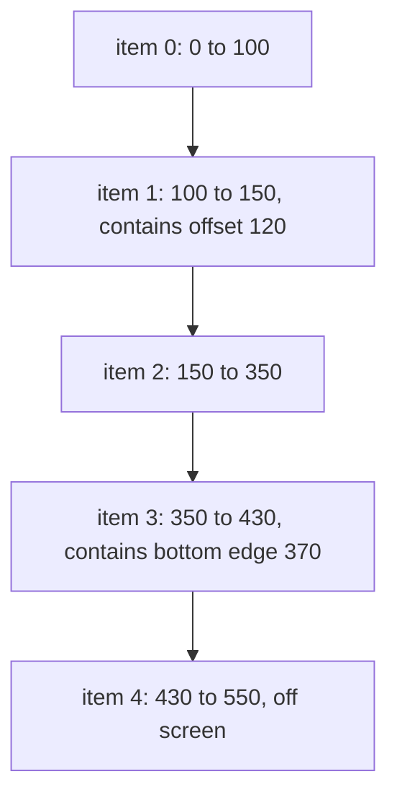
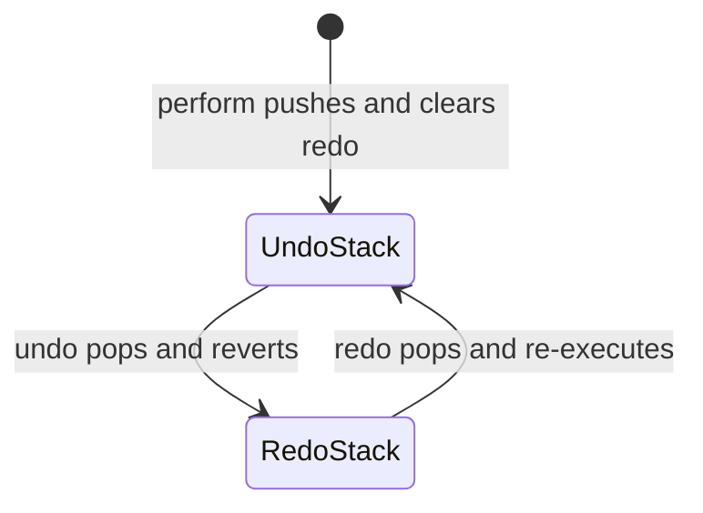
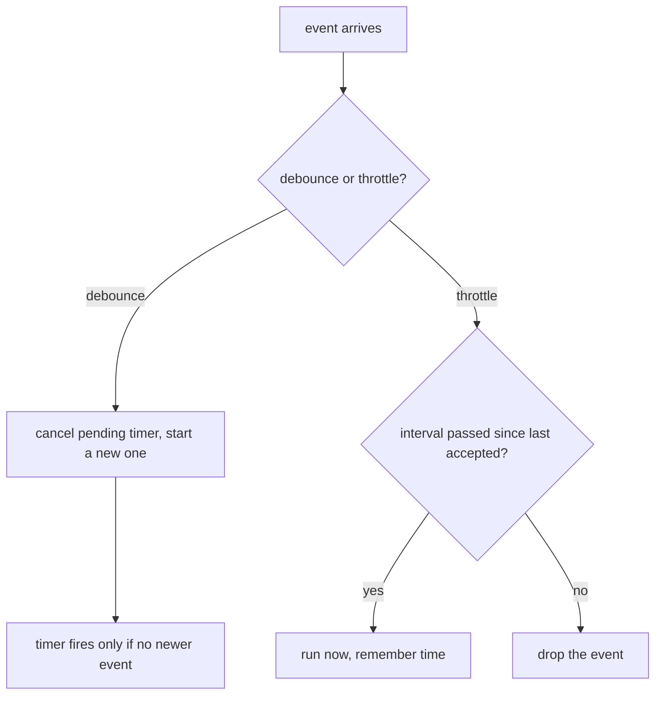
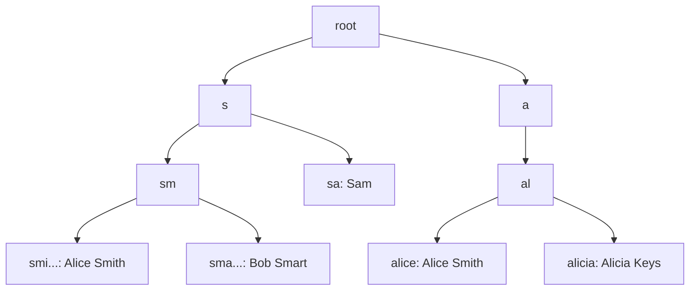
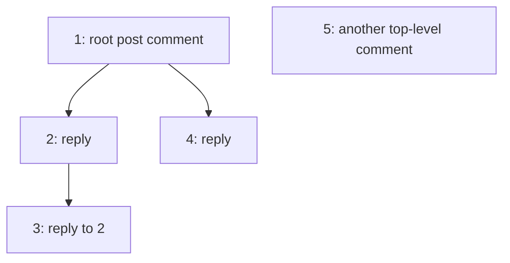
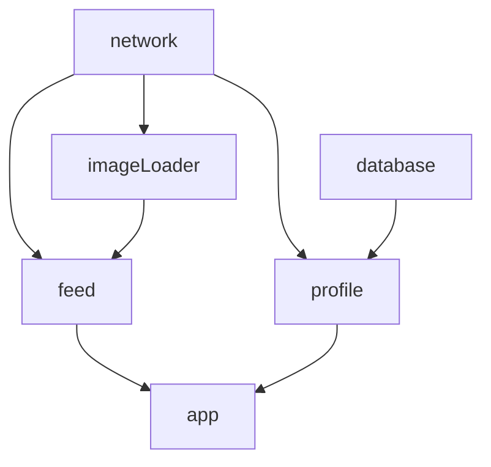

# Mobile-Flavoured Coding Problems

[⬅ Back to index](../README.md)

Covers: coding problems with an app flavour that Android and iOS interviewers like to ask: they test the same data structures and algorithms, framed around lists, caches, text, timers and feeds.

---

## Lists and scrolling

### 1. Compute the Changes Between Two Lists (RecyclerView / Collection View Diff)

**🟡 Medium** · ⭐ Product/FAANG favourite

<details>
<summary>Answer</summary>

**In short:** Match items by a stable id and find the **longest common subsequence (LCS)** of the old and new lists — those items stay; every other old item is a removal and every other new item is an insertion. A suffix LCS table lets you walk both lists once and emit an edit script with positions that can be applied in order (exactly what `notifyItemRemoved` / `notifyItemInserted` need). O(n·m) time and space. Android's `DiffUtil` solves the same problem with Eugene Myers' difference algorithm, which is faster when the lists are similar.

#### Problem

A screen shows a list. New data arrives. Instead of reloading everything (losing scroll position and animations), compute the smallest set of **insert / remove / update** operations that turns the old list into the new one. Items have an `id` (identity) and content (what's drawn).

- old = `[A, B, C, D]`, new = `[B, D, E]` → `Remove(0, A)`, `Remove(1, C)`, `Insert(2, E)` (after removing A, C sits at position 1).
- If `B` keeps its id but its text changed → also `Update(position of B)`.

#### Clarifying questions & edge cases

- Are ids unique within a list? (Assume yes — duplicate ids make "which one moved" ambiguous; `DiffUtil` assumes the same.)
- Do we need **moves**, or are remove + insert enough? (Start without moves; see follow-ups.)
- What do positions mean? Positions in the list *as it is while applying the operations in order* — that's what RecyclerView expects.
- Empty old list → all inserts; empty new list → all removes.
- How big are the lists? O(n·m) memory is fine for a few thousand items, not for 100k.

#### Brute force

Remove everything and insert everything: `n + m` operations, always correct, but every row animates and scroll position is lost — the same as `notifyDataSetChanged()`. Trying all subsets of kept items is exponential. The question is really "which items can stay?", and that's LCS.

#### Key insight

An item can stay only if the relative order of all kept items is the same in both lists. "The largest set of items appearing in the same order in both sequences" is exactly the **longest common subsequence**. Keep the LCS, remove the rest of the old list, insert the rest of the new list — that's the minimum number of insert + remove operations (`n + m − 2·LCS`).

Build `lcs[i][j]` = LCS length of the suffixes `old[i..]` and `new[j..]`:

- if `old[i].id == new[j].id`: `lcs[i][j] = 1 + lcs[i+1][j+1]` (keep both),
- else `lcs[i][j] = max(lcs[i+1][j], lcs[i][j+1])` (drop `old[i]` or skip `new[j]`).

Then walk forward from `(0, 0)` with a `pos` counter = position in the list being edited:

- ids match → item stays; if content differs emit `Update(pos)`; `pos++`.
- removing `old[i]` keeps the LCS just as long (`lcs[i+1][j] >= lcs[i][j+1]`) → `Remove(pos)`; `pos` stays (the next item slides into it).
- otherwise → `Insert(pos, new[j])`; `pos++`.

Using suffixes (not prefixes) is the trick that makes the forward walk produce in-order positions.

#### Walkthrough

old = `[A, B, C, D]`, new = `[B, D, E]`. LCS = `[B, D]`.

| step | i (old) | j (new) | decision | op | list after | pos |
|---|---|---|---|---|---|---|
| 1 | A | B | A not in LCS path | Remove(0, A) | B C D | 0 |
| 2 | B | B | match | keep | B C D | 1 |
| 3 | C | D | `lcs[3][1]=1 >= lcs[2][2]=0` | Remove(1, C) | B D | 1 |
| 4 | D | D | match | keep | B D | 2 |
| 5 | — | E | old exhausted | Insert(2, E) | B D E | 3 |

#### Kotlin

```kotlin
data class Item(val id: String, val content: String)

sealed class Change {
    data class Insert(val position: Int, val id: String) : Change()
    data class Remove(val position: Int, val id: String) : Change()
    data class Update(val position: Int, val id: String) : Change()
}

fun diff(old: List<Item>, new: List<Item>): List<Change> {
    val n = old.size
    val m = new.size
    // lcs[i][j] = LCS length (by id) of old[i..] and new[j..]
    val lcs = Array(n + 1) { IntArray(m + 1) }
    for (i in n - 1 downTo 0) {
        for (j in m - 1 downTo 0) {
            lcs[i][j] = if (old[i].id == new[j].id) lcs[i + 1][j + 1] + 1
                        else maxOf(lcs[i + 1][j], lcs[i][j + 1])
        }
    }
    val changes = mutableListOf<Change>()
    var i = 0
    var j = 0
    var pos = 0 // position in the list as it is being edited
    while (i < n || j < m) {
        when {
            i < n && j < m && old[i].id == new[j].id -> {
                if (old[i] != new[j]) changes += Change.Update(pos, new[j].id) // same item, new content
                i++; j++; pos++
            }
            j == m || (i < n && lcs[i + 1][j] >= lcs[i][j + 1]) -> {
                changes += Change.Remove(pos, old[i].id) // next item slides into pos
                i++
            }
            else -> {
                changes += Change.Insert(pos, new[j].id)
                j++; pos++
            }
        }
    }
    return changes
}
```

#### Swift

```swift
struct Item: Equatable {
    let id: String
    let content: String
}

enum Change: Equatable {
    case insert(position: Int, id: String)
    case remove(position: Int, id: String)
    case update(position: Int, id: String)
}

func diff(_ old: [Item], _ new: [Item]) -> [Change] {
    let n = old.count, m = new.count
    var lcs = Array(repeating: Array(repeating: 0, count: m + 1), count: n + 1)
    for i in stride(from: n - 1, through: 0, by: -1) {
        for j in stride(from: m - 1, through: 0, by: -1) {
            lcs[i][j] = old[i].id == new[j].id ? lcs[i + 1][j + 1] + 1
                                               : max(lcs[i + 1][j], lcs[i][j + 1])
        }
    }
    var changes: [Change] = []
    var i = 0, j = 0, pos = 0
    while i < n || j < m {
        if i < n && j < m && old[i].id == new[j].id {
            if old[i] != new[j] { changes.append(.update(position: pos, id: new[j].id)) }
            i += 1; j += 1; pos += 1
        } else if j == m || (i < n && lcs[i + 1][j] >= lcs[i][j + 1]) {
            changes.append(.remove(position: pos, id: old[i].id))
            i += 1
        } else {
            changes.append(.insert(position: pos, id: new[j].id))
            j += 1; pos += 1
        }
    }
    return changes
}
```

#### Complexity

- **Time:** O(n·m) to fill the table, O(n + m) to walk it.
- **Space:** O(n·m) for the table. Myers' algorithm runs in O((n + m)·D) time, where D is the number of edits, with linear-space variants — much better when only a few items changed, which is the normal case for a feed refresh.

#### Common mistakes

- Comparing items by full equality for *identity*: then an edited item looks like remove + insert, and the row flashes instead of updating in place. Identity (`id`) and content are two separate checks — that's why `DiffUtil.ItemCallback` has both `areItemsTheSame` and `areContentsTheSame`.
- Emitting positions from the *new* list for removals, or from the *old* list for insertions — the adapter applies them one by one, so positions must reflect the list mid-edit (or be applied back to front).
- Running the diff on the main thread for big lists. On Android, `ListAdapter` / `AsyncListDiffer` run `DiffUtil` on a background thread; on iOS, diffable data sources compute the changes from snapshots for you.

#### Follow-ups

- *What does `DiffUtil` actually use?* Eugene Myers' difference algorithm (shortest edit script by walking diagonals of the edit graph), plus an optional extra pass to detect moves, which costs more time. It finds an equally short edit script, faster for similar lists.
- *How do you detect moves?* After the diff, pair each removed id with an inserted id that is the same — that pair is a move. Swift's `CollectionDifference` has `inferringMoves()` for this.
- *Can you cut memory to O(m)?* For the LCS **length**, keep two rows. For the edit script itself you need Hirschberg's divide-and-conquer or linear-space Myers. LCS as a DP is covered in [Dynamic Programming](19-dynamic-programming.md).

</details>

### 2. Find the Visible Items Range for a Scroll Offset (Variable Heights)

**🟡 Medium** · ⭐ Product/FAANG favourite

<details>
<summary>Answer</summary>

**In short:** Precompute prefix sums of item heights so `top[i]` is the y-position where item `i` starts. The list is then a sorted array of start positions, so the first visible item is found with a binary search for the scroll offset, and the last visible item with a binary search for `offset + viewportHeight`. O(n) once to build, then O(log n) per scroll event instead of O(n).

#### Problem

You're writing a virtualised list (what RecyclerView or a lazy list does internally). Items have different heights. Given the scroll offset (how far the top of the viewport is from the top of the content) and the viewport height, return the range of item indices that are at least partly on screen.

- heights = `[100, 50, 200, 80, 120]`, offset = `120`, viewport = `250` → items `1..3` (item 1 spans 100–150, item 3 spans 350–430 and starts before 370).

#### Clarifying questions & edge cases

- Are all heights positive? (Assume yes; zero-height items make "visible" ambiguous.)
- Is an item that only touches the edge (its bottom exactly at the offset) visible? Decide and state it; below, an item is visible if it overlaps the half-open window `[offset, offset + viewport)`.
- Offset beyond the end of the content, or empty list → empty range.
- Do heights change (images loading, expanding cells)? Then prefix sums need updating — see follow-ups.
- Should you include a few extra items above and below (overscan/prefetch)? Easy to add after the range is found.

#### Brute force

Walk from item 0, adding heights until you pass the offset, then keep going until you pass the bottom edge. O(n) per scroll frame. With thousands of items and 60–120 frames a second, that's wasted work — and it gets worse the further down the user scrolls.

#### Key insight

Let `top[0] = 0` and `top[i + 1] = top[i] + heights[i]`. Item `i` occupies `[top[i], top[i + 1])`. `top` is strictly increasing, so it's sorted — and "which item contains y?" becomes a binary search:

- **First visible:** the item containing `offset` — the smallest `k` with `top[k] > offset`, minus one.
- **Last visible:** the last item whose top is above the bottom edge `end = offset + viewport` — the smallest `k` with `top[k] >= end`, minus one.

Both are standard "first index where a condition becomes true" searches (see [Binary Search](10-binary-search.md)).

#### Walkthrough

heights = `[100, 50, 200, 80, 120]` → `top = [0, 100, 150, 350, 430, 550]`. offset = 120, end = 370.

| search | condition | first k where true | result |
|---|---|---|---|
| first visible | `top[k] > 120` | k = 2 (`top[2] = 150`) | item 1 |
| last visible | `top[k] >= 370` | k = 4 (`top[4] = 430`) | item 3 |



#### Kotlin

```kotlin
class VisibleRangeFinder(heights: IntArray) {
    // top[i] = y where item i starts; top[n] = total content height
    private val top = LongArray(heights.size + 1)

    init {
        for (i in heights.indices) top[i + 1] = top[i] + heights[i]
    }

    // Smallest k with top[k] > y (or >= y when inclusive); top.size if none.
    private fun firstIndex(y: Long, inclusive: Boolean): Int {
        var lo = 0
        var hi = top.size
        while (lo < hi) {
            val mid = (lo + hi) ushr 1
            val ok = if (inclusive) top[mid] >= y else top[mid] > y
            if (ok) hi = mid else lo = mid + 1
        }
        return lo
    }

    /** Returns the visible indices, or an empty range. */
    fun visibleRange(offset: Long, viewportHeight: Long): IntRange {
        val n = top.size - 1
        if (n == 0 || viewportHeight <= 0 || offset >= top[n]) return IntRange.EMPTY
        val start = offset.coerceAtLeast(0)
        val first = firstIndex(start, inclusive = false) - 1
        val last = (firstIndex(start + viewportHeight, inclusive = true) - 1).coerceAtMost(n - 1)
        return first..last
    }
}
```

#### Swift

```swift
struct VisibleRangeFinder {
    private var top: [Int]

    init(heights: [Int]) {
        top = [0]
        for h in heights { top.append(top.last! + h) }
    }

    // Smallest k with top[k] > y (or >= y when inclusive); top.count if none.
    private func firstIndex(_ y: Int, inclusive: Bool) -> Int {
        var lo = 0, hi = top.count
        while lo < hi {
            let mid = (lo + hi) / 2
            let ok = inclusive ? top[mid] >= y : top[mid] > y
            if ok { hi = mid } else { lo = mid + 1 }
        }
        return lo
    }

    func visibleRange(offset: Int, viewportHeight: Int) -> ClosedRange<Int>? {
        let n = top.count - 1
        guard n > 0, viewportHeight > 0, offset < top[n] else { return nil }
        let start = max(0, offset)
        let first = firstIndex(start, inclusive: false) - 1
        let last = min(firstIndex(start + viewportHeight, inclusive: true) - 1, n - 1)
        return first...last
    }
}
```

#### Complexity

- **Time:** O(n) to build the prefix sums once; O(log n) per query (two binary searches).
- **Space:** O(n) for the prefix array.

#### Common mistakes

- Off-by-one at the edges: mixing up `>` and `>=` makes an item that ends exactly at the offset count as visible (or the last item get dropped). Write down the half-open interval `[top[i], top[i+1])` and derive the conditions from it.
- Using 32-bit `Int` for the running total of a very long list — it can overflow; `Long` in Kotlin is cheap insurance (Swift's `Int` is 64-bit on modern devices).
- Rebuilding the prefix array on every scroll event — build once, rebuild (or update) only when heights change.

#### Follow-ups

- *Heights change often (images load, cells expand)?* Use a Fenwick tree (binary indexed tree) over heights: O(log n) to update one height and O(log n) to find "the item containing y" by descending the tree. Prefix sums are covered in [Prefix Sums, Intervals & Sweep Line](09-prefix-sums-intervals.md).
- *Heights unknown until measured?* Use an estimated height for unmeasured items and correct the prefix sums (and the scroll offset, to avoid a jump) as items are measured — what lazy lists do in practice.
- *Grid instead of a list?* Uniform grids need only row math — see [question 3](#3-compute-a-grid-layout-rows-columns-and-item-frames).

</details>

### 3. Compute a Grid Layout (Rows, Columns and Item Frames)

**🟢 Easy**

<details>
<summary>Answer</summary>

**In short:** Work out how many columns fit (`(width + spacing) / (minItemWidth + spacing)`), split the leftover width evenly between them, and then every item's position is just integer math on its index: `row = index / columns`, `col = index % columns`, `x = col * (itemWidth + spacing)`, `y = row * (itemHeight + spacing)`. The interesting parts are pixel rounding, the reverse lookup (which item is at a tap point), and edge cases. O(1) per item.

#### Problem

Lay out `N` photos in a grid inside a container of width `W`. Each cell must be at least `minItemWidth` wide, cells are separated by `spacing` pixels horizontally and vertically, and all cells in a row share the width so the row fills the container exactly. Return the frame of any item, the number of rows, the content height, and which item (if any) is under a tap at `(x, y)`.

- `W = 1080`, `minItemWidth = 300`, `spacing = 16` → 3 columns; widths 350, 349, 349 (1048 px of cells + 2 gaps of 16 = 1080).

#### Clarifying questions & edge cases

- Integer pixels or floating point? Integer pixels mean the leftover remainder must go somewhere, or the right edge is ragged.
- What if even one column doesn't fit (`W < minItemWidth`)? Use 1 column of width `W`.
- Is there outer padding? (Treat it as reducing `W`; spacing here is only between cells.)
- Right-to-left layouts: mirror `x` as `W − x − width`.
- `N = 0` → zero rows, zero height.

#### Brute force

Place items one by one, tracking a running x and y and wrapping when the next cell wouldn't fit. That's O(N) to find one item's frame, and the reverse lookup ("what's under the finger?") becomes a scan. Fine for drawing every item once, wasteful for scrolling or hit-testing.

#### Key insight

A grid is a 2-D array stored row by row, so index ↔ (row, col) is the same math as flattening a matrix:

- **Columns:** `k` columns need `k·minItemWidth + (k − 1)·spacing ≤ W`, i.e. `k ≤ (W + spacing) / (minItemWidth + spacing)`. Take the floor, at least 1.
- **Cell width:** `usable = W − (k − 1)·spacing`, `base = usable / k`, `extra = usable % k`. Give the first `extra` columns one more pixel, so widths add up exactly to `W`.
- **Column x:** `col·(base + spacing) + min(col, extra)` — each earlier wide column shifts this one by one pixel.
- **Rows:** `ceil(N / k) = (N + k − 1) / k`. Content height = `rows·itemHeight + (rows − 1)·spacing`.
- **Hit test:** `row = y / (itemHeight + spacing)`; if `y` falls in the gap part of that stride, no item. Then find the column whose `[x, x + width)` contains the tap and check `index < N`.

#### Walkthrough

`W = 1080, minItemWidth = 300, spacing = 16, itemHeight = 300, N = 7`.

| quantity | formula | value |
|---|---|---|
| columns | (1080 + 16) / (300 + 16) | 3 |
| usable | 1080 − 2·16 | 1048 |
| base, extra | 1048 / 3, 1048 % 3 | 349, 1 |
| col 0 / 1 / 2 x | 0, 349+16+1, 2·365+1 | 0, 366, 731 |
| col widths | 350, 349, 349 | last ends at 731+349 = 1080 |
| rows | (7 + 2) / 3 | 3 |
| item 5 | row 1, col 2 | x = 731, y = 316 |
| tap (400, 320) | row 1, col 1 | item 4 |
| tap (400, 305) | y % 316 = 305 ≥ 300, in the gap | none |

#### Kotlin

```kotlin
data class Frame(val x: Int, val y: Int, val width: Int, val height: Int)

class GridLayout(
    containerWidth: Int,
    minItemWidth: Int,
    private val spacing: Int,
    private val itemHeight: Int,
) {
    val columns = maxOf(1, (containerWidth + spacing) / (minItemWidth + spacing))
    private val usable = containerWidth - (columns - 1) * spacing
    private val baseWidth = usable / columns
    private val extra = usable % columns // first `extra` columns get 1 extra pixel

    fun columnX(col: Int) = col * (baseWidth + spacing) + minOf(col, extra)
    fun columnWidth(col: Int) = baseWidth + if (col < extra) 1 else 0

    fun rows(itemCount: Int) = (itemCount + columns - 1) / columns

    fun contentHeight(itemCount: Int): Int {
        val r = rows(itemCount)
        return if (r == 0) 0 else r * itemHeight + (r - 1) * spacing
    }

    fun frame(index: Int): Frame {
        val row = index / columns
        val col = index % columns
        return Frame(columnX(col), row * (itemHeight + spacing), columnWidth(col), itemHeight)
    }

    /** Index of the item under (x, y), or null for a gap / empty cell. */
    fun indexAt(x: Int, y: Int, itemCount: Int): Int? {
        if (x < 0 || y < 0) return null
        val stride = itemHeight + spacing
        if (y % stride >= itemHeight) return null // tapped the gap between rows
        val col = (0 until columns).firstOrNull { c ->
            x >= columnX(c) && x < columnX(c) + columnWidth(c)
        } ?: return null // tapped the gap between columns, or past the edge
        val index = (y / stride) * columns + col
        return if (index < itemCount) index else null
    }
}
```

#### Swift

```swift
struct GridLayout {
    let columns: Int
    private let spacing: Int, itemHeight: Int, baseWidth: Int, extra: Int

    init(containerWidth: Int, minItemWidth: Int, spacing: Int, itemHeight: Int) {
        self.spacing = spacing
        self.itemHeight = itemHeight
        columns = max(1, (containerWidth + spacing) / (minItemWidth + spacing))
        let usable = containerWidth - (columns - 1) * spacing
        baseWidth = usable / columns
        extra = usable % columns
    }

    func columnX(_ col: Int) -> Int { col * (baseWidth + spacing) + min(col, extra) }
    func columnWidth(_ col: Int) -> Int { baseWidth + (col < extra ? 1 : 0) }
    func rows(_ itemCount: Int) -> Int { (itemCount + columns - 1) / columns }

    func frame(_ index: Int) -> (x: Int, y: Int, width: Int, height: Int) {
        let row = index / columns, col = index % columns
        return (columnX(col), row * (itemHeight + spacing), columnWidth(col), itemHeight)
    }

    func indexAt(x: Int, y: Int, itemCount: Int) -> Int? {
        guard x >= 0, y >= 0 else { return nil }
        let stride = itemHeight + spacing
        guard y % stride < itemHeight else { return nil }
        guard let col = (0..<columns).first(where: { x >= columnX($0) && x < columnX($0) + columnWidth($0) })
        else { return nil }
        let index = (y / stride) * columns + col
        return index < itemCount ? index : nil
    }
}
```

#### Complexity

- **Time:** O(1) for `frame`, `rows` and `contentHeight`; O(columns) for `indexAt` (columns is tiny; it can be made O(1) by dividing and correcting for the remainder pixels).
- **Space:** O(1) — nothing is stored per item.

#### Common mistakes

- Computing columns as `W / minItemWidth`, forgetting that `k` columns only have `k − 1` gaps.
- Ignoring the remainder: `1048 / 3 = 349` leaves a 1-pixel strip on the right that shows up as a visible misalignment.
- `rows = N / columns` (floors) instead of the ceiling — the last partial row disappears.
- Treating taps in the spacing as hits on the neighbouring item.

#### Follow-ups

- *Items with variable heights (staggered grid / masonry)?* Keep each column's current height and place the next item in the shortest column — a min-heap over columns when there are many (see [Heaps & Priority Queues](13-heaps-priority-queues.md)).
- *Which rows are visible for a scroll offset?* `firstRow = offset / stride`, `lastRow = (offset + viewport − 1) / stride`, then items `firstRow·k` to `min(N, (lastRow + 1)·k) − 1`. For variable row heights, use prefix sums + binary search ([question 2](#2-find-the-visible-items-range-for-a-scroll-offset-variable-heights)).
- *Section headers spanning all columns?* Precompute the start y of each section and do the grid math within a section — similar in spirit to `GridLayoutManager.SpanSizeLookup` on Android.

</details>

## Caches and state

### 4. In-Memory Image Cache with LRU Eviction and a Byte-Size Limit

**🟡 Medium** · ⭐ Product/FAANG favourite

<details>
<summary>Answer</summary>

**In short:** It's the classic LRU cache (hash map + recency order) with one change: the limit is **total bytes**, not number of entries, so after every insert you evict least-recently-used entries **in a loop** until the total fits. Store each entry's size when you insert it, refuse items bigger than the whole cache, and adjust the total when a key is replaced. `get` and `put` are O(1) amortised (a single `put` may evict several entries, but each entry is evicted at most once). Android's `LruCache` with `sizeOf` overridden is exactly this.

#### Problem

Build the memory cache for an image loader. Bitmaps differ wildly in size (a 48 px avatar vs a full-screen photo), so the cache is limited to `maxBytes`, e.g. 1/8 of the app's memory. Support:

- `get(key)` → the image or null, marking it as recently used,
- `put(key, image)` → insert or replace, evicting least-recently-used images until the total size ≤ `maxBytes`,
- `trimTo(bytes)` → shrink on a low-memory signal.

Example (`maxBytes = 10`, sizes in MB): put A(4), B(3), C(2) → 9 MB. `get(A)`. put D(4) → 13 MB, evict B (least recently used) → 10 MB. Cache holds C, A, D.

#### Clarifying questions & edge cases

- Can one image be larger than the whole cache? It must not wipe everything else out — refuse it (return false) and let the caller show it without caching.
- Replacing a key: subtract the old size before adding the new one.
- Must sizes be stable? Record the size at insert time; recomputing later (after a bitmap was recycled or mutated) can corrupt the total.
- Threads: image loaders call the cache from many threads, so lock (or confine it to one thread / an actor).
- For the plain entry-count version, see [Design-Style Coding Problems](22-design-style-coding.md).

#### Brute force

Keep a list of entries with "last used" timestamps and scan for the oldest on each eviction: O(n) per eviction, and a big insert may evict many entries — O(n²) in the worst case. Fine for 10 images, not for hundreds of thumbnails during a fast fling.

#### Key insight

Two structures, each doing what it's good at:

1. A **hash map** from key to entry for O(1) lookup.
2. A **doubly linked list in recency order** so "move to most recent" and "remove least recent" are O(1).

Kotlin's `LinkedHashMap(capacity, loadFactor, accessOrder = true)` is both at once: iteration order is least-recently-used first, and `get` moves an entry to the end. Swift has no such type, so you hand-write the list.

The byte limit changes eviction from "remove one" to "remove until it fits". That's still cheap overall: every entry is inserted once and evicted at most once, so the total eviction work is bounded by the number of puts.

#### Walkthrough

`maxBytes = 10` (MB). Order is shown least → most recently used.

| op | order after | total | note |
|---|---|---|---|
| put A(4) | A | 4 | |
| put B(3) | A B | 7 | |
| put C(2) | A B C | 9 | |
| get A | B C A | 9 | A becomes most recent |
| put D(4) | B C A D | 13 | over the limit |
| evict B | C A D | 10 | ≤ 10, stop evicting |
| put E(12) | C A D | 10 | E is bigger than the cache: refused |

#### Kotlin

```kotlin
class SizedLruCache<K, V>(
    private val maxBytes: Long,
    private val sizeOf: (V) -> Long,
) {
    private class Entry<V>(val value: V, val size: Long)

    // accessOrder = true: iteration goes least recently used -> most recently used
    private val map = LinkedHashMap<K, Entry<V>>(16, 0.75f, true)
    var currentBytes = 0L
        private set

    @Synchronized
    fun get(key: K): V? = map[key]?.value // get() also moves the entry to the recent end

    /** Returns false if the value is larger than the whole cache and was not stored. */
    @Synchronized
    fun put(key: K, value: V): Boolean {
        map.remove(key)?.let { currentBytes -= it.size } // replacing: drop the old size
        val size = sizeOf(value)
        require(size >= 0) { "size must be non-negative" }
        if (size > maxBytes) return false
        map[key] = Entry(value, size)
        currentBytes += size
        trimTo(maxBytes)
        return true
    }

    @Synchronized
    fun remove(key: K): V? {
        val entry = map.remove(key) ?: return null
        currentBytes -= entry.size
        return entry.value
    }

    /** Evict least recently used entries until the total is at most [limit]. */
    @Synchronized
    fun trimTo(limit: Long) {
        val iterator = map.entries.iterator()
        while (currentBytes > limit && iterator.hasNext()) {
            val eldest = iterator.next()
            currentBytes -= eldest.value.size
            iterator.remove()
        }
    }
}

// Usage with Android bitmaps:
// val cache = SizedLruCache<String, Bitmap>(Runtime.getRuntime().maxMemory() / 8) {
//     it.allocationByteCount.toLong()
// }
```

#### Swift

```swift
final class SizedLRUCache<Key: Hashable, Value> {
    private final class Node {
        let key: Key
        let value: Value
        let size: Int
        weak var prev: Node? // towards the most recently used end; weak avoids a retain cycle
        var next: Node?      // towards the least recently used end
        init(key: Key, value: Value, size: Int) {
            self.key = key; self.value = value; self.size = size
        }
    }

    private var nodes: [Key: Node] = [:]
    private var head: Node? // most recently used
    private var tail: Node? // least recently used
    private let maxBytes: Int
    private let sizeOf: (Value) -> Int
    private(set) var currentBytes = 0

    init(maxBytes: Int, sizeOf: @escaping (Value) -> Int) {
        self.maxBytes = maxBytes
        self.sizeOf = sizeOf
    }

    func get(_ key: Key) -> Value? {
        guard let node = nodes[key] else { return nil }
        unlink(node)
        pushFront(node)
        return node.value
    }

    @discardableResult
    func put(_ key: Key, _ value: Value) -> Bool {
        if let old = nodes.removeValue(forKey: key) {
            unlink(old)
            currentBytes -= old.size
        }
        let size = sizeOf(value)
        guard size <= maxBytes else { return false }
        let node = Node(key: key, value: value, size: size)
        nodes[key] = node
        pushFront(node)
        currentBytes += size
        trim(to: maxBytes)
        return true
    }

    func trim(to limit: Int) {
        while currentBytes > limit, let lru = tail {
            unlink(lru)
            nodes[lru.key] = nil
            currentBytes -= lru.size
        }
    }

    private func unlink(_ node: Node) {
        if let p = node.prev { p.next = node.next } else { head = node.next }
        if let n = node.next { n.prev = node.prev } else { tail = node.prev }
        node.prev = nil
        node.next = nil
    }

    private func pushFront(_ node: Node) {
        node.next = head
        head?.prev = node
        head = node
        if tail == nil { tail = node }
    }
}
```

The Swift class is not thread-safe; wrap calls in a lock or make it an `actor` if several tasks use it.

#### Complexity

- **Time:** `get` O(1); `put` O(1) amortised — one put can evict k entries, but each entry is evicted at most once over the cache's lifetime.
- **Space:** O(n) for the map and the list, plus the images themselves (bounded by `maxBytes`).

#### Common mistakes

- Evicting just **one** entry per insert — with variable sizes, one big photo may need several thumbnails evicted.
- Forgetting to subtract the old size when a key is replaced, so `currentBytes` drifts upward and the cache slowly empties itself.
- Letting an oversized item in: the eviction loop then removes everything, including the item itself.
- Measuring bitmaps by file size (the compressed JPEG) instead of decoded size — a 3 MB JPEG of a 12-megapixel (4000 × 3000) photo is about 48 MB as an ARGB_8888 bitmap (`width × height × 4` bytes).

#### Follow-ups

- *What do the platforms give you?* Android's `android.util.LruCache` takes a max size and calls your `sizeOf` (commonly returning the bitmap's byte count) — the same algorithm. iOS `NSCache` has `totalCostLimit` and `setObject(_:forKey:cost:)`, and evicts automatically under memory pressure, but it doesn't promise strict LRU order.
- *Respond to low memory?* Call `trimTo(currentBytes / 2)` or `trimTo(0)` from `onTrimMemory` / the memory-warning notification.
- *Two-level cache?* Memory LRU in front of a disk LRU (same algorithm, file sizes as cost); on a memory miss check disk, then network, and fill both on the way back.

</details>

### 5. Undo / Redo with Two Stacks (Command Pattern)

**🟡 Medium**

<details>
<summary>Answer</summary>

**In short:** Represent every user action as a **command** object that knows how to `execute()` and `undo()` itself. Keep two stacks: performing an action executes it, pushes it on the undo stack and **clears the redo stack**; undo pops from undo, reverts it and pushes it on redo; redo pops from redo, re-executes it and pushes it back on undo. Every operation is O(1) plus the cost of the command itself.

#### Problem

Add undo/redo to a note editor (or a drawing canvas, or a photo editor's filter stack). Support `perform(action)`, `undo()`, `redo()`, `canUndo`, `canRedo`, with a limit on how much history is kept.

Example: type "Hi", type " there" → `"Hi there"`. undo → `"Hi"`. undo → `""`. redo → `"Hi"`. type "!" → `"Hi!"`, and redo is no longer possible (the old " there" future is discarded).

#### Clarifying questions & edge cases

- Undo/redo with empty stacks → no-op (return false), never crash.
- A new action after some undos discards the redo history — that's what users expect (no branching history unless asked).
- History limit: drop the **oldest** command, not the newest.
- Should consecutive keystrokes be one undo step? Usually yes — see follow-ups (coalescing).
- Are commands reversible by themselves, or do we need snapshots? (Deleting text must remember *what* was deleted.)

#### Brute force

Save a full copy of the document after every change (the memento/snapshot approach): undo = go back one snapshot. Simple and very robust, but each step costs O(document size) memory and time. It's actually a good choice for small immutable states (e.g. a Compose/SwiftUI screen state); for long documents or images it's too heavy.

#### Key insight

Undo history is last-in-first-out: you always undo the most recent change first. Redo is the mirror image, so it's a second stack. The invariant:

> the undo stack (bottom → top) holds the changes that produced the current state, in order; the redo stack (top → bottom) holds the changes you can re-apply, in order.

A new action breaks the redo chain because those commands were recorded against a state that no longer exists — re-applying them could insert text at a position that now means something else. That's why `perform` must clear redo.

Commands store just enough to reverse themselves: an insert remembers position and text; a delete remembers position and the removed text (captured in `execute`).

#### Walkthrough

| action | document | undo stack (top last) | redo stack (top last) |
|---|---|---|---|
| perform Insert(0, "Hi") | `Hi` | ins1 | — |
| perform Insert(2, " there") | `Hi there` | ins1, ins2 | — |
| undo | `Hi` | ins1 | ins2 |
| undo | (empty) | — | ins2, ins1 |
| redo | `Hi` | ins1 | ins2 |
| perform Insert(2, "!") | `Hi!` | ins1, ins3 | — (cleared) |



#### Kotlin

```kotlin
interface Command {
    fun execute()
    fun undo()
}

class InsertText(private val doc: StringBuilder, private val position: Int, private val text: String) : Command {
    override fun execute() { doc.insert(position, text) }
    override fun undo() { doc.delete(position, position + text.length) }
}

class DeleteText(private val doc: StringBuilder, private val position: Int, private val length: Int) : Command {
    private var removed = "" // captured on execute so undo can restore it
    override fun execute() {
        removed = doc.substring(position, position + length)
        doc.delete(position, position + length)
    }
    override fun undo() { doc.insert(position, removed) }
}

class History(private val limit: Int = 100) {
    private val undoStack = ArrayDeque<Command>()
    private val redoStack = ArrayDeque<Command>()

    val canUndo get() = undoStack.isNotEmpty()
    val canRedo get() = redoStack.isNotEmpty()

    fun perform(command: Command) {
        command.execute()
        undoStack.addLast(command)
        if (undoStack.size > limit) undoStack.removeFirst() // forget the oldest step
        redoStack.clear() // the old future no longer applies
    }

    fun undo(): Boolean {
        val command = undoStack.removeLastOrNull() ?: return false
        command.undo()
        redoStack.addLast(command)
        return true
    }

    fun redo(): Boolean {
        val command = redoStack.removeLastOrNull() ?: return false
        command.execute()
        undoStack.addLast(command)
        return true
    }
}
```

#### Swift

```swift
protocol Command {
    func execute()
    func undo()
}

final class Document { var text: [Character] = [] }

final class InsertText: Command {
    private let doc: Document, position: Int, text: [Character]
    init(_ doc: Document, at position: Int, _ text: String) {
        self.doc = doc; self.position = position; self.text = Array(text)
    }
    func execute() { doc.text.insert(contentsOf: text, at: position) }
    func undo() { doc.text.removeSubrange(position..<position + text.count) }
}

final class History {
    private var undoStack: [Command] = []
    private var redoStack: [Command] = []
    private let limit: Int
    init(limit: Int = 100) { self.limit = limit }

    var canUndo: Bool { !undoStack.isEmpty }
    var canRedo: Bool { !redoStack.isEmpty }

    func perform(_ command: Command) {
        command.execute()
        undoStack.append(command)
        if undoStack.count > limit { undoStack.removeFirst() } // O(limit), fine for small limits
        redoStack.removeAll()
    }

    @discardableResult func undo() -> Bool {
        guard let command = undoStack.popLast() else { return false }
        command.undo()
        redoStack.append(command)
        return true
    }

    @discardableResult func redo() -> Bool {
        guard let command = redoStack.popLast() else { return false }
        command.execute()
        undoStack.append(command)
        return true
    }
}
```

#### Complexity

- **Time:** `perform`, `undo`, `redo` are O(1) plus the command's own work (inserting into a `StringBuilder` is O(document length) in the worst case). Clearing the redo stack is O(size of redo), paid for by the pushes that filled it.
- **Space:** O(limit) commands, each storing only its own change (not the whole document).

#### Common mistakes

- Not clearing redo on a new action — redo then replays edits against a different document and corrupts it.
- A delete command that doesn't capture the removed text, so undo has nothing to restore.
- Trimming history from the wrong end (dropping the most recent step when the limit is hit).
- Commands holding references to views or activities — they outlive configuration changes and leak; hold the model instead.

#### Follow-ups

- *Coalescing typing into one undo step?* When a new insert continues the previous one (adjacent position, within about a second), merge it into the top command instead of pushing a new one.
- *Grouping (one "Format" button changes five things)?* A composite command that holds a list and undoes it in reverse order. iOS `UndoManager` supports grouping (`beginUndoGrouping` / `endUndoGrouping`) and registers undo actions with `registerUndo(withTarget:handler:)`.
- *Collaborative editing?* Plain undo stacks break when another user edits in between; you need operational transforms or CRDTs to rebase commands — a system-design discussion, not a coding one. Stacks themselves are covered in [Stacks, Queues & Monotonic Stack](11-stacks-queues-monotonic.md).

</details>

## Timers and networking

### 6. Implement Debounce and Throttle

**🟡 Medium** · ⭐ Product/FAANG favourite

<details>
<summary>Answer</summary>

**In short:** **Debounce** waits until events *stop* for `wait` ms and then runs once with the latest event — every new event cancels and restarts the timer (search-as-you-type). **Throttle** runs at most once per `interval` — the first event goes through and later ones are dropped until the interval has passed (button double-taps, scroll analytics). As pure logic on timestamps both are a single O(n) pass; in an app they're a cancellable timer (`Job` + `delay`, `DispatchWorkItem`) or the built-in Flow / Combine operators.

#### Problem

Two parts that interviewers often ask together:

1. **Pure logic:** given sorted event timestamps, return when a trailing debounce fires, and which events a leading throttle lets through.
2. **App code:** write a `Debouncer` you can call from a text field listener, and a `Throttler` for a button.

Example with events at `[0, 100, 250, 600, 650, 700, 1200]` ms:

- debounce(300) fires at `[550, 1000, 1500]` (300 ms after the last event of each burst),
- throttle(300) accepts `[0, 600, 1200]`.

#### Clarifying questions & edge cases

- **Leading or trailing?** Debounce is usually trailing (fire after the pause); throttle is usually leading (fire immediately, then ignore). Both have the other variant — ask.
- Tie: an event arriving exactly `wait` ms after the previous one — does the old timer fire first? State a convention (below: yes, `>=` means it fired).
- Which value is delivered — the latest (debounce, for search) or the first (throttle, for taps)?
- Lifecycle: pending debounced work must be cancelled when the screen goes away.
- Time source: use a monotonic clock (`SystemClock.elapsedRealtime()`, `ContinuousClock`), not wall-clock time that can jump.

#### Brute force

The naive app approach: start a fresh timer for every keystroke without cancelling the old ones — every timer still fires, so you get one network request per character, just delayed. For the pure version, simulating time millisecond by millisecond works but is O(time range) instead of O(events).

#### Key insight

**Debounce:** event `i` schedules a timer for `t[i] + wait`. That timer survives only if no newer event arrives before it: `t[i+1] >= t[i] + wait` (or `i` is the last event). So a fire happens exactly at the end of each "burst" of events whose gaps are shorter than `wait`.

**Throttle:** remember the time of the last *accepted* event. A new event is accepted only if `t − lastAccepted >= interval`. Dropped events don't reset anything — that's the difference from debounce, where every event resets the timer.



#### Walkthrough

Events `[0, 100, 250, 600, 650, 700, 1200]`, wait = interval = 300.

| t | gap to next | debounce: timer for t + 300 | throttle: t − lastAccepted | throttle |
|---|---|---|---|---|
| 0 | 100 | 300 — cancelled | first event | accept (last = 0) |
| 100 | 150 | 400 — cancelled | 100 | drop |
| 250 | 350 | **550 fires** | 250 | drop |
| 600 | 50 | 900 — cancelled | 600 | accept (last = 600) |
| 650 | 50 | 950 — cancelled | 50 | drop |
| 700 | 500 | **1000 fires** | 100 | drop |
| 1200 | — | **1500 fires** | 600 | accept |

#### Kotlin

Pure logic (what you'd write on a whiteboard):

```kotlin
/** Trailing debounce: the times at which the handler runs. */
fun debounceFireTimes(events: LongArray, waitMs: Long): List<Long> {
    val fires = mutableListOf<Long>()
    for (i in events.indices) {
        val deadline = events[i] + waitMs
        // This event's timer survives only if the next event comes at or after its deadline.
        if (i == events.lastIndex || events[i + 1] >= deadline) fires += deadline
    }
    return fires
}

/** Leading throttle: the events that are let through. */
fun throttleAccepted(events: LongArray, intervalMs: Long): List<Long> {
    val accepted = mutableListOf<Long>()
    for (t in events) {
        if (accepted.isEmpty() || t - accepted.last() >= intervalMs) accepted += t
    }
    return accepted
}
```

App versions (Android, using kotlinx.coroutines):

```kotlin
class Debouncer(private val scope: CoroutineScope, private val waitMs: Long) {
    private var pending: Job? = null

    fun submit(action: suspend () -> Unit) {
        pending?.cancel() // a newer event replaces the pending one
        pending = scope.launch {
            delay(waitMs)
            action()
        }
    }
}

class Throttler(private val intervalMs: Long, private val now: () -> Long = SystemClock::elapsedRealtime) {
    private var lastRun: Long? = null

    fun tryRun(action: () -> Unit): Boolean {
        val t = now()
        val last = lastRun
        if (last != null && t - last < intervalMs) return false // too soon: drop
        lastRun = t
        action()
        return true
    }
}

// With Flow you'd normally use the built-in operators:
// queryFlow.debounce(300).distinctUntilChanged().flatMapLatest { repository.search(it) }
```

Using `viewModelScope` (or `lifecycleScope`) as the scope means pending work is cancelled automatically when the screen goes away.

#### Swift

```swift
import Dispatch

func debounceFireTimes(_ events: [Int], wait: Int) -> [Int] {
    var fires: [Int] = []
    for i in events.indices where i == events.count - 1 || events[i + 1] >= events[i] + wait {
        fires.append(events[i] + wait)
    }
    return fires
}

func throttleAccepted(_ events: [Int], interval: Int) -> [Int] {
    var accepted: [Int] = []
    for t in events where accepted.isEmpty || t - accepted.last! >= interval {
        accepted.append(t)
    }
    return accepted
}

final class Debouncer {
    private let delay: DispatchTimeInterval
    private let queue: DispatchQueue
    private var pending: DispatchWorkItem?

    init(delay: DispatchTimeInterval, queue: DispatchQueue = .main) {
        self.delay = delay
        self.queue = queue
    }

    func submit(_ action: @escaping () -> Void) {
        pending?.cancel() // cancelled work items never run
        let item = DispatchWorkItem(block: action)
        pending = item
        queue.asyncAfter(deadline: .now() + delay, execute: item)
    }

    func cancel() { pending?.cancel() }
}
```

In Combine the operators are built in: `publisher.debounce(for: .milliseconds(300), scheduler: RunLoop.main)` and `publisher.throttle(for: .seconds(1), scheduler: RunLoop.main, latest: false)`.

#### Complexity

- **Time:** pure versions O(n) for n events; app versions O(1) per event.
- **Space:** O(1) state (one pending job or one timestamp), plus the output list in the pure versions.

#### Common mistakes

- Mixing them up: debouncing a "Pay" button delays the first tap; you want throttle (or disabling the button) there. Throttling a search box sends requests mid-typing; you want debounce.
- Not cancelling the previous timer, so every keystroke still fires.
- Resetting the throttle window on *dropped* events — then a user tapping steadily is blocked forever.
- Using a timer tied to a destroyed screen (leaks, or callbacks touching dead views). Scope it to the lifecycle and cancel on teardown.
- Debouncing the request but not cancelling an in-flight older request — a slow old response can overwrite a newer one (`flatMapLatest` / cancelling the previous `Task` fixes this).

#### Follow-ups

- *Debounce with a max wait?* Also fire if `maxWait` ms passed since the first event of the burst, so a user who never pauses still gets results.
- *Leading-edge debounce?* Fire on the first event of a burst and ignore the rest until a quiet period of `wait` ms.
- *Rate limiting a whole API client (N requests per second)?* Use a sliding window of timestamps in a queue or a token bucket — see [Design-Style Coding Problems](22-design-style-coding.md).

</details>

### 7. Exponential Backoff with Jitter

**🟢 Easy**

<details>
<summary>Answer</summary>

**In short:** After the n-th failure wait about `base × 2ⁿ`, capped at `cap`, so retries spread out instead of hammering a struggling server. Then add **jitter**: with "full jitter" the actual delay is a random value in `[0, min(cap, base × 2ⁿ)]`, so thousands of phones that failed at the same moment don't all retry at the same moment. The only tricky code is computing `2ⁿ` without overflow. O(1) per delay.

#### Problem

Write the retry policy for a network client:

1. `delayFor(attempt)` → how long to wait before retry number `attempt` (0-based), with exponential growth, a cap and jitter.
2. `retry(block)` → run `block`, retrying retryable failures up to `maxAttempts` times with those delays.

With `base = 500 ms`, `cap = 30 s`, the upper bounds are 500, 1000, 2000, 4000, 8000, 16000, 30000, 30000 ... and the actual delay is random below each bound.

#### Clarifying questions & edge cases

- Which errors are retryable? Timeouts, connection errors, HTTP 5xx and 429 — yes. 4xx like 400/401/404 — no, retrying won't help.
- Does the server send `Retry-After` (on 429/503)? If so, respect it instead of your own delay.
- Large attempt numbers: `base shl 40` overflows — clamp before shifting.
- Is the operation safe to repeat (idempotent)? Retrying a non-idempotent POST can charge a card twice; use an idempotency key.
- Cancellation: if the user leaves the screen, stop retrying.

#### Brute force

Retry immediately in a loop, or with a fixed delay. Immediate retries turn a server hiccup into a self-inflicted denial of service. Pure exponential backoff without jitter is better but still synchronised: every client that failed at 12:00:00 retries at 12:00:01, 12:00:03, 12:00:07 together — the "thundering herd".

#### Key insight

- **Exponential growth** makes the total load from retries shrink fast: after a few attempts each client is retrying rarely.
- **The cap** keeps the wait reasonable for a user who is staring at a spinner.
- **Jitter** breaks the synchronisation. Common variants (described in a well-known AWS Architecture Blog post, "Exponential Backoff And Jitter"):

| variant | delay for attempt n (c = min(cap, base·2ⁿ)) | trait |
|---|---|---|
| no jitter | c | clients stay in lockstep |
| full jitter | random(0, c) | spreads load best, sometimes retries very soon |
| equal jitter | c/2 + random(0, c/2) | never shorter than half the bound |
| decorrelated | min(cap, random(base, 3 · previousDelay)) | depends on the last delay, not on n |

**Overflow-safe ceiling:** `base · 2ⁿ > cap` exactly when `base > cap >> n` (integer shift). So check that first, and only shift when it's safe.

#### Walkthrough

`base = 500`, `cap = 30_000`, full jitter. "random" values are examples.

| attempt n | base · 2ⁿ | ceiling c | delay = random(0, c) |
|---|---|---|---|
| 0 | 500 | 500 | 312 |
| 1 | 1 000 | 1 000 | 870 |
| 2 | 2 000 | 2 000 | 455 |
| 3 | 4 000 | 4 000 | 3 120 |
| 6 | 32 000 | 30 000 (capped) | 17 400 |
| 40 | would overflow | 30 000 (`500 > 30000 >> 40 = 0`) | 22 950 |

#### Kotlin

```kotlin
import kotlin.random.Random

/** min(cap, base * 2^attempt) without overflowing. */
fun backoffCeiling(attempt: Int, baseMs: Long, capMs: Long): Long {
    require(attempt >= 0 && baseMs > 0 && capMs >= baseMs)
    if (attempt >= 62 || baseMs > (capMs shr attempt)) return capMs // base * 2^n would exceed cap
    return baseMs shl attempt
}

/** Full jitter: uniform in [0, ceiling]. */
fun fullJitterDelay(attempt: Int, baseMs: Long, capMs: Long, random: Random = Random.Default): Long =
    random.nextLong(backoffCeiling(attempt, baseMs, capMs) + 1)

/** Equal jitter: uniform in [ceiling / 2, ceiling]. */
fun equalJitterDelay(attempt: Int, baseMs: Long, capMs: Long, random: Random = Random.Default): Long {
    val ceiling = backoffCeiling(attempt, baseMs, capMs)
    val half = ceiling / 2
    return half + random.nextLong(ceiling - half + 1)
}

/** Retries retryable failures; [sleep] is injectable so tests don't really wait. */
fun <T> retryWithBackoff(
    maxAttempts: Int,
    baseMs: Long,
    capMs: Long,
    isRetryable: (Exception) -> Boolean,
    sleep: (Long) -> Unit = { Thread.sleep(it) },
    block: () -> T,
): T {
    require(maxAttempts >= 1)
    var failures = 0
    while (true) {
        try {
            return block()
        } catch (e: Exception) {
            failures++
            if (failures >= maxAttempts || !isRetryable(e)) throw e
            sleep(fullJitterDelay(failures - 1, baseMs, capMs))
        }
    }
}
```

In coroutine code make it a `suspend fun`, use `delay(...)` instead of `Thread.sleep`, and **rethrow `CancellationException`** rather than treating it as a retryable failure.

#### Swift

```swift
func backoffCeiling(attempt: Int, baseMs: Int, capMs: Int) -> Int {
    precondition(attempt >= 0 && baseMs > 0 && capMs >= baseMs)
    if attempt >= 62 || baseMs > (capMs >> attempt) { return capMs }
    return baseMs << attempt
}

func fullJitterDelay(attempt: Int, baseMs: Int, capMs: Int) -> Int {
    Int.random(in: 0...backoffCeiling(attempt: attempt, baseMs: baseMs, capMs: capMs))
}

func retryWithBackoff<T>(
    maxAttempts: Int, baseMs: Int, capMs: Int,
    isRetryable: (Error) -> Bool,
    _ block: () async throws -> T
) async throws -> T {
    var failures = 0
    while true {
        do {
            return try await block()
        } catch {
            failures += 1
            if failures >= maxAttempts || !isRetryable(error) || error is CancellationError { throw error }
            let ms = fullJitterDelay(attempt: failures - 1, baseMs: baseMs, capMs: capMs)
            try await Task.sleep(nanoseconds: UInt64(ms) * 1_000_000) // throws if the task is cancelled
        }
    }
}
```

#### Complexity

- **Time:** O(1) per delay computation; the retry loop makes at most `maxAttempts` calls.
- **Space:** O(1).

#### Common mistakes

- `base * 2.0.pow(n)` or `base shl n` without a clamp — overflows (or becomes `Infinity`) after enough attempts and produces a negative or huge delay.
- Retrying non-retryable errors (401, 400) or non-idempotent requests.
- Catching `CancellationException` (Kotlin) / `CancellationError` (Swift) and retrying it — the screen is gone but the loop keeps going.
- Forgetting jitter, so a server outage is followed by synchronised retry spikes from every client.
- Ignoring `Retry-After` from the server.

#### Follow-ups

- *Where does the platform do this for you?* Android `WorkManager` supports `setBackoffCriteria` with `LINEAR` or `EXPONENTIAL` policies for background work; OkHttp only retries some connection failures on its own, so app-level policies are usually written by hand or as an interceptor.
- *Retrying many requests at once?* Add a **retry budget** (e.g. retries may be at most 10% of requests) or a circuit breaker that stops trying for a while after repeated failures.
- *Testing it?* Inject the random source and the sleep function (as above) so tests are deterministic and instant. Shifts and overflow are covered in [Bit Manipulation & Math](21-bit-manipulation-math.md).

</details>

## Text and search

### 8. Word-Wrap and Truncate Text to Fit a Width

**🟡 Medium**

<details>
<summary>Answer</summary>

**In short:** Greedy line breaking: put words on the current line while they fit (`lineWidth + space + wordWidth ≤ maxWidth`), otherwise start a new line; hard-break any single word longer than a line. For truncation, wrap first, keep `maxLines` lines and, if text was cut, shorten the last kept line until it plus "…" fits. Greedy uses the **fewest possible lines**, in O(n) for n characters. If the interviewer wants *balanced* lines (minimum raggedness), that's a DP.

#### Problem

A chat bubble / notification preview has `maxWidth` columns and at most `maxLines` lines. Write `wrap(text, maxWidth)` → lines, and `truncate(text, maxWidth, maxLines)` → at most `maxLines` lines, ending with `…` if anything was cut. Treat each character as width 1 (in a real app widths come from the font).

- `"The quick brown fox jumps over the lazy dog"`, width 10 → `["The quick", "brown fox", "jumps over", "the lazy", "dog"]`
- truncate to 3 lines → `["The quick", "brown fox", "jumps ove…"]`

#### Clarifying questions & edge cases

- Multiple spaces, leading/trailing spaces, newlines? (Below: split on spaces and drop empty words; handle `\n` by wrapping each paragraph separately.)
- A word longer than `maxWidth` (a URL) → break it across lines.
- `maxWidth ≤ 0` or `maxLines ≤ 0` → invalid input; reject.
- Does the ellipsis count towards the width? Yes — it must fit on the last line.
- Real text: character widths differ, emoji are several UTF-16 units, and some scripts have no spaces. Ask whether "width 1 per character" is acceptable for the exercise.

#### Brute force

Try every way to place line breaks between words and keep the one with the fewest lines — exponential (2ⁿ⁻¹ break patterns for n words). Nobody writes this, but saying it out loud frames why greedy is enough.

#### Key insight

For "fewest lines", greedy is optimal. Exchange argument: compare greedy with any valid wrapping. Greedy's first line holds at least as many words as the other one's first line (it only stops when the next word doesn't fit). By induction, after k lines greedy has placed at least as many words as any other wrapping — so it never needs more lines.

Greedy does **not** produce the most balanced shape: it can leave a long line followed by a nearly empty one. "Minimum raggedness" (penalise the square of trailing space per line) needs DP over break points — the idea behind TeX's line breaking, and similar to what Android's `BREAK_STRATEGY_HIGH_QUALITY` aims for.

For truncation, wrapping already tells you exactly which words fit; you only fix up the last visible line.

#### Walkthrough

`maxWidth = 10`.

| word | current line | check | action |
|---|---|---|---|
| The | (empty) | — | line = "The" |
| quick | "The" | 3 + 1 + 5 = 9 ≤ 10 | line = "The quick" |
| brown | "The quick" | 9 + 1 + 5 = 15 > 10 | emit "The quick", line = "brown" |
| fox | "brown" | 5 + 1 + 3 = 9 | line = "brown fox" |
| jumps | "brown fox" | 15 > 10 | emit, line = "jumps" |
| over | "jumps" | 5 + 1 + 4 = 10 | line = "jumps over" |
| the | "jumps over" | 14 > 10 | emit, line = "the" |
| lazy | "the" | 8 | line = "the lazy" |
| dog | "the lazy" | 12 > 10 | emit, line = "dog"; emit at end |

Truncate to 3 lines: keep the first 3; text was cut, so the last line `"jumps over"` + `…` = 11 > 10 → drop one character → `"jumps ove…"`.

#### Kotlin

```kotlin
fun wrap(text: String, maxWidth: Int): List<String> {
    require(maxWidth > 0)
    val lines = mutableListOf<String>()
    val line = StringBuilder()
    for (rawWord in text.split(' ')) {
        if (rawWord.isEmpty()) continue // collapse repeated spaces
        var word = rawWord
        // A word longer than a whole line gets hard-broken.
        while (word.length > maxWidth) {
            if (line.isNotEmpty()) { lines += line.toString(); line.clear() }
            lines += word.substring(0, maxWidth)
            word = word.substring(maxWidth)
        }
        when {
            line.isEmpty() -> line.append(word)
            line.length + 1 + word.length <= maxWidth -> line.append(' ').append(word)
            else -> { lines += line.toString(); line.clear(); line.append(word) }
        }
    }
    if (line.isNotEmpty()) lines += line.toString()
    return lines
}

fun truncate(text: String, maxWidth: Int, maxLines: Int, ellipsis: String = "…"): List<String> {
    require(maxLines > 0 && maxWidth >= ellipsis.length)
    val lines = wrap(text, maxWidth)
    if (lines.size <= maxLines) return lines
    val kept = lines.take(maxLines).toMutableList()
    var last = kept.last()
    while (last.isNotEmpty() && last.length + ellipsis.length > maxWidth) last = last.dropLast(1)
    kept[kept.lastIndex] = last.trimEnd() + ellipsis // don't leave "word …"
    return kept
}
```

#### Swift

```swift
func wrap(_ text: String, maxWidth: Int) -> [String] {
    precondition(maxWidth > 0)
    var lines: [String] = []
    var line = ""
    for raw in text.split(separator: " ") { // split drops empty pieces
        var word = Array(raw)
        while word.count > maxWidth {
            if !line.isEmpty { lines.append(line); line = "" }
            lines.append(String(word[..<maxWidth]))
            word = Array(word[maxWidth...])
        }
        let w = String(word)
        if line.isEmpty {
            line = w
        } else if line.count + 1 + w.count <= maxWidth {
            line += " " + w
        } else {
            lines.append(line)
            line = w
        }
    }
    if !line.isEmpty { lines.append(line) }
    return lines
}

func truncate(_ text: String, maxWidth: Int, maxLines: Int, ellipsis: String = "…") -> [String] {
    precondition(maxLines > 0 && maxWidth >= ellipsis.count)
    let lines = wrap(text, maxWidth: maxWidth)
    guard lines.count > maxLines else { return lines }
    var kept = Array(lines.prefix(maxLines))
    var last = kept[maxLines - 1]
    while !last.isEmpty && last.count + ellipsis.count > maxWidth { last.removeLast() }
    while last.last == " " { last.removeLast() }
    kept[maxLines - 1] = last + ellipsis
    return kept
}
```

Swift's `String.count` counts grapheme clusters (what users see as characters), which is closer to the truth than Kotlin's `length` (UTF-16 units) for emoji — but neither is a pixel width.

#### Complexity

- **Time:** O(n) for n characters — each word is checked once and each character is copied into a line once. (One caveat: repeatedly taking `substring` of the remainder of a very long word costs O(L²/maxWidth) for a word of length L; walking a start index instead keeps it linear.)
- **Space:** O(n) for the output lines.

#### Common mistakes

- Forgetting the space when checking fit (`line.length + word.length` instead of `+ 1 +`).
- Forgetting to emit the last line after the loop.
- Infinite loop on a word longer than the width — the hard-break handles it.
- Adding the ellipsis without making room for it, so the last line overflows by one.
- In real UI code, measuring with `String.length` instead of the font: use `Paint.measureText` / `StaticLayout` on Android and `NSString.size(withAttributes:)` / `NSLayoutManager` / `TextKit` on iOS.

#### Follow-ups

- *Text Justification (LeetCode 68, Hard)?* Same greedy line filling, then distribute `maxWidth − letters` spaces across the gaps of each line, extra spaces going to the left gaps; the last line is left-aligned.
- *Balanced lines?* DP: `best[i]` = minimum cost to lay out words `i..n−1`, trying every possible end of the first line — O(n²), see [Dynamic Programming](19-dynamic-programming.md).
- *Ellipsize in the middle (`"Screensh…2026.png"`)?* Keep a prefix and suffix whose combined width plus the ellipsis fits.

</details>

### 9. Autocomplete from a Contact List (Trie + Ranking)

**🟡 Medium** · ⭐ Product/FAANG favourite

<details>
<summary>Answer</summary>

**In short:** Insert every **word** of every contact name (lowercased) into a trie, storing at each word's end node which contacts it belongs to. For a query, walk down the trie along the prefix in O(L), collect all contacts in that subtree, de-duplicate (a contact can match by first and last name) and return the top k by a ranking score (call frequency, recency), ties broken alphabetically. To make queries O(L + k) regardless of how many contacts match, cache each node's top-k list at insert time.

#### Problem

The dialer's search box shows up to `k` contacts as the user types. A contact matches if **any word** of its name starts with the query (so "sm" finds "Alice Smith"). Rank by a score, best first.

Contacts: Alice Smith (5), Bob Smart (9), Sam Lee (3), Alicia Keys (7).

- `"sm"` → Bob Smart, Alice Smith
- `"al"` → Alicia Keys, Alice Smith
- `"s"` → Bob Smart, Alice Smith, Sam Lee

#### Clarifying questions & edge cases

- Case and accents: "jose" should probably find "José" — normalise both sides (lowercase, strip diacritics).
- Multi-word queries ("ali sm")? Below: single-token prefix; see follow-ups.
- Empty query → show nothing or the top-k "favourites" — ask.
- How many contacts? A few thousand on a phone: even a linear scan may be acceptable — say so, then show the trie.
- Do contacts change while the box is open? Then you need insert/delete on the trie.

#### Brute force

For each keystroke, scan all contacts, check `name.split(' ').any { it.startsWith(query) }`, sort the matches by score. O(N · name length + M log M) per keystroke for N contacts and M matches. For 2,000 contacts this is honestly fine on a modern phone; the trie matters when the list is big (a company directory, a music library) or you need instant results on low-end devices.

#### Key insight

All words sharing a prefix live in **one subtree** of a trie, and you reach it in O(L) steps for an L-letter prefix. So the expensive "which names start with this?" becomes "walk L nodes, then read a subtree".



Ranking is a separate step on the (usually small) set of matches: sort by score, or keep a size-k heap if matches are many (see [Heaps & Priority Queues](13-heaps-priority-queues.md)). Precomputing the top k at every node trades memory and slower inserts for O(L + k) queries.

#### Walkthrough

Query `"s"`, `k = 3`.

| step | node | collected contact ids |
|---|---|---|
| walk "s" | node `s` | — |
| DFS subtree | `smith`, `smart`, `sam` | Alice Smith, Bob Smart, Sam Lee |
| de-duplicate | — | 3 contacts |
| sort by score desc | — | Bob Smart (9), Alice Smith (5), Sam Lee (3) |

Query `"x"` → no child `x` at the root → empty list immediately.

#### Kotlin

```kotlin
data class Contact(val name: String, val score: Int) // score: e.g. call count or recency

class ContactAutocomplete(private val contacts: List<Contact>) {
    private class Node {
        val children = HashMap<Char, Node>()
        val contactIndices = mutableListOf<Int>() // contacts having a word that ends here
    }

    private val root = Node()

    init {
        for ((index, contact) in contacts.withIndex()) {
            for (word in contact.name.lowercase().split(' ')) {
                if (word.isNotEmpty()) insert(word, index)
            }
        }
    }

    private fun insert(word: String, contactIndex: Int) {
        var node = root
        for (ch in word) node = node.children.getOrPut(ch) { Node() }
        node.contactIndices += contactIndex
    }

    fun suggest(query: String, limit: Int = 5): List<Contact> {
        val prefix = query.trim().lowercase()
        if (prefix.isEmpty()) return emptyList()
        var node = root
        for (ch in prefix) node = node.children[ch] ?: return emptyList() // O(L) walk
        val matches = HashSet<Int>() // a contact can match through several words
        val stack = ArrayDeque<Node>()
        stack.addLast(node)
        while (stack.isNotEmpty()) { // iterative DFS over the subtree
            val current = stack.removeLast()
            matches += current.contactIndices
            for (child in current.children.values) stack.addLast(child)
        }
        return matches
            .map { contacts[it] }
            .sortedWith(compareByDescending<Contact> { it.score }.thenBy { it.name })
            .take(limit)
    }
}
```

#### Swift

```swift
struct Contact {
    let name: String
    let score: Int
}

final class ContactAutocomplete {
    private final class Node {
        var children: [Character: Node] = [:]
        var contactIndices: [Int] = []
    }

    private let root = Node()
    private let contacts: [Contact]

    init(contacts: [Contact]) {
        self.contacts = contacts
        for (index, contact) in contacts.enumerated() {
            for word in contact.name.lowercased().split(separator: " ") {
                var node = root
                for ch in word {
                    if node.children[ch] == nil { node.children[ch] = Node() }
                    node = node.children[ch]!
                }
                node.contactIndices.append(index)
            }
        }
    }

    func suggest(_ query: String, limit: Int = 5) -> [Contact] {
        let prefix = query.trimmingCharacters(in: .whitespaces).lowercased()
        guard !prefix.isEmpty else { return [] }
        var node = root
        for ch in prefix {
            guard let next = node.children[ch] else { return [] }
            node = next
        }
        var matches = Set<Int>()
        var stack = [node]
        while let current = stack.popLast() {
            matches.formUnion(current.contactIndices)
            stack.append(contentsOf: current.children.values)
        }
        return matches.map { contacts[$0] }
            .sorted { $0.score != $1.score ? $0.score > $1.score : $0.name < $1.name }
            .prefix(limit)
            .map { $0 }
    }
}
```

(`trimmingCharacters(in:)` comes from Foundation, which is always available in iOS code; drop the trim if you must stay in the pure standard library.)

#### Complexity

- **Build:** O(total characters of all names).
- **Query:** O(L + S + M log M) — L to walk the prefix, S nodes in the subtree, M matches to sort. With cached top-k per node: O(L + k).
- **Space:** O(total characters) for the trie (plus O(nodes · k) if caching top-k).

#### Common mistakes

- Indexing only the full name, so "smi" doesn't find "Alice Smith".
- Returning the same contact twice when two of its words match.
- Recursion over a deep trie is fine for names, but iterative DFS avoids any stack concerns and is just as short.
- Not normalising case/accents consistently on insert **and** on query.
- Re-sorting on every keystroke without limiting — fine for small M, but use a heap or cached top-k for large directories.

#### Follow-ups

- *Multi-word queries ("ali sm")?* Match each query token as a prefix of a *different* word in the name: get the candidate set for each token from the trie and intersect.
- *Typos ("smiht")?* Allow edit distance 1 by exploring the trie with a small DP row per node (Levenshtein automaton idea), or match on initials ("as" → Alice Smith).
- *Phone numbers too?* A second trie over digits, or search by suffix. Tries in depth, including LeetCode's Search Suggestions System: [Tries & String Algorithms](15-tries-string-algorithms.md).

</details>

## Feeds, threads and dependencies

### 10. Merge Paginated Feeds Sorted by Time, with De-duplication

**🟡 Medium** · ⭐ Product/FAANG favourite

<details>
<summary>Answer</summary>

**In short:** It's a **k-way merge**: each source's loaded posts are already sorted newest-first, so the next post to show is always the newest among the k heads; a `HashSet` of seen ids drops duplicates. The mobile twist is **pagination**: if a source has run out of loaded posts but has more pages on the server, you must stop and load its next page first — that unloaded page could contain posts newer than every head you still hold. O(k) per emitted post with a linear scan (k is small in apps), O(log k) with a heap.

#### Problem

A home feed combines several sources (people you follow, groups, recommendations). Each API returns pages sorted by time, newest first, and the same post can come from two sources. Build a merger:

- `addPage(source, posts, hasMore)` when a page arrives,
- `sourcesToLoad()` → which sources must fetch their next page before more can be shown,
- `take(limit)` → up to `limit` posts in global newest-first order, no duplicate ids, never showing a post out of order.

Example: source 0 = `[p9@100, p7@80, p4@50]` (more pages exist), source 1 = `[p8@90, p7@80, p2@20]` (last page). `take(10)` → `p9, p8, p7, p4`, then it must stop: source 0's next page might have something newer than `p2@20`. After loading `[p3@40, p1@10]` for source 0, `take(10)` → `p3, p2, p1`.

#### Clarifying questions & edge cases

- Tie on timestamp → break by id so the order is stable across refreshes.
- Duplicate ids across sources (shared posts, reposts) → show once. Within one source too, if pages overlap after new posts shift the server's offsets.
- Empty sources, sources that fail to load (show what's safe, retry the failed one — [question 7](#7-exponential-backoff-with-jitter)).
- Cursors: request the next page by "older than (timestamp, id)" rather than page number, so new posts don't shift pages.
- Unbounded memory: the `seen` set grows with scrolling; for very long sessions keep only ids newer than some horizon.

#### Brute force

Concatenate everything loaded, de-duplicate with a set, sort by time: O(N log N) per refresh, and it silently breaks the pagination rule — posts from a partly loaded source appear in the wrong place once their next page arrives (or the list "jumps" as items get inserted above what the user already saw).

#### Key insight

1. **Merge:** each buffer is sorted, so the globally newest remaining post is one of the k heads. Pick it, pop it, repeat — the merge step of merge sort, generalised to k lists (see Merge k Sorted Lists in [Heaps & Priority Queues](13-heaps-priority-queues.md)).
2. **Dedup:** `seen.add(id)` returns false for a repeat — skip it.
3. **Safety rule:** a source with an empty buffer and `hasMore = true` is a hole in our knowledge. Its next post could be newer than all heads, so nothing more can be emitted until it's loaded. That's what makes the order final: a post, once shown, never gets something inserted above it from a later page.

For an app, k is 2–5 sources, so a linear scan over heads is simpler than a heap and just as fast in practice. With many sources, use a heap keyed by each head.

#### Walkthrough

| step | head of source 0 | head of source 1 | picked | output |
|---|---|---|---|---|
| 1 | p9@100 | p8@90 | p9 | p9 |
| 2 | p7@80 | p8@90 | p8 | p9 p8 |
| 3 | p7@80 | p7@80 | p7 (source 0) | p9 p8 p7 |
| 4 | p4@50 | p7@80 | p7 — duplicate, skipped | p9 p8 p7 |
| 5 | p4@50 | p2@20 | p4 | p9 p8 p7 p4 |
| 6 | (empty, hasMore) | p2@20 | **stop: load source 0** | |
| 7 | p3@40 (new page) | p2@20 | p3, then p2, then p1 | … p3 p2 p1 |

Without the stop in step 6, `p2@20` would have been shown before `p3@40`.

#### Kotlin

```kotlin
data class Post(val id: String, val timestamp: Long)

class FeedMerger(sourceCount: Int) {
    private val buffers = List(sourceCount) { ArrayDeque<Post>() }
    private val hasMore = BooleanArray(sourceCount) { true } // unknown until the first page arrives
    private val seen = HashSet<String>()

    fun addPage(source: Int, posts: List<Post>, more: Boolean) {
        buffers[source].addAll(posts) // each page is newest-first and older than the previous page
        hasMore[source] = more
    }

    /** Sources whose next page must arrive before anything else can be emitted. */
    fun sourcesToLoad(): List<Int> = buffers.indices.filter { buffers[it].isEmpty() && hasMore[it] }

    fun take(limit: Int): List<Post> {
        val out = mutableListOf<Post>()
        while (out.size < limit) {
            if (sourcesToLoad().isNotEmpty()) break // an unloaded page could hold newer posts
            var best = -1
            for (s in buffers.indices) {
                val head = buffers[s].firstOrNull() ?: continue
                if (best == -1 || isNewer(head, buffers[best].first())) best = s
            }
            if (best == -1) break // every source is fully consumed
            val post = buffers[best].removeFirst()
            if (seen.add(post.id)) out += post // add() is false for a duplicate
        }
        return out
    }

    private fun isNewer(a: Post, b: Post) =
        a.timestamp > b.timestamp || (a.timestamp == b.timestamp && a.id < b.id)
}
```

#### Swift

```swift
struct Post: Equatable {
    let id: String
    let timestamp: Int
}

final class FeedMerger {
    private var buffers: [[Post]]
    private var heads: [Int]      // index of the next unread post in each buffer
    private var hasMore: [Bool]
    private var seen = Set<String>()

    init(sourceCount: Int) {
        buffers = Array(repeating: [], count: sourceCount)
        heads = Array(repeating: 0, count: sourceCount)
        hasMore = Array(repeating: true, count: sourceCount)
    }

    func addPage(source: Int, posts: [Post], more: Bool) {
        buffers[source].append(contentsOf: posts)
        hasMore[source] = more
    }

    func sourcesToLoad() -> [Int] {
        buffers.indices.filter { heads[$0] == buffers[$0].count && hasMore[$0] }
    }

    func take(_ limit: Int) -> [Post] {
        var out: [Post] = []
        while out.count < limit, sourcesToLoad().isEmpty {
            var best: Int? = nil
            for s in buffers.indices where heads[s] < buffers[s].count {
                if let b = best {
                    let x = buffers[s][heads[s]], y = buffers[b][heads[b]]
                    if x.timestamp > y.timestamp || (x.timestamp == y.timestamp && x.id < y.id) { best = s }
                } else {
                    best = s
                }
            }
            guard let b = best else { break }
            let post = buffers[b][heads[b]]
            heads[b] += 1 // advance an index instead of removeFirst(), which is O(n) on arrays
            if seen.insert(post.id).inserted { out.append(post) }
        }
        return out
    }
}
```

#### Complexity

- **Time:** O(k) per post taken (scan the heads, plus the `sourcesToLoad` check) — O(N·k) overall; O(N log k) with a heap.
- **Space:** O(N) for buffered posts and the `seen` set.

#### Common mistakes

- Emitting past a source that still has unloaded pages — the classic bug where posts appear out of order or "jump in" above what the user already scrolled past.
- Dedup by object equality instead of id — the same post from two sources may differ in fields like "reason shown".
- Unstable tie-breaking, so two posts with equal timestamps swap places on every refresh and the diff animates them.
- Swift `removeFirst()` on an `Array` in a loop — O(n) each; advance an index (as above) or use a deque.

#### Follow-ups

- *Pull-to-refresh adds newer posts at the top?* Run the same merge on the new pages and prepend; the `seen` set prevents duplicates of posts already shown. Then diff old vs new list for animations ([question 1](#1-compute-the-changes-between-two-lists-recyclerview--collection-view-diff)).
- *Ads every N posts?* Insert after merging, by position, so ranking logic stays separate.
- *Ranked (not chronological) feed?* Each source then has a score instead of time; the same merge works as long as each source returns pages sorted by that score.

</details>

### 11. Flatten a Nested Comment Thread for Display (Indentation by Depth)

**🟢 Easy**

<details>
<summary>Answer</summary>

**In short:** Comments form a tree (each reply points to its parent). Build `parent → children` lists, sort each by time, then do a **pre-order DFS**: emit a comment, then its replies, each with `depth = parent depth + 1`. Pre-order gives exactly the order of a threaded view, and depth becomes the indentation. Skip the children of collapsed comments. Use an explicit stack so very deep threads can't overflow the call stack. O(n log n) with sorting, O(n) without.

#### Problem

The API returns a flat list of comments `{id, parentId?, text, createdAt}`. A RecyclerView / `List` needs a flat list of rows `(comment, depth)` in thread order, oldest first among siblings, with these rules:

- collapsed comments show a row but hide all replies,
- indentation is capped at `maxIndent` levels (deep threads would otherwise squeeze text to nothing),
- replies whose parent isn't in the data (deleted or not loaded) are shown at the top level.



→ rows: `1 (0)`, `2 (1)`, `3 (2)`, `4 (1)`, `5 (0)`.

#### Clarifying questions & edge cases

- Sibling order: by time, by votes? (Below: `createdAt`, ties by id.)
- Orphans (parent missing) → top level, or hide? Ask; below they're promoted to the top level.
- Can the data contain a cycle (a bug)? A `visited` set makes the walk safe.
- Depth cap: indentation is capped, but keep the real depth too if the UI shows "replying to …".
- Collapsed: show a "N replies hidden" hint — needs the number of direct replies (or the whole subtree size).

#### Brute force

For each comment, walk up the parent chain to compute depth (O(depth) each, O(n²) for a chain), then sort rows by their full path of ancestor timestamps. It works but is slow and fiddly. Grouping by parent once and walking down the tree is simpler and linear.

#### Key insight

A threaded view **is** a pre-order traversal: a comment is followed immediately by its whole reply subtree before its next sibling. So:

1. **Group** comments by `parentId` in a hash map (O(n)); comments with no parent or an unknown parent go under the `null` key (roots).
2. **Sort** each sibling list by time.
3. **DFS** from the roots with a stack of `(comment, depth)`. Push children in **reverse** order so the first child is popped first.
4. If a comment is collapsed, emit it but don't push its children.

#### Walkthrough

Comments: 1 (root, t=1), 2 (parent 1, t=2), 3 (parent 2, t=3), 4 (parent 1, t=4), 5 (root, t=5). `collapsed = {}`.

| step | pop | emit row | push (top last) | stack after |
|---|---|---|---|---|
| start | — | — | 5@0, 1@0 | 5, 1 |
| 1 | 1@0 | 1, depth 0 | 4@1, 2@1 | 5, 4, 2 |
| 2 | 2@1 | 2, depth 1 | 3@2 | 5, 4, 3 |
| 3 | 3@2 | 3, depth 2 | — | 5, 4 |
| 4 | 4@1 | 4, depth 1 | — | 5 |
| 5 | 5@0 | 5, depth 0 | — | empty |

With `collapsed = {2}`: step 2 emits `2 (1 reply hidden)` and pushes nothing, so 3 never appears.

#### Kotlin

```kotlin
data class Comment(val id: Int, val parentId: Int?, val text: String, val createdAt: Long)
data class Row(val comment: Comment, val indent: Int, val hiddenReplies: Int)

fun flattenThread(
    comments: List<Comment>,
    collapsed: Set<Int> = emptySet(),
    maxIndent: Int = 5,
): List<Row> {
    val ids = comments.mapTo(HashSet()) { it.id }
    val children = HashMap<Int?, MutableList<Comment>>()
    for (c in comments) {
        val parent = c.parentId?.takeIf { it in ids } // unknown parent -> treat as a root
        children.getOrPut(parent) { mutableListOf() } += c
    }
    for (siblings in children.values) siblings.sortWith(compareBy<Comment>({ it.createdAt }, { it.id }))

    val rows = mutableListOf<Row>()
    val visited = HashSet<Int>() // guards against bad data with cycles
    val stack = ArrayDeque<Pair<Comment, Int>>()
    children[null]?.asReversed()?.forEach { stack.addLast(it to 0) } // reversed: first root on top
    while (stack.isNotEmpty()) {
        val (comment, depth) = stack.removeLast()
        if (!visited.add(comment.id)) continue
        val replies = children[comment.id].orEmpty()
        val isCollapsed = comment.id in collapsed
        rows += Row(comment, minOf(depth, maxIndent), if (isCollapsed) replies.size else 0)
        if (!isCollapsed) {
            for (reply in replies.asReversed()) stack.addLast(reply to depth + 1)
        }
    }
    return rows
}
```

Note: a pure cycle (1 → 2 → 1, no root) never appears, because neither comment is a root. That's acceptable for corrupt data; the `visited` set just prevents infinite loops.

#### Swift

```swift
struct Comment {
    let id: Int
    let parentId: Int?
    let text: String
    let createdAt: Int
}

struct Row {
    let comment: Comment
    let indent: Int
    let hiddenReplies: Int
}

func flattenThread(_ comments: [Comment], collapsed: Set<Int> = [], maxIndent: Int = 5) -> [Row] {
    let ids = Set(comments.map(\.id))
    var children: [Int?: [Comment]] = [:]
    for c in comments {
        let parent = c.parentId.flatMap { ids.contains($0) ? $0 : nil }
        children[parent, default: []].append(c)
    }
    for key in children.keys {
        children[key]!.sort { ($0.createdAt, $0.id) < ($1.createdAt, $1.id) }
    }

    var rows: [Row] = []
    var visited = Set<Int>()
    var stack: [(Comment, Int)] = (children[nil] ?? []).reversed().map { ($0, 0) }
    while let (comment, depth) = stack.popLast() {
        guard visited.insert(comment.id).inserted else { continue }
        let replies = children[comment.id] ?? []
        let isCollapsed = collapsed.contains(comment.id)
        rows.append(Row(comment: comment, indent: min(depth, maxIndent),
                        hiddenReplies: isCollapsed ? replies.count : 0))
        if !isCollapsed {
            stack.append(contentsOf: replies.reversed().map { ($0, depth + 1) })
        }
    }
    return rows
}
```

#### Complexity

- **Time:** O(n log n) because of sorting siblings (O(n) if the API already returns them in order); grouping and the DFS are O(n).
- **Space:** O(n) for the map, the stack and the output.

#### Common mistakes

- Pushing children in normal order onto a stack — siblings come out reversed.
- Recursive DFS on a thread that's 5,000 replies deep (a "reply chain" game) — stack overflow; the explicit stack avoids it.
- BFS instead of DFS — gives level order (all top-level comments first), which isn't how threads read.
- Forgetting orphans, so replies to deleted comments silently vanish.
- Re-flattening the whole tree on every expand/collapse for huge threads — fine for hundreds of comments; for more, splice the subtree's rows in or out at the comment's position.

#### Follow-ups

- *"N replies hidden" should count the whole subtree?* Compute subtree sizes once with a post-order pass (`size = 1 + sum of children sizes`).
- *Load more replies lazily?* Store a "load more" placeholder row as a child; when it loads, insert the new comments into `children` and re-flatten (or splice) that subtree.
- *Render a file tree or nested settings menu?* Same algorithm. Tree traversals in depth: [Trees & Binary Search Trees](14-trees-bst.md) and [Graphs: BFS, DFS & Topological Sort](16-graphs-bfs-dfs-topo.md).

</details>

### 12. Order Module / SDK Initialisation by Dependencies (Topological Sort)

**🟡 Medium** · ⭐ Product/FAANG favourite

<details>
<summary>Answer</summary>

**In short:** Modules and "must start before" relations form a directed graph; a valid initialisation order is a **topological order**. Use Kahn's algorithm: count each module's unmet dependencies, start with the modules that have none, and every time you initialise one, decrement its dependents — those that reach zero are ready. Processing in **layers** also tells you which modules can start in parallel. If some modules never reach zero, there's a cycle; report them. O(V + E).

#### Problem

At app start you initialise modules (analytics, network, database, image loader, feature modules), each declaring what it needs first. Return an order (as layers of modules that can run in parallel), or report a dependency cycle.

```
app          -> feed, profile
feed         -> network, imageLoader
profile      -> network, database
imageLoader  -> network
network      -> (none)
database     -> (none)
```

→ layers `[database, network]`, `[imageLoader, profile]`, `[feed]`, `[app]`.

#### Clarifying questions & edge cases

- A dependency that isn't declared as a module (e.g. `network` appears only as a dependency) → treat it as a module with no dependencies, or fail fast — ask.
- Self-dependency or a cycle (`a → b → a`) → error that names the modules involved.
- Duplicate entries in a dependency list → de-duplicate, or the counts are wrong.
- Is any valid order fine, or must it be deterministic? Sorting each layer makes the output stable (helps tests and crash reports).
- Lazy initialisation: do we need to initialise *everything*, or only what one screen needs? (Then run the same algorithm on the subgraph reachable from that screen.)

#### Brute force

Repeatedly scan all modules and initialise any whose dependencies are all done, until nothing changes: O(V · (V + E)) in the worst case (a long chain finds one module per pass). Trying permutations is O(V!). Kahn's algorithm does the same thing but only looks at a module when one of its dependencies has just finished.

#### Key insight

A module can start exactly when its count of unfinished dependencies hits zero. Keep:

- `remaining[m]` = number of distinct dependencies of `m` not yet initialised,
- `dependents[d]` = modules that wait for `d` (the reverse edges — this is what makes each step cheap).

Start with every module whose `remaining` is 0. Each layer is everything ready right now; finishing it decrements the dependents, and those that reach 0 form the next layer. Every edge is decremented exactly once → O(V + E).

If the layers run out before every module is processed, the leftovers all have `remaining > 0`: each is on a cycle or depends (directly or indirectly) on one. No order exists.



(Arrows point from a dependency to the module that needs it.)

#### Walkthrough

| layer | ready modules | decrements | remaining after |
|---|---|---|---|
| 0 | database, network | profile 2→1→0, imageLoader 1→0, feed 2→1 | imageLoader 0, profile 0, feed 1, app 2 |
| 1 | imageLoader, profile | feed 1→0, app 2→1 | feed 0, app 1 |
| 2 | feed | app 1→0 | app 0 |
| 3 | app | — | all done: 6 of 6 processed |

#### Kotlin

```kotlin
class DependencyCycleException(val modules: Set<String>) :
    IllegalStateException("Dependency cycle involving: $modules")

/** deps[m] = modules that must be initialised before m. Returns layers that can each run in parallel. */
fun initLayers(deps: Map<String, List<String>>): List<List<String>> {
    val all = deps.keys + deps.values.flatten() // undeclared dependencies count as leaf modules
    val remaining = HashMap<String, Int>()
    val dependents = HashMap<String, MutableList<String>>()
    for (m in all) remaining[m] = 0
    for ((module, needs) in deps) {
        for (d in needs.toSet()) { // toSet(): ignore duplicate entries
            remaining[module] = remaining.getValue(module) + 1
            dependents.getOrPut(d) { mutableListOf() } += module
        }
    }

    val layers = mutableListOf<List<String>>()
    var layer = all.filter { remaining.getValue(it) == 0 }.sorted()
    var processed = 0
    while (layer.isNotEmpty()) {
        layers += layer
        processed += layer.size
        val next = mutableListOf<String>()
        for (m in layer) {
            for (dependent in dependents[m].orEmpty()) {
                val left = remaining.getValue(dependent) - 1
                remaining[dependent] = left
                if (left == 0) next += dependent // all of its dependencies are now done
            }
        }
        layer = next.sorted()
    }
    if (processed < all.size) {
        throw DependencyCycleException(remaining.filterValues { it > 0 }.keys)
    }
    return layers
}
```

#### Swift

```swift
struct DependencyCycleError: Error {
    let modules: Set<String>
}

func initLayers(_ deps: [String: [String]]) throws -> [[String]] {
    var all = Set(deps.keys)
    for needs in deps.values { all.formUnion(needs) }
    var remaining: [String: Int] = [:]
    var dependents: [String: [String]] = [:]
    for m in all { remaining[m] = 0 }
    for (module, needs) in deps {
        for d in Set(needs) {
            remaining[module, default: 0] += 1
            dependents[d, default: []].append(module)
        }
    }

    var layers: [[String]] = []
    var layer = all.filter { remaining[$0] == 0 }.sorted()
    var processed = 0
    while !layer.isEmpty {
        layers.append(layer)
        processed += layer.count
        var next: [String] = []
        for m in layer {
            for dependent in dependents[m] ?? [] {
                remaining[dependent]! -= 1
                if remaining[dependent] == 0 { next.append(dependent) }
            }
        }
        layer = next.sorted()
    }
    guard processed == all.count else {
        throw DependencyCycleError(modules: Set(remaining.filter { $0.value > 0 }.keys))
    }
    return layers
}
```

#### Complexity

- **Time:** O(V + E) for the graph work, plus O(V log V) for sorting layers (only needed for deterministic output).
- **Space:** O(V + E) for the counts and the reverse adjacency lists.

#### Common mistakes

- Building edges in the wrong direction (module → dependency) and then decrementing the wrong counts — draw one edge and say out loud "when `network` finishes, `feed` loses one dependency".
- Not de-duplicating dependency lists, so a module waits for a dependency "twice" and never becomes ready.
- Forgetting modules that appear only as dependencies.
- Reporting "cycle" without saying which modules — the error message is the whole point for the developer who has to fix it. (The leftover set includes modules *downstream* of the cycle; to print the exact cycle, run a DFS with a "visiting" colour on the leftovers.)

#### Follow-ups

- *Where does this show up on Android/iOS?* Jetpack App Startup's `Initializer.dependencies()` declares exactly this graph; Gradle orders module and task builds as a DAG and fails on cycles; Dagger/Hilt reject dependency cycles at compile time.
- *Minimise total startup time when modules take different times?* That's the critical path: longest path in the DAG weighted by init time, computed with DP over the topological order.
- *DFS version?* Post-order DFS with three colours (unvisited / visiting / done) gives an order and finds the exact cycle — see [Graphs: BFS, DFS & Topological Sort](16-graphs-bfs-dfs-topo.md).

</details>

---

[⬅ Previous: Design-Style Coding Problems](22-design-style-coding.md) · [⬅ Back to index](../README.md) · [Next: Company-Wise Coding Questions ➡](24-company-wise-coding.md)
