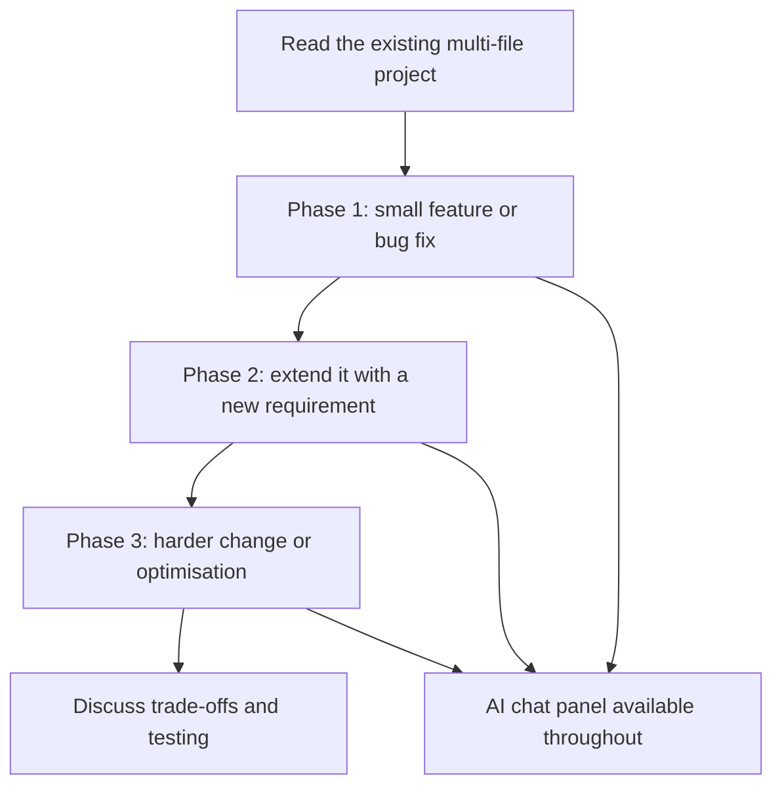
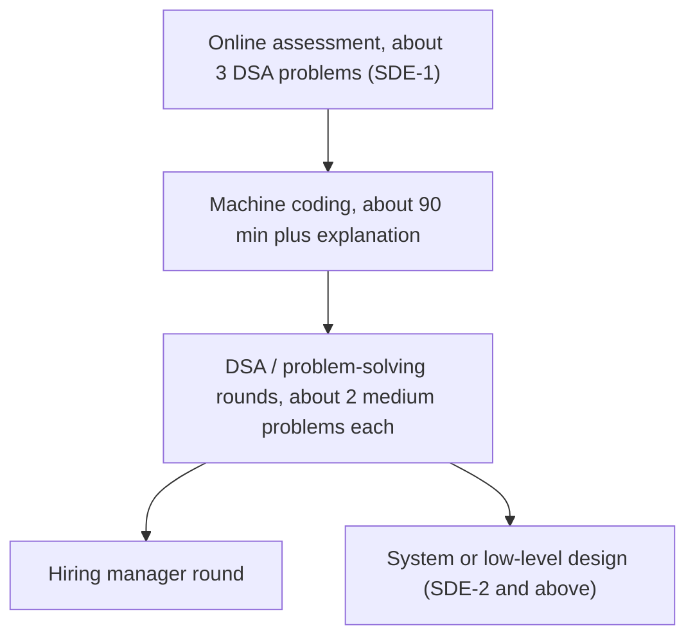
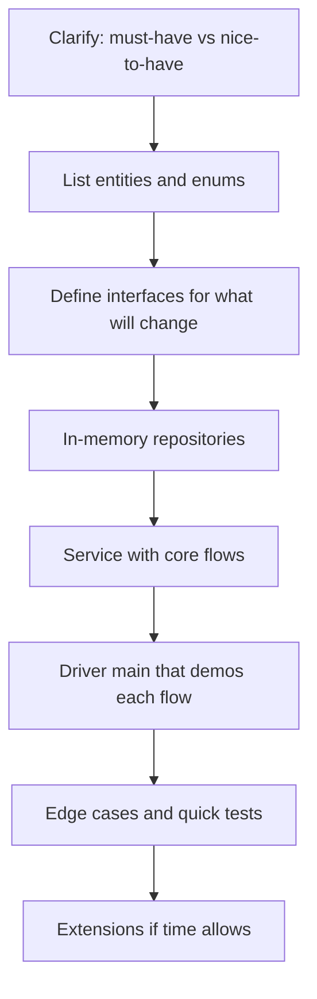
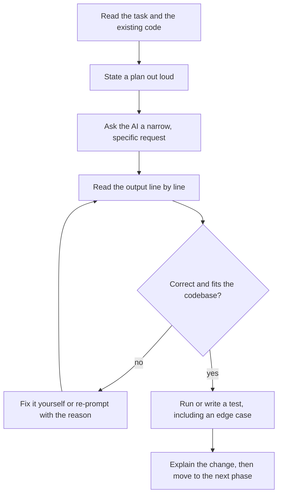

# Company-Wise Coding Questions

[⬅ Back to index](../README.md)

Covers: how coding rounds differ across product companies — format, difficulty, favourite patterns and frequently reported problems — based on public candidate reports, plus how to tailor your preparation for each.

---

> Everything in this file comes from public candidate reports (interview forums, blog write-ups, recruiter prep emails shared online). Formats change often, differ by team, level and country, and your recruiter's description always wins. Treat this as "what to expect and how to prepare", not as official policy.

## Big tech

### 1. What are Google coding rounds like?

**📘 Concept** · ⭐ Product/FAANG favourite

<details>
<summary>Answer</summary>

**In short:** Google is commonly reported to run one or two phone/virtual screens and then an onsite loop where, for L3/L4 software roles, about two rounds are pure coding (around 45 minutes each, usually one problem with follow-ups), plus behavioural ("Googleyness") and sometimes design. Interviewers write structured feedback on algorithms, coding, communication and testing, and a separate committee decides. Candidates report that **clean, correct code and how you handle follow-ups** matter more than speed. Recent reports also mention a return to in-person onsites for many US roles and a 2026 pilot of an AI-assisted code-comprehension round on some teams.

#### Typical shape of the process (as reported)

| Stage | What candidates describe |
|---|---|
| Recruiter call | Level, team area, timeline; sometimes a short prep guide |
| Technical screen | 45 min, one or two problems, shared doc or online editor |
| Onsite / virtual onsite | Usually 4-5 interviews; for L3/L4 typically ~2 coding, 1 behavioural, others coding or design depending on level |
| Hiring committee | Reads written feedback from every interviewer; no single interviewer decides |
| Team matching | Often after the committee approves |

#### What a coding round feels like

1. The problem is often stated vaguely on purpose. Asking clarifying questions is part of the grade (see [How Coding Interviews Work](01-coding-interviews-overview.md)).
2. You get one main problem, then follow-ups that change a constraint: "what if the input doesn't fit in memory?", "what if this is called a million times?", "can you do it in O(1) space?".
3. Historically the editor had no autocomplete and no code execution, so you were expected to dry-run your own code. Assume this unless told otherwise.

#### Patterns candidates report most

- **Graphs** (BFS/DFS on grids, topological sort, union-find) — [Graphs](16-graphs-bfs-dfs-topo.md), [Advanced Graphs](17-advanced-graphs.md)
- **Dynamic programming** — [Dynamic Programming](19-dynamic-programming.md)
- **Intervals and sweep line** — [Prefix Sums & Intervals](09-prefix-sums-intervals.md)
- **Binary search on the answer** — [Binary Search](10-binary-search.md)
- **Design-style data structures** (iterators, caches, "implement X") — [Design-Style Coding](22-design-style-coding.md)

Google is known for problems that are *not* direct LeetCode copies but variations, so pattern recognition ([Pattern Recognition](04-pattern-recognition.md)) pays off more than memorising problem lists.

#### Reported recent changes (hedged)

- **In-person onsites:** several reports from 2025 onward say Google moved many US roles back to at least one in-person round, partly to reduce cheating with AI tools. Ask your recruiter whether yours is in person.
- **AI-assisted code comprehension pilot:** candidate reports describe a pilot starting around May 2026, on select teams only, where you read and reason about existing code with access to Gemini, rather than writing a solution from scratch. It is not reported as universal. See [question 15](#15-what-should-you-do-in-an-ai-assisted-coding-round) for how to behave in such a round.

#### How to prepare specifically

- Practise writing code in a plain editor with no run button, then dry-running it with a small example.
- After solving any practice problem, ask yourself two follow-ups: "what if it's streaming?" and "what if it's 100× larger?".
- Name your variables well and extract helper functions — readability is explicitly reported as part of the "coding" score.
- Always state complexity unprompted ([Complexity Analysis](02-complexity-analysis.md)).

#### Common mistakes

- Racing to code before agreeing on the problem, then solving the wrong variant.
- Treating the first working solution as the end — the follow-ups are where strong hire signals come from.
- Skipping tests: interviewers commonly note whether you found your own bugs.

</details>

### 2. What are Meta coding rounds like?

**📘 Concept** · ⭐ Product/FAANG favourite

<details>
<summary>Answer</summary>

**In short:** Meta's classic coding round is reported as **two problems in about 35-45 minutes of coding time**, usually LeetCode medium (sometimes one easy plus one medium), and speed plus bug-free code is the main differentiator. Since roughly October 2025, candidates report that **one of the two onsite coding rounds was replaced by a 60-minute AI-enabled round** in CoderPad: a small multi-file project worked through in phases, with an AI chat panel, graded on how well you understand, verify and steer the AI's output rather than how fast you type.

#### Classic coding round

| Aspect | What candidates report |
|---|---|
| Length | 45 min total; ~5 min intro, ~35-40 min for two problems, a few minutes for questions |
| Difficulty | Mostly medium; problems are often well-known ones from Meta-tagged lists |
| Editor | CoderPad-style; code execution often not used or not allowed in the classic round |
| Grading | Problem solving, coding, verification (testing), communication |

Because you have about 15-20 minutes per problem, there is little time for discovering the idea live. Candidates widely report that Meta's question pool is fairly stable, which is why Meta-tagged practice lists are so popular.

Patterns reported most: arrays/strings with hash maps ([Arrays, Strings & Hashing](07-arrays-strings-hashing.md)), two pointers ([Two Pointers](08-two-pointers-sliding-window.md)), binary trees ([Trees](14-trees-bst.md)), BFS/DFS ([Graphs](16-graphs-bfs-dfs-topo.md)), heaps ([Heaps](13-heaps-priority-queues.md)), and intervals. Heavy DP is less often reported than at Google.

#### The AI-enabled round (reported since ~late 2025)



What candidates describe:

- About 60 minutes, in CoderPad, with a starter project spread over several files.
- Tasks come in phases; you are not expected to finish every phase.
- An AI assistant is available in a side panel. Using it is allowed; blindly pasting its output is what hurts you.
- The interviewer watches whether you can read unfamiliar code, explain what the AI produced, catch its mistakes, and test the result.

#### How to prepare

- **Classic round:** drill medium problems against a 20-minute timer, two in a row. Practise writing code correctly the first time, and the habit of a quick 3-case dry run after each problem.
- **AI round:** practise on a small real codebase: read it, add a feature with an AI assistant, and force yourself to explain every line it generated before accepting it. Practise writing quick tests. See [question 15](#15-what-should-you-do-in-an-ai-assisted-coding-round).
- Prepare the behavioural round too — Meta weighs it heavily for levelling.

#### Common mistakes

- Spending 30 minutes on problem one and rushing problem two.
- Optimal-but-buggy code: at Meta's pace, a correct simpler solution with clear reasoning often beats a broken clever one.
- In the AI round, letting the assistant drive. The signal is your judgment, not the tool's.

</details>

### 3. What are Amazon coding rounds like?

**📘 Concept** · ⭐ Product/FAANG favourite

<details>
<summary>Answer</summary>

**In short:** Amazon is commonly reported to start with an **online assessment**: about two DSA problems plus a work-style / personality assessment tied to the Leadership Principles (some candidates also report a repo-based, AI-assisted task in newer OAs). The loop is then usually **3-5 interviews of about an hour**, and almost every one mixes a coding or design question with **Leadership Principles (LP) behavioural questions**. Problems are typically medium, with trees, graphs, hash maps and heaps reported often.

#### The online assessment (as reported)

| Part | What candidates describe |
|---|---|
| Coding | ~2 problems, timed (often around 90 minutes total), auto-graded on hidden test cases |
| Work style | Situational/personality questions — "which would you rather do" — scored against the LPs |
| Sometimes | A work-simulation section, or a newer task working in a small repo with AI help |

Because the OA is auto-graded, **passing all hidden tests matters**. Edge cases (empty input, duplicates, large values) cost more here than in a live round. See [How Coding Interviews Work](01-coding-interviews-overview.md) for OA strategy.

#### The loop

- Each interviewer is reportedly assigned some Leadership Principles to probe. Expect 15-25 minutes of "tell me about a time..." in each round, then coding.
- One interviewer is a **Bar Raiser** from another team, who has strong influence on the decision.
- Coding problems are usually medium: [Trees](14-trees-bst.md) (level order, LCA, serialise), [Graphs](16-graphs-bfs-dfs-topo.md) (number of islands, rotting oranges, course schedule), [Heaps](13-heaps-priority-queues.md) (top K, K closest points), [hash maps](07-arrays-strings-hashing.md), and design-style problems such as LRU Cache ([Design-Style Coding](22-design-style-coding.md)).
- SDE-2 and above usually add system design; SDE-1 loops sometimes include a low-level/object-oriented design question.

#### Why LPs matter as much as code

A candidate who solves every problem but gives weak LP stories can be rejected. Prepare 8-10 stories in STAR format (Situation, Task, Action, Result), each reusable for several principles — for example "Customer Obsession", "Ownership", "Dive Deep", "Deliver Results", "Disagree and Commit". Use "I", not "we", and include measurable results.

#### How to prepare specifically

- Solve Amazon-tagged medium problems with a 30-35 minute limit (you lose time to LPs).
- For the OA, practise on an auto-graded platform and always test edge cases before submitting.
- Write clean, modular code — Amazon interviewers often ask "how would you extend this?".

#### Common mistakes

- Treating the behavioural part as small talk.
- Running out of time on code because the LP discussion ran long — keep stories to 2-3 minutes.
- Submitting OA code that passes the samples but fails on empty or very large inputs.

</details>

### 4. What are Microsoft coding rounds like?

**📘 Concept**

<details>
<summary>Answer</summary>

**In short:** Microsoft is commonly reported to have a more **team-driven** process than Google or Meta: an online assessment or phone screen, then a loop of about 3-5 interviews, each typically mixing a coding problem with discussion of your past work. Problems are usually easy-to-medium classics (strings, arrays, linked lists, trees), and interviewers reportedly care about **working code, edge cases and clear communication** more than exotic algorithms. An "as appropriate" (AA) interviewer, a senior person, often has the final say.

#### Typical shape (as reported)

| Stage | What candidates describe |
|---|---|
| Screen | OA on an auto-graded platform (more common for new grads) or a recruiter + technical phone screen |
| Loop | 3-5 rounds, ~45-60 min each, often all on one day |
| Final round | Often with a senior "as appropriate" interviewer who may combine coding, design and culture fit |

Since hiring is often for a specific team, the content varies: an Azure infrastructure team might ask concurrency questions, while an Office or mobile team might ask more practical coding.

#### Patterns reported most

- **Strings and arrays** — reversing words, parsing, string compression ([Arrays, Strings & Hashing](07-arrays-strings-hashing.md))
- **Linked lists** — reverse, merge, detect cycle ([Linked Lists](12-linked-lists.md))
- **Trees** — traversal, LCA, validate BST ([Trees](14-trees-bst.md))
- **Matrix problems** — spiral order, rotate image
- Occasional **design-style** classes such as LRU Cache ([Design-Style Coding](22-design-style-coding.md))

#### What tends to be valued

- Asking about inputs and edge cases (null, empty, Unicode) before coding.
- Code that compiles in your head — Microsoft rounds historically leaned towards whiteboard-style correctness.
- Talking about testing: candidates are sometimes asked "how would you test this function?", and listing categories (normal, boundary, invalid, performance) is the expected answer shape. See [How Coding Interviews Work](01-coding-interviews-overview.md).

#### How to prepare

- Do a broad sweep of easy/medium classics in each core data structure rather than deep hard-problem practice.
- Prepare a 2-minute walkthrough of your most significant project; it often comes up in every round.
- Practise explaining how you'd test a function you just wrote.

#### Common mistakes

- Assuming it's easier and under-preparing — the bar on clean, bug-free code is still high.
- Forgetting null/empty checks in linked-list and tree problems.

</details>

### 5. What are Apple coding rounds like?

**📘 Concept**

<details>
<summary>Answer</summary>

**In short:** Apple has no single company-wide format — candidates consistently report that **each team runs its own process**. Expect a recruiter call, one or two technical screens, then a loop of several interviews with the hiring team. Coding questions are often **practical and tied to the team's domain** (for iOS roles: Swift, memory management, concurrency, UI behaviour) rather than pure LeetCode, though classic DSA problems still appear. Deep knowledge of the platform you'd work on matters more than at most companies.

#### Why it varies so much

Apple hires into specific teams, and the hiring manager largely shapes the loop. A Core OS team might ask C/C++ and bit manipulation; a Maps team graph problems; an app team practical Swift code. Ask your recruiter: "What will the technical rounds focus on, and which language should I use?"

#### What candidates report seeing

| Round type | Example content |
|---|---|
| Classic DSA | Medium problems: strings, arrays, trees, hash maps, sometimes graphs |
| Practical coding | Implement a small feature, parse data, build a cache, debounce a function |
| Language / platform deep dive | Swift value vs reference types, ARC and retain cycles, GCD vs Swift concurrency, collection performance |
| Code review / debugging | Find the bugs in a given snippet |
| Project deep dive | Detailed questions about something you built |

#### How to prepare

- **Know your language deeply.** For iOS: Swift's `String` and `Character` model, copy-on-write collections, `weak`/`unowned`, actors and `async/await`. See [Kotlin & Swift for Coding Interviews](03-kotlin-swift-for-interviews.md).
- Practise **mobile-flavoured problems** — image cache, rate limiter, debouncing, diffing lists — in [Mobile-Flavoured Coding](23-mobile-flavoured-coding.md) and [Design-Style Coding](22-design-style-coding.md).
- Still cover the DSA core: [Arrays & Hashing](07-arrays-strings-hashing.md), [Trees](14-trees-bst.md), [Graphs](16-graphs-bfs-dfs-topo.md).
- Prepare to explain why you want *this* team — Apple interviewers are reported to probe product passion and attention to detail.

#### Common mistakes

- Preparing only LeetCode and getting caught by platform questions.
- Writing Swift that is technically correct but not idiomatic (force unwraps everywhere, ignoring value semantics).

</details>

### 6. What are Uber coding rounds like?

**📘 Concept**

<details>
<summary>Answer</summary>

**In short:** Uber is commonly reported to use an online assessment or phone screen with medium-to-hard DSA, then an onsite with **algorithmic coding, a "depth in specialisation" round, system design (for mid-level and above) and behavioural**. Problems frequently have a **real-world, map-or-dispatch flavour** — graphs, grids, intervals, heaps — and candidates report that Uber's DSA difficulty sits at the harder end among product companies. Some loops include a **practical/machine-coding style round** where you build a small working component.

#### What candidates describe

| Round | Typical content |
|---|---|
| OA / screen | 1-3 timed problems, often medium-hard; auto-graded on some platforms |
| Algorithms | Graphs (shortest path, BFS on a grid), heaps, intervals, sometimes DP |
| Practical / machine coding | Build something that runs — a rate limiter, a key-value store, a parser — with clean structure |
| Specialisation | Domain-specific depth: mobile architecture for mobile roles, distributed systems for backend |
| Behavioural | Collaboration, ownership, conflict |

#### Why the flavour matters

Uber's product is about locations, matching and time windows, so problems are often framed as "drivers and riders", "trips on a timeline" or "cities connected by roads". Underneath they map to familiar patterns:

- "Nearest K drivers" → heap or quickselect ([Heaps](13-heaps-priority-queues.md))
- "Cheapest route with at most K stops" → modified Bellman-Ford / BFS ([Advanced Graphs](17-advanced-graphs.md))
- "How many cars are on the road at peak time?" → sweep line ([Prefix Sums & Intervals](09-prefix-sums-intervals.md))
- "Evaluate a dependency / ordering" → topological sort ([Graphs](16-graphs-bfs-dfs-topo.md))

The skill being tested is translating a story into the pattern — practise that with [Pattern Recognition](04-pattern-recognition.md).

#### How to prepare

- Do a solid block of graph and heap problems, including Dijkstra and topological sort.
- Practise one or two 60-minute "build a working component" exercises with tests (see [question 14](#14-how-do-you-approach-a-machine-coding-round)).
- For mobile roles, revise app architecture and offline/caching patterns ([Mobile-Flavoured Coding](23-mobile-flavoured-coding.md)).

#### Common mistakes

- Getting lost in the story and missing that it's a standard pattern.
- Under-preparing for hard graph problems.

</details>

### 7. What are Netflix-style practical coding rounds like?

**📘 Concept**

<details>
<summary>Answer</summary>

**In short:** Netflix and similar "senior-heavy" companies (and many late-stage startups) are commonly reported to favour **practical coding over puzzle-style DSA**: build or extend something realistic, debug existing code, or design a component, often with the freedom to run code and look things up. Processes are highly **team-specific**, and the bar is about writing production-quality code, discussing trade-offs and showing judgment — the culture ("freedom and responsibility", candid feedback) is assessed as seriously as the code.

#### What "practical" usually means

| Format | Example tasks reported |
|---|---|
| Build a small component | An in-memory cache with TTL, a rate limiter, a simple job scheduler, an event emitter |
| Extend existing code | Add a feature to a provided project; fix failing tests |
| Data processing | Parse logs, aggregate viewing events, compute top-N titles |
| Concurrency | Thread-safe counter, producer/consumer, retry with backoff |
| Take-home | Occasionally a small project reviewed in a follow-up call |

DSA still appears — you need hash maps, heaps, sorting and basic graph traversal to build these well — but the problems are rarely the "trick" kind.

#### What is graded

- **Working, readable code** with sensible names, small functions and clear structure.
- **Testing**: do you write a few quick tests or at least a `main` that exercises edge cases?
- **Trade-offs**: why a `LinkedHashMap` for LRU, why a lock vs an atomic, what happens under load.
- **Communication with a peer**: interviewers often act like a teammate, not an examiner.

#### How to prepare

- Build a handful of components from [Design-Style Coding](22-design-style-coding.md) end to end in 45-60 minutes each, including tests.
- Practise reading unfamiliar code quickly and adding a feature to it.
- Revise concurrency basics in your language ([Kotlin & Swift for Coding Interviews](03-kotlin-swift-for-interviews.md)).
- Read the company's published culture memo, if it has one, and prepare stories that match it.

#### Common mistakes

- Over-engineering: adding interfaces and patterns no one asked for instead of shipping something that works.
- Not running or testing the code when you're allowed to.
- Treating "practical" as "easy" — the bar on quality is high.

</details>

## Indian product companies

### 8. What are Flipkart coding rounds like?

**📘 Concept**

<details>
<summary>Answer</summary>

**In short:** Flipkart is commonly reported to run a **machine coding round** (about 90 minutes to build a working, extensible low-level design in your language, followed by a code walkthrough and explanation), plus **DSA rounds** with about two medium problems each (DP and trees come up often), a hiring-manager round, and design for senior roles. For SDE-1 the process often starts with an **online assessment of about three DSA problems**. Machine coding is frequently the round that decides the outcome.

#### Typical shape (as reported)



The order varies; some candidates report machine coding first as an elimination round.

#### The machine coding round

You get a problem statement such as a parking lot, a ride-sharing backend, a splitwise-style expense sharer, a library management system, an event booking system or a snake-and-ladder game. Typical expectations reported:

- **Working code** you can demo through a driver/`main` or simple command inputs — no UI, no database, in-memory storage only.
- **Clean separation**: models, services, repositories/stores, and strategies for things likely to change.
- **Extensibility**: the evaluator later asks "how would you add X?", and a good design makes it a small change.
- **Explanation**: after time is up you walk through the code; expect probing on why you chose each abstraction.

The approach is covered step by step in [question 14](#14-how-do-you-approach-a-machine-coding-round).

#### The DSA rounds

Problems are commonly reported as medium, sometimes hard, with a heavy share of [Dynamic Programming](19-dynamic-programming.md) and [Trees](14-trees-bst.md), plus graphs and binary search. Interviewers often want brute force first, then optimisation, then code — and dry runs on paper.

#### How to prepare

- Build 4-6 machine coding problems end to end under a 90-minute timer, then do a mock explanation of each.
- Revise SOLID principles and a few patterns that fit naturally (Strategy, Factory, Observer) — use them only where they help.
- For DSA: DP on strings/arrays, tree recursion, and graph BFS/DFS.

#### Common mistakes

- Code that doesn't run at the end of 90 minutes. Working and simple beats elegant and incomplete.
- Putting everything in one class, or over-abstracting with interfaces for everything.
- Not leaving 10 minutes to test the main flows.

</details>

### 9. What are Swiggy and Zomato coding rounds like?

**📘 Concept**

<details>
<summary>Answer</summary>

**In short:** Food-delivery companies such as Swiggy and Zomato are commonly reported to run an **online assessment or DSA screen, then problem-solving rounds with medium problems, often a machine coding or low-level design round, and a hiring-manager/culture round**. Problems and design tasks frequently carry a **delivery-domain flavour** — orders, restaurants, delivery partners, time slots, nearest assignment — which map to heaps, intervals, graphs and hash maps.

#### What candidates describe

| Round | Typical content |
|---|---|
| OA / screen | 2-3 DSA problems, easy to medium-hard |
| Problem solving | Medium problems: arrays, hash maps, sliding window, trees, graphs, sometimes DP |
| Machine coding / LLD | Build a small working system: food ordering, delivery assignment, restaurant rating, cart and offers |
| Hiring manager | Past projects, ownership, why this company |
| Design (senior) | Systems such as order tracking, notifications, search |

#### Domain-flavoured problems and their patterns

- "Assign the nearest free delivery partner" → heap or sorted structure ([Heaps](13-heaps-priority-queues.md))
- "Maximum orders that overlap in time" → sweep line ([Prefix Sums & Intervals](09-prefix-sums-intervals.md))
- "Top K restaurants by rating in a city" → heap + hash map
- "Minimum time to deliver across a city grid" → BFS ([Graphs](16-graphs-bfs-dfs-topo.md))

#### How to prepare

- Cover the medium core: [Sliding Window](08-two-pointers-sliding-window.md), [Hashing](07-arrays-strings-hashing.md), [Trees](14-trees-bst.md), [Graphs](16-graphs-bfs-dfs-topo.md).
- Do two or three delivery-flavoured machine coding exercises (order lifecycle with states, assignment strategy, pricing with pluggable offers).
- For mobile roles, expect app-architecture questions and possibly a small Android/iOS practical — see [question 12](#12-how-do-mobile-role-coding-rounds-differ-at-these-companies).

#### Common mistakes

- Ignoring state transitions (placed → accepted → picked up → delivered) in LLD problems; modelling them explicitly with an enum or state machine is a strong signal.
- Hard-coding the assignment or pricing logic instead of making it a strategy.

</details>

### 10. What are PhonePe, Razorpay and CRED coding rounds like?

**📘 Concept**

<details>
<summary>Answer</summary>

**In short:** Fintech product companies like PhonePe, Razorpay and CRED are commonly reported to rely heavily on **machine coding plus DSA**. PhonePe in particular is reported to **start with a machine coding round**, often used as an elimination step, followed by DSA/problem-solving and design rounds. Across these companies, expect working, extensible, well-tested code, and expect correctness questions specific to money: **idempotency, concurrency, precision and auditability**.

#### What candidates describe

| Company | Reported emphasis |
|---|---|
| PhonePe | Machine coding first (working code in ~90-120 min, then a review), then DSA rounds (medium-hard), then design and hiring manager |
| Razorpay | Machine coding / LLD and DSA; practical problems around payments, retries, webhooks; strong focus on code quality |
| CRED | DSA + machine coding or practical rounds; high bar on clean design and product thinking |

Formats vary by role and year — confirm with the recruiter.

#### Typical fintech machine coding problems

- A wallet system: add money, transfer, transaction history, reversals.
- A splitwise-style expense sharer with balance simplification.
- A rate limiter or retry-with-backoff wrapper for an API.
- A coupon/rewards engine with pluggable rules.
- An in-memory payment-status tracker with a state machine.

#### Money-specific things interviewers listen for

- **No floating point for money.** Use `Long` minor units (paise/cents) or `BigDecimal`.
- **Idempotency:** a retried "transfer" request with the same ID must not move money twice — keep a map of processed request IDs.
- **Atomicity and concurrency:** two transfers from the same wallet at once must not overdraw it; mention locking (e.g. `synchronized` or per-account locks in a fixed order to avoid deadlock).
- **Audit trail:** store immutable transaction records, not just balances.

#### How to prepare

- Build a wallet and an expense-sharing app end to end under time pressure ([question 14](#14-how-do-you-approach-a-machine-coding-round)).
- DSA: medium-hard coverage of [Graphs](16-graphs-bfs-dfs-topo.md), [Dynamic Programming](19-dynamic-programming.md), [Heaps](13-heaps-priority-queues.md) and [Binary Search](10-binary-search.md).
- Practise explaining thread-safety choices in Kotlin/Java ([Kotlin & Swift for Coding Interviews](03-kotlin-swift-for-interviews.md)).

#### Common mistakes

- Using `Double` for amounts.
- Ignoring failure paths (insufficient balance, unknown user, duplicate request).
- Not having a runnable demo when the machine coding time ends.

</details>

### 11. What are Zerodha and smaller startups' coding rounds like?

**📘 Concept**

<details>
<summary>Answer</summary>

**In short:** Zerodha and many smaller product startups are commonly reported to skip the LeetCode-heavy loop in favour of **practical evaluation**: a take-home assignment or a live "build something real" task, followed by a deep conversation about your code, your past work and the fundamentals behind it. What matters is whether you can **ship clean, working software and reason about it** — small teams hire people who will own systems on day one.

#### Formats candidates describe

| Format | What it looks like |
|---|---|
| Take-home | A small app or service in a few days: e.g. a CLI that parses and aggregates data, a small API, a mobile screen with offline caching |
| Live practical | 60-90 min building or extending something, with the internet and your own IDE allowed |
| Code walkthrough | Explaining your take-home or an open-source project line by line, then changing it live |
| Fundamentals chat | Networking, databases, OS basics, language internals — "how does this actually work?" |
| Light DSA | Occasionally one easy/medium problem, usually practical (parsing, hash maps, sorting) |

Zerodha in particular is publicly known for valuing open-source work and a strong engineering culture; candidates report conversations that dig into what you have built rather than puzzle rounds. Smaller startups vary widely — some copy big-tech loops, others are a single founder conversation plus a take-home.

#### What is graded in a take-home

- **It works** out of the box with a README explaining how to run it.
- **Structure**: sensible packages, small functions, no dead code.
- **Tests** for the core logic.
- **Judgment**: you solved the stated problem without gold-plating, and you can explain the trade-offs you skipped.
- **Ownership signals**: error handling, input validation, logging where it matters.

#### How to prepare

- Keep one or two polished personal or open-source projects you can walk through in depth.
- Practise a 2-3 hour take-home under realistic limits; then review it as if you were the interviewer.
- Revise fundamentals you claim on your CV — every line can be probed.
- Keep DSA basics warm ([Arrays & Hashing](07-arrays-strings-hashing.md), [Design-Style Coding](22-design-style-coding.md)) because some startups still include one problem.

#### Common mistakes

- Spending a week on a take-home meant to take 3 hours — or over-engineering it with microservices.
- Being unable to explain code you submitted (especially if an AI tool wrote parts of it).
- Ignoring the README and setup instructions.

</details>

## Preparing for a specific company

### 12. How do mobile-role coding rounds differ at these companies?

**📘 Concept**

<details>
<summary>Answer</summary>

**In short:** At most big tech companies, **mobile engineers get the same DSA coding rounds as everyone else**, then replace or add rounds for mobile system design and platform knowledge. At Indian product companies and startups, mobile loops are more often **practical**: machine coding of a small app or component, Android/iOS deep dives and app architecture. The DSA bar for mobile roles is reported to be similar at FAANG and sometimes slightly lighter elsewhere — but rarely absent.

#### How it typically varies (as reported)

| Company type | DSA coding | Mobile-specific rounds |
|---|---|---|
| Google | Same generic coding rounds; any language (Kotlin/Java or Swift is fine) | Sometimes an Android/iOS domain round; mobile design for senior levels |
| Meta | Same two-problem coding rounds (and the AI-enabled round where used) | Mobile system design replaces backend system design for mobile ("product architecture"-style) |
| Amazon | Same OA and coding, plus LPs | Design round is often mobile-flavoured for mobile roles |
| Apple | Mixed DSA and very platform-specific practical coding | Deep Swift/UIKit/SwiftUI or Android-equivalent questions |
| Uber, Netflix-style | DSA plus practical | Mobile architecture, offline, performance |
| Flipkart, Swiggy, PhonePe, CRED and similar | DSA rounds (sometimes lighter) | Machine coding of an app or component, Android/iOS internals, app architecture |
| Startups | Light DSA | Take-home app, code walkthrough |

#### What "mobile-flavoured" coding looks like

Problems that are still DSA but framed in app terms — covered in [Mobile-Flavoured Coding](23-mobile-flavoured-coding.md):

- An LRU image cache with a size limit
- Debounce or throttle user input
- Diff two lists to compute RecyclerView/UITableView updates
- Paginate and merge feeds, deduplicate items
- Retry with exponential backoff, rate limiting
- Parse a JSON-like or deep-link string

#### What changes in how you're graded

- **Language idioms count more.** Mobile interviewers notice whether your Kotlin/Swift is idiomatic. Know the collection APIs, heaps and deques in your language — [Kotlin & Swift for Coding Interviews](03-kotlin-swift-for-interviews.md).
- **Threading.** Expect "is this thread-safe?" and "where does this run — main thread or background?" follow-ups.
- **Memory and lifecycle.** Retain cycles, leaking activities/view controllers, cache eviction.

#### How to prepare

- Do the same DSA core as backend candidates (it's usually the same round), then add 5-10 mobile-flavoured problems.
- Practise one or two machine coding tasks in plain Kotlin/Swift (no UI) — many Indian companies accept a console-driven solution.
- Prepare mobile system design separately; it is outside this repo's scope.

#### Common mistakes

- Assuming "mobile" means no DSA and skipping trees and graphs.
- Writing Java-style Kotlin or Objective-C-style Swift.

</details>

### 13. Which problems are frequently reported at each company?

**📘 Concept**

<details>
<summary>Answer</summary>

**In short:** Public candidate reports and company-tagged practice lists show recurring favourites per company, but they shift every year and are a **sample, not a syllabus**. Use the table below to calibrate the *style* and *difficulty* each company likes, then make sure you know the underlying pattern so a variation doesn't throw you. All of these are well-known problems that candidates commonly report; none is guaranteed.

#### Frequently reported problems (illustrative, hedged)

| Company | Problems commonly reported by candidates | Patterns behind them |
|---|---|---|
| Google | Number of Islands, Merge Intervals, Meeting Rooms II, Word Ladder, Longest Increasing Path in a Matrix, Median of Two Sorted Arrays | [Graphs](16-graphs-bfs-dfs-topo.md), [Intervals](09-prefix-sums-intervals.md), [Binary Search](10-binary-search.md), [DP](19-dynamic-programming.md) |
| Meta | Valid Palindrome II, Minimum Remove to Make Valid Parentheses, Binary Tree Vertical Order Traversal, Lowest Common Ancestor of a Binary Tree, Kth Largest Element in an Array, Subarray Sum Equals K, Random Pick with Weight, Basic Calculator II | [Two Pointers](08-two-pointers-sliding-window.md), [Stacks](11-stacks-queues-monotonic.md), [Trees](14-trees-bst.md), [Heaps](13-heaps-priority-queues.md), [Prefix Sums](09-prefix-sums-intervals.md) |
| Amazon | Two Sum, Number of Islands, Rotting Oranges, LRU Cache, K Closest Points to Origin, Merge k Sorted Lists, Top K Frequent Words, Course Schedule | [Hashing](07-arrays-strings-hashing.md), [Graphs](16-graphs-bfs-dfs-topo.md), [Heaps](13-heaps-priority-queues.md), [Design-Style](22-design-style-coding.md) |
| Microsoft | Reverse Linked List, Reverse Words in a String, Spiral Matrix, Rotate Image, Validate Binary Search Tree, Serialize and Deserialize Binary Tree, String to Integer (atoi) | [Linked Lists](12-linked-lists.md), [Arrays & Strings](07-arrays-strings-hashing.md), [Trees](14-trees-bst.md) |
| Apple | LRU Cache, Merge Intervals, Group Anagrams, Valid Parentheses, plus team-specific practical tasks | [Design-Style](22-design-style-coding.md), [Hashing](07-arrays-strings-hashing.md) |
| Uber | Cheapest Flights Within K Stops, Bus Routes, Meeting Rooms II, Word Search II, Top K Frequent Elements | [Advanced Graphs](17-advanced-graphs.md), [Tries](15-tries-string-algorithms.md), [Heaps](13-heaps-priority-queues.md) |
| Flipkart and similar Indian product companies | DP classics (Coin Change, Longest Increasing Subsequence, Edit Distance), tree problems (Binary Tree Maximum Path Sum, LCA), Trapping Rain Water, plus machine coding (parking lot, splitwise, booking system) | [DP](19-dynamic-programming.md), [Trees](14-trees-bst.md), [question 14](#14-how-do-you-approach-a-machine-coding-round) |
| Fintech (PhonePe, Razorpay, CRED) | Graph and DP mediums, rate limiter, LRU cache; machine coding of a wallet, expense sharer or rewards engine | [Graphs](16-graphs-bfs-dfs-topo.md), [Design-Style](22-design-style-coding.md) |

#### How to use company-tagged lists well

1. **Sort by recency, not all-time.** A problem popular five years ago may be retired.
2. **Do the top 30-50 for your target company**, but after each, write one line: "the pattern was X because of signal Y" ([Pattern Recognition](04-pattern-recognition.md)).
3. **Solve one variant of each.** If you solved Meeting Rooms II, also try "maximum overlapping intervals with weights" — interviewers often tweak known problems.
4. **Don't memorise code.** Interviewers change a constraint precisely to detect memorised answers, and follow-ups expose it immediately.

#### Common mistakes

- Treating a tagged list as the entire syllabus and skipping core patterns.
- Grinding hundreds of tagged problems without reviewing the ones you failed.

</details>

### 14. How do you approach a machine coding round?

**📘 Concept** · ⭐ Product/FAANG favourite (commonly reported at Flipkart, PhonePe, Swiggy)

<details>
<summary>Answer</summary>

**In short:** A machine coding round (usually 60-120 minutes) asks you to build a **working, in-memory, extensible** solution to a low-level design problem — parking lot, splitwise, booking system — then demo and explain it. Win it by time-boxing: **clarify requirements (10 min) → model entities (10 min) → define interfaces and services (10 min) → implement core flows with in-memory storage (40-50 min) → demo and test (10-15 min)**, keeping things likely to change behind strategies. Working and readable beats clever and unfinished.

#### What evaluators check

| Criterion | What good looks like |
|---|---|
| Functionality | The core flows run end to end via a `main`/driver |
| Modelling | Entities match the domain; enums for fixed sets; clear ownership of state |
| Separation | Models, repositories (in-memory stores), services (business logic), strategies (pluggable rules) |
| Extensibility | Adding a new vehicle type, pricing rule or payment mode is a small, local change |
| Error handling | Invalid input and edge cases return clear errors instead of crashing |
| Readability | Good names, small functions, no god class |
| Explanation | You can justify every abstraction and say what you'd do with more time |

#### Step by step



1. **Clarify requirements.** Write a numbered list of must-have features and confirm it. Ask what's out of scope (persistence, UI, concurrency). Agree on input format — commands from stdin or a hard-coded driver.
2. **Model.** Nouns become classes (`Vehicle`, `Slot`, `Ticket`), fixed categories become enums, verbs become service methods.
3. **Interfaces where change is likely.** Pricing, allocation, notification, splitting rules — anything the interviewer might say "now add X" to. Not every class needs an interface.
4. **In-memory storage.** `HashMap`s behind small repository classes, so switching to a database would be local.
5. **Implement core flows first**, then less important ones. Commit to a working path early.
6. **Demo and test.** A driver that runs the main scenarios, plus failure cases (full lot, invalid ticket, duplicate entry).
7. **Extensions.** Only now add bonus features, or explain how you would.

#### Kotlin skeleton (parking lot)

```kotlin
enum class VehicleType { BIKE, CAR, TRUCK }

data class Vehicle(val plate: String, val type: VehicleType)

class Slot(val id: Int, val floor: Int, val type: VehicleType) {
    var vehicle: Vehicle? = null
    val isFree: Boolean get() = vehicle == null
}

data class Ticket(val id: String, val slotId: Int, val plate: String, val entryMinute: Long)

// Things likely to change sit behind interfaces
interface SlotAllocationStrategy {
    fun pick(freeSlots: List<Slot>, vehicle: Vehicle): Slot?
}

class NearestFirstStrategy : SlotAllocationStrategy {
    override fun pick(freeSlots: List<Slot>, vehicle: Vehicle): Slot? =
        freeSlots.filter { it.type == vehicle.type }
            .minWithOrNull(compareBy<Slot>({ it.floor }, { it.id }))
}

interface PricingStrategy {
    fun price(type: VehicleType, minutes: Long): Long // minor units, never Double
}

class HourlyPricing(private val ratePerHour: Map<VehicleType, Long>) : PricingStrategy {
    override fun price(type: VehicleType, minutes: Long): Long {
        val hours = maxOf(1L, (minutes + 59) / 60) // round up, minimum one hour
        return hours * (ratePerHour[type] ?: error("No rate for $type"))
    }
}

// In-memory storage, isolated so a database could replace it later
class InMemorySlotRepository(slots: List<Slot>) {
    private val byId = LinkedHashMap<Int, Slot>().apply { slots.forEach { put(it.id, it) } }
    fun freeSlots(): List<Slot> = byId.values.filter { it.isFree }
    fun get(id: Int): Slot = byId[id] ?: throw IllegalArgumentException("Unknown slot $id")
}

class ParkingService(
    private val slots: InMemorySlotRepository,
    private val allocation: SlotAllocationStrategy,
    private val pricing: PricingStrategy,
) {
    private val activeTickets = HashMap<String, Ticket>()
    private val parkedPlates = HashSet<String>()
    private var nextTicketNumber = 1

    fun park(vehicle: Vehicle, nowMinute: Long): Result<Ticket> {
        if (vehicle.plate in parkedPlates) {
            return Result.failure(IllegalStateException("${vehicle.plate} is already parked"))
        }
        val slot = allocation.pick(slots.freeSlots(), vehicle)
            ?: return Result.failure(IllegalStateException("No free ${vehicle.type} slot"))
        slot.vehicle = vehicle
        parkedPlates += vehicle.plate
        val ticket = Ticket("T${nextTicketNumber++}", slot.id, vehicle.plate, nowMinute)
        activeTickets[ticket.id] = ticket
        return Result.success(ticket)
    }

    fun unpark(ticketId: String, nowMinute: Long): Result<Long> {
        val ticket = activeTickets.remove(ticketId)
            ?: return Result.failure(IllegalArgumentException("Invalid ticket $ticketId"))
        val slot = slots.get(ticket.slotId)
        slot.vehicle = null
        parkedPlates -= ticket.plate
        return Result.success(pricing.price(slot.type, nowMinute - ticket.entryMinute))
    }
}

fun main() {
    val repo = InMemorySlotRepository(
        listOf(Slot(1, 0, VehicleType.CAR), Slot(2, 0, VehicleType.BIKE), Slot(3, 1, VehicleType.CAR))
    )
    val rates = mapOf(VehicleType.BIKE to 2_000L, VehicleType.CAR to 5_000L, VehicleType.TRUCK to 10_000L)
    val service = ParkingService(repo, NearestFirstStrategy(), HourlyPricing(rates))

    val ticket = service.park(Vehicle("KA01", VehicleType.CAR), nowMinute = 0).getOrThrow()
    println(ticket)                                                  // slot 1, the nearest car slot
    println(service.park(Vehicle("KA01", VehicleType.CAR), 5))       // Failure: already parked
    println(service.unpark(ticket.id, nowMinute = 90))               // Success(10000): 2 hours
    println(service.park(Vehicle("TR09", VehicleType.TRUCK), 100))   // Failure: no truck slot
}
```

Notice what the skeleton buys you when the interviewer asks for extensions:

- "Add a weekend pricing rule" → a new `PricingStrategy`, no change to `ParkingService`.
- "Fill top floors first" → a new `SlotAllocationStrategy`.
- "Make it thread-safe" → guard `park`/`unpark` with a lock (or `@Synchronized`), and explain why the check-then-assign in `park` is a race otherwise.
- "Persist it" → replace the repository.

#### Time-boxing tips

- Set a hard checkpoint at the halfway mark: if the core flow doesn't run yet, cut features.
- Write the driver early and grow it — it doubles as your test.
- Don't spend time on input parsing unless asked; a hard-coded driver is usually acceptable (confirm first).

#### Common mistakes

- Designing for 30 minutes and coding for 30 — then nothing runs.
- Interfaces for everything ("`IVehicleFactoryProvider`") — abstraction without a reason is penalised too.
- Using `Double` for money, or mutable state shared without any thought about concurrency.
- No validation: parking the same vehicle twice, unparking with an unknown ticket.

#### Follow-ups

- "How would you add concurrency?" → per-resource locks or a single lock around allocation; discuss contention.
- "How would you test this?" → unit tests per strategy plus service tests with a fake repository.
- More practice problems: [Design-Style Coding](22-design-style-coding.md) and [Mobile-Flavoured Coding](23-mobile-flavoured-coding.md).

</details>

### 15. What should you do in an AI-assisted coding round?

**📘 Concept**

<details>
<summary>Answer</summary>

**In short:** In rounds where an AI assistant is allowed — such as Meta's reported AI-enabled CoderPad round, Google's reported code-comprehension pilot, or some newer Amazon OA tasks — the signal is **your judgment, not the tool's output**. Read and understand the code first, use the AI for well-scoped tasks, **verify every suggestion** by reading and testing it, explain what it did and why it's correct, and stay in control of the plan. Candidates who paste output they can't explain reportedly do worse than those who barely use the tool.

#### What interviewers appear to be grading (from candidate reports)

| Signal | What it looks like in practice |
|---|---|
| Code comprehension | You can navigate an unfamiliar multi-file project and explain how it works |
| Problem decomposition | You break the task into steps before prompting |
| Verification | You read generated code, spot bugs, and run or write tests |
| Communication | You narrate what you asked the AI, what it returned, and what you changed |
| Ownership | You make the final decisions; the AI is a tool, not the driver |

#### A workflow that works



1. **Spend the first minutes reading**, not prompting. Find the entry point, the data model and the tests.
2. **Prompt narrowly**: "write a function that merges overlapping intervals in this `Interval` type" beats "solve phase 2".
3. **Review like a code reviewer**: off-by-one errors, null handling, wrong complexity, invented APIs that don't exist, ignoring an existing helper.
4. **Test**: run the existing tests, add one for the new behaviour, and try an edge case (empty input, duplicates).
5. **Explain** the final code as if you wrote it — because you are responsible for it.

#### Things AI assistants commonly get wrong in interview tasks

- Plausible-looking code with subtle off-by-one or boundary bugs.
- Solutions that are correct but O(n²) when O(n log n) is needed.
- Calling functions that don't exist in the provided codebase.
- Silently changing behaviour elsewhere in a file.

Your DSA knowledge is what lets you catch these, so the core patterns in this repo still matter — arguably more ([Complexity Analysis](02-complexity-analysis.md), [Pattern Recognition](04-pattern-recognition.md)). General round mechanics are in [How Coding Interviews Work](01-coding-interviews-overview.md).

#### How to prepare

- Practise on small real projects with an assistant, and make it a rule to explain each accepted suggestion aloud.
- Practise reading unfamiliar code quickly: pick an open-source file and summarise it in 2 minutes.
- Practise writing quick tests in your interview language.
- Confirm the rules with your recruiter: which tool, whether code execution is allowed, and whether the AI round replaces a classic round.

#### Common mistakes

- Prompting before understanding the code.
- Accepting a big generated block without reading it.
- Going silent while the AI works — narrate what you're doing.
- Over-trusting the AI's claims about complexity or correctness.

</details>

### 16. How do you tailor your preparation for a specific company in 2 weeks?

**📘 Concept**

<details>
<summary>Answer</summary>

**In short:** With two weeks, don't try to learn everything. **Find out the exact format** from your recruiter, **rank the patterns** that company is reported to favour, fill your weakest high-priority pattern first, then shift to **company-tagged problems under realistic conditions** (timer, editor, talking aloud), and spend real time on the non-coding rounds (behavioural, machine coding, design) that often decide the outcome.

#### Step 1: Gather facts (day 1)

Ask the recruiter:

- How many rounds, how long, and what type each is (DSA, machine coding, design, behavioural, AI-assisted)?
- Which editor/platform? Can I run code? Which languages?
- Is it in person or remote?
- Is there a prep guide?

Then read recent candidate reports for the same role and level, and note the 2-3 patterns that come up most (see [question 13](#13-which-problems-are-frequently-reported-at-each-company)).

#### Step 2: Plan the two weeks

| Days | Focus | Example for an Amazon SDE-2 mobile role |
|---|---|---|
| 1 | Format, gather the company's top patterns, take one timed baseline mock | Recruiter call; one 60-min mock |
| 2-5 | Weakest high-priority patterns: learn the template, solve 3-5 problems each | [Graphs](16-graphs-bfs-dfs-topo.md), [Heaps](13-heaps-priority-queues.md), [Trees](14-trees-bst.md) |
| 6-9 | Company-tagged problems, recent first, timed and talked aloud | 2-3 Amazon-tagged mediums per day in 30-35 min each |
| Evenings of days 3, 6 and 9 | Non-coding rounds | Write 8-10 LP stories in STAR format |
| 10-11 | Company-specific round type | Mobile system design; a design-style problem like LRU Cache |
| 12-13 | Full mock loops under real conditions | Two mocks with a friend or platform; review mistakes |
| 14 | Light review only | Re-read your notes and templates ([Reusable Templates](05-reusable-templates.md)); rest |

Swap the focus by company:

- **Google:** more graphs/DP and follow-up practice; plain-editor dry runs.
- **Meta:** two-problems-in-40-minutes drills; AI-round practice if your loop has one.
- **Flipkart / PhonePe / Indian product:** at least three full 90-minute machine coding builds ([question 14](#14-how-do-you-approach-a-machine-coding-round)) plus DP and trees.
- **Startups:** a polished take-home or project walkthrough.

#### Step 3: Practise the way you'll be tested

- Use the same kind of editor (no autocomplete if that's what you'll get).
- Use the language you'll interview in — see [Kotlin & Swift for Coding Interviews](03-kotlin-swift-for-interviews.md).
- Keep a **mistake log**: for every miss, write the pattern you didn't spot and the signal you should have noticed. Re-solve those problems on day 12-13.

#### Common mistakes

- Spending all 14 days on new problems and never doing a full mock.
- Ignoring behavioural/LP or machine coding rounds because they "aren't real coding".
- Cramming hard problems the night before instead of resting.

#### Follow-ups

- Longer runway? Use the 4-8 week plan in [How Coding Interviews Work](01-coding-interviews-overview.md).
- Multiple companies at once? Prepare the shared DSA core first, then do company-specific weeks in the order of your interview dates.

</details>

---

[⬅ Previous: Mobile-Flavoured Coding Problems](23-mobile-flavoured-coding.md) · [⬅ Back to index](../README.md)
